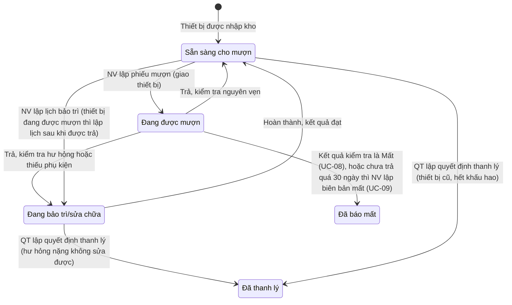
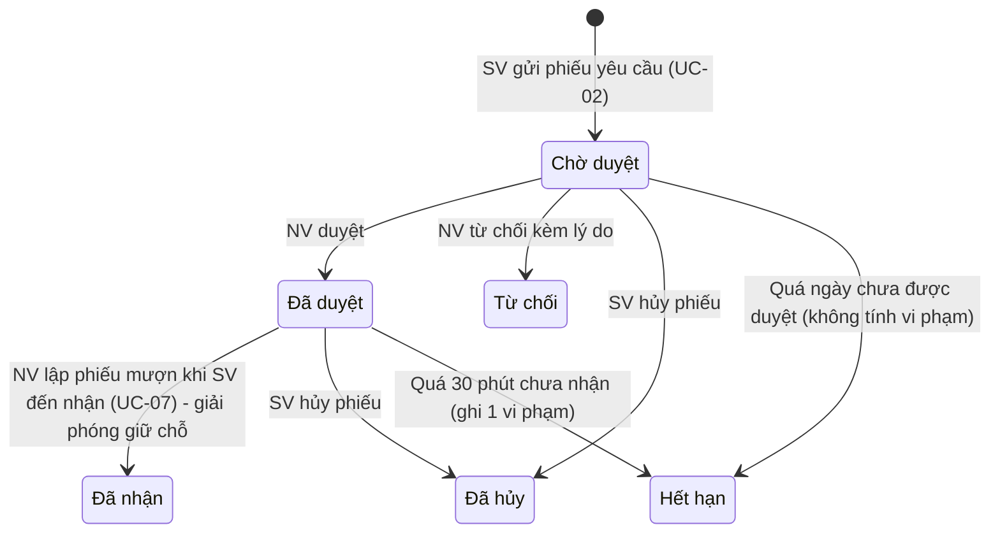
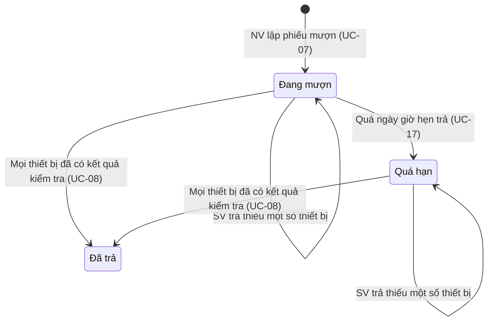
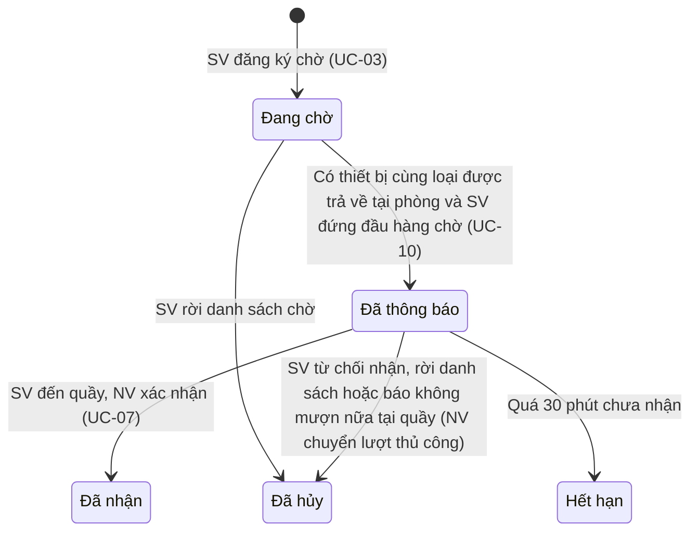

# TÀI LIỆU ĐẶC TẢ YÊU CẦU PHẦN MỀM (SRS)

## Hệ thống quản lý mượn trả thiết bị học tập cho sinh viên

| Mục | Nội dung |
|---|---|
| Trường / Khoa | Trường Đại học Công nghệ Thông tin – Khoa Công nghệ Phần mềm |
| Môn học | Đồ án môn Phát triển phần mềm hướng đối tượng |
| Nhóm | SE100 - Nhóm 13 |
| Sinh viên thực hiện | 24521007 – Nguyễn Phi Long; 24520993 – Trần Lê Đức Lợi; 24522050 – Nguyễn Đại Vương; 24520856 – Đinh Nhật Khôi; 24521692 – Nguyễn Huỳnh Quốc Thịnh |
| Ngày lập | 22/10/2026 |
| Căn cứ lập tài liệu | Hồ sơ phân tích v1.2 (19/10/2026); Mô hình Usecase v1.2 (20/10/2026); Biểu mẫu OOAD Nhóm 13; đề bài “Hệ thống quản lý mượn trả thiết bị học tập cho sinh viên” |

> Tài liệu này tổng hợp từ các tài liệu nguồn, không thêm yêu cầu mới ngoài 7 quyết định xử lý ĐX-01 đến ĐX-07 (mục [2.8](#28-quyết-định-xử-lý-bổ-sung-của-srs)). Các quyết định này là đề xuất của nhóm lập SRS cho những điểm nguồn chưa nêu rõ hoặc chưa thống nhất, được đánh dấu [ĐX-xx] ở nơi áp dụng. Mọi yêu cầu, quy tắc và số liệu còn lại đều có mã truy vết về tài liệu nguồn (FR, NFR, UC, US, BP, GL, EL, CR, SH). Các điểm nguồn chưa thống nhất được liệt kê ở [Phụ lục C](#phụ-lục-c-các-điểm-chưa-thống-nhất-trong-tài-liệu-nguồn-và-cách-xử-lý).

**Mục lục**

- [1. Giới thiệu](#1-giới-thiệu)
  - [1.1 Mục đích](#11-mục-đích)
  - [1.2 Phạm vi sản phẩm](#12-phạm-vi-sản-phẩm)
  - [1.3 Tài liệu tham chiếu](#13-tài-liệu-tham-chiếu)
  - [1.4 Từ viết tắt và ký hiệu](#14-từ-viết-tắt-và-ký-hiệu)
  - [1.5 Bố cục tài liệu](#15-bố-cục-tài-liệu)
- [2. Mô tả tổng quan](#2-mô-tả-tổng-quan)
  - [2.1 Bối cảnh và vấn đề](#21-bối-cảnh-và-vấn-đề)
  - [2.2 Mục tiêu, giải pháp và tiêu chí thành công](#22-mục-tiêu-giải-pháp-và-tiêu-chí-thành-công)
  - [2.3 Các bên liên quan](#23-các-bên-liên-quan)
  - [2.4 Tác nhân (Actor)](#24-tác-nhân-actor)
  - [2.5 Môi trường vận hành và giao diện bên ngoài](#25-môi-trường-vận-hành-và-giao-diện-bên-ngoài)
  - [2.6 Giả định, ràng buộc và phụ thuộc](#26-giả-định-ràng-buộc-và-phụ-thuộc)
  - [2.7 Mức ưu tiên](#27-mức-ưu-tiên)
  - [2.8 Quyết định xử lý bổ sung của SRS](#28-quyết-định-xử-lý-bổ-sung-của-srs)
- [3. Mô hình nghiệp vụ](#3-mô-hình-nghiệp-vụ)
  - [3.1 Từ điển miền](#31-từ-điển-miền)
  - [3.2 Quy trình nghiệp vụ](#32-quy-trình-nghiệp-vụ)
  - [3.3 Tham số và giá trị mặc định](#33-tham-số-và-giá-trị-mặc-định)
  - [3.4 Quy tắc nghiệp vụ](#34-quy-tắc-nghiệp-vụ)
  - [3.5 Công thức tính](#35-công-thức-tính)
- [4. Yêu cầu chức năng](#4-yêu-cầu-chức-năng)
  - [4.1 Danh sách use case](#41-danh-sách-use-case)
  - [4.2 Yêu cầu chức năng (FR)](#42-yêu-cầu-chức-năng-fr)
  - [4.3 Đặc tả use case](#43-đặc-tả-use-case)
  - [4.4 Sự kiện hệ thống (SSD)](#44-sự-kiện-hệ-thống-ssd)
- [5. Yêu cầu phi chức năng](#5-yêu-cầu-phi-chức-năng)
- [6. Mô hình dữ liệu miền](#6-mô-hình-dữ-liệu-miền)
  - [6.1 Danh sách lớp thực thể](#61-danh-sách-lớp-thực-thể)
  - [6.2 Ràng buộc kèm theo các quan hệ](#62-ràng-buộc-kèm-theo-các-quan-hệ)
  - [6.3 Miền giá trị của các thuộc tính trạng thái](#63-miền-giá-trị-của-các-thuộc-tính-trạng-thái)
- [7. Mô hình trạng thái](#7-mô-hình-trạng-thái)
  - [7.1 Thiết bị (ThietBi)](#71-thiết-bị-thietbi)
  - [7.2 Phiếu yêu cầu mượn (PhieuYeuCauMuon)](#72-phiếu-yêu-cầu-mượn-phieuyeucaumuon)
  - [7.3 Phiếu mượn (PhieuMuon)](#73-phiếu-mượn-phieumuon)
  - [7.4 Đăng ký chờ (DangKyCho)](#74-đăng-ký-chờ-dangkycho)
- [8. Mô hình động](#8-mô-hình-động)
  - [8.1 Sequence diagram](#81-sequence-diagram)
  - [8.2 Activity diagram](#82-activity-diagram)
- [9. Ma trận truy vết](#9-ma-trận-truy-vết)
  - [9.1 Use case → nguồn yêu cầu](#91-use-case--nguồn-yêu-cầu)
  - [9.2 Yêu cầu → use case](#92-yêu-cầu--use-case)
- [10. Nhật ký thay đổi yêu cầu](#10-nhật-ký-thay-đổi-yêu-cầu)
- [Phụ lục A. Đối chiếu đề bài gốc với yêu cầu đã chốt](#phụ-lục-a-đối-chiếu-đề-bài-gốc-với-yêu-cầu-đã-chốt)
- [Phụ lục B. Quan hệ giữa các lớp thực thể](#phụ-lục-b-quan-hệ-giữa-các-lớp-thực-thể)
- [Phụ lục C. Các điểm chưa thống nhất trong tài liệu nguồn và cách xử lý](#phụ-lục-c-các-điểm-chưa-thống-nhất-trong-tài-liệu-nguồn-và-cách-xử-lý)
- [Phụ lục D. Câu chuyện người dùng và tiêu chí chấp nhận](#phụ-lục-d-câu-chuyện-người-dùng-và-tiêu-chí-chấp-nhận)
- [Phụ lục E. Bản ghi thu thập yêu cầu](#phụ-lục-e-bản-ghi-thu-thập-yêu-cầu)

---

## 1. Giới thiệu

### 1.1 Mục đích

Tài liệu đặc tả các yêu cầu chức năng, yêu cầu phi chức năng, quy tắc nghiệp vụ và mô hình miền của **Hệ thống quản lý mượn trả thiết bị học tập cho sinh viên**, làm cơ sở thống nhất giữa các bên liên quan và nhóm phát triển cho các giai đoạn thiết kế, hiện thực và kiểm thử.

### 1.2 Phạm vi sản phẩm

Tên dự án: **Hệ thống quản lý mượn trả thiết bị học tập cho sinh viên**. Phạm vi và giải pháp được nêu trong Tầm nhìn dự án (Biểu mẫu P1_01):

**Trong phạm vi:** Quản lý thiết bị theo loại và từng đơn vị vật lý; tra cứu và đặt trước trên ứng dụng; đăng ký chờ, gia hạn; giao/nhận tại quầy; vi phạm, phí trả trễ, bồi thường; khóa/mở khóa quyền mượn; bảo trì, thanh lý; nhà cung cấp, bảo hành; thông báo tự động từ ứng dụng; tài khoản sinh viên của trường; phân quyền ba vai trò; báo cáo, thống kê.

**Ngoài phạm vi:** Tích hợp quét mã tự động phần cứng / RFID; tự động thẩm định, phân tích hình ảnh hư hỏng bằng trí tuệ nhân tạo; mượn/trả hoàn toàn trực tuyến (ứng dụng chỉ đặt trước); thanh toán trực tuyến; tạo và nhập tài khoản, dữ liệu sinh viên.

Use case UC-24 (Quản lý cấm mượn dài hạn) có ưu tiên thấp, chưa đưa vào giai đoạn đầu (CR-14).

### 1.3 Tài liệu tham chiếu

| Tài liệu | Nội dung được dùng |
|---|---|
| Biểu mẫu OOAD Nhóm 13 (.xlsx) | Tầm nhìn (P1_01), bên liên quan (P2_01), từ điển miền (P2_02), quy trình nghiệp vụ (P2_03), thu thập yêu cầu (P2_04), FR/NFR (P2_05), user story (P2_06), nhật ký thay đổi yêu cầu (P2_07), đặc tả ca sử dụng (P3A_01), SSD (P3A_02), mô hình miền (P3A_03) |
| Mô hình Usecase Nhóm 13 – v1.2 (20/10/2026) | Danh sách actor, danh sách và đặc tả 24 use case |
| Hồ sơ phân tích Nhóm 13 – v1.2 (19/10/2026) | Class diagram mức phân tích, sơ đồ trạng thái, mô hình động |
| Đề bài “Hệ thống quản lý mượn trả thiết bị học tập cho sinh viên” (PDF) | Giới thiệu chung, vai trò người dùng, nghiệp vụ gốc |

**Nguyên tắc khi nguồn không thống nhất:** theo các yêu cầu đã được chấp thuận trong nhật ký thay đổi yêu cầu (mục [10](#10-nhật-ký-thay-đổi-yêu-cầu)) và theo đặc tả FR/UC phiên bản mới nhất; với điểm nguồn chưa nêu rõ thì theo quyết định ĐX tương ứng ở mục 2.8. Các trường hợp cụ thể ở Phụ lục A và C.

### 1.4 Từ viết tắt và ký hiệu

| Ký hiệu | Ý nghĩa |
|---|---|
| SV | Sinh viên |
| NV | Nhân viên quản lý thiết bị |
| QT | Quản trị viên |
| MSSV | Mã số sinh viên |
| SH | Stakeholder – bên liên quan |
| GL | Glossary – thuật ngữ trong từ điển miền |
| BP | Business Process – quy trình nghiệp vụ |
| EL | Elicitation Log – bản ghi thu thập yêu cầu |
| FR | Functional Requirement – yêu cầu chức năng |
| NFR | Non-functional Requirement – yêu cầu phi chức năng |
| US | User Story – câu chuyện người dùng |
| CR | Change Request – đề nghị thay đổi yêu cầu |
| UC | Use Case – ca sử dụng |
| SSD | System Sequence Diagram – sơ đồ tuần tự hệ thống |
| DM | Domain Model – khái niệm/lớp trong mô hình miền |
| SRS | Software Requirements Specification – đặc tả yêu cầu phần mềm |

### 1.5 Bố cục tài liệu

Mục 2: mô tả tổng quan (gồm quyết định xử lý bổ sung ĐX-01 đến ĐX-07 ở mục 2.8). Mục 3: mô hình nghiệp vụ (từ điển miền, quy trình, tham số, quy tắc, công thức). Mục 4: yêu cầu chức năng (FR, use case, SSD). Mục 5: yêu cầu phi chức năng. Mục 6: mô hình dữ liệu miền. Mục 7: mô hình trạng thái. Mục 8: mô hình động. Mục 9: ma trận truy vết. Mục 10: nhật ký thay đổi yêu cầu. Phụ lục A–E.

## 2. Mô tả tổng quan

### 2.1 Bối cảnh và vấn đề

Hệ thống phục vụ nhà trường trong việc quản lý kho thiết bị phục vụ giảng dạy, học tập và nghiên cứu, đồng thời giúp sinh viên tra cứu và đăng ký mượn thiết bị mà không phải đến phòng thiết bị để hỏi tình trạng còn hàng (đề bài). Đề bài nêu ví dụ các thiết bị: laptop, máy chiếu, micro, loa, máy ảnh, tai nghe, bảng vẽ điện tử, webcam, chân máy, bộ dụng cụ thí nghiệm. Từ điển miền (GL-04) nêu ví dụ loại thiết bị: bút trình chiếu, máy chiếu di động, bộ chuyển cổng tín hiệu, micro không dây, remote máy lạnh, remote máy chiếu.

**Vấn đề:** Việc mượn thiết bị học tập hiện làm thủ công bằng sổ sách hoặc bảng tính; khó biết thiết bị nào còn trong kho, đang được mượn, ai đang giữ, khi nào đến hạn trả, thiết bị nào hư hỏng chờ sửa và không thống kê được tần suất sử dụng để lên kế hoạch mua sắm.

**Người dùng mục tiêu:** Sinh viên; Nhân viên quản lý thiết bị; Quản trị viên. Nhà trường và nhà cung cấp là bên liên quan gián tiếp.

### 2.2 Mục tiêu, giải pháp và tiêu chí thành công

**Mục tiêu:** Số hóa quy trình đăng ký, mượn, trả, bảo trì và thanh lý thiết bị; giúp sinh viên tra cứu thiết bị còn hàng trước khi đến quầy; giúp nhân viên kiểm soát thiết bị và hạn trả; thống kê tần suất sử dụng để hoạch định mua sắm bổ sung.

**Giải pháp đề xuất:** Quản lý từng thiết bị theo mã riêng và số hóa quy trình đặt trước, duyệt, giao, nhận, kiểm tra, bảo trì, thanh lý; sinh viên dùng tài khoản của trường để tra cứu, đặt trước trên ứng dụng và nhận thiết bị tại quầy; quy định mượn do quản trị viên cấu hình; hệ thống tự động thông báo và lưu lịch sử mượn/trả để đối chiếu, lập báo cáo.

**Chức năng cốt lõi:** Đăng nhập/phân quyền; tra cứu thiết bị; đặt trước; đăng ký chờ; gia hạn; giao/nhận và kiểm tra thiết bị; ghi nhận vi phạm, thu phạt, mở khóa; bảo trì, sửa chữa; quản lý danh mục và quy định mượn; thanh lý; thông báo; báo cáo, thống kê.

**Tiêu chí thành công:** Phân quyền đúng ba vai trò; sinh viên tra cứu, đặt trước trong giới hạn quy định; nhân viên giao/nhận theo mã thiết bị và đối chiếu tình trạng lúc giao - lúc trả; tính đúng phí trả trễ, bồi thường (ví dụ 240.000 VNĐ); tự động mở khóa khi đủ thiết bị và tiền phạt; thông báo đúng mốc; lịch sử mượn/trả lưu đầy đủ; báo cáo, thống kê tạo được từ dữ liệu hệ thống.

### 2.3 Các bên liên quan

| ID | Bên liên quan | Vai trò | Nhu cầu / Vấn đề | Kỳ vọng | Mức ảnh hưởng | Mức ưu tiên | Xung đột tiềm ẩn |
|---|---|---|---|---|---|---|---|
| SH-01 | Sinh viên | Người mượn thiết bị học tập | Khó biết thiết bị còn hay hết nếu không đến trực tiếp phòng thiết bị; khó tự theo dõi hạn trả nếu không có nhắc nhở tự động | Tra cứu nhanh trên app; nhận thông báo nhắc hạn trả và báo khi thiết bị đăng ký chờ đã sẵn sàng | Cao | Cao | Muốn gia hạn hoặc mượn thêm nhưng phải nhường người đang đăng ký chờ và không được vượt số lượng, thời gian mượn tối đa |
| SH-02 | Nhân viên quản lý thiết bị | Người duyệt phiếu, giao/nhận và kiểm tra thiết bị | Tra cứu thủ công dễ nhầm lẫn, thất thoát thiết bị; khó biết ai đang giữ thiết bị và khi nào đến hạn trả | Duyệt mượn/trả đúng điều kiện; đối chiếu, cập nhật tình trạng thiết bị kịp thời; theo dõi vi phạm, danh sách chờ, lịch bảo trì | Cao | Cao | Muốn xử lý nhanh tại quầy nhưng phải kiểm tra điều kiện sinh viên và đối chiếu tình trạng thiết bị; lập biên bản vi phạm, xử phạt có thể gây bất đồng với sinh viên |
| SH-03 | Quản trị viên | Người thiết lập danh mục, quy định mượn và phân quyền | Cần quản lý danh mục thiết bị, thanh lý, nhà cung cấp; cần thống kê tần suất mượn, thiết bị thường xuyên hư hỏng, sinh viên vi phạm nhiều lần | Cấu hình quy định mượn và mức phạt theo loại thiết bị, nhóm sinh viên; phân quyền rõ ràng; báo cáo chính xác làm cơ sở mua sắm bổ sung | Cao | Cao | Muốn kiểm soát chặt (giới hạn mượn, mức phạt, phân quyền theo phòng thiết bị) nhưng sinh viên và nhân viên cần thao tác thuận tiện |
| SH-04 | Nhà trường / đơn vị quản lý | Đơn vị chủ quản kho thiết bị phục vụ giảng dạy, học tập, nghiên cứu | Cần căn cứ dữ liệu rõ ràng để xử lý tranh chấp phát sinh với sinh viên khi thiết bị hư hỏng, mất hoặc trả trễ | Lịch sử mượn/trả và tình trạng thiết bị được lưu trữ đầy đủ để tra cứu, đối chiếu khi có tranh chấp với sinh viên | Trung bình | Thấp | Khi xử lý tranh chấp, nhà trường cần dữ liệu đối chiếu rõ ràng nhưng sinh viên có thể không đồng ý với kết quả hoặc mức bồi thường |
| SH-05 | Nhà cung cấp thiết bị | Đơn vị cung cấp thiết bị, hỗ trợ bảo hành, sửa chữa hoặc đổi trả | Cần được liên hệ đúng thời hạn bảo hành khi thiết bị hư hỏng cần sửa chữa hoặc đổi trả | Thông tin thiết bị (mã thiết bị, ngày nhập kho, thời hạn bảo hành) được lưu và theo dõi chính xác | Trung bình | Thấp | Thiết bị hết thời hạn bảo hành mà vẫn hư hỏng thì nhà cung cấp không còn trách nhiệm hỗ trợ, trong khi thiết bị vẫn cần sửa chữa để tiếp tục cho mượn |

### 2.4 Tác nhân (Actor)

| STT | Tác nhân | Ý nghĩa / Ghi chú |
|---|---|---|
| 1 | Sinh viên (SV) | Sinh viên do nhà trường quản lý, dùng ứng dụng trên điện thoại để tra cứu, đặt trước, đăng ký chờ, gia hạn, hủy phiếu yêu cầu, xem lịch sử, phản hồi tình trạng thiết bị. Chỉ thấy dữ liệu của chính mình. |
| 2 | Nhân viên quản lý thiết bị (NV) | Làm việc tại quầy, được cấp quyền theo từng phòng thiết bị: duyệt yêu cầu, giao/nhận thiết bị, kiểm tra, lập biên bản và ghi nhận nộp phạt, bảo trì và sửa chữa, xử lý danh sách chờ, nhắc nhở sinh viên, nhận thông báo nhắc bảo trì. |
| 3 | Quản trị viên (QT) | Quản lý danh mục thiết bị, nhà cung cấp và bảo hành, quy định mượn và mức phạt, tài khoản và phân quyền nhân viên, thanh lý, báo cáo, nhật ký hệ thống. |
| 4 | Hệ thống (bộ hẹn giờ) | Tác nhân nội bộ tự động theo thời gian/sự kiện: nhắc hạn, đánh dấu quá hạn, khóa quyền mượn, hết hạn giữ chỗ và chuyển lượt danh sách chờ, tính phí, tự mở khóa quyền mượn. |

Vai trò của ba nhóm người dùng được định nghĩa tại GL-01, GL-02, GL-03. Hệ thống phân quyền theo ba vai trò (SV, NV, QT) và theo phòng thiết bị đối với NV (FR-34, NFR-01).

### 2.5 Môi trường vận hành và giao diện bên ngoài

Các nội dung dưới đây chỉ gồm những gì tài liệu nguồn nêu:

- **Ứng dụng của sinh viên:** SV dùng ứng dụng trên điện thoại để tra cứu, đặt trước, đăng ký chờ, gia hạn, hủy phiếu yêu cầu, xem lịch sử và phản hồi tình trạng thiết bị (Mô hình Usecase, mục 2). Giao diện hỗ trợ tốt trên thiết bị di động (NFR-04). Ứng dụng chỉ dùng để đặt trước; giao và nhận thiết bị luôn thực hiện tại quầy (CR-11, FR-03).
- **Giao diện quầy của nhân viên:** NV quét mã thẻ SV (FR-08) và quét hoặc nhập tay mã thiết bị (FR-10) để duyệt, giao, nhận (Hồ sơ phân tích, lớp GiaoDienNhanVien).
- **Dữ liệu từ nhà trường:** tài khoản và dữ liệu sinh viên (mã số sinh viên, họ tên, lớp, khoa, nhóm sinh viên, hạn thẻ, trạng thái học, học kỳ) do nhà trường cung cấp; hệ thống không tạo hoặc nhập danh sách sinh viên (FR-35, CR-13).
- **Kênh thông báo:** ứng dụng và email; SMS tùy chọn (FR-24).
- **Ngoài phạm vi:** tích hợp quét mã tự động phần cứng/RFID; thanh toán trực tuyến; phân tích hình ảnh hư hỏng bằng trí tuệ nhân tạo (P1_01, UC-08).

### 2.6 Giả định, ràng buộc và phụ thuộc

| Loại | Nội dung | Nguồn |
|---|---|---|
| Giả định | Nhóm sinh viên do nhà trường cung cấp; QT không tạo nhóm | UC-13, GL-29 |
| Giả định | Thẻ sinh viên có mã quét được | UC-07, FR-08 |
| Giả định | Tiền phạt do SV nộp trực tiếp cho NV; hệ thống chỉ ghi nhận (thanh toán trực tuyến ngoài phạm vi) | UC-09 |
| Phụ thuộc | Học kỳ theo hệ thống của nhà trường | FR-42, CR-14 |
| Phụ thuộc | Tài khoản và dữ liệu sinh viên do nhà trường cung cấp | FR-33, FR-35, CR-13 |
| Ràng buộc | Ứng dụng chỉ dùng để đặt trước; giao nhận tại quầy | CR-11, EL-24 |
| Ràng buộc | Mã thiết bị in chìm trên thiết bị; nhập tay khi không quét được | GL-06, FR-10 |
| Ràng buộc | Việc đánh giá hư hỏng do NV thực hiện; không tự động phân tích hình ảnh hư hỏng | UC-08 |
| Ràng buộc | UC-24 ưu tiên thấp, chưa đưa vào giai đoạn đầu | CR-14, UC-24 |

### 2.7 Mức ưu tiên

Nguồn dùng ba mức: **Bắt buộc**, **Nên có**, **Có thể có**. Trạng thái yêu cầu trong Biểu mẫu P2_05: Đã duyệt, Đã thay đổi, Đã xem xét, Bản nháp. Mức ưu tiên của use case và của FR được giữ nguyên theo từng nguồn; cách dùng hai mức này xem ĐX-06. Các yêu cầu Bản nháp xem ĐX-07.

### 2.8 Quyết định xử lý bổ sung của SRS

Bảy quyết định dưới đây do nhóm lập SRS đề xuất để xử lý các điểm tài liệu nguồn chưa nêu rõ hoặc chưa thống nhất. Đây là nội dung **chưa có trong tài liệu nguồn**; cột cuối nêu việc cần cập nhật ngược vào tài liệu nguồn để hai bên thống nhất.

| Mã | Vấn đề | Quyết định | Cơ sở | Cập nhật tài liệu nguồn |
|---|---|---|---|---|
| ĐX-01 | Nhóm ưu tiên được mượn tối đa 10 giờ | Nhóm ưu tiên gồm học viên cao học và sinh viên làm đồ án tốt nghiệp. Sinh viên đại học thuộc mức tối đa 5 giờ. Giới hạn số thiết bị giữ nguyên theo FR-20 (2 và 3 thiết bị). Cả hai giá trị vẫn do QT cấu hình theo nhóm sinh viên. | FR-20 (hai nhóm này được giới hạn 3 thiết bị); GL-12 (ví dụ sinh viên làm đồ án tốt nghiệp); đề bài (hai nhóm này được ưu tiên về số lượng và thời gian mượn); CR-12 (đổi thời gian mượn sang giờ) | Nêu rõ hai nhóm trong GL-12 và FR-20 |
| ĐX-02 | Giá trị mặc định của số lần nhập sai mật khẩu tối đa (soLanDangNhapSaiToiDa) | Mặc định 5 lần, phải lớn hơn 0, QT cấu hình tại UC-13. | FR-20, FR-33, UC-19 E2; số 5 là giá trị duy nhất nguồn từng nêu (ví dụ trong BP-12) | Ghi giá trị mặc định trong FR-20 và Hồ sơ phân tích 1.5.7 |
| ĐX-03 | Giờ mở cửa và giờ đóng cửa quầy (gioMoCua, gioDongCua) | Không đặt giá trị mặc định. QT phải thiết lập theo giờ làm việc thực tế của quầy thiết bị trước khi đưa hệ thống vào sử dụng. Giữ nguyên ràng buộc gioMoCua nhỏ hơn gioDongCua và hạn trả không muộn hơn giờ đóng cửa. | FR-20, FR-11, GL-12, Hồ sơ phân tích 1.5.7; giờ làm việc do nhà trường quy định, nguồn không có số liệu | Không cần |
| ĐX-04 | Mốc “chưa trả quá 30 ngày” để lập biên bản mất | Tính theo ngày lịch kể từ ngày giờ hẹn trả của phiếu mượn, cùng cách tính số ngày trễ (FR-43). Quá mốc này NV lập biên bản mất, thiết bị chuyển Đã báo mất và bồi thường 100% giá trị hiện hành. | FR-43, UC-09 A3, GL-18; nguồn nêu “quá 30 ngày” nhưng không nêu mốc bắt đầu tính | Ghi rõ mốc bắt đầu tính trong FR-43 và UC-09 A3 |
| ĐX-05 | Ví dụ loại thiết bị và mức phí không đồng nhất giữa các nguồn | Hệ thống không có danh mục thiết bị hay mức phí mặc định. Ví dụ ở đề bài, GL-04, GL-05, GL-17, NFR-09 và EL-22 chỉ để minh họa. NFR-09 (laptop 50.000 và máy chiếu 30.000 VNĐ/ngày, trễ 3 ngày là 240.000 VNĐ) giữ nguyên là tiêu chí chấp nhận cho tính phí trễ. Mức phí thực tế do QT cấu hình theo loại thiết bị. | FR-37, FR-14, NFR-09 | Không cần |
| ĐX-06 | Mức ưu tiên của use case khác mức ưu tiên của FR tương ứng | Giữ nguyên mức ưu tiên ghi ở từng nguồn. Mức của use case quyết định use case có thuộc giai đoạn đầu hay không; mức của FR quyết định thứ tự các yêu cầu trong use case. Use case Bắt buộc được hiện thực đủ luồng chính, kể cả khi FR liên quan ở mức Nên có. | UC-10 và UC-11 là Bắt buộc, trong khi FR-05, FR-06 và FR-16 là Nên có | Không cần |
| ĐX-07 | Trạng thái Bản nháp của yêu cầu và trạng thái Đang phân tích của CR-04 | Các yêu cầu đang ở trạng thái Bản nháp vẫn được đưa vào SRS vì đã được use case v1.2 tham chiếu; SRS giữ nguyên nhãn Bản nháp và các yêu cầu này cần được nhóm duyệt trước khi chốt baseline. CR-04 (Chấp thuận, trạng thái Đang phân tích) được hiểu là đã chấp thuận nhưng chưa đưa vào giai đoạn đầu theo CR-14; nội dung hiện nằm ở FR-42 và UC-24. | CR-04, CR-14, FR-42, UC-24 | Cập nhật trạng thái các FR/NFR Bản nháp ở P2_05 và trạng thái CR-04 ở P2_07 sau khi duyệt |

## 3. Mô hình nghiệp vụ

### 3.1 Từ điển miền

Thuật ngữ nghiệp vụ thống nhất giữa các bên liên quan và nhóm phát triển (Biểu mẫu P2_02).

| Mã | Thuật ngữ | Tên tiếng Anh | Định nghĩa nghiệp vụ | Ví dụ / Quy tắc sử dụng | Nguồn / Stakeholder | Ghi chú |
|---|---|---|---|---|---|---|
| GL-01 | Sinh viên | Student | Người dùng chính có nhu cầu mượn thiết bị để học trên lớp, làm bài tập nhóm, đồ án, thực tập, thuyết trình hoặc hoạt động câu lạc bộ học thuật. | Tra cứu thiết bị, đặt trước, đăng ký chờ, gia hạn và xem lịch sử mượn/trả của bản thân. | SH-01 |  |
| GL-02 | Nhân viên quản lý thiết bị | Equipment Staff | Người duyệt yêu cầu mượn, giao và nhận thiết bị, kiểm tra tình trạng, ghi nhận vi phạm và quản lý lịch bảo trì. | Quét mã thẻ sinh viên và mã thiết bị khi giao, nhận; lập phiếu mượn trực tiếp khi sinh viên không đặt trước. | SH-02 |  |
| GL-03 | Quản trị viên | Administrator | Người hoạch định quy định mượn, quản lý danh mục thiết bị, phân quyền, nhà cung cấp/bảo hành và quyết định thanh lý. | Cấu hình số thiết bị tối đa và thời gian mượn tối đa theo nhóm sinh viên, phí trả trễ theo loại thiết bị, khung phạt hư hỏng. | SH-03 |  |
| GL-04 | Loại thiết bị | Equipment Type | Nhóm phân loại thiết bị theo chức năng trong danh mục. | Ví dụ: Bút trình chiếu, máy chiếu di động, bộ chuyển cổng tín hiệu, micro không dây, remote máy lạnh, remote máy chiếu. | SH-02; SH-03 | Phân biệt với "Thiết bị" - một đơn vị vật lý cụ thể thuộc loại thiết bị này. |
| GL-05 | Thiết bị | Equipment Unit | Một đơn vị vật lý cụ thể thuộc một loại thiết bị, có mã riêng. | Phòng thiết bị có bút trình chiếu, máy chiếu di động, bộ chuyển cổng tín hiệu, micro không dây, remote máy lạnh, remote máy chiếu, mỗi thiết bị một mã. | SH-02; SH-03 | Tương tự quan hệ giữa đầu sách và các bản sao sách trong thư viện. |
| GL-06 | Mã thiết bị | Equipment Code | Mã duy nhất của từng thiết bị, dùng để nhận diện và theo dõi lịch sử mượn, trả, bảo trì. | Nhân viên quét mã khi giao và khi nhận lại; mã in chìm trên thiết bị, nhập tay khi không quét được. | SH-02 |  |
| GL-07 | Vị trí lưu trữ | Storage Location | Nơi cất giữ thiết bị trong kho, giúp nhân viên tìm nhanh khi giao. | Gồm phòng thiết bị, kệ và tủ. | SH-02 |  |
| GL-08 | Tình trạng thiết bị | Equipment Condition | Trạng thái hiện tại của thiết bị, phản ánh khả năng cho mượn. | Sẵn sàng cho mượn; đang được mượn; đang bảo trì/sửa chữa; đã thanh lý; đã báo mất. | SH-02 | Thiết bị hư hỏng tính là hết hàng. Phân biệt với trạng thái của phiếu yêu cầu mượn/phiếu mượn. |
| GL-09 | Phiếu yêu cầu mượn | Borrow Request | Chứng từ ghi nhận đề nghị mượn của sinh viên gồm loại thiết bị, số lượng và thời gian mượn dự kiến; cần nhân viên duyệt. | Sinh viên chọn thiết bị, số lượng, thời gian mượn dự kiến trong giới hạn quy định rồi gửi; được duyệt thì giữ chỗ. | SH-01; SH-02 | Phân biệt với "Phiếu mượn" - chứng từ lập sau khi thiết bị đã được giao thực tế. |
| GL-10 | Phiếu mượn | Borrow Slip | Chứng từ có mã riêng do nhân viên lập khi giao thiết bị, ghi ngày mượn, ngày hẹn trả, sinh viên mượn và danh sách thiết bị. | Một phiếu có thể gồm nhiều thiết bị khác loại; hạn trả, gia hạn và việc trả tính cho cả phiếu. | SH-02; SH-01 |  |
| GL-11 | Ngày mượn | Borrow Date | Ngày giờ thiết bị được giao thực tế cho sinh viên, ghi trên phiếu mượn. | Ghi trên phiếu mượn khi nhân viên giao thiết bị. | SH-02 |  |
| GL-12 | Ngày hẹn trả | Due Date | Ngày giờ sinh viên phải trả cả phiếu mượn, bằng ngày giờ mượn cộng thời gian mượn. | Thời gian mượn tối đa 5 giờ; nhóm ưu tiên (ví dụ sinh viên làm đồ án tốt nghiệp) tối đa 10 giờ; không muộn hơn giờ đóng cửa quầy. | SH-01; SH-02 |  |
| GL-13 | Ngày trả thực tế | Actual Return Date | Ngày giờ sinh viên thực sự hoàn trả thiết bị, dùng để đối chiếu với ngày hẹn trả. | Trả sau ngày hẹn trả (quá thời gian ân hạn) thì tính là trả trễ hạn. | SH-02 |  |
| GL-14 | Danh sách chờ | Waiting List | Danh sách sinh viên đăng ký chờ mượn một loại thiết bị khi không còn thiết bị khả dụng, xử lý theo thứ tự đăng ký trước. | Khi có thiết bị cùng loại được trả về, hệ thống thông báo và giữ chỗ cho sinh viên đứng đầu danh sách. | SH-01; SH-02 |  |
| GL-15 | Gia hạn | Extension | Yêu cầu kéo dài thời gian mượn của cả phiếu mượn, chỉ áp dụng khi chưa có sinh viên đăng ký chờ các loại thiết bị trong phiếu. | Mỗi phiếu gia hạn tối đa một lần, gửi trước ngày hẹn trả; hệ thống tự duyệt. | SH-01 |  |
| GL-16 | Vi phạm | Violation | Hành vi không tuân thủ quy định mượn trả: trả trễ hạn, làm hư hỏng, làm mất thiết bị hoặc không đến nhận đúng thời hạn giữ chỗ. | Nhân viên kiểm tra sinh viên có vi phạm hay không trước khi duyệt phiếu mượn mới. | SH-02 |  |
| GL-17 | Phí phạt | Penalty Fee | Khoản tiền sinh viên phải trả khi trả thiết bị trễ hạn, tính theo từng ngày trễ trên mỗi thiết bị theo mức phí của loại thiết bị. | Bút trình chiếu 10.000 VNĐ/ngày, máy chiếu di động 40.000 VNĐ/ngày , bộ chuyển cổng tín hiệu 10.000 VNĐ/ngày, micro không dây 20.000 VNĐ/ngày, remote máy lạnh - remote máy chiếu 20.000 VNĐ/ngày | SH-02; SH-03 | Phân biệt với "Bồi thường" - áp dụng khi thiết bị bị hư hỏng hoặc mất. |
| GL-18 | Bồi thường | Compensation | Khoản tiền sinh viên phải trả khi làm hư hỏng (theo khung phạt) hoặc làm mất thiết bị (theo giá trị tại thời điểm mất). | Hư hỏng: tỷ lệ khung phạt × giá trị hiện hành. Mất: 100% giá trị hiện hành tại thời điểm mất. | SH-02; SH-01; SH-04 |  |
| GL-19 | Khóa quyền mượn | Borrowing Suspension | Trạng thái tạm ngừng cho sinh viên mượn thiết bị mới, áp dụng khi quá hạn trả vượt số ngày quy định hoặc còn biên bản chưa nộp. | Hệ thống tự mở khóa khi nhân viên xác nhận đã nhận đủ thiết bị và thu đủ tiền phạt. | SH-01; SH-02 |  |
| GL-20 | Bảo trì | Maintenance | Hoạt động kiểm tra, bảo dưỡng định kỳ để đảm bảo chất lượng thiết bị; thiết bị đang bảo trì không thể cho mượn. | Thiết bị đang bảo trì có tình trạng "đang bảo trì/sửa chữa". | SH-02 | Khác "Sửa chữa" (GL-28) và "Thanh lý" (GL-24). |
| GL-21 | Lịch bảo trì | Maintenance Schedule | Kế hoạch kiểm tra, bảo dưỡng thiết bị theo chu kỳ của từng loại, ghi kết quả sau mỗi lần thực hiện. | Mỗi loại thiết bị có chu kỳ bảo trì riêng. | SH-02 |  |
| GL-22 | Nhà cung cấp | Supplier | Đơn vị cung cấp thiết bị cho nhà trường, được theo dõi thông tin liên hệ để hỗ trợ sửa chữa hoặc đổi trả. | Một loại thiết bị có thể do nhiều nhà cung cấp. | SH-03; SH-05 |  |
| GL-23 | Bảo hành | Warranty | Khoảng thời gian nhà cung cấp cam kết hỗ trợ sửa chữa hoặc đổi trả thiết bị hư hỏng. | Thiết bị hư hỏng còn trong thời hạn bảo hành thì liên hệ nhà cung cấp. | SH-03; SH-05 |  |
| GL-24 | Thanh lý | Disposal | Nghiệp vụ loại khỏi hệ thống thiết bị cũ, hư hỏng nặng không sửa được hoặc hết khấu hao, do quản trị viên quyết định. | Thiết bị hư hỏng nặng hoặc hết khấu hao được đưa vào quyết định thanh lý. | SH-03 | Phân biệt với "Thiết bị đã thanh lý" - kết quả/tình trạng của thiết bị sau khi thực hiện nghiệp vụ này (một giá trị của GL-08). |
| GL-25 | Quyết định thanh lý | Disposal Decision | Chứng từ có mã số riêng, ghi ngày thanh lý và danh sách thiết bị được thanh lý trong một đợt. | Mỗi đợt thanh lý có một quyết định thanh lý riêng. | SH-03 |  |
| GL-26 | Báo cáo, thống kê | Report and Statistics | Tổng hợp dữ liệu phục vụ quản lý: tình trạng thiết bị, mượn quá hạn, hư hỏng/mất, tần suất mượn, vi phạm, lịch sử bảo trì/thanh lý. | Quản trị viên xem báo cáo để hoạch định mua sắm bổ sung. | SH-03 |  |
| GL-27 | Thông báo | Notification | Thông điệp hệ thống gửi tự động qua ứng dụng, email hoặc SMS đến sinh viên hoặc nhân viên tại các mốc quan trọng. | Sắp đến hạn trả, quá hạn trả, đến lượt nhận thiết bị chờ, phát sinh vi phạm hoặc phí phạt. | SH-02; SH-01 |  |
| GL-28 | Sửa chữa | Repair | Hoạt động khắc phục hư hỏng hoặc thay thế linh kiện lỗi của một thiết bị để khôi phục hoạt động bình thường. | Thiết bị hư hỏng sau khi trả chuyển sang "đang bảo trì/sửa chữa"; tiền bồi thường của sinh viên tính theo khung phạt. | SH-02; SH-03; SH-05 | Phân biệt với Bảo trì (GL-20) (bảo dưỡng định kỳ theo lịch) và Thanh lý (GL-24) (hư hỏng toàn phần, chi phí sửa quá lớn hoặc không thể khắc phục). |
| GL-29 | Nhóm sinh viên | Student Group | Phân loại sinh viên để áp dụng quy định mượn, do nhà trường cung cấp. | Sinh viên đại học; học viên cao học; sinh viên làm đồ án tốt nghiệp. | SH-03; SH-04 |  |
| GL-30 | Giữ chỗ | Reservation | Dành sẵn số lượng thiết bị của một loại cho sinh viên trong 30 phút để đến quầy nhận. | Áp dụng cho phiếu yêu cầu đã duyệt và sinh viên đến lượt trong danh sách chờ; quá 30 phút chưa nhận thì hủy và ghi 1 vi phạm. | SH-01; SH-02 |  |
| GL-31 | Số lượng khả dụng | Available Quantity | Số thiết bị sẵn sàng cho mượn của một loại tại một phòng thiết bị, đã trừ số lượng đang giữ chỗ. | Bằng 0 thì sinh viên đăng ký chờ. | SH-01; SH-02 |  |
| GL-32 | Khung phạt | Damage Penalty Tier | Mức bồi thường hư hỏng theo phần trăm giá trị hiện hành của thiết bị, do quản trị viên tạo. | Nhẹ 15%, vừa 40%, nặng 80%; nhân viên chọn khung phù hợp khi đánh giá. | SH-02; SH-03 |  |
| GL-33 | Giá trị hiện hành | Current Value | Giá trị mới nhất của thiết bị do quản trị viên cập nhật, có lưu lịch sử. | Dùng để tính bồi thường hư hỏng và mất. | SH-03 |  |
| GL-34 | Biên bản vi phạm | Violation Report | Chứng từ nhân viên lập khi trả trễ, hư hỏng hoặc mất, ghi các khoản tiền theo từng thiết bị. | Số tiền không đổi sau khi lập; chỉ quản trị viên được hủy hoặc điều chỉnh. | SH-02; SH-03 |  |
| GL-35 | Phòng thiết bị | Equipment Room | Nơi quản lý và lưu trữ thiết bị, thuộc một cơ sở, gồm các kệ và tủ. | Nhân viên chỉ thao tác với phòng thiết bị được cấp quyền; sinh viên nhận, trả thiết bị tại phòng này. | SH-02; SH-03 |  |
| GL-36 | Hạn thẻ | Card Expiry | Ngày hết hiệu lực của thẻ sinh viên. | Thẻ hết hạn thì không được đặt trước hoặc mượn. | SH-02; SH-04 |  |
| GL-37 | Ân hạn | Grace Period | Khoảng thời gian sau ngày hẹn trả mà sinh viên chưa bị tính trả trễ. | Ân hạn 15 phút. | SH-02; SH-03 |  |
| GL-38 | Cấm mượn dài hạn | Long-term Borrowing Ban | Trạng thái không cho sinh viên mượn thiết bị cho đến khi quản trị viên gỡ, áp dụng khi số lần vi phạm trong học kỳ vượt ngưỡng. | Vượt 3 lần vi phạm trong học kỳ. | SH-03; SH-04 | Ưu tiên thấp. |

Các ví dụ ở GL-04, GL-05 và GL-17 là ví dụ minh họa của từ điển miền, không phải danh mục hay mức phí mặc định của hệ thống (ĐX-05).

### 3.2 Quy trình nghiệp vụ

Mô tả đầy đủ từng quy trình (bước chính, ngoại lệ, điểm đau, cơ hội hỗ trợ) nằm ở Biểu mẫu P2_03; bảng dưới đây tóm tắt mục tiêu, tác nhân và use case tương ứng.

| Mã | Tên quy trình | Mục tiêu | Tác nhân | Use case tương ứng | Ghi chú |
|---|---|---|---|---|---|
| BP-01 | Tra cứu tình trạng thiết bị | Giúp sinh viên nắm được thiết bị nào còn hàng và thông tin chi tiết trước khi quyết định mượn | Sinh viên | UC-01 |  |
| BP-02 | Đăng ký mượn thiết bị | Ghi nhận nhu cầu mượn thiết bị của sinh viên để nhân viên quản lý thiết bị xét duyệt | Sinh viên | UC-02, UC-20 | Điều chỉnh theo CR-11 (ứng dụng chỉ dùng để đặt trước). |
| BP-03 | Duyệt và giao thiết bị | Xác nhận sinh viên đủ điều kiện và bàn giao đúng thiết bị đủ điều kiện sử dụng | Sinh viên; Nhân viên quản lý thiết bị | UC-06, UC-07 | Điều chỉnh theo CR-11; luồng hiện hành xem UC-06, UC-07. |
| BP-04 | Trả và kiểm tra thiết bị | Xác nhận thiết bị được trả đầy đủ, đúng tình trạng và cập nhật lại tình trạng thiết bị | Sinh viên; Nhân viên quản lý thiết bị; Hệ thống | UC-08, UC-21 |  |
| BP-05 | Đăng ký và xử lý danh sách chờ | Đảm bảo sinh viên được mượn thiết bị đã hết hàng theo đúng thứ tự đăng ký khi có thiết bị trả về | Sinh viên; Nhân viên quản lý thiết bị; Hệ thống | UC-03, UC-10 | Điều chỉnh theo CR-11 (nhân viên xác nhận khi SV đến nhận; bỏ tình trạng thiết bị “Chờ xác nhận”); luồng hiện hành xem UC-03, UC-10. |
| BP-06 | Gia hạn thời gian mượn | Cho phép sinh viên kéo dài thời gian sử dụng thiết bị khi chưa có ai chờ mượn | Sinh viên; Nhân viên quản lý thiết bị | UC-04 | Thời gian gia hạn hiện hành tính bằng giờ, tối đa 2 giờ, hệ thống tự duyệt (FR-07, CR-12); luồng hiện hành xem UC-04. |
| BP-07 | Nhắc hạn và xử lý vi phạm mượn trả | Nhắc sinh viên trả đúng hạn, kiểm soát quá hạn và xử lý vi phạm, phí phạt phát sinh | Sinh viên; Nhân viên quản lý thiết bị; Hệ thống | UC-09, UC-17, UC-18 |  |
| BP-08 | Bảo trì và sửa chữa thiết bị | Đảm bảo thiết bị được kiểm tra, bảo dưỡng và sửa chữa kịp thời để duy trì chất lượng phục vụ | Nhân viên quản lý thiết bị | UC-11 |  |
| BP-09 | Thanh lý thiết bị | Loại bỏ khỏi kho những thiết bị không còn khả năng phục vụ mượn/trả | Quản trị viên | UC-15 |  |
| BP-10 | Quản lý danh mục thiết bị và quy định mượn | Duy trì thông tin thiết bị và các quy định mượn áp dụng thống nhất cho toàn hệ thống | Quản trị viên | UC-12, UC-13, UC-22 |  |
| BP-11 | Lập báo cáo, thống kê tình hình sử dụng thiết bị | Cung cấp số liệu tổng hợp phục vụ công tác quản lý và hoạch định mua sắm thiết bị | Quản trị viên | UC-16 |  |
| BP-12 | Quản lý tài khoản, xác thực và phân quyền người dùng | Kiểm soát chặt chẽ quyền truy cập hệ thống; đảm bảo chỉ sinh viên trực thuộc nhà trường được sử dụng ứng dụng thông qua tài khoản định danh do Quản trị viên cấp theo Mã số sinh viên (MSSV); ngăn chặn việc tự do đăng ký tài khoản tự do ngoài tầm kiểm soát | Quản trị viên; Sinh viên; Hệ thống | UC-14, UC-19 | Nội dung cũ đã được thay theo CR-13 (tài khoản và dữ liệu SV do nhà trường cung cấp); luồng hiện hành xem UC-19, UC-14. |

### 3.3 Tham số và giá trị mặc định

Các tham số do QT cấu hình tại UC-13 (FR-20, FR-37); thay đổi chỉ áp dụng cho giao dịch phát sinh sau, không hồi tố.

| Tham số / Quy định | Giá trị mặc định hoặc ràng buộc | Nguồn |
|---|---|---|
| Số thiết bị tối đa được mượn (tính trên tổng, không phân biệt loại) | Sinh viên đại học: 2; học viên cao học hoặc sinh viên làm đồ án tốt nghiệp: 3 | FR-20, CR-06, EL-11, EL-19 |
| Thời gian mượn tối đa (giờ) | 5 giờ; nhóm ưu tiên: 10 giờ. Nhóm ưu tiên gồm học viên cao học và sinh viên làm đồ án tốt nghiệp [ĐX-01]. Có thể đặt ngoại lệ theo loại thiết bị (chỉ đặt thời gian) | FR-20, GL-12, CR-12, ĐX-01 |
| Số ngày quá hạn để khóa quyền mượn mới (soNgayKhoa) | 3 ngày | FR-09, Hồ sơ phân tích 1.5.7 |
| Thời gian giữ chỗ (thoiGianGiuChoPhut) | 30 phút | GL-30, FR-06, FR-30 |
| Ân hạn sau ngày hẹn trả (anHanPhut) | 15 phút | GL-37, FR-43 |
| Số giờ gia hạn tối đa (soGioGiaHanToiDa) | 2 giờ | FR-07, CR-12 |
| Ngưỡng vi phạm (nguongViPham) | 3 lần/học kỳ | FR-42, GL-38 |
| Số lần nhập sai mật khẩu tối đa (soLanDangNhapSaiToiDa) | 5 lần [ĐX-02]; phải lớn hơn 0 | FR-33, UC-19, ĐX-02 |
| Giờ mở cửa / đóng cửa quầy (gioMoCua, gioDongCua) | Không có giá trị mặc định; QT phải thiết lập theo giờ làm việc thực tế của quầy trước khi đưa hệ thống vào sử dụng [ĐX-03]. gioMoCua nhỏ hơn gioDongCua; hạn trả không muộn hơn giờ đóng cửa | GL-12, FR-11, ĐX-03 |
| Khung phạt hư hỏng (% giá trị hiện hành) | Nhẹ 15%, Vừa 40%, Nặng 80%; có thể thêm khung; khung đã dùng chỉ được tắt, không xóa | FR-37, GL-32, CR-08 |
| Phí trả trễ (VNĐ/ngày) | Cấu hình theo từng loại thiết bị, không theo nhóm sinh viên | FR-37, CR-09 |
| Chu kỳ bảo trì (ngày) | Cấu hình theo từng loại thiết bị, lớn hơn 0 | FR-16, Hồ sơ phân tích 1.5.9 |

Các giá trị sau theo yêu cầu nhưng không nằm trong danh sách tham số cấu hình của FR-20: nhắc hạn trả trước **1 giờ** (FR-24, CR-12); chưa trả quá **30 ngày** (tính theo ngày lịch kể từ ngày giờ hẹn trả [ĐX-04]) thì lập biên bản mất (FR-43); mỗi phiếu mượn gia hạn tối đa **một lần** (FR-07, CR-02).

### 3.4 Quy tắc nghiệp vụ

| STT | Quy tắc | Nguồn |
|---|---|---|
| 1 | Tài khoản và dữ liệu sinh viên do nhà trường cung cấp; sinh viên không tự đăng ký. | FR-33, FR-35, CR-13, UC-19 A1 |
| 2 | SV không được đặt trước hoặc mượn khi thẻ hết hạn, không còn theo học (tốt nghiệp, thôi học, đình chỉ) hoặc quyền mượn bị khóa. | FR-04, FR-35, GL-36, UC-02 E1 |
| 3 | Giới hạn số thiết bị tính trên tổng số thiết bị SV đang cầm, không phân biệt loại; cấu hình theo nhóm sinh viên. | CR-06, EL-19, FR-20 |
| 4 | Thời gian mượn tính bằng giờ. Phiếu gồm nhiều loại thiết bị thì lấy mức tối đa nhỏ nhất theo các loại trong phiếu. Nhóm ưu tiên (10 giờ) gồm học viên cao học và sinh viên làm đồ án tốt nghiệp [ĐX-01]. | CR-12, FR-20, UC-02 A3, ĐX-01 |
| 5 | Ngày giờ hẹn trả của cả phiếu = giờ giao + thời gian mượn: giao theo phiếu yêu cầu dùng thời gian mượn dự kiến; mượn trực tiếp hoặc từ danh sách chờ dùng thời gian mượn tối đa của nhóm. Hạn trả không vượt mức tối đa của nhóm và không muộn hơn giờ đóng cửa quầy. | UC-07, GL-12, FR-11 |
| 6 | Ứng dụng chỉ dùng để đặt trước; giao và nhận thiết bị thực hiện tại quầy. | CR-11, EL-24, FR-03 |
| 7 | Phiếu yêu cầu Chờ duyệt chưa giữ chỗ và chưa gán thiết bị cụ thể. Khi NV duyệt, hệ thống giữ chỗ số lượng từng loại trong 30 phút. | GL-30, FR-30, UC-02, UC-06 |
| 8 | Số lượng khả dụng = số thiết bị Sẵn sàng cho mượn của một loại tại một phòng, đã trừ số lượng đang giữ chỗ; thiết bị hư hỏng tính là hết hàng. | GL-31, GL-08, UC-01 A3 |
| 9 | Phiếu yêu cầu chưa được duyệt trong ngày thì hết hiệu lực, không tính vi phạm. | FR-30, UC-06 E1 |
| 10 | Giữ chỗ quá 30 phút mà SV chưa đến nhận: hệ thống hủy giữ chỗ, ghi 1 vi phạm “Không đến nhận” và chuyển lượt cho SV kế tiếp; không còn ai chờ thì số lượng trở lại khả dụng. | FR-28, GL-30, US-23, UC-10 E1 |
| 11 | Hủy phiếu yêu cầu, rời danh sách chờ hoặc từ chối nhận thiết bị: chuyển Đã hủy, không tính vi phạm. | FR-29, UC-20, UC-03 A2, UC-10 A1 |
| 12 | Danh sách chờ quản lý theo từng loại thiết bị tại từng phòng thiết bị; xếp theo thứ tự đăng ký trước, phục vụ trước. | FR-05, GL-14 |
| 13 | Gia hạn: mỗi phiếu tối đa một lần, gửi trước ngày giờ hẹn trả, thêm tối đa 2 giờ, chỉ khi chưa có SV đăng ký chờ các loại thiết bị trong phiếu; hệ thống tự duyệt; hạn trả mới không muộn hơn giờ đóng cửa quầy. | FR-07, CR-02, CR-12, GL-15, UC-04 |
| 14 | Trả quá ngày giờ hẹn trả sau 15 phút ân hạn thì tính trả trễ; số ngày trễ tính theo ngày lịch, tối thiểu 1 ngày. | FR-43, GL-37 |
| 15 | Phí trả trễ tính riêng từng thiết bị: số ngày trễ × phí/ngày của loại thiết bị (lưu trong chi tiết phiếu mượn tại thời điểm giao); không vượt giá trị hiện hành của thiết bị. Phí trễ theo loại thiết bị, không theo nhóm sinh viên. | FR-14, FR-37, FR-43, CR-07, CR-09, UC-07 (yêu cầu đặc biệt), UC-09 E1 |
| 16 | Bồi thường hư hỏng = tỷ lệ khung phạt × giá trị hiện hành; thiếu phụ kiện xử lý như hư hỏng và phải chọn khung phạt. | FR-14, FR-36, CR-08, UC-09 bước 2 |
| 17 | Bồi thường mất = 100% giá trị hiện hành tại thời điểm mất. Giá trị hiện hành là giá trị mới nhất do QT cập nhật, có lưu lịch sử. | GL-18, GL-33, FR-14 |
| 18 | Thiết bị chưa trả quá 30 ngày (tính theo ngày lịch kể từ ngày giờ hẹn trả [ĐX-04]) thì NV lập biên bản mất; thiết bị chuyển Đã báo mất. | FR-43, UC-09 A3, ĐX-04 |
| 19 | Biên bản vi phạm: số tiền không đổi sau khi lập; chỉ QT được hủy hoặc điều chỉnh, mọi thay đổi ghi nhật ký. | GL-34, FR-14, UC-09 A2 |
| 20 | Cách đếm vi phạm: mỗi loại vi phạm (Trả trễ, Hư hỏng, Mất) có trong một biên bản tính một vi phạm, không tính theo số thiết bị; mỗi lần giữ chỗ hết hạn tính một vi phạm “Không đến nhận”. | UC-09 bước 2, UC-24 bước 1, FR-28, Hồ sơ phân tích 1.5.18 |
| 21 | Khóa quyền mượn mới tự động khi phiếu quá hạn trả quá số ngày quy định (mặc định 3 ngày) hoặc SV còn biên bản chưa nộp; hệ thống chặn đặt trước và lập phiếu mượn mới, hiển thị lý do. | FR-09, GL-19, UC-17 |
| 22 | Mở khóa tự động ngay khi NV xác nhận đã nhận đủ thiết bị và thu đủ tiền, không cần QT; không áp dụng với SV thuộc diện Cấm mượn dài hạn. | FR-15, CR-10, UC-09 E2 |
| 23 | Tiền phạt do SV nộp trực tiếp cho NV; hệ thống chỉ ghi nhận từng biên bản Đã nộp. | UC-09 (giả định), FR-15 |
| 24 | Cấm mượn dài hạn: số vi phạm trong học kỳ vượt ngưỡng (mặc định 3 lần) thì chuyển Cấm mượn dài hạn cho đến khi QT gỡ cấm kèm lý do. Ưu tiên thấp. | FR-42, GL-38, CR-14, UC-24 |
| 25 | Quy định mượn, phí và khung phạt thay đổi chỉ áp dụng cho giao dịch phát sinh sau; phiếu và biên bản đã lập giữ nguyên. | FR-20, FR-37, UC-13 |
| 26 | Một thiết bị tại một thời điểm chỉ thuộc tối đa một phiếu mượn đang hiệu lực; số lượng giữ chỗ không vượt số lượng khả dụng. | NFR-06, UC-07 E3 |
| 27 | NV chỉ thấy và thao tác với thiết bị, yêu cầu, phiếu của phòng thiết bị được cấp quyền. | FR-34, NFR-01 |
| 28 | Thiết bị đang bảo trì/sửa chữa không thể đưa vào phiếu mượn. | FR-17, GL-20 |
| 29 | Thiết bị đến hạn bảo trì khi ngày hiện tại ≥ ngày hoàn thành lần bảo trì định kỳ gần nhất (chưa có lần nào thì tính từ ngày nhập kho) + chu kỳ bảo trì của loại. Thiết bị đang được mượn thì NV lập lịch sau khi thiết bị được trả và về Sẵn sàng cho mượn. | UC-11 bước 1 và A2, UC-17 bước 7 |
| 30 | Thiết bị hư hỏng nặng không sửa được được đề xuất thanh lý; QT lập quyết định thanh lý (mã số riêng, ngày thanh lý, danh sách thiết bị); thiết bị Đã thanh lý vẫn giữ lịch sử. | FR-21, FR-38, GL-25, UC-15 |
| 31 | Xóa loại thiết bị hoặc thiết bị đã có lịch sử chỉ ngưng sử dụng, không xóa hẳn. | FR-18, UC-12 E2 |
| 32 | Mật khẩu tài khoản NV, QT lưu dạng băm; hệ thống không lưu mật khẩu SV. Nhập sai mật khẩu quá số lần quy định (mặc định 5 [ĐX-02]) thì tạm khóa đăng nhập. | NFR-05, FR-33, UC-19 E2, ĐX-02 |
| 33 | Nhật ký hệ thống chỉ xem, không ai được sửa hoặc xóa. | FR-40, NFR-02, UC-23 |
| 34 | SV chỉ gửi phản hồi tình trạng thiết bị sau khi đã bàn giao thiết bị tại quầy (NV đã nhận trả). | FR-25, UC-21 |
| 35 | Phiếu mượn chuyển Đã trả khi mọi thiết bị trong phiếu đã có kết quả kiểm tra (kể cả kết quả Mất); SV trả thiếu thì phiếu giữ Đang mượn hoặc Quá hạn. | FR-13, UC-08 A1 |
| 36 | Thông báo tự động gửi trước hạn trả 1 giờ và khi quá hạn; thông báo thiết bị chờ sẵn sàng gửi ngay khi bắt đầu giữ chỗ; qua ứng dụng và email, SMS tùy chọn. | FR-24, UC-17, NFR-08 |

### 3.5 Công thức tính

| Nội dung | Công thức | Nguồn |
|---|---|---|
| Phí trả trễ của một thiết bị | số ngày trễ × phiTreMoiNgay của chi tiết phiếu mượn (đã lưu khi giao); tối đa bằng giá trị hiện hành. Phí của cả phiếu là tổng các thiết bị | FR-14, FR-43, CR-07, CR-09, Hồ sơ phân tích 1.5.17 và 1.5.20 |
| Bồi thường hư hỏng | tỷ lệ khung phạt (%) × giá trị hiện hành | FR-14, GL-18, FR-37 |
| Bồi thường mất | 100% × giá trị hiện hành tại thời điểm mất | FR-14, GL-18 |
| Ngày giờ hẹn trả của phiếu | giờ giao + thời gian mượn; thời gian mượn lấy theo quy tắc 5, mục 3.4 | UC-07, GL-12 |
| Số ngày trễ | theo ngày lịch, tối thiểu 1 ngày, tính khi quá hạn trả sau ân hạn 15 phút | FR-43 |
| Mốc lập biên bản mất khi chưa trả | 30 ngày lịch kể từ ngày giờ hẹn trả của phiếu; sau mốc này bồi thường 100% giá trị hiện hành | FR-43, UC-09 A3, GL-18, ĐX-04 |
| Đến hạn bảo trì | ngày hiện tại ≥ ngày hoàn thành lần bảo trì định kỳ gần nhất (hoặc ngày nhập kho nếu chưa có) + chu kỳ bảo trì của loại | UC-11, UC-17 |
| Ví dụ chuẩn | Laptop 50.000 và máy chiếu 30.000 VNĐ/ngày, trả trễ 3 ngày: (50.000 + 30.000) × 3 = 240.000 VNĐ | NFR-09, EL-22, ĐX-05 |

## 4. Yêu cầu chức năng

### 4.1 Danh sách use case

Hệ thống có **24 use case** và **4 tác nhân** (Sinh viên, Nhân viên quản lý thiết bị, Quản trị viên, Hệ thống – bộ hẹn giờ). Sơ đồ use case tổng nằm ở Mô hình Usecase, mục 1.

**Quan hệ giữa các use case (MD-01):** extend: UC-03 → UC-02 (khi loại thiết bị hết hàng); UC-09 → UC-08 (khi có vi phạm); UC-10 → UC-08. Không có quan hệ include. UC-19 Đăng nhập là tiền điều kiện của các use case còn lại.

| UC | Tên use case | Actor | Độ ưu tiên | Mô tả |
|---|---|---|---|---|
| UC-01 | Tra cứu thiết bị | Sinh viên | Bắt buộc | Sinh viên tìm, lọc và xem chi tiết thiết bị còn hàng trước khi đến quầy. |
| UC-02 | Đặt trước thiết bị | Sinh viên | Bắt buộc | Sinh viên gửi phiếu yêu cầu mượn (đặt trước) nhiều loại thiết bị để nhân viên duyệt và giữ chỗ. Ứng dụng chỉ dùng để đặt trước; nhận thiết bị tại quầy. |
| UC-03 | Đăng ký chờ | Sinh viên | Nên có | Sinh viên đăng ký vào danh sách chờ khi loại thiết bị cần mượn đã hết số lượng khả dụng tại một phòng thiết bị; danh sách chờ được xếp theo từng loại thiết bị tại từng phòng. |
| UC-04 | Gia hạn thời gian mượn | Sinh viên | Nên có | Sinh viên gia hạn phiếu mượn đang giữ; hệ thống tự kiểm tra và duyệt, không cần nhân viên. |
| UC-05 | Xem lịch sử mượn/trả, biên bản và phí phạt | Sinh viên | Bắt buộc | Sinh viên theo dõi lịch sử mượn/trả của chính mình, kể cả biên bản vi phạm và phí phạt. |
| UC-06 | Duyệt hoặc từ chối phiếu yêu cầu mượn | Nhân viên quản lý thiết bị | Bắt buộc | Nhân viên duyệt hoặc từ chối phiếu yêu cầu mượn của sinh viên thuộc phòng thiết bị mình được cấp quyền; duyệt thì hệ thống giữ chỗ. |
| UC-07 | Giao thiết bị và lập phiếu mượn | Nhân viên quản lý thiết bị; Sinh viên (có mặt tại quầy) | Bắt buộc | Nhân viên bàn giao trực tiếp từng thiết bị cụ thể cho sinh viên có mặt tại quầy và lập phiếu mượn nhiều thiết bị. |
| UC-08 | Nhận trả và kiểm tra thiết bị | Nhân viên quản lý thiết bị; Sinh viên (có mặt tại quầy) | Bắt buộc | Nhân viên nhận lại từng thiết bị, đối chiếu với tình trạng lúc giao và ghi kết quả kiểm tra. |
| UC-09 | Lập biên bản vi phạm, thu phạt và mở khóa | Nhân viên quản lý thiết bị; Hệ thống; Quản trị viên (chỉ hủy hoặc điều chỉnh biên bản) | Bắt buộc | Nhân viên lập biên bản vi phạm và ghi nhận thu phạt; hệ thống tính tiền theo từng thiết bị và tự mở khóa quyền mượn khi đủ điều kiện. |
| UC-10 | Xử lý danh sách chờ | Nhân viên quản lý thiết bị; Hệ thống | Bắt buộc | Khi có thiết bị khả dụng tại một phòng, hệ thống giữ chỗ và thông báo cho sinh viên đứng đầu danh sách chờ của loại thiết bị đó tại phòng đó; nhân viên xác nhận khi sinh viên đến nhận. |
| UC-11 | Bảo trì và sửa chữa thiết bị | Nhân viên quản lý thiết bị | Bắt buộc | Nhân viên lập lịch bảo trì định kỳ, tiếp nhận sửa chữa thiết bị hư hỏng và ghi kết quả. |
| UC-12 | Quản lý loại thiết bị và thiết bị | Quản trị viên | Bắt buộc | Quản trị viên duy trì danh mục phòng thiết bị, loại thiết bị, từng đơn vị vật lý, vị trí lưu trữ, giá trị, nhà cung cấp và thời hạn bảo hành để kho trên hệ thống phản ánh đúng thực tế. |
| UC-13 | Cấu hình quy định mượn, mức phí và khung phạt | Quản trị viên | Bắt buộc | Quản trị viên thiết lập giới hạn mượn theo nhóm sinh viên, mức phí trễ theo loại thiết bị, khung phạt hư hỏng và các tham số hệ thống. |
| UC-14 | Quản lý tài khoản nhân viên và phân quyền theo phòng | Quản trị viên | Bắt buộc | Quản trị viên quản lý tài khoản nhân viên và cấp hoặc thu hồi quyền theo từng phòng thiết bị. |
| UC-15 | Lập quyết định thanh lý | Quản trị viên | Bắt buộc | Quản trị viên lập quyết định thanh lý thiết bị cũ, hư hỏng nặng không sửa chữa được hoặc đã hết khấu hao. |
| UC-16 | Xem báo cáo, thống kê | Quản trị viên | Bắt buộc | Quản trị viên xem và xuất báo cáo, thống kê phục vụ quản lý và hoạch định mua sắm. |
| UC-17 | Theo dõi hạn trả, giữ chỗ và khóa quyền mượn tự động | Hệ thống (bộ hẹn giờ); Sinh viên (nhận thông báo); Nhân viên quản lý thiết bị (nhận thông báo nhắc bảo trì) | Bắt buộc | Hệ thống tự động chạy theo lịch để nhắc hạn trả, đánh dấu quá hạn, khóa quyền mượn mới, hết hạn giữ chỗ và nhắc bảo trì đến hạn; thông báo cho sinh viên đúng các mốc và nhắc nhân viên khi thiết bị đến hạn bảo trì. |
| UC-18 | Nhắc nhở sinh viên sắp đến hạn hoặc quá hạn | Nhân viên quản lý thiết bị | Nên có | Nhân viên xem danh sách sinh viên sắp đến hạn hoặc quá hạn trả thiết bị và gửi thông báo nhắc nhở. |
| UC-19 | Đăng nhập | Sinh viên; Nhân viên quản lý thiết bị; Quản trị viên | Bắt buộc | Người dùng đăng nhập theo vai trò: sinh viên dùng tài khoản sinh viên của trường; nhân viên và quản trị viên dùng tài khoản do hệ thống cấp. |
| UC-20 | Hủy phiếu yêu cầu mượn | Sinh viên | Nên có | Sinh viên hủy phiếu yêu cầu mượn khi không còn nhu cầu để thiết bị được giải phóng cho người khác. |
| UC-21 | Phản hồi tình trạng thiết bị sau khi trả | Sinh viên | Có thể có | Sinh viên gửi phản hồi về tình trạng thực tế của thiết bị gặp phải trong quá trình sử dụng để nhân viên kiểm tra, đối chiếu. |
| UC-22 | Quản lý nhà cung cấp và thời hạn bảo hành | Quản trị viên | Nên có | Quản trị viên quản lý thông tin liên hệ của nhà cung cấp và thời hạn bảo hành của thiết bị để hỗ trợ sửa chữa hoặc đổi trả; một thiết bị hoặc loại thiết bị có thể do nhiều nhà cung cấp. |
| UC-23 | Xem nhật ký hệ thống | Quản trị viên | Nên có | Quản trị viên xem nhật ký hệ thống để đối chiếu khi có tranh chấp hoặc thay đổi cấu hình. |
| UC-24 | Quản lý cấm mượn dài hạn | Quản trị viên; Hệ thống | Có thể có (chưa đưa vào giai đoạn đầu) | Hệ thống đếm số lần vi phạm của sinh viên trong học kỳ; vượt ngưỡng thì chuyển sang cấm mượn dài hạn cho đến khi quản trị viên gỡ cấm. |

### 4.2 Yêu cầu chức năng (FR)

Có 43 yêu cầu chức năng, gom theo nhóm chức năng để dễ đọc; thứ tự mã không thay đổi ý nghĩa. Cột “Truy vết” gồm: bên liên quan nguồn (SH), tham chiếu thu thập yêu cầu/đề nghị thay đổi (EL, CR) và use case liên quan (UC).

#### 4.2.1 Tra cứu và đặt trước

| Mã | Yêu cầu | Tiêu chí chấp nhận | Ưu tiên · Trạng thái | Truy vết |
|---|---|---|---|---|
| FR-01 | Hệ thống cho phép sinh viên tìm kiếm, lọc danh mục thiết bị theo tên, loại thiết bị, phòng thiết bị và tình trạng còn/hết hàng. | Trả về kết quả tìm kiếm chính xác theo bộ lọc đã chọn; thiết bị hư hỏng tính là hết hàng; thời gian phản hồi theo NFR-03. | Bắt buộc · Đã thay đổi | SH: SH-01; EL-01; UC: UC-01 |
| FR-02 | Hệ thống hiển thị thông tin chi tiết thiết bị gồm thông số kỹ thuật, hình ảnh, số lượng khả dụng và ngày dự kiến có sẵn nếu hết hàng. | Hiển thị đầy đủ các trường thông tin; số lượng khả dụng đã trừ số lượng đang giữ chỗ. | Bắt buộc · Đã thay đổi | SH: SH-01; EL-01; UC: UC-01 |
| FR-03 | Sinh viên có thể tạo và gửi phiếu yêu cầu mượn (đặt trước) trên ứng dụng: chọn phòng thiết bị, loại thiết bị, số lượng và thời gian mượn dự kiến. | Phiếu được tạo với mã duy nhất, trạng thái Chờ duyệt; chọn được nhiều loại thiết bị trong một phiếu; ứng dụng chỉ dùng để đặt trước, việc nhận thiết bị thực hiện tại quầy. | Bắt buộc · Đã thay đổi | SH: SH-01; EL-02, EL-24, CR-11; UC: UC-02 |
| FR-04 | Hệ thống kiểm tra khi đăng ký mượn: thẻ còn hạn, không bị khóa quyền mượn, tổng số thiết bị không vượt giới hạn của nhóm sinh viên và thời gian mượn không vượt mức tối đa. | Từ chối và nêu rõ điều kiện không đạt nếu vượt hạn mức (ví dụ sinh viên đại học vượt 2 thiết bị tính trên tổng hoặc vượt 5 giờ). | Bắt buộc · Đã thay đổi | SH: SH-01; EL-02, EL-19, CR-06; UC: UC-02, UC-06 |

#### 4.2.2 Danh sách chờ và giữ chỗ

| Mã | Yêu cầu | Tiêu chí chấp nhận | Ưu tiên · Trạng thái | Truy vết |
|---|---|---|---|---|
| FR-05 | Hệ thống cho phép sinh viên đăng ký vào danh sách chờ (xếp hàng theo thứ tự đăng ký trước) khi loại thiết bị cần mượn đã hết số lượng khả dụng tại một phòng thiết bị; danh sách chờ được quản lý theo từng loại thiết bị tại từng phòng. | Ghi nhận mã đăng ký chờ, thời điểm đăng ký và số thứ tự chờ chính xác. | Nên có · Đã duyệt | SH: SH-01; EL-03; UC: UC-03, UC-10 |
| FR-06 | Khi có thiết bị cùng loại được trả về, hệ thống tự động thông báo và giữ chỗ 30 phút cho sinh viên đứng đầu danh sách chờ. | Thông báo gửi ngay khi thiết bị khả dụng; thời gian giữ chỗ tính từ lúc thông báo; sinh viên đến quầy nhận theo FR-10, FR-11. | Nên có · Đã thay đổi | SH: SH-01; EL-03, EL-18, CR-01, CR-11; UC: UC-10 |
| FR-28 | Hệ thống tự động hủy giữ chỗ khi sinh viên không đến nhận trong 30 phút, ghi 1 vi phạm và chuyển lượt cho sinh viên kế tiếp trong danh sách chờ, không yêu cầu sinh viên chủ động hủy; nhân viên có thể chuyển lượt thủ công khi sinh viên báo không mượn nữa tại quầy. | Quá 30 phút, phiếu yêu cầu hoặc đăng ký chờ chuyển 'Hết hạn' và sinh viên kế tiếp được thông báo ngay mà không cần nhân viên thao tác; không còn ai chờ thì số lượng trở lại khả dụng. | Bắt buộc · Đã thay đổi | SH: SH-02; EL-18, CR-05, CR-11; UC: UC-10, UC-17, UC-24, UC-06 |
| FR-29 | Sinh viên có thể rời danh sách chờ, từ chối nhận thiết bị khi đã được giữ chỗ hoặc hủy phiếu yêu cầu mượn khi không còn nhu cầu; hệ thống cập nhật lại số thứ tự của các sinh viên phía sau. | Trạng thái chuyển 'Đã hủy' và không tính vi phạm; số thứ tự chờ của các sinh viên phía sau được cập nhật đúng; nếu đang giữ chỗ thì sinh viên kế tiếp được thông báo ngay. | Nên có · Đã thay đổi | SH: SH-01; EL-03, EL-18, CR-05, CR-11; UC: UC-03, UC-20, UC-10 |

#### 4.2.3 Duyệt, giao thiết bị và lập phiếu mượn

| Mã | Yêu cầu | Tiêu chí chấp nhận | Ưu tiên · Trạng thái | Truy vết |
|---|---|---|---|---|
| FR-30 | Nhân viên xem danh sách phiếu yêu cầu mượn của phòng mình, kiểm tra điều kiện sinh viên và số lượng khả dụng rồi duyệt hoặc từ chối (kèm lý do); khi duyệt hệ thống giữ chỗ 30 phút. | Không đủ điều kiện thì không cho duyệt và nêu lý do; sinh viên nhận thông báo kết quả; phiếu chưa được duyệt trong ngày tự hết hiệu lực. | Bắt buộc · Bản nháp | SH: SH-02; EL-02, CR-11, CR-15; UC: UC-17, UC-06 |
| FR-08 | Nhân viên quét mã thẻ sinh viên để tra cứu thông tin (họ tên, lớp, thẻ còn hạn, số thiết bị đang mượn, lịch sử nợ vi phạm). | Hiển thị thông tin sinh viên và trạng thái hợp lệ/không hợp lệ ngay sau khi quét thẻ. | Bắt buộc · Đã duyệt | SH: SH-02; EL-05; UC: UC-07 |
| FR-10 | Nhân viên quét (hoặc nhập tay) mã thiết bị vật lý cụ thể để gán vào phiếu mượn và ghi nhận tình trạng ban đầu kèm hình ảnh hiện trạng. | Lưu thành công mã thiết bị cụ thể, mô tả tình trạng và ảnh đính kèm; mã in chìm trên thiết bị, nhập tay khi không quét được. | Bắt buộc · Đã thay đổi | SH: SH-02; EL-06, EL-24; UC: UC-07, UC-08 |
| FR-11 | Hệ thống lập và xác nhận phiếu mượn chính thức cho nhiều thiết bị, gồm mã phiếu, ngày mượn, ngày hẹn trả, mã sinh viên và danh sách thiết bị bàn giao. | Phiếu mượn lưu với trạng thái Đang mượn, thiết bị chuyển Đang được mượn, giải phóng giữ chỗ; ngày hẹn trả không vượt mức tối đa của nhóm sinh viên và không muộn hơn giờ đóng cửa quầy trong ngày. | Bắt buộc · Đã thay đổi | SH: SH-02; EL-06, EL-20, CR-07, CR-12; UC: UC-07 |
| FR-31 | Nhân viên có thể lập phiếu mượn trực tiếp cho sinh viên đến quầy mượn không đặt trước, với đầy đủ kiểm tra như khi giao theo phiếu yêu cầu. | Kiểm tra điều kiện sinh viên và số lượng khả dụng; thiết bị gán và phiếu lập theo FR-10, FR-11. | Bắt buộc · Bản nháp | SH: SH-02; EL-06, CR-11; UC: UC-07 |

#### 4.2.4 Gia hạn

| Mã | Yêu cầu | Tiêu chí chấp nhận | Ưu tiên · Trạng thái | Truy vết |
|---|---|---|---|---|
| FR-07 | Sinh viên có thể gửi yêu cầu gia hạn cho phiếu mượn nếu chưa có sinh viên đăng ký chờ các loại thiết bị trong phiếu; hệ thống tự duyệt. | Mỗi phiếu gia hạn tối đa một lần, gửi trước ngày hẹn trả, thêm tối đa 2 giờ; từ chối khi đã có người chờ; cập nhật ngày hẹn trả của phiếu. | Nên có · Đã thay đổi | SH: SH-01; EL-04, CR-02, CR-12; UC: UC-04 |

#### 4.2.5 Nhận trả và kiểm tra thiết bị

| Mã | Yêu cầu | Tiêu chí chấp nhận | Ưu tiên · Trạng thái | Truy vết |
|---|---|---|---|---|
| FR-12 | Nhân viên quét mã thiết bị khi sinh viên trả, đối chiếu hiện trạng thực tế với mô tả và hình ảnh lúc giao. | Hiển thị màn hình so sánh tình trạng lúc giao và cho phép nhập tình trạng lúc trả. | Bắt buộc · Đã duyệt | SH: SH-02; EL-07, CR-07; UC: UC-08 |
| FR-13 | Hệ thống xác nhận trả cả phiếu, cập nhật ngày trả thực tế và tình trạng từng thiết bị theo kết quả kiểm tra (nguyên vẹn về Sẵn sàng; hư hỏng, thiếu phụ kiện về Đang bảo trì/sửa chữa; mất về Đã báo mất). | Phiếu mượn chuyển Đã trả khi mọi thiết bị trong phiếu đã có kết quả kiểm tra; thiết bị nguyên vẹn sẵn sàng cho lượt mượn tiếp theo. | Bắt buộc · Đã thay đổi | SH: SH-02; EL-07, CR-07; UC: UC-08 |
| FR-36 | Nhân viên ghi kết quả kiểm tra từng thiết bị khi nhận trả: nguyên vẹn, hư hỏng, thiếu phụ kiện hoặc mất; hư hỏng và thiếu phụ kiện phải chọn khung phạt. | Bắt buộc có mô tả và khung phạt khi hư hỏng hoặc thiếu phụ kiện; thiết bị hư hỏng nặng không sửa được được đề xuất thanh lý. | Bắt buộc · Bản nháp | SH: SH-02; EL-07, EL-21, CR-03, CR-08; UC: UC-08 |

#### 4.2.6 Vi phạm, phí phạt, khóa và mở khóa quyền mượn

| Mã | Yêu cầu | Tiêu chí chấp nhận | Ưu tiên · Trạng thái | Truy vết |
|---|---|---|---|---|
| FR-43 | Hệ thống xác định phiếu mượn trả trễ hạn và tính số ngày trễ để lập biên bản vi phạm. | Trả quá ngày hẹn trả sau 15 phút ân hạn thì tính trễ; số ngày trễ tính theo ngày lịch, tối thiểu 1 ngày; phí trễ mỗi thiết bị không vượt giá trị hiện hành; chưa trả quá 30 ngày thì lập biên bản mất. | Bắt buộc · Bản nháp | SH: SH-02; EL-08, EL-22, CR-09; UC: UC-17, UC-08, UC-09 |
| FR-14 | Nhân viên lập biên bản vi phạm và hệ thống tự động tính tiền đối với trường hợp trả trễ hạn, làm hư hỏng hoặc làm mất thiết bị, chi tiết theo từng thiết bị. | Trả trễ: số ngày trễ × phí/ngày của loại thiết bị (ví dụ 240.000 VNĐ); hư hỏng: tỷ lệ khung phạt × giá trị hiện hành; mất: 100% giá trị hiện hành; biên bản lưu mã phiếu, thiết bị, loại vi phạm, số tiền và không đổi sau khi lập. | Bắt buộc · Đã thay đổi | SH: SH-02; EL-08, EL-21, EL-22, CR-03, CR-08, CR-09; UC: UC-09 |
| FR-15 | Hệ thống ghi nhận sinh viên đã nộp tiền theo từng biên bản; khi nhân viên xác nhận đã nhận đủ thiết bị và thu đủ tiền, hệ thống tự động mở lại quyền mượn. | Mở khóa tự động ngay sau khi nhân viên xác nhận, không cần quản trị viên; còn biên bản chưa nộp hoặc còn thiết bị chưa trả thì chưa mở; không áp dụng với cấm mượn dài hạn. | Bắt buộc · Đã thay đổi | SH: SH-02; EL-08, EL-23, CR-10; UC: UC-24, UC-09 |
| FR-09 | Hệ thống tự động khóa quyền mượn thiết bị mới đối với sinh viên có phiếu quá hạn trả quá số ngày quy định (mặc định 3 ngày) hoặc chưa hoàn tất nộp phạt. | Chặn đặt trước và lập phiếu mượn mới, hiển thị lý do tạm khóa. | Bắt buộc · Đã thay đổi | SH: SH-02; EL-05, EL-08, CR-10; UC: UC-17, UC-09 |
| FR-42 | Hệ thống đếm số lần vi phạm của sinh viên trong học kỳ; vượt ngưỡng thì chuyển sang cấm mượn dài hạn cho đến khi quản trị viên gỡ cấm. | Ngưỡng mặc định 3 lần/học kỳ; học kỳ theo hệ thống của nhà trường; không bị mở khóa tự động; quản trị viên gỡ cấm kèm lý do. | Có thể có · Đã xem xét | SH: SH-04; CR-04, CR-14; UC: UC-24, UC-09 |

#### 4.2.7 Bảo trì, sửa chữa và thanh lý

| Mã | Yêu cầu | Tiêu chí chấp nhận | Ưu tiên · Trạng thái | Truy vết |
|---|---|---|---|---|
| FR-16 | Nhân viên quản lý thiết bị lập lịch bảo trì định kỳ cho từng loại thiết bị theo chu kỳ quy định và cập nhật kết quả sau bảo dưỡng. | Lưu lịch bảo trì, ngày hoàn thành, nội dung thực hiện và đánh giá kết quả. | Nên có · Đã xem xét | SH: SH-02; EL-09; UC: UC-11 |
| FR-17 | Hệ thống tự động chuyển tình trạng thiết bị sang 'Đang bảo trì/sửa chữa' trong thời gian bảo trì, sửa chữa và ngăn không cho mượn. | Thiết bị đang bảo trì/sửa chữa không thể chọn đưa vào phiếu mượn. | Bắt buộc · Đã thay đổi | SH: SH-02; EL-09; UC: UC-11 |
| FR-38 | Nhân viên tiếp nhận sửa chữa thiết bị hư hỏng phát sinh từ kiểm tra khi trả, ghi nội dung, kết quả và đưa thiết bị về sẵn sàng cho mượn hoặc đề xuất thanh lý. | Liên kết với phiếu mượn có thiết bị hư hỏng; thiết bị đề xuất thanh lý hiện trong danh sách chờ quyết định của quản trị viên. | Nên có · Bản nháp | SH: SH-02; EL-09, CR-15; UC: UC-15, UC-11 |
| FR-21 | Quản trị viên lập và phê duyệt quyết định thanh lý đối với thiết bị cũ, hỏng nặng; cập nhật tình trạng thiết bị thành 'Đã thanh lý'. | Quyết định thanh lý có mã số riêng, ngày thanh lý và danh sách thiết bị đính kèm. | Bắt buộc · Đã duyệt | SH: SH-03; EL-12; UC: UC-15 |

#### 4.2.8 Danh mục, nhà cung cấp và quy định mượn

| Mã | Yêu cầu | Tiêu chí chấp nhận | Ưu tiên · Trạng thái | Truy vết |
|---|---|---|---|---|
| FR-18 | Quản trị viên quản lý danh mục loại thiết bị, thông tin chi tiết từng đơn vị vật lý (mã thiết bị, thông số, hình ảnh, giá trị, ngày nhập kho, thời hạn bảo hành, nhà cung cấp, vị trí phòng/kệ/tủ) và danh mục phòng thiết bị. | Thêm, sửa, xóa, tra cứu danh mục và vị trí lưu trữ; thiết bị đã có lịch sử không xóa hẳn; giá trị thiết bị cập nhật được theo thời gian và lưu lịch sử. | Bắt buộc · Đã thay đổi | SH: SH-03; EL-10; UC: UC-12 |
| FR-19 | Quản trị viên quản lý thông tin nhà cung cấp và thời hạn bảo hành của thiết bị; một thiết bị hoặc loại thiết bị có thể do nhiều nhà cung cấp. | Lưu thông tin liên hệ nhà cung cấp, theo dõi ngày hết hạn bảo hành của từng thiết bị. | Nên có · Đã thay đổi | SH: SH-03; SH-05; EL-10; EL-17; UC: UC-22 |
| FR-20 | Quản trị viên cấu hình quy định mượn theo nhóm sinh viên: số thiết bị tối đa (tính trên tổng) và thời gian mượn tối đa (giờ), có thể đặt ngoại lệ theo loại thiết bị; cấu hình các tham số số ngày khóa, thời gian giữ chỗ, ân hạn, số giờ gia hạn, ngưỡng vi phạm, số lần nhập sai mật khẩu tối đa (soLanDangNhapSaiToiDa), giờ mở và đóng cửa quầy. | Mặc định: sinh viên đại học 2 thiết bị, học viên cao học hoặc làm đồ án tốt nghiệp 3 thiết bị; thời gian mượn tối đa 5 giờ, nhóm ưu tiên 10 giờ; quy định mới áp dụng cho các giao dịch phát sinh sau đó. | Bắt buộc · Đã thay đổi | SH: SH-03; EL-11, EL-19, CR-06, CR-12; UC: UC-07, UC-17, UC-13, UC-19 |
| FR-37 | Quản trị viên cấu hình mức phí trả trễ (VNĐ/ngày) theo từng loại thiết bị và các khung phạt hư hỏng theo phần trăm giá trị thiết bị. | Mỗi loại thiết bị có một mức phí trễ; khung phạt mặc định nhẹ 15%, vừa 40%, nặng 80%, có thể thêm khung; khung đã dùng chỉ được tắt, không xóa; cấu hình mới không ảnh hưởng phiếu và biên bản đã lập. | Bắt buộc · Bản nháp | SH: SH-03; EL-21, EL-22, CR-08, CR-09; UC: UC-07, UC-13 |

#### 4.2.9 Tài khoản, phân quyền và dữ liệu sinh viên

| Mã | Yêu cầu | Tiêu chí chấp nhận | Ưu tiên · Trạng thái | Truy vết |
|---|---|---|---|---|
| FR-33 | Hệ thống cho phép đăng nhập theo vai trò: sinh viên dùng tài khoản sinh viên của trường; nhân viên và quản trị viên dùng tài khoản do hệ thống cấp. | Đăng nhập đúng thông tin và chuyển đến giao diện theo vai trò; sinh viên không có chức năng tự đăng ký; nhập sai mật khẩu quá số lần quy định thì tạm khóa đăng nhập. | Bắt buộc · Bản nháp | SH: SH-03; EL-15, EL-25, CR-13; UC: UC-19, UC-13 |
| FR-34 | Quản trị viên quản lý tài khoản nhân viên (tạo, sửa, khóa/mở) và cấp hoặc thu hồi quyền của nhân viên theo từng phòng thiết bị. | Nhân viên chỉ thấy và thao tác với thiết bị, yêu cầu, phiếu của phòng thiết bị được cấp quyền; tài khoản bị khóa không đăng nhập được; mọi thay đổi được ghi lại. | Bắt buộc · Bản nháp | SH: SH-03; EL-15, CR-13, CR-15; UC: UC-18, UC-19, UC-14 |
| FR-35 | Hệ thống sử dụng tài khoản và dữ liệu sinh viên do nhà trường cung cấp (mã số sinh viên, họ tên, lớp, khoa, nhóm sinh viên, hạn thẻ, trạng thái học, học kỳ); không có chức năng tạo hoặc nhập danh sách sinh viên. | Nhóm sinh viên và hạn thẻ quyết định quyền mượn và giới hạn mượn; sinh viên đã tốt nghiệp, thôi học hoặc bị đình chỉ không đặt trước được; dữ liệu cập nhật từ nhà trường áp dụng cho giao dịch phát sinh sau. | Bắt buộc · Bản nháp | SH: SH-04; EL-25, CR-13; UC: UC-19, UC-02, UC-14 |

#### 4.2.10 Thông báo, nhắc nhở và tác vụ tự động

| Mã | Yêu cầu | Tiêu chí chấp nhận | Ưu tiên · Trạng thái | Truy vết |
|---|---|---|---|---|
| FR-24 | Hệ thống tự động gửi thông báo qua ứng dụng và email (SMS tùy chọn) cho sinh viên khi sắp đến hạn trả, đã quá hạn, khi có thiết bị chờ sẵn sàng, khi phiếu yêu cầu được duyệt hoặc từ chối và khi phát sinh vi phạm, phí phạt. | Thông báo được gửi trước hạn trả 1 giờ và khi quá hạn; thông báo thiết bị chờ sẵn sàng được gửi ngay khi bắt đầu giữ chỗ. | Bắt buộc · Đã thay đổi | SH: SH-01; EL-14, CR-12; UC: UC-18, UC-17, UC-06 |
| FR-39 | Nhân viên xem danh sách sinh viên sắp đến hạn hoặc quá hạn trả và gửi thông báo nhắc nhở. | Lọc theo phòng thiết bị; mỗi lần nhắc được ghi lại. | Nên có · Bản nháp | SH: SH-02; EL-14, CR-15; UC: UC-18 |
| FR-41 | Hệ thống tự động chạy theo lịch để nhắc hạn, đánh dấu quá hạn, khóa quyền mượn, hết hạn giữ chỗ và nhắc bảo trì đến hạn. | Chạy lại không tạo kết quả trùng. | Bắt buộc · Bản nháp | SH: SH-02; EL-08, EL-18; UC: UC-17, UC-11 |

#### 4.2.11 Lịch sử mượn/trả và phản hồi của sinh viên

| Mã | Yêu cầu | Tiêu chí chấp nhận | Ưu tiên · Trạng thái | Truy vết |
|---|---|---|---|---|
| FR-32 | Sinh viên có thể xem lịch sử mượn/trả của mình: phiếu mượn đang và đã thực hiện, ngày mượn, ngày hẹn trả, ngày trả thực tế, tình trạng thiết bị khi trả, vi phạm và phí phạt. | Chỉ hiển thị dữ liệu của chính sinh viên đăng nhập; phiếu đang mượn hiển thị ngày hẹn trả. | Bắt buộc · Bản nháp | SH: SH-01; EL-16, CR-15; UC: UC-05 |
| FR-25 | Sinh viên có thể gửi phản hồi, ghi nhận tình trạng thực tế của thiết bị gặp phải trong quá trình sử dụng sau khi đã bàn giao thiết bị tại quầy. | Phản hồi được lưu trữ gắn với mã thiết bị và phiếu mượn để nhân viên đối soát. | Có thể có · Đã xem xét | SH: SH-01; EL-14; UC: UC-08, UC-21 |

#### 4.2.12 Báo cáo thống kê và nhật ký hệ thống

| Mã | Yêu cầu | Tiêu chí chấp nhận | Ưu tiên · Trạng thái | Truy vết |
|---|---|---|---|---|
| FR-22 | Hệ thống kết xuất báo cáo thống kê tình trạng thiết bị hiện có trong kho (sẵn sàng, đang mượn, bảo trì, đã thanh lý). | Số liệu báo cáo khớp 100% với dữ liệu tình trạng thiết bị thực tế trong hệ thống. | Bắt buộc · Đã duyệt | SH: SH-03; EL-13; UC: UC-16 |
| FR-23 | Hệ thống kết xuất báo cáo danh sách sinh viên mượn quá hạn, danh sách thiết bị hư hỏng/mất và thống kê tần suất mượn theo loại thiết bị. | Hỗ trợ lọc theo khoảng thời gian và xuất được báo cáo. | Bắt buộc · Đã thay đổi | SH: SH-03; EL-13; UC: UC-16 |
| FR-26 | Hệ thống kết xuất báo cáo thống kê vi phạm của sinh viên (số lần trả trễ, làm hư hỏng, làm mất thiết bị, không đến nhận) theo từng sinh viên. | Báo cáo liệt kê đúng số lần và loại vi phạm của từng sinh viên trong khoảng thời gian được chọn. | Nên có · Đã thay đổi | SH: SH-03; EL-13; UC: UC-16 |
| FR-27 | Hệ thống kết xuất báo cáo lịch sử bảo trì, thanh lý thiết bị theo từng đợt. | Báo cáo hiển thị đúng lịch bảo trì/thanh lý và kết quả thực hiện theo khoảng thời gian hoặc đợt được chọn. | Nên có · Đã duyệt | SH: SH-03; EL-13; UC: UC-16 |
| FR-40 | Quản trị viên xem nhật ký hệ thống (người thực hiện, thời điểm, thao tác, giá trị trước và sau). | Chỉ xem, lọc theo người dùng, đối tượng, thời gian; không sửa hoặc xóa được. | Nên có · Bản nháp | SH: SH-03; EL-15, EL-16, CR-13, CR-15; UC: UC-23, UC-13 |

### 4.3 Đặc tả use case

Đặc tả lấy từ Mô hình Usecase v1.2 (mục 4). Ký hiệu: A = luồng thay thế, E = ngoại lệ.

#### UC-01 – Tra cứu thiết bị

*Người tạo: Nhóm 13 · Ngày tạo: 06/10/2026 · Cập nhật gần nhất: 20/10/2026 (Nhóm 13)*

| Trường | Nội dung |
|---|---|
| Actor | Sinh viên |
| Mô tả | Sinh viên tìm, lọc và xem chi tiết thiết bị còn hàng trước khi đến quầy. |
| Tiền điều kiện | SV đã đăng nhập (UC-19). |
| Hậu điều kiện | SV nắm được số lượng khả dụng; có thể chuyển sang Đặt trước (UC-02) hoặc Đăng ký chờ (UC-03). |
| Độ ưu tiên | Bắt buộc |
| Tần suất sử dụng | Khi SV có nhu cầu tìm thiết bị phục vụ học tập (BP-01). |
| Includes | Không |
| Extends | Không |
| Yêu cầu đặc biệt | 95% yêu cầu tra cứu phản hồi dưới 1,5 giây với ít nhất 100 người dùng đồng thời (NFR-03). Giao diện không vỡ bố cục trên các kích thước màn hình điện thoại phổ biến (NFR-04). |
| Giả định | Không |
| Nguồn / Ghi chú | Nguồn: FR-01, FR-02; BP-01; US-01; EL-01; GL-31; NFR-03, NFR-04. |

**Luồng chính**

1. SV nhập từ khóa và chọn bộ lọc (tên, loại thiết bị, phòng thiết bị, còn/hết hàng).
2. Hệ thống trả danh sách thiết bị khớp bộ lọc.
3. SV chọn một thiết bị.
4. Hệ thống hiển thị thông số kỹ thuật, hình ảnh, phòng quản lý và số lượng khả dụng (đã trừ số lượng đang giữ chỗ).

**Luồng thay thế**

- **A1.** Còn hàng: hiển thị nút Đặt trước.
- **A2.** Hết hàng: hiển thị ngày dự kiến có sẵn tại phòng đó và nút Đăng ký chờ.
- **A3.** Thiết bị hư hỏng được tính là hết hàng; chỉ thiết bị Sẵn sàng cho mượn mới được tính vào số lượng khả dụng.

**Ngoại lệ**

- **E1.** Không có kết quả: thông báo không tìm thấy.

#### UC-02 – Đặt trước thiết bị

*Người tạo: Nhóm 13 · Ngày tạo: 06/10/2026 · Cập nhật gần nhất: 20/10/2026 (Nhóm 13)*

| Trường | Nội dung |
|---|---|
| Actor | Sinh viên |
| Mô tả | Sinh viên gửi phiếu yêu cầu mượn (đặt trước) nhiều loại thiết bị để nhân viên duyệt và giữ chỗ. Ứng dụng chỉ dùng để đặt trước; nhận thiết bị tại quầy. |
| Tiền điều kiện | SV đã đăng nhập (UC-19). Thẻ còn hạn, quyền mượn bình thường (không bị khóa). |
| Hậu điều kiện | Phiếu yêu cầu ở trạng thái Chờ duyệt; chưa giữ chỗ, chưa gán thiết bị cụ thể. |
| Độ ưu tiên | Bắt buộc |
| Tần suất sử dụng | Khi SV đã tra cứu và quyết định mượn thiết bị còn hàng (BP-02). |
| Includes | Không |
| Extends | Không |
| Yêu cầu đặc biệt | Giới hạn mượn tính trên tổng số thiết bị, không phân biệt loại (CR-06). Ứng dụng chỉ dùng để đặt trước; việc nhận thiết bị thực hiện tại quầy (CR-11). |
| Giả định | Không |
| Nguồn / Ghi chú | Nguồn: FR-03, FR-04, FR-35; BP-02; US-02, US-28; CR-06, CR-11, CR-12; EL-02, EL-19, EL-24. |

**Luồng chính**

1. SV chọn phòng thiết bị, các loại thiết bị còn hàng và số lượng từng loại.
2. SV nhập thời gian mượn dự kiến (tính theo giờ).
3. SV xác nhận gửi.
4. Hệ thống kiểm tra thẻ còn hạn và nhóm sinh viên (dữ liệu do nhà trường cung cấp), quyền mượn, số lượng khả dụng, giới hạn số thiết bị theo nhóm (tính trên tổng) và thời gian mượn tối đa.
5. Hệ thống tạo phiếu yêu cầu có mã duy nhất, trạng thái Chờ duyệt.

**Luồng thay thế**

- **A1.** Loại thiết bị hết hàng: đề nghị Đăng ký chờ (UC-03) cho loại đó; các loại còn lại vẫn đặt được.
- **A2.** Vượt giới hạn số thiết bị của nhóm (tính trên tổng, ví dụ SV đại học vượt 2 thiết bị): từ chối, nêu rõ điều kiện không đạt; SV giảm số lượng và gửi lại.
- **A3.** Thời gian vượt mức tối đa của nhóm (áp dụng ngoại lệ theo loại nếu có; phiếu gồm nhiều loại thì lấy mức nhỏ nhất theo các loại trong phiếu; ví dụ SV đại học vượt 5 giờ): từ chối, nêu mức tối đa cho phép.

**Ngoại lệ**

- **E1.** SV bị khóa, thẻ hết hạn hoặc không còn theo học: không cho gửi, hiển thị lý do.
- **E2.** Số lượng khả dụng thay đổi khi gửi: báo lỗi, SV chọn lại.

#### UC-03 – Đăng ký chờ

*Người tạo: Nhóm 13 · Ngày tạo: 06/10/2026 · Cập nhật gần nhất: 20/10/2026 (Nhóm 13)*

| Trường | Nội dung |
|---|---|
| Actor | Sinh viên |
| Mô tả | Sinh viên đăng ký vào danh sách chờ khi loại thiết bị cần mượn đã hết số lượng khả dụng tại một phòng thiết bị; danh sách chờ được xếp theo từng loại thiết bị tại từng phòng. |
| Tiền điều kiện | SV đã đăng nhập (UC-19). Loại thiết bị có số lượng khả dụng bằng 0 tại phòng thiết bị mà SV chọn. |
| Hậu điều kiện | SV nằm trong danh sách chờ của loại thiết bị tại phòng đó, ở trạng thái Đang chờ. |
| Độ ưu tiên | Nên có |
| Tần suất sử dụng | Khi thiết bị SV cần mượn đã hết (BP-05). |
| Includes | Không |
| Extends | UC-02 – Đặt trước thiết bị (khi loại thiết bị hết hàng) |
| Yêu cầu đặc biệt | Xếp hàng theo thứ tự đăng ký trước, phục vụ trước, theo từng loại thiết bị tại từng phòng thiết bị (FR-05, GL-14). |
| Giả định | Không |
| Nguồn / Ghi chú | Nguồn: FR-05, FR-29; BP-05; US-03, US-22; EL-03; GL-14. |

**Luồng chính**

1. SV mở chi tiết loại thiết bị hết hàng tại một phòng thiết bị và chọn Đăng ký chờ.
2. Hệ thống kiểm tra loại thiết bị đã hết số lượng khả dụng tại phòng đó.
3. Hệ thống thêm SV vào cuối danh sách chờ của loại thiết bị tại phòng đó; ghi mã đăng ký chờ, phòng thiết bị, thời điểm đăng ký và số thứ tự chờ.
4. Hệ thống hiển thị số thứ tự chờ của SV.

**Luồng thay thế**

- **A1.** SV xem số thứ tự chờ hiện tại của mình.
- **A2.** SV rời danh sách chờ khi không còn nhu cầu: đăng ký chuyển Đã hủy, số thứ tự các SV phía sau trong cùng danh sách chờ được cập nhật, không tính vi phạm (FR-29).

**Ngoại lệ**

- **E1.** Loại thiết bị còn số lượng khả dụng tại phòng đó: từ chối, đề nghị Đặt trước (UC-02).

#### UC-04 – Gia hạn thời gian mượn

*Người tạo: Nhóm 13 · Ngày tạo: 06/10/2026 · Cập nhật gần nhất: 07/10/2026 (Nhóm 13)*

| Trường | Nội dung |
|---|---|
| Actor | Sinh viên |
| Mô tả | Sinh viên gia hạn phiếu mượn đang giữ; hệ thống tự kiểm tra và duyệt, không cần nhân viên. |
| Tiền điều kiện | SV đang giữ thiết bị theo một phiếu mượn. Chưa quá ngày giờ hẹn trả. |
| Hậu điều kiện | Ngày giờ hẹn trả mới được áp dụng cho việc tính phí trễ của phiếu. |
| Độ ưu tiên | Nên có |
| Tần suất sử dụng | Khi SV muốn gia hạn trước ngày hẹn trả (BP-06). |
| Includes | Không |
| Extends | Không |
| Yêu cầu đặc biệt | Mỗi phiếu gia hạn tối đa một lần (CR-02, CR-12). Hạn trả không muộn hơn giờ đóng cửa quầy (GL-12, CR-12). |
| Giả định | Không |
| Nguồn / Ghi chú | Nguồn: FR-07; BP-06; US-06; CR-02, CR-12; EL-04; GL-15. |

**Luồng chính**

1. SV chọn phiếu mượn đang mượn và chọn Gia hạn.
2. SV chọn số giờ gia hạn thêm (tối đa 2 giờ).
3. Hệ thống kiểm tra: phiếu chưa gia hạn lần nào và không có SV đang đăng ký chờ các loại thiết bị trong phiếu.
4. Hợp lệ: hệ thống tự duyệt, cập nhật ngày giờ hẹn trả của phiếu, tăng số lần gia hạn và ghi nhật ký.
5. Hệ thống hiển thị kết quả cho SV.

**Luồng thay thế**

- **A1.** Có SV đang chờ loại thiết bị trong phiếu: từ chối, nêu lý do.
- **A2.** Đã gia hạn một lần hoặc đã quá ngày giờ hẹn trả: từ chối.

**Ngoại lệ**

- **E1.** Số giờ vượt mức cho phép: từ chối, nêu mức tối đa.

#### UC-05 – Xem lịch sử mượn/trả, biên bản và phí phạt

*Người tạo: Nhóm 13 · Ngày tạo: 06/10/2026 · Cập nhật gần nhất: 07/10/2026 (Nhóm 13)*

| Trường | Nội dung |
|---|---|
| Actor | Sinh viên |
| Mô tả | Sinh viên theo dõi lịch sử mượn/trả của chính mình, kể cả biên bản vi phạm và phí phạt. |
| Tiền điều kiện | SV đã đăng nhập (UC-19). |
| Hậu điều kiện | SV nắm được các phiếu mượn, vi phạm và phí phạt của mình. |
| Độ ưu tiên | Bắt buộc |
| Tần suất sử dụng | Khi SV muốn xem lại các phiếu mượn, vi phạm và phí phạt của mình (FR-32). |
| Includes | Không |
| Extends | Không |
| Yêu cầu đặc biệt | Chỉ hiển thị dữ liệu của chính SV đăng nhập (FR-32, NFR-01). |
| Giả định | Không |
| Nguồn / Ghi chú | Nguồn: FR-32; US-12; EL-16; NFR-01, NFR-07. |

**Luồng chính**

1. SV mở màn hình lịch sử mượn/trả.
2. Hệ thống hiển thị danh sách phiếu mượn của SV (đang mượn và đã thực hiện).
3. SV chọn một phiếu.
4. Hệ thống hiển thị ngày mượn, ngày hẹn trả, ngày trả thực tế, tình trạng thiết bị khi trả, vi phạm và phí phạt (nếu có).

**Luồng thay thế**

- **A1.** Chưa có phiếu mượn: hiển thị danh sách trống.

**Ngoại lệ**

- **E1.** Truy cập dữ liệu của người khác: từ chối.

#### UC-06 – Duyệt hoặc từ chối phiếu yêu cầu mượn

*Người tạo: Nhóm 13 · Ngày tạo: 06/10/2026 · Cập nhật gần nhất: 07/10/2026 (Nhóm 13)*

| Trường | Nội dung |
|---|---|
| Actor | Nhân viên quản lý thiết bị |
| Mô tả | Nhân viên duyệt hoặc từ chối phiếu yêu cầu mượn của sinh viên thuộc phòng thiết bị mình được cấp quyền; duyệt thì hệ thống giữ chỗ. |
| Tiền điều kiện | Có phiếu yêu cầu Chờ duyệt thuộc phòng NV được cấp quyền. |
| Hậu điều kiện | Phiếu Đã duyệt (giữ chỗ 30 phút) hoặc Từ chối; ghi nhật ký. |
| Độ ưu tiên | Bắt buộc |
| Tần suất sử dụng | Khi có phiếu yêu cầu mượn chờ duyệt (FR-30). |
| Includes | Không |
| Extends | Không |
| Yêu cầu đặc biệt | Duyệt thì hệ thống giữ chỗ; số lượng khả dụng được tính sau khi trừ số lượng đang giữ chỗ (FR-30, GL-31). |
| Giả định | Không |
| Nguồn / Ghi chú | Nguồn: FR-04, FR-24, FR-28, FR-30; BP-03; US-04; CR-11, CR-15; EL-02. |

**Luồng chính**

1. NV mở danh sách phiếu yêu cầu của phòng mình và chọn một phiếu Chờ duyệt.
2. Hệ thống kiểm tra lại điều kiện SV (thẻ, nhóm, quyền mượn, giới hạn tổng) và số lượng khả dụng.
3. NV chọn Duyệt.
4. Hệ thống chuyển phiếu sang Đã duyệt, giữ chỗ số lượng từng loại trong 30 phút và thông báo cho SV.

**Luồng thay thế**

- **A1.** Không đủ điều kiện hoặc không còn số lượng: hệ thống chặn Duyệt, nêu lý do; NV chọn Từ chối kèm lý do; SV được thông báo.

**Ngoại lệ**

- **E1.** Phiếu chưa được duyệt trong ngày: tự hết hiệu lực.
- **E2.** Phiếu thuộc phòng chưa được cấp quyền: từ chối truy cập.
- **E3.** SV không đến nhận trong 30 phút kể từ khi duyệt: hệ thống tự hủy giữ chỗ và ghi 1 vi phạm (xem UC-17, FR-28).

#### UC-07 – Giao thiết bị và lập phiếu mượn

*Người tạo: Nhóm 13 · Ngày tạo: 06/10/2026 · Cập nhật gần nhất: 20/10/2026 (Nhóm 13)*

| Trường | Nội dung |
|---|---|
| Actor | Nhân viên quản lý thiết bị; Sinh viên (có mặt tại quầy) |
| Mô tả | Nhân viên bàn giao trực tiếp từng thiết bị cụ thể cho sinh viên có mặt tại quầy và lập phiếu mượn nhiều thiết bị. |
| Tiền điều kiện | SV có mặt tại quầy. Có phiếu yêu cầu Đã duyệt còn giữ chỗ, hoặc SV đang được giữ chỗ từ danh sách chờ, hoặc mượn trực tiếp không đặt trước (A1). |
| Hậu điều kiện | Phiếu mượn nhiều thiết bị được tạo; thiết bị chuyển Đang được mượn. Tình trạng ban đầu và ảnh được lưu để đối chiếu khi trả. |
| Độ ưu tiên | Bắt buộc |
| Tần suất sử dụng | Mỗi lượt giao thiết bị tại quầy. |
| Includes | Không |
| Extends | Không |
| Yêu cầu đặc biệt | 95% yêu cầu quét mã kiểm tra thẻ sinh viên/thiết bị phản hồi dưới 1,5 giây (NFR-03). Mã thiết bị được in chìm trên thiết bị; nhập tay khi không quét được (FR-10). Phí trễ/ngày được lưu trong chi tiết phiếu mượn tại thời điểm giao; thay đổi cấu hình sau đó không ảnh hưởng phiếu đã lập (FR-37). Một thiết bị tại một thời điểm chỉ thuộc tối đa một phiếu mượn đang hiệu lực (NFR-06). |
| Giả định | Thẻ sinh viên có mã quét được (FR-08). |
| Nguồn / Ghi chú | Nguồn: FR-08, FR-10, FR-11, FR-20, FR-31, FR-37; BP-03; US-05, US-27; CR-07, CR-11; EL-05, EL-06, EL-20, EL-24; NFR-03, NFR-06. |

**Luồng chính**

1. NV quét mã thẻ SV; hệ thống hiển thị họ tên, lớp, nhóm sinh viên, hạn thẻ, số thiết bị đang mượn, lịch sử nợ vi phạm và trạng thái hợp lệ/không hợp lệ.
2. Hệ thống kiểm tra thẻ, quyền mượn và tổng số thiết bị (đang cầm + giao mới) không vượt giới hạn của nhóm.
3. NV chọn phiếu yêu cầu Đã duyệt; hệ thống nêu phòng/kệ/tủ để lấy hàng.
4. Với từng thiết bị: NV quét (hoặc nhập tay) mã thiết bị; hệ thống kiểm tra thiết bị Sẵn sàng và thuộc phòng của NV; NV nhập mô tả tình trạng ban đầu (kèm ảnh nếu cần).
5. NV chọn Lập phiếu mượn.
6. Hệ thống tạo phiếu mượn gồm mã phiếu, ngày giờ mượn, SV mượn, danh sách thiết bị và ngày giờ hẹn trả của cả phiếu = giờ giao + thời gian mượn (giao theo phiếu yêu cầu: thời gian mượn dự kiến; mượn trực tiếp hoặc từ danh sách chờ: thời gian mượn tối đa của nhóm), không vượt mức tối đa của nhóm (nhỏ nhất theo các loại trong phiếu) và không muộn hơn giờ đóng cửa quầy; chi tiết phiếu lưu phí trễ/ngày của loại thiết bị tại thời điểm giao; thiết bị chuyển Đang được mượn; phiếu mượn ở trạng thái Đang mượn; giải phóng giữ chỗ (giao theo phiếu yêu cầu: phiếu yêu cầu chuyển Đã nhận).

**Luồng thay thế**

- **A1.** Mượn trực tiếp không đặt trước: NV chọn loại thiết bị và số lượng; hệ thống kiểm tra điều kiện SV, số lượng khả dụng và giới hạn như các bước 1-2 (FR-31); các bước 4-6 thực hiện như trên; hạn trả dùng thời gian mượn tối đa của nhóm.
- **A2.** SV đến từ danh sách chờ: NV xác nhận SV đang được giữ chỗ; hạn trả dùng thời gian mượn tối đa của nhóm; đăng ký chuyển Đã nhận.
- **A3.** Thiết bị quét không Sẵn sàng hoặc không đúng loại đã duyệt: từ chối, không đưa vào phiếu.

**Ngoại lệ**

- **E1.** SV bị khóa, thẻ hết hạn, không còn theo học hoặc vượt giới hạn: dừng, hiển thị lý do.
- **E2.** Giữ chỗ đã quá 30 phút: không giao theo phiếu cũ.
- **E3.** Hai NV giao cùng một thiết bị: chỉ một giao dịch thành công.

#### UC-08 – Nhận trả và kiểm tra thiết bị

*Người tạo: Nhóm 13 · Ngày tạo: 06/10/2026 · Cập nhật gần nhất: 20/10/2026 (Nhóm 13)*

| Trường | Nội dung |
|---|---|
| Actor | Nhân viên quản lý thiết bị; Sinh viên (có mặt tại quầy) |
| Mô tả | Nhân viên nhận lại từng thiết bị, đối chiếu với tình trạng lúc giao và ghi kết quả kiểm tra. |
| Tiền điều kiện | SV mang thiết bị đến trả tại quầy (thiết bị mất: SV báo mất tại quầy). Thiết bị thuộc phiếu mượn đang hiệu lực. |
| Hậu điều kiện | Kết quả kiểm tra, NV nhận trả và ngày trả thực tế của thiết bị (trừ thiết bị Mất) được lưu; tình trạng thiết bị được cập nhật. Phiếu chuyển Đã trả khi mọi thiết bị trong phiếu đã có kết quả. |
| Độ ưu tiên | Bắt buộc |
| Tần suất sử dụng | Mỗi lượt trả thiết bị tại quầy. |
| Includes | Không |
| Extends | Không |
| Yêu cầu đặc biệt | Hiển thị song song tình trạng lúc giao và lúc trả (FR-12). Việc đánh giá hư hỏng do NV thực hiện; không tự động phân tích hình ảnh hư hỏng (ngoài phạm vi theo Tầm nhìn dự án). Thiếu phụ kiện xử lý như hư hỏng, phải chọn khung phạt (FR-36). |
| Giả định | Không |
| Nguồn / Ghi chú | Nguồn: FR-10, FR-12, FR-13, FR-25, FR-36, FR-43; BP-04; US-08, US-09; CR-03, CR-07, CR-08; EL-07. Được mở rộng bởi UC-09, UC-10. |

**Luồng chính**

1. NV quét (hoặc nhập tay) mã thiết bị trả (thiết bị mất: SV báo mất, NV nhập tay mã thiết bị theo phiếu mượn của SV); hệ thống hiển thị tình trạng và ảnh lúc giao, cùng phản hồi của SV (nếu có; SV gửi sau khi thiết bị được nhận trả, UC-21).
2. NV kiểm tra thực tế và nhập tình trạng lúc trả (kèm ảnh nếu cần).
3. NV chọn kết quả: Nguyên vẹn, Hư hỏng, Thiếu phụ kiện hoặc Mất; với Hư hỏng/Thiếu phụ kiện, NV mô tả và chọn khung phạt.
4. Hệ thống ghi NV nhận trả (NV đang đăng nhập), ghi ngày trả thực tế (kết quả Mất không có ngày trả) và xác định trễ hạn.
5. Nguyên vẹn: thiết bị về Sẵn sàng cho mượn (nếu có SV chờ loại thiết bị này tại phòng thì chuyển UC-10).
6. Trả trễ, hư hỏng, thiếu phụ kiện hoặc mất: chuyển UC-09.
7. Lặp lại cho các thiết bị còn lại; khi mọi thiết bị trong phiếu đã có kết quả kiểm tra (kể cả kết quả Mất), phiếu chuyển Đã trả.

**Luồng thay thế**

- **A1.** SV trả thiếu một số thiết bị: phiếu giữ Đang mượn hoặc Quá hạn; thiết bị chưa trả tiếp tục tính theo hạn trả của phiếu.
- **A2.** Hư hỏng hoặc thiếu phụ kiện: thiết bị chuyển Đang bảo trì/sửa chữa (UC-11).
- **A3.** Mất: thiết bị chuyển Đã báo mất.

**Ngoại lệ**

- **E1.** Thiết bị không thuộc phiếu đang hiệu lực: báo lỗi, không cho nhận.

#### UC-09 – Lập biên bản vi phạm, thu phạt và mở khóa

*Người tạo: Nhóm 13 · Ngày tạo: 06/10/2026 · Cập nhật gần nhất: 20/10/2026 (Nhóm 13)*

| Trường | Nội dung |
|---|---|
| Actor | Nhân viên quản lý thiết bị; Hệ thống; Quản trị viên (chỉ hủy hoặc điều chỉnh biên bản) |
| Mô tả | Nhân viên lập biên bản vi phạm và ghi nhận thu phạt; hệ thống tính tiền theo từng thiết bị và tự mở khóa quyền mượn khi đủ điều kiện. |
| Tiền điều kiện | Từ UC-08 có thiết bị trả trễ, hư hỏng, thiếu phụ kiện hoặc mất; hoặc SV đang bị tạm khóa do quá hạn hoặc chưa nộp phạt. |
| Hậu điều kiện | Biên bản Đã nộp; quyền mượn mở lại nếu đủ điều kiện; nhật ký đầy đủ. |
| Độ ưu tiên | Bắt buộc |
| Tần suất sử dụng | Khi SV trả trễ, làm hư hỏng, làm mất thiết bị hoặc khi SV đang bị khóa cần mở lại quyền mượn (BP-07). |
| Includes | Không |
| Extends | UC-08 – Nhận trả và kiểm tra thiết bị (khi có vi phạm) |
| Yêu cầu đặc biệt | Kết quả tính khớp ví dụ chuẩn: laptop 50.000 và máy chiếu 30.000 VNĐ/ngày, trả trễ 3 ngày là 240.000 VNĐ (NFR-09). Trả quá ngày hẹn trả sau 15 phút ân hạn thì tính trễ; số ngày trễ tính theo ngày lịch, tối thiểu 1 ngày (FR-43). Mở khóa tự động ngay sau khi NV xác nhận, không cần QT (FR-15). |
| Giả định | Tiền phạt do SV nộp trực tiếp cho NV, hệ thống chỉ ghi nhận (thanh toán trực tuyến ngoài phạm vi). |
| Nguồn / Ghi chú | Nguồn: FR-09, FR-14, FR-15, FR-42, FR-43; BP-07; US-10, US-21; CR-03, CR-08, CR-09, CR-10; EL-08, EL-21, EL-22, EL-23; GL-17, GL-18, GL-34; NFR-09. Việc tự động khóa quyền mượn khi quá hạn quá số ngày quy định (mặc định 3 ngày) hoặc chưa hoàn tất nộp phạt do hệ thống thực hiện (xem UC-17). |

**Luồng chính**

1. Hệ thống đề xuất các khoản tiền theo từng thiết bị: phí trả trễ (số ngày trễ × phí/ngày đã lưu trong chi tiết phiếu mượn khi giao), bồi thường hư hỏng (tỷ lệ khung phạt × giá trị hiện hành), bồi thường mất (100% giá trị hiện hành).
2. NV kiểm tra và lập biên bản vi phạm; số tiền không đổi sau khi lập; hệ thống ghi vi phạm cho SV: mỗi loại vi phạm (Trả trễ, Hư hỏng, Mất) có trong biên bản tính một vi phạm, không tính theo số thiết bị (thiếu phụ kiện xử lý như hư hỏng).
3. Hệ thống thông báo vi phạm và phí phạt cho SV.
4. SV nộp tiền cho NV (ngoài hệ thống).
5. NV ghi nhận từng biên bản Đã nộp và xác nhận đã nhận đủ thiết bị.
6. Hệ thống kiểm tra đã nhận đủ thiết bị và thu đủ tiền; tự động mở lại quyền mượn.

**Luồng thay thế**

- **A1.** SV chưa nộp đủ tiền hoặc còn thiết bị chưa trả: quyền mượn vẫn bị khóa.
- **A2.** Cần hủy hoặc điều chỉnh biên bản: chỉ QT thực hiện được (GL-34); thay đổi được ghi nhật ký.
- **A3.** Thiết bị chưa trả quá 30 ngày: NV lập biên bản mất, thiết bị chuyển Đã báo mất.

**Ngoại lệ**

- **E1.** Phí trễ vượt giá trị hiện hành của thiết bị: giới hạn bằng giá trị hiện hành.
- **E2.** SV thuộc diện Cấm mượn dài hạn: không mở khóa tự động (FR-15).

#### UC-10 – Xử lý danh sách chờ

*Người tạo: Nhóm 13 · Ngày tạo: 06/10/2026 · Cập nhật gần nhất: 20/10/2026 (Nhóm 13)*

| Trường | Nội dung |
|---|---|
| Actor | Nhân viên quản lý thiết bị; Hệ thống |
| Mô tả | Khi có thiết bị khả dụng tại một phòng, hệ thống giữ chỗ và thông báo cho sinh viên đứng đầu danh sách chờ của loại thiết bị đó tại phòng đó; nhân viên xác nhận khi sinh viên đến nhận. |
| Tiền điều kiện | Loại thiết bị có SV trong danh sách chờ tại phòng thiết bị. Có một thiết bị cùng loại được trả về tại phòng đó và chuyển sang Sẵn sàng cho mượn. |
| Hậu điều kiện | Danh sách chờ được cập nhật; thiết bị được giữ cho đúng SV. |
| Độ ưu tiên | Bắt buộc |
| Tần suất sử dụng | Khi có thiết bị cùng loại được trả về (BP-05). |
| Includes | Không |
| Extends | UC-08 – Nhận trả và kiểm tra thiết bị |
| Yêu cầu đặc biệt | Chuyển lượt tự động khi hết thời gian giữ chỗ, không cần SV chủ động hủy (FR-28). Danh sách chờ được quản lý theo từng loại thiết bị tại từng phòng thiết bị (FR-05). |
| Giả định | Không |
| Nguồn / Ghi chú | Nguồn: FR-05, FR-06, FR-28, FR-29; BP-05; US-11, US-22, US-23; CR-01, CR-05, CR-11; EL-03, EL-18; GL-14, GL-30. |

**Luồng chính**

1. Thiết bị loại X được trả về nguyên vẹn tại một phòng và chuyển sang Sẵn sàng cho mượn.
2. Hệ thống xác định SV đứng đầu danh sách chờ của loại X tại phòng đó.
3. Hệ thống giữ chỗ 30 phút, chuyển đăng ký chờ sang Đã thông báo và thông báo cho SV.
4. SV đến quầy; NV xác nhận khi SV đến nhận (UC-07); đăng ký chuyển Đã nhận.

**Luồng thay thế**

- **A1.** SV từ chối nhận hoặc rời danh sách: đăng ký chuyển Đã hủy, không tính vi phạm; nếu đang giữ chỗ thì SV kế tiếp được thông báo ngay (FR-29).
- **A2.** NV xem danh sách chờ và chuyển lượt thủ công khi SV báo không mượn nữa tại quầy (FR-28).

**Ngoại lệ**

- **E1.** Quá 30 phút chưa nhận: đăng ký chuyển Hết hạn, ghi 1 vi phạm, chuyển SV kế tiếp trong danh sách chờ của loại X tại phòng đó; không còn ai chờ thì số lượng trở lại khả dụng.

#### UC-11 – Bảo trì và sửa chữa thiết bị

*Người tạo: Nhóm 13 · Ngày tạo: 06/10/2026 · Cập nhật gần nhất: 20/10/2026 (Nhóm 13)*

| Trường | Nội dung |
|---|---|
| Actor | Nhân viên quản lý thiết bị |
| Mô tả | Nhân viên lập lịch bảo trì định kỳ, tiếp nhận sửa chữa thiết bị hư hỏng và ghi kết quả. |
| Tiền điều kiện | Loại thiết bị có chu kỳ bảo trì; hoặc có thiết bị hư hỏng từ UC-08. |
| Hậu điều kiện | Thiết bị về Sẵn sàng cho mượn hoặc được đề xuất thanh lý; lịch sử bảo trì được lưu. |
| Độ ưu tiên | Bắt buộc |
| Tần suất sử dụng | Định kỳ theo chu kỳ bảo trì của từng loại thiết bị, hoặc khi phát hiện thiết bị hư hỏng lúc trả (BP-08). |
| Includes | Không |
| Extends | Không |
| Yêu cầu đặc biệt | Thiết bị đang bảo trì/sửa chữa không thể chọn đưa vào phiếu mượn (FR-17). Thiết bị đề xuất thanh lý hiện trong danh sách chờ quyết định của Quản trị viên (UC-15, FR-38). |
| Giả định | Không |
| Nguồn / Ghi chú | Nguồn: FR-16, FR-17, FR-38, FR-41; BP-08; US-14; CR-15; EL-09; GL-20, GL-21, GL-28. |

**Luồng chính**

1. Hệ thống nhắc thiết bị đến hạn bảo trì (UC-17; đến hạn khi ngày hiện tại ≥ ngày hoàn thành lần bảo trì định kỳ gần nhất của thiết bị, chưa có lần nào thì tính từ ngày nhập kho, cộng chu kỳ bảo trì của loại); thiết bị hư hỏng phát sinh từ kiểm tra khi trả (UC-08) chờ NV tiếp nhận sửa chữa.
2. NV lập lịch bảo trì hoặc tiếp nhận sửa chữa; hệ thống chuyển thiết bị sang Đang bảo trì/sửa chữa (không cho mượn).
3. NV thực hiện kiểm tra, bảo dưỡng hoặc sửa chữa; ghi nội dung thực hiện, kết quả và ngày hoàn thành.
4. NV chọn kết quả: đưa thiết bị về Sẵn sàng cho mượn hoặc đề xuất thanh lý (nếu hư hỏng nặng không sửa được).

**Luồng thay thế**

- **A1.** Thiết bị còn trong thời hạn bảo hành: NV có thể liên hệ nhà cung cấp để sửa chữa hoặc đổi trả (GL-23).
- **A2.** Thiết bị đến hạn bảo trì đang được mượn: NV lập lịch sau khi thiết bị được trả và về Sẵn sàng cho mượn.

**Ngoại lệ:** Không có.

#### UC-12 – Quản lý loại thiết bị và thiết bị

*Người tạo: Nhóm 13 · Ngày tạo: 06/10/2026 · Cập nhật gần nhất: 07/10/2026 (Nhóm 13)*

| Trường | Nội dung |
|---|---|
| Actor | Quản trị viên |
| Mô tả | Quản trị viên duy trì danh mục phòng thiết bị, loại thiết bị, từng đơn vị vật lý, vị trí lưu trữ, giá trị, nhà cung cấp và thời hạn bảo hành để kho trên hệ thống phản ánh đúng thực tế. |
| Tiền điều kiện | QT đã đăng nhập (UC-19). |
| Hậu điều kiện | Danh mục được cập nhật và ghi nhật ký; mỗi thiết bị có mã riêng và thuộc một loại. |
| Độ ưu tiên | Bắt buộc |
| Tần suất sử dụng | Khi có thiết bị mới nhập kho hoặc cần cập nhật thông tin danh mục (BP-10). |
| Includes | Không |
| Extends | Không |
| Yêu cầu đặc biệt | Mỗi thiết bị cụ thể có mã riêng và thuộc một loại thiết bị (US-15). Giá trị hiện hành mới nhất do QT cập nhật được dùng để tính bồi thường (GL-33). |
| Giả định | Không |
| Nguồn / Ghi chú | Nguồn: FR-18; BP-10; US-15; EL-10; GL-04, GL-05, GL-06, GL-07, GL-33, GL-35. Nhà cung cấp và thời hạn bảo hành được quản lý tại UC-22. |

**Luồng chính**

1. QT mở Danh mục thiết bị.
2. QT thêm/sửa danh mục phòng thiết bị (phòng thuộc một cơ sở, gồm các kệ và tủ).
3. QT thêm/sửa/xóa loại thiết bị (tên, mô tả, hãng sản xuất, chu kỳ bảo trì).
4. QT thêm/sửa/xóa từng thiết bị (mã thiết bị duy nhất, tên, mô tả, thông số kỹ thuật, hình ảnh, giá trị, ngày nhập kho, thời hạn bảo hành, nhà cung cấp, vị trí phòng/kệ/tủ).
5. Hệ thống kiểm tra hợp lệ và lưu; khi cập nhật giá trị thiết bị, hệ thống lưu lịch sử giá trị.

**Luồng thay thế:** Không có.

**Ngoại lệ**

- **E1.** Mã thiết bị trùng: từ chối.
- **E2.** Xóa loại/thiết bị đã có lịch sử: chỉ ngưng sử dụng, không xóa hẳn (FR-18).

#### UC-13 – Cấu hình quy định mượn, mức phí và khung phạt

*Người tạo: Nhóm 13 · Ngày tạo: 06/10/2026 · Cập nhật gần nhất: 20/10/2026 (Nhóm 13)*

| Trường | Nội dung |
|---|---|
| Actor | Quản trị viên |
| Mô tả | Quản trị viên thiết lập giới hạn mượn theo nhóm sinh viên, mức phí trễ theo loại thiết bị, khung phạt hư hỏng và các tham số hệ thống. |
| Tiền điều kiện | QT đã đăng nhập (UC-19). Đã có loại thiết bị và nhóm sinh viên (do nhà trường cung cấp). |
| Hậu điều kiện | Cấu hình áp dụng cho giao dịch phát sinh sau; phiếu và biên bản đã lập giữ nguyên. |
| Độ ưu tiên | Bắt buộc |
| Tần suất sử dụng | Khi cần điều chỉnh quy định mượn, mức phí trả trễ hoặc khung phạt (BP-10). |
| Includes | Không |
| Extends | Không |
| Yêu cầu đặc biệt | Không áp dụng hồi tố: phiếu và biên bản đã lập không bị ảnh hưởng; mỗi thay đổi được ghi nhật ký (FR-20, FR-37, FR-40). Giá trị mặc định (FR-20): SV đại học tối đa 2 thiết bị; học viên cao học hoặc SV làm đồ án tốt nghiệp tối đa 3 thiết bị; thời gian mượn tối đa 5 giờ, nhóm ưu tiên 10 giờ. Khung phạt hư hỏng mặc định: Nhẹ 15%, Vừa 40%, Nặng 80% giá trị hiện hành (FR-37). Số lần nhập sai mật khẩu tối đa (soLanDangNhapSaiToiDa): nhập sai vượt mức này thì tạm khóa đăng nhập (UC-19, FR-33). |
| Giả định | Nhóm sinh viên do nhà trường cung cấp, QT không tạo nhóm (GL-29). |
| Nguồn / Ghi chú | Nguồn: FR-20, FR-33, FR-37; BP-10; US-16; CR-06, CR-08, CR-09, CR-12; EL-11, EL-19, EL-21, EL-22; GL-29, GL-32, GL-37. |

**Luồng chính**

1. QT chọn mục cấu hình: (a) số thiết bị tối đa và thời gian mượn tối đa (giờ) theo nhóm SV, ngoại lệ theo loại; (b) phí trả trễ (VNĐ/ngày) theo loại; (c) khung phạt hư hỏng (%); (d) tham số hệ thống.
2. QT nhập giá trị; hệ thống kiểm tra hợp lệ.
3. QT lưu; hệ thống áp dụng cho các giao dịch phát sinh sau đó và ghi nhật ký giá trị trước/sau.

**Luồng thay thế**

- **A1.** Thêm khung phạt mới ngoài ba khung mặc định (Nhẹ 15%, Vừa 40%, Nặng 80%).
- **A2.** Tham số gồm: số ngày khóa, thời gian giữ chỗ, ân hạn, số giờ gia hạn, ngưỡng vi phạm, số lần nhập sai mật khẩu tối đa (soLanDangNhapSaiToiDa), giờ mở/đóng cửa quầy.

**Ngoại lệ**

- **E1.** Giá trị không hợp lệ: từ chối.
- **E2.** Xóa khung phạt đã dùng: không cho xóa, chỉ cho tắt (FR-37).

#### UC-14 – Quản lý tài khoản nhân viên và phân quyền theo phòng

*Người tạo: Nhóm 13 · Ngày tạo: 06/10/2026 · Cập nhật gần nhất: 07/10/2026 (Nhóm 13)*

| Trường | Nội dung |
|---|---|
| Actor | Quản trị viên |
| Mô tả | Quản trị viên quản lý tài khoản nhân viên và cấp hoặc thu hồi quyền theo từng phòng thiết bị. |
| Tiền điều kiện | QT đã đăng nhập (UC-19). Đã có danh sách phòng thiết bị. |
| Hậu điều kiện | Tài khoản và quyền được cập nhật, ghi nhật ký. |
| Độ ưu tiên | Bắt buộc |
| Tần suất sử dụng | Khi cần tạo, khóa/mở tài khoản nhân viên hoặc cấp/thu hồi quyền theo phòng thiết bị (FR-34). |
| Includes | Không |
| Extends | Không |
| Yêu cầu đặc biệt | NV chỉ thấy và thao tác với thiết bị, yêu cầu, phiếu của phòng thiết bị được cấp quyền (FR-34, NFR-01). Mật khẩu tài khoản do hệ thống quản lý được băm an toàn (NFR-05). |
| Giả định | Không |
| Nguồn / Ghi chú | Nguồn: FR-34, FR-35; BP-12 (đã điều chỉnh theo CR-13); US-17, US-25; CR-13, CR-15; EL-15; NFR-01, NFR-05. Tài khoản sinh viên do nhà trường cấp, không quản lý tại đây. |

**Luồng chính**

1. QT mở Quản lý tài khoản nhân viên.
2. QT tạo, sửa, khóa hoặc mở tài khoản nhân viên.
3. QT chọn nhân viên và cấp hoặc thu hồi quyền theo từng phòng thiết bị.
4. Hệ thống lưu thay đổi (mật khẩu được băm) và ghi nhật ký.

**Luồng thay thế:** Không có.

**Ngoại lệ**

- **E1.** Tên đăng nhập trùng: từ chối.
- **E2.** Tài khoản bị khóa: không đăng nhập được (FR-34).

#### UC-15 – Lập quyết định thanh lý

*Người tạo: Nhóm 13 · Ngày tạo: 06/10/2026 · Cập nhật gần nhất: 07/10/2026 (Nhóm 13)*

| Trường | Nội dung |
|---|---|
| Actor | Quản trị viên |
| Mô tả | Quản trị viên lập quyết định thanh lý thiết bị cũ, hư hỏng nặng không sửa chữa được hoặc đã hết khấu hao. |
| Tiền điều kiện | QT đã đăng nhập (UC-19). Có thiết bị cũ, hư hỏng nặng không sửa chữa được, hết khấu hao hoặc được NV đề xuất thanh lý. |
| Hậu điều kiện | Quyết định thanh lý được lưu; thiết bị chuyển Đã thanh lý; vẫn giữ lịch sử. |
| Độ ưu tiên | Bắt buộc |
| Tần suất sử dụng | Khi có thiết bị cũ, hư hỏng nặng không sửa chữa được hoặc hết khấu hao (BP-09). |
| Includes | Không |
| Extends | Không |
| Yêu cầu đặc biệt | Mỗi đợt thanh lý có một quyết định thanh lý riêng (GL-25). |
| Giả định | Không |
| Nguồn / Ghi chú | Nguồn: FR-21, FR-38; BP-09; US-19; EL-12; GL-24, GL-25. |

**Luồng chính**

1. QT xem xét thiết bị dựa trên kết quả bảo trì, báo cáo hư hỏng hoặc đề xuất thanh lý của NV và chọn các thiết bị cần thanh lý.
2. QT xác nhận lập quyết định thanh lý.
3. Hệ thống tạo quyết định thanh lý có mã số riêng, ngày thanh lý và danh sách thiết bị kèm theo; chuyển các thiết bị sang Đã thanh lý và ghi nhật ký.

**Luồng thay thế:** Không có.

**Ngoại lệ:** Không có.

#### UC-16 – Xem báo cáo, thống kê

*Người tạo: Nhóm 13 · Ngày tạo: 06/10/2026 · Cập nhật gần nhất: 07/10/2026 (Nhóm 13)*

| Trường | Nội dung |
|---|---|
| Actor | Quản trị viên |
| Mô tả | Quản trị viên xem và xuất báo cáo, thống kê phục vụ quản lý và hoạch định mua sắm. |
| Tiền điều kiện | QT đã đăng nhập (UC-19). Hệ thống đã có dữ liệu mượn/trả, vi phạm, bảo trì, thanh lý. |
| Hậu điều kiện | Báo cáo được hiển thị và xuất được. |
| Độ ưu tiên | Bắt buộc |
| Tần suất sử dụng | Khi cần theo dõi tình hình mượn/trả và hoạch định mua sắm bổ sung (BP-11). |
| Includes | Không |
| Extends | Không |
| Yêu cầu đặc biệt | Số liệu báo cáo tình trạng thiết bị khớp 100% với dữ liệu thực tế trong hệ thống (FR-22). Hỗ trợ lọc theo khoảng thời gian (FR-23). |
| Giả định | Không |
| Nguồn / Ghi chú | Nguồn: FR-22, FR-23, FR-26, FR-27; BP-11; US-20; EL-13. |

**Luồng chính**

1. QT chọn loại báo cáo: tình trạng thiết bị trong kho; SV mượn quá hạn chưa trả; thiết bị hư hỏng/mất (kèm SV liên quan và phiếu mượn tương ứng); tần suất mượn theo loại thiết bị; vi phạm của SV; lịch sử bảo trì/thanh lý.
2. QT chọn khoảng thời gian.
3. Hệ thống tổng hợp dữ liệu và hiển thị báo cáo.
4. QT xuất báo cáo.

**Luồng thay thế**

- **A1.** Không có dữ liệu trong khoảng đã chọn: hiển thị báo cáo trống.

**Ngoại lệ:** Không có.

#### UC-17 – Theo dõi hạn trả, giữ chỗ và khóa quyền mượn tự động

*Người tạo: Nhóm 13 · Ngày tạo: 07/10/2026 · Cập nhật gần nhất: 20/10/2026 (Nhóm 13)*

| Trường | Nội dung |
|---|---|
| Actor | Hệ thống (bộ hẹn giờ); Sinh viên (nhận thông báo); Nhân viên quản lý thiết bị (nhận thông báo nhắc bảo trì) |
| Mô tả | Hệ thống tự động chạy theo lịch để nhắc hạn trả, đánh dấu quá hạn, khóa quyền mượn mới, hết hạn giữ chỗ và nhắc bảo trì đến hạn; thông báo cho sinh viên đúng các mốc và nhắc nhân viên khi thiết bị đến hạn bảo trì. |
| Tiền điều kiện | Có phiếu mượn đang mượn có ngày hẹn trả, hoặc có giữ chỗ đang hiệu lực, hoặc có thiết bị đến hạn bảo trì. |
| Hậu điều kiện | Thông báo được gửi đúng mốc; phiếu quá hạn được đánh dấu; quyền mượn mới bị khóa khi đủ điều kiện khóa; giữ chỗ hết hạn được hủy. |
| Độ ưu tiên | Bắt buộc |
| Tần suất sử dụng | Chạy tự động theo lịch (FR-41). |
| Includes | Không |
| Extends | Không |
| Yêu cầu đặc biệt | Thông báo gửi trước hạn trả 1 giờ và khi quá hạn; thông báo thiết bị chờ sẵn sàng gửi ngay khi bắt đầu giữ chỗ (FR-24, NFR-08). Thông báo qua ứng dụng và email; SMS tùy chọn (FR-24). Chạy lại không tạo kết quả trùng (FR-41). Số ngày khóa, thời gian giữ chỗ và ân hạn do QT cấu hình (UC-13, FR-20). |
| Giả định | Không |
| Nguồn / Ghi chú | Nguồn: FR-09, FR-24, FR-28, FR-30, FR-41, FR-43; BP-07; US-07, US-23; CR-10, CR-11, CR-12; EL-08, EL-14, EL-18; NFR-08. |

**Luồng chính**

1. Hệ thống chạy theo lịch và rà soát các phiếu mượn đang mượn, các giữ chỗ và lịch bảo trì.
2. Trước hạn trả 1 giờ: hệ thống gửi thông báo nhắc hạn cho SV qua ứng dụng và email.
3. Khi phiếu mượn quá hạn trả: hệ thống đánh dấu quá hạn và gửi thông báo quá hạn cho SV.
4. Khi phiếu quá hạn trả quá số ngày quy định (mặc định 3 ngày) hoặc SV còn biên bản chưa nộp phạt: hệ thống khóa quyền mượn thiết bị mới, chặn đặt trước và lập phiếu mượn mới, hiển thị lý do tạm khóa.
5. Khi giữ chỗ quá 30 phút mà SV chưa đến nhận: phiếu yêu cầu hoặc đăng ký chờ chuyển Hết hạn, ghi 1 vi phạm; chuyển lượt cho SV kế tiếp trong danh sách chờ của loại thiết bị tại phòng đó (UC-10) hoặc trả số lượng về khả dụng nếu không còn ai chờ.
6. Phiếu yêu cầu chưa được duyệt trong ngày: hệ thống cho hết hiệu lực.
7. Thiết bị đến hạn bảo trì (ngày hiện tại ≥ ngày hoàn thành lần bảo trì định kỳ gần nhất, chưa có lần nào thì tính từ ngày nhập kho, cộng chu kỳ của loại): hệ thống nhắc bảo trì cho NV (UC-11).

**Luồng thay thế:** Không có.

**Ngoại lệ:** Không có.

#### UC-18 – Nhắc nhở sinh viên sắp đến hạn hoặc quá hạn

*Người tạo: Nhóm 13 · Ngày tạo: 07/10/2026 · Cập nhật gần nhất: 07/10/2026 (Nhóm 13)*

| Trường | Nội dung |
|---|---|
| Actor | Nhân viên quản lý thiết bị |
| Mô tả | Nhân viên xem danh sách sinh viên sắp đến hạn hoặc quá hạn trả thiết bị và gửi thông báo nhắc nhở. |
| Tiền điều kiện | NV đã đăng nhập (UC-19). Có phiếu mượn sắp đến hạn hoặc quá hạn thuộc phòng thiết bị NV được cấp quyền. |
| Hậu điều kiện | Thông báo nhắc nhở được gửi đến SV; mỗi lần nhắc được ghi lại. |
| Độ ưu tiên | Nên có |
| Tần suất sử dụng | Khi có phiếu mượn sắp đến hạn hoặc quá hạn (BP-07). |
| Includes | Không |
| Extends | Không |
| Yêu cầu đặc biệt | Danh sách lọc được theo phòng thiết bị; mỗi lần nhắc được ghi lại (FR-39). |
| Giả định | Không |
| Nguồn / Ghi chú | Nguồn: FR-24, FR-34, FR-39; BP-07; US-29; CR-15; EL-14. |

**Luồng chính**

1. NV mở danh sách SV sắp đến hạn hoặc quá hạn trả; lọc theo phòng thiết bị.
2. NV chọn SV cần nhắc và chọn Nhắc nhở.
3. Hệ thống gửi thông báo nhắc nhở đến SV và ghi lại lần nhắc.

**Luồng thay thế:** Không có.

**Ngoại lệ**

- **E1.** Phiếu thuộc phòng chưa được cấp quyền: từ chối truy cập (FR-34).

#### UC-19 – Đăng nhập

*Người tạo: Nhóm 13 · Ngày tạo: 07/10/2026 · Cập nhật gần nhất: 20/10/2026 (Nhóm 13)*

| Trường | Nội dung |
|---|---|
| Actor | Sinh viên; Nhân viên quản lý thiết bị; Quản trị viên |
| Mô tả | Người dùng đăng nhập theo vai trò: sinh viên dùng tài khoản sinh viên của trường; nhân viên và quản trị viên dùng tài khoản do hệ thống cấp. |
| Tiền điều kiện | Tài khoản đã được cấp (SV: do nhà trường; NV: do QT tạo tại UC-14) và chưa bị khóa. |
| Hậu điều kiện | Người dùng vào giao diện tương ứng với vai trò; SV chỉ xem dữ liệu của chính mình. |
| Độ ưu tiên | Bắt buộc |
| Tần suất sử dụng | Khi người dùng bắt đầu sử dụng hệ thống (BP-12). |
| Includes | Không |
| Extends | Không |
| Yêu cầu đặc biệt | Hệ thống không lưu mật khẩu sinh viên; mật khẩu NV và QT được băm an toàn (NFR-05). Phân quyền theo 3 vai trò và theo phòng thiết bị; người dùng không truy cập được chức năng ngoài phạm vi quyền (NFR-01). |
| Giả định | Không |
| Nguồn / Ghi chú | Nguồn: FR-20, FR-33, FR-34, FR-35; BP-12 (đã điều chỉnh theo CR-13); US-24; CR-13; EL-15, EL-25; NFR-01, NFR-05. Là tiền điều kiện của các Use-case còn lại. |

**Luồng chính**

1. Người dùng nhập thông tin đăng nhập.
2. Hệ thống xác thực tài khoản.
3. Hệ thống chuyển người dùng đến giao diện theo vai trò (Sinh viên, Nhân viên quản lý thiết bị, Quản trị viên).

**Luồng thay thế**

- **A1.** SV không có chức năng tự đăng ký: tài khoản và dữ liệu sinh viên do nhà trường cung cấp (FR-33, FR-35).

**Ngoại lệ**

- **E1.** Thông tin đăng nhập không đúng: từ chối.
- **E2.** Nhập sai mật khẩu quá số lần quy định (soLanDangNhapSaiToiDa, do QT cấu hình tại UC-13): tạm khóa đăng nhập (FR-33).
- **E3.** Tài khoản bị khóa: không đăng nhập được (FR-34).

#### UC-20 – Hủy phiếu yêu cầu mượn

*Người tạo: Nhóm 13 · Ngày tạo: 07/10/2026 · Cập nhật gần nhất: 07/10/2026 (Nhóm 13)*

| Trường | Nội dung |
|---|---|
| Actor | Sinh viên |
| Mô tả | Sinh viên hủy phiếu yêu cầu mượn khi không còn nhu cầu để thiết bị được giải phóng cho người khác. |
| Tiền điều kiện | SV đã đăng nhập (UC-19). Có phiếu yêu cầu đang Chờ duyệt hoặc Đã duyệt và chưa nhận thiết bị. |
| Hậu điều kiện | Phiếu yêu cầu chuyển Đã hủy; giữ chỗ (nếu có) được giải phóng; không tính vi phạm. |
| Độ ưu tiên | Nên có |
| Tần suất sử dụng | Khi SV không còn nhu cầu mượn (FR-29). |
| Includes | Không |
| Extends | Không |
| Yêu cầu đặc biệt | Hủy phiếu không tính vi phạm (FR-29). |
| Giả định | Không |
| Nguồn / Ghi chú | Nguồn: FR-29; BP-02; US-26; CR-05, CR-11; EL-18. |

**Luồng chính**

1. SV mở danh sách phiếu yêu cầu của mình và chọn phiếu cần hủy.
2. SV chọn Hủy phiếu yêu cầu.
3. Hệ thống chuyển phiếu sang Đã hủy và giải phóng giữ chỗ.

**Luồng thay thế:** Không có.

**Ngoại lệ:** Không có.

#### UC-21 – Phản hồi tình trạng thiết bị sau khi trả

*Người tạo: Nhóm 13 · Ngày tạo: 07/10/2026 · Cập nhật gần nhất: 20/10/2026 (Nhóm 13)*

| Trường | Nội dung |
|---|---|
| Actor | Sinh viên |
| Mô tả | Sinh viên gửi phản hồi về tình trạng thực tế của thiết bị gặp phải trong quá trình sử dụng để nhân viên kiểm tra, đối chiếu. |
| Tiền điều kiện | SV đã đăng nhập (UC-19). SV đã bàn giao tại quầy thiết bị của một phiếu mượn (NV đã nhận trả, UC-08). |
| Hậu điều kiện | Phản hồi được lưu gắn với mã thiết bị và phiếu mượn để NV xem khi kiểm tra, đối chiếu (UC-08). |
| Độ ưu tiên | Có thể có |
| Tần suất sử dụng | Sau khi SV bàn giao thiết bị tại quầy (BP-04). |
| Includes | Không |
| Extends | Không |
| Yêu cầu đặc biệt | Phản hồi được NV xem khi kiểm tra, đối chiếu lúc nhận trả (FR-25, US-13). |
| Giả định | Không |
| Nguồn / Ghi chú | Nguồn: FR-25; BP-04; US-13; EL-14. |

**Luồng chính**

1. SV chọn phiếu mượn và thiết bị đã bàn giao tại quầy cần phản hồi.
2. SV nhập phản hồi về tình trạng thiết bị (ví dụ: pin yếu, giật lag, trầy xước sẵn có).
3. SV gửi phản hồi.
4. Hệ thống lưu phản hồi gắn với mã thiết bị và phiếu mượn.

**Luồng thay thế:** Không có.

**Ngoại lệ:** Không có.

#### UC-22 – Quản lý nhà cung cấp và thời hạn bảo hành

*Người tạo: Nhóm 13 · Ngày tạo: 07/10/2026 · Cập nhật gần nhất: 07/10/2026 (Nhóm 13)*

| Trường | Nội dung |
|---|---|
| Actor | Quản trị viên |
| Mô tả | Quản trị viên quản lý thông tin liên hệ của nhà cung cấp và thời hạn bảo hành của thiết bị để hỗ trợ sửa chữa hoặc đổi trả; một thiết bị hoặc loại thiết bị có thể do nhiều nhà cung cấp. |
| Tiền điều kiện | QT đã đăng nhập (UC-19). |
| Hậu điều kiện | Thông tin nhà cung cấp và thời hạn bảo hành được lưu; ngày hết hạn bảo hành của từng thiết bị được theo dõi. |
| Độ ưu tiên | Nên có |
| Tần suất sử dụng | Khi cần cập nhật thông tin nhà cung cấp hoặc thời hạn bảo hành (US-18). |
| Includes | Không |
| Extends | Không |
| Yêu cầu đặc biệt | Không |
| Giả định | Không |
| Nguồn / Ghi chú | Nguồn: FR-19; BP-10; US-18; EL-10, EL-17; GL-22, GL-23; SH-05. |

**Luồng chính**

1. QT mở Quản lý nhà cung cấp.
2. QT thêm hoặc sửa thông tin liên hệ của nhà cung cấp.
3. QT gán một hoặc nhiều nhà cung cấp cho loại thiết bị hoặc thiết bị.
4. QT cập nhật thời hạn bảo hành của thiết bị.
5. Hệ thống lưu thông tin và theo dõi ngày hết hạn bảo hành của từng thiết bị.

**Luồng thay thế:** Không có.

**Ngoại lệ:** Không có.

#### UC-23 – Xem nhật ký hệ thống

*Người tạo: Nhóm 13 · Ngày tạo: 07/10/2026 · Cập nhật gần nhất: 07/10/2026 (Nhóm 13)*

| Trường | Nội dung |
|---|---|
| Actor | Quản trị viên |
| Mô tả | Quản trị viên xem nhật ký hệ thống để đối chiếu khi có tranh chấp hoặc thay đổi cấu hình. |
| Tiền điều kiện | QT đã đăng nhập (UC-19). Đã có thao tác phát sinh trong hệ thống. |
| Hậu điều kiện | QT xem được người thực hiện, thời điểm, thao tác, giá trị trước và giá trị sau. |
| Độ ưu tiên | Nên có |
| Tần suất sử dụng | Khi cần đối chiếu tranh chấp hoặc thay đổi cấu hình (US-30). |
| Includes | Không |
| Extends | Không |
| Yêu cầu đặc biệt | Chỉ xem; không sửa hoặc xóa được nhật ký (FR-40, NFR-02). |
| Giả định | Không |
| Nguồn / Ghi chú | Nguồn: FR-40; US-30; CR-13, CR-15; EL-15, EL-16; NFR-02. |

**Luồng chính**

1. QT mở Nhật ký hệ thống.
2. QT lọc theo người dùng, đối tượng hoặc thời gian.
3. Hệ thống hiển thị người thực hiện, thời điểm, thao tác, giá trị trước và giá trị sau.

**Luồng thay thế:** Không có.

**Ngoại lệ:** Không có.

#### UC-24 – Quản lý cấm mượn dài hạn

*Người tạo: Nhóm 13 · Ngày tạo: 07/10/2026 · Cập nhật gần nhất: 20/10/2026 (Nhóm 13)*

| Trường | Nội dung |
|---|---|
| Actor | Quản trị viên; Hệ thống |
| Mô tả | Hệ thống đếm số lần vi phạm của sinh viên trong học kỳ; vượt ngưỡng thì chuyển sang cấm mượn dài hạn cho đến khi quản trị viên gỡ cấm. |
| Tiền điều kiện | SV có vi phạm (trả trễ, hư hỏng, mất hoặc không đến nhận). QT đã đăng nhập (UC-19) khi gỡ cấm. |
| Hậu điều kiện | SV bị cấm mượn dài hạn cho đến khi QT gỡ cấm; sau khi gỡ, quyền mượn được mở lại và thao tác được ghi lại. |
| Độ ưu tiên | Có thể có (chưa đưa vào giai đoạn đầu) |
| Tần suất sử dụng | Khi số lần vi phạm trong học kỳ vượt ngưỡng (FR-42). |
| Includes | Không |
| Extends | Không |
| Yêu cầu đặc biệt | Học kỳ theo hệ thống của nhà trường (FR-42, CR-14). Ưu tiên thấp, chưa đưa vào giai đoạn đầu (CR-14). |
| Giả định | Không |
| Nguồn / Ghi chú | Nguồn: FR-28, FR-42; US-31; CR-04, CR-14; EL-08. |

**Luồng chính**

1. Mỗi khi ghi nhận vi phạm (trả trễ, hư hỏng, mất hoặc không đến nhận), hệ thống cộng số lần vi phạm của SV trong học kỳ (mỗi loại vi phạm Trả trễ, Hư hỏng, Mất có trong một biên bản tính một vi phạm, không tính theo số thiết bị; mỗi lần giữ chỗ hết hạn tính một vi phạm Không đến nhận).
2. Khi số lần vi phạm vượt ngưỡng (mặc định 3 lần/học kỳ), hệ thống chuyển SV sang trạng thái Cấm mượn dài hạn.
3. QT chọn SV đang bị cấm, chọn Gỡ cấm và nhập lý do.
4. Hệ thống mở lại quyền mượn và ghi lại thao tác.

**Luồng thay thế:** Không có.

**Ngoại lệ**

- **E1.** SV bị cấm mượn dài hạn: không được mở khóa tự động khi nộp phạt (FR-15, FR-42).

### 4.4 Sự kiện hệ thống (SSD)

SSD coi hệ thống như một “hộp đen”, mô tả sự kiện hệ thống giữa actor và hệ thống cho từng kịch bản (Biểu mẫu P3A_02).

#### SSD-01 – Đặt trước thiết bị thành công (UC-02, actor: Sinh viên)

| Thứ tự | System event | Tham số chính | Phản hồi của hệ thống | Điều kiện / Ghi chú |
|---|---|---|---|---|
| 1 | guiYeuCau(maSV, maPhong, dsLoaiVaSoLuong, thoiGianMuonGio) | Mã SV, mã phòng thiết bị, danh sách loại thiết bị và số lượng, thời gian mượn dự kiến (giờ) | Tạo phiếu yêu cầu có mã duy nhất, trạng thái Chờ duyệt; trả maYeuCau và hiển thị phiếu yêu cầu (Chờ duyệt) | SV đã đăng nhập; thẻ còn hạn, quyền mượn bình thường (không bị khóa). Hệ thống kiểm tra nhóm SV, số lượng khả dụng, giới hạn số thiết bị (tính trên tổng) và thời gian mượn tối đa của nhóm. Phiếu yêu cầu chưa giữ chỗ, chưa gán thiết bị cụ thể. Nhánh: SV bị khóa, thẻ hết hạn hoặc không còn theo học -> không cho gửi, hiển thị lý do; loại hết hàng -> đề nghị Đăng ký chờ (UC-03), các loại còn lại vẫn đặt được; vượt giới hạn số thiết bị của nhóm -> từ chối, nêu rõ điều kiện không đạt; vượt thời gian tối đa của nhóm (áp dụng ngoại lệ theo loại nếu có; phiếu gồm nhiều loại thì lấy mức nhỏ nhất theo các loại trong phiếu) -> từ chối, nêu mức tối đa cho phép; số lượng khả dụng thay đổi khi gửi -> báo lỗi, SV chọn lại. |

#### SSD-02 – Duyệt phiếu yêu cầu mượn (UC-06, actor: Nhân viên quản lý thiết bị)

| Thứ tự | System event | Tham số chính | Phản hồi của hệ thống | Điều kiện / Ghi chú |
|---|---|---|---|---|
| 1 | layPhieuChoDuyet(maNV) | Mã NV | Trả danh sách phiếu Chờ duyệt của các phòng thiết bị NV được cấp quyền | Có phiếu yêu cầu Chờ duyệt thuộc phòng NV được cấp quyền. Ngoại lệ của UC-06: phiếu chưa được duyệt trong ngày -> tự hết hiệu lực; phiếu thuộc phòng chưa được cấp quyền -> từ chối truy cập |
| 2 | kiemTraPhieu(maYeuCau) | Mã phiếu yêu cầu | Kiểm tra lại điều kiện SV (thẻ, nhóm, quyền mượn, giới hạn tổng) và số lượng khả dụng (đã trừ số lượng đang giữ chỗ); trả kết quả kiểm tra | NV đã chọn một phiếu Chờ duyệt |
| 3 | duyet(maYeuCau) | Mã phiếu yêu cầu | Phiếu chuyển Đã duyệt, giữ chỗ số lượng từng loại trong 30 phút; thông báo SV; ghi nhật ký; trả “duyệt thành công” | Đủ điều kiện và còn số lượng. SV không đến nhận trong 30 phút -> hệ thống tự hủy giữ chỗ và ghi 1 vi phạm (UC-17) |

#### SSD-03 – Từ chối phiếu yêu cầu mượn (UC-06, actor: Nhân viên quản lý thiết bị)

| Thứ tự | System event | Tham số chính | Phản hồi của hệ thống | Điều kiện / Ghi chú |
|---|---|---|---|---|
| 1 | layPhieuChoDuyet(maNV) | Mã NV | Trả danh sách phiếu Chờ duyệt của các phòng thiết bị NV được cấp quyền | Có phiếu Chờ duyệt thuộc phòng NV được cấp quyền |
| 2 | kiemTraPhieu(maYeuCau) | Mã phiếu yêu cầu | Kiểm tra lại điều kiện SV và số lượng khả dụng; trả kết quả kiểm tra; chặn Duyệt và nêu lý do | không đủ điều kiện hoặc không còn số lượng |
| 3 | tuChoi(maYeuCau, lyDo) | Mã phiếu yêu cầu, lý do từ chối | Phiếu chuyển Từ chối, lưu lý do; thông báo SV; ghi nhật ký; trả “từ chối thành công” | NV chọn Từ chối kèm lý do |

#### SSD-04 – Giao thiết bị theo phiếu yêu cầu Đã duyệt (UC-07, actor: Nhân viên quản lý thiết bị)

| Thứ tự | System event | Tham số chính | Phản hồi của hệ thống | Điều kiện / Ghi chú |
|---|---|---|---|---|
| 1 | layThongTinSV(maThe) | Mã thẻ SV (quét thẻ) | Hiển thị họ tên, lớp, nhóm SV, hạn thẻ, số thiết bị đang mượn, lịch sử nợ vi phạm và trạng thái hợp lệ/không hợp lệ | SV có mặt tại quầy. SV bị khóa, thẻ hết hạn, không còn theo học hoặc vượt giới hạn -> dừng, hiển thị lý do |
| 2 | chonPhieuYeuCau(maYeuCau) | Mã phiếu yêu cầu | Kiểm tra còn giữ chỗ; hiển thị phòng/kệ/tủ để lấy hàng | Phiếu yêu cầu Đã duyệt còn giữ chỗ; giữ chỗ quá 30 phút -> không giao theo phiếu cũ |
| 3 | themThietBi(maThietBi) | Mã thiết bị (quét hoặc nhập tay) | Kiểm tra thiết bị Sẵn sàng, thuộc phòng của NV và đúng loại đã duyệt | Lặp cho từng thiết bị. Không Sẵn sàng hoặc không đúng loại -> từ chối, không đưa vào phiếu. Hai NV giao cùng một thiết bị -> chỉ một giao dịch thành công |
| 4 | ghiTinhTrangBanDau(maThietBi, moTa, anh) | Mã thiết bị, mô tả tình trạng ban đầu, ảnh (nếu cần) | Lưu tình trạng ban đầu và ảnh để đối chiếu khi trả | Lặp cho từng thiết bị |
| 5 | lapPhieuMuon() | Không có | Tạo phiếu mượn (mã phiếu, ngày giờ mượn, SV mượn, danh sách thiết bị, ngày giờ hẹn trả) trạng thái Đang mượn; chi tiết phiếu lưu phí trễ/ngày của loại thiết bị tại thời điểm giao; thiết bị chuyển Đang được mượn; giải phóng giữ chỗ và chuyển phiếu yêu cầu sang Đã nhận; hiển thị phiếu mượn | Hạn trả của cả phiếu = giờ giao + thời gian mượn dự kiến của phiếu yêu cầu; không vượt mức tối đa của nhóm (nhỏ nhất theo các loại trong phiếu) và không muộn hơn giờ đóng cửa quầy |

#### SSD-05 – Mượn trực tiếp không đặt trước (UC-07, actor: Nhân viên quản lý thiết bị)

| Thứ tự | System event | Tham số chính | Phản hồi của hệ thống | Điều kiện / Ghi chú |
|---|---|---|---|---|
| 1 | layThongTinSV(maThe) | Mã thẻ SV (quét thẻ) | Hiển thị họ tên, lớp, nhóm SV, hạn thẻ, số thiết bị đang mượn, lịch sử nợ vi phạm và trạng thái hợp lệ/không hợp lệ | SV có mặt tại quầy. SV bị khóa, thẻ hết hạn, không còn theo học hoặc vượt giới hạn -> dừng, hiển thị lý do |
| 2 | muonTrucTiep(dsLoaiVaSoLuong) | Danh sách loại thiết bị và số lượng | Kiểm tra điều kiện SV, số lượng khả dụng và giới hạn như bước kiểm tra thông thường; hợp lệ thì hiển thị phòng/kệ/tủ để lấy hàng | SV đến quầy mượn không đặt trước (FR-31) |
| 3 | themThietBi(maThietBi) | Mã thiết bị (quét hoặc nhập tay) | Kiểm tra thiết bị Sẵn sàng, thuộc phòng của NV và đúng loại đã duyệt | Lặp cho từng thiết bị. Không Sẵn sàng hoặc không đúng loại -> từ chối, không đưa vào phiếu. Hai NV giao cùng một thiết bị -> chỉ một giao dịch thành công |
| 4 | ghiTinhTrangBanDau(maThietBi, moTa, anh) | Mã thiết bị, mô tả tình trạng ban đầu, ảnh (nếu cần) | Lưu tình trạng ban đầu và ảnh để đối chiếu khi trả | Lặp cho từng thiết bị |
| 5 | lapPhieuMuon() | Không có | Tạo phiếu mượn (mã phiếu, ngày giờ mượn, SV mượn, danh sách thiết bị, ngày giờ hẹn trả) trạng thái Đang mượn; chi tiết phiếu lưu phí trễ/ngày của loại thiết bị tại thời điểm giao; thiết bị chuyển Đang được mượn; hiển thị phiếu mượn | Hạn trả của cả phiếu = giờ giao + thời gian mượn tối đa của nhóm (mượn trực tiếp không đặt trước); không vượt mức tối đa của nhóm (nhỏ nhất theo các loại trong phiếu) và không muộn hơn giờ đóng cửa quầy |

#### SSD-06 – Giao thiết bị cho SV đến từ danh sách chờ (UC-07, actor: Nhân viên quản lý thiết bị)

| Thứ tự | System event | Tham số chính | Phản hồi của hệ thống | Điều kiện / Ghi chú |
|---|---|---|---|---|
| 1 | layThongTinSV(maThe) | Mã thẻ SV (quét thẻ) | Hiển thị họ tên, lớp, nhóm SV, hạn thẻ, số thiết bị đang mượn, lịch sử nợ vi phạm và trạng thái hợp lệ/không hợp lệ | SV có mặt tại quầy. SV bị khóa, thẻ hết hạn, không còn theo học hoặc vượt giới hạn -> dừng, hiển thị lý do |
| 2 | chonDangKyCho(maDangKy) | Mã đăng ký chờ | Kiểm tra còn giữ chỗ; hiển thị phòng/kệ/tủ để lấy hàng | SV đang được giữ chỗ từ danh sách chờ; giữ chỗ quá 30 phút -> không giao theo phiếu cũ |
| 3 | themThietBi(maThietBi) | Mã thiết bị (quét hoặc nhập tay) | Kiểm tra thiết bị Sẵn sàng, thuộc phòng của NV và đúng loại đã duyệt | Lặp cho từng thiết bị. Không Sẵn sàng hoặc không đúng loại -> từ chối, không đưa vào phiếu. Hai NV giao cùng một thiết bị -> chỉ một giao dịch thành công |
| 4 | ghiTinhTrangBanDau(maThietBi, moTa, anh) | Mã thiết bị, mô tả tình trạng ban đầu, ảnh (nếu cần) | Lưu tình trạng ban đầu và ảnh để đối chiếu khi trả | Lặp cho từng thiết bị |
| 5 | lapPhieuMuon() | Không có | Tạo phiếu mượn (mã phiếu, ngày giờ mượn, SV mượn, danh sách thiết bị, ngày giờ hẹn trả) trạng thái Đang mượn; chi tiết phiếu lưu phí trễ/ngày của loại thiết bị tại thời điểm giao; thiết bị chuyển Đang được mượn; đăng ký chờ chuyển Đã nhận; hiển thị phiếu mượn | Hạn trả của cả phiếu = giờ giao + thời gian mượn tối đa của nhóm (SV đến từ danh sách chờ); không vượt mức tối đa của nhóm (nhỏ nhất theo các loại trong phiếu) và không muộn hơn giờ đóng cửa quầy |

#### SSD-07 – Nhận trả và kiểm tra thiết bị (UC-08, actor: Nhân viên quản lý thiết bị)

| Thứ tự | System event | Tham số chính | Phản hồi của hệ thống | Điều kiện / Ghi chú |
|---|---|---|---|---|
| 1 | nhanThietBi(maThietBi) | Mã thiết bị (quét hoặc nhập tay) | Hiển thị tình trạng và ảnh lúc giao, phản hồi của SV (nếu có; SV gửi sau khi thiết bị được nhận trả, UC-21) | SV mang thiết bị đến trả tại quầy; lặp cho từng thiết bị SV trả. Thiết bị mất: SV báo mất, NV nhập tay mã thiết bị theo phiếu mượn của SV. Thiết bị không thuộc phiếu mượn đang hiệu lực -> báo lỗi, không cho nhận |
| 2 | ghiKetQuaKiemTra(maThietBi, ketQua, moTa, khungPhat) | Mã thiết bị, kết quả (Nguyên vẹn / Hư hỏng / Thiếu phụ kiện / Mất), mô tả, khung phạt | Ghi kết quả kiểm tra, NV nhận trả (NV đang đăng nhập) và ngày trả thực tế (kết quả Mất không có ngày trả), xác định trễ hạn; cập nhật tình trạng thiết bị: Nguyên vẹn -> Sẵn sàng cho mượn (có SV chờ loại này tại phòng -> xử lý UC-10); Hư hỏng/Thiếu phụ kiện -> Đang bảo trì/sửa chữa (UC-11); Mất -> Đã báo mất. Trả trễ, hư hỏng, thiếu phụ kiện hoặc mất -> chuyển UC-09. Khi mọi thiết bị trong phiếu đã có kết quả (kể cả Mất): phiếu chuyển Đã trả; trả kết quả nhận trả | Trả quá ngày giờ hẹn trả sau 15 phút ân hạn thì tính trễ. Hư hỏng/Thiếu phụ kiện phải có mô tả và khung phạt. SV trả thiếu một số thiết bị -> phiếu giữ Đang mượn hoặc Quá hạn. |

## 5. Yêu cầu phi chức năng

Có 9 yêu cầu phi chức năng (Biểu mẫu P2_05).

| Mã | Yêu cầu | Chỉ số / Tiêu chí chấp nhận | Ưu tiên · Trạng thái | Truy vết |
|---|---|---|---|---|
| NFR-01 | Hệ thống phân quyền truy cập nghiêm ngặt theo 3 vai trò (Sinh viên, Nhân viên quản lý thiết bị, Quản trị viên) và theo phòng thiết bị. | 100% người dùng không thể truy cập các đường dẫn/chức năng ngoài phạm vi quyền được cấp. | Bắt buộc · Đã thay đổi | SH: SH-03; EL-15; UC: UC-19, UC-14, UC-05 |
| NFR-02 | Toàn bộ lịch sử mượn/trả, thay đổi tình trạng thiết bị và biên bản xử phạt phải được ghi vết nhật ký kiểm toán. | Dữ liệu nhật ký không thể chỉnh sửa hoặc xóa bởi bất kỳ người dùng nào. | Bắt buộc · Đã duyệt | SH: SH-03; SH-04; EL-15; EL-16; UC: UC-23 |
| NFR-03 | Thời gian phản hồi thao tác tra cứu, tìm kiếm thiết bị và quét mã kiểm tra thẻ sinh viên/thiết bị. | 95% yêu cầu tra cứu phản hồi dưới 1.5 giây với ít nhất 100 người dùng đồng thời. | Bắt buộc · Đã duyệt | SH: SH-01; EL-01; UC: UC-07, UC-01 |
| NFR-04 | Giao diện hỗ trợ tốt trên thiết bị di động để sinh viên dễ dàng tra cứu, đặt trước và nhận thông báo mọi lúc mọi nơi. | Giao diện hiển thị chuẩn xác, không vỡ bố cục trên các kích thước màn hình điện thoại phổ biến. | Bắt buộc · Đã thay đổi | SH: SH-01; EL-14; UC: UC-01 |
| NFR-05 | Mật khẩu tài khoản do hệ thống quản lý (nhân viên, quản trị viên) phải được mã hóa băm an toàn; hệ thống không lưu mật khẩu sinh viên. | Không lưu trữ mật khẩu dạng rõ trong cơ sở dữ liệu. | Bắt buộc · Đã thay đổi | SH: SH-03; EL-15, CR-13; UC: UC-19, UC-14 |
| NFR-06 | Hệ thống đảm bảo toàn vẹn dữ liệu khi có nhiều giao dịch mượn/trả/giữ chỗ diễn ra đồng thời. | Một thiết bị tại một thời điểm chỉ thuộc tối đa một phiếu mượn đang hiệu lực; số lượng giữ chỗ không vượt số lượng khả dụng. | Bắt buộc · Đã thay đổi | SH: SH-02; EL-06; UC: UC-07 |
| NFR-07 | Dữ liệu tình trạng thiết bị và lịch sử mượn/trả được lưu trữ đầy đủ để tra cứu, đối chiếu khi có tranh chấp giữa sinh viên và nhà trường. | Lưu đầy đủ lịch sử mượn/trả, tình trạng lúc giao và lúc trả, biên bản vi phạm. | Bắt buộc · Bản nháp | SH: SH-04; EL-16; UC: UC-05 |
| NFR-08 | Thông báo tự động được gửi đúng các mốc thời gian quan trọng. | Gửi đúng mốc sắp đến hạn trả, quá hạn trả và thiết bị chờ sẵn sàng. | Bắt buộc · Bản nháp | SH: SH-01; EL-14; UC: UC-17 |
| NFR-09 | Công thức tính phí trả trễ và bồi thường phải chính xác. | Kết quả tính khớp ví dụ chuẩn: laptop 50.000 và máy chiếu 30.000 VNĐ/ngày, trả trễ 3 ngày là 240.000 VNĐ. | Bắt buộc · Bản nháp | SH: SH-03; EL-22; UC: UC-09 |

## 6. Mô hình dữ liệu miền

Mô hình miền gồm **26 lớp thực thể** và **47 mối quan hệ** (Hồ sơ phân tích mục 1.3–1.5; Biểu mẫu P3A_03). Mức phân tích chỉ nêu thuộc tính và phương thức chính; thuộc tính chi tiết (kiểu, ràng buộc) xem Hồ sơ phân tích mục 1.5. Danh sách quan hệ và bản số ở [Phụ lục B](#phụ-lục-b-quan-hệ-giữa-các-lớp-thực-thể).

### 6.1 Danh sách lớp thực thể

| Mã | Lớp | Mô tả | Thuộc tính chính | Nguồn yêu cầu / UC | Ghi chú |
|---|---|---|---|---|---|
| DM-01 | NguoiDungHeThong (Người dùng hệ thống) | Lớp cha của NV và QT: có mã người dùng (maNguoiDung) làm định danh chung; tài khoản do hệ thống cấp, mật khẩu băm, có thể bị khóa. | maNguoiDung, tenDangNhap, matKhauBam, hoTen, trangThaiKhoa, soLanDangNhapSai | FR-33, FR-34, NFR-05, GL-02, GL-03, UC-14, UC-19 | Lớp trừu tượng; bổ sung ở mức phân tích; maNguoiDung là định danh chung của NV và QT |
| DM-02 | NhanVienQuanLy (Nhân viên quản lý thiết bị) | Kế thừa NguoiDungHeThong; có mã nhân viên (maNV); được cấp quyền theo từng phòng thiết bị. | maNV; kế thừa từ NguoiDungHeThong: maNguoiDung, tenDangNhap, matKhauBam, hoTen, trangThaiKhoa, soLanDangNhapSai | FR-34, GL-02, UC-06, UC-07, UC-08, UC-09, UC-11, UC-17, UC-18 |  |
| DM-03 | QuanTriVien (Quản trị viên) | Kế thừa NguoiDungHeThong; có mã quản trị viên (maQT); quản lý danh mục, quy định, tài khoản NV, thanh lý, báo cáo. | maQT; kế thừa từ NguoiDungHeThong: maNguoiDung, tenDangNhap, matKhauBam, hoTen, trangThaiKhoa, soLanDangNhapSai | GL-03, UC-09, UC-12, UC-13, UC-14, UC-15, UC-16, UC-22, UC-23, UC-24 |  |
| DM-04 | SinhVien (Sinh viên) | Dữ liệu và tài khoản do nhà trường cung cấp; không tự đăng ký. | maSV, hoTen, lop, khoa, email, hanThe, trangThaiHoc, hocKy, trangThaiQuyenMuon | FR-24, FR-35, GL-01, UC-05, UC-24 | Không kế thừa NguoiDungHeThong; hệ thống không lưu mật khẩu SV |
| DM-05 | NhomSinhVien (Nhóm sinh viên) | Đại học; cao học; làm đồ án tốt nghiệp (nhà trường cung cấp). | maNhom, tenNhom | GL-29 |  |
| DM-06 | QuyDinhMuon (Quy định mượn) | Số thiết bị tối đa (tính trên tổng) và thời gian mượn tối đa (giờ) theo nhóm SV, ngoại lệ theo loại. | maQuyDinh, soThietBiToiDa, thoiGianMuonToiDaGio | FR-20, UC-02, UC-06, UC-07 |  |
| DM-07 | ThamSoHeThong (Tham số hệ thống) | Số ngày khóa, thời gian giữ chỗ, ân hạn, số giờ gia hạn, ngưỡng vi phạm, số lần nhập sai mật khẩu tối đa, giờ mở/đóng cửa quầy. | soNgayKhoa, thoiGianGiuChoPhut, anHanPhut, soGioGiaHanToiDa, nguongViPham, soLanDangNhapSaiToiDa, gioMoCua, gioDongCua | FR-20, FR-33, UC-13, UC-19 | Một bộ tham số dùng chung |
| DM-08 | PhongThietBi (Phòng thiết bị) | Thuộc một cơ sở, gồm các kệ và tủ. | maPhong, tenPhong, coSo | FR-05, FR-18, GL-35, UC-12 |  |
| DM-09 | LoaiThietBi (Loại thiết bị) | Nhóm phân loại; có chu kỳ bảo trì và phí trễ (VNĐ/ngày). | maLoai, tenLoai, moTa, hangSanXuat, chuKyBaoTri, phiTreMoiNgay | FR-18, FR-37, GL-04, UC-01 |  |
| DM-10 | ThietBi (Thiết bị) | Một đơn vị vật lý có mã riêng, thuộc một loại. | maThietBi, tenThietBi, moTa, thongSoKyThuat, hinhAnh, giaTriHienHanh, ngayNhapKho, thoiHanBaoHanh, tinhTrang, viTriKe, viTriTu | FR-18, GL-05, GL-06, GL-07, GL-08, UC-11, UC-22 | Có sơ đồ trạng thái (MD-04) |
| DM-11 | LichSuGiaTri (Lịch sử giá trị thiết bị) | Lưu các lần QT cập nhật giá trị; dùng tính bồi thường. | giaTri, ngayCapNhat | FR-18, GL-33 |  |
| DM-12 | NhaCungCap (Nhà cung cấp) | Một thiết bị hoặc loại thiết bị có thể do nhiều nhà cung cấp. | maNCC, tenNCC, thongTinLienHe | FR-19, GL-22, UC-22 |  |
| DM-13 | PhieuYeuCauMuon (Phiếu yêu cầu mượn) | SV đặt trước nhiều loại thiết bị; NV duyệt thì giữ chỗ 30 phút. | maYeuCau, thoiGianGui, thoiGianMuonDuKienGio, trangThai, lyDoTuChoi, thoiDiemDuyet | FR-03, FR-30, GL-09, UC-06, UC-17, UC-20 | Có sơ đồ trạng thái (MD-05); trạng thái Đã nhận bổ sung ở mức phân tích |
| DM-14 | ChiTietYeuCauMuon (Chi tiết yêu cầu mượn) | Một dòng gồm loại thiết bị và số lượng của phiếu yêu cầu. | soLuong | FR-03 |  |
| DM-15 | DangKyCho (Đăng ký chờ) | SV xếp hàng chờ một loại thiết bị đã hết tại một phòng thiết bị, theo thứ tự đăng ký. | maDangKy, thoiDiemDangKy, soThuTuCho, trangThai, hanGiuCho | FR-05, FR-06, GL-14, UC-03, UC-07, UC-10 | Có sơ đồ trạng thái (MD-07) |
| DM-16 | PhieuMuon (Phiếu mượn) | Lập khi giao thiết bị; gồm nhiều thiết bị; hạn trả, gia hạn tính cho cả phiếu. | maPhieu, ngayGioMuon, ngayGioHenTra, soLanGiaHan, trangThai | FR-11, GL-10, UC-04, UC-08, UC-17 | Có sơ đồ trạng thái (MD-06) |
| DM-17 | ChiTietPhieuMuon (Chi tiết phiếu mượn) | Từng thiết bị trong phiếu: tình trạng lúc giao, phí trễ/ngày tại thời điểm giao, tình trạng lúc trả, kết quả kiểm tra, ngày trả thực tế, NV nhận trả. | tinhTrangBanDau, anhBanDau, phiTreMoiNgay, tinhTrangKhiTra, anhKhiTra, ketQuaKiemTra, ngayGioTraThucTe | FR-10, FR-12, FR-13, FR-36, FR-37, UC-07, UC-08 |  |
| DM-18 | ViPham (Vi phạm) | Bản ghi mỗi lần vi phạm (trả trễ, hư hỏng, mất, không đến nhận) để thống kê và đếm theo học kỳ. | maViPham, loaiViPham, thoiDiemGhiNhan, hocKy | FR-26, FR-28, FR-42, GL-16, UC-24 | Bổ sung ở mức phân tích |
| DM-19 | BienBanViPham (Biên bản vi phạm) | Chứng từ do NV lập khi trả trễ, hư hỏng hoặc mất; số tiền không đổi sau khi lập. | maBienBan, ngayLap, tongTien, trangThai, thoiDiemNop | FR-14, GL-34, UC-09 | Trạng thái Đã hủy bổ sung ở mức phân tích |
| DM-20 | ChiTietBienBan (Chi tiết biên bản) | Khoản tiền theo từng thiết bị của biên bản: trả trễ (số ngày trễ × phí trễ/ngày đã lưu trong chi tiết phiếu mượn, tối đa bằng giá trị hiện hành), hư hỏng (tỷ lệ khung phạt × giá trị hiện hành), mất (100% giá trị hiện hành). | loaiViPham, soNgayTre, soTien | FR-14, FR-43, GL-34 |  |
| DM-21 | KhungPhat (Khung phạt) | Tỷ lệ bồi thường hư hỏng theo % giá trị hiện hành (mặc định Nhẹ 15%, Vừa 40%, Nặng 80%). | maKhung, tenKhung, tyLePhanTram, dangSuDung | FR-37, GL-32 |  |
| DM-22 | BaoTriSuaChua (Bảo trì/sửa chữa) | Lịch và kết quả bảo trì định kỳ hoặc sửa chữa thiết bị hư hỏng. | maBaoTri, loaiThucHien, ngayLap, noiDungThucHien, ketQua, ngayHoanThanh | FR-16, FR-38, GL-20, GL-21, GL-28, UC-11 |  |
| DM-23 | QuyetDinhThanhLy (Quyết định thanh lý) | Mã số riêng, ngày thanh lý, danh sách thiết bị của một đợt. | maQuyetDinh, ngayThanhLy | FR-21, GL-25, UC-15 |  |
| DM-24 | PhanHoiTinhTrang (Phản hồi tình trạng thiết bị) | Phản hồi của SV sau khi trả, gắn với thiết bị và phiếu mượn. | noiDung, thoiDiemGui | FR-25, UC-08, UC-21 |  |
| DM-25 | ThongBao (Thông báo) | Thông báo gửi SV hoặc NV qua ứng dụng, email (SMS tùy chọn); mỗi lần nhắc được ghi lại; mỗi thông báo có đúng một người nhận. | maThongBao, loaiThongBao, noiDung, kenhGui, thoiDiemGui | FR-24, FR-39, GL-27, UC-17 |  |
| DM-26 | NhatKyHeThong (Nhật ký hệ thống) | Người thực hiện (NV, QT, SV hoặc Hệ thống), thời điểm, thao tác, giá trị trước/sau; chỉ xem, không sửa/xóa. | maNhatKy, thoiDiem, thaoTac, doiTuong, giaTriTruoc, giaTriSau | FR-40, NFR-02, UC-23 | Người thực hiện thể hiện qua liên kết; không có liên kết nghĩa là Hệ thống tự động thực hiện |

Sáu lớp biên/điều khiển được dùng trong sequence diagram: GiaoDienSinhVien, GiaoDienNhanVien (Boundary); DatTruocCtrl, DuyetPhieuCtrl, GiaoThietBiCtrl, NhanTraCtrl (Control) – xem Hồ sơ phân tích mục 1.4a và 1.5.27.

### 6.2 Ràng buộc kèm theo các quan hệ

1. Mỗi ThongBao có đúng một người nhận, là một SinhVien hoặc một NhanVienQuanLy.
2. Mỗi ViPham gắn với đúng một chứng từ phát sinh: BienBanViPham (Trả trễ, Hư hỏng, Mất), PhieuYeuCauMuon hoặc DangKyCho (Không đến nhận).
3. Mỗi dòng NhatKyHeThong có tối đa một người thực hiện (NhanVienQuanLy/QuanTriVien hoặc SinhVien), không có người thực hiện nghĩa là Hệ thống tự động thực hiện.
4. DangKyCho thuộc một phòng thiết bị: danh sách chờ được xếp theo từng loại thiết bị tại từng phòng.
5. ChiTietPhieuMuon ghi NV nhận trả khi thiết bị đã có kết quả kiểm tra.

### 6.3 Miền giá trị của các thuộc tính trạng thái

| Thuộc tính | Giá trị | Nguồn |
|---|---|---|
| ThietBi.tinhTrang | Sẵn sàng cho mượn / Đang được mượn / Đang bảo trì-sửa chữa / Đã thanh lý / Đã báo mất | 1.5.10, GL-08 |
| PhieuYeuCauMuon.trangThai | Chờ duyệt / Đã duyệt / Từ chối / Đã hủy / Hết hạn / Đã nhận | 1.5.13 |
| PhieuMuon.trangThai | Đang mượn / Quá hạn / Đã trả | 1.5.16 |
| DangKyCho.trangThai | Đang chờ / Đã thông báo / Đã nhận / Đã hủy / Hết hạn | 1.5.15 |
| ChiTietPhieuMuon.ketQuaKiemTra | Nguyên vẹn / Hư hỏng / Thiếu phụ kiện / Mất (rỗng trước khi trả) | 1.5.17, FR-36 |
| BienBanViPham.trangThai | Chưa nộp / Đã nộp / Đã hủy | 1.5.19 |
| ViPham.loaiViPham | Trả trễ / Hư hỏng / Mất / Không đến nhận | 1.5.18, GL-16 |
| ChiTietBienBan.loaiViPham | Trả trễ / Hư hỏng / Mất | 1.5.20 |
| SinhVien.trangThaiHoc | Đang học / Tốt nghiệp / Thôi học / Đình chỉ | 1.5.4, FR-35 |
| SinhVien.trangThaiQuyenMuon | Bình thường (mặc định) / Tạm khóa / Cấm mượn dài hạn | 1.5.4, GL-19, GL-38 |
| NguoiDungHeThong.trangThaiKhoa | Hoạt động (mặc định) / Tạm khóa đăng nhập / Bị khóa. Hai trạng thái sau đều không đăng nhập được | 1.5.1, FR-33, FR-34 |
| BaoTriSuaChua.loaiThucHien | Bảo trì định kỳ / Sửa chữa | 1.5.22 |
| BaoTriSuaChua.ketQua | Đưa về Sẵn sàng / Đề xuất thanh lý (rỗng khi đang thực hiện) | 1.5.22 |
| ThongBao.loaiThongBao | Nhắc hạn trả / Quá hạn / Thiết bị chờ sẵn sàng / Duyệt hoặc từ chối yêu cầu / Vi phạm, phí phạt / Nhắc nhở của NV / Nhắc bảo trì | 1.5.25 |
| ThongBao.kenhGui | Ứng dụng / Email / SMS (tùy chọn) | 1.5.25, FR-24 |

## 7. Mô hình trạng thái

Bốn sơ đồ trạng thái (Hồ sơ phân tích mục 2). Sơ đồ Mermaid được vẽ lại từ đúng bảng chuyển trạng thái đi kèm.

### 7.1 Thiết bị (ThietBi)

| STT | Trạng thái | Ý nghĩa |
|---|---|---|
| 1 | Sẵn sàng cho mượn | Thiết bị trong kho, được tính vào số lượng khả dụng. |
| 2 | Đang được mượn | Thiết bị đã giao cho SV theo một phiếu mượn. |
| 3 | Đang bảo trì/sửa chữa | Thiết bị đang bảo trì hoặc sửa chữa, không cho mượn. |
| 4 | Đã báo mất | Kết quả kiểm tra khi trả là Mất, hoặc thiết bị chưa trả quá 30 ngày và NV lập biên bản mất. |
| 5 | Đã thanh lý | Thiết bị đã nằm trong quyết định thanh lý, vẫn giữ lịch sử. |

| STT | Từ trạng thái | Biến cố / hành động | Đến trạng thái |
|---|---|---|---|
| 1 | (khởi tạo) | Thiết bị được nhập kho | Sẵn sàng cho mượn |
| 2 | Sẵn sàng cho mượn | NV lập phiếu mượn (giao thiết bị) | Đang được mượn |
| 3 | Đang được mượn | Trả, kiểm tra nguyên vẹn | Sẵn sàng cho mượn |
| 4 | Đang được mượn | Trả, kiểm tra hư hỏng hoặc thiếu phụ kiện | Đang bảo trì/sửa chữa |
| 5 | Đang được mượn | Kết quả kiểm tra là Mất (UC-08), hoặc chưa trả quá 30 ngày thì NV lập biên bản mất (UC-09) | Đã báo mất |
| 6 | Sẵn sàng cho mượn | NV lập lịch bảo trì (thiết bị đang được mượn thì lập lịch sau khi được trả) | Đang bảo trì/sửa chữa |
| 7 | Đang bảo trì/sửa chữa | Hoàn thành, kết quả đạt | Sẵn sàng cho mượn |
| 8 | Đang bảo trì/sửa chữa | QT lập quyết định thanh lý (hư hỏng nặng không sửa được) | Đã thanh lý |
| 9 | Sẵn sàng cho mượn | QT lập quyết định thanh lý (thiết bị cũ, hết khấu hao) | Đã thanh lý |

### 7.2 Phiếu yêu cầu mượn (PhieuYeuCauMuon)

| STT | Trạng thái | Ý nghĩa |
|---|---|---|
| 1 | Chờ duyệt | SV đã gửi; chưa giữ chỗ, chưa gán thiết bị cụ thể. |
| 2 | Đã duyệt | NV đã duyệt; giữ chỗ số lượng từng loại trong 30 phút. |
| 3 | Từ chối | NV từ chối kèm lý do. |
| 4 | Đã hủy | SV hủy phiếu; giải phóng giữ chỗ, không tính vi phạm. |
| 5 | Hết hạn | Hết hiệu lực. Từ Chờ duyệt: quá ngày chưa được duyệt (FR-30), không tính vi phạm. Từ Đã duyệt: quá thời gian giữ chỗ (30 phút) chưa nhận, ghi 1 vi phạm (FR-28). |
| 6 | Đã nhận | NV đã lập phiếu mượn từ phiếu yêu cầu khi SV đến nhận; giải phóng giữ chỗ. |

| STT | Từ trạng thái | Biến cố / hành động | Đến trạng thái |
|---|---|---|---|
| 1 | (khởi tạo) | SV gửi phiếu yêu cầu (UC-02) | Chờ duyệt |
| 2 | Chờ duyệt | NV duyệt | Đã duyệt |
| 3 | Chờ duyệt | NV từ chối kèm lý do | Từ chối |
| 4 | Chờ duyệt | SV hủy phiếu | Đã hủy |
| 5 | Chờ duyệt | Quá ngày chưa được duyệt (không tính vi phạm) | Hết hạn |
| 6 | Đã duyệt | NV lập phiếu mượn khi SV đến nhận (UC-07); giải phóng giữ chỗ | Đã nhận |
| 7 | Đã duyệt | SV hủy phiếu | Đã hủy |
| 8 | Đã duyệt | Quá 30 phút chưa nhận (ghi 1 vi phạm) | Hết hạn |

### 7.3 Phiếu mượn (PhieuMuon)

| STT | Trạng thái | Ý nghĩa |
|---|---|---|
| 1 | Đang mượn | Phiếu mới lập, SV đang giữ thiết bị. |
| 2 | Quá hạn | Quá ngày giờ hẹn trả (sau ân hạn), hệ thống đánh dấu quá hạn. |
| 3 | Đã trả | Mọi thiết bị trong phiếu đã có kết quả kiểm tra (kể cả kết quả Mất). |

| STT | Từ trạng thái | Biến cố / hành động | Đến trạng thái |
|---|---|---|---|
| 1 | (khởi tạo) | NV lập phiếu mượn (UC-07) | Đang mượn |
| 2 | Đang mượn | SV gia hạn (một lần, tối đa 2 giờ) | Đang mượn |
| 3 | Đang mượn | SV trả thiếu một số thiết bị | Đang mượn |
| 4 | Quá hạn | SV trả thiếu một số thiết bị | Quá hạn |
| 5 | Đang mượn | Quá ngày giờ hẹn trả (UC-17) | Quá hạn |
| 6 | Đang mượn | Mọi thiết bị đã có kết quả kiểm tra (UC-08) | Đã trả |
| 7 | Quá hạn | Mọi thiết bị đã có kết quả kiểm tra (UC-08) | Đã trả |

### 7.4 Đăng ký chờ (DangKyCho)

| STT | Trạng thái | Ý nghĩa |
|---|---|---|
| 1 | Đang chờ | SV đã vào danh sách chờ của loại thiết bị tại một phòng, có số thứ tự chờ. |
| 2 | Đã thông báo | Đến lượt: hệ thống giữ chỗ 30 phút và thông báo cho SV. |
| 3 | Đã nhận | SV đến quầy, NV xác nhận và giao thiết bị. |
| 4 | Đã hủy | SV rời danh sách, từ chối nhận hoặc báo không mượn nữa tại quầy; không tính vi phạm. |
| 5 | Hết hạn | Quá 30 phút chưa nhận; ghi 1 vi phạm, chuyển lượt cho SV kế tiếp. |

| STT | Từ trạng thái | Biến cố / hành động | Đến trạng thái |
|---|---|---|---|
| 1 | (khởi tạo) | SV đăng ký chờ (UC-03) | Đang chờ |
| 2 | Đang chờ | Có thiết bị cùng loại được trả về tại phòng và SV đứng đầu hàng chờ (UC-10) | Đã thông báo |
| 3 | Đang chờ | SV rời danh sách chờ | Đã hủy |
| 4 | Đã thông báo | SV đến quầy, NV xác nhận (UC-07) | Đã nhận |
| 5 | Đã thông báo | SV từ chối nhận, rời danh sách hoặc báo không mượn nữa tại quầy (NV chuyển lượt thủ công) | Đã hủy |
| 6 | Đã thông báo | Quá 30 phút chưa nhận | Hết hạn |

## 8. Mô hình động

Các sơ đồ tuần tự (Hình 7–10) và sơ đồ hoạt động (Hình 11–13) nằm trong Hồ sơ phân tích mục 3; dưới đây là phần mô tả đi kèm từng sơ đồ.

### 8.1 Sequence diagram

#### 8.1.1 UC-02 Đặt trước thiết bị (Hình 7 – Sequence diagram UC-02)

Sinh viên gửi phiếu yêu cầu mượn nhiều loại thiết bị. DatTruocCtrl kiểm tra điều kiện SV (SinhVien), quy định của nhóm (QuyDinhMuon) và số lượng khả dụng (LoaiThietBi), rồi tạo PhieuYeuCauMuon ở trạng thái Chờ duyệt (chưa giữ chỗ). Các nhánh: E1 (SV bị khóa, thẻ hết hạn, không còn theo học), A1 (loại hết hàng, đề nghị Đăng ký chờ UC-03), A2 (vượt giới hạn tổng số thiết bị), A3 (vượt thời gian tối đa), E2 (số lượng khả dụng thay đổi khi gửi).

#### 8.1.2 UC-06 Duyệt hoặc từ chối phiếu yêu cầu mượn (Hình 8 – Sequence diagram UC-06)

Nhân viên mở danh sách phiếu Chờ duyệt của phòng mình, hệ thống kiểm tra lại điều kiện SV và số lượng khả dụng (đã trừ số lượng đang giữ chỗ). Đủ điều kiện thì duyệt: phiếu chuyển Đã duyệt, ghi NV duyệt, giữ chỗ 30 phút, thông báo SV và ghi nhật ký. Không đủ (A1) thì hệ thống chặn Duyệt, NV chọn Từ chối kèm lý do: phiếu chuyển Từ chối, SV được thông báo và nhật ký được ghi.

#### 8.1.3 UC-07 Giao thiết bị và lập phiếu mượn (Hình 9 – Sequence diagram UC-07)

Nhân viên quét thẻ SV; hệ thống kiểm tra điều kiện SV và giới hạn tổng số thiết bị theo quy định của nhóm (QuyDinhMuon). Với từng thiết bị quét hoặc nhập tay mã, hệ thống kiểm tra Sẵn sàng và đúng loại đã duyệt, NV ghi tình trạng ban đầu. Khi lập phiếu mượn, hệ thống xác định ngày giờ hẹn trả của cả phiếu bằng giờ giao cộng thời gian mượn (giao theo phiếu yêu cầu: thời gian mượn dự kiến; mượn trực tiếp hoặc từ danh sách chờ: thời gian mượn tối đa của nhóm), không vượt mức tối đa của nhóm (nhỏ nhất theo các loại trong phiếu) và không muộn hơn giờ đóng cửa quầy; chi tiết phiếu lưu phí trễ/ngày của loại tại thời điểm giao. Hệ thống tạo PhieuMuon (Đang mượn) và ChiTietPhieuMuon, đặt thiết bị Đang được mượn, giải phóng giữ chỗ. Ba nguồn giao: phiếu yêu cầu Đã duyệt, SV đến từ danh sách chờ (A2), mượn trực tiếp (A1); E1, E2, A3, E3 như đặc tả UC-07.

#### 8.1.4 UC-08 Nhận trả và kiểm tra thiết bị (Hình 10 – Sequence diagram UC-08)

Nhân viên quét hoặc nhập tay mã thiết bị trả (thiết bị mất: SV báo mất, NV nhập tay mã theo phiếu mượn của SV). Hệ thống hiển thị tình trạng và ảnh lúc giao cùng phản hồi của SV (nếu có; SV gửi sau khi thiết bị được nhận trả, UC-21); NV ghi tình trạng lúc trả và chọn kết quả (Nguyên vẹn, Hư hỏng, Thiếu phụ kiện, Mất; Hư hỏng và Thiếu phụ kiện cần mô tả và khung phạt). Với từng thiết bị, hệ thống ghi NV nhận trả, ngày trả thực tế (kết quả Mất không có ngày trả), xác định trễ hạn, cập nhật tình trạng thiết bị và chuyển UC-10 / UC-11 / UC-09 khi cần (E1, A2, A3). Phiếu chuyển Đã trả khi mọi thiết bị đã có kết quả; nếu SV trả thiếu thì phiếu giữ Đang mượn hoặc Quá hạn (A1).

### 8.2 Activity diagram

#### 8.2.1 UC-09 Lập biên bản vi phạm, thu phạt và mở khóa (Hình 11 – Activity diagram UC-09)

Quy trình từ khi có thiết bị trả trễ, hư hỏng, thiếu phụ kiện hoặc mất: hệ thống tính sẵn tiền theo từng thiết bị (phí trễ theo mức đã lưu khi giao), NV lập biên bản (số tiền không đổi), SV nộp tiền trực tiếp cho NV (ngoài hệ thống), NV ghi nhận Đã nộp và xác nhận đã nhận đủ thiết bị; hệ thống tự mở lại quyền mượn, trừ SV thuộc diện Cấm mượn dài hạn. Nhánh khác: thiết bị chưa trả quá 30 ngày thì NV lập biên bản mất (A3, FR-43), thiết bị chuyển Đã báo mất; chỉ QT được hủy hoặc điều chỉnh biên bản và thay đổi được ghi nhật ký (A2, GL-34). Mỗi loại vi phạm trong biên bản được ghi một vi phạm cho SV.

#### 8.2.2 UC-10 Xử lý danh sách chờ (Hình 12 – Activity diagram UC-10)

Khi thiết bị loại X được trả nguyên vẹn tại một phòng, hệ thống giữ chỗ 30 phút và thông báo SV đứng đầu danh sách chờ của loại X tại phòng đó. Trong thời gian giữ chỗ có bốn diễn biến: SV đến nhận (NV xác nhận, đăng ký Đã nhận); SV từ chối hoặc rời danh sách (Đã hủy, không tính vi phạm, A1); SV báo không mượn nữa tại quầy (NV chuyển lượt thủ công, đăng ký Đã hủy, A2); quá 30 phút (Hết hạn, ghi 1 vi phạm, E1). Ba trường hợp sau đều chuyển lượt cho SV kế tiếp; không còn ai chờ thì số lượng trở lại khả dụng.

#### 8.2.3 UC-17 Theo dõi hạn trả, giữ chỗ và khóa quyền mượn tự động (Hình 13 – Activity diagram UC-17)

Tác nhân Hệ thống (bộ hẹn giờ) chạy theo lịch và lần lượt rà soát: phiếu mượn (nhắc hạn trước 1 giờ, đánh dấu và thông báo quá hạn, khóa quyền mượn khi quá hạn quá số ngày quy định hoặc còn biên bản chưa nộp), giữ chỗ quá 30 phút, phiếu yêu cầu chưa duyệt trong ngày, thiết bị đến hạn bảo trì (nhắc bảo trì, UC-11). Chạy lại không tạo kết quả trùng.

## 9. Ma trận truy vết

### 9.1 Use case → nguồn yêu cầu

Dòng “Nguồn” trong đặc tả từng use case (Mô hình Usecase, mục 4).

| UC | Tên use case | Nguồn (FR, NFR, BP, US, EL, CR, GL, SH) |
|---|---|---|
| UC-01 | Tra cứu thiết bị | FR-01, FR-02; BP-01; US-01; EL-01; GL-31; NFR-03, NFR-04 |
| UC-02 | Đặt trước thiết bị | FR-03, FR-04, FR-35; BP-02; US-02, US-28; CR-06, CR-11, CR-12; EL-02, EL-19, EL-24 |
| UC-03 | Đăng ký chờ | FR-05, FR-29; BP-05; US-03, US-22; EL-03; GL-14 |
| UC-04 | Gia hạn thời gian mượn | FR-07; BP-06; US-06; CR-02, CR-12; EL-04; GL-15 |
| UC-05 | Xem lịch sử mượn/trả, biên bản và phí phạt | FR-32; US-12; EL-16; NFR-01, NFR-07 |
| UC-06 | Duyệt hoặc từ chối phiếu yêu cầu mượn | FR-04, FR-24, FR-28, FR-30; BP-03; US-04; CR-11, CR-15; EL-02 |
| UC-07 | Giao thiết bị và lập phiếu mượn | FR-08, FR-10, FR-11, FR-20, FR-31, FR-37; BP-03; US-05, US-27; CR-07, CR-11; EL-05, EL-06, EL-20, EL-24; NFR-03, NFR-06 |
| UC-08 | Nhận trả và kiểm tra thiết bị | FR-10, FR-12, FR-13, FR-25, FR-36, FR-43; BP-04; US-08, US-09; CR-03, CR-07, CR-08; EL-07 |
| UC-09 | Lập biên bản vi phạm, thu phạt và mở khóa | FR-09, FR-14, FR-15, FR-42, FR-43; BP-07; US-10, US-21; CR-03, CR-08, CR-09, CR-10; EL-08, EL-21, EL-22, EL-23; GL-17, GL-18, GL-34; NFR-09 |
| UC-10 | Xử lý danh sách chờ | FR-05, FR-06, FR-28, FR-29; BP-05; US-11, US-22, US-23; CR-01, CR-05, CR-11; EL-03, EL-18; GL-14, GL-30 |
| UC-11 | Bảo trì và sửa chữa thiết bị | FR-16, FR-17, FR-38, FR-41; BP-08; US-14; CR-15; EL-09; GL-20, GL-21, GL-28 |
| UC-12 | Quản lý loại thiết bị và thiết bị | FR-18; BP-10; US-15; EL-10; GL-04, GL-05, GL-06, GL-07, GL-33, GL-35 |
| UC-13 | Cấu hình quy định mượn, mức phí và khung phạt | FR-20, FR-33, FR-37; BP-10; US-16; CR-06, CR-08, CR-09, CR-12; EL-11, EL-19, EL-21, EL-22; GL-29, GL-32, GL-37 |
| UC-14 | Quản lý tài khoản nhân viên và phân quyền theo phòng | FR-34, FR-35; BP-12 (đã điều chỉnh theo CR-13); US-17, US-25; CR-13, CR-15; EL-15; NFR-01, NFR-05 |
| UC-15 | Lập quyết định thanh lý | FR-21, FR-38; BP-09; US-19; EL-12; GL-24, GL-25 |
| UC-16 | Xem báo cáo, thống kê | FR-22, FR-23, FR-26, FR-27; BP-11; US-20; EL-13 |
| UC-17 | Theo dõi hạn trả, giữ chỗ và khóa quyền mượn tự động | FR-09, FR-24, FR-28, FR-30, FR-41, FR-43; BP-07; US-07, US-23; CR-10, CR-11, CR-12; EL-08, EL-14, EL-18; NFR-08 |
| UC-18 | Nhắc nhở sinh viên sắp đến hạn hoặc quá hạn | FR-24, FR-34, FR-39; BP-07; US-29; CR-15; EL-14 |
| UC-19 | Đăng nhập | FR-20, FR-33, FR-34, FR-35; BP-12 (đã điều chỉnh theo CR-13); US-24; CR-13; EL-15, EL-25; NFR-01, NFR-05 |
| UC-20 | Hủy phiếu yêu cầu mượn | FR-29; BP-02; US-26; CR-05, CR-11; EL-18 |
| UC-21 | Phản hồi tình trạng thiết bị sau khi trả | FR-25; BP-04; US-13; EL-14 |
| UC-22 | Quản lý nhà cung cấp và thời hạn bảo hành | FR-19; BP-10; US-18; EL-10, EL-17; GL-22, GL-23; SH-05 |
| UC-23 | Xem nhật ký hệ thống | FR-40; US-30; CR-13, CR-15; EL-15, EL-16; NFR-02 |
| UC-24 | Quản lý cấm mượn dài hạn | FR-28, FR-42; US-31; CR-04, CR-14; EL-08 |

### 9.2 Yêu cầu → use case

Hợp của cột “Mã yêu cầu liên quan” (Biểu mẫu P3A_01) và dòng “Nguồn” trong đặc tả use case.

| Yêu cầu | Use case liên quan |
|---|---|
| FR-01 | UC-01 |
| FR-02 | UC-01 |
| FR-03 | UC-02 |
| FR-04 | UC-02, UC-06 |
| FR-05 | UC-03, UC-10 |
| FR-06 | UC-10 |
| FR-07 | UC-04 |
| FR-08 | UC-07 |
| FR-09 | UC-09, UC-17 |
| FR-10 | UC-07, UC-08 |
| FR-11 | UC-07 |
| FR-12 | UC-08 |
| FR-13 | UC-08 |
| FR-14 | UC-09 |
| FR-15 | UC-09, UC-24 |
| FR-16 | UC-11 |
| FR-17 | UC-11 |
| FR-18 | UC-12 |
| FR-19 | UC-22 |
| FR-20 | UC-07, UC-13, UC-17, UC-19 |
| FR-21 | UC-15 |
| FR-22 | UC-16 |
| FR-23 | UC-16 |
| FR-24 | UC-06, UC-17, UC-18 |
| FR-25 | UC-08, UC-21 |
| FR-26 | UC-16 |
| FR-27 | UC-16 |
| FR-28 | UC-06, UC-10, UC-17, UC-24 |
| FR-29 | UC-03, UC-10, UC-20 |
| FR-30 | UC-06, UC-17 |
| FR-31 | UC-07 |
| FR-32 | UC-05 |
| FR-33 | UC-13, UC-19 |
| FR-34 | UC-14, UC-18, UC-19 |
| FR-35 | UC-02, UC-14, UC-19 |
| FR-36 | UC-08 |
| FR-37 | UC-07, UC-13 |
| FR-38 | UC-11, UC-15 |
| FR-39 | UC-18 |
| FR-40 | UC-13, UC-23 |
| FR-41 | UC-11, UC-17 |
| FR-42 | UC-09, UC-24 |
| FR-43 | UC-08, UC-09, UC-17 |
| NFR-01 | UC-05, UC-14, UC-19 |
| NFR-02 | UC-23 |
| NFR-03 | UC-01, UC-07 |
| NFR-04 | UC-01 |
| NFR-05 | UC-14, UC-19 |
| NFR-06 | UC-07 |
| NFR-07 | UC-05 |
| NFR-08 | UC-17 |
| NFR-09 | UC-09 |

## 10. Nhật ký thay đổi yêu cầu

15 đề nghị thay đổi yêu cầu (Biểu mẫu P2_07). Cột “Điều chỉnh sau đó” lấy từ phần phân tích tác động của chính đề nghị đó. Ngày của CR-05 hiển thị dạng số trong file Excel (46296), được quy đổi thành 2026-10-01.

| CR | Ngày | Yêu cầu | Loại | Mô tả thay đổi | Lý do / Nguồn | Ưu tiên | Quyết định · Trạng thái | Điều chỉnh sau đó |
|---|---|---|---|---|---|---|---|---|
| CR-01 | 2026-09-10 | FR-06 | Thêm mới | Sinh viên đứng đầu danh sách chờ phải xác nhận nhận thiết bị trong 30 phút kể từ khi được thông báo; quá hạn thì chuyển cho sinh viên kế tiếp. | Phỏng vấn nhân viên quản lý thiết bị | Cao | Chấp thuận · Đã áp dụng | Điều chỉnh tại CR-11: nhân viên xác nhận khi sinh viên đến nhận, bỏ tình trạng "Chờ xác nhận" của thiết bị. |
| CR-02 | 2026-09-14 | FR-07 | Sửa đổi | Mỗi phiếu mượn chỉ được gia hạn tối đa một lần và phải gửi yêu cầu trước ngày hẹn trả. | Bảng câu hỏi sinh viên | Trung bình | Chấp thuận · Đã áp dụng | Bổ sung tại CR-12: hệ thống tự duyệt gia hạn. |
| CR-03 | 2026-09-18 | FR-12 | Sửa đổi | Phân loại tình trạng thiết bị khi trả: Bình thường, Hư hỏng nhẹ, Hư hỏng nặng, Mất; mỗi mức áp dụng một cách tính phí riêng. | Quan sát quy trình mượn/trả | Cao | Chấp thuận · Đã áp dụng | Điều chỉnh tại CR-08: khung phạt theo phần trăm giá trị thay mức hư hỏng cố định. |
| CR-04 | 2026-09-22 | FR-09 | Thêm mới | Đếm số lần vi phạm (trả trễ, hư hỏng, mất) của sinh viên trong học kỳ; vượt 3 lần thì cấm mượn dài hạn đến khi quản trị viên gỡ cấm, thay vì chỉ tạm khóa đến khi trả xong. | Yêu cầu của nhà trường/quản lý thiết bị | Thấp | Chấp thuận · Đang phân tích | Điều chỉnh tại CR-14: hạ xuống ưu tiên thấp. |
| CR-05 | 2026-10-01 | FR-06, FR-28, FR-29 | Thêm mới | Bổ sung cách xử lý khi sinh viên đứng đầu danh sách chờ không thể hoặc không muốn nhận thiết bị: sinh viên có thể từ chối hoặc rời danh sách chờ; hết hạn xác nhận thì hệ thống tự chuyển lượt, không yêu cầu sinh viên chủ động hủy; nhân viên có thể chuyển lượt thủ công. | Góp ý rà soát biểu mẫu: hàng đợi bị kẹt khi sinh viên không phản hồi hoặc không mang điện thoại | Cao | Chấp thuận · Đã áp dụng | Điều chỉnh tại CR-11: trạng thái đăng ký chờ gồm Đang chờ, Đã thông báo, Đã nhận, Hết hạn, Đã hủy. |
| CR-06 | 2026-10-03 | FR-04, FR-20 | Sửa đổi | Giới hạn số thiết bị mượn cùng lúc tính trên tổng số thiết bị, không phân biệt loại, cấu hình theo nhóm sinh viên. | Làm rõ yêu cầu của khách hàng | Cao | Chấp thuận · Đã áp dụng |  |
| CR-07 | 2026-10-03 | FR-11, FR-12, FR-13 | Sửa đổi | Phiếu mượn gồm nhiều thiết bị; hạn trả, gia hạn và việc trả tính cho cả phiếu, kết quả kiểm tra ghi theo từng thiết bị; phí trả trễ tính riêng từng thiết bị rồi cộng lại. | Làm rõ yêu cầu của khách hàng; thống nhất nghiệp vụ | Cao | Chấp thuận · Đã áp dụng |  |
| CR-08 | 2026-10-03 | FR-14, FR-36, FR-37 | Sửa đổi | Bồi thường hư hỏng theo khung phạt phần trăm giá trị hiện hành do quản trị viên tạo (nhẹ 15%, vừa 40%, nặng 80%); mất bồi thường 100% giá trị hiện hành; giá trị thiết bị lưu lịch sử; thay phần mức hư hỏng cố định của CR-03. | Làm rõ yêu cầu của khách hàng | Cao | Chấp thuận · Đã áp dụng |  |
| CR-09 | 2026-10-03 | FR-14, FR-37, FR-43 | Sửa đổi | Phí trả trễ theo loại thiết bị, không theo nhóm sinh viên: số ngày trễ × phí/ngày của loại; ân hạn 15 phút; trần bằng giá trị hiện hành; chưa trả quá 30 ngày thì lập biên bản mất. | Làm rõ yêu cầu của khách hàng; thống nhất nghiệp vụ | Cao | Chấp thuận · Đã áp dụng |  |
| CR-10 | 2026-10-03 | FR-09, FR-15 | Sửa đổi | Mở khóa quyền mượn tự động khi nhân viên xác nhận đã nhận đủ thiết bị và thu đủ tiền phạt. | Làm rõ yêu cầu của khách hàng | Cao | Chấp thuận · Đã áp dụng |  |
| CR-11 | 2026-10-03 | FR-03, FR-06, FR-28, FR-29, FR-30, FR-31 | Sửa đổi | Ứng dụng chỉ dùng để đặt trước, giao nhận luôn tại quầy; nhân viên lập được phiếu mượn trực tiếp; giữ chỗ 30 phút sau khi duyệt hoặc khi đến lượt chờ, nhân viên xác nhận khi sinh viên đến nhận; không đến nhận thì hủy giữ chỗ và ghi 1 vi phạm; bỏ tình trạng thiết bị "Chờ xác nhận". | Làm rõ yêu cầu của khách hàng; thống nhất nghiệp vụ | Cao | Chấp thuận · Đã áp dụng |  |
| CR-12 | 2026-10-03 | FR-07, FR-11, FR-20, FR-24 | Sửa đổi | Thời gian mượn tính bằng giờ: tối đa 5 giờ, nhóm ưu tiên 10 giờ; hạn trả không muộn hơn giờ đóng cửa quầy; gia hạn do hệ thống tự duyệt, thêm tối đa 2 giờ; nhắc hạn trước 1 giờ. | Thống nhất nghiệp vụ | Cao | Chấp thuận · Đã áp dụng |  |
| CR-13 | 2026-10-03 | FR-33, FR-34, FR-35 | Sửa đổi | Tài khoản và dữ liệu sinh viên do nhà trường cung cấp (đồng bộ DDA); hệ thống không tạo hoặc nhập danh sách sinh viên; thay nội dung cũ của BP-12. | Làm rõ yêu cầu của khách hàng; thống nhất nghiệp vụ | Cao | Chấp thuận · Đã áp dụng |  |
| CR-14 | 2026-10-03 | FR-42 | Đổi ưu tiên | Giữ CR-04 (cấm mượn dài hạn) ở mức ưu tiên Thấp, chưa đưa vào giai đoạn đầu; số lần vi phạm tính cả không đến nhận; học kỳ theo hệ thống của nhà trường. | Thống nhất nghiệp vụ | Thấp | Chấp thuận · Đã áp dụng |  |
| CR-15 | 2026-10-03 | FR-30, FR-32, FR-34, FR-38, FR-39, FR-40 | Thêm mới | Bổ sung yêu cầu còn thiếu: duyệt phiếu yêu cầu, lịch sử mượn/trả, phân quyền theo phòng thiết bị, tiếp nhận sửa chữa, nhắc nhở thủ công, nhật ký hệ thống. | Góp ý rà soát biểu mẫu | Trung bình | Chấp thuận · Đã áp dụng |  |

## Phụ lục A. Đối chiếu đề bài gốc với yêu cầu đã chốt

Các điểm đề bài (PDF) khác với yêu cầu hiện hành trong Biểu mẫu. SRS này theo yêu cầu hiện hành.

| Nội dung | Đề bài gốc | Yêu cầu hiện hành | Nguồn |
|---|---|---|---|
| Thời gian mượn | Ví dụ: sinh viên đại học tối đa 2 thiết bị trong 7 ngày; học viên cao học hoặc nhóm sinh viên làm đồ án tốt nghiệp tối đa 3 thiết bị trong 15 ngày | Số thiết bị tối đa giữ nguyên 2 và 3; thời gian mượn tính bằng giờ: tối đa 5 giờ, nhóm ưu tiên 10 giờ | FR-20, CR-12 |
| Gia hạn | SV gửi yêu cầu gia hạn thêm một số ngày theo quy định khi chưa có ai đăng ký chờ | Mỗi phiếu gia hạn tối đa một lần, thêm tối đa 2 giờ, hệ thống tự duyệt | FR-07, CR-02, CR-12 |
| Thông báo khi có thiết bị trả về | Nhân viên thông báo cho SV đứng đầu danh sách chờ | Hệ thống tự động giữ chỗ 30 phút và thông báo; NV xác nhận khi SV đến nhận; quá 30 phút thì hết hạn, ghi 1 vi phạm và chuyển lượt | FR-06, FR-28, CR-11, UC-10 |
| Mức phí phạt | Quản trị viên cấu hình mức phí theo từng loại thiết bị và từng nhóm đối tượng sinh viên | Phí trả trễ theo loại thiết bị, không theo nhóm sinh viên; bồi thường hư hỏng theo khung phạt % giá trị hiện hành; mất 100% giá trị hiện hành | CR-08, CR-09, FR-37 |
| Nội dung bổ sung ngoài đề bài | (không nêu) | Giữ chỗ 30 phút và vi phạm “Không đến nhận”; cấm mượn dài hạn khi vượt ngưỡng vi phạm trong học kỳ; nhật ký hệ thống; tài khoản và dữ liệu sinh viên do nhà trường cung cấp | CR-01, CR-04, CR-05, CR-11, CR-13, CR-14, CR-15 |

## Phụ lục B. Quan hệ giữa các lớp thực thể

47 quan hệ (Hồ sơ phân tích mục 1.4b); bản số ghi theo thứ tự phía lớp A – phía lớp B.

| No | Lớp A | Quan hệ | Lớp B | Bản số (A - B) |
|---|---|---|---|---|
| 1 | NguoiDungHeThong | Kế thừa | NhanVienQuanLy | - |
| 2 | NguoiDungHeThong | Kế thừa | QuanTriVien | - |
| 3 | NhomSinhVien | Kết hợp (thuộc) | SinhVien | 1 - 0..* |
| 4 | NhomSinhVien | Kết hợp (áp dụng) | QuyDinhMuon | 1 - 0..* |
| 5 | LoaiThietBi | Kết hợp (ngoại lệ theo loại) | QuyDinhMuon | 0..1 - 0..* |
| 6 | PhongThietBi | Kết hợp (lưu giữ) | ThietBi | 1 - 0..* |
| 7 | LoaiThietBi | Kết hợp (gồm) | ThietBi | 1 - 0..* |
| 8 | ThietBi | Hợp thành (lưu giá trị) | LichSuGiaTri | 1 - 0..* |
| 9 | NhaCungCap | Kết hợp (cung cấp) | ThietBi | 0..* - 0..* |
| 10 | NhaCungCap | Kết hợp (cung cấp) | LoaiThietBi | 0..* - 0..* |
| 11 | NhanVienQuanLy | Kết hợp (được cấp quyền) | PhongThietBi | 0..* - 0..* |
| 12 | SinhVien | Kết hợp (gửi) | PhieuYeuCauMuon | 1 - 0..* |
| 13 | PhongThietBi | Kết hợp (thuộc) | PhieuYeuCauMuon | 1 - 0..* |
| 14 | NhanVienQuanLy | Kết hợp (duyệt) | PhieuYeuCauMuon | 0..1 - 0..* |
| 15 | PhieuYeuCauMuon | Hợp thành | ChiTietYeuCauMuon | 1 - 1..* |
| 16 | ChiTietYeuCauMuon | Kết hợp (yêu cầu) | LoaiThietBi | 0..* - 1 |
| 17 | SinhVien | Kết hợp (đăng ký) | DangKyCho | 1 - 0..* |
| 18 | LoaiThietBi | Kết hợp (được chờ) | DangKyCho | 1 - 0..* |
| 19 | PhongThietBi | Kết hợp (thuộc) | DangKyCho | 1 - 0..* |
| 20 | SinhVien | Kết hợp (mượn) | PhieuMuon | 1 - 0..* |
| 21 | NhanVienQuanLy | Kết hợp (lập) | PhieuMuon | 1 - 0..* |
| 22 | PhieuYeuCauMuon | Kết hợp (dẫn đến) | PhieuMuon | 0..1 - 0..1 |
| 23 | DangKyCho | Kết hợp (dẫn đến) | PhieuMuon | 0..1 - 0..1 |
| 24 | PhieuMuon | Hợp thành | ChiTietPhieuMuon | 1 - 1..* |
| 25 | ChiTietPhieuMuon | Kết hợp (giao) | ThietBi | 0..* - 1 |
| 26 | ChiTietPhieuMuon | Kết hợp (chọn khung phạt) | KhungPhat | 0..* - 0..1 |
| 27 | ChiTietPhieuMuon | Kết hợp (có) | PhanHoiTinhTrang | 1 - 0..* |
| 28 | SinhVien | Kết hợp (gửi) | PhanHoiTinhTrang | 1 - 0..* |
| 29 | NhanVienQuanLy | Kết hợp (nhận trả) | ChiTietPhieuMuon | 0..1 - 0..* |
| 30 | SinhVien | Kết hợp (bị ghi nhận) | ViPham | 1 - 0..* |
| 31 | BienBanViPham | Kết hợp (ghi nhận) | ViPham | 0..1 - 0..* |
| 32 | PhieuYeuCauMuon | Kết hợp (không đến nhận) | ViPham | 0..1 - 0..* |
| 33 | DangKyCho | Kết hợp (không đến nhận) | ViPham | 0..1 - 0..* |
| 34 | SinhVien | Kết hợp (nhận) | ThongBao | 0..1 - 0..* |
| 35 | NhanVienQuanLy | Kết hợp (nhận) | ThongBao | 0..1 - 0..* |
| 36 | PhieuMuon | Kết hợp (phát sinh) | BienBanViPham | 1 - 0..* |
| 37 | NhanVienQuanLy | Kết hợp (lập) | BienBanViPham | 1 - 0..* |
| 38 | BienBanViPham | Hợp thành | ChiTietBienBan | 1 - 1..* |
| 39 | ChiTietBienBan | Kết hợp (về) | ThietBi | 0..* - 1 |
| 40 | ChiTietBienBan | Kết hợp (áp dụng) | KhungPhat | 0..* - 0..1 |
| 41 | ThietBi | Kết hợp (được bảo trì/sửa) | BaoTriSuaChua | 1 - 0..* |
| 42 | NhanVienQuanLy | Kết hợp (thực hiện) | BaoTriSuaChua | 1 - 0..* |
| 43 | PhieuMuon | Kết hợp (phát sinh) | BaoTriSuaChua | 0..1 - 0..* |
| 44 | QuanTriVien | Kết hợp (lập) | QuyetDinhThanhLy | 1 - 0..* |
| 45 | QuyetDinhThanhLy | Kết hợp (thanh lý) | ThietBi | 0..1 - 1..* |
| 46 | NguoiDungHeThong | Kết hợp (thực hiện) | NhatKyHeThong | 0..1 - 0..* |
| 47 | SinhVien | Kết hợp (thực hiện) | NhatKyHeThong | 0..1 - 0..* |

## Phụ lục C. Các điểm chưa thống nhất trong tài liệu nguồn và cách xử lý

Mỗi điểm có quyết định xử lý trong SRS. Quyết định đánh dấu ĐX là đề xuất của nhóm lập SRS (mục 2.8); các quyết định còn lại theo yêu cầu đã chấp thuận trong tài liệu nguồn.

| STT | Điểm chưa thống nhất hoặc chưa rõ | Cách xử lý trong SRS | Tài liệu nguồn cần cập nhật |
|---|---|---|---|
| 1 | Biểu mẫu P2_03, BP-12 vẫn ghi nội dung cũ: QT tạo hoặc import tài khoản SV theo MSSV, gửi mật khẩu tạm qua email, bắt đổi mật khẩu lần đầu, quên mật khẩu thì dùng OTP/link reset, ví dụ khóa sau 5 lần nhập sai. CR-13, FR-33, FR-35 và UC-19 quy định tài khoản và dữ liệu SV do nhà trường cung cấp, hệ thống không tạo hoặc nhập danh sách SV, số lần nhập sai do QT cấu hình. | Theo CR-13, FR-33, FR-35, UC-19. Không đưa các chi tiết cũ của BP-12 vào yêu cầu. Giá trị mặc định số lần nhập sai: xem ĐX-02. | Viết lại BP-12 trong P2_03 theo CR-13 |
| 2 | BP-05 còn nêu tình trạng “Chờ xác nhận” và việc SV xác nhận trong 30 phút; BP-06 nêu gia hạn “thêm số ngày”; BP-03 mô tả NV duyệt khi SV đã đến quầy. | Theo CR-11 (bỏ tình trạng “Chờ xác nhận”, NV xác nhận khi SV đến nhận), CR-12 (gia hạn tính bằng giờ), UC-06 và UC-07. | Cập nhật BP-03, BP-05, BP-06 trong P2_03 |
| 3 | “Nhóm ưu tiên” được mượn tối đa 10 giờ: GL-12 chỉ nêu ví dụ sinh viên làm đồ án tốt nghiệp; FR-20 không nói rõ nhóm nào hưởng 10 giờ. | ĐX-01: gồm học viên cao học và sinh viên làm đồ án tốt nghiệp. | GL-12, FR-20 |
| 4 | Ví dụ loại thiết bị và mức phí trễ không đồng nhất: đề bài (laptop, máy chiếu, micro, loa…); GL-04, GL-05, GL-17 (bút trình chiếu 10.000, máy chiếu di động 40.000, bộ chuyển cổng tín hiệu 10.000, micro không dây 20.000, remote máy lạnh và remote máy chiếu 20.000 VNĐ/ngày); NFR-09, EL-22 (laptop 50.000, máy chiếu 30.000 VNĐ/ngày). | ĐX-05: tất cả chỉ là ví dụ; mức phí do QT cấu hình theo loại thiết bị. | Không cần |
| 5 | Chưa nêu giá trị mặc định cho soLanDangNhapSaiToiDa, giờ mở cửa và giờ đóng cửa quầy. | ĐX-02 (mặc định 5 lần) và ĐX-03 (giờ quầy do QT thiết lập, không có mặc định). | FR-20, Hồ sơ phân tích 1.5.7 |
| 6 | FR-43 và UC-09 A3 nêu “chưa trả quá 30 ngày” nhưng không nêu tính từ thời điểm nào. | ĐX-04: tính theo ngày lịch kể từ ngày giờ hẹn trả của phiếu. | FR-43, UC-09 A3 |
| 7 | Mức ưu tiên của use case và của FR tương ứng không trùng nhau, ví dụ UC-11 và UC-10 là Bắt buộc trong khi FR-16, FR-05, FR-06 là Nên có. | ĐX-06: giữ nguyên mức của từng nguồn; use case Bắt buộc được hiện thực đủ luồng chính. | Không cần |
| 8 | Trạng thái yêu cầu: 16 trong 52 yêu cầu (FR và NFR) đang ở trạng thái Bản nháp (FR-30, FR-31, FR-32, FR-33, FR-34, FR-35, FR-36, FR-37, FR-38, FR-39, FR-40, FR-41, FR-43, NFR-07, NFR-08, NFR-09). CR-04 còn ở trạng thái Đang phân tích trong khi CR-14 (đã áp dụng) giữ cấm mượn dài hạn ở ưu tiên thấp. | ĐX-07: giữ nhãn Bản nháp, cần duyệt trước khi chốt baseline; CR-04 hiểu là đã chấp thuận nhưng chưa đưa vào giai đoạn đầu (FR-42, UC-24). | P2_05, P2_07 |
| 9 | Biểu mẫu P3A_02, P3A_04 có các đường dẫn tệp sơ đồ (docs/uml/…); chính biểu mẫu ghi các đường dẫn này là ví dụ cần thay bằng minh chứng thật. | Không đưa các đường dẫn vào SRS. | P3A_02, P3A_04 |
| 10 | Sơ đồ use case và Hình 1–13 là hình ảnh trong file Word, không có nội dung dạng văn bản. | SRS dùng bảng và mô tả bằng chữ đi kèm; sơ đồ trạng thái được vẽ lại bằng Mermaid từ bảng chuyển trạng thái. Sơ đồ use case đã được đối chiếu với danh sách actor và quan hệ extend trong văn bản. | Không cần |
| 11 | Ngày của CR-05 hiển thị dạng số (46296) trong file Excel. | Quy đổi thành 2026-10-01. | Định dạng ô ngày của CR-05 trong P2_07 |

## Phụ lục D. Câu chuyện người dùng và tiêu chí chấp nhận

31 user story với tiêu chí Cho trước – Khi – Thì (Biểu mẫu P2_06).

| Mã | Vai trò | Tôi muốn | Để | Ưu tiên | Cho trước | Khi | Thì |
|---|---|---|---|---|---|---|---|
| US-01 | Sinh viên | tra cứu thiết bị và xem thông tin chi tiết của thiết bị | tôi biết thiết bị nào còn hàng trước khi đến quầy thiết bị | Bắt buộc | danh mục thiết bị trên hệ thống đã có dữ liệu về thiết bị và tình trạng còn hàng/hết hàng | tôi tìm theo tên, loại thiết bị, tình trạng còn hàng/hết hàng hoặc phòng thiết bị rồi chọn một thiết bị | hệ thống hiển thị danh sách thiết bị khớp điều kiện; trang chi tiết hiển thị thông số kỹ thuật, hình ảnh, số lượng khả dụng và ngày dự kiến có sẵn nếu thiết bị đang hết hàng |
| US-02 | Sinh viên | đặt trước thiết bị bằng phiếu yêu cầu mượn | nhân viên quản lý thiết bị duyệt và giữ chỗ cho tôi trước khi tôi đến quầy | Bắt buộc | tôi đã đăng nhập, không bị khóa quyền mượn và thiết bị còn số lượng khả dụng | tôi chọn loại thiết bị, số lượng, thời gian mượn dự kiến trong giới hạn quy định và gửi phiếu yêu cầu mượn | hệ thống kiểm tra tổng số thiết bị không vượt giới hạn của nhóm sinh viên và lưu phiếu ở trạng thái chờ duyệt; vượt giới hạn thì từ chối và nêu lý do |
| US-03 | Sinh viên | đăng ký vào danh sách chờ của loại thiết bị đã hết | tôi được thông báo khi có thiết bị cùng loại được trả về | Nên có | loại thiết bị đó không còn số lượng khả dụng | tôi chọn đăng ký chờ cho loại thiết bị đó | hệ thống thêm tôi vào cuối danh sách chờ của loại thiết bị và ghi nhận thời điểm đăng ký |
| US-04 | Nhân viên quản lý thiết bị | duyệt phiếu yêu cầu mượn của sinh viên | chỉ những sinh viên đủ điều kiện mới được mượn thiết bị | Bắt buộc | có phiếu yêu cầu mượn đang chờ duyệt | tôi mở phiếu yêu cầu mượn để duyệt | hệ thống kiểm tra thẻ còn hạn, sinh viên không vi phạm/không bị khóa quyền mượn, chưa vượt số thiết bị tối đa; đủ điều kiện thì cho duyệt và giữ chỗ 30 phút, không đủ thì từ chối và nêu điều kiện không đạt |
| US-05 | Nhân viên quản lý thiết bị | giao thiết bị cụ thể cho sinh viên và ghi nhận tình trạng ban đầu | mỗi thiết bị vật lý được theo dõi riêng và có căn cứ đối chiếu khi trả | Bắt buộc | sinh viên có mặt tại quầy, phiếu yêu cầu mượn đã được duyệt và thiết bị được chọn đang ở tình trạng sẵn sàng cho mượn | tôi quét mã thẻ sinh viên, quét mã thiết bị được giao và nhập tình trạng ban đầu (kèm ảnh nếu cần) | hệ thống lập phiếu mượn có mã riêng (ngày mượn, ngày hẹn trả, sinh viên, danh sách thiết bị) và chuyển thiết bị sang tình trạng đang được mượn |
| US-06 | Sinh viên | gửi yêu cầu gia hạn thời gian mượn | tôi có thêm thời gian sử dụng thiết bị đang mượn | Nên có | tôi đang mượn theo một phiếu mượn và chưa có sinh viên đăng ký chờ các loại thiết bị trong phiếu | tôi gửi yêu cầu gia hạn trước ngày hẹn trả | hệ thống tự duyệt và cập nhật ngày hẹn trả của phiếu; nếu đã có sinh viên đăng ký chờ hoặc phiếu đã gia hạn một lần thì từ chối |
| US-07 | Sinh viên | nhận thông báo nhắc lịch trả thiết bị | tôi trả đúng hạn và tránh bị phạt | Bắt buộc | tôi đang mượn thiết bị và phiếu mượn có ngày hẹn trả | thiết bị sắp đến hạn trả hoặc đã quá hạn trả | hệ thống tự động gửi thông báo nhắc hạn hoặc quá hạn qua ứng dụng và email; quá hạn vượt số ngày quy định mà chưa trả thì tạm khóa quyền mượn mới đến khi tôi trả thiết bị và nộp phạt (nếu có) |
| US-08 | Nhân viên quản lý thiết bị | nhận thiết bị sinh viên trả và xác nhận trả cả phiếu | phiếu mượn ghi nhận đúng việc hoàn trả | Bắt buộc | phiếu mượn đang hiệu lực có chứa thiết bị cần trả | tôi quét mã từng thiết bị sinh viên trả và xác nhận trả | hệ thống ghi nhận ngày trả thực tế vào phiếu mượn và chuyển phiếu sang đã trả khi mọi thiết bị đã được kiểm tra |
| US-09 | Nhân viên quản lý thiết bị | kiểm tra, đối chiếu tình trạng thiết bị lúc trả với lúc giao | xác định thiết bị có hư hỏng hoặc thất lạc phụ kiện hay không và cập nhật tình trạng thiết bị | Bắt buộc | thiết bị đã được xác nhận trả và có tình trạng ghi nhận lúc giao | tôi nhập tình trạng lúc nhận lại (kèm ảnh nếu cần) và chọn kết quả: nguyên vẹn, hư hỏng, thiếu phụ kiện hoặc mất | hệ thống lưu kết quả đối chiếu và cập nhật tình trạng thiết bị: sẵn sàng cho mượn nếu nguyên vẹn, đang bảo trì/sửa chữa nếu hư hỏng, đã báo mất nếu mất |
| US-10 | Nhân viên quản lý thiết bị | ghi nhận vi phạm và tính phí phạt | các trường hợp trả trễ, hư hỏng hoặc mất thiết bị được xử lý theo đúng quy định | Bắt buộc | phiếu mượn có thiết bị trả trễ hạn, bị hư hỏng hoặc bị mất | tôi lập biên bản vi phạm cho phiếu mượn đó và chọn loại vi phạm | hệ thống lưu biên bản vi phạm, tính tiền theo từng thiết bị (trả trễ theo số ngày trễ và phí của loại thiết bị, hư hỏng theo khung phạt, mất theo giá trị hiện hành) và gửi thông báo về vi phạm, phí phạt đến sinh viên |
| US-11 | Nhân viên quản lý thiết bị | thông báo cho sinh viên đứng đầu danh sách chờ khi có thiết bị được trả về | sinh viên đăng ký trước nhất được biết thiết bị đã sẵn sàng để mượn | Nên có | loại thiết bị có sinh viên trong danh sách chờ | một thiết bị cùng loại được trả về và chuyển sang sẵn sàng cho mượn | hệ thống xác định sinh viên đăng ký trước nhất trong danh sách chờ, giữ chỗ 30 phút và gửi thông báo đến sinh viên đó; quá 30 phút chưa nhận thì chuyển sang sinh viên kế tiếp |
| US-12 | Sinh viên | theo dõi lịch sử mượn/trả của mình | tôi nắm được các phiếu mượn đã và đang thực hiện | Bắt buộc | tôi đã đăng nhập và đã có ít nhất một phiếu mượn | tôi mở màn hình lịch sử mượn/trả | hệ thống hiển thị danh sách phiếu mượn gồm ngày mượn, ngày hẹn trả, ngày trả thực tế, tình trạng thiết bị khi trả, vi phạm và phí phạt (nếu có) |
| US-13 | Sinh viên | phản hồi tình trạng thiết bị gặp phải sau khi trả | nhân viên quản lý thiết bị có thêm thông tin để kiểm tra, đối chiếu | Có thể có | tôi đã trả thiết bị của một phiếu mượn | tôi nhập phản hồi về tình trạng thiết bị (ví dụ pin yếu, giật lag, trầy xước sẵn có) và gửi | hệ thống lưu phản hồi của sinh viên để nhân viên quản lý thiết bị xem khi kiểm tra, đối chiếu |
| US-14 | Nhân viên quản lý thiết bị | lập lịch bảo trì định kỳ và ghi nhận kết quả bảo trì | thiết bị được bảo dưỡng theo chu kỳ và đảm bảo chất lượng phục vụ | Nên có | loại thiết bị đã có chu kỳ bảo trì quy định | tôi lên lịch bảo trì cho thiết bị và ghi nhận kết quả sau mỗi lần bảo trì | hệ thống lưu lịch và kết quả bảo trì; trong thời gian bảo trì thiết bị ở tình trạng đang bảo trì và không thể cho mượn |
| US-15 | Quản trị viên | quản lý danh mục loại thiết bị và từng thiết bị cụ thể | kho thiết bị trên hệ thống phản ánh đúng thực tế | Bắt buộc | tôi đã đăng nhập với vai trò quản trị viên | tôi thêm, sửa hoặc xóa loại thiết bị hoặc thiết bị cụ thể với thông tin (mã thiết bị, tên, mô tả, thông số kỹ thuật, hình ảnh, nhà cung cấp, ngày nhập kho, giá trị, thời hạn bảo hành, vị trí lưu trữ) | hệ thống lưu thay đổi; mỗi thiết bị cụ thể có mã thiết bị riêng và thuộc một loại thiết bị |
| US-16 | Quản trị viên | cấu hình quy định mượn theo nhóm sinh viên và loại thiết bị | giới hạn mượn và mức phạt được áp dụng đúng | Bắt buộc | đã có loại thiết bị và nhóm sinh viên (ví dụ sinh viên đại học, học viên cao học, sinh viên làm đồ án tốt nghiệp) | tôi đặt số thiết bị tối đa và thời gian mượn tối đa cho từng nhóm sinh viên, mức phí trả trễ cho từng loại thiết bị và các khung phạt hư hỏng | hệ thống lưu cấu hình và áp dụng cho các lần mượn và tính tiền phát sinh sau đó |
| US-17 | Quản trị viên | phân quyền cho nhân viên quản lý thiết bị theo từng phòng thiết bị | mỗi người chỉ thao tác trong phạm vi chức năng và phòng thiết bị được cấp phép | Bắt buộc | đã có tài khoản nhân viên quản lý thiết bị và danh sách phòng thiết bị | tôi cấp hoặc thu hồi quyền của một nhân viên theo phòng thiết bị | hệ thống cập nhật quyền và nhân viên đó chỉ thao tác được với các phòng thiết bị đang được cấp quyền |
| US-18 | Quản trị viên | quản lý thông tin nhà cung cấp và thời hạn bảo hành | hỗ trợ sửa chữa hoặc đổi trả khi thiết bị hư hỏng trong thời gian bảo hành | Nên có | thiết bị đã được gán nhà cung cấp và thời hạn bảo hành | tôi cập nhật thông tin liên hệ của nhà cung cấp và thời hạn bảo hành của thiết bị | hệ thống lưu thông tin nhà cung cấp và thời hạn bảo hành của thiết bị |
| US-19 | Quản trị viên | ra quyết định thanh lý thiết bị | loại khỏi kho các thiết bị cũ, hư hỏng nặng không sửa chữa được hoặc đã hết khấu hao | Bắt buộc | có thiết bị hư hỏng nặng không thể sửa chữa hoặc đã sử dụng lâu năm | tôi lập quyết định thanh lý và chọn danh sách thiết bị được thanh lý | hệ thống lưu quyết định với mã số riêng, ngày thanh lý, danh sách thiết bị kèm theo và chuyển các thiết bị đó sang tình trạng đã thanh lý |
| US-20 | Quản trị viên | xem báo cáo, thống kê mượn/trả thiết bị | theo dõi tình hình sử dụng và hoạch định mua sắm bổ sung | Bắt buộc | hệ thống đã có dữ liệu mượn/trả, vi phạm, bảo trì và thanh lý | tôi chọn một loại báo cáo (tình trạng thiết bị trong kho, sinh viên quá hạn chưa trả, thiết bị hư hỏng/mất, tần suất mượn theo loại thiết bị, vi phạm của sinh viên, lịch sử bảo trì/thanh lý) | hệ thống hiển thị báo cáo đúng loại đã chọn với dữ liệu tổng hợp tương ứng (ví dụ báo cáo quá hạn liệt kê sinh viên đang mượn quá hạn chưa trả) |
| US-21 | Nhân viên quản lý thiết bị | ghi nhận sinh viên đã nộp tiền và đã trả đủ thiết bị | sinh viên được mở lại quyền mượn sau khi hoàn tất nghĩa vụ xử lý vi phạm | Bắt buộc | sinh viên đang bị tạm khóa quyền mượn | tôi ghi nhận đã nộp trên biên bản vi phạm và xác nhận đã nhận đủ thiết bị | hệ thống chuyển biên bản sang đã nộp và tự động mở lại quyền mượn thiết bị mới cho sinh viên |
| US-22 | Sinh viên | rời khỏi danh sách chờ hoặc từ chối nhận thiết bị khi không còn nhu cầu mượn | những sinh viên phía sau được nhận thiết bị sớm hơn và tôi không giữ chỗ không cần thiết | Nên có | tôi đang trong danh sách chờ hoặc đã được giữ chỗ thiết bị | tôi chọn rời danh sách chờ hoặc từ chối nhận thiết bị | hệ thống chuyển đăng ký của tôi sang 'Đã hủy', cập nhật số thứ tự của các sinh viên phía sau và nếu tôi đang giữ chỗ thì thông báo ngay cho sinh viên kế tiếp |
| US-23 | Nhân viên quản lý thiết bị | thiết bị chỉ được giữ chỗ cho một sinh viên trong 30 phút | hàng đợi không bị kẹt khi sinh viên không đến nhận và tôi không phải theo dõi thủ công | Bắt buộc | phiếu yêu cầu đã duyệt hoặc sinh viên đến lượt trong danh sách chờ đang được giữ chỗ | đã quá 30 phút mà sinh viên chưa đến nhận thiết bị | hệ thống hủy giữ chỗ, ghi 1 vi phạm, thông báo cho sinh viên kế tiếp; nếu không còn ai chờ thì số lượng trở lại khả dụng |
| US-24 | Sinh viên | đăng nhập bằng tài khoản sinh viên của trường | tôi sử dụng hệ thống mà không phải đăng ký tài khoản riêng | Bắt buộc | nhà trường đã cung cấp tài khoản của tôi | tôi đăng nhập bằng tài khoản của trường | hệ thống đưa tôi vào giao diện sinh viên và chỉ cho tôi xem dữ liệu của chính mình |
| US-25 | Quản trị viên | quản lý tài khoản nhân viên quản lý thiết bị | chỉ người được cấp phép mới thao tác tại quầy | Bắt buộc | tôi đã đăng nhập với vai trò quản trị viên | tôi tạo, sửa, khóa hoặc mở tài khoản của một nhân viên | hệ thống lưu thay đổi; tài khoản bị khóa không đăng nhập được |
| US-26 | Sinh viên | hủy phiếu yêu cầu mượn khi không còn nhu cầu | thiết bị được giải phóng cho người khác và tôi không giữ chỗ không cần thiết | Nên có | tôi có phiếu yêu cầu đang chờ duyệt hoặc đã duyệt và chưa nhận thiết bị | tôi chọn hủy phiếu yêu cầu | hệ thống chuyển phiếu sang 'Đã hủy' và giải phóng giữ chỗ |
| US-27 | Nhân viên quản lý thiết bị | lập phiếu mượn trực tiếp cho sinh viên đến quầy không đặt trước | sinh viên vẫn được mượn khi còn thiết bị khả dụng | Bắt buộc | sinh viên có mặt tại quầy và còn thiết bị khả dụng | tôi quét mã thẻ sinh viên, quét mã thiết bị và nhập tình trạng ban đầu | hệ thống kiểm tra điều kiện như khi duyệt rồi lập phiếu mượn |
| US-28 | Quản trị viên | hệ thống dùng dữ liệu sinh viên do nhà trường cung cấp | quy định mượn được áp dụng đúng cho từng sinh viên mà không phải nhập tay | Bắt buộc | nhà trường đã cung cấp và cập nhật dữ liệu sinh viên | sinh viên đặt trước hoặc được nhân viên quét mã thẻ | hệ thống áp giới hạn theo nhóm sinh viên và chặn thẻ hết hạn hoặc sinh viên đã thôi học, bị đình chỉ |
| US-29 | Nhân viên quản lý thiết bị | xem danh sách sinh viên sắp đến hạn hoặc quá hạn và gửi nhắc nhở | sinh viên trả đúng hạn | Nên có | có phiếu mượn sắp đến hạn hoặc quá hạn | tôi mở danh sách theo phòng thiết bị và chọn nhắc | hệ thống hiển thị danh sách và gửi thông báo đến sinh viên |
| US-30 | Quản trị viên | xem nhật ký hệ thống | tôi đối chiếu khi có tranh chấp hoặc thay đổi cấu hình | Nên có | đã có thao tác phát sinh trong hệ thống | tôi tìm nhật ký theo người dùng, đối tượng hoặc thời gian | hệ thống hiển thị người thực hiện, thời điểm, thao tác, giá trị trước và sau |
| US-31 | Quản trị viên | gỡ cấm mượn dài hạn của sinh viên | sinh viên chỉ được mượn lại khi tôi đồng ý | Có thể có | sinh viên đang bị cấm mượn dài hạn do vượt ngưỡng vi phạm trong học kỳ | tôi gỡ cấm và nhập lý do | hệ thống mở lại quyền mượn và ghi lại thao tác |

## Phụ lục E. Bản ghi thu thập yêu cầu

25 bản ghi (Biểu mẫu P2_04), được tham chiếu bằng mã EL trong cột “Truy vết” của các yêu cầu.

| ID | Bên liên quan | Kỹ thuật | Mục tiêu / Câu hỏi | Phát hiện / Bằng chứng | Yêu cầu suy ra | Trạng thái |
|---|---|---|---|---|---|---|
| EL-01 | SH-01 | Phân tích tài liệu | Sinh viên cần tra cứu thông tin thiết bị như thế nào trước khi mượn? | Cần tra cứu nhanh trên ứng dụng theo tên, loại thiết bị, tình trạng còn/hết hàng, phòng thiết bị, thông số kỹ thuật và ảnh minh họa. | FR-01, FR-02, NFR-03 | Đã phân tích |
| EL-02 | SH-01 | Phân tích tài liệu | Sinh viên đăng ký mượn thiết bị trực tuyến như thế nào? | Sinh viên chọn loại thiết bị, số lượng, thời gian mượn dự kiến trong giới hạn quy định và gửi phiếu yêu cầu để nhân viên duyệt trước khi đến nhận. | FR-03, FR-04, FR-30 | Đã phân tích |
| EL-03 | SH-01 | Phân tích tài liệu | Khi thiết bị cần mượn đã hết thì xử lý nhu cầu của sinh viên thế nào? | Đăng ký vào danh sách chờ; khi có thiết bị cùng loại được trả, hệ thống thông báo và giữ chỗ cho sinh viên đứng đầu. Trường hợp sinh viên từ chối hoặc không đến nhận: xem EL-18. | FR-05, FR-06, FR-29 | Đã phân tích |
| EL-04 | SH-01 | Phân tích tài liệu | Quy định gia hạn thời gian mượn thiết bị như thế nào? | Chỉ cho phép gia hạn nếu chưa có sinh viên nào đăng ký chờ; thời gian gia hạn thêm tuân theo giới hạn quy định. | FR-07 | Đã phân tích |
| EL-05 | SH-02 | Phân tích tài liệu | Quy trình nhân viên kiểm tra điều kiện sinh viên khi duyệt mượn tại quầy? | Nhân viên quét thẻ sinh viên: kiểm tra hạn thẻ, kiểm tra không bị khóa quyền do nợ phạt hoặc quá hạn, kiểm tra tổng số thiết bị đang giữ chưa vượt định mức. | FR-08, FR-09 | Đã phân tích |
| EL-06 | SH-02 | Phân tích tài liệu | Cách thức bàn giao và xác nhận thiết bị vật lý tại quầy? | Quét mã vạch/mã thiết bị vật lý cụ thể, lập phiếu mượn, ghi nhận chi tiết tình trạng ban đầu của thiết bị và có thể chụp ảnh lưu trữ làm bằng chứng đối chiếu. | FR-10, FR-11, FR-31, NFR-06 | Đã phân tích |
| EL-07 | SH-02 | Phân tích tài liệu | Quy trình nhận trả và kiểm tra tình trạng thiết bị được thực hiện ra sao? | Nhân viên quét mã thiết bị, đối chiếu tình trạng thực tế với mô tả/hình ảnh lúc giao; kiểm tra linh kiện, phụ kiện kèm theo và xác nhận ngày trả thực tế. | FR-12, FR-13, FR-36 | Đã phân tích |
| EL-08 | SH-02 | Phân tích tài liệu | Xử lý các trường hợp vi phạm (trả trễ hạn, hư hỏng, làm mất thiết bị)? | Lập biên bản vi phạm, tính phí trả trễ theo ngày trên từng thiết bị, bồi thường hư hỏng theo khung phạt, bồi thường mất theo giá trị hiện hành; tạm khóa quyền mượn nếu quá hạn > 3 ngày; tự mở khóa khi đủ thiết bị và tiền. | FR-09, FR-14, FR-15, FR-41, FR-43 | Đã phân tích |
| EL-09 | SH-02 | Phân tích tài liệu | Quản lý lịch bảo trì, bảo dưỡng định kỳ thiết bị được tổ chức thế nào? | Nhân viên lên lịch bảo trì theo chu kỳ quy định của từng loại thiết bị; trong thời gian bảo dưỡng thiết bị tự động chuyển tình trạng 'Đang bảo trì' và không thể mượn. | FR-16, FR-17, FR-38 | Đã phân tích |
| EL-10 | SH-03 | Phân tích tài liệu | Quản trị viên cần quản lý danh mục và thông tin thiết bị như thế nào? | Thêm/sửa/xóa thông tin loại thiết bị và từng đơn vị vật lý (mã thiết bị, cấu hình, vị trí phòng/kệ/tủ, nhà cung cấp, ngày nhập, giá trị cập nhật theo thời gian, hạn bảo hành, tình trạng). | FR-18, FR-19 | Đã phân tích |
| EL-11 | SH-03 | Phân tích tài liệu | Chính sách mượn thiết bị phân cấp theo nhóm sinh viên ra sao? | Số thiết bị tối đa và thời gian mượn tối đa cấu hình theo nhóm sinh viên: sinh viên đại học tối đa 2 thiết bị; học viên cao học hoặc làm đồ án tốt nghiệp tối đa 3 thiết bị (tính trên tổng); thời gian mượn tính theo giờ (xem CR-12). | FR-20 | Đã phân tích |
| EL-12 | SH-03 | Phân tích tài liệu | Quy trình xử lý thanh lý thiết bị cũ/hư hỏng nặng không thể sửa chữa? | Quản trị viên lập và duyệt quyết định thanh lý kèm mã quyết định, ngày thanh lý và danh sách thiết bị; cập nhật tình trạng thiết bị thành 'Đã thanh lý'. | FR-21 | Đã phân tích |
| EL-13 | SH-03 | Phân tích tài liệu | Yêu cầu về hệ thống báo cáo, thống kê dành cho quản lý và nhà trường? | Báo cáo tình trạng thiết bị (sẵn sàng/đang mượn/bảo trì/thanh lý), báo cáo mượn quá hạn, thống kê thiết bị hư hỏng/mất, thống kê tần suất mượn để mua sắm bổ sung, thống kê vi phạm của sinh viên, lịch sử bảo trì/thanh lý. | FR-22, FR-23, FR-26, FR-27 | Đã phân tích |
| EL-14 | SH-01 | Phân tích tài liệu | Nhu cầu phản hồi và nhận thông báo nhắc nhở tự động từ hệ thống? | Sinh viên muốn nhận thông báo tự động (email/SMS/ứng dụng) khi sắp đến hạn trả, quá hạn, khi có thiết bị chờ sẵn sàng; gửi đánh giá tình trạng thiết bị sau khi trả. | FR-24, FR-25, FR-39, NFR-04, NFR-08 | Đã phân tích |
| EL-15 | SH-03 | Phân tích tài liệu | Yêu cầu về bảo mật, phân quyền người dùng và lưu trữ dữ liệu kiểm toán? | Phân quyền nghiêm ngặt 3 vai trò (Sinh viên, Nhân viên quản lý thiết bị, Quản trị viên); sinh viên dùng tài khoản của trường; lưu vết lịch sử mượn trả và thay đổi tình trạng thiết bị để đối soát khi tranh chấp. | FR-33, FR-34, FR-40, NFR-01, NFR-02, NFR-05 | Đã phân tích |
| EL-16 | SH-04 | Phân tích tài liệu | Nhà trường cần căn cứ gì để xử lý tranh chấp với sinh viên khi thiết bị hư hỏng, mất hoặc trả trễ? | Cần lưu đầy đủ lịch sử mượn/trả và tình trạng thiết bị (lúc giao, lúc trả) để đối chiếu khi phát sinh tranh chấp. | FR-32, FR-40, NFR-02, NFR-07 | Đã phân tích |
| EL-17 | SH-05 | Phân tích tài liệu | Nhà cung cấp cần thông tin gì để hỗ trợ sửa chữa, đổi trả thiết bị đúng hạn? | Cần theo dõi ngày nhập kho và thời hạn bảo hành của từng thiết bị để liên hệ nhà cung cấp trong thời hạn bảo hành. | FR-19 | Đã phân tích |
| EL-18 | SH-02 | Phỏng vấn | Khi sinh viên đứng đầu danh sách chờ không phản hồi hoặc không còn nhu cầu mượn thì xử lý thế nào để không kẹt hàng đợi? | Nhân viên cho biết sinh viên đứng đầu danh sách chờ phải nhận thiết bị trong 30 phút kể từ khi được thông báo; quá hạn thì chuyển cho sinh viên kế tiếp (đã ghi nhận tại CR-01, điều chỉnh tại CR-11). | FR-06, FR-28, FR-29, FR-41 | Đã phân tích |
| EL-19 | SH-03 | Phân tích tài liệu | Giới hạn số thiết bị được mượn tính theo loại thiết bị hay theo tổng số thiết bị? | Tính trên tổng số thiết bị sinh viên đang cầm, không phân biệt loại; đổi được theo nhóm sinh viên. | FR-04, FR-20 | Đã phân tích |
| EL-20 | SH-02 | Phân tích tài liệu | Một phiếu mượn gồm những gì? | Một phiếu gồm nhiều thiết bị hoặc nhiều loại; mỗi phiếu có mã riêng, ngày giờ, người mượn và danh sách thiết bị. | FR-11 | Đã phân tích |
| EL-21 | SH-03 | Phân tích tài liệu | Mức bồi thường khi thiết bị hư hỏng hoặc mất được tính thế nào? | Quản trị viên cấu hình; mất theo giá trị tại thời điểm mất; hư hỏng theo khung phần trăm giá trị (nhẹ, vừa, nặng) do quản trị viên tạo, nhân viên chọn khung. | FR-14, FR-36, FR-37 | Đã phân tích |
| EL-22 | SH-03 | Phân tích tài liệu | Phí trả trễ được tính thế nào khi một phiếu có nhiều thiết bị? | Tính riêng từng thiết bị theo số ngày trễ; laptop 50.000 và máy chiếu 30.000 VNĐ/ngày, trả trễ 3 ngày là 240.000 VNĐ. | FR-14, FR-37, FR-43, NFR-09 | Đã phân tích |
| EL-23 | SH-02 | Phân tích tài liệu | Khi nào mở lại quyền mượn của sinh viên bị khóa? | Mở ngay khi nhân viên xác nhận đã nhận đủ thiết bị và tiền phạt; hệ thống tự động mở. | FR-15 | Đã phân tích |
| EL-24 | SH-01 | Phân tích tài liệu | Đăng ký mượn trực tuyến dùng để làm gì? | Chỉ để đặt trước; sinh viên ra quầy để quét thẻ, kiểm tra tình trạng ban đầu và giao nhận trực tiếp. | FR-03, FR-10 | Đã phân tích |
| EL-25 | SH-04 | Phân tích tài liệu | Dữ liệu và tài khoản sinh viên lấy từ đâu? | Ban đầu dự kiến có dữ liệu sinh viên riêng và nhập từ bảng tính; sau đó thống nhất dùng tài khoản và dữ liệu sinh viên do nhà trường cung cấp (xem CR-13). | FR-33, FR-35 | Đã phân tích |
