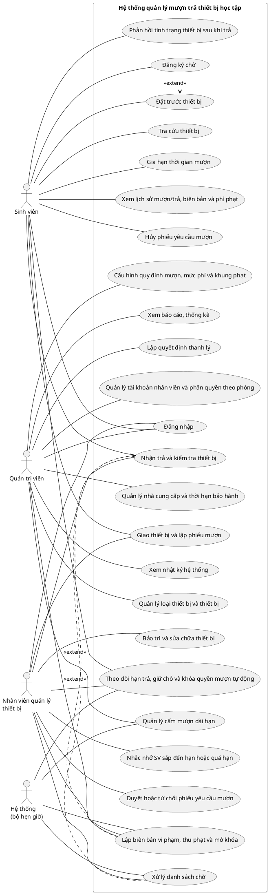

TRƯỜNG ĐẠI HỌC CÔNG NGHỆ THÔNG TIN

KHOA CÔNG NGHỆ PHẦN MỀM

Đồ án môn PHÁT TRIỂN PHẦN MỀM HƯỚNG ĐỐI TƯỢNG

Mô hình Usecase Hệ thống quản lý mượn trả thiết bị học tập cho sinh viên

Version 1.2

Sinh viên thực hiện:

24521007 – Nguyễn Phi Long

24520993 – Trần Lê Đức Lợi

24522050 – Nguyễn Đại Vương

24520856 – Đinh Nhật Khôi

24521692 – Nguyễn Huỳnh Quốc Thịnh

**Bảng ghi nhận thay đổi tài liệu**

| **Ngày** | **Phiên bản** | **Mô tả** | **Tác giả** |
|---|---|---|---|
| 06/10/2026 | 1.0 | Bản đầu tiên: sơ đồ Use-case tổng, danh sách Actor, danh sách và đặc tả 16 Use-case cốt lõi (dựa trên SRS v1.1). | Nhóm 13 |
| 07/10/2026 | 1.1 | Rà soát đối chiếu với Biểu mẫu OOAD Nhóm 13 và đề bài: sửa nội dung Use-case 01-16 cho bám sát nguồn; bổ sung UC-17 đến UC-24; đồng bộ sơ đồ, danh sách Actor và Use-case. | Nhóm 13 |
| 20/10/2026 | 1.2 | Đồng bộ với Analysis document v1.2: UC-13, UC-19 thêm tham số soLanDangNhapSaiToiDa; UC-21 đổi “đã trả” thành “đã bàn giao tại quầy”; UC-07 ghi rõ hạn trả (mượn trực tiếp hoặc từ danh sách chờ dùng thời gian mượn tối đa) và phí trễ lưu khi giao; UC-03, UC-10 ghi rõ danh sách chờ theo phòng; bổ sung UC-01, UC-02, UC-08, UC-09, UC-11, UC-17, UC-24 cho thống nhất. | Nhóm 13 |
|  |  |  |  |

Mục lục

- [**1. Sơ đồ Use-case**](#1-sơ-đồ-use-case) **5**
- [**2. Danh sách các Actor**](#2-danh-sách-các-actor) **7**
- [**3. Danh sách các Use-case**](#3-danh-sách-các-use-case) **7**
- [**4. Đặc tả Use-case**](#4-đặc-tả-use-case) **10**
  - [4.1 Đặc tả Use-case “UC-01 – Tra cứu thiết bị”](#41-đặc-tả-use-case-uc-01--tra-cứu-thiết-bị) 10
  - [4.2 Đặc tả Use-case “UC-02 – Đặt trước thiết bị”](#42-đặc-tả-use-case-uc-02--đặt-trước-thiết-bị) 11
  - [4.3 Đặc tả Use-case “UC-03 – Đăng ký chờ”](#43-đặc-tả-use-case-uc-03--đăng-ký-chờ) 13
  - [4.4 Đặc tả Use-case “UC-04 – Gia hạn thời gian mượn”](#44-đặc-tả-use-case-uc-04--gia-hạn-thời-gian-mượn) 14
  - [4.5 Đặc tả Use-case “UC-05 – Xem lịch sử mượn/trả, biên bản và phí phạt”](#45-đặc-tả-use-case-uc-05--xem-lịch-sử-mượntrả-biên-bản-và-phí-phạt) 15
  - [4.6 Đặc tả Use-case “UC-06 – Duyệt hoặc từ chối phiếu yêu cầu mượn”](#46-đặc-tả-use-case-uc-06--duyệt-hoặc-từ-chối-phiếu-yêu-cầu-mượn) 16
  - [4.7 Đặc tả Use-case “UC-07 – Giao thiết bị và lập phiếu mượn”](#47-đặc-tả-use-case-uc-07--giao-thiết-bị-và-lập-phiếu-mượn) 17
  - [4.8 Đặc tả Use-case “UC-08 – Nhận trả và kiểm tra thiết bị”](#48-đặc-tả-use-case-uc-08--nhận-trả-và-kiểm-tra-thiết-bị) 19
  - [4.9 Đặc tả Use-case “UC-09 – Lập biên bản vi phạm, thu phạt và mở khóa”](#49-đặc-tả-use-case-uc-09--lập-biên-bản-vi-phạm-thu-phạt-và-mở-khóa) 21
  - [4.10 Đặc tả Use-case “UC-10 – Xử lý danh sách chờ”](#410-đặc-tả-use-case-uc-10--xử-lý-danh-sách-chờ) 22
  - [4.11 Đặc tả Use-case “UC-11 – Bảo trì và sửa chữa thiết bị”](#411-đặc-tả-use-case-uc-11--bảo-trì-và-sửa-chữa-thiết-bị) 23
  - [4.12 Đặc tả Use-case “UC-12 – Quản lý loại thiết bị và thiết bị”](#412-đặc-tả-use-case-uc-12--quản-lý-loại-thiết-bị-và-thiết-bị) 25
  - [4.13 Đặc tả Use-case “UC-13 – Cấu hình quy định mượn, mức phí và khung phạt”](#413-đặc-tả-use-case-uc-13--cấu-hình-quy-định-mượn-mức-phí-và-khung-phạt) 26
  - [4.14 Đặc tả Use-case “UC-14 – Quản lý tài khoản nhân viên và phân quyền theo phòng”](#414-đặc-tả-use-case-uc-14--quản-lý-tài-khoản-nhân-viên-và-phân-quyền-theo-phòng) 27
  - [4.15 Đặc tả Use-case “UC-15 – Lập quyết định thanh lý”](#415-đặc-tả-use-case-uc-15--lập-quyết-định-thanh-lý) 28
  - [4.16 Đặc tả Use-case “UC-16 – Xem báo cáo, thống kê”](#416-đặc-tả-use-case-uc-16--xem-báo-cáo-thống-kê) 29
  - [4.17 Đặc tả Use-case “UC-17 – Theo dõi hạn trả, giữ chỗ và khóa quyền mượn tự động”](#417-đặc-tả-use-case-uc-17--theo-dõi-hạn-trả-giữ-chỗ-và-khóa-quyền-mượn-tự-động) 31
  - [4.18 Đặc tả Use-case “UC-18 – Nhắc nhở sinh viên sắp đến hạn hoặc quá hạn”](#418-đặc-tả-use-case-uc-18--nhắc-nhở-sinh-viên-sắp-đến-hạn-hoặc-quá-hạn) 32
  - [4.19 Đặc tả Use-case “UC-19 – Đăng nhập”](#419-đặc-tả-use-case-uc-19--đăng-nhập) 33
  - [4.20 Đặc tả Use-case “UC-20 – Hủy phiếu yêu cầu mượn”](#420-đặc-tả-use-case-uc-20--hủy-phiếu-yêu-cầu-mượn) 34
  - [4.21 Đặc tả Use-case “UC-21 – Phản hồi tình trạng thiết bị sau khi trả”](#421-đặc-tả-use-case-uc-21--phản-hồi-tình-trạng-thiết-bị-sau-khi-trả) 35
  - [4.22 Đặc tả Use-case “UC-22 – Quản lý nhà cung cấp và thời hạn bảo hành”](#422-đặc-tả-use-case-uc-22--quản-lý-nhà-cung-cấp-và-thời-hạn-bảo-hành) 36
  - [4.23 Đặc tả Use-case “UC-23 – Xem nhật ký hệ thống”](#423-đặc-tả-use-case-uc-23--xem-nhật-ký-hệ-thống) 37
  - [4.24 Đặc tả Use-case “UC-24 – Quản lý cấm mượn dài hạn”](#424-đặc-tả-use-case-uc-24--quản-lý-cấm-mượn-dài-hạn) 38

# 1. Sơ đồ Use-case

# 2. Danh sách các Actor

| STT | Tên Actor | Ý nghĩa/Ghi chú |
|---|---|---|
| 1 | Sinh viên (SV) | Sinh viên do nhà trường quản lý, dùng ứng dụng trên điện thoại để tra cứu, đặt trước, đăng ký chờ, gia hạn, hủy phiếu yêu cầu, xem lịch sử, phản hồi tình trạng thiết bị. Chỉ thấy dữ liệu của chính mình. |
| 2 | Nhân viên quản lý thiết bị (NV) | Làm việc tại quầy, được cấp quyền theo từng phòng thiết bị: duyệt yêu cầu, giao/nhận thiết bị, kiểm tra, lập biên bản và ghi nhận nộp phạt, bảo trì và sửa chữa, xử lý danh sách chờ, nhắc nhở sinh viên, nhận thông báo nhắc bảo trì. |
| 3 | Quản trị viên (QT) | Quản lý danh mục thiết bị, nhà cung cấp và bảo hành, quy định mượn và mức phạt, tài khoản và phân quyền nhân viên, thanh lý, báo cáo, nhật ký hệ thống. |
| 4 | Hệ thống (bộ hẹn giờ) | Tác nhân nội bộ tự động theo thời gian/sự kiện: nhắc hạn, đánh dấu quá hạn, khóa quyền mượn, hết hạn giữ chỗ và chuyển lượt danh sách chờ, tính phí, tự mở khóa quyền mượn. |

# 3. Danh sách các Use-case

| STT | Tên Use-case | Ý nghĩa/Ghi chú |
|---|---|---|
| 1 | UC-01 – Tra cứu thiết bị | SV tìm, lọc và xem chi tiết thiết bị (thông số, số lượng khả dụng, ngày dự kiến có sẵn). Actor: Sinh viên. |
| 2 | UC-02 – Đặt trước thiết bị | SV gửi phiếu yêu cầu mượn nhiều loại thiết bị để NV duyệt và giữ chỗ; ứng dụng chỉ dùng để đặt trước. Actor: Sinh viên. |
| 3 | UC-03 – Đăng ký chờ | SV đăng ký vào danh sách chờ (theo thứ tự đăng ký, theo từng loại thiết bị tại từng phòng) khi loại thiết bị hết khả dụng tại phòng đó; có thể rời danh sách. Actor: Sinh viên. |
| 4 | UC-04 – Gia hạn thời gian mượn | SV gia hạn phiếu mượn một lần (thêm tối đa 2 giờ) khi chưa có người chờ; hệ thống tự duyệt. Actor: Sinh viên. |
| 5 | UC-05 – Xem lịch sử mượn/trả, biên bản và phí phạt | SV xem phiếu mượn đang và đã thực hiện (ngày mượn, ngày hẹn trả, ngày trả thực tế, tình trạng thiết bị khi trả), biên bản vi phạm và phí phạt của mình. Actor: Sinh viên. |
| 6 | UC-06 – Duyệt hoặc từ chối phiếu yêu cầu mượn | NV xem phiếu yêu cầu của phòng mình, kiểm tra điều kiện rồi duyệt (giữ chỗ 30 phút) hoặc từ chối kèm lý do. Actor: Nhân viên quản lý thiết bị. |
| 7 | UC-07 – Giao thiết bị và lập phiếu mượn | NV quét thẻ SV, quét từng thiết bị, ghi tình trạng ban đầu và lập phiếu mượn nhiều thiết bị; gồm mượn trực tiếp không đặt trước. Actor: Nhân viên quản lý thiết bị; Sinh viên (có mặt tại quầy). |
| 8 | UC-08 – Nhận trả và kiểm tra thiết bị | NV quét thiết bị trả, đối chiếu tình trạng lúc giao/trả, ghi kết quả (nguyên vẹn, hư hỏng, thiếu phụ kiện, mất). Actor: Nhân viên quản lý thiết bị; Sinh viên (có mặt tại quầy). |
| 9 | UC-09 – Lập biên bản vi phạm, thu phạt và mở khóa | Lập biên bản trả trễ/hư hỏng/mất, tự tính tiền theo từng thiết bị, ghi nhận SV đã nộp tiền và tự mở khóa khi đủ điều kiện. Actor: Nhân viên quản lý thiết bị; Hệ thống; Quản trị viên (hủy/điều chỉnh biên bản). |
| 10 | UC-10 – Xử lý danh sách chờ | Khi có thiết bị cùng loại được trả về tại một phòng, hệ thống giữ chỗ 30 phút cho SV đứng đầu hàng chờ của loại đó tại phòng đó; hết hạn thì chuyển lượt; NV xác nhận khi SV đến nhận. Actor: Nhân viên quản lý thiết bị; Hệ thống. |
| 11 | UC-11 – Bảo trì và sửa chữa thiết bị | NV lập lịch bảo trì định kỳ, tiếp nhận sửa chữa thiết bị hư hỏng và ghi kết quả; thiết bị đang bảo trì không cho mượn. Actor: Nhân viên quản lý thiết bị. |
| 12 | UC-12 – Quản lý loại thiết bị và thiết bị | QT quản lý danh mục phòng thiết bị, loại thiết bị và từng thiết bị (mã, giá trị, thời hạn bảo hành, nhà cung cấp, vị trí lưu trữ). Actor: Quản trị viên. |
| 13 | UC-13 – Cấu hình quy định mượn, mức phí và khung phạt | QT cấu hình số thiết bị và thời gian mượn tối đa theo nhóm SV, phí trễ theo loại thiết bị, khung phạt hư hỏng và tham số hệ thống. Actor: Quản trị viên. |
| 14 | UC-14 – Quản lý tài khoản nhân viên và phân quyền theo phòng | QT tạo, sửa, khóa/mở tài khoản nhân viên và cấp/thu hồi quyền theo từng phòng thiết bị. Actor: Quản trị viên. |
| 15 | UC-15 – Lập quyết định thanh lý | QT lập quyết định thanh lý (mã số, ngày, danh sách thiết bị); thiết bị chuyển Đã thanh lý. Actor: Quản trị viên. |
| 16 | UC-16 – Xem báo cáo, thống kê | QT xem và xuất báo cáo: tình trạng kho, quá hạn, hư hỏng/mất, tần suất mượn, vi phạm, lịch sử bảo trì/thanh lý. Actor: Quản trị viên. |
| 17 | UC-17 – Theo dõi hạn trả, giữ chỗ và khóa quyền mượn tự động | Hệ thống tự động nhắc hạn trả, đánh dấu quá hạn, khóa quyền mượn mới, hết hạn giữ chỗ và nhắc bảo trì đến hạn. Actor: Hệ thống; Sinh viên (nhận thông báo); Nhân viên quản lý thiết bị (nhận thông báo nhắc bảo trì). |
| 18 | UC-18 – Nhắc nhở sinh viên sắp đến hạn hoặc quá hạn | NV xem danh sách SV sắp đến hạn hoặc quá hạn trả theo phòng thiết bị và gửi thông báo nhắc nhở. Actor: Nhân viên quản lý thiết bị. |
| 19 | UC-19 – Đăng nhập | Người dùng đăng nhập theo vai trò; SV dùng tài khoản của trường, NV và QT dùng tài khoản do hệ thống cấp. Actor: Sinh viên; Nhân viên quản lý thiết bị; Quản trị viên. |
| 20 | UC-20 – Hủy phiếu yêu cầu mượn | SV hủy phiếu yêu cầu mượn (Chờ duyệt hoặc Đã duyệt, chưa nhận thiết bị); giữ chỗ được giải phóng, không tính vi phạm. Actor: Sinh viên. |
| 21 | UC-21 – Phản hồi tình trạng thiết bị sau khi trả | SV ghi nhận tình trạng thiết bị gặp phải khi sử dụng (ví dụ pin yếu, giật lag, trầy xước sẵn có) để NV đối chiếu. Actor: Sinh viên. |
| 22 | UC-22 – Quản lý nhà cung cấp và thời hạn bảo hành | QT lưu thông tin liên hệ nhà cung cấp, gán nhà cung cấp cho thiết bị và theo dõi thời hạn bảo hành. Actor: Quản trị viên. |
| 23 | UC-23 – Xem nhật ký hệ thống | QT xem và lọc nhật ký hệ thống (người thực hiện, thời điểm, thao tác, giá trị trước và sau). Actor: Quản trị viên. |
| 24 | UC-24 – Quản lý cấm mượn dài hạn | Hệ thống cấm mượn dài hạn khi vượt ngưỡng vi phạm trong học kỳ; QT gỡ cấm kèm lý do (ưu tiên thấp, chưa đưa vào giai đoạn đầu). Actor: Quản trị viên; Hệ thống. |

# 4. Đặc tả Use-case

## 4.1 Đặc tả Use-case “UC-01 – Tra cứu thiết bị”

|  |  |  |  |
|---|---|---|---|
| Mã Use Case: | UC-01 |  |  |
| Tên Use Case: | Tra cứu thiết bị |  |  |
| Người tạo: | Nhóm 13 | Người cập nhật gần nhất: | Nhóm 13 |
| Ngày tạo: | 06/10/2026 | Ngày cập nhật gần nhất: | 20/10/2026 |

|  |  |
|---|---|
| Actor: | Sinh viên |
| Mô tả: | Sinh viên tìm, lọc và xem chi tiết thiết bị còn hàng trước khi đến quầy. |
| Tiền điều kiện: | SV đã đăng nhập (UC-19). |
| Hậu điều kiện: | SV nắm được số lượng khả dụng; có thể chuyển sang Đặt trước (UC-02) hoặc Đăng ký chờ (UC-03). |
| Độ ưu tiên: | Bắt buộc |
| Tần suất sử dụng: | Khi SV có nhu cầu tìm thiết bị phục vụ học tập (BP-01). |
| Luồng chính: | 1. SV nhập từ khóa và chọn bộ lọc (tên, loại thiết bị, phòng thiết bị, còn/hết hàng). 2. Hệ thống trả danh sách thiết bị khớp bộ lọc. 3. SV chọn một thiết bị. 4. Hệ thống hiển thị thông số kỹ thuật, hình ảnh, phòng quản lý và số lượng khả dụng (đã trừ số lượng đang giữ chỗ). |
| Luồng thay thế: | A1. Còn hàng: hiển thị nút Đặt trước. A2. Hết hàng: hiển thị ngày dự kiến có sẵn tại phòng đó và nút Đăng ký chờ. A3. Thiết bị hư hỏng được tính là hết hàng; chỉ thiết bị Sẵn sàng cho mượn mới được tính vào số lượng khả dụng. |
| Ngoại lệ: | E1. Không có kết quả: thông báo không tìm thấy. |
| Includes: | Không |
| Extends | Không |
| Yêu cầu đặc biệt: | 95% yêu cầu tra cứu phản hồi dưới 1,5 giây với ít nhất 100 người dùng đồng thời (NFR-03). Giao diện không vỡ bố cục trên các kích thước màn hình điện thoại phổ biến (NFR-04). |
| Giả định: | Không |
| Ghi chú: | Nguồn: FR-01, FR-02; BP-01; US-01; EL-01; GL-31; NFR-03, NFR-04. |

## 4.2 Đặc tả Use-case “UC-02 – Đặt trước thiết bị”

|  |  |  |  |
|---|---|---|---|
| Mã Use Case: | UC-02 |  |  |
| Tên Use Case: | Đặt trước thiết bị |  |  |
| Người tạo: | Nhóm 13 | Người cập nhật gần nhất: | Nhóm 13 |
| Ngày tạo: | 06/10/2026 | Ngày cập nhật gần nhất: | 20/10/2026 |

|  |  |
|---|---|
| Actor: | Sinh viên |
| Mô tả: | Sinh viên gửi phiếu yêu cầu mượn (đặt trước) nhiều loại thiết bị để nhân viên duyệt và giữ chỗ. Ứng dụng chỉ dùng để đặt trước; nhận thiết bị tại quầy. |
| Tiền điều kiện: | SV đã đăng nhập (UC-19). Thẻ còn hạn, quyền mượn bình thường (không bị khóa). |
| Hậu điều kiện: | Phiếu yêu cầu ở trạng thái Chờ duyệt; chưa giữ chỗ, chưa gán thiết bị cụ thể. |
| Độ ưu tiên: | Bắt buộc |
| Tần suất sử dụng: | Khi SV đã tra cứu và quyết định mượn thiết bị còn hàng (BP-02). |
| Luồng chính: | 1. SV chọn phòng thiết bị, các loại thiết bị còn hàng và số lượng từng loại. 2. SV nhập thời gian mượn dự kiến (tính theo giờ). 3. SV xác nhận gửi. 4. Hệ thống kiểm tra thẻ còn hạn và nhóm sinh viên (dữ liệu do nhà trường cung cấp), quyền mượn, số lượng khả dụng, giới hạn số thiết bị theo nhóm (tính trên tổng) và thời gian mượn tối đa. 5. Hệ thống tạo phiếu yêu cầu có mã duy nhất, trạng thái Chờ duyệt. |
| Luồng thay thế: | A1. Loại thiết bị hết hàng: đề nghị Đăng ký chờ (UC-03) cho loại đó; các loại còn lại vẫn đặt được. A2. Vượt giới hạn số thiết bị của nhóm (tính trên tổng, ví dụ SV đại học vượt 2 thiết bị): từ chối, nêu rõ điều kiện không đạt; SV giảm số lượng và gửi lại. A3. Thời gian vượt mức tối đa của nhóm (áp dụng ngoại lệ theo loại nếu có; phiếu gồm nhiều loại thì lấy mức nhỏ nhất theo các loại trong phiếu; ví dụ SV đại học vượt 5 giờ): từ chối, nêu mức tối đa cho phép. |
| Ngoại lệ: | E1. SV bị khóa, thẻ hết hạn hoặc không còn theo học: không cho gửi, hiển thị lý do. E2. Số lượng khả dụng thay đổi khi gửi: báo lỗi, SV chọn lại. |
| Includes: | Không |
| Extends | Không |
| Yêu cầu đặc biệt: | Giới hạn mượn tính trên tổng số thiết bị, không phân biệt loại (CR-06). Ứng dụng chỉ dùng để đặt trước; việc nhận thiết bị thực hiện tại quầy (CR-11). |
| Giả định: | Không |
| Ghi chú: | Nguồn: FR-03, FR-04, FR-35; BP-02; US-02, US-28; CR-06, CR-11, CR-12; EL-02, EL-19, EL-24. |

## 4.3 Đặc tả Use-case “UC-03 – Đăng ký chờ”

|  |  |  |  |
|---|---|---|---|
| Mã Use Case: | UC-03 |  |  |
| Tên Use Case: | Đăng ký chờ |  |  |
| Người tạo: | Nhóm 13 | Người cập nhật gần nhất: | Nhóm 13 |
| Ngày tạo: | 06/10/2026 | Ngày cập nhật gần nhất: | 20/10/2026 |

|  |  |
|---|---|
| Actor: | Sinh viên |
| Mô tả: | Sinh viên đăng ký vào danh sách chờ khi loại thiết bị cần mượn đã hết số lượng khả dụng tại một phòng thiết bị; danh sách chờ được xếp theo từng loại thiết bị tại từng phòng. |
| Tiền điều kiện: | SV đã đăng nhập (UC-19). Loại thiết bị có số lượng khả dụng bằng 0 tại phòng thiết bị mà SV chọn. |
| Hậu điều kiện: | SV nằm trong danh sách chờ của loại thiết bị tại phòng đó, ở trạng thái Đang chờ. |
| Độ ưu tiên: | Nên có |
| Tần suất sử dụng: | Khi thiết bị SV cần mượn đã hết (BP-05). |
| Luồng chính: | 1. SV mở chi tiết loại thiết bị hết hàng tại một phòng thiết bị và chọn Đăng ký chờ. 2. Hệ thống kiểm tra loại thiết bị đã hết số lượng khả dụng tại phòng đó. 3. Hệ thống thêm SV vào cuối danh sách chờ của loại thiết bị tại phòng đó; ghi mã đăng ký chờ, phòng thiết bị, thời điểm đăng ký và số thứ tự chờ. 4. Hệ thống hiển thị số thứ tự chờ của SV. |
| Luồng thay thế: | A1. SV xem số thứ tự chờ hiện tại của mình. A2. SV rời danh sách chờ khi không còn nhu cầu: đăng ký chuyển Đã hủy, số thứ tự các SV phía sau trong cùng danh sách chờ được cập nhật, không tính vi phạm (FR-29). |
| Ngoại lệ: | E1. Loại thiết bị còn số lượng khả dụng tại phòng đó: từ chối, đề nghị Đặt trước (UC-02). |
| Includes: | Không |
| Extends | UC-02 – Đặt trước thiết bị (khi loại thiết bị hết hàng) |
| Yêu cầu đặc biệt: | Xếp hàng theo thứ tự đăng ký trước, phục vụ trước, theo từng loại thiết bị tại từng phòng thiết bị (FR-05, GL-14). |
| Giả định: | Không |
| Ghi chú: | Nguồn: FR-05, FR-29; BP-05; US-03, US-22; EL-03; GL-14. |

## 4.4 Đặc tả Use-case “UC-04 – Gia hạn thời gian mượn”

|  |  |  |  |
|---|---|---|---|
| Mã Use Case: | UC-04 |  |  |
| Tên Use Case: | Gia hạn thời gian mượn |  |  |
| Người tạo: | Nhóm 13 | Người cập nhật gần nhất: | Nhóm 13 |
| Ngày tạo: | 06/10/2026 | Ngày cập nhật gần nhất: | 07/10/2026 |

|  |  |
|---|---|
| Actor: | Sinh viên |
| Mô tả: | Sinh viên gia hạn phiếu mượn đang giữ; hệ thống tự kiểm tra và duyệt, không cần nhân viên. |
| Tiền điều kiện: | SV đang giữ thiết bị theo một phiếu mượn. Chưa quá ngày giờ hẹn trả. |
| Hậu điều kiện: | Ngày giờ hẹn trả mới được áp dụng cho việc tính phí trễ của phiếu. |
| Độ ưu tiên: | Nên có |
| Tần suất sử dụng: | Khi SV muốn gia hạn trước ngày hẹn trả (BP-06). |
| Luồng chính: | 1. SV chọn phiếu mượn đang mượn và chọn Gia hạn. 2. SV chọn số giờ gia hạn thêm (tối đa 2 giờ). 3. Hệ thống kiểm tra: phiếu chưa gia hạn lần nào và không có SV đang đăng ký chờ các loại thiết bị trong phiếu. 4. Hợp lệ: hệ thống tự duyệt, cập nhật ngày giờ hẹn trả của phiếu, tăng số lần gia hạn và ghi nhật ký. 5. Hệ thống hiển thị kết quả cho SV. |
| Luồng thay thế: | A1. Có SV đang chờ loại thiết bị trong phiếu: từ chối, nêu lý do. A2. Đã gia hạn một lần hoặc đã quá ngày giờ hẹn trả: từ chối. |
| Ngoại lệ: | E1. Số giờ vượt mức cho phép: từ chối, nêu mức tối đa. |
| Includes: | Không |
| Extends | Không |
| Yêu cầu đặc biệt: | Mỗi phiếu gia hạn tối đa một lần (CR-02, CR-12). Hạn trả không muộn hơn giờ đóng cửa quầy (GL-12, CR-12). |
| Giả định: | Không |
| Ghi chú: | Nguồn: FR-07; BP-06; US-06; CR-02, CR-12; EL-04; GL-15. |

## 4.5 Đặc tả Use-case “UC-05 – Xem lịch sử mượn/trả, biên bản và phí phạt”

|  |  |  |  |
|---|---|---|---|
| Mã Use Case: | UC-05 |  |  |
| Tên Use Case: | Xem lịch sử mượn/trả, biên bản và phí phạt |  |  |
| Người tạo: | Nhóm 13 | Người cập nhật gần nhất: | Nhóm 13 |
| Ngày tạo: | 06/10/2026 | Ngày cập nhật gần nhất: | 07/10/2026 |

|  |  |
|---|---|
| Actor: | Sinh viên |
| Mô tả: | Sinh viên theo dõi lịch sử mượn/trả của chính mình, kể cả biên bản vi phạm và phí phạt. |
| Tiền điều kiện: | SV đã đăng nhập (UC-19). |
| Hậu điều kiện: | SV nắm được các phiếu mượn, vi phạm và phí phạt của mình. |
| Độ ưu tiên: | Bắt buộc |
| Tần suất sử dụng: | Khi SV muốn xem lại các phiếu mượn, vi phạm và phí phạt của mình (FR-32). |
| Luồng chính: | 1. SV mở màn hình lịch sử mượn/trả. 2. Hệ thống hiển thị danh sách phiếu mượn của SV (đang mượn và đã thực hiện). 3. SV chọn một phiếu. 4. Hệ thống hiển thị ngày mượn, ngày hẹn trả, ngày trả thực tế, tình trạng thiết bị khi trả, vi phạm và phí phạt (nếu có). |
| Luồng thay thế: | A1. Chưa có phiếu mượn: hiển thị danh sách trống. |
| Ngoại lệ: | E1. Truy cập dữ liệu của người khác: từ chối. |
| Includes: | Không |
| Extends | Không |
| Yêu cầu đặc biệt: | Chỉ hiển thị dữ liệu của chính SV đăng nhập (FR-32, NFR-01). |
| Giả định: | Không |
| Ghi chú: | Nguồn: FR-32; US-12; EL-16; NFR-01, NFR-07. |

## 4.6 Đặc tả Use-case “UC-06 – Duyệt hoặc từ chối phiếu yêu cầu mượn”

|  |  |  |  |
|---|---|---|---|
| Mã Use Case: | UC-06 |  |  |
| Tên Use Case: | Duyệt hoặc từ chối phiếu yêu cầu mượn |  |  |
| Người tạo: | Nhóm 13 | Người cập nhật gần nhất: | Nhóm 13 |
| Ngày tạo: | 06/10/2026 | Ngày cập nhật gần nhất: | 07/10/2026 |

|  |  |
|---|---|
| Actor: | Nhân viên quản lý thiết bị |
| Mô tả: | Nhân viên duyệt hoặc từ chối phiếu yêu cầu mượn của sinh viên thuộc phòng thiết bị mình được cấp quyền; duyệt thì hệ thống giữ chỗ. |
| Tiền điều kiện: | Có phiếu yêu cầu Chờ duyệt thuộc phòng NV được cấp quyền. |
| Hậu điều kiện: | Phiếu Đã duyệt (giữ chỗ 30 phút) hoặc Từ chối; ghi nhật ký. |
| Độ ưu tiên: | Bắt buộc |
| Tần suất sử dụng: | Khi có phiếu yêu cầu mượn chờ duyệt (FR-30). |
| Luồng chính: | 1. NV mở danh sách phiếu yêu cầu của phòng mình và chọn một phiếu Chờ duyệt. 2. Hệ thống kiểm tra lại điều kiện SV (thẻ, nhóm, quyền mượn, giới hạn tổng) và số lượng khả dụng. 3. NV chọn Duyệt. 4. Hệ thống chuyển phiếu sang Đã duyệt, giữ chỗ số lượng từng loại trong 30 phút và thông báo cho SV. |
| Luồng thay thế: | A1. Không đủ điều kiện hoặc không còn số lượng: hệ thống chặn Duyệt, nêu lý do; NV chọn Từ chối kèm lý do; SV được thông báo. |
| Ngoại lệ: | E1. Phiếu chưa được duyệt trong ngày: tự hết hiệu lực. E2. Phiếu thuộc phòng chưa được cấp quyền: từ chối truy cập. E3. SV không đến nhận trong 30 phút kể từ khi duyệt: hệ thống tự hủy giữ chỗ và ghi 1 vi phạm (xem UC-17, FR-28). |
| Includes: | Không |
| Extends | Không |
| Yêu cầu đặc biệt: | Duyệt thì hệ thống giữ chỗ; số lượng khả dụng được tính sau khi trừ số lượng đang giữ chỗ (FR-30, GL-31). |
| Giả định: | Không |
| Ghi chú: | Nguồn: FR-04, FR-24, FR-28, FR-30; BP-03; US-04; CR-11, CR-15; EL-02. |

## 4.7 Đặc tả Use-case “UC-07 – Giao thiết bị và lập phiếu mượn”

|  |  |  |  |
|---|---|---|---|
| Mã Use Case: | UC-07 |  |  |
| Tên Use Case: | Giao thiết bị và lập phiếu mượn |  |  |
| Người tạo: | Nhóm 13 | Người cập nhật gần nhất: | Nhóm 13 |
| Ngày tạo: | 06/10/2026 | Ngày cập nhật gần nhất: | 20/10/2026 |

|  |  |
|---|---|
| Actor: | Nhân viên quản lý thiết bị; Sinh viên (có mặt tại quầy) |
| Mô tả: | Nhân viên bàn giao trực tiếp từng thiết bị cụ thể cho sinh viên có mặt tại quầy và lập phiếu mượn nhiều thiết bị. |
| Tiền điều kiện: | SV có mặt tại quầy. Có phiếu yêu cầu Đã duyệt còn giữ chỗ, hoặc SV đang được giữ chỗ từ danh sách chờ, hoặc mượn trực tiếp không đặt trước (A1). |
| Hậu điều kiện: | Phiếu mượn nhiều thiết bị được tạo; thiết bị chuyển Đang được mượn. Tình trạng ban đầu và ảnh được lưu để đối chiếu khi trả. |
| Độ ưu tiên: | Bắt buộc |
| Tần suất sử dụng: | Mỗi lượt giao thiết bị tại quầy. |
| Luồng chính: | 1. NV quét mã thẻ SV; hệ thống hiển thị họ tên, lớp, nhóm sinh viên, hạn thẻ, số thiết bị đang mượn, lịch sử nợ vi phạm và trạng thái hợp lệ/không hợp lệ. 2. Hệ thống kiểm tra thẻ, quyền mượn và tổng số thiết bị (đang cầm + giao mới) không vượt giới hạn của nhóm. 3. NV chọn phiếu yêu cầu Đã duyệt; hệ thống nêu phòng/kệ/tủ để lấy hàng. 4. Với từng thiết bị: NV quét (hoặc nhập tay) mã thiết bị; hệ thống kiểm tra thiết bị Sẵn sàng và thuộc phòng của NV; NV nhập mô tả tình trạng ban đầu (kèm ảnh nếu cần). 5. NV chọn Lập phiếu mượn. 6. Hệ thống tạo phiếu mượn gồm mã phiếu, ngày giờ mượn, SV mượn, danh sách thiết bị và ngày giờ hẹn trả của cả phiếu = giờ giao + thời gian mượn (giao theo phiếu yêu cầu: thời gian mượn dự kiến; mượn trực tiếp hoặc từ danh sách chờ: thời gian mượn tối đa của nhóm), không vượt mức tối đa của nhóm (nhỏ nhất theo các loại trong phiếu) và không muộn hơn giờ đóng cửa quầy; chi tiết phiếu lưu phí trễ/ngày của loại thiết bị tại thời điểm giao; thiết bị chuyển Đang được mượn; phiếu mượn ở trạng thái Đang mượn; giải phóng giữ chỗ (giao theo phiếu yêu cầu: phiếu yêu cầu chuyển Đã nhận). |
| Luồng thay thế: | A1. Mượn trực tiếp không đặt trước: NV chọn loại thiết bị và số lượng; hệ thống kiểm tra điều kiện SV, số lượng khả dụng và giới hạn như các bước 1-2 (FR-31); các bước 4-6 thực hiện như trên; hạn trả dùng thời gian mượn tối đa của nhóm. A2. SV đến từ danh sách chờ: NV xác nhận SV đang được giữ chỗ; hạn trả dùng thời gian mượn tối đa của nhóm; đăng ký chuyển Đã nhận. A3. Thiết bị quét không Sẵn sàng hoặc không đúng loại đã duyệt: từ chối, không đưa vào phiếu. |
| Ngoại lệ: | E1. SV bị khóa, thẻ hết hạn, không còn theo học hoặc vượt giới hạn: dừng, hiển thị lý do. E2. Giữ chỗ đã quá 30 phút: không giao theo phiếu cũ. E3. Hai NV giao cùng một thiết bị: chỉ một giao dịch thành công. |
| Includes: | Không |
| Extends | Không |
| Yêu cầu đặc biệt: | 95% yêu cầu quét mã kiểm tra thẻ sinh viên/thiết bị phản hồi dưới 1,5 giây (NFR-03). Mã thiết bị được in chìm trên thiết bị; nhập tay khi không quét được (FR-10). Phí trễ/ngày được lưu trong chi tiết phiếu mượn tại thời điểm giao; thay đổi cấu hình sau đó không ảnh hưởng phiếu đã lập (FR-37). Một thiết bị tại một thời điểm chỉ thuộc tối đa một phiếu mượn đang hiệu lực (NFR-06). |
| Giả định: | Thẻ sinh viên có mã quét được (FR-08). |
| Ghi chú: | Nguồn: FR-08, FR-10, FR-11, FR-20, FR-31, FR-37; BP-03; US-05, US-27; CR-07, CR-11; EL-05, EL-06, EL-20, EL-24; NFR-03, NFR-06. |

## 4.8 Đặc tả Use-case “UC-08 – Nhận trả và kiểm tra thiết bị”

|  |  |  |  |
|---|---|---|---|
| Mã Use Case: | UC-08 |  |  |
| Tên Use Case: | Nhận trả và kiểm tra thiết bị |  |  |
| Người tạo: | Nhóm 13 | Người cập nhật gần nhất: | Nhóm 13 |
| Ngày tạo: | 06/10/2026 | Ngày cập nhật gần nhất: | 20/10/2026 |

|  |  |
|---|---|
| Actor: | Nhân viên quản lý thiết bị; Sinh viên (có mặt tại quầy) |
| Mô tả: | Nhân viên nhận lại từng thiết bị, đối chiếu với tình trạng lúc giao và ghi kết quả kiểm tra. |
| Tiền điều kiện: | SV mang thiết bị đến trả tại quầy (thiết bị mất: SV báo mất tại quầy). Thiết bị thuộc phiếu mượn đang hiệu lực. |
| Hậu điều kiện: | Kết quả kiểm tra, NV nhận trả và ngày trả thực tế của thiết bị (trừ thiết bị Mất) được lưu; tình trạng thiết bị được cập nhật. Phiếu chuyển Đã trả khi mọi thiết bị trong phiếu đã có kết quả. |
| Độ ưu tiên: | Bắt buộc |
| Tần suất sử dụng: | Mỗi lượt trả thiết bị tại quầy. |
| Luồng chính: | 1. NV quét (hoặc nhập tay) mã thiết bị trả (thiết bị mất: SV báo mất, NV nhập tay mã thiết bị theo phiếu mượn của SV); hệ thống hiển thị tình trạng và ảnh lúc giao, cùng phản hồi của SV (nếu có; SV gửi sau khi thiết bị được nhận trả, UC-21). 2. NV kiểm tra thực tế và nhập tình trạng lúc trả (kèm ảnh nếu cần). 3. NV chọn kết quả: Nguyên vẹn, Hư hỏng, Thiếu phụ kiện hoặc Mất; với Hư hỏng/Thiếu phụ kiện, NV mô tả và chọn khung phạt. 4. Hệ thống ghi NV nhận trả (NV đang đăng nhập), ghi ngày trả thực tế (kết quả Mất không có ngày trả) và xác định trễ hạn. 5. Nguyên vẹn: thiết bị về Sẵn sàng cho mượn (nếu có SV chờ loại thiết bị này tại phòng thì chuyển UC-10). 6. Trả trễ, hư hỏng, thiếu phụ kiện hoặc mất: chuyển UC-09. 7. Lặp lại cho các thiết bị còn lại; khi mọi thiết bị trong phiếu đã có kết quả kiểm tra (kể cả kết quả Mất), phiếu chuyển Đã trả. |
| Luồng thay thế: | A1. SV trả thiếu một số thiết bị: phiếu giữ Đang mượn hoặc Quá hạn; thiết bị chưa trả tiếp tục tính theo hạn trả của phiếu. A2. Hư hỏng hoặc thiếu phụ kiện: thiết bị chuyển Đang bảo trì/sửa chữa (UC-11). A3. Mất: thiết bị chuyển Đã báo mất. |
| Ngoại lệ: | E1. Thiết bị không thuộc phiếu đang hiệu lực: báo lỗi, không cho nhận. |
| Includes: | Không |
| Extends | Không |
| Yêu cầu đặc biệt: | Hiển thị song song tình trạng lúc giao và lúc trả (FR-12). Việc đánh giá hư hỏng do NV thực hiện; không tự động phân tích hình ảnh hư hỏng (ngoài phạm vi theo Tầm nhìn dự án). Thiếu phụ kiện xử lý như hư hỏng, phải chọn khung phạt (FR-36). |
| Giả định: | Không |
| Ghi chú: | Nguồn: FR-10, FR-12, FR-13, FR-25, FR-36, FR-43; BP-04; US-08, US-09; CR-03, CR-07, CR-08; EL-07. Được mở rộng bởi UC-09, UC-10. |

## 4.9 Đặc tả Use-case “UC-09 – Lập biên bản vi phạm, thu phạt và mở khóa”

|  |  |  |  |
|---|---|---|---|
| Mã Use Case: | UC-09 |  |  |
| Tên Use Case: | Lập biên bản vi phạm, thu phạt và mở khóa |  |  |
| Người tạo: | Nhóm 13 | Người cập nhật gần nhất: | Nhóm 13 |
| Ngày tạo: | 06/10/2026 | Ngày cập nhật gần nhất: | 20/10/2026 |

|  |  |
|---|---|
| Actor: | Nhân viên quản lý thiết bị; Hệ thống; Quản trị viên (chỉ hủy hoặc điều chỉnh biên bản) |
| Mô tả: | Nhân viên lập biên bản vi phạm và ghi nhận thu phạt; hệ thống tính tiền theo từng thiết bị và tự mở khóa quyền mượn khi đủ điều kiện. |
| Tiền điều kiện: | Từ UC-08 có thiết bị trả trễ, hư hỏng, thiếu phụ kiện hoặc mất; hoặc SV đang bị tạm khóa do quá hạn hoặc chưa nộp phạt. |
| Hậu điều kiện: | Biên bản Đã nộp; quyền mượn mở lại nếu đủ điều kiện; nhật ký đầy đủ. |
| Độ ưu tiên: | Bắt buộc |
| Tần suất sử dụng: | Khi SV trả trễ, làm hư hỏng, làm mất thiết bị hoặc khi SV đang bị khóa cần mở lại quyền mượn (BP-07). |
| Luồng chính: | 1. Hệ thống đề xuất các khoản tiền theo từng thiết bị: phí trả trễ (số ngày trễ × phí/ngày đã lưu trong chi tiết phiếu mượn khi giao), bồi thường hư hỏng (tỷ lệ khung phạt × giá trị hiện hành), bồi thường mất (100% giá trị hiện hành). 2. NV kiểm tra và lập biên bản vi phạm; số tiền không đổi sau khi lập; hệ thống ghi vi phạm cho SV: mỗi loại vi phạm (Trả trễ, Hư hỏng, Mất) có trong biên bản tính một vi phạm, không tính theo số thiết bị (thiếu phụ kiện xử lý như hư hỏng). 3. Hệ thống thông báo vi phạm và phí phạt cho SV. 4. SV nộp tiền cho NV (ngoài hệ thống). 5. NV ghi nhận từng biên bản Đã nộp và xác nhận đã nhận đủ thiết bị. 6. Hệ thống kiểm tra đã nhận đủ thiết bị và thu đủ tiền; tự động mở lại quyền mượn. |
| Luồng thay thế: | A1. SV chưa nộp đủ tiền hoặc còn thiết bị chưa trả: quyền mượn vẫn bị khóa. A2. Cần hủy hoặc điều chỉnh biên bản: chỉ QT thực hiện được (GL-34); thay đổi được ghi nhật ký. A3. Thiết bị chưa trả quá 30 ngày: NV lập biên bản mất, thiết bị chuyển Đã báo mất. |
| Ngoại lệ: | E1. Phí trễ vượt giá trị hiện hành của thiết bị: giới hạn bằng giá trị hiện hành. E2. SV thuộc diện Cấm mượn dài hạn: không mở khóa tự động (FR-15). |
| Includes: | Không |
| Extends | UC-08 – Nhận trả và kiểm tra thiết bị (khi có vi phạm) |
| Yêu cầu đặc biệt: | Kết quả tính khớp ví dụ chuẩn: laptop 50.000 và máy chiếu 30.000 VNĐ/ngày, trả trễ 3 ngày là 240.000 VNĐ (NFR-09). Trả quá ngày hẹn trả sau 15 phút ân hạn thì tính trễ; số ngày trễ tính theo ngày lịch, tối thiểu 1 ngày (FR-43). Mở khóa tự động ngay sau khi NV xác nhận, không cần QT (FR-15). |
| Giả định: | Tiền phạt do SV nộp trực tiếp cho NV, hệ thống chỉ ghi nhận (thanh toán trực tuyến ngoài phạm vi). |
| Ghi chú: | Nguồn: FR-09, FR-14, FR-15, FR-42, FR-43; BP-07; US-10, US-21; CR-03, CR-08, CR-09, CR-10; EL-08, EL-21, EL-22, EL-23; GL-17, GL-18, GL-34; NFR-09. Việc tự động khóa quyền mượn khi quá hạn quá số ngày quy định (mặc định 3 ngày) hoặc chưa hoàn tất nộp phạt do hệ thống thực hiện (xem UC-17). |

## 4.10 Đặc tả Use-case “UC-10 – Xử lý danh sách chờ”

|  |  |  |  |
|---|---|---|---|
| Mã Use Case: | UC-10 |  |  |
| Tên Use Case: | Xử lý danh sách chờ |  |  |
| Người tạo: | Nhóm 13 | Người cập nhật gần nhất: | Nhóm 13 |
| Ngày tạo: | 06/10/2026 | Ngày cập nhật gần nhất: | 20/10/2026 |

|  |  |
|---|---|
| Actor: | Nhân viên quản lý thiết bị; Hệ thống |
| Mô tả: | Khi có thiết bị khả dụng tại một phòng, hệ thống giữ chỗ và thông báo cho sinh viên đứng đầu danh sách chờ của loại thiết bị đó tại phòng đó; nhân viên xác nhận khi sinh viên đến nhận. |
| Tiền điều kiện: | Loại thiết bị có SV trong danh sách chờ tại phòng thiết bị. Có một thiết bị cùng loại được trả về tại phòng đó và chuyển sang Sẵn sàng cho mượn. |
| Hậu điều kiện: | Danh sách chờ được cập nhật; thiết bị được giữ cho đúng SV. |
| Độ ưu tiên: | Bắt buộc |
| Tần suất sử dụng: | Khi có thiết bị cùng loại được trả về (BP-05). |
| Luồng chính: | 1. Thiết bị loại X được trả về nguyên vẹn tại một phòng và chuyển sang Sẵn sàng cho mượn. 2. Hệ thống xác định SV đứng đầu danh sách chờ của loại X tại phòng đó. 3. Hệ thống giữ chỗ 30 phút, chuyển đăng ký chờ sang Đã thông báo và thông báo cho SV. 4. SV đến quầy; NV xác nhận khi SV đến nhận (UC-07); đăng ký chuyển Đã nhận. |
| Luồng thay thế: | A1. SV từ chối nhận hoặc rời danh sách: đăng ký chuyển Đã hủy, không tính vi phạm; nếu đang giữ chỗ thì SV kế tiếp được thông báo ngay (FR-29). A2. NV xem danh sách chờ và chuyển lượt thủ công khi SV báo không mượn nữa tại quầy (FR-28). |
| Ngoại lệ: | E1. Quá 30 phút chưa nhận: đăng ký chuyển Hết hạn, ghi 1 vi phạm, chuyển SV kế tiếp trong danh sách chờ của loại X tại phòng đó; không còn ai chờ thì số lượng trở lại khả dụng. |
| Includes: | Không |
| Extends | UC-08 – Nhận trả và kiểm tra thiết bị |
| Yêu cầu đặc biệt: | Chuyển lượt tự động khi hết thời gian giữ chỗ, không cần SV chủ động hủy (FR-28). Danh sách chờ được quản lý theo từng loại thiết bị tại từng phòng thiết bị (FR-05). |
| Giả định: | Không |
| Ghi chú: | Nguồn: FR-05, FR-06, FR-28, FR-29; BP-05; US-11, US-22, US-23; CR-01, CR-05, CR-11; EL-03, EL-18; GL-14, GL-30. |

## 4.11 Đặc tả Use-case “UC-11 – Bảo trì và sửa chữa thiết bị”

|  |  |  |  |
|---|---|---|---|
| Mã Use Case: | UC-11 |  |  |
| Tên Use Case: | Bảo trì và sửa chữa thiết bị |  |  |
| Người tạo: | Nhóm 13 | Người cập nhật gần nhất: | Nhóm 13 |
| Ngày tạo: | 06/10/2026 | Ngày cập nhật gần nhất: | 20/10/2026 |

|  |  |
|---|---|
| Actor: | Nhân viên quản lý thiết bị |
| Mô tả: | Nhân viên lập lịch bảo trì định kỳ, tiếp nhận sửa chữa thiết bị hư hỏng và ghi kết quả. |
| Tiền điều kiện: | Loại thiết bị có chu kỳ bảo trì; hoặc có thiết bị hư hỏng từ UC-08. |
| Hậu điều kiện: | Thiết bị về Sẵn sàng cho mượn hoặc được đề xuất thanh lý; lịch sử bảo trì được lưu. |
| Độ ưu tiên: | Bắt buộc |
| Tần suất sử dụng: | Định kỳ theo chu kỳ bảo trì của từng loại thiết bị, hoặc khi phát hiện thiết bị hư hỏng lúc trả (BP-08). |
| Luồng chính: | 1. Hệ thống nhắc thiết bị đến hạn bảo trì (UC-17; đến hạn khi ngày hiện tại ≥ ngày hoàn thành lần bảo trì định kỳ gần nhất của thiết bị, chưa có lần nào thì tính từ ngày nhập kho, cộng chu kỳ bảo trì của loại); thiết bị hư hỏng phát sinh từ kiểm tra khi trả (UC-08) chờ NV tiếp nhận sửa chữa. 2. NV lập lịch bảo trì hoặc tiếp nhận sửa chữa; hệ thống chuyển thiết bị sang Đang bảo trì/sửa chữa (không cho mượn). 3. NV thực hiện kiểm tra, bảo dưỡng hoặc sửa chữa; ghi nội dung thực hiện, kết quả và ngày hoàn thành. 4. NV chọn kết quả: đưa thiết bị về Sẵn sàng cho mượn hoặc đề xuất thanh lý (nếu hư hỏng nặng không sửa được). |
| Luồng thay thế: | A1. Thiết bị còn trong thời hạn bảo hành: NV có thể liên hệ nhà cung cấp để sửa chữa hoặc đổi trả (GL-23). A2. Thiết bị đến hạn bảo trì đang được mượn: NV lập lịch sau khi thiết bị được trả và về Sẵn sàng cho mượn. |
| Ngoại lệ: | Không có. |
| Includes: | Không |
| Extends | Không |
| Yêu cầu đặc biệt: | Thiết bị đang bảo trì/sửa chữa không thể chọn đưa vào phiếu mượn (FR-17). Thiết bị đề xuất thanh lý hiện trong danh sách chờ quyết định của Quản trị viên (UC-15, FR-38). |
| Giả định: | Không |
| Ghi chú: | Nguồn: FR-16, FR-17, FR-38, FR-41; BP-08; US-14; CR-15; EL-09; GL-20, GL-21, GL-28. |

## 4.12 Đặc tả Use-case “UC-12 – Quản lý loại thiết bị và thiết bị”

|  |  |  |  |
|---|---|---|---|
| Mã Use Case: | UC-12 |  |  |
| Tên Use Case: | Quản lý loại thiết bị và thiết bị |  |  |
| Người tạo: | Nhóm 13 | Người cập nhật gần nhất: | Nhóm 13 |
| Ngày tạo: | 06/10/2026 | Ngày cập nhật gần nhất: | 07/10/2026 |

|  |  |
|---|---|
| Actor: | Quản trị viên |
| Mô tả: | Quản trị viên duy trì danh mục phòng thiết bị, loại thiết bị, từng đơn vị vật lý, vị trí lưu trữ, giá trị, nhà cung cấp và thời hạn bảo hành để kho trên hệ thống phản ánh đúng thực tế. |
| Tiền điều kiện: | QT đã đăng nhập (UC-19). |
| Hậu điều kiện: | Danh mục được cập nhật và ghi nhật ký; mỗi thiết bị có mã riêng và thuộc một loại. |
| Độ ưu tiên: | Bắt buộc |
| Tần suất sử dụng: | Khi có thiết bị mới nhập kho hoặc cần cập nhật thông tin danh mục (BP-10). |
| Luồng chính: | 1. QT mở Danh mục thiết bị. 2. QT thêm/sửa danh mục phòng thiết bị (phòng thuộc một cơ sở, gồm các kệ và tủ). 3. QT thêm/sửa/xóa loại thiết bị (tên, mô tả, hãng sản xuất, chu kỳ bảo trì). 4. QT thêm/sửa/xóa từng thiết bị (mã thiết bị duy nhất, tên, mô tả, thông số kỹ thuật, hình ảnh, giá trị, ngày nhập kho, thời hạn bảo hành, nhà cung cấp, vị trí phòng/kệ/tủ). 5. Hệ thống kiểm tra hợp lệ và lưu; khi cập nhật giá trị thiết bị, hệ thống lưu lịch sử giá trị. |
| Luồng thay thế: | Không có. |
| Ngoại lệ: | E1. Mã thiết bị trùng: từ chối. E2. Xóa loại/thiết bị đã có lịch sử: chỉ ngưng sử dụng, không xóa hẳn (FR-18). |
| Includes: | Không |
| Extends | Không |
| Yêu cầu đặc biệt: | Mỗi thiết bị cụ thể có mã riêng và thuộc một loại thiết bị (US-15). Giá trị hiện hành mới nhất do QT cập nhật được dùng để tính bồi thường (GL-33). |
| Giả định: | Không |
| Ghi chú: | Nguồn: FR-18; BP-10; US-15; EL-10; GL-04, GL-05, GL-06, GL-07, GL-33, GL-35. Nhà cung cấp và thời hạn bảo hành được quản lý tại UC-22. |

## 4.13 Đặc tả Use-case “UC-13 – Cấu hình quy định mượn, mức phí và khung phạt”

|  |  |  |  |
|---|---|---|---|
| Mã Use Case: | UC-13 |  |  |
| Tên Use Case: | Cấu hình quy định mượn, mức phí và khung phạt |  |  |
| Người tạo: | Nhóm 13 | Người cập nhật gần nhất: | Nhóm 13 |
| Ngày tạo: | 06/10/2026 | Ngày cập nhật gần nhất: | 20/10/2026 |

|  |  |
|---|---|
| Actor: | Quản trị viên |
| Mô tả: | Quản trị viên thiết lập giới hạn mượn theo nhóm sinh viên, mức phí trễ theo loại thiết bị, khung phạt hư hỏng và các tham số hệ thống. |
| Tiền điều kiện: | QT đã đăng nhập (UC-19). Đã có loại thiết bị và nhóm sinh viên (do nhà trường cung cấp). |
| Hậu điều kiện: | Cấu hình áp dụng cho giao dịch phát sinh sau; phiếu và biên bản đã lập giữ nguyên. |
| Độ ưu tiên: | Bắt buộc |
| Tần suất sử dụng: | Khi cần điều chỉnh quy định mượn, mức phí trả trễ hoặc khung phạt (BP-10). |
| Luồng chính: | 1. QT chọn mục cấu hình: (a) số thiết bị tối đa và thời gian mượn tối đa (giờ) theo nhóm SV, ngoại lệ theo loại; (b) phí trả trễ (VNĐ/ngày) theo loại; (c) khung phạt hư hỏng (%); (d) tham số hệ thống. 2. QT nhập giá trị; hệ thống kiểm tra hợp lệ. 3. QT lưu; hệ thống áp dụng cho các giao dịch phát sinh sau đó và ghi nhật ký giá trị trước/sau. |
| Luồng thay thế: | A1. Thêm khung phạt mới ngoài ba khung mặc định (Nhẹ 15%, Vừa 40%, Nặng 80%). A2. Tham số gồm: số ngày khóa, thời gian giữ chỗ, ân hạn, số giờ gia hạn, ngưỡng vi phạm, số lần nhập sai mật khẩu tối đa (soLanDangNhapSaiToiDa), giờ mở/đóng cửa quầy. |
| Ngoại lệ: | E1. Giá trị không hợp lệ: từ chối. E2. Xóa khung phạt đã dùng: không cho xóa, chỉ cho tắt (FR-37). |
| Includes: | Không |
| Extends | Không |
| Yêu cầu đặc biệt: | Không áp dụng hồi tố: phiếu và biên bản đã lập không bị ảnh hưởng; mỗi thay đổi được ghi nhật ký (FR-20, FR-37, FR-40). Giá trị mặc định (FR-20): SV đại học tối đa 2 thiết bị; học viên cao học hoặc SV làm đồ án tốt nghiệp tối đa 3 thiết bị; thời gian mượn tối đa 5 giờ, nhóm ưu tiên 10 giờ. Khung phạt hư hỏng mặc định: Nhẹ 15%, Vừa 40%, Nặng 80% giá trị hiện hành (FR-37). Số lần nhập sai mật khẩu tối đa (soLanDangNhapSaiToiDa): nhập sai vượt mức này thì tạm khóa đăng nhập (UC-19, FR-33). |
| Giả định: | Nhóm sinh viên do nhà trường cung cấp, QT không tạo nhóm (GL-29). |
| Ghi chú: | Nguồn: FR-20, FR-33, FR-37; BP-10; US-16; CR-06, CR-08, CR-09, CR-12; EL-11, EL-19, EL-21, EL-22; GL-29, GL-32, GL-37. |

## 4.14 Đặc tả Use-case “UC-14 – Quản lý tài khoản nhân viên và phân quyền theo phòng”

|  |  |  |  |
|---|---|---|---|
| Mã Use Case: | UC-14 |  |  |
| Tên Use Case: | Quản lý tài khoản nhân viên và phân quyền theo phòng |  |  |
| Người tạo: | Nhóm 13 | Người cập nhật gần nhất: | Nhóm 13 |
| Ngày tạo: | 06/10/2026 | Ngày cập nhật gần nhất: | 07/10/2026 |

|  |  |
|---|---|
| Actor: | Quản trị viên |
| Mô tả: | Quản trị viên quản lý tài khoản nhân viên và cấp hoặc thu hồi quyền theo từng phòng thiết bị. |
| Tiền điều kiện: | QT đã đăng nhập (UC-19). Đã có danh sách phòng thiết bị. |
| Hậu điều kiện: | Tài khoản và quyền được cập nhật, ghi nhật ký. |
| Độ ưu tiên: | Bắt buộc |
| Tần suất sử dụng: | Khi cần tạo, khóa/mở tài khoản nhân viên hoặc cấp/thu hồi quyền theo phòng thiết bị (FR-34). |
| Luồng chính: | 1. QT mở Quản lý tài khoản nhân viên. 2. QT tạo, sửa, khóa hoặc mở tài khoản nhân viên. 3. QT chọn nhân viên và cấp hoặc thu hồi quyền theo từng phòng thiết bị. 4. Hệ thống lưu thay đổi (mật khẩu được băm) và ghi nhật ký. |
| Luồng thay thế: | Không có. |
| Ngoại lệ: | E1. Tên đăng nhập trùng: từ chối. E2. Tài khoản bị khóa: không đăng nhập được (FR-34). |
| Includes: | Không |
| Extends | Không |
| Yêu cầu đặc biệt: | NV chỉ thấy và thao tác với thiết bị, yêu cầu, phiếu của phòng thiết bị được cấp quyền (FR-34, NFR-01). Mật khẩu tài khoản do hệ thống quản lý được băm an toàn (NFR-05). |
| Giả định: | Không |
| Ghi chú: | Nguồn: FR-34, FR-35; BP-12 (đã điều chỉnh theo CR-13); US-17, US-25; CR-13, CR-15; EL-15; NFR-01, NFR-05. Tài khoản sinh viên do nhà trường cấp, không quản lý tại đây. |

## 4.15 Đặc tả Use-case “UC-15 – Lập quyết định thanh lý”

|  |  |  |  |
|---|---|---|---|
| Mã Use Case: | UC-15 |  |  |
| Tên Use Case: | Lập quyết định thanh lý |  |  |
| Người tạo: | Nhóm 13 | Người cập nhật gần nhất: | Nhóm 13 |
| Ngày tạo: | 06/10/2026 | Ngày cập nhật gần nhất: | 07/10/2026 |

|  |  |
|---|---|
| Actor: | Quản trị viên |
| Mô tả: | Quản trị viên lập quyết định thanh lý thiết bị cũ, hư hỏng nặng không sửa chữa được hoặc đã hết khấu hao. |
| Tiền điều kiện: | QT đã đăng nhập (UC-19). Có thiết bị cũ, hư hỏng nặng không sửa chữa được, hết khấu hao hoặc được NV đề xuất thanh lý. |
| Hậu điều kiện: | Quyết định thanh lý được lưu; thiết bị chuyển Đã thanh lý; vẫn giữ lịch sử. |
| Độ ưu tiên: | Bắt buộc |
| Tần suất sử dụng: | Khi có thiết bị cũ, hư hỏng nặng không sửa chữa được hoặc hết khấu hao (BP-09). |
| Luồng chính: | 1. QT xem xét thiết bị dựa trên kết quả bảo trì, báo cáo hư hỏng hoặc đề xuất thanh lý của NV và chọn các thiết bị cần thanh lý. 2. QT xác nhận lập quyết định thanh lý. 3. Hệ thống tạo quyết định thanh lý có mã số riêng, ngày thanh lý và danh sách thiết bị kèm theo; chuyển các thiết bị sang Đã thanh lý và ghi nhật ký. |
| Luồng thay thế: | Không có. |
| Ngoại lệ: | Không có. |
| Includes: | Không |
| Extends | Không |
| Yêu cầu đặc biệt: | Mỗi đợt thanh lý có một quyết định thanh lý riêng (GL-25). |
| Giả định: | Không |
| Ghi chú: | Nguồn: FR-21, FR-38; BP-09; US-19; EL-12; GL-24, GL-25. |

## 4.16 Đặc tả Use-case “UC-16 – Xem báo cáo, thống kê”

|  |  |  |  |
|---|---|---|---|
| Mã Use Case: | UC-16 |  |  |
| Tên Use Case: | Xem báo cáo, thống kê |  |  |
| Người tạo: | Nhóm 13 | Người cập nhật gần nhất: | Nhóm 13 |
| Ngày tạo: | 06/10/2026 | Ngày cập nhật gần nhất: | 07/10/2026 |

|  |  |
|---|---|
| Actor: | Quản trị viên |
| Mô tả: | Quản trị viên xem và xuất báo cáo, thống kê phục vụ quản lý và hoạch định mua sắm. |
| Tiền điều kiện: | QT đã đăng nhập (UC-19). Hệ thống đã có dữ liệu mượn/trả, vi phạm, bảo trì, thanh lý. |
| Hậu điều kiện: | Báo cáo được hiển thị và xuất được. |
| Độ ưu tiên: | Bắt buộc |
| Tần suất sử dụng: | Khi cần theo dõi tình hình mượn/trả và hoạch định mua sắm bổ sung (BP-11). |
| Luồng chính: | 1. QT chọn loại báo cáo: tình trạng thiết bị trong kho; SV mượn quá hạn chưa trả; thiết bị hư hỏng/mất (kèm SV liên quan và phiếu mượn tương ứng); tần suất mượn theo loại thiết bị; vi phạm của SV; lịch sử bảo trì/thanh lý. 2. QT chọn khoảng thời gian. 3. Hệ thống tổng hợp dữ liệu và hiển thị báo cáo. 4. QT xuất báo cáo. |
| Luồng thay thế: | A1. Không có dữ liệu trong khoảng đã chọn: hiển thị báo cáo trống. |
| Ngoại lệ: | Không có. |
| Includes: | Không |
| Extends | Không |
| Yêu cầu đặc biệt: | Số liệu báo cáo tình trạng thiết bị khớp 100% với dữ liệu thực tế trong hệ thống (FR-22). Hỗ trợ lọc theo khoảng thời gian (FR-23). |
| Giả định: | Không |
| Ghi chú: | Nguồn: FR-22, FR-23, FR-26, FR-27; BP-11; US-20; EL-13. |

## 4.17 Đặc tả Use-case “UC-17 – Theo dõi hạn trả, giữ chỗ và khóa quyền mượn tự động”

|  |  |  |  |
|---|---|---|---|
| Mã Use Case: | UC-17 |  |  |
| Tên Use Case: | Theo dõi hạn trả, giữ chỗ và khóa quyền mượn tự động |  |  |
| Người tạo: | Nhóm 13 | Người cập nhật gần nhất: | Nhóm 13 |
| Ngày tạo: | 07/10/2026 | Ngày cập nhật gần nhất: | 20/10/2026 |

|  |  |
|---|---|
| Actor: | Hệ thống (bộ hẹn giờ); Sinh viên (nhận thông báo); Nhân viên quản lý thiết bị (nhận thông báo nhắc bảo trì) |
| Mô tả: | Hệ thống tự động chạy theo lịch để nhắc hạn trả, đánh dấu quá hạn, khóa quyền mượn mới, hết hạn giữ chỗ và nhắc bảo trì đến hạn; thông báo cho sinh viên đúng các mốc và nhắc nhân viên khi thiết bị đến hạn bảo trì. |
| Tiền điều kiện: | Có phiếu mượn đang mượn có ngày hẹn trả, hoặc có giữ chỗ đang hiệu lực, hoặc có thiết bị đến hạn bảo trì. |
| Hậu điều kiện: | Thông báo được gửi đúng mốc; phiếu quá hạn được đánh dấu; quyền mượn mới bị khóa khi đủ điều kiện khóa; giữ chỗ hết hạn được hủy. |
| Độ ưu tiên: | Bắt buộc |
| Tần suất sử dụng: | Chạy tự động theo lịch (FR-41). |
| Luồng chính: | 1. Hệ thống chạy theo lịch và rà soát các phiếu mượn đang mượn, các giữ chỗ và lịch bảo trì. 2. Trước hạn trả 1 giờ: hệ thống gửi thông báo nhắc hạn cho SV qua ứng dụng và email. 3. Khi phiếu mượn quá hạn trả: hệ thống đánh dấu quá hạn và gửi thông báo quá hạn cho SV. 4. Khi phiếu quá hạn trả quá số ngày quy định (mặc định 3 ngày) hoặc SV còn biên bản chưa nộp phạt: hệ thống khóa quyền mượn thiết bị mới, chặn đặt trước và lập phiếu mượn mới, hiển thị lý do tạm khóa. 5. Khi giữ chỗ quá 30 phút mà SV chưa đến nhận: phiếu yêu cầu hoặc đăng ký chờ chuyển Hết hạn, ghi 1 vi phạm; chuyển lượt cho SV kế tiếp trong danh sách chờ của loại thiết bị tại phòng đó (UC-10) hoặc trả số lượng về khả dụng nếu không còn ai chờ. 6. Phiếu yêu cầu chưa được duyệt trong ngày: hệ thống cho hết hiệu lực. 7. Thiết bị đến hạn bảo trì (ngày hiện tại ≥ ngày hoàn thành lần bảo trì định kỳ gần nhất, chưa có lần nào thì tính từ ngày nhập kho, cộng chu kỳ của loại): hệ thống nhắc bảo trì cho NV (UC-11). |
| Luồng thay thế: | Không có. |
| Ngoại lệ: | Không có. |
| Includes: | Không |
| Extends | Không |
| Yêu cầu đặc biệt: | Thông báo gửi trước hạn trả 1 giờ và khi quá hạn; thông báo thiết bị chờ sẵn sàng gửi ngay khi bắt đầu giữ chỗ (FR-24, NFR-08). Thông báo qua ứng dụng và email; SMS tùy chọn (FR-24). Chạy lại không tạo kết quả trùng (FR-41). Số ngày khóa, thời gian giữ chỗ và ân hạn do QT cấu hình (UC-13, FR-20). |
| Giả định: | Không |
| Ghi chú: | Nguồn: FR-09, FR-24, FR-28, FR-30, FR-41, FR-43; BP-07; US-07, US-23; CR-10, CR-11, CR-12; EL-08, EL-14, EL-18; NFR-08. |

## 4.18 Đặc tả Use-case “UC-18 – Nhắc nhở sinh viên sắp đến hạn hoặc quá hạn”

|  |  |  |  |
|---|---|---|---|
| Mã Use Case: | UC-18 |  |  |
| Tên Use Case: | Nhắc nhở sinh viên sắp đến hạn hoặc quá hạn |  |  |
| Người tạo: | Nhóm 13 | Người cập nhật gần nhất: | Nhóm 13 |
| Ngày tạo: | 07/10/2026 | Ngày cập nhật gần nhất: | 07/10/2026 |

|  |  |
|---|---|
| Actor: | Nhân viên quản lý thiết bị |
| Mô tả: | Nhân viên xem danh sách sinh viên sắp đến hạn hoặc quá hạn trả thiết bị và gửi thông báo nhắc nhở. |
| Tiền điều kiện: | NV đã đăng nhập (UC-19). Có phiếu mượn sắp đến hạn hoặc quá hạn thuộc phòng thiết bị NV được cấp quyền. |
| Hậu điều kiện: | Thông báo nhắc nhở được gửi đến SV; mỗi lần nhắc được ghi lại. |
| Độ ưu tiên: | Nên có |
| Tần suất sử dụng: | Khi có phiếu mượn sắp đến hạn hoặc quá hạn (BP-07). |
| Luồng chính: | 1. NV mở danh sách SV sắp đến hạn hoặc quá hạn trả; lọc theo phòng thiết bị. 2. NV chọn SV cần nhắc và chọn Nhắc nhở. 3. Hệ thống gửi thông báo nhắc nhở đến SV và ghi lại lần nhắc. |
| Luồng thay thế: | Không có. |
| Ngoại lệ: | E1. Phiếu thuộc phòng chưa được cấp quyền: từ chối truy cập (FR-34). |
| Includes: | Không |
| Extends | Không |
| Yêu cầu đặc biệt: | Danh sách lọc được theo phòng thiết bị; mỗi lần nhắc được ghi lại (FR-39). |
| Giả định: | Không |
| Ghi chú: | Nguồn: FR-24, FR-34, FR-39; BP-07; US-29; CR-15; EL-14. |

## 4.19 Đặc tả Use-case “UC-19 – Đăng nhập”

|  |  |  |  |
|---|---|---|---|
| Mã Use Case: | UC-19 |  |  |
| Tên Use Case: | Đăng nhập |  |  |
| Người tạo: | Nhóm 13 | Người cập nhật gần nhất: | Nhóm 13 |
| Ngày tạo: | 07/10/2026 | Ngày cập nhật gần nhất: | 20/10/2026 |

|  |  |
|---|---|
| Actor: | Sinh viên; Nhân viên quản lý thiết bị; Quản trị viên |
| Mô tả: | Người dùng đăng nhập theo vai trò: sinh viên dùng tài khoản sinh viên của trường; nhân viên và quản trị viên dùng tài khoản do hệ thống cấp. |
| Tiền điều kiện: | Tài khoản đã được cấp (SV: do nhà trường; NV: do QT tạo tại UC-14) và chưa bị khóa. |
| Hậu điều kiện: | Người dùng vào giao diện tương ứng với vai trò; SV chỉ xem dữ liệu của chính mình. |
| Độ ưu tiên: | Bắt buộc |
| Tần suất sử dụng: | Khi người dùng bắt đầu sử dụng hệ thống (BP-12). |
| Luồng chính: | 1. Người dùng nhập thông tin đăng nhập. 2. Hệ thống xác thực tài khoản. 3. Hệ thống chuyển người dùng đến giao diện theo vai trò (Sinh viên, Nhân viên quản lý thiết bị, Quản trị viên). |
| Luồng thay thế: | A1. SV không có chức năng tự đăng ký: tài khoản và dữ liệu sinh viên do nhà trường cung cấp (FR-33, FR-35). |
| Ngoại lệ: | E1. Thông tin đăng nhập không đúng: từ chối. E2. Nhập sai mật khẩu quá số lần quy định (soLanDangNhapSaiToiDa, do QT cấu hình tại UC-13): tạm khóa đăng nhập (FR-33). E3. Tài khoản bị khóa: không đăng nhập được (FR-34). |
| Includes: | Không |
| Extends | Không |
| Yêu cầu đặc biệt: | Hệ thống không lưu mật khẩu sinh viên; mật khẩu NV và QT được băm an toàn (NFR-05). Phân quyền theo 3 vai trò và theo phòng thiết bị; người dùng không truy cập được chức năng ngoài phạm vi quyền (NFR-01). |
| Giả định: | Không |
| Ghi chú: | Nguồn: FR-20, FR-33, FR-34, FR-35; BP-12 (đã điều chỉnh theo CR-13); US-24; CR-13; EL-15, EL-25; NFR-01, NFR-05. Là tiền điều kiện của các Use-case còn lại. |

## 4.20 Đặc tả Use-case “UC-20 – Hủy phiếu yêu cầu mượn”

|  |  |  |  |
|---|---|---|---|
| Mã Use Case: | UC-20 |  |  |
| Tên Use Case: | Hủy phiếu yêu cầu mượn |  |  |
| Người tạo: | Nhóm 13 | Người cập nhật gần nhất: | Nhóm 13 |
| Ngày tạo: | 07/10/2026 | Ngày cập nhật gần nhất: | 07/10/2026 |

|  |  |
|---|---|
| Actor: | Sinh viên |
| Mô tả: | Sinh viên hủy phiếu yêu cầu mượn khi không còn nhu cầu để thiết bị được giải phóng cho người khác. |
| Tiền điều kiện: | SV đã đăng nhập (UC-19). Có phiếu yêu cầu đang Chờ duyệt hoặc Đã duyệt và chưa nhận thiết bị. |
| Hậu điều kiện: | Phiếu yêu cầu chuyển Đã hủy; giữ chỗ (nếu có) được giải phóng; không tính vi phạm. |
| Độ ưu tiên: | Nên có |
| Tần suất sử dụng: | Khi SV không còn nhu cầu mượn (FR-29). |
| Luồng chính: | 1. SV mở danh sách phiếu yêu cầu của mình và chọn phiếu cần hủy. 2. SV chọn Hủy phiếu yêu cầu. 3. Hệ thống chuyển phiếu sang Đã hủy và giải phóng giữ chỗ. |
| Luồng thay thế: | Không có. |
| Ngoại lệ: | Không có. |
| Includes: | Không |
| Extends | Không |
| Yêu cầu đặc biệt: | Hủy phiếu không tính vi phạm (FR-29). |
| Giả định: | Không |
| Ghi chú: | Nguồn: FR-29; BP-02; US-26; CR-05, CR-11; EL-18. |

## 4.21 Đặc tả Use-case “UC-21 – Phản hồi tình trạng thiết bị sau khi trả”

|  |  |  |  |
|---|---|---|---|
| Mã Use Case: | UC-21 |  |  |
| Tên Use Case: | Phản hồi tình trạng thiết bị sau khi trả |  |  |
| Người tạo: | Nhóm 13 | Người cập nhật gần nhất: | Nhóm 13 |
| Ngày tạo: | 07/10/2026 | Ngày cập nhật gần nhất: | 20/10/2026 |

|  |  |
|---|---|
| Actor: | Sinh viên |
| Mô tả: | Sinh viên gửi phản hồi về tình trạng thực tế của thiết bị gặp phải trong quá trình sử dụng để nhân viên kiểm tra, đối chiếu. |
| Tiền điều kiện: | SV đã đăng nhập (UC-19). SV đã bàn giao tại quầy thiết bị của một phiếu mượn (NV đã nhận trả, UC-08). |
| Hậu điều kiện: | Phản hồi được lưu gắn với mã thiết bị và phiếu mượn để NV xem khi kiểm tra, đối chiếu (UC-08). |
| Độ ưu tiên: | Có thể có |
| Tần suất sử dụng: | Sau khi SV bàn giao thiết bị tại quầy (BP-04). |
| Luồng chính: | 1. SV chọn phiếu mượn và thiết bị đã bàn giao tại quầy cần phản hồi. 2. SV nhập phản hồi về tình trạng thiết bị (ví dụ: pin yếu, giật lag, trầy xước sẵn có). 3. SV gửi phản hồi. 4. Hệ thống lưu phản hồi gắn với mã thiết bị và phiếu mượn. |
| Luồng thay thế: | Không có. |
| Ngoại lệ: | Không có. |
| Includes: | Không |
| Extends | Không |
| Yêu cầu đặc biệt: | Phản hồi được NV xem khi kiểm tra, đối chiếu lúc nhận trả (FR-25, US-13). |
| Giả định: | Không |
| Ghi chú: | Nguồn: FR-25; BP-04; US-13; EL-14. |

## 4.22 Đặc tả Use-case “UC-22 – Quản lý nhà cung cấp và thời hạn bảo hành”

|  |  |  |  |
|---|---|---|---|
| Mã Use Case: | UC-22 |  |  |
| Tên Use Case: | Quản lý nhà cung cấp và thời hạn bảo hành |  |  |
| Người tạo: | Nhóm 13 | Người cập nhật gần nhất: | Nhóm 13 |
| Ngày tạo: | 07/10/2026 | Ngày cập nhật gần nhất: | 07/10/2026 |

|  |  |
|---|---|
| Actor: | Quản trị viên |
| Mô tả: | Quản trị viên quản lý thông tin liên hệ của nhà cung cấp và thời hạn bảo hành của thiết bị để hỗ trợ sửa chữa hoặc đổi trả; một thiết bị hoặc loại thiết bị có thể do nhiều nhà cung cấp. |
| Tiền điều kiện: | QT đã đăng nhập (UC-19). |
| Hậu điều kiện: | Thông tin nhà cung cấp và thời hạn bảo hành được lưu; ngày hết hạn bảo hành của từng thiết bị được theo dõi. |
| Độ ưu tiên: | Nên có |
| Tần suất sử dụng: | Khi cần cập nhật thông tin nhà cung cấp hoặc thời hạn bảo hành (US-18). |
| Luồng chính: | 1. QT mở Quản lý nhà cung cấp. 2. QT thêm hoặc sửa thông tin liên hệ của nhà cung cấp. 3. QT gán một hoặc nhiều nhà cung cấp cho loại thiết bị hoặc thiết bị. 4. QT cập nhật thời hạn bảo hành của thiết bị. 5. Hệ thống lưu thông tin và theo dõi ngày hết hạn bảo hành của từng thiết bị. |
| Luồng thay thế: | Không có. |
| Ngoại lệ: | Không có. |
| Includes: | Không |
| Extends | Không |
| Yêu cầu đặc biệt: | Không |
| Giả định: | Không |
| Ghi chú: | Nguồn: FR-19; BP-10; US-18; EL-10, EL-17; GL-22, GL-23; SH-05. |

## 4.23 Đặc tả Use-case “UC-23 – Xem nhật ký hệ thống”

|  |  |  |  |
|---|---|---|---|
| Mã Use Case: | UC-23 |  |  |
| Tên Use Case: | Xem nhật ký hệ thống |  |  |
| Người tạo: | Nhóm 13 | Người cập nhật gần nhất: | Nhóm 13 |
| Ngày tạo: | 07/10/2026 | Ngày cập nhật gần nhất: | 07/10/2026 |

|  |  |
|---|---|
| Actor: | Quản trị viên |
| Mô tả: | Quản trị viên xem nhật ký hệ thống để đối chiếu khi có tranh chấp hoặc thay đổi cấu hình. |
| Tiền điều kiện: | QT đã đăng nhập (UC-19). Đã có thao tác phát sinh trong hệ thống. |
| Hậu điều kiện: | QT xem được người thực hiện, thời điểm, thao tác, giá trị trước và giá trị sau. |
| Độ ưu tiên: | Nên có |
| Tần suất sử dụng: | Khi cần đối chiếu tranh chấp hoặc thay đổi cấu hình (US-30). |
| Luồng chính: | 1. QT mở Nhật ký hệ thống. 2. QT lọc theo người dùng, đối tượng hoặc thời gian. 3. Hệ thống hiển thị người thực hiện, thời điểm, thao tác, giá trị trước và giá trị sau. |
| Luồng thay thế: | Không có. |
| Ngoại lệ: | Không có. |
| Includes: | Không |
| Extends | Không |
| Yêu cầu đặc biệt: | Chỉ xem; không sửa hoặc xóa được nhật ký (FR-40, NFR-02). |
| Giả định: | Không |
| Ghi chú: | Nguồn: FR-40; US-30; CR-13, CR-15; EL-15, EL-16; NFR-02. |

## 4.24 Đặc tả Use-case “UC-24 – Quản lý cấm mượn dài hạn”

|  |  |  |  |
|---|---|---|---|
| Mã Use Case: | UC-24 |  |  |
| Tên Use Case: | Quản lý cấm mượn dài hạn |  |  |
| Người tạo: | Nhóm 13 | Người cập nhật gần nhất: | Nhóm 13 |
| Ngày tạo: | 07/10/2026 | Ngày cập nhật gần nhất: | 20/10/2026 |

|  |  |
|---|---|
| Actor: | Quản trị viên; Hệ thống |
| Mô tả: | Hệ thống đếm số lần vi phạm của sinh viên trong học kỳ; vượt ngưỡng thì chuyển sang cấm mượn dài hạn cho đến khi quản trị viên gỡ cấm. |
| Tiền điều kiện: | SV có vi phạm (trả trễ, hư hỏng, mất hoặc không đến nhận). QT đã đăng nhập (UC-19) khi gỡ cấm. |
| Hậu điều kiện: | SV bị cấm mượn dài hạn cho đến khi QT gỡ cấm; sau khi gỡ, quyền mượn được mở lại và thao tác được ghi lại. |
| Độ ưu tiên: | Có thể có (chưa đưa vào giai đoạn đầu) |
| Tần suất sử dụng: | Khi số lần vi phạm trong học kỳ vượt ngưỡng (FR-42). |
| Luồng chính: | 1. Mỗi khi ghi nhận vi phạm (trả trễ, hư hỏng, mất hoặc không đến nhận), hệ thống cộng số lần vi phạm của SV trong học kỳ (mỗi loại vi phạm Trả trễ, Hư hỏng, Mất có trong một biên bản tính một vi phạm, không tính theo số thiết bị; mỗi lần giữ chỗ hết hạn tính một vi phạm Không đến nhận). 2. Khi số lần vi phạm vượt ngưỡng (mặc định 3 lần/học kỳ), hệ thống chuyển SV sang trạng thái Cấm mượn dài hạn. 3. QT chọn SV đang bị cấm, chọn Gỡ cấm và nhập lý do. 4. Hệ thống mở lại quyền mượn và ghi lại thao tác. |
| Luồng thay thế: | Không có. |
| Ngoại lệ: | E1. SV bị cấm mượn dài hạn: không được mở khóa tự động khi nộp phạt (FR-15, FR-42). |
| Includes: | Không |
| Extends | Không |
| Yêu cầu đặc biệt: | Học kỳ theo hệ thống của nhà trường (FR-42, CR-14). Ưu tiên thấp, chưa đưa vào giai đoạn đầu (CR-14). |
| Giả định: | Không |
| Ghi chú: | Nguồn: FR-28, FR-42; US-31; CR-04, CR-14; EL-08. |
