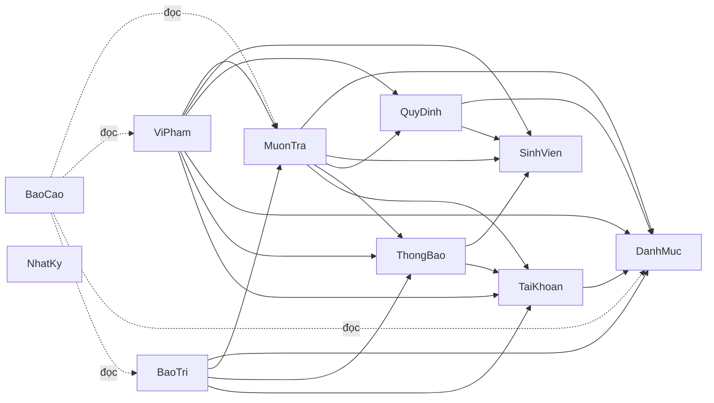

# QUY ƯỚC LẬP TRÌNH BACKEND (BACKEND CONVENTIONS)

## Hệ thống quản lý mượn trả thiết bị học tập cho sinh viên

| Mục | Nội dung |
|---|---|
| Trường / Khoa | Trường Đại học Công nghệ Thông tin – Khoa Công nghệ Phần mềm |
| Môn học | Đồ án môn Phát triển phần mềm hướng đối tượng (SE100) |
| Nhóm | Nhóm 13 |
| Phiên bản | 1.1 – nhóm đã duyệt các đề xuất ĐX-CV |
| Ngày lập | 24/10/2026 |
| Cập nhật gần nhất | 13/11/2026 (đồng bộ quyết định nhóm: .NET 9, nhánh nền `develop`, kiểm thử tích hợp trên PostgreSQL Supabase thay cho Testcontainers ở mục 2.1, 16, 17.1, 17.3, 18.1, 18.3); trước đó 06/11/2026 (khắc phục không nhất quán xuyên tài liệu, đồng bộ với backend-architecture.md v1.3: mục 1.1, 6.1, 6.3, 6.7, 8.2, 8.3, 8.5, 10.4, 12.2, 13.2, 16, 17.1, 17.2, 18.1, 21) |
| Căn cứ lập tài liệu | backend-architecture.md (v1.3, 06/11/2026); SRS.md (22/10/2026); Usecase.md v1.2; BusinessRule.md (BR-01 … BR-81); Authorization.md (ĐX-PQ-01 … ĐX-PQ-11) |

> Tài liệu quy định **cách viết mã và cách phối hợp** khi hiện thực backend, để mọi thành viên làm theo cùng một chuẩn. Tài liệu **không thêm yêu cầu nghiệp vụ mới** và không lặp lại toàn bộ thiết kế: kiến trúc, danh sách endpoint chi tiết và lược đồ dữ liệu xem `backend-architecture.md` (viết tắt **KT** khi dẫn mục, ví dụ "KT 6.4"). Nội dung nào không có trong năm tài liệu căn cứ được gắn nhãn **[ĐX-CV-xx]** và tổng hợp ở mục 21; nhóm đã duyệt toàn bộ các đề xuất này. Nhãn **[Đã chốt]**, **[ĐX-KT-xx]**, **[ĐX-xx]**, **[ĐX-PQ-xx]** giữ nguyên nghĩa như ở các tài liệu căn cứ.

**Mục lục**

1. Giới thiệu và phạm vi
2. Nền tảng kỹ thuật
3. Quy ước đặt tên
4. Cấu trúc mã nguồn và phụ thuộc giữa các module
5. Quy ước theo tầng
6. Quy ước API
7. Cơ sở dữ liệu và EF Core
8. Giao dịch, đồng thời và nhất quán dữ liệu
9. Thời gian, tiền và công thức
10. Xác thực và phân quyền
11. Nhật ký kiểm toán
12. Tác vụ nền
13. Thông báo email
14. Lưu trữ ảnh
15. Xử lý lỗi, ghi log, giám sát
16. Cấu hình và bí mật
17. Kiểm thử
18. Git, CI/CD và triển khai
19. Phong cách mã và tài liệu mã
20. Danh sách kiểm tra khi review
21. Danh mục ĐX-CV và các điểm đã cập nhật ngược nguồn

---

## 1. Giới thiệu và phạm vi

### 1.1 Mục đích và cách dùng

- Áp dụng cho toàn bộ mã backend (ASP.NET Core) của nhóm; mọi quy tắc trong tài liệu là **bắt buộc**. Quy tắc nào được bảo vệ tự động (kiểm thử kiến trúc, CI) được nêu ở mục tương ứng; các quy tắc còn lại kiểm bằng review theo danh sách ở mục 20.
- Căn cứ **nghiệp vụ**: BusinessRule.md, SRS.md, Usecase.md, Authorization.md. Căn cứ **kỹ thuật**: backend-architecture.md. Phát hiện mâu thuẫn giữa các tài liệu thì không tự chọn một bên mà ghi nhận để nhóm quyết định (mục 21).
- Truy vết: trong mã, test và mô tả pull request dùng các mã UC, FR, NFR, BR, GL, DM, CR, SSD như SRS (KT 1.3).
- Nguồn thẩm quyền của từng loại thông tin và quy tắc khi lệch: xem KT 1.4.

### 1.2 Phạm vi giai đoạn 1 (KT 1.2, KT-10)

| Nhóm | Use case |
|---|---|
| Trong phạm vi (16 UC Bắt buộc) | UC-01, UC-02, UC-05, UC-06, UC-07, UC-08, UC-09, UC-10, UC-11, UC-12, UC-13, UC-14, UC-15, UC-16, UC-17, UC-19 |
| Bổ sung do phụ thuộc | UC-03 Đăng ký chờ (**ĐX-KT-01**: UC-10 cần dữ liệu từ UC-03) |
| Ngoài giai đoạn 1 (điểm mở rộng) | UC-04, UC-18, UC-20, UC-21, UC-22, UC-23, UC-24 |

Quy tắc: không hiện thực use case ngoài phạm vi khi chưa được nhóm duyệt. Hai trường hợp **vẫn làm** dù use case liên quan hoãn: ghi nhật ký hệ thống (NFR-02, ĐX-KT-02) và bảng nhà cung cấp, chỉ đọc và gán cho thiết bị (UC-12, ĐX-KT-11). Máy trạng thái ở Domain (mục 5.1) đã liệt kê sẵn phương thức `Huy` của `PhieuYeuCauMuon` dù UC-20 để giai đoạn sau (KT 8.1).

### 1.3 Ký hiệu

| Ký hiệu | Ý nghĩa |
|---|---|
| **KT x.y** | Mục x.y của backend-architecture.md |
| **BR-xx, FR-xx, NFR-xx, UC-xx, DM-xx, GL-xx, CR-xx, SSD-xx** | Mã truy vết như SRS và BusinessRule |
| **[Đã chốt]**, **KT-01 … KT-12** | Quyết định kỹ thuật nhóm đã chốt (KT 2.1). **KT-13 … KT-22** là lựa chọn bổ sung do nhóm ủy quyền, nhóm đã duyệt (KT 2.2) |
| **[ĐX-CV-xx]** | Đề xuất của tài liệu này, nhóm đã duyệt (mục 21) |

---

## 2. Nền tảng kỹ thuật

### 2.1 Công nghệ bắt buộc dùng (KT 2, KT 3.3)

| Lớp | Công nghệ | Nguồn |
|---|---|---|
| Runtime, framework | ASP.NET Core, Minimal API, .NET 9 (nhóm chốt ngày 13/11/2026) | KT-01, KT-13, KT-14 |
| Kiến trúc | Modular monolith; trong mỗi module theo hướng clean architecture | KT-02 |
| CSDL | PostgreSQL trên Supabase; EF Core + Npgsql; truy vấn báo cáo và tra cứu nặng dùng SQL thuần (Dapper hoặc `FromSql`) | KT-03, KT-15 |
| Xử lý use case | Mỗi use case là một handler đăng ký DI; **không dùng thư viện mediator** | KT-16 |
| Kiểm tra dữ liệu vào | FluentValidation cho request; quy tắc nghiệp vụ nằm ở Domain | KT-17 |
| Xác thực | JWT Bearer (access và refresh token); mật khẩu NV/QT băm bằng `PasswordHasher` của Microsoft.Extensions.Identity.Core | KT-06, KT 7.4 |
| Tác vụ nền | `BackgroundService` + `PeriodicTimer` (cron trong tiến trình) | KT-07 |
| Email | Dịch vụ email qua **HTTP API** sau `IEmailSender` (đề xuất Brevo) | KT-08, KT-20 |
| Lưu ảnh | Supabase Storage sau `IAnhStorage` | KT-09 |
| API | REST + OpenAPI (thành phần có sẵn của ASP.NET Core); client Android sinh bằng openapi-generator (Java, Retrofit) | KT-04, KT-18 |
| Log | Serilog, JSON ra stdout | KT-19 |
| Xuất báo cáo | `.xlsx` (ClosedXML) và `.csv` | KT-21, ĐX-KT-09 |
| Kiểm thử | xUnit, PostgreSQL trên Supabase (môi trường `test`), `WebApplicationFactory`, NetArchTest, k6 | KT 17 |
| Đóng gói, triển khai | Docker; web trên Vercel; backend trên Render gói miễn phí | KT-12 |

Ghi chú: các mã KT-13 đến KT-22 trong bảng trên (phiên bản .NET, Minimal API, truy cập dữ liệu, handler, FluentValidation, OpenAPI, Serilog, email HTTP API, xuất báo cáo) là lựa chọn nhóm ủy quyền, nhóm đã duyệt theo KT 2.2; nếu nhóm đổi lựa chọn nào thì cập nhật bảng này.

### 2.2 Quy tắc chung về công nghệ

| Quy tắc | Nguồn / nhãn |
|---|---|
| Không dùng đĩa cục bộ để lưu dữ liệu (ảnh, tệp): hệ thống tệp của Render là tạm thời | KT-09, KT 3.4 |
| Không gửi email qua SMTP (Render chặn cổng 25, 465, 587 trên gói miễn phí) | KT-20, KT 3.4 |
| Không chạy migration lúc ứng dụng khởi động (tránh nhiều bản cùng chạy khi Render triển khai chồng) | KT 16.4 |
| Không tạo thêm dịch vụ Render miễn phí khác trong cùng workspace | KT 3.4 |
| Thư viện hoặc dịch vụ ngoài danh sách ở 2.1 chỉ được thêm khi nhóm đã duyệt | [ĐX-CV-04] |

---

## 3. Quy ước đặt tên

### 3.1 Nguyên tắc ngôn ngữ

- **Thuật ngữ nghiệp vụ** (thực thể, thuộc tính, trạng thái, use case) giữ nguyên tên tiếng Việt không dấu theo hồ sơ phân tích, ví dụ `PhieuMuon`, `ngayGioHenTra`. **Không dịch sang tiếng Anh** (không đặt `LoanSlip` cho `PhieuMuon`) (KT-11, KT 1.3) **[Đã chốt]**.
- **Thành phần kỹ thuật** dùng hậu tố hoặc tiền tố tiếng Anh theo mẫu của KT 4.3, KT 7.1: `Handler`, `Configuration`, `Repository`, `Endpoints`, `Contracts`, `Reader`, `Service`, `Outbox`, `Sender`, `Storage`, `Clock`.

### 3.2 Bảng quy ước

| Đối tượng | Quy ước | Ví dụ (nguồn) |
|---|---|---|
| Project | `QuanLyMuonTra.Api`, `QuanLyMuonTra.SharedKernel`, `QuanLyMuonTra.Infrastructure`; mỗi module một project chính `QuanLyMuonTra.Modules.{Module}` và một project `QuanLyMuonTra.Modules.{Module}.Contracts` | KT 4.4 |
| Project kiểm thử | `QuanLyMuonTra.UnitTests`, `QuanLyMuonTra.IntegrationTests`, `QuanLyMuonTra.ArchitectureTests`; kịch bản k6 ở `tests/load/` | KT 4.4 |
| Module | PascalCase: `TaiKhoan`, `SinhVien`, `DanhMuc`, `QuyDinh`, `MuonTra`, `ViPham`, `BaoTri`, `ThongBao`, `NhatKy`, `BaoCao` | KT 4.1 |
| Namespace | Theo project cộng thư mục tầng: `Domain`, `Application`, `Infrastructure`, `Presentation` | KT 4.4 |
| Lớp, phương thức C# | PascalCase. Lớp miền và phương thức nghiệp vụ dùng tiếng Việt không dấu | `PhieuMuon`, `ThietBi.Giao()`, `TinhPhi.SoNgayTre(...)`, `DanhDauQuaHan` (KT 4.3, 8.1) |
| Handler | Một handler cho một use case, tên `{HanhDong}{DoiTuong}Handler` | `DuyetPhieuHandler`, `DatTruocHandler`, `GiaoThietBiHandler`, `NhanTraHandler` (KT 4.3) |
| Interface (port, contract) | Tiền tố `I` | `IThongBaoOutbox`, `IEmailSender`, `IAnhStorage`, `ISchoolDirectory`, `IClock`, `ICurrentUser`, `IAuditLogger`, `IQuyenPhongService`, `IPhieuMuonReader`, `IThietBiService`, `IQuyenMuonService` (KT 4–12) |
| Cấu hình EF, repository | `{ThucThe}Configuration`, `Ef{ThucThe}Repository` | `PhieuMuonConfiguration`, `EfPhieuMuonRepository` (KT 4.3) |
| Nhóm endpoint | Hàm mở rộng `Map{Module}Endpoints()` | `MapMuonTraEndpoints()` (KT-14, KT 4.3) |
| Chính sách phân quyền | `SinhVien`, `NhanVien`, `QuanTri`, `NhanVienQuanTri` | KT 7.2 |
| Sự kiện miền | Tên mô tả sự việc đã xảy ra theo mẫu của nguồn, khai báo trong `{Module}.Contracts` | `GiuChoHetHan`, `PhieuYeuCauDaDuyet`, `BienBanDaLap`, `ThietBiDenHanBaoTri`, `ViPhamDaGhiNhan` (KT 4.5) |
| Job | Tên job như KT 9.2; lớp chạy lịch `SchedulerHostedService` | `NhacHanTra`, `DanhDauQuaHan`, `KhoaQuyenMuon`, `HetHanGiuCho`, `HetHieuLucPhieuChoDuyet`, `NhacBaoTri`, `GuiEmail`, `DongBoSinhVien`, `DonAnhMoCo` |
| Phương thức bất đồng bộ | Hậu tố `Async`, tham số cuối là `CancellationToken ct` | `XacThucAsync(string mssv, string matKhau, CancellationToken ct)` (KT 7.1) **[ĐX-CV-04]** |
| Schema, bảng, cột, ràng buộc CSDL | `snake_case` không dấu | `muon_tra.phieu_muon`, `ngay_gio_hen_tra` (KT 1.3) |
| Mã giá trị trạng thái, vai trò, loại thông báo | CHỮ HOA, gạch dưới, không dấu | `SAN_SANG`, `DANG_MUON`, `SINH_VIEN` (mục 3.3) |
| Đường dẫn API | Tiền tố `/api/v1`; tài nguyên theo tên miền không dấu, kebab-case | `/phieu-yeu-cau-muon`, `/thiet-bi` (KT 6.1) |
| Thuộc tính JSON và tham số truy vấn | camelCase theo hồ sơ phân tích | `maThietBi`, `ngayGioHenTra`, `?trangThai=`, `?kichThuoc=` (KT 6.1, 6.4) |
| Mã lỗi nghiệp vụ (`maLoi`) | CHỮ HOA, gạch dưới, không dấu | `THIET_BI_DA_DUOC_GIAO` (mục 6.7) |
| Biến môi trường, khóa cấu hình | `Phan__Khoa` (hai dấu gạch dưới phân cấp) | `Jwt__Secret`, `Email__ApiKey` (KT 15) |
| Khóa chống trùng thông báo (`khoa_trung_lap`) | `{LOAI}:{maDoiTuong}[:{moc}]` | `NHAC_HAN:{maPhieu}:{hanTra}`, `QUA_HAN:{maPhieu}`, `BAO_TRI:{maThietBi}:{ngayDenHan}` (KT 9.2) |
| Khóa lưu ảnh trong Storage | `{loai}/{yyyy}/{mm}/{uuid}`, do server sinh | KT 11.2 |
| Bucket | `thiet-bi-anh` (công khai chỉ đọc), `tinh-trang-anh` (riêng tư) | KT 11.1 |
| Mã job | `J1` … `J9` | KT 9.2 |

### 3.3 Mã giá trị của thuộc tính trạng thái (KT 5.4, SRS 6.3)

API trả về **mã**; tên hiển thị tiếng Việt do client ánh xạ. Không tự thêm hoặc đổi mã. Ba dòng `ThongBao.trangThaiGui`, nguồn giao thiết bị và giai đoạn ảnh lấy từ KT 5.5 và KT 6.4 (nguồn ghi ngay tại dòng); các dòng còn lại từ KT 5.4.

| Thuộc tính | Mã giá trị |
|---|---|
| ThietBi.tinhTrang | `SAN_SANG`, `DANG_DUOC_MUON`, `DANG_BAO_TRI_SUA_CHUA`, `DA_THANH_LY`, `DA_BAO_MAT` |
| PhieuYeuCauMuon.trangThai | `CHO_DUYET`, `DA_DUYET`, `TU_CHOI`, `DA_HUY`, `HET_HAN`, `DA_NHAN` |
| PhieuMuon.trangThai | `DANG_MUON`, `QUA_HAN`, `DA_TRA` |
| DangKyCho.trangThai | `DANG_CHO`, `DA_THONG_BAO`, `DA_NHAN`, `DA_HUY`, `HET_HAN` |
| ChiTietPhieuMuon.ketQuaKiemTra | `NGUYEN_VEN`, `HU_HONG`, `THIEU_PHU_KIEN`, `MAT` (rỗng trước khi trả) |
| BienBanViPham.trangThai | `CHUA_NOP`, `DA_NOP`, `DA_HUY` |
| ViPham.loaiViPham | `TRA_TRE`, `HU_HONG`, `MAT`, `KHONG_DEN_NHAN` |
| ChiTietBienBan.loaiViPham | `TRA_TRE`, `HU_HONG`, `MAT` (không có `KHONG_DEN_NHAN`) |
| SinhVien.trangThaiHoc | `DANG_HOC`, `TOT_NGHIEP`, `THOI_HOC`, `DINH_CHI` |
| SinhVien.trangThaiQuyenMuon | `BINH_THUONG`, `TAM_KHOA`, `CAM_MUON_DAI_HAN` |
| NguoiDungHeThong.trangThaiKhoa | `HOAT_DONG`, `TAM_KHOA_DANG_NHAP`, `BI_KHOA` |
| BaoTriSuaChua.loaiThucHien | `BAO_TRI_DINH_KY`, `SUA_CHUA` |
| BaoTriSuaChua.ketQua | `DUA_VE_SAN_SANG`, `DE_XUAT_THANH_LY` (rỗng khi đang thực hiện) |
| ThongBao.loaiThongBao | `NHAC_HAN_TRA`, `QUA_HAN`, `THIET_BI_CHO_SAN_SANG`, `DUYET_HOAC_TU_CHOI`, `VI_PHAM_PHI_PHAT`, `NHAC_NHO_NV`, `NHAC_BAO_TRI` |
| ThongBao.kenhGui | `UNG_DUNG`, `EMAIL`, `SMS` (giai đoạn 1 không dùng `SMS`) |
| ThongBao.trangThaiGui (cột bổ sung, KT 5.5) | `CHO_GUI`, `DANG_GUI`, `DA_GUI`, `LOI`, `LOI_VINH_VIEN` |
| Vai trò trong token | `SINH_VIEN`, `NHAN_VIEN`, `QUAN_TRI` |
| Nguồn giao thiết bị (body lập phiếu mượn) | `PHIEU_YEU_CAU`, `DANG_KY_CHO`, `TRUC_TIEP` (KT 6.4) |
| Giai đoạn ảnh (`luu_tru.anh_tai_len.giai_doan`) | `BAN_DAU`, `KHI_TRA`, `THIET_BI` (KT 5.5) |

### 3.4 Mã chứng từ [ĐX-CV-06]

Bản gốc của KT 5.1 chỉ nêu cách sinh (`ma_yeu_cau`, `ma_phieu`, `ma_dang_ky`, `ma_bien_ban`, `ma_quyet_dinh` do **sequence PostgreSQL** sinh, định dạng *tiền tố + ngày + số thứ tự*, chấp nhận khoảng trống số) và ví dụ duy nhất `PM-261024-000123`, chưa có tiền tố của các loại còn lại. Quy ước đã được nhóm duyệt và cập nhật vào KT 5.1 (v1.2): định dạng `{tiềnTố}-{yyMMdd}-{6 chữ số}`, ngày theo múi giờ Asia/Ho_Chi_Minh.

| Cột | Tiền tố |
|---|---|
| `ma_phieu` (phiếu mượn) | `PM` (theo ví dụ của nguồn) |
| `ma_yeu_cau` (phiếu yêu cầu mượn) | `YC` |
| `ma_dang_ky` (đăng ký chờ) | `DK` |
| `ma_bien_ban` (biên bản vi phạm) | `BB` |
| `ma_quyet_dinh` (quyết định thanh lý) | `QD` |

---

## 4. Cấu trúc mã nguồn và phụ thuộc giữa các module

### 4.1 Cấu trúc thư mục (KT 4.4)

```
QuanLyMuonTra/
├─ src/
│  ├─ QuanLyMuonTra.Api/                 # Host: Program.cs, middleware, xác thực, OpenAPI, ghép module
│  ├─ QuanLyMuonTra.SharedKernel/        # Entity, AggregateRoot, Result, DomainEvent, IClock, VnTime
│  ├─ QuanLyMuonTra.Infrastructure/      # AppDbContext, interceptor nhật ký, email, lưu ảnh, chạy lịch job
│  └─ Modules/
│     ├─ MuonTra/
│     │  ├─ QuanLyMuonTra.Modules.MuonTra/            # Domain/ Application/ Infrastructure/ Presentation/
│     │  └─ QuanLyMuonTra.Modules.MuonTra.Contracts/  # interface, DTO, sự kiện công khai
│     ├─ ViPham/        (cấu trúc tương tự)
│     ├─ DanhMuc/  QuyDinh/  SinhVien/  TaiKhoan/  BaoTri/  ThongBao/  NhatKy/  BaoCao/
├─ tests/
│  ├─ QuanLyMuonTra.UnitTests/
│  ├─ QuanLyMuonTra.IntegrationTests/
│  ├─ QuanLyMuonTra.ArchitectureTests/
│  └─ load/                              # kịch bản k6
├─ db/                                   # script seed, script pg_dump, SQL trigger và grant
├─ Dockerfile
└─ render.yaml
```

Quy tắc: mỗi module là **một project chính** (các tầng là thư mục và namespace) cộng **một project `Contracts`**. Module chỉ tham chiếu project `Contracts` của module khác bằng project reference (KT 4.4).

### 4.2 Module, schema và dữ liệu sở hữu (KT 4.1, 5.1)

| Module | Schema | Thực thể sở hữu (DM) | Trách nhiệm |
|---|---|---|---|
| TaiKhoan | `tai_khoan` | DM-01, 02, 03 | Tài khoản NV, QT; đăng nhập NV/QT; phát hành JWT; quyền theo phòng |
| SinhVien | `sinh_vien` | DM-04, 05 | Dữ liệu SV và nhóm do nhà trường cung cấp; đăng nhập SV; trạng thái quyền mượn; đồng bộ |
| DanhMuc | `danh_muc` | DM-08, 09, 10, 11, 12 | Phòng, loại thiết bị, thiết bị, lịch sử giá trị, nhà cung cấp |
| QuyDinh | `quy_dinh` | DM-06, 07, 21 | Quy định mượn theo nhóm, tham số hệ thống, khung phạt |
| MuonTra | `muon_tra` | DM-13, 14, 15, 16, 17 | Tra cứu, phiếu yêu cầu, danh sách chờ, giữ chỗ, giao, phiếu mượn, nhận trả |
| ViPham | `vi_pham` | DM-18, 19, 20 | Vi phạm, biên bản, phí và bồi thường, khóa và mở khóa quyền mượn |
| BaoTri | `bao_tri` | DM-22, 23 | Bảo trì, sửa chữa, quyết định thanh lý |
| ThongBao | `thong_bao` | DM-25 | Hàng đợi thông báo (outbox), gửi email |
| NhatKy | `nhat_ky` | DM-26 | Nhật ký kiểm toán chỉ thêm |
| BaoCao | (không có) | (không có) | Báo cáo, thống kê, chỉ đọc nhiều schema |

Ngoài module: schema `luu_tru` (ảnh tải lên, do hạ tầng quản lý) và schema `truong_gia_lap` (mô phỏng hệ thống nhà trường, KT-05). DM-24 (PhanHoiTinhTrang) thuộc UC-21, để giai đoạn sau.

### 4.3 Các tầng và hướng phụ thuộc (KT 4.3)

```
Presentation   ->  Application  ->  Domain
Infrastructure ->  Application, Domain
Domain không phụ thuộc tầng nào (chỉ dùng SharedKernel)
```

| Tầng | Chứa | Không được chứa |
|---|---|---|
| Domain | Thực thể, aggregate, giá trị, enum, quy tắc nghiệp vụ, máy trạng thái, sự kiện miền, hàm công thức thuần | EF Core, ASP.NET, truy cập CSDL, HTTP |
| Application | Handler từng use case, validator, giao diện (port) tới hạ tầng, job | Tham chiếu `Infrastructure` hoặc `Presentation` |
| Infrastructure | Cấu hình EF Core, repository, truy vấn SQL, hiện thực các port | Quy tắc nghiệp vụ |
| Presentation | Endpoint Minimal API, model request và response, chính sách phân quyền gắn vào endpoint | Quy tắc nghiệp vụ (nằm ở Domain, KT-17) |

### 4.4 Phụ thuộc giữa các module

Quy tắc: module chỉ phụ thuộc vào `Contracts` của module khác, không tham chiếu mã nội bộ; đồ thị **không có chu trình** (KT 4.2).



**[ĐX-CV-01]** Ba cạnh `MuonTra → TaiKhoan`, `ViPham → TaiKhoan`, `BaoTri → TaiKhoan` **không có** ở sơ đồ KT 4.2 bản gốc, nhưng KT 7.2 và KT 8.3 yêu cầu kiểm tra phòng của NV qua `IQuyenPhongService` (module `TaiKhoan`). Nhóm đã chọn thêm ba cạnh, gọi qua `TaiKhoan.Contracts`; thêm cạnh không tạo chu trình vì `TaiKhoan` chỉ phụ thuộc `DanhMuc`. Sơ đồ KT 4.2 (v1.2) đã được cập nhật.

Quy tắc đi kèm sơ đồ (KT 4.2, 4.5):

| Quy tắc | Nội dung |
|---|---|
| Không phụ thuộc ngược | `MuonTra` **không** phụ thuộc `ViPham`. Khi giữ chỗ hết hạn, `MuonTra` phát sự kiện `GiuChoHetHan` (khai báo ở `MuonTra.Contracts`); `ViPham` xử lý để ghi vi phạm `KHONG_DEN_NHAN` (BR-31, BR-63) |
| Đọc dữ liệu phiếu | `ViPham` đọc phiếu qua `IPhieuMuonReader` trong `MuonTra.Contracts` (UC-09 bước 1) |
| Nhật ký | Không module nào gọi `NhatKy` trực tiếp; interceptor ở hạ tầng ghi nhật ký (mục 11) |
| Truy vấn chỉ đọc | Chỉ truy vấn tra cứu (UC-01) và báo cáo (UC-16) được `JOIN` nhiều schema bằng SQL chỉ đọc. Mọi thao tác **ghi** luôn đi qua module sở hữu dữ liệu |
| Kiểm tra tham chiếu khi xóa danh mục | `DanhMuc` và `QuyDinh` không phụ thuộc các module chứng từ: chúng khai báo `IThamChieuDanhMucProvider`, `IThamChieuKhungPhatProvider` trong `Contracts`, còn `MuonTra`, `ViPham`, `BaoTri`, `QuyDinh` hiện thực (đảo phụ thuộc, mục 6.3), nên đồ thị ở trên không đổi |

### 4.5 Cách module giao tiếp (KT 4.5)

| Cơ chế | Dùng khi | Ví dụ |
|---|---|---|
| Gọi đồng bộ qua `Contracts` | Cần kết quả ngay, cùng giao dịch | `MuonTra` gọi `IThietBiService.DatDangDuocMuon(...)`; `ViPham` gọi `IQuyenMuonService.Khoa(...)` |
| Sự kiện miền trong tiến trình | Tác dụng phụ không thuộc lõi nghiệp vụ; gửi **trước khi commit**, cùng giao dịch | `GiuChoHetHan`, `PhieuYeuCauDaDuyet`, `BienBanDaLap`, `ThietBiDenHanBaoTri`, `ViPhamDaGhiNhan` |
| Hàng đợi thông báo (outbox) | Mọi thông báo gửi cho SV hoặc NV | Handler ghi dòng vào `thong_bao`; job `GuiEmail` gửi sau (mục 13) |

Cả ba cơ chế chạy trong **một giao dịch cơ sở dữ liệu** với **một `AppDbContext` dùng chung** (**ĐX-KT-08**), vì NFR-06 đòi các thay đổi nhiều bảng của một thao tác giao, trả hoặc duyệt phải nguyên tử. Ranh giới module được bảo vệ bằng project reference, `Contracts` và kiểm thử kiến trúc (mục 17), không bằng cách tách DbContext.

### 4.6 Kiểm thử kiến trúc tự động (KT 4.6)

Dùng NetArchTest trong `QuanLyMuonTra.ArchitectureTests`, chạy ở CI. Bốn quy tắc bắt buộc luôn đạt:

1. `Domain` không phụ thuộc `Application`, `Infrastructure`, `Presentation`, EF Core hay ASP.NET.
2. `Application` không phụ thuộc `Infrastructure` và `Presentation`.
3. Module không tham chiếu namespace nội bộ của module khác, chỉ tham chiếu `*.Contracts`.
4. Mọi endpoint phải gắn chính sách phân quyền, trừ danh sách ngoại lệ: đăng nhập, làm mới token, `/health` (NFR-01). Xem thêm **[ĐX-CV-08]** ở mục 10.1.

---

## 5. Quy ước theo tầng

### 5.1 Domain

| Quy tắc | Nguồn |
|---|---|
| Mỗi aggregate expose **các phương thức chuyển trạng thái**; mỗi phương thức kiểm tra trạng thái nguồn theo SRS mục 7 và ném lỗi `TRANG_THAI_KHONG_HOP_LE` nếu trái quy tắc | KT 8.1 |
| **Không** có endpoint hay mã ngoài Domain ghi trực tiếp cột trạng thái | KT 8.1 |
| Công thức phí, số ngày trễ, hạn trả, bồi thường là **hàm miền thuần** (không đọc đồng hồ hệ thống, không truy cập CSDL); thời gian đưa vào qua tham số hoặc `IClock` | KT 8.5, NFR-09 |
| Quy tắc nghiệp vụ nằm ở Domain; validator ở Application chỉ kiểm tra cú pháp dữ liệu vào | KT-17 |
| Kế thừa lớp nền của `SharedKernel`: `Entity`, `AggregateRoot`, `DomainEvent` | KT 4.4 |
| Thực thể cần ghi vết gắn marker `IAuditable` (mục 11) | KT 12.2 |

Máy trạng thái bắt buộc hiện thực (KT 8.1; đối chiếu BusinessRule mục 17):

| Aggregate | Phương thức (trạng thái nguồn → đích) |
|---|---|
| ThietBi | `NhapKho` (khởi tạo → SAN_SANG); `Giao` (SAN_SANG → DANG_DUOC_MUON); `NhanTraNguyenVen` (DANG_DUOC_MUON → SAN_SANG); `NhanTraHuHong` (DANG_DUOC_MUON → DANG_BAO_TRI_SUA_CHUA); `DanhDauMat` (DANG_DUOC_MUON → DA_BAO_MAT); `ChuyenBaoTri` (SAN_SANG → DANG_BAO_TRI_SUA_CHUA); `HoanThanhBaoTri` (DANG_BAO_TRI_SUA_CHUA → SAN_SANG); `ThanhLy` (SAN_SANG hoặc DANG_BAO_TRI_SUA_CHUA → DA_THANH_LY) |
| PhieuYeuCauMuon | `Duyet` (CHO_DUYET → DA_DUYET); `TuChoi` (CHO_DUYET → TU_CHOI); `HetHan` (CHO_DUYET hoặc DA_DUYET → HET_HAN); `DanhDauDaNhan` (DA_DUYET → DA_NHAN); `Huy` (CHO_DUYET hoặc DA_DUYET → DA_HUY, UC-20 giai đoạn sau) |
| DangKyCho | `ThongBaoDenLuot` (DANG_CHO → DA_THONG_BAO); `DanhDauDaNhan` (DA_THONG_BAO → DA_NHAN); `Roi` (DANG_CHO hoặc DA_THONG_BAO → DA_HUY); `HetHan` (DA_THONG_BAO → HET_HAN) |
| PhieuMuon | `DanhDauQuaHan` (DANG_MUON → QUA_HAN); `XetDaTra` (DANG_MUON hoặc QUA_HAN → DA_TRA khi mọi chi tiết có kết quả kiểm tra) |
| BienBanViPham | `DanhDauDaNop` (CHUA_NOP → DA_NOP); `Huy` (CHUA_NOP hoặc DA_NOP → DA_HUY, chỉ QT) |

Hai điểm cần nhớ khi viết nghiệp vụ trả thiết bị (KT 8.1):

- Hư hỏng khi trả: `NhanTraHuHong` chuyển thiết bị sang `DANG_BAO_TRI_SUA_CHUA` **ngay lúc ghi kết quả kiểm tra** (BR-51, UC-08 A2). BR-51 áp dụng cho cả kết quả `HU_HONG` và `THIEU_PHU_KIEN`; kết quả `MAT` chuyển thiết bị sang `DA_BAO_MAT` bằng `DanhDauMat`. Bản ghi `bao_tri_sua_chua` do NV tạo sau ở UC-11.
- Danh sách "chờ tiếp nhận sửa chữa" được **suy ra**: thiết bị đang `DANG_BAO_TRI_SUA_CHUA` chưa có bản ghi bảo trì còn mở; không có trạng thái riêng.

### 5.2 Application

| Quy tắc | Nguồn |
|---|---|
| Mỗi use case một handler đăng ký DI; không dùng mediator | KT-16 |
| Một lần xử lý use case ghi dữ liệu là **một giao dịch**: lỗi ở bất kỳ bước nào thì hoàn tác toàn bộ | KT 4.5, 8.3, 8.4 |
| Thứ tự trong handler ghi dữ liệu: (1) kiểm tra quyền phòng của NV; (2) `BEGIN`; (3) lấy khóa theo thứ tự cố định (mục 8.2); (4) kiểm tra điều kiện và tính toán; (5) ghi thay đổi bằng cập nhật có điều kiện; (6) ghi thông báo vào outbox; (7) ghi nhật ký (cùng giao dịch); (8) `COMMIT` | KT 8.3, 8.4 |
| Handler **không** gọi trực tiếp việc gửi email; chỉ ghi dòng `thong_bao` qua `IThongBaoOutbox` (mục 13) | KT 4.3, 4.5, 10.2 |
| Mỗi job của UC-17 nằm trong module sở hữu dữ liệu tương ứng (bảng ở mục 12); phần chạy lịch nằm ở hạ tầng | KT 4.1 |
| Truy cập dữ liệu của module khác chỉ qua `Contracts` (mục 4.4) | KT 4.2 |
| Lỗi nghiệp vụ ném từ Domain hoặc Application, kèm `maLoi` ở mục 6.7; **không** trả mã HTTP trực tiếp từ handler | KT 14 |
| Kiểu `Result` của `SharedKernel` dùng cho kết quả của các thao tác kiểm tra không có tác dụng phụ (các endpoint `/kiem-tra…`, KT 6.4); vi phạm quy tắc khi thực hiện hành động thì ném lỗi nghiệp vụ | **[ĐX-CV-07]** |

### 5.3 Infrastructure

| Quy tắc | Nguồn |
|---|---|
| Một `AppDbContext` dùng chung; EF Core + Npgsql | KT-15, ĐX-KT-08 |
| Truy vấn **tra cứu**: `AsNoTracking`, phép chiếu (projection) sang DTO, phân trang bắt buộc, tránh N+1; quét thẻ SV và thiết bị truy vấn theo khóa chính hoặc khóa duy nhất | NFR-03, KT 13 |
| Truy vấn **báo cáo** và tra cứu nặng dùng SQL thuần (Dapper hoặc `FromSql`) | KT-15 |
| `IMemoryCache` 5 đến 10 giây chỉ cho kết quả tra cứu **hiển thị**; kiểm tra để ra quyết định nghiệp vụ luôn đọc dữ liệu thật | KT 13 (NFR-03) |
| Hiện thực port: `MockSchoolDirectory`, `HttpEmailSender`, `LogEmailSender`, `SupabaseAnhStorage`, ... đặt ở `Infrastructure`; đổi nhà cung cấp chỉ thay bản hiện thực | KT 7.1, 10.3, 11.1 |

### 5.4 Presentation

| Quy tắc | Nguồn |
|---|---|
| Endpoint Minimal API gom theo module qua `Map{Module}Endpoints()`; chính sách vai trò gắn ở **cấp nhóm endpoint** | KT-14, KT 6.1 |
| Endpoint chỉ nhận request, gọi handler, trả response; không chứa quy tắc nghiệp vụ | KT 4.3, KT-17 |
| Dùng model request và response riêng; không trả thực thể Domain ra ngoài | KT 4.3 |
| Không có tham số `maSV` ở nhóm `/sv`; mã SV lấy từ claim (mục 10.2) | KT 6.1, BR-06 |
| Request chạy qua FluentValidation trước khi vào handler | KT-17 |

---

## 6. Quy ước API

Danh sách endpoint chi tiết (đường dẫn, UC, ghi chú) nằm ở KT 6.2 đến 6.5 và là căn cứ chính; mục này chỉ quy định cách đặt và cách dùng.

### 6.1 Quy ước chung (KT 6.1)

| Nội dung | Quy ước |
|---|---|
| Kiểu | REST qua HTTPS, JSON, tiền tố `/api/v1` |
| Đặt tên | Tài nguyên theo tên miền không dấu, kebab-case (`phieu-yeu-cau-muon`, `thiet-bi`); thuộc tính JSON camelCase theo hồ sơ phân tích (`maThietBi`, `ngayGioHenTra`) **[Đã chốt]** |
| Thời gian | ISO 8601 có múi giờ (UTC); client tự hiển thị giờ Việt Nam |
| Tiền | Số nguyên VNĐ (không có phần lẻ) |
| Phân trang | `?trang=1&kichThuoc=20` (tối đa 100); phản hồi có `tongSo` |
| Tài liệu | `openapi.yaml` là hợp đồng thiết kế (contract-first, ĐX-API-30); `openapi.json` sinh từ mã phải khớp hợp đồng; CI lưu `openapi.json` làm artifact để sinh client Android và báo lỗi nếu lệch `openapi.yaml` |
| Lỗi | RFC 9457 `application/problem+json`, thêm trường `maLoi` (bảng ở mục 6.7) và `traceId` |
| Giao dịch nhiều bước tại quầy | Không giữ phiên phía server. Các sự kiện tuần tự của SSD (quét thiết bị, ghi tình trạng, lập phiếu) được ánh xạ thành **các endpoint kiểm tra không có tác dụng phụ** và **một endpoint lập phiếu nguyên tử** |

### 6.2 Khu vực, vai trò và chính sách (KT 6.1, 7.2)

| Tiền tố | Tác nhân | Chính sách gắn ở cấp nhóm endpoint |
|---|---|---|
| `/api/v1/auth` | Công khai và phiên | `dang-nhap` (SV, NV/QT) và `lam-moi`: không có chính sách (ngoại lệ NFR-01); `GET toi`: `NhanVienQuanTri`; `dang-xuat`: xem **[ĐX-CV-08]** ở mục 10.1 |
| `/api/v1/sv` | Sinh viên | `SinhVien` |
| `/api/v1/quay` | Nhân viên | `NhanVien` |
| `/api/v1/quan-tri` | Quản trị viên | `QuanTri` |
| `/api/v1/anh` | NV và QT (tải ảnh) | `NhanVienQuanTri` |

Quản trị viên **không có** endpoint nghiệp vụ quầy (KT 7.2, ĐX-PQ-02): giao, nhận trả, duyệt phiếu thuộc `/quay`.

### 6.3 Đặt tên endpoint và hành động

Quy ước rút ra từ danh sách endpoint ở KT 6.2 đến 6.5:

| Loại thao tác | Cách đặt | Ví dụ |
|---|---|---|
| Truy vấn | `GET`; bộ lọc là tham số truy vấn camelCase | `GET /phieu-yeu-cau-muon?trangThai=CHO_DUYET&maPhong=` |
| Tạo | `POST` vào tập tài nguyên | `POST /phieu-muon`, `POST /bien-ban-vi-pham` |
| Sửa | `PUT` | `PUT /nhan-vien/{ma}/quyen-phong` |
| Chuyển trạng thái hoặc hành động nghiệp vụ | `POST /{tai-nguyen}/{ma}/{hanh-dong}`, hành động là động từ kebab-case không dấu | `duyet`, `tu-choi`, `roi`, `chuyen-luot`, `hoan-thanh`, `da-nop`, `khoa`, `mo-khoa`, `tat`, `dat-lai-mat-khau`, `ngung-su-dung`, `huy` |
| Kiểm tra không có tác dụng phụ | `GET .../kiem-tra`, hoặc `POST .../kiem-tra-*` khi cần body; **không** được ghi dữ liệu, không đổi trạng thái | `GET /phieu-yeu-cau-muon/{ma}/kiem-tra`, `POST /phieu-muon/kiem-tra-thiet-bi` |
| Thao tác nhiều bước phải nguyên tử | Một endpoint duy nhất, một giao dịch (mục 8) | `POST /quay/phieu-muon` (UC-07) |
| Xóa cứng (chỉ khi chưa có lịch sử hoặc chưa dùng) **[ĐX-CV-09]** | `DELETE /{tai-nguyen}/{ma}` | `DELETE /quan-tri/loai-thiet-bi/{ma}`, `DELETE /quan-tri/thiet-bi/{ma}`, `DELETE /quan-tri/cau-hinh/khung-phat/{ma}` |
| "Xóa" dữ liệu đã có lịch sử | `POST .../ngung-su-dung` (đặt cờ `ngung_su_dung`), không xóa cứng (BR-18) | `POST /quan-tri/thiet-bi/{ma}/ngung-su-dung` (theo mẫu KT 6.5) |

Ghi chú:

- Danh sách endpoint ở KT 6.2 đến 6.5 chỉ có `GET`, `POST`, `PUT`; ba endpoint `DELETE` ở **[ĐX-CV-09]** là phần bổ sung của ĐX-CV; các endpoint `GET` bổ sung theo ĐX-API-25 xem KT 6.3 đến 6.5; không dùng `PATCH`.
- **[ĐX-CV-09]** UC-12 (bước 3, 4) và UC-13 E2 nêu thao tác "xóa", và KT 6.6 có mã `KHUNG_PHAT_DA_DUNG_KHONG_XOA`, nhưng KT 6.5 không có endpoint xóa. Nhóm đã chọn bổ sung ba endpoint `DELETE` thuộc nhóm `/quan-tri` (chính sách `QuanTri`):
  - `DELETE /loai-thiet-bi/{ma}` và `DELETE /thiet-bi/{ma}`: chỉ xóa cứng khi chưa có lịch sử và không còn đối tượng phụ thuộc. Ngược lại trả `409` với `DA_CO_LICH_SU_CHI_NGUNG_SU_DUNG` và client gọi `POST .../ngung-su-dung` (BR-18, UC-12 E2).
  - `DELETE /cau-hinh/khung-phat/{ma}`: chỉ xóa khi khung chưa dùng. Nếu đã dùng thì trả `409` với `KHUNG_PHAT_DA_DUNG_KHONG_XOA`; khung đã dùng chỉ được tắt bằng `POST .../tat`, đặt `dang_su_dung = false` (UC-13 E2, FR-37).
  - Nguồn không định nghĩa "lịch sử"; tiêu chí ở bảng dưới do tài liệu này đề xuất và nhóm đã duyệt.
- Số tiền của biên bản do **server tính lại**, không tin giá trị client gửi (`POST /quay/bien-ban-vi-pham`, KT 6.4).
- Thiết bị trong phiếu mượn và hành động nhận trả do **NV** thực hiện tại quầy; ứng dụng SV chỉ đặt trước (Authorization mục 7, BR-01).

**Tiêu chí xóa cứng [ĐX-CV-09, nhóm đã duyệt].** Việc kiểm tra và lệnh xóa chạy trong **một giao dịch** (mục 8.1). Bảng dưới liệt kê các bản ghi làm đối tượng bị từ chối xóa cứng (trả `409`).

| Đối tượng | Từ chối xóa cứng khi tồn tại bản ghi nào sau đây | Khi xóa được, xóa kèm trong cùng giao dịch |
|---|---|---|
| Thiết bị | `chi_tiet_phieu_muon`, `chi_tiet_bien_ban`, `bao_tri_sua_chua` hoặc `chi_tiet_thanh_ly` tham chiếu tới thiết bị; hoặc `tinh_trang` khác `SAN_SANG` | `lich_su_gia_tri`, bảng nối nhà cung cấp và ảnh danh mục của chính thiết bị (ảnh được gỡ liên kết để job `DonAnhMoCo` dọn) |
| Loại thiết bị | Còn `thiet_bi` thuộc loại (kể cả đã ngưng sử dụng, thanh lý hoặc báo mất); hoặc `chi_tiet_yeu_cau_muon`, `dang_ky_cho`, `quy_dinh_muon` ngoại lệ theo loại tham chiếu tới loại | Bảng nối nhà cung cấp của loại |
| Khung phạt | `chi_tiet_phieu_muon` (khung đã chọn khi trả) hoặc `chi_tiet_bien_ban` tham chiếu tới khung | Không có |

Ghi chú:

- `lich_su_gia_tri` **không** được tính là lịch sử: mỗi thiết bị có ít nhất một giá trị từ lúc nhập kho, nếu tính thì không thiết bị nào xóa được; giá trị này chỉ cần để tính bồi thường cho chứng từ, mà thiết bị chưa có chứng từ thì không cần.
- `tinh_trang` khác `SAN_SANG` (đang mượn, đang bảo trì/sửa chữa, đã thanh lý, đã báo mất) luôn là hệ quả của một chứng từ nên coi là có lịch sử (BR-18: thiết bị đã thanh lý vẫn giữ lịch sử).
- `dang_su_dung` của khung phạt là cờ bật/tắt (FR-37 dùng chữ "tắt"), **không** phải dấu hiệu "đã dùng": khung đã dùng vẫn được tắt, khung chưa dùng có thể tắt hoặc xóa.
- Các bảng chứng từ thuộc module khác, nên `DanhMuc` và `QuyDinh` **không** đọc trực tiếp (xem mục 4.4). `DanhMuc.Contracts` khai báo `IThamChieuDanhMucProvider` (thiết bị, loại) và `QuyDinh.Contracts` khai báo `IThamChieuKhungPhatProvider`; `MuonTra`, `ViPham`, `BaoTri` và `QuyDinh` hiện thực phần bảng mình sở hữu; handler xóa nhận tất cả bản hiện thực qua DI.
- Thao tác xóa cũng được ghi nhật ký (giá trị trước khi xóa, mục 11).

### 6.4 Phạm vi dữ liệu trong API (KT 6.1, 7.2)

| Vai trò | Quy tắc bắt buộc |
|---|---|
| SV | Mã SV **luôn lấy từ claim `sub` của token**, không bao giờ từ tham số đường dẫn, query hay body (BR-06). Mọi truy vấn của SV lọc theo mã đó. Truy cập tài nguyên của người khác (ví dụ `phieu-yeu-cau-muon/{ma}` không phải của mình) trả `403` với `KHONG_DU_QUYEN` |
| NV | Truy vấn danh sách tự thêm điều kiện `ma_phong IN (phòng được cấp quyền)`. Truy cập từng đối tượng thuộc phòng chưa được cấp quyền gọi `EnsureAsync(maNV, maPhong)` và trả `403` với `PHONG_CHUA_CAP_QUYEN` (UC-06 E2, UC-18 E1) |
| QT | Không giới hạn theo phòng (ĐX-PQ-02) |

### 6.5 Phản hồi thành công

- Thao tác tạo chứng từ trả `201` (lập phiếu mượn, KT 8.4); thao tác hành động trên chứng từ có sẵn trả `200` (duyệt phiếu, KT 8.3).
- Danh sách phân trang luôn có `tongSo`. Tham số `kichThuoc` tối đa 100 (nguồn lấy ví dụ 20).
- **[ĐX-CV-11]** Bản gốc KT 6.1 chưa nêu tên trường chứa danh sách, giá trị mặc định của `kichThuoc` và cách xử lý khi vượt mức. Quy ước (đã cập nhật vào KT 6.1): `kichThuoc` mặc định 20; phản hồi dạng `{ "tongSo": 0, "trang": 1, "kichThuoc": 20, "danhSach": [] }`; `trang < 1` hoặc `kichThuoc` ngoài khoảng 1 đến 100 trả `400` với `DU_LIEU_KHONG_HOP_LE`.
- Kết quả tra cứu thiết bị cho SV trả theo loại thiết bị và phòng kèm số lượng khả dụng (BR-20); khi hết hàng trả `ngayDuKienCoSan` (ĐX-KT-05).
- Phản hồi liên quan ảnh riêng tư trả URL có chữ ký 10 phút, không trả khóa lưu trữ (mục 14).

### 6.6 Lỗi

Mọi lỗi trả về dạng `application/problem+json` (RFC 9457) do **một middleware** duy nhất tạo ra (KT 14). Không handler hay endpoint tự dựng phản hồi lỗi riêng.

| Phân loại | Mã HTTP | Cách xử lý |
|---|---|---|
| Lỗi nghiệp vụ | Theo bảng 6.7 | Ném từ Domain hoặc Application kèm `maLoi`; middleware ánh xạ sang mã HTTP |
| Dữ liệu vào không hợp lệ | 400 | Kèm danh sách trường lỗi (FluentValidation) |
| Xung đột cập nhật đồng thời (`xmin`) | 409 | `DbUpdateConcurrencyException` được chuyển thành `XUNG_DOT_CAP_NHAT` |
| Lỗi hệ thống | 500 | Không lộ chi tiết nội bộ (SQL, stack trace, chuỗi kết nối); chỉ trả `traceId` |

Cách chọn mã HTTP cho lỗi nghiệp vụ (rút ra từ bảng 6.7):

| Mã | Dùng khi |
|---|---|
| 401 | Thiếu hoặc sai thông tin xác thực |
| 403 | Không đủ quyền, sai phạm vi dữ liệu, tài khoản bị khóa |
| 409 | Xung đột với trạng thái hiện tại, xung đột đồng thời hoặc trùng khóa duy nhất |
| 422 | Dữ liệu hợp lệ về cú pháp nhưng vi phạm quy tắc nghiệp vụ |

**[ĐX-CV-02]** Quy ước sử dụng: client dựa vào `maLoi` (ổn định) để hiển thị lý do, không phân tích nội dung `detail`; danh sách trường lỗi của mã `400` đặt trong trường `errors` (từ khóa trường → danh sách thông báo), theo `ValidationProblemDetails` của ASP.NET Core.

### 6.7 Bảng mã lỗi nghiệp vụ

Bảng này khớp hoàn toàn với KT 6.6 (v1.3). So với bản gốc của KT 6.6, sáu dòng đánh dấu **[ĐX-CV-02]**, một dòng đánh dấu **[ĐX-CV-09]** và mã `MA_NV_TRUNG` (ĐX-API-26) là mã bổ sung, nhóm đã duyệt vì bản gốc chưa có mã cho tình huống mà chính KT hoặc use case đã nêu.

| `maLoi` | HTTP | Tình huống | Nguồn |
|---|---|---|---|
| `DANG_NHAP_SAI` | 401 | Thông tin đăng nhập không đúng | UC-19 E1 |
| `TAI_KHOAN_BI_KHOA` | 403 | Tài khoản bị khóa hoặc tạm khóa đăng nhập. Cũng dùng khi token còn hạn nhưng tài khoản NV/QT đã bị khóa (KT 7.2) **[ĐX-CV-02]** | UC-19 E2, E3 |
| `KHONG_DU_QUYEN` | 403 | Truy cập chức năng ngoài vai trò, hoặc dữ liệu của người khác | NFR-01, BR-06 |
| `PHONG_CHUA_CAP_QUYEN` | 403 | NV truy cập đối tượng thuộc phòng chưa được cấp quyền | UC-06 E2, UC-18 E1 |
| `SV_THE_HET_HAN`, `SV_KHONG_CON_THEO_HOC`, `SV_BI_KHOA_QUYEN_MUON` | 422 | Không được đặt trước hoặc mượn | BR-23, UC-02 E1, UC-07 E1 |
| `VUOT_GIOI_HAN_THIET_BI`, `VUOT_THOI_GIAN_MUON_TOI_DA` | 422 | Vượt giới hạn của nhóm | BR-24, BR-25 |
| `SO_LUONG_KHA_DUNG_THAY_DOI` | 409 | Số lượng khả dụng thay đổi khi gửi hoặc duyệt | UC-02 E2 |
| `CON_HANG_KHONG_DANG_KY_CHO` | 422 | Đăng ký chờ khi còn hàng | BR-33 |
| `GIU_CHO_HET_HAN` | 409 | Giao theo giữ chỗ đã quá 30 phút | UC-07 E2 |
| `THIET_BI_KHONG_SAN_SANG`, `THIET_BI_SAI_PHONG`, `THIET_BI_SAI_LOAI` | 422 | Thiết bị quét không đạt | BR-40, UC-07 A3 |
| `THIET_BI_DA_DUOC_GIAO` | 409 | Hai NV giao cùng một thiết bị, giao dịch sau thất bại | UC-07 E3, BR-44 |
| `THIET_BI_KHONG_THUOC_PHIEU` | 422 | Nhận thiết bị không thuộc phiếu hiệu lực | BR-48 |
| `THIEU_MO_TA_HOAC_KHUNG_PHAT` | 422 | Hư hỏng hoặc thiếu phụ kiện thiếu mô tả hoặc khung phạt | BR-50 |
| `TRANG_THAI_KHONG_HOP_LE` | 409 | Chuyển trạng thái trái máy trạng thái | SRS mục 7 |
| `MA_THIET_BI_TRUNG`, `MA_NV_TRUNG`, `TEN_DANG_NHAP_TRUNG` | 409 | Trùng khóa duy nhất (mã thiết bị, mã nhân viên, tên đăng nhập) | UC-12 E1, UC-14 E1, ĐX-API-26 |
| `GIA_TRI_CAU_HINH_KHONG_HOP_LE` | 422 | Cấu hình sai ràng buộc | UC-13 E1 |
| `KHUNG_PHAT_DA_DUNG_KHONG_XOA` | 409 | Xóa khung phạt đã dùng | UC-13 E2 |
| `CHUA_CAU_HINH_GIO_QUAY` | 409 | Chưa đặt `gioMoCua`, `gioDongCua` khi cần tính hạn trả | ĐX-03 |
| `GIAO_SAU_GIO_DONG_CUA` | 422 | `gioGiao` đã từ giờ đóng cửa trở đi, từ chối lập phiếu mượn | KT 8.4, ĐX-KT-06 **[ĐX-CV-02]** |
| `DU_LIEU_KHONG_HOP_LE` | 400 | Dữ liệu vào sai cú pháp hoặc thiếu trường | KT 14 **[ĐX-CV-02]** |
| `KHONG_TIM_THAY` | 404 | Mã tài nguyên không tồn tại (tài nguyên của người khác vẫn trả 403) | **[ĐX-CV-02]** |
| `XUNG_DOT_CAP_NHAT` | 409 | Va chạm concurrency token `xmin` | KT 8.4 mục 3, KT 14 **[ĐX-CV-02]** |
| `CHUA_XAC_THUC` | 401 | Token thiếu, không hợp lệ hoặc hết hạn; client dùng `auth/lam-moi` | KT 7.3 **[ĐX-CV-02]** |
| `QUA_NHIEU_YEU_CAU` | 429 | Vượt giới hạn tần suất trên `/auth/*` | KT 7.4 **[ĐX-CV-02]** |
| `DA_CO_LICH_SU_CHI_NGUNG_SU_DUNG` | 409 | Xóa loại thiết bị hoặc thiết bị đã có lịch sử hoặc còn đối tượng phụ thuộc (mục 6.3); dùng `ngung-su-dung` | UC-12 E2, BR-18 **[ĐX-CV-09]** |

Quy tắc áp dụng bảng:

- Điều kiện của SV không đạt (thẻ, học tập, quyền mượn, giới hạn nhóm) trả `422` với mã `SV_*` hoặc `VUOT_*` tương ứng; số lượng khả dụng không còn đủ khi gửi hoặc duyệt trả `409` với `SO_LUONG_KHA_DUNG_THAY_DOI`. **[ĐX-CV-10]** Bản gốc sơ đồ KT 8.3 ghi chung "422" cho cả hai nhánh của bước duyệt; sơ đồ KT 8.3 (v1.2) đã được sửa theo bảng KT 6.6 (nguồn mã lỗi).
- Không tự thêm mã lỗi mới ngoài bảng này; cần mã mới thì thêm vào bảng trước, sau đó mới dùng trong mã.

---

## 7. Cơ sở dữ liệu và EF Core

### 7.1 Nguyên tắc (KT 5.1)

| Nguyên tắc | Quy tắc |
|---|---|
| Một CSDL, nhiều schema | Mỗi module một schema (mục 4.2). Không tạo bảng ở schema `public` |
| Khóa chính | `uuid` v7 sinh ở ứng dụng bằng `Guid.CreateVersion7()` cho thực thể phát sinh trong hệ thống. `ma_thiet_bi` và `ma_sv` là khóa nghiệp vụ duy nhất. `NguoiDungHeThong` dùng `ma_nguoi_dung` làm khóa chính; `ma_nv`, `ma_qt` là thuộc tính duy nhất, **không** làm khóa chính |
| Mã chứng từ | Sequence PostgreSQL, định dạng ở mục 3.4; chấp nhận có khoảng trống số |
| Thời gian | `timestamptz`, lưu UTC; phép tính "ngày lịch" theo `Asia/Ho_Chi_Minh` (mục 9) |
| Tiền | `numeric(14,0)` (VNĐ), kiểu `decimal` trong C# |
| Trạng thái | `text` kèm ràng buộc `CHECK` theo danh sách ở mục 3.3; ánh xạ sang enum C# bằng chuyển đổi chuỗi |
| Xóa | Không xóa cứng dữ liệu có lịch sử (BR-18, tiêu chí ở mục 6.3); dùng cờ `ngung_su_dung` (bool, mặc định `false`) trên `danh_muc.thiet_bi` và `danh_muc.loai_thiet_bi` |
| Đồng thời | Cột hệ thống `xmin` làm concurrency token cho năm aggregate: `thiet_bi`, `phieu_yeu_cau_muon`, `dang_ky_cho`, `phieu_muon`, `bien_ban_vi_pham` |
| Bảng chỉ thêm | `lich_su_gia_tri` (giá trị hiện hành là bản ghi mới nhất) và `nhat_ky_he_thong` chỉ được thêm, không sửa. Ngoại lệ duy nhất: `lich_su_gia_tri` của một thiết bị bị xóa cứng cùng thiết bị khi thiết bị chưa có lịch sử (mục 6.3) |

### 7.2 Quy ước ánh xạ EF Core

| Quy tắc | Nguồn |
|---|---|
| Mỗi thực thể có một lớp `{ThucThe}Configuration`; tên schema, bảng, cột là `snake_case` không dấu theo bảng KT 5.2 | KT 5.2, KT 4.3 |
| Hệ kế thừa tài khoản dùng kiểu bảng riêng cho lớp con (TPT): `nguoi_dung_he_thong`, `nhan_vien_quan_ly`, `quan_tri_vien` | KT 5.2 |
| Quan hệ nhiều–nhiều dùng bảng nối có tên rõ: `tai_khoan.nhan_vien_phong` (NV – phòng); hai bảng nối nhà cung cấp với thiết bị và loại thiết bị; `bao_tri.chi_tiet_thanh_ly` | KT 5.2, 5.5 |
| `quy_dinh.tham_so_he_thong` chỉ có **một dòng** (`id = 1`, có ràng buộc); đọc tham số luôn từ dòng này | KT 5.2 |
| `phieu_yeu_cau_muon.han_giu_cho` lưu hạn giữ chỗ tại thời điểm duyệt; `chi_tiet_phieu_muon.phi_tre_moi_ngay` lưu phí trễ tại thời điểm giao | KT 5.5, 8.7 |
| Các cột và bảng bổ sung ở mức vật lý (KT 5.5) không đổi nghiệp vụ; không thêm cột mới ngoài danh sách này mà không cập nhật tài liệu thiết kế | KT 5.5 |
| `ThongBao` và `NhatKyHeThong` có hai cột khóa ngoại cho phép rỗng kèm `CHECK` (một trong hai người nhận; tối đa một người thực hiện) thay cho quan hệ đa hình | KT 5.3 |
| Bảng `sinh_vien` **không có cột mật khẩu** | KT 5.2, BR-08 |
| **Truy cập mã** giữa module chỉ qua `Contracts`; riêng truy vấn tra cứu (UC-01) và báo cáo (UC-16) được `JOIN` nhiều schema bằng SQL chỉ đọc (mục 4.4) | KT 4.2 |

### 7.3 Ràng buộc và chỉ mục bắt buộc (KT 5.6)

| Ràng buộc / chỉ mục | Mục đích |
|---|---|
| `UNIQUE (ma_thiet_bi)` trên `thiet_bi` | Mã thiết bị trùng bị từ chối (UC-12 E1) |
| `UNIQUE (ten_dang_nhap)` trên `nguoi_dung_he_thong` | Tên đăng nhập trùng bị từ chối (UC-14 E1) |
| `UNIQUE (ma_thiet_bi) WHERE ket_qua_kiem_tra IS NULL` trên `chi_tiet_phieu_muon` | Một thiết bị chỉ thuộc tối đa một phiếu mượn đang hiệu lực (lưới an toàn cuối, NFR-06, BR-44) |
| `UNIQUE (ma_thiet_bi)` trên `chi_tiet_thanh_ly` | Mỗi thiết bị tối đa một quyết định thanh lý |
| Chỉ mục `(ma_phong, ma_loai, tinh_trang)` trên `thiet_bi` | Tính số lượng khả dụng nhanh (NFR-03) |
| Chỉ mục `(trang_thai, ngay_gio_hen_tra)` trên `phieu_muon` | Job nhắc hạn, đánh dấu quá hạn (UC-17) |
| Chỉ mục `(ma_sv, trang_thai)` trên `phieu_muon` | Đếm thiết bị đang cầm, tra cứu lịch sử (BR-24, UC-05) |
| Chỉ mục `(ma_phong, trang_thai, han_giu_cho)` trên `phieu_yeu_cau_muon` | Danh sách chờ duyệt, tổng giữ chỗ, job hết hạn giữ chỗ (BR-20, BR-31) |
| Chỉ mục `(ma_phong, ma_loai, trang_thai, thoi_diem_dang_ky)` trên `dang_ky_cho` | Xếp hàng theo thứ tự đăng ký trước (BR-34) |
| `UNIQUE (khoa_trung_lap) WHERE khoa_trung_lap IS NOT NULL` trên `thong_bao` | Chạy lại job không tạo thông báo trùng (FR-41) |
| `CHECK` giá trị | `so_luong > 0`; `gio_mo_cua < gio_dong_cua`; `chu_ky_bao_tri > 0`; `phi_tre_moi_ngay >= 0`; `so_lan_dang_nhap_sai_toi_da > 0`; `tong_tien >= 0`; chỉ một trong hai khóa ngoại người nhận của `thong_bao` khác rỗng |
| Ràng buộc duy nhất có điều kiện trên `(ma_phieu_muon, ma_thiet_bi, loai_vi_pham)` chỉ với biên bản chưa hủy | Chống lập trùng khoản biên bản (BR-62, BR-63) |
| Trigger chặn `UPDATE`, `DELETE`, `TRUNCATE` trên `nhat_ky_he_thong` | Nhật ký không thể sửa hoặc xóa (NFR-02, BR-79) |

### 7.4 Migration và dữ liệu khởi tạo (KT 5.7, 16.4)

| Quy tắc | Nội dung |
|---|---|
| Công cụ | Migration bằng EF Core; **mỗi module có thư mục migration riêng**, cùng áp dụng vào một CSDL |
| SQL EF không sinh được | Trigger, `REVOKE`, ràng buộc có điều kiện, role đặt trong migration dạng SQL thô, lưu ở `db/` |
| Nơi chạy | Chạy ở **bước pipeline** bằng gói migration (`dotnet ef migrations bundle`) trước khi triển khai; **không** chạy lúc ứng dụng khởi động |
| Seed bắt buộc | Một dòng `tham_so_he_thong` với giá trị mặc định ở SRS 3.3 (bảng dưới); ba khung phạt Nhẹ 15%, Vừa 40%, Nặng 80%; quy định mượn cho ba nhóm (đại học 2 thiết bị 5 giờ; cao học và đồ án tốt nghiệp 3 thiết bị 10 giờ, ĐX-01); một tài khoản QT khởi tạo từ biến môi trường (ĐX-PQ-01); dữ liệu SV mẫu trong `truong_gia_lap` |
| `gio_mo_cua`, `gio_dong_cua` | **Không có giá trị mặc định** (ĐX-03). Bản seed demo đặt tạm giá trị rõ ràng và ghi chú để nhóm đổi |
| Không có danh mục mặc định | Hệ thống không có danh mục thiết bị hay mức phí mặc định (ĐX-05); seed demo chỉ phục vụ kiểm thử và tách riêng khỏi seed bắt buộc |

Giá trị mặc định tham số hệ thống (BusinessRule mục 14):

| Tham số | Mặc định | Ý nghĩa |
|---|---|---|
| `soNgayKhoa` | 3 | Số ngày quá hạn vượt quá thì khóa quyền mượn |
| `thoiGianGiuChoPhut` | 30 | Thời gian giữ chỗ sau khi duyệt hoặc đến lượt chờ |
| `anHanPhut` | 15 | Thời gian ân hạn trả trễ |
| `soGioGiaHanToiDa` | 2 | Giai đoạn sau (UC-04) |
| `nguongViPham` | 3 | Ngưỡng số lần vi phạm trong học kỳ; vượt thì chuyển Cấm mượn dài hạn (BR-68, FR-42; ngoài giai đoạn 1, UC-24) |
| `soLanDangNhapSaiToiDa` | 5 | Số lần nhập sai mật khẩu NV/QT trước khi tạm khóa đăng nhập |

### 7.5 Bảo mật cơ sở dữ liệu (KT 5.1, 12.3)

- Không đưa schema ứng dụng vào danh sách "Exposed schemas" của Data API; thu hồi quyền của `anon` và `authenticated`; bật RLS không có policy làm lớp phòng thủ thứ hai.
- Backend kết nối bằng **một role riêng quyền tối thiểu** (`app_backend`); role này bị `REVOKE UPDATE, DELETE, TRUNCATE` trên `nhat_ky.nhat_ky_he_thong`.
- Chuỗi kết nối đi qua connection pooler của Supabase, SSL bắt buộc, `Maximum Pool Size` nhỏ (khoảng 10) để không cạn kết nối của gói miễn phí (KT 15).

---

## 8. Giao dịch, đồng thời và nhất quán dữ liệu

### 8.1 Nguyên tắc

- Mọi thao tác ghi của một use case chạy trong **một giao dịch cơ sở dữ liệu** gồm thay đổi nghiệp vụ, dòng thông báo (outbox) và dòng nhật ký (KT 4.5, 12.2). Lỗi ở bất kỳ bước nào thì hoàn tác toàn bộ.
- Tính đúng của số lượng và trạng thái dựa vào **cơ chế của CSDL** (khóa, cập nhật có điều kiện, chỉ mục duy nhất, `xmin`), không dựa vào bộ nhớ hay kiểm tra "đọc rồi ghi" ở tầng ứng dụng (NFR-06).
- Trạng thái theo thời gian không được phụ thuộc vào việc job đã chạy hay chưa (mục 8.6).

### 8.2 Khóa và cập nhật có điều kiện (KT 8.3, 8.4)

| Tình huống | Cách bắt buộc |
|---|---|
| Mọi thao tác có SV (duyệt, giao) | Khóa dòng `sinh_vien` bằng `FOR UPDATE` |
| Mọi thao tác làm giảm khả dụng (danh sách ở KT 8.2, ĐX-KT-13) | Lấy `pg_advisory_xact_lock` cho từng cặp (phòng, loại) bị ảnh hưởng, qua **một thành phần dùng chung** suy khóa từ (`ma_phong`, `ma_loai`) |
| Thứ tự lấy khóa | **Thứ tự sắp xếp cố định** để tránh deadlock khi phiếu có nhiều loại: dòng `sinh_vien` trước, khóa tư vấn sau, các khóa tư vấn sắp tăng dần theo cặp (phòng, loại) |
| Loại khóa tư vấn | Chỉ dùng `pg_advisory_xact_lock` (khóa gắn với giao dịch), vì đúng trong cả hai chế độ của connection pooler. Không dùng khóa tư vấn mức phiên |
| Gán thiết bị | `UPDATE thiet_bi SET tinh_trang = 'DANG_DUOC_MUON' WHERE ma_thiet_bi = ? AND tinh_trang = 'SAN_SANG' AND ma_phong = ? AND ma_loai = ?`; số dòng ảnh hưởng **phải bằng 1**, bằng 0 thì hoàn tác toàn bộ giao dịch và trả `THIET_BI_DA_DUOC_GIAO` |
| Chuyển trạng thái bởi job | Cập nhật **có điều kiện theo trạng thái nguồn**, để chạy trùng vẫn không tạo kết quả trùng (FR-41) |

Ba lớp bảo vệ chống giao trùng và vượt số lượng (KT 8.4): (1) so sánh và gán nguyên tử như trên; (2) chỉ mục duy nhất có điều kiện trên `chi_tiet_phieu_muon` làm lưới an toàn cuối; (3) concurrency token `xmin`, va chạm trả `409` với `XUNG_DOT_CAP_NHAT`. Số lượng giữ chỗ không vượt số lượng khả dụng nhờ khóa tư vấn theo (phòng, loại) ở mọi thao tác làm giảm khả dụng (ĐX-KT-13) và việc tính `khaDung` trong cùng giao dịch.

### 8.3 Số lượng khả dụng và giữ chỗ (BR-20, BR-29; KT 8.2)

Không có thực thể giữ chỗ riêng; giữ chỗ được **suy ra**:

```
khaDung(phong, loai) =
    đếm(thiet_bi: phong, loai, tinh_trang = SAN_SANG, ngung_su_dung = false)
  − tổng(chi_tiet_yeu_cau_muon.so_luong của phiếu: phong, trang_thai = DA_DUYET, han_giu_cho > now, theo loai)
  − đếm(dang_ky_cho: phong, loai, trang_thai = DA_THONG_BAO, han_giu_cho > now)
```

- Mỗi `DangKyCho` giữ **một** thiết bị (ĐX-KT-05).
- Điều kiện `han_giu_cho > now` làm giữ chỗ **tự hết tác dụng ngay khi quá hạn**, kể cả khi job chưa chuyển trạng thái. Mọi nơi tính `khaDung` phải dùng đúng điều kiện này.
- `ngayDuKienCoSan` (khi hết hàng) = `ngayGioHenTra` nhỏ nhất trong các phiếu đang mượn có thiết bị loại đó tại phòng đó (ĐX-KT-05).
- Phạm vi khóa bảo vệ bất biến `khaDung ≥ 0`: KT 8.2 (ĐX-KT-13).

### 8.4 Hạn trả (BR-42; KT 8.4)

`hanTra = min(gioGiao + thoiGianMuon, gioDongCuaCungNgay)`, trong đó `thoiGianMuon` là thời gian dự kiến của phiếu yêu cầu, hoặc thời gian mượn tối đa của nhóm khi mượn trực tiếp hoặc giao từ danh sách chờ; luôn không vượt mức tối đa của nhóm (nhỏ nhất theo các loại trong phiếu). Nếu `gioGiao` đã từ giờ đóng cửa trở đi thì từ chối với `GIAO_SAU_GIO_DONG_CUA` (ĐX-KT-06); nếu chưa cấu hình giờ mở và đóng cửa thì từ chối với `CHUA_CAU_HINH_GIO_QUAY` (ĐX-03).

### 8.5 Khóa và mở khóa quyền mượn (BR-66, BR-67; KT 8.6)

| Sự kiện | Hành động |
|---|---|
| Lập biên bản (cùng giao dịch) | Đặt `TAM_KHOA` cho SV vì có biên bản `CHUA_NOP` |
| Job `KhoaQuyenMuon` | Khóa SV có phiếu quá hạn vượt `soNgayKhoa` hoặc còn biên bản `CHUA_NOP`; **không đổi** nếu đã `TAM_KHOA` hoặc `CAM_MUON_DAI_HAN` |
| NV ghi nhận `DA_NOP` hoặc gọi `xac-nhan-nhan-du-thiet-bi` | Xét mở khóa: mở khi **không còn** biên bản `CHUA_NOP` **và** không còn thiết bị chưa trả của phiếu quá hạn; **không mở** nếu `CAM_MUON_DAI_HAN` (FR-15, ĐX-KT-14) |
| QT hủy biên bản | Biên bản `DA_HUY` không còn tính là chưa nộp; xét mở khóa lại (ĐX-PQ-09) |

Mở khóa **chỉ chạy theo sự kiện** (hành động của NV hoặc QT), **không** do job (BR-67).

### 8.6 Cập nhật trạng thái theo thời gian khi có truy cập [ĐX-KT-12]

Đúng sai nghiệp vụ không phụ thuộc cron: handler áp dụng lại **cùng quy tắc** của job J2, J4, J5 cho **đúng aggregate đang được truy cập** trước khi xử lý (KT 9.3):

| Khi | Áp dụng |
|---|---|
| NV nhận trả | Số ngày trễ tính theo thời điểm thực; phiếu được xét `QUA_HAN` |
| Duyệt hoặc giao | Giữ chỗ quá `han_giu_cho` bị từ chối |
| SV hoặc NV đăng nhập | Xét lại khóa quyền mượn của SV liên quan |

Các phép chuyển này dùng **chung phương thức Domain** với job và cập nhật có điều kiện theo trạng thái nên chạy trùng với job vẫn không tạo kết quả trùng (FR-41).

### 8.7 Không hồi tố (BusinessRule mục 14; KT 8.7)

| Thay đổi cấu hình | Cách đảm bảo không ảnh hưởng giao dịch đã lập |
|---|---|
| Phí trả trễ theo loại | `phi_tre_moi_ngay` đã lưu vào `chi_tiet_phieu_muon` lúc giao |
| Thời gian giữ chỗ | `han_giu_cho` đã lưu lúc duyệt hoặc lúc đến lượt chờ |
| Hạn trả | `ngay_gio_hen_tra` lưu tại phiếu mượn |
| Khung phạt, giá trị thiết bị | Số tiền biên bản không đổi sau khi lập; giá trị thiết bị có lịch sử |
| Số thiết bị tối đa, thời gian tối đa | Chỉ kiểm tra tại thời điểm đặt trước, duyệt hoặc giao |

---

## 9. Thời gian, tiền và công thức

### 9.1 Quy tắc (KT 5.1, 8.5, ĐX-KT-06)

| Nội dung | Quy tắc |
|---|---|
| Lưu trữ | `timestamptz`, UTC; kiểu C# `DateTimeOffset` |
| Múi giờ nghiệp vụ | `Asia/Ho_Chi_Minh` (UTC+7) cho mọi phép tính "ngày lịch". Ảnh Docker dùng nền Debian (có tzdata) hoặc cài thêm tzdata |
| Nguồn thời gian | Mọi chỗ cần "bây giờ" dùng `IClock`; ngày lịch tính qua `VnTime.NgayLich`. Không gọi trực tiếp `DateTime.Now`, `DateTime.UtcNow`, `DateTimeOffset.UtcNow` trong Domain và Application, để kiểm thử với thời gian giả lập (KT 8.5: mọi phép tính dùng `IClock`). Việc áp dụng riêng cho hai tầng này là **[ĐX-CV-04]** |
| Tiền | `decimal`, VNĐ nguyên; JSON là số nguyên |

### 9.2 Công thức (SRS 3.5; KT 8.5)

| Nội dung | Quy tắc hiện thực |
|---|---|
| Số ngày trễ | Nếu `thoiDiem <= hanTra + anHanPhut` thì 0. Ngược lại `max(1, ngàyLịchVN(thoiDiem) − ngàyLịchVN(hanTra))` |
| Mốc "chưa trả quá 30 ngày" | `ngàyLịchVN(now) − ngàyLịchVN(hanTra) > 30` (ĐX-04) |
| Khóa quyền mượn do quá hạn | Cùng cách tính số ngày trễ; khóa khi số ngày trễ `> soNgayKhoa` và còn thiết bị chưa trả |
| Phiếu yêu cầu "chưa duyệt trong ngày" | Hết hiệu lực khi sang ngày lịch kế tiếp của ngày gửi (BR-30) |
| Phí trễ một thiết bị | `min(soNgayTre × phiTreMoiNgay (đã lưu khi giao), giaTriHienHanh)`; phí phiếu là tổng |
| Bồi thường hư hỏng | `làmTròn(giaTriHienHanh × tyLe / 100)` đến đồng, `MidpointRounding.AwayFromZero` |
| Bồi thường mất | `giaTriHienHanh` tại thời điểm mất (100%) |

Mẫu hàm miền thuần (KT 8.5):

```csharp
public static int SoNgayTre(DateTimeOffset hanTra, DateTimeOffset thoiDiem, int anHanPhut)
{
    if (thoiDiem <= hanTra.AddMinutes(anHanPhut)) return 0;
    var ngayHan = VnTime.NgayLich(hanTra);      // DateOnly theo Asia/Ho_Chi_Minh
    var ngayTra = VnTime.NgayLich(thoiDiem);
    return Math.Max(1, ngayTra.DayNumber - ngayHan.DayNumber);
}

public static decimal PhiTre(int soNgayTre, decimal phiMoiNgay, decimal giaTriHienHanh)
    => Math.Min(soNgayTre * phiMoiNgay, giaTriHienHanh);
```

Ca kiểm thử **bắt buộc** cho NFR-09: laptop 50.000 và máy chiếu 30.000 VNĐ/ngày, trả trễ 3 ngày cho kết quả `(50.000 + 30.000) × 3 = 240.000` VNĐ. Kèm các ca biên: ân hạn, nửa đêm, trần giá trị (mục 17).

---

## 10. Xác thực và phân quyền

### 10.1 Chính sách phân quyền (KT 7.2)

| Chính sách | Điều kiện | Áp dụng cho |
|---|---|---|
| `SinhVien` | Claim vai trò `SINH_VIEN` | Nhóm `/sv` |
| `NhanVien` | Claim vai trò `NHAN_VIEN` **và** tài khoản đang `HOAT_DONG` | Nhóm `/quay` |
| `QuanTri` | Claim vai trò `QUAN_TRI` **và** tài khoản đang `HOAT_DONG` | Nhóm `/quan-tri` |
| `NhanVienQuanTri` | NV hoặc QT | `/anh`, `GET /auth/toi` |

Quy tắc:

- Mọi endpoint **phải** gắn chính sách, trừ `dang-nhap` (SV và NV/QT), `lam-moi` và `/health` (NFR-01, kiểm thử kiến trúc ở mục 4.6).
- **[ĐX-CV-08]** KT 4.6 bản gốc chưa nêu hai endpoint sau: `GET /health/ready` (KT 14 mô tả, kiểm tra kết nối CSDL) và `POST /auth/dang-xuat` (KT 6.2, KT 7.3: thu hồi refresh token, refresh token gửi qua body). Danh sách ngoại lệ nay gồm cả hai: `/health/ready` là điểm kiểm tra hạ tầng; `dang-xuat` xác định phiên bằng refresh token trong body vì access token 15 phút có thể đã hết hạn lúc đăng xuất. KT 4.6 (v1.2) đã được bổ sung.
- Trạng thái tài khoản NV/QT được đọc **ở mỗi request** bằng truy vấn theo khóa chính, nên khi QT khóa tài khoản thì token còn hạn cũng bị từ chối ngay (FR-34). SV không có trạng thái khóa tài khoản ở hệ thống này (ĐX-PQ-05).

### 10.2 Phạm vi dữ liệu (KT 7.2; Authorization mục 4)

| Vai trò | Cách thực thi |
|---|---|
| SV | Mọi truy vấn lọc theo `maSV` từ claim `sub`; không có tham số `maSV` trong `/sv` |
| NV | `IQuyenPhongService` trả tập `maPhong` của NV, đọc từ `tai_khoan.nhan_vien_phong`, cache bộ nhớ **30 giây**, **xóa cache khi QT đổi quyền** ở UC-14. Truy vấn danh sách thêm `ma_phong IN (...)`; truy cập từng đối tượng gọi `EnsureAsync(maNV, maPhong)` và trả `PHONG_CHUA_CAP_QUYEN` |
| QT | Không giới hạn theo phòng; không có endpoint nghiệp vụ quầy |

Handler của NV gọi kiểm tra quyền phòng **trước khi mở giao dịch** (KT 8.3), qua `TaiKhoan.Contracts` (ĐX-CV-01).

### 10.3 JWT và phiên (KT 7.3)

| Thông số | Quy tắc |
|---|---|
| Thuật toán, khóa | HS256, khóa bí mật tối thiểu 256 bit từ biến môi trường `Jwt__Secret` |
| Access token | Hạn 15 phút. Claim: `sub` (mã người dùng hoặc `maSV`), `role`, `jti`. Độ lệch đồng hồ cho phép 30 giây |
| Refresh token | Hạn 7 ngày, ngẫu nhiên, **chỉ lưu giá trị băm** trong `tai_khoan.refresh_token`; xoay vòng mỗi lần làm mới; dùng lại token đã xoay vòng thì **thu hồi cả chuỗi** |
| Lưu ở client | Android: kho lưu trữ mã hóa của hệ điều hành. Web: access token trong bộ nhớ, refresh token gửi qua body. **Không dùng cookie** (web trên Vercel và API trên Render khác miền) |
| Thu hồi | Đăng xuất thu hồi refresh token; khóa tài khoản làm refresh token của tài khoản đó không dùng được nữa |

### 10.4 Mật khẩu và khóa đăng nhập (KT 7.4)

| Nội dung | Quy tắc | Nguồn |
|---|---|---|
| Băm mật khẩu NV/QT | `PasswordHasher` của Microsoft.Extensions.Identity.Core (PBKDF2, có muối); không lưu mật khẩu dạng rõ; không ghi mật khẩu vào log hay nhật ký | NFR-05, BR-09 |
| Mật khẩu SV | **Không lưu** trong schema ứng dụng; xác thực qua `ISchoolDirectory` | BR-08 |
| Chính sách mật khẩu NV/QT | Tối thiểu 8 ký tự khi tạo tài khoản hoặc đặt lại; vi phạm trả 400 `DU_LIEU_KHONG_HOP_LE`; đăng nhập không kiểm tra độ dài | ĐX-API-27 |
| Đếm nhập sai (chỉ NV, QT) | Tăng `so_lan_dang_nhap_sai` khi sai; đạt `soLanDangNhapSaiToiDa` (mặc định 5) thì đặt `TAM_KHOA_DANG_NHAP`; đăng nhập đúng thì về 0 | BR-10, ĐX-PQ-04, ĐX-PQ-05 |
| Mở lại | NV: QT mở tại UC-14 (kể cả khi `TAM_KHOA_DANG_NHAP`). QT: bên vận hành mở trực tiếp ngoài use case | ĐX-PQ-04 |
| Chống dò mật khẩu ở tầng mạng | `RateLimiter` của ASP.NET Core trên `/auth/*` theo IP (ví dụ 10 yêu cầu mỗi phút; giá trị cụ thể nhóm chốt); vượt thì `429` `QUA_NHIEU_YEU_CAU`. Đây là lớp hạ tầng, không phải bộ đếm nhập sai của SV | KT 7.4 |
| Tài khoản QT đầu tiên | Tạo bằng seed từ `Seed__AdminUser`, `Seed__AdminPassword`. Người triển khai phải đặt mật khẩu mạnh trước khi dùng thật (yêu cầu vận hành; hệ thống không có chức năng đổi mật khẩu QT) | ĐX-PQ-01, ĐX-PQ-07 |
| Đặt lại mật khẩu NV | `POST /quan-tri/nhan-vien/{ma}/dat-lai-mat-khau`; không ghi giá trị mật khẩu vào nhật ký | ĐX-PQ-07, KT 12.1 |

### 10.5 Quyền mượn của SV (ĐX-PQ-08; KT 7.2)

Khi `trangThaiQuyenMuon` là `TAM_KHOA` hoặc `CAM_MUON_DAI_HAN`:

| Chặn | Không chặn |
|---|---|
| `POST /sv/phieu-yeu-cau-muon`; `POST /sv/dang-ky-cho`; lập phiếu mượn mới ở quầy (cả mượn trực tiếp và giao từ danh sách chờ) | Tra cứu; xem lịch sử; rời danh sách chờ; nhận trả thiết bị tại quầy |

### 10.6 Thao tác có quy định người thực hiện (Authorization mục 7)

Handler của các thao tác sau phải kiểm tra đúng người thực hiện; không dựa riêng vào việc ẩn nút ở giao diện.

| Thao tác | Người thực hiện | Nguồn |
|---|---|---|
| Hủy hoặc điều chỉnh biên bản vi phạm | **Chỉ QT**; ghi nhật ký giá trị trước và sau. Số tiền biên bản không đổi sau khi lập (NV và hệ thống không sửa) | BR-07, BR-62, ĐX-PQ-09 |
| Quyết định thanh lý | QT quyết định; NV chỉ đề xuất | BR-71, BR-73, UC-15 |
| Tạo, sửa, khóa, mở tài khoản NV; cấp, thu hồi quyền phòng | QT (UC-14) | BR-09, FR-34 |
| Cấu hình quy định mượn, phí, khung phạt, tham số | QT (UC-13) | BR mục 14, FR-37 |
| Quản lý danh mục phòng, loại thiết bị, thiết bị; cập nhật giá trị hiện hành | QT (UC-12) | BR-14, BR-17, FR-18 |
| Duyệt hoặc từ chối phiếu yêu cầu mượn | NV, trong phạm vi phòng được cấp quyền | BR-28, UC-06 |
| Giao và nhận trả thiết bị; đánh giá hư hỏng, chọn khung phạt; ghi nhận đã nộp phạt | NV tại quầy | BR-01, BR-02, BR-49, BR-65 |
| Mở khóa quyền mượn | Hệ thống tự động khi NV xác nhận đã nhận đủ thiết bị và thu đủ tiền; không cần QT | BR-67, FR-15 |
| Chuyển lượt trong danh sách chờ | Hệ thống tự động khi giữ chỗ hết hạn; NV chuyển thủ công khi SV báo không mượn nữa | BR-32, BR-36 |
| Sửa hoặc xóa nhật ký hệ thống | **Không ai** | BR-79, NFR-02 |

### 10.7 Đăng nhập của SV và đồng bộ dữ liệu SV (KT 7.1, ĐX-KT-07)

- Xác thực SV qua cổng `ISchoolDirectory` (`XacThucAsync`, `LayTheoMssvAsync`, `LayThayDoiTuAsync`). Giai đoạn 1 dùng `MockSchoolDirectory` đọc schema `truong_gia_lap`; đổi sang kết nối thật chỉ thay bản hiện thực, không đổi nghiệp vụ (KT-05).
- Mật khẩu SV mẫu chỉ nằm ở bảng mô phỏng `truong_gia_lap.sinh_vien_truong` (băm); bảng của ứng dụng không có cột mật khẩu SV.
- Job `DongBoSinhVien` chạy mỗi 30 phút, kéo thay đổi sau mốc đồng bộ gần nhất và upsert vào `sinh_vien.sinh_vien` và `sinh_vien.nhom_sinh_vien`. Khi SV đăng nhập thành công, cập nhật ngay bản ghi của SV đó.
- Dữ liệu cập nhật chỉ áp dụng cho giao dịch phát sinh sau (FR-35); phiếu đã lập không đổi.
- Không có chức năng tạo hay nhập tay danh sách SV (BR-08).
- `trangThaiQuyenMuon` do hệ thống này sở hữu và **không bị ghi đè** bởi đồng bộ.

### 10.8 CORS và truyền tải (KT 7.5)

- Bắt buộc HTTPS. CORS chỉ cho các miền trong `Cors__AllowedOrigins` (miền production của web Vercel).
- Tiêu đề bảo mật chuẩn (`X-Content-Type-Options`, HSTS). Không bật `AllowAnyOrigin` kèm thông tin xác thực.

---

## 11. Nhật ký kiểm toán

### 11.1 Nội dung ghi (NFR-02, BR-79, Authorization mục 10; KT 12.1)

Mỗi dòng `nhat_ky.nhat_ky_he_thong` gồm: người thực hiện (NV, QT hoặc SV qua hai cột khóa ngoại cho phép rỗng; **cả hai rỗng nghĩa là Hệ thống tự động thực hiện**), thời điểm, thao tác, đối tượng, `gia_tri_truoc` và `gia_tri_sau` (JSON). Ràng buộc `CHECK` bảo đảm tối đa một người thực hiện.

Sự kiện **bắt buộc** ghi trong giai đoạn 1:

| Nhóm | Sự kiện |
|---|---|
| Mượn trả | Đổi tình trạng thiết bị; duyệt và từ chối phiếu yêu cầu; lập phiếu mượn; NV nhận trả (người đang đăng nhập); kết quả kiểm tra |
| Vi phạm | Lập, hủy và điều chỉnh biên bản; ghi nhận `DA_NOP`; khóa và mở khóa quyền mượn |
| Cấu hình | Mỗi thay đổi quy định mượn, phí, khung phạt, tham số (giá trị trước và sau) |
| Tài khoản | Tạo, sửa, khóa, mở tài khoản NV; cấp và thu hồi quyền phòng; đặt lại mật khẩu (**không ghi giá trị mật khẩu**) |
| Danh mục và thanh lý | Cập nhật và xóa danh mục thiết bị, giá trị thiết bị; lập quyết định thanh lý |
| Bảo trì | Lập lịch, hoàn thành bảo trì và sửa chữa |

### 11.2 Cách ghi (KT 12.2)

| Quy tắc | Nội dung |
|---|---|
| Cơ chế chính | `SaveChangesInterceptor` ở `Infrastructure`: thực thể gắn marker `IAuditable` được chụp trạng thái trước và sau của các thuộc tính thay đổi, ghi vào `nhat_ky_he_thong` **trong cùng giao dịch** với thay đổi nghiệp vụ. Ghi nhật ký lỗi thì thay đổi nghiệp vụ cũng hoàn tác |
| Người thực hiện | Lấy từ `ICurrentUser` (claim). Không có người dùng (job, bộ hẹn giờ) thì ghi rỗng, tức Hệ thống |
| Cột nhạy cảm | `mat_khau_bam` và mã băm refresh token **bị loại** khỏi JSON |
| Sự kiện không đổi thực thể nào | Ghi qua `IAuditLogger` gọi tường minh |
| Cấm | Không module nào ghi thẳng vào schema `nhat_ky` (không dùng SQL hay `DbSet` của `NhatKy`); sự kiện không đổi thực thể thì dùng `IAuditLogger`. Không có endpoint sửa hoặc xóa nhật ký (FR-40, NFR-02) |

Bảo đảm không sửa, không xóa nằm ở CSDL: trigger `BEFORE UPDATE OR DELETE` (từng dòng) và `BEFORE TRUNCATE` (từng câu lệnh) gọi `nhat_ky.chan_sua_xoa()`, cộng `REVOKE UPDATE, DELETE, TRUNCATE ... FROM app_backend`; đặt trong migration SQL thô ở `db/` (KT 12.3).

Endpoint **xem** nhật ký (UC-23) để giai đoạn sau (ĐX-KT-02); giai đoạn 1 đối chiếu qua bảng điều khiển của Supabase.

---

## 12. Tác vụ nền

### 12.1 Cách chạy (KT 9.1)

| Quy tắc | Nội dung |
|---|---|
| Bộ chạy lịch | `SchedulerHostedService` (một `BackgroundService`) dùng `PeriodicTimer` 1 phút; mỗi tick chọn các job đến lượt theo chu kỳ riêng |
| Giao dịch | Mỗi job chạy trong **giao dịch riêng**, mở đầu bằng `pg_try_advisory_xact_lock(khoaJob)`. Không lấy được khóa (tiến trình khác đang chạy job này, ví dụ Render triển khai hai bản chồng nhau) thì **bỏ qua** tick đó |
| Tick đầu | Chạy **ngay khi ứng dụng khởi động**, không chờ hết 1 phút, để bù các mốc đã qua |
| Cô lập lỗi | Lỗi của một job hoặc một phần tử được bắt và ghi log; không làm dừng các job khác |
| Idempotent | Job viết theo kiểu **truy vấn theo trạng thái và mốc thời gian**, không dựa vào việc "đã chạy tick trước". Chạy lại hoặc chạy bù cho cùng kết quả và không tạo bản ghi trùng (FR-41) |
| Nhiều bản API | Chạy nhiều bản cùng lúc là an toàn nhờ khóa tư vấn theo job |
| Thời gian | Điều kiện thời gian dùng `IClock` (mục 9.1) |

### 12.2 Danh sách job (KT 9.2)

| Mã | Job (module) | Chu kỳ | Hành động | Khóa chống trùng | Nguồn |
|---|---|---|---|---|---|
| J1 | `NhacHanTra` (MuonTra) | 1 phút | `DANG_MUON` có `hanTra` trong (now, now + 1 giờ]: ghi thông báo `NHAC_HAN_TRA` cho SV | `NHAC_HAN:{maPhieu}:{hanTra}` | BR-75, FR-24 |
| J2 | `DanhDauQuaHan` (MuonTra) | 1 phút | `DANG_MUON` có `now > hanTra + anHanPhut`: phiếu → `QUA_HAN`; thông báo `QUA_HAN` | `QUA_HAN:{maPhieu}` và kiểm tra trạng thái nguồn | BR-76 |
| J3 | `KhoaQuyenMuon` (ViPham) | 1 phút | Điều kiện khóa ở mục 8.5: SV → `TAM_KHOA`; ghi nhật ký (người thực hiện rỗng) | Điều kiện trạng thái | BR-66, FR-09 |
| J4 | `HetHanGiuCho` (MuonTra) | 1 phút | `DA_DUYET` hoặc `DA_THONG_BAO` có `han_giu_cho < now`: chuyển `HET_HAN`; phát `GiuChoHetHan`; chuyển lượt cho SV kế tiếp (UC-10; lấy khóa tư vấn (phòng, loại) trước khi chuyển lượt, ĐX-KT-13) hoặc trả số lượng khả dụng | Cập nhật có điều kiện theo trạng thái | BR-31, BR-32, BR-36 |
| J5 | `HetHieuLucPhieuChoDuyet` (MuonTra) | 1 phút | `CHO_DUYET` đã sang ngày lịch kế tiếp: chuyển `HET_HAN`, **không** tính vi phạm | Cập nhật có điều kiện theo trạng thái | BR-30 |
| J6 | `NhacBaoTri` (BaoTri) | 1 giờ | Thiết bị đến hạn bảo trì (BR-70): ghi thông báo `NHAC_BAO_TRI` cho các NV có quyền phòng | `BAO_TRI:{maThietBi}:{ngayDenHan}` | BR-70, UC-17 |
| J7 | `GuiEmail` (ThongBao) | 1 phút | Gửi email từ outbox qua `IEmailSender` (mục 13) | Chuyển `DANG_GUI` có điều kiện | BR-75, NFR-08 |
| J8 | `DongBoSinhVien` (SinhVien) | 30 phút | Upsert dữ liệu SV (mục 10.7) | Upsert idempotent | FR-35, KT-05 |
| J9 | `DonAnhMoCo` (hạ tầng) | Hằng ngày | Xóa ảnh chưa gắn đối tượng quá 24 giờ khỏi Storage và bảng | - | KT 11 |

Thông báo **tự động** dùng khóa chống trùng; thông báo nhắc thủ công của NV (UC-18, giai đoạn sau) không dùng khóa này vì mỗi lần nhắc được ghi lại riêng (FR-39).

### 12.3 Độ trễ và hạn chế đã chấp nhận (KT 9.3, 16.6)

- Cron mỗi phút cho độ trễ tối đa khoảng 1 phút **khi dịch vụ đang chạy**. Nếu dịch vụ ngủ (gói miễn phí), job bắt kịp ngay khi dịch vụ thức nhưng có thể trễ so với mốc.
- Thông báo "trước 1 giờ" đã quá hạn thì **không gửi bù** (J1 chỉ chọn phiếu có hạn trả trong tương lai).
- Theo dõi job: mỗi lần chạy ghi log số phần tử xử lý và thời lượng; cảnh báo khi một job trễ quá 5 phút so với chu kỳ (mục 15).

---

## 13. Thông báo email

### 13.1 Kênh và phạm vi (KT 10.1, ĐX-KT-03)

| Kênh (`kenhGui`) | Giai đoạn 1 |
|---|---|
| `EMAIL` | Gửi thật qua dịch vụ email |
| `UNG_DUNG` | Chỉ **lưu bản ghi** `thong_bao`; ứng dụng đọc qua `GET /sv/thong-bao`. Không có push (không dùng FCM) |
| `SMS` | Không làm |

Mỗi sự kiện thông báo sinh **một dòng cho mỗi kênh**. Dòng `UNG_DUNG` ghi `DA_GUI` ngay; dòng `EMAIL` ghi `CHO_GUI`.

| Loại | Người nhận | Thời điểm |
|---|---|---|
| `NHAC_HAN_TRA` | SV | Trước hạn trả 1 giờ |
| `QUA_HAN` | SV | Khi phiếu quá hạn |
| `THIET_BI_CHO_SAN_SANG` | SV | Ngay khi bắt đầu giữ chỗ cho danh sách chờ |
| `DUYET_HOAC_TU_CHOI` | SV | Sau khi NV duyệt hoặc từ chối |
| `VI_PHAM_PHI_PHAT` | SV | Sau khi lập biên bản |
| `NHAC_BAO_TRI` | NV có quyền phòng | Khi thiết bị đến hạn bảo trì |
| `NHAC_NHO_NV` | SV | Giai đoạn sau (UC-18) |

### 13.2 Outbox và gửi (KT 10.2)

| Quy tắc | Nội dung |
|---|---|
| Ghi cùng giao dịch | Handler `INSERT` dòng `thong_bao` ở trạng thái `CHO_GUI` **trong cùng giao dịch nghiệp vụ**: không mất thông báo nếu nghiệp vụ đã commit, không có thông báo ma nếu nghiệp vụ hoàn tác |
| Không gửi trực tiếp | Handler **không** gọi `IEmailSender`; chỉ job `GuiEmail` (J7) gửi |
| Chọn dòng để gửi | Dòng `CHO_GUI` hoặc `LOI` đến lượt thử lại, **tối đa 50 dòng mỗi tick**; đặt `DANG_GUI` có điều kiện trước khi gửi |
| Kết quả | Thành công: `DA_GUI` và `lan_thu_cuoi`. Lỗi tạm thời: `LOI`, `so_lan_thu + 1` |
| Thử lại | Tối đa 5 lần với giãn cách 1, 5, 15, 60 phút; sau đó `LOI_VINH_VIEN` và ghi log mức cảnh báo |
| Cô lập lỗi | Lỗi gửi email **không** làm hỏng nghiệp vụ |
| Mẫu nội dung | Tiếng Việt, mỗi loại một mẫu HTML nhúng trong ứng dụng, thay tham số bằng chuỗi; chỉ chứa thông tin cần thiết (mã phiếu, hạn trả, số tiền) |
| Địa chỉ nhận | `sinh_vien.email` do nhà trường cung cấp; NV lấy từ `nguoi_dung_he_thong.email` (ĐX-KT-04). Email của NV là tùy chọn (`email` cho phép NULL, ĐX-DB-04): NV không có email thì không tạo dòng `EMAIL` cho thông báo gửi NV, vẫn ghi dòng `UNG_DUNG`; nhắc bảo trì vẫn xem được qua `GET /quay/bao-tri/den-han` |
| Chống trùng | Thông báo tự động có `khoa_trung_lap` (mục 3.2, 12.2) |

### 13.3 Nhà cung cấp email (KT 10.3)

- `IEmailSender` có hai bản: `HttpEmailSender` (production) và `LogEmailSender` (dev, in ra log).
- Giao thức là **HTTP API**; không dùng SMTP.
- Nhà cung cấp đề xuất của KT 10.3: Brevo (gói miễn phí, xác minh địa chỉ gửi, không bắt buộc sở hữu tên miền); Resend là phương án thay thế nhưng thường cần xác minh tên miền riêng để gửi tới địa chỉ bất kỳ. Hạn mức gói miễn phí do nhóm kiểm tra hiện hành.
- Cấu hình: `Email__Provider` (`Log` hoặc `Http`), `Email__ApiKey`, `Email__From`.

---

## 14. Lưu trữ ảnh

### 14.1 Quy tắc (KT 11.1)

| Nội dung | Quy tắc |
|---|---|
| Giao diện | `IAnhStorage` (`Upload`, `TaoUrlKy`, `Xoa`); bản `SupabaseAnhStorage` dùng `HttpClient` gọi Storage REST API |
| Bucket | `thiet-bi-anh` (ảnh thiết bị trong danh mục, công khai chỉ đọc); `tinh-trang-anh` (ảnh tình trạng lúc giao và lúc trả, **riêng tư**) |
| Quyền ghi | **Chỉ backend** ghi, bằng khóa `service_role` đặt trong biến môi trường `Supabase__ServiceRoleKey`; **không bao giờ gửi khóa này cho client**, không đưa vào kho mã |
| Quyền đọc ảnh riêng tư | Backend cấp **URL có chữ ký** thời hạn **10 phút** khi trả `ban-giao` hoặc chi tiết phiếu mượn; kiểm tra quyền (phòng của NV hoặc SV chủ phiếu) **trước khi cấp** |
| Luồng tải | `POST /api/v1/anh` (multipart) → kiểm tra → ghi Storage → tạo dòng `luu_tru.anh_tai_len` chưa gắn đối tượng → trả `maAnh`. Khi lập phiếu (`POST /quay/phieu-muon`) hoặc ghi kết quả kiểm tra, ảnh được gắn vào đối tượng (`doi_tuong_loai`, `doi_tuong_id`, `giai_doan`) |
| Ảnh mồ côi | Job J9 xóa ảnh chưa gắn sau 24 giờ |
| Lưu giữ | **Không xóa** ảnh của phiếu đã lập, vì NFR-07 đòi lưu đủ tình trạng lúc giao và lúc trả để đối chiếu tranh chấp |

### 14.2 Giới hạn (KT 11.2, ĐX-KT-10)

| Giới hạn | Giá trị |
|---|---|
| Kích thước mỗi ảnh (sau nén) | Tối đa 2 MB |
| Nén phía client | Cạnh dài tối đa 1280 px, JPEG chất lượng khoảng 80% |
| Số ảnh | Tối đa 5 ảnh mỗi thiết bị lúc giao và 5 ảnh lúc trả; tối đa 5 ảnh danh mục mỗi thiết bị |
| Định dạng | `image/jpeg`, `image/png`, `image/webp`; **kiểm tra chữ ký tệp (magic bytes)** ở server, không tin phần mở rộng hay `Content-Type` do client gửi |
| Tên khóa lưu trữ | Do server sinh (`{loai}/{yyyy}/{mm}/{uuid}`), không dùng tên tệp của người dùng |

---

## 15. Xử lý lỗi, ghi log, giám sát (KT 14)

| Nội dung | Quy tắc |
|---|---|
| Middleware lỗi | Một middleware duy nhất bắt ngoại lệ và chuyển thành `application/problem+json` kèm `traceId` (mục 6.6) |
| Ghi log | Serilog, JSON ra stdout; mỗi dòng có `traceId` và mã người dùng. **Không ghi** token, mật khẩu, nội dung email |
| Mức log | Thông tin cho nghiệp vụ chính; **cảnh báo** cho gửi email lỗi vĩnh viễn và job lỗi |
| Điểm kiểm tra sức khỏe | `GET /health` (sống, không truy vấn CSDL) và `GET /health/ready` (kiểm tra kết nối CSDL); `/health` đặt làm đường dẫn health check trên Render |
| Theo dõi job | Mỗi lần chạy job ghi log số phần tử xử lý và thời lượng; cảnh báo khi một job trễ quá 5 phút so với chu kỳ |
| Môi trường Production | Không bật trang lỗi chi tiết (`ASPNETCORE_ENVIRONMENT=Production`) |

---

## 16. Cấu hình và bí mật (KT 15)

Bí mật chỉ nằm trong biến môi trường của Render (và `dotnet user-secrets` ở máy dev), **không đưa vào kho mã nguồn**. Tham số nghiệp vụ (giữ chỗ, ân hạn, ngưỡng...) **không** nằm ở cấu hình triển khai vì do QT cấu hình trong CSDL (UC-13).

| Biến môi trường | Ý nghĩa |
|---|---|
| `ConnectionStrings__Default` | Chuỗi kết nối PostgreSQL qua connection pooler của Supabase, SSL bắt buộc, `Maximum Pool Size` khoảng 10 |
| `ConnectionStrings__Test` | Chuỗi kết nối PostgreSQL của môi trường `test` cho kiểm thử tích hợp và đồng thời; dạng connection pooler, SSL bắt buộc; chỉ đặt ở máy dev (`dotnet user-secrets`) và GitHub secret của CI |
| `Jwt__Secret`, `Jwt__Issuer`, `Jwt__Audience` | Khóa ký và thông tin token |
| `Supabase__Url`, `Supabase__ServiceRoleKey` | Gọi Storage (chỉ backend giữ) |
| `Email__Provider`, `Email__ApiKey`, `Email__From` | Gửi email (`Log` cho dev, `Http` cho production) |
| `Cors__AllowedOrigins` | Danh sách miền web được phép |
| `Seed__AdminUser`, `Seed__AdminPassword` | Tài khoản QT khởi tạo (đặt mật khẩu mạnh khi triển khai) |
| `ASPNETCORE_ENVIRONMENT` | `Development` hoặc `Production` |
| `PORT` | Render truyền cổng lắng nghe; ứng dụng đọc biến này |

Môi trường: `dev` (máy cá nhân kết nối PostgreSQL trên Supabase, không dùng PostgreSQL cục bộ; `LogEmailSender`, `truong_gia_lap` có dữ liệu mẫu), `test` (PostgreSQL trên Supabase dành cho kiểm thử tích hợp và đồng thời, dùng được từ máy dev và CI) và `prod` (Render + Supabase). Gói miễn phí của Supabase cho phép hai dự án hoạt động cùng lúc; nhóm bố trí các môi trường trên các dự án đó.

---

## 17. Kiểm thử (KT 17)

### 17.1 Các loại kiểm thử bắt buộc

| Loại | Phạm vi | Công cụ |
|---|---|---|
| Đơn vị | Quy tắc miền: máy trạng thái, công thức phí và bồi thường, số ngày trễ, tính hạn trả, đếm vi phạm | xUnit, `IClock` giả lập |
| Tích hợp | Handler cùng EF Core trên PostgreSQL thật: ràng buộc duy nhất, chỉ mục duy nhất có điều kiện, trigger nhật ký, giao dịch, tiêu chí xóa cứng (mục 6.3) | PostgreSQL trên Supabase (môi trường `test`) |
| API | Ma trận phân quyền (vai trò × endpoint), phạm vi SV và phòng của NV, định dạng lỗi | `WebApplicationFactory` |
| Đồng thời | Hai giao dịch cùng giao một thiết bị chỉ một thành công; hai giao dịch duyệt cho số lượng cuối cùng; giao trực tiếp song song với giao trực tiếp cho hai thiết bị khác nhau khi khả dụng chỉ đủ một; duyệt song song với giao trực tiếp ở đơn vị khả dụng cuối cùng; duyệt song song với lập lịch bảo trì ở đơn vị khả dụng cuối cùng; chuyển lượt hoặc giữ chỗ cho đăng ký chờ song song với giao trực tiếp; duyệt song song với xóa cứng thiết bị ở đơn vị khả dụng cuối cùng (ĐX-KT-13); không vượt giữ chỗ | Chạy song song trên PostgreSQL thật |
| Job | Chạy lại không tạo trùng (FR-41); chạy bù sau gián đoạn; khóa tư vấn | Tích hợp với đồng hồ giả lập |
| Kiến trúc | Phụ thuộc giữa tầng và module; chính sách trên mọi endpoint (mục 4.6) | NetArchTest |
| Tải | NFR-03: 100 người dùng đồng thời, p95 dưới 1,5 giây | k6 |
| Truy vết | Mỗi use case giai đoạn 1 có ít nhất một kịch bản kiểm thử ghi mã UC trong tên | Quy ước đặt tên |

### 17.2 Kiểm thử bắt buộc theo yêu cầu phi chức năng (KT 13)

| NFR | Kiểm chứng bắt buộc |
|---|---|
| NFR-01 | Ma trận quyền: duyệt toàn bộ endpoint, thử từng vai trò; kiểm thử kiến trúc bảo đảm không endpoint nào thiếu chính sách |
| NFR-02 | Kiểm thử tích hợp: `UPDATE` và `DELETE` trên nhật ký phải bị từ chối |
| NFR-03 | k6, 100 người dùng ảo, đo p95 `< 1,5 s` trên môi trường triển khai thật. Nếu gói miễn phí không đạt thì ghi nhận số đo thực tế và nêu rõ là hạn chế của gói miễn phí |
| NFR-05 | Rà soát lược đồ; kiểm thử không có mật khẩu dạng rõ |
| NFR-06 | Kiểm thử đồng thời: hai giao dịch giao cùng một thiết bị; hai giao dịch duyệt cho thiết bị cuối cùng; giao trực tiếp song song với giao trực tiếp cho hai thiết bị khác nhau khi khả dụng chỉ đủ một; duyệt song song với giao trực tiếp ở đơn vị khả dụng cuối cùng; duyệt song song với lập lịch bảo trì ở đơn vị khả dụng cuối cùng; chuyển lượt hoặc giữ chỗ cho đăng ký chờ song song với giao trực tiếp; duyệt song song với xóa cứng thiết bị ở đơn vị khả dụng cuối cùng (ĐX-KT-13) |
| NFR-07 | Kiểm thử luồng giao và trả có đối chiếu |
| NFR-08 | Kiểm thử job với `IClock` giả lập; theo dõi độ trễ gửi trong log |
| NFR-09 | Ca chuẩn 240.000 VNĐ (mục 9.2) và các ca biên: ân hạn, nửa đêm, trần giá trị |

### 17.3 Quy ước viết kiểm thử

| Quy tắc | Nội dung |
|---|---|
| Truy vết | Tên kiểm thử của kịch bản UC ghi mã UC (ví dụ `UC07`), theo yêu cầu của KT 17 |
| Thời gian | Không dùng đồng hồ thật; dùng `IClock` giả lập |
| CSDL | Kiểm thử tích hợp và đồng thời chạy trên PostgreSQL thật của môi trường `test` (Supabase), không dùng CSDL trong bộ nhớ thay thế |
| Định dạng tên **[ĐX-CV-05]** | `{MaUC}_{TinhHuong}_{KetQuaMongDoi}`, ví dụ `UC07_HaiNVGiaoCungThietBi_ChiMotThanhCong` |
| Ngưỡng coverage **[ĐX-CV-04]** | Nguồn không đặt ngưỡng phần trăm; tài liệu này cũng **không đặt số cứng**. Tiêu chí đạt là: mỗi UC giai đoạn 1 có kịch bản kiểm thử, các ca bắt buộc ở 17.2 đều đạt, mọi quy tắc ở mục 9.2 đều có kiểm thử đơn vị. Nhóm có thể bổ sung ngưỡng sau |

---

## 18. Git, CI/CD và triển khai

### 18.1 CI/CD (KT 16.4)

| Bước | Nội dung |
|---|---|
| 1. Build và kiểm thử | Kiểm tra định dạng (`dotnet format --verify-no-changes`), `dotnet build`, kiểm thử đơn vị, kiểm thử kiến trúc, kiểm thử tích hợp (chạy trên PostgreSQL của môi trường `test` trên Supabase; chuỗi kết nối lấy từ GitHub secret `ConnectionStrings__Test`, dùng chuỗi của connection pooler vì runner GitHub dùng IPv4) |
| 2. OpenAPI | Xuất `openapi.json` làm artifact để sinh client Android; so sánh với `openapi.yaml`, báo lỗi nếu lệch (ĐX-API-30) |
| 3. Migration | Tạo gói migration (`dotnet ef migrations bundle`) và chạy vào Supabase **trước khi** triển khai, dùng chuỗi kết nối của connection pooler (kết nối trực tiếp mặc định chỉ có IPv6, runner GitHub dùng IPv4) |
| 4. Triển khai | Render tự triển khai khi có commit vào nhánh chính (`autoDeploy`) **sau khi CI xanh** |

### 18.2 Đóng gói và triển khai (KT 16.1 đến 16.6)

| Nội dung | Quy tắc |
|---|---|
| Docker | Dockerfile nhiều giai đoạn: `dotnet/sdk:10.0` để publish `src/QuanLyMuonTra.Api`, `dotnet/aspnet:10.0` để chạy; `ASPNETCORE_ENVIRONMENT=Production` |
| Cổng | Ứng dụng lắng nghe cổng đọc từ biến `PORT` (Render mặc định 10000), ví dụ `builder.WebHost.UseUrls($"http://0.0.0.0:{port}")` |
| Render | `render.yaml`: dịch vụ web `runtime: docker`, `plan: free`, `healthCheckPath: /health`, `autoDeploy: true`; các biến bí mật đặt `sync: false` |
| Frontend | Web NV/QT trên Vercel gọi API qua HTTPS; miền Vercel production thêm vào `Cors__AllowedOrigins`; miền preview chỉ cho phép ở dev hoặc staging |
| Giữ dịch vụ thức | Dịch vụ giám sát miễn phí gọi `GET /health` mỗi 5 đến 10 phút (dưới ngưỡng ngủ 15 phút); workflow GitHub Actions theo lịch làm lớp dự phòng. `/health` chỉ trả trạng thái sống, không truy vấn CSDL |
| Sao lưu | Gói Supabase miễn phí không có sao lưu hằng ngày: chạy `pg_dump` thủ công (script trong `db/`) trước mỗi mốc quan trọng (nộp bài, bảo vệ), lưu bản sao ngoài Supabase |
| Trước buổi bảo vệ | Gọi thử `/health` vài phút trước; kiểm tra dự án Supabase không ở trạng thái tạm dừng và tick job gần nhất trong log |
| Bí mật | Không commit bí mật, chuỗi kết nối, khóa `service_role` vào kho mã (mục 16) |

### 18.3 Quy ước Git [ĐX-CV-03]

Nguồn không có quy ước Git ngoài việc "commit vào nhánh chính kích hoạt triển khai sau khi CI xanh". Quy ước nhóm đã duyệt cho nhóm 5 người:

| Nội dung | Quy ước |
|---|---|
| Nhánh chính | `main`; luôn triển khai được; **không commit trực tiếp** vào `main` |
| Nhánh nền | `develop`; nơi tích hợp các nhánh làm việc; **không commit trực tiếp** vào `develop` |
| Nhánh làm việc | Tách từ `develop`, đặt tên `{loai}/{ma-uc}-{mo-ta-ngan}`; `loai` thuộc `feature`, `fix`, `refactor`, `test`, `docs`, `chore`. Ví dụ `feature/uc-07-giao-thiet-bi` |
| Commit | Theo Conventional Commits: `{loai}({module}): {mô tả}`, `module` là tên module viết thường. Ví dụ `feat(muontra): giao thiết bị nguyên tử`. Mô tả viết tiếng Việt |
| Pull request | Một PR một mục tiêu; tiêu đề có mã UC hoặc BR liên quan; yêu cầu **CI xanh** và ít nhất **một** thành viên khác duyệt trước khi gộp; dùng danh sách ở mục 20 để review |
| Gộp | Squash merge nhánh làm việc vào `develop`, để mỗi PR là một commit trên `develop`; `main` nhận thay đổi từ `develop` |
| Migration | Mỗi thay đổi lược đồ đi cùng migration trong cùng PR; không sửa migration đã gộp vào `develop` hoặc `main` |

---

## 19. Phong cách mã và tài liệu mã

### 19.1 Phong cách mã [ĐX-CV-04]

| Quy tắc | Nội dung |
|---|---|
| Định dạng | Một `.editorconfig` ở thư mục gốc; CI kiểm tra bằng `dotnet format --verify-no-changes` (bước 1 của mục 18.1) |
| Cảnh báo | Bật `Nullable` cho mọi project; `TreatWarningsAsErrors` ở cấu hình `Release` |
| Bất đồng bộ | Phương thức I/O dùng `async` với hậu tố `Async` và tham số cuối `CancellationToken ct` (theo mẫu `ISchoolDirectory`); không dùng `.Result`, `.Wait()` |
| Thư viện mới | Không thêm thư viện hoặc dịch vụ ngoài danh sách ở mục 2.1 khi chưa được nhóm duyệt |
| Tên thuộc tính C# | PascalCase (ví dụ `MaThietBi`); serializer chuyển sang camelCase ở JSON theo mục 6.1 |

### 19.2 Ngôn ngữ và chú thích [ĐX-CV-05]

| Quy tắc | Nội dung |
|---|---|
| Tên định danh | Theo mục 3.1; không dịch thuật ngữ nghiệp vụ |
| Chú thích | Tiếng Việt có dấu; giải thích **vì sao** thay vì lặp lại mã; ghi mã truy vết khi cài đặt một quy tắc cụ thể (ví dụ `// BR-44: một thiết bị chỉ thuộc một phiếu đang hiệu lực`) |
| Hợp đồng công khai | Interface và DTO trong `*.Contracts` có chú thích XML ngắn mô tả mục đích, đầu vào và lỗi có thể ném |
| Thông điệp lỗi hiển thị | Tiếng Việt; mã `maLoi` giữ không dấu theo mục 6.7 |

---

## 20. Danh sách kiểm tra khi review

Mỗi pull request phải trả lời "đạt" cho các mục liên quan:

| # | Kiểm tra | Mục |
|---|---|---|
| 1 | Tên thực thể, thuộc tính, trạng thái theo hồ sơ phân tích; mã trạng thái đúng bảng 3.3 | 3 |
| 2 | Không phá quy tắc phụ thuộc tầng và module; chỉ tham chiếu `*.Contracts` của module khác; kiểm thử kiến trúc xanh | 4 |
| 3 | Quy tắc nghiệp vụ nằm ở Domain; endpoint không chứa nghiệp vụ; không ghi trực tiếp cột trạng thái | 5 |
| 4 | Endpoint mới có chính sách phân quyền (hoặc nằm trong danh sách ngoại lệ) | 4.6, 10.1 |
| 5 | SV: mã SV lấy từ claim; NV: danh sách lọc theo phòng và truy cập đối tượng gọi `EnsureAsync` | 6.4, 10.2 |
| 6 | Lỗi nghiệp vụ dùng `maLoi` có trong bảng 6.7 và đúng mã HTTP; không tự dựng phản hồi lỗi | 6.6, 6.7 |
| 7 | Endpoint mới xuất hiện trong `openapi.json`; endpoint kiểm tra không có tác dụng phụ | 6.1, 6.3 |
| 8 | Thao tác ghi nằm trong một giao dịch; khóa lấy theo thứ tự cố định; gán thiết bị bằng cập nhật có điều kiện và kiểm tra số dòng | 8.2 |
| 9 | Tính `khaDung` dùng điều kiện `han_giu_cho > now` | 8.3 |
| 10 | Thời gian dùng `IClock` và `VnTime`; tiền dùng `decimal` VNĐ nguyên; công thức khớp mục 9.2 | 9 |
| 11 | Thay đổi cấu hình không hồi tố: giá trị cần giữ đã được lưu vào chứng từ | 8.7 |
| 12 | Thực thể thay đổi nghiệp vụ gắn `IAuditable`; không ghi nhật ký trực tiếp; không có mật khẩu hay mã băm token trong nhật ký và log | 11, 15 |
| 13 | Thông báo ghi vào outbox cùng giao dịch, kèm `khoa_trung_lap` nếu là thông báo tự động; handler không gửi email trực tiếp | 13 |
| 14 | Job idempotent, chọn theo trạng thái và mốc thời gian, có khóa tư vấn, không làm dừng job khác khi lỗi | 12 |
| 15 | Ảnh: kiểm tra magic bytes, giới hạn kích thước, khóa lưu do server sinh; URL ký 10 phút; không lộ khóa `service_role` | 14 |
| 16 | Lược đồ thay đổi có migration; SQL EF không sinh được nằm trong `db/`; không chạy migration lúc khởi động | 7.4 |
| 17 | Không có bí mật hay chuỗi kết nối trong mã nguồn | 16 |
| 18 | Có kiểm thử tương ứng; tên kiểm thử có mã UC; các ca bắt buộc ở 17.2 còn đạt | 17 |

---

## 21. Danh mục ĐX-CV và các điểm đã cập nhật ngược nguồn

Các đề xuất dưới đây nằm ngoài năm tài liệu căn cứ và **nhóm đã duyệt toàn bộ**. Cột cuối liệt kê chỗ đã được cập nhật ngược vào `backend-architecture.md` (v1.2) để hai tài liệu khớp nhau.

| Mã | Nội dung | Trạng thái | Đã cập nhật ngược vào KT (v1.2) |
|---|---|---|---|
| ĐX-CV-01 | Thêm ba cạnh phụ thuộc `MuonTra`, `ViPham`, `BaoTri` → `TaiKhoan` (qua `TaiKhoan.Contracts`) | Nhóm đã duyệt | KT 4.2: bổ sung ba cạnh vào sơ đồ |
| ĐX-CV-02 | Sáu mã lỗi bổ sung (`GIAO_SAU_GIO_DONG_CUA`, `DU_LIEU_KHONG_HOP_LE`, `KHONG_TIM_THAY`, `XUNG_DOT_CAP_NHAT`, `CHUA_XAC_THUC`, `QUA_NHIEU_YEU_CAU`); áp dụng `TAI_KHOAN_BI_KHOA` cho từng request; quy ước dùng `maLoi` và trường `errors` | Nhóm đã duyệt | KT 6.6: thêm sáu mã; KT 6.1: sửa tham chiếu "mục 6.5" thành "mục 6.6", thêm trường `errors`; KT 7.3, 7.4, 8.4, 14: ghi mã tương ứng |
| ĐX-CV-03 | Quy ước Git: nhánh, commit, pull request, squash merge | Nhóm đã duyệt | - |
| ĐX-CV-04 | Phong cách mã (`.editorconfig`, `Nullable`, `TreatWarningsAsErrors`, `dotnet format` ở CI, `Async` + `CancellationToken`), kiểm soát thư viện mới, không đặt ngưỡng coverage cứng | Nhóm đã duyệt | KT 16.4: thêm bước kiểm tra định dạng |
| ĐX-CV-05 | Ngôn ngữ chú thích, quy ước ghi mã truy vết trong mã, định dạng tên kiểm thử | Nhóm đã duyệt | - |
| ĐX-CV-06 | Tiền tố mã chứng từ `YC`, `DK`, `BB`, `QD` và định dạng `{tiềnTố}-{yyMMdd}-{6 chữ số}` (`PM` lấy từ ví dụ của nguồn) | Nhóm đã duyệt | KT 5.1: bổ sung tiền tố |
| ĐX-CV-07 | Lỗi nghiệp vụ ném ngoại lệ; kiểu `Result` chỉ cho thao tác kiểm tra không có tác dụng phụ | Nhóm đã duyệt | KT 14: nêu rõ cách dùng `Result` |
| ĐX-CV-08 | Thêm `GET /health/ready` và `POST /auth/dang-xuat` vào danh sách endpoint không cần chính sách | Nhóm đã duyệt | KT 4.6: bổ sung ngoại lệ; KT 6.2: ghi chú `dang-xuat` |
| ĐX-CV-09 | Thêm ba endpoint `DELETE` (loại thiết bị, thiết bị, khung phạt) và tiêu chí xóa cứng ở mục 6.3: thiết bị và loại thiết bị đã có lịch sử hoặc còn đối tượng phụ thuộc trả `409` `DA_CO_LICH_SU_CHI_NGUNG_SU_DUNG`; khung phạt đã dùng trả `409` `KHUNG_PHAT_DA_DUNG_KHONG_XOA` | Nhóm đã duyệt, kể cả tiêu chí "có lịch sử" | KT 6.5: thêm ba endpoint `DELETE` và bảng tiêu chí; KT 6.6: thêm mã `DA_CO_LICH_SU_CHI_NGUNG_SU_DUNG`; KT 4.2: ghi chú interface kiểm tra tham chiếu |
| ĐX-CV-10 | Duyệt thiếu số lượng trả `409` `SO_LUONG_KHA_DUNG_THAY_DOI` theo bảng KT 6.6; sơ đồ KT 8.3 ghi chung `422` | Nhóm đã duyệt | KT 8.3: sửa sơ đồ |
| ĐX-CV-11 | Cấu trúc phản hồi phân trang `{ tongSo, trang, kichThuoc, danhSach }`, `kichThuoc` mặc định 20; `trang` hoặc `kichThuoc` ngoài khoảng hợp lệ trả `400` | Nhóm đã duyệt | KT 6.1: bổ sung |

Các quyết định KT-13 đến KT-22 và ĐX-KT-01 đến ĐX-KT-15 của `backend-architecture.md` nhóm cũng đã duyệt; tài liệu này áp dụng chúng đúng như đã ghi ở đó.
