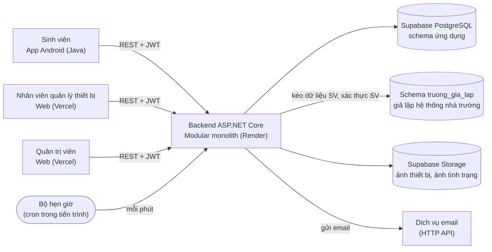
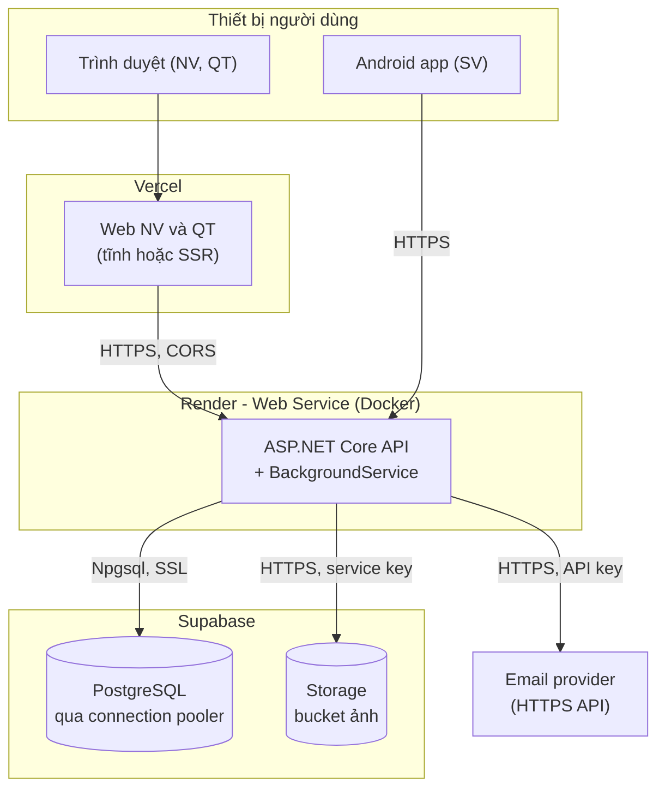
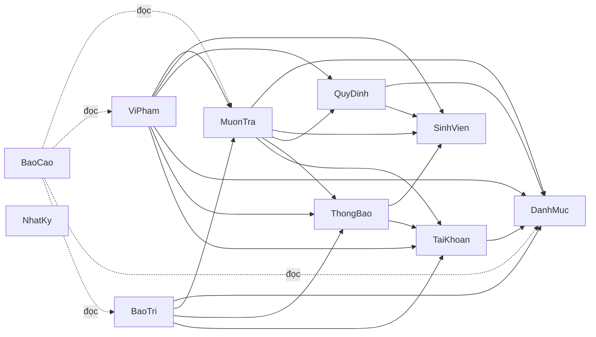
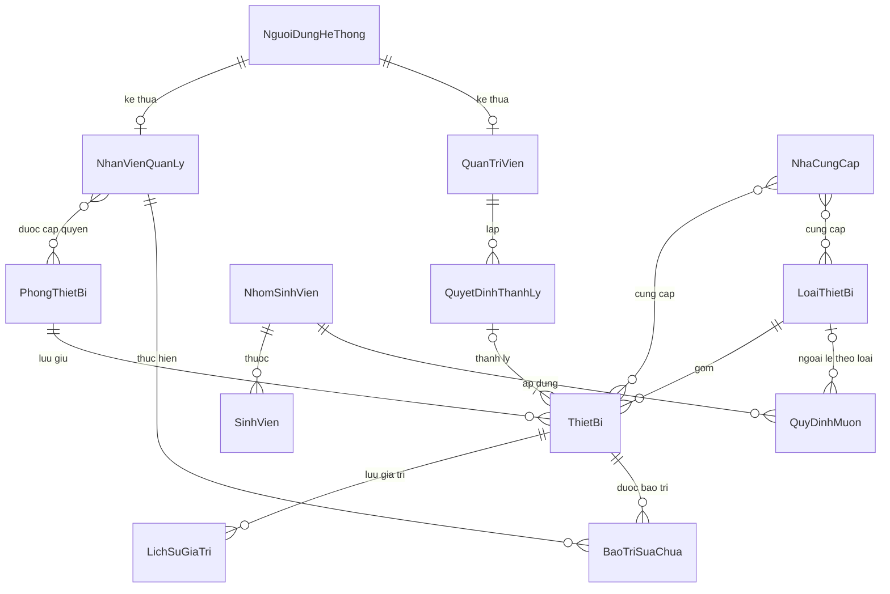
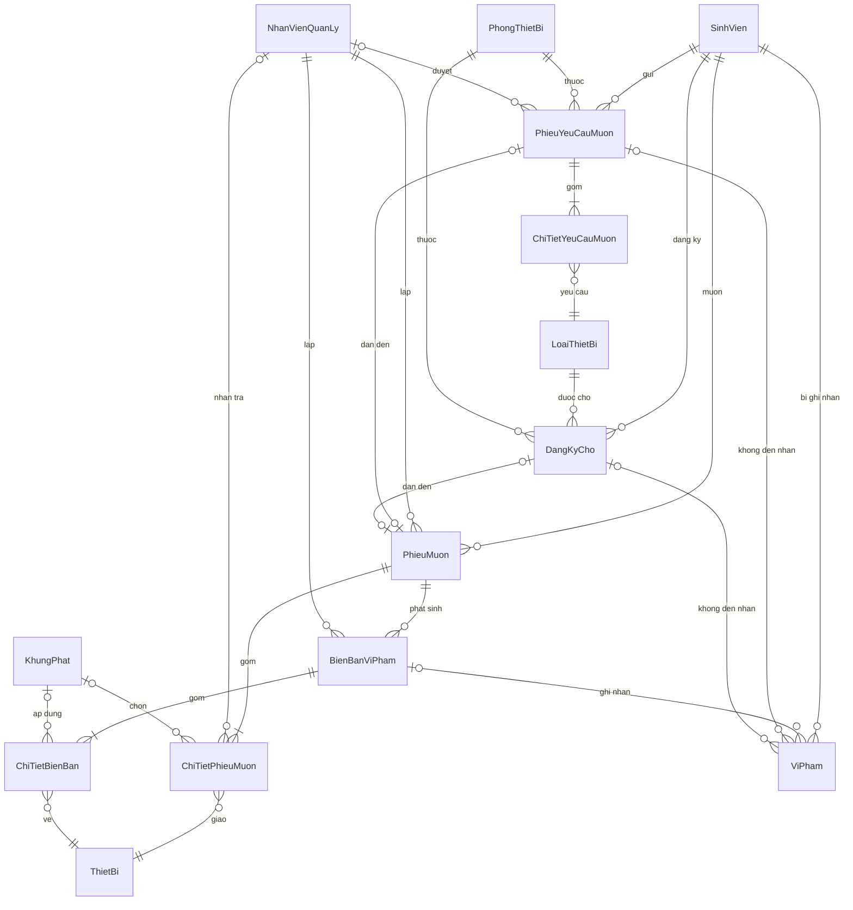
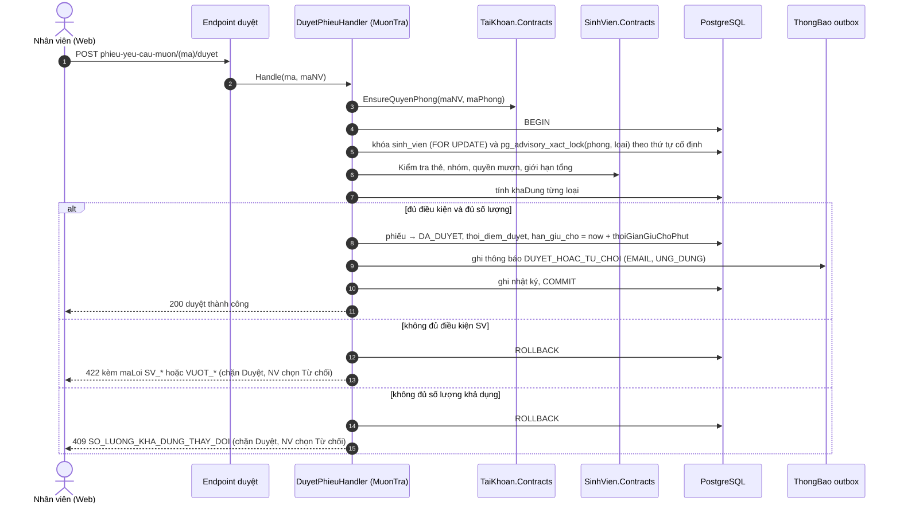
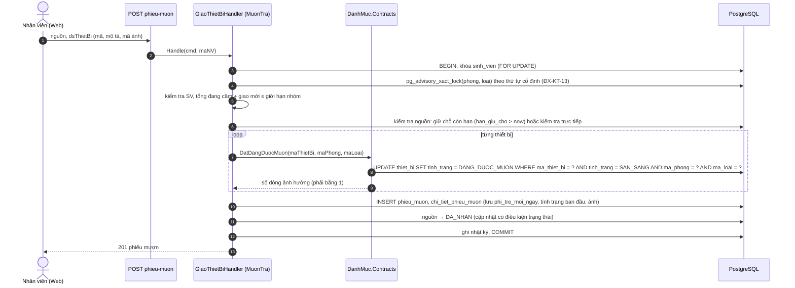
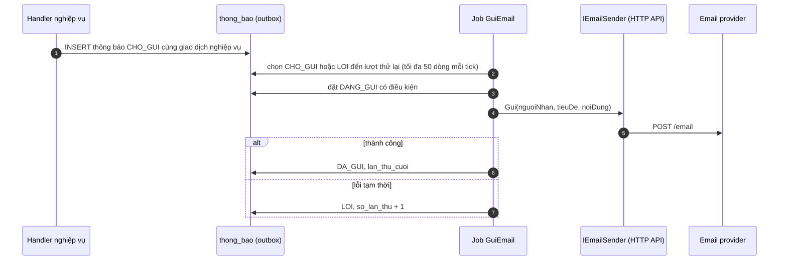

# KIẾN TRÚC BACKEND (BACKEND ARCHITECTURE)

## Hệ thống quản lý mượn trả thiết bị học tập cho sinh viên

| Mục | Nội dung |
|---|---|
| Trường / Khoa | Trường Đại học Công nghệ Thông tin – Khoa Công nghệ Phần mềm |
| Môn học | Đồ án môn Phát triển phần mềm hướng đối tượng (SE100) |
| Nhóm | Nhóm 13 |
| Phiên bản | 1.3 – nhóm đã duyệt; đồng bộ với Backend-Conventions.md |
| Ngày lập | 24/10/2026 |
| Cập nhật gần nhất | 13/11/2026 (đồng bộ quyết định nhóm: .NET 9 ở KT-13; môi trường dev không dùng PostgreSQL cục bộ, kiểm thử tích hợp chạy trên PostgreSQL Supabase thay cho Testcontainers ở mục 15, 16.4, 17); trước đó 07/11/2026 (mục 1.4, 8.2, 9.2: chốt bước giữ chỗ cho đăng ký chờ chạy đồng bộ, chỉ định `Usecase.md` là nơi thẩm quyền của luồng use case); trước đó 06/11/2026 (khắc phục không nhất quán xuyên tài liệu, đồng bộ với Backend-Conventions.md: mục 1.4, 2.1, 2.2, 6.1, 6.3, 6.4, 6.5, 6.6, 7.4, 8.2, 8.4, 8.6, 9.2, 10.2, 13, 15, 16.4, 17, 19.1, 19.2); trước đó 25/10/2026 (mục 4.2, 4.6, 5.1, 6.1, 6.2, 6.5, 6.6, 7.3, 7.4, 8.3, 8.4, 14, 16.4) |
| Căn cứ lập tài liệu | SRS.md (22/10/2026); Usecase.md v1.2; BusinessRule.md (BR-01 … BR-81); Authorization.md (ĐX-PQ-01 … ĐX-PQ-11) |

> Tài liệu mô tả **cách hiện thực backend** cho các yêu cầu đã chốt ở bốn tài liệu căn cứ; không thêm yêu cầu nghiệp vụ mới. Các quyết định kỹ thuật do nhóm chốt được ghi **[Đã chốt]**. Các điểm tài liệu này tự đề xuất (nguồn chưa nêu hoặc nhóm ủy quyền) được ghi **[ĐX-KT-xx]** và tổng hợp ở mục 19; nhóm đã duyệt toàn bộ. Số liệu về giới hạn gói miễn phí của Render và Supabase được kiểm tra ngày 24/10/2026; nhóm cần kiểm tra lại trên trang giá hiện hành trước khi triển khai.

**Mục lục**

1. Giới thiệu
2. Quyết định kiến trúc
3. Tổng quan kiến trúc
4. Cấu trúc modular monolith
5. Mô hình dữ liệu vật lý
6. Thiết kế API
7. Xác thực và phân quyền
8. Logic nghiệp vụ cốt lõi và nhất quán dữ liệu
9. Tác vụ nền (UC-17)
10. Thông báo qua email
11. Lưu trữ ảnh
12. Nhật ký kiểm toán
13. Yêu cầu phi chức năng và giải pháp
14. Xử lý lỗi, ghi log, giám sát
15. Cấu hình và bí mật
16. Triển khai và CI/CD
17. Chiến lược kiểm thử
18. Điểm mở rộng cho giai đoạn sau
19. Quyết định bổ sung đã duyệt và rủi ro

---

## 1. Giới thiệu

### 1.1 Mục đích

Mô tả kiến trúc, công nghệ, cấu trúc mã nguồn, mô hình dữ liệu vật lý, giao diện API và các giải pháp kỹ thuật cho backend của hệ thống, làm cơ sở để nhóm hiện thực, kiểm thử và triển khai. Backend phục vụ ba loại client: ứng dụng Android của sinh viên (SV), web của nhân viên quản lý thiết bị (NV) và web của quản trị viên (QT) (SRS 2.5, NFR-04).

### 1.2 Phạm vi giai đoạn 1

Nhóm chốt hiện thực **các use case có độ ưu tiên Bắt buộc**; UC-24 được ghi như điểm mở rộng (mục 18).

| Nhóm | Use case | Ghi chú |
|---|---|---|
| Trong phạm vi giai đoạn 1 (16 UC Bắt buộc) | UC-01, UC-02, UC-05, UC-06, UC-07, UC-08, UC-09, UC-10, UC-11, UC-12, UC-13, UC-14, UC-15, UC-16, UC-17, UC-19 | Theo độ ưu tiên ở SRS 4.1 |
| Bổ sung do phụ thuộc | UC-03 (Đăng ký chờ) | UC-10 là Bắt buộc nhưng chỉ có dữ liệu đầu vào khi SV đã đăng ký chờ ở UC-03 (Nên có). Xem **ĐX-KT-01** |
| Ngoài giai đoạn 1 (điểm mở rộng) | UC-04, UC-18, UC-20, UC-21, UC-22, UC-23, UC-24 | Kiến trúc và dữ liệu đã chừa chỗ, xem mục 18 |

Hai điểm cần lưu ý khi loại các UC trên khỏi giai đoạn 1:

- Việc **ghi** nhật ký hệ thống vẫn làm đầy đủ vì NFR-02 là Bắt buộc; chỉ màn **xem** nhật ký (UC-23) để sau (**ĐX-KT-02**).
- Bảng nhà cung cấp vẫn có trong lược đồ vì UC-12 gán nhà cung cấp cho thiết bị; chỉ màn quản lý nhà cung cấp (UC-22) để sau (**ĐX-KT-11**).

### 1.3 Quy ước

| Quy ước | Nội dung |
|---|---|
| Nhãn | **[Đã chốt]**: nhóm đã quyết định. **[ĐX-KT-xx]**: đề xuất của tài liệu này. Nhãn [ĐX-xx], [ĐX-PQ-xx] giữ nguyên nghĩa như SRS và Authorization |
| Truy vết | Dùng các mã UC, FR, NFR, BR, GL, DM, CR, SSD như SRS |
| Tên miền | Giữ tên thực thể, thuộc tính, trạng thái theo hồ sơ phân tích (ví dụ PhieuMuon, ngayGioHenTra) [Đã chốt] |
| Tên trong CSDL | Schema, bảng, cột dùng `snake_case` không dấu (phieu_muon, ngay_gio_hen_tra) |
| Mã giá trị trạng thái | Chữ hoa, gạch dưới, không dấu (SAN_SANG, DANG_MUON), xem mục 5.4 |
| Sơ đồ | Mermaid, giống SRS [Đã chốt] |

### 1.4 Nguồn thẩm quyền và quy tắc xử lý khi lệch

Mỗi loại thông tin có một tài liệu thẩm quyền; các tài liệu còn lại là bản dẫn xuất hoặc tóm lược và phải cập nhật theo.

| Loại thông tin | Tài liệu thẩm quyền | Tài liệu phụ thuộc | Ghi chú |
|---|---|---|---|
| Yêu cầu chức năng, phi chức năng, thuật ngữ, thực thể miền (DM), miền giá trị và máy trạng thái | `SRS.md` (FR, NFR, 6.3, 7) | Mọi tài liệu còn lại | Các ĐX đã duyệt làm rõ SRS có thể chưa được ghi ngược, xem quy tắc bên dưới |
| Luồng, tiền điều kiện, hậu điều kiện, ngoại lệ của use case | `Usecase.md` mục 4 | SRS 4.3 (bản trùng nội dung, đối chiếu ngày 07/11/2026: 24/24 use case khớp), `Authorization.md`, `API-Notes.md` | Sửa `Usecase.md` trước, rồi đồng bộ SRS 4.3 |
| Quy tắc nghiệp vụ và giá trị mặc định của tham số | `BusinessRule.md` (BR-01 … BR-81, mục 14) | SRS 3.3, `Backend-Conventions.md` 7.4, `schema.sql` (DEFAULT, seed), `DatabaseDesign.md` | Giá trị mặc định lặp ở bốn nơi, hiện đã khớp |
| Phân quyền, phạm vi dữ liệu theo vai trò và phòng | `Authorization.md` (ĐX-PQ) | KT 7, `Backend-Conventions.md` 10, `API-Notes.md` mục 3, `openapi.yaml` (chính sách mỗi thao tác) | Quyền ở mức use case (ĐX-PQ-03) |
| Thiết kế dữ liệu logic và lý do | `DatabaseDesign.md` (ĐX-DB) | `schema.sql`, KT 5, `Backend-Conventions.md` 7 | |
| DDL vật lý thực thi | `schema.sql` | `DatabaseDesign.md` mục 5 đến 7 | Hai tài liệu phải luôn khớp |
| Hợp đồng API (đường dẫn, schema, mã lỗi, chính sách mỗi thao tác) | `openapi.yaml` (contract-first, ĐX-API-30) | `API-Notes.md` (giải thích), KT 6 và `Backend-Conventions.md` 6 (bản tóm lược) | KT 6 và Conv 6 chỉ tóm lược, phải cập nhật theo hợp đồng |
| Giải thích API: luồng, máy trạng thái, công thức, quy tắc lỗi | `API-Notes.md` (ĐX-API) | — | Phần công thức dẫn KT 8.5 thay vì lặp |
| Quyết định kiến trúc và quy tắc thao tác nghiệp vụ lõi (khóa, giao dịch, job) | `backend-architecture.md` (KT, ĐX-KT) | `Backend-Conventions.md` 8, 12; `DatabaseDesign.md` mục 9 | Job: KT 9.2 là nơi thẩm quyền, `Backend-Conventions.md` 12.2 là bản sao |
| Quy ước lập trình | `Backend-Conventions.md` (ĐX-CV) | — | Không lặp lại thiết kế kiến trúc |
| Mã lỗi nghiệp vụ | `openapi.yaml` (enum `MaLoi`) | `API-Notes.md` mục 10, KT 6.6, `Backend-Conventions.md` 6.7 | Bản sao ở KT và Conv phải có đủ 32 mã |

**[ĐX-KT-15] Quy tắc khi lệch.** ĐX đã được nhóm duyệt có hiệu lực cao hơn câu chữ gốc của tài liệu mà nó làm rõ hoặc bổ sung; việc ghi ngược vào tài liệu gốc là tùy chọn (cột "Cập nhật nguồn" ở mục 19.1).

---

## 2. Quyết định kiến trúc

### 2.1 Các quyết định đã chốt

| Mã | Chủ đề | Quyết định | Ghi chú |
|---|---|---|---|
| KT-01 | Nền tảng backend | ASP.NET Core | [Đã chốt] |
| KT-02 | Kiểu kiến trúc | Modular monolith; bên trong mỗi module theo hướng clean architecture | [Đã chốt] |
| KT-03 | Cơ sở dữ liệu | Supabase (PostgreSQL) | [Đã chốt] |
| KT-04 | Client và API | SV: app di động native (Java). NV, QT: web. Một REST API kèm OpenAPI dùng chung cho mọi client | [Đã chốt] |
| KT-05 | Tích hợp tài khoản và dữ liệu SV | Giả lập cho đồ án: bảng SV mẫu, đăng nhập giả lập. Dữ liệu SV (nhóm, hạn thẻ, trạng thái học, học kỳ) lấy theo cách **kéo định kỳ** | [Đã chốt] |
| KT-06 | Phiên và phân quyền | JWT; kiểm tra vai trò và phòng thiết bị ở lớp guard/middleware | [Đã chốt] |
| KT-07 | Tác vụ nền | Cron trong tiến trình, quét mỗi phút; mỗi tác vụ chạy lại không tạo kết quả trùng (FR-41) | [Đã chốt] |
| KT-08 | Thông báo | Email | [Đã chốt]; xem **ĐX-KT-03** về kênh "Ứng dụng" và SMS |
| KT-09 | Lưu ảnh | Không dùng đĩa cục bộ; dùng dịch vụ miễn phí do tài liệu gợi ý: **Supabase Storage**. Giới hạn dung lượng do tài liệu đề xuất (mục 11) | Nhóm ủy quyền, xem **ĐX-KT-10** |
| KT-10 | Phạm vi | Các UC Bắt buộc, bổ sung UC-03 do phụ thuộc (**ĐX-KT-01**); UC-24 và các UC ngoài giai đoạn 1 ở mục 1.2 là điểm mở rộng | [Đã chốt] |
| KT-11 | Tên miền và sơ đồ | Giữ tên miền như hồ sơ phân tích; Mermaid | [Đã chốt] |
| KT-12 | Triển khai | Frontend web: Vercel. Backend: Render, **chỉ dùng gói miễn phí** (không dùng gói trả phí) | [Đã chốt] |

### 2.2 Lựa chọn kỹ thuật bổ sung (nhóm ủy quyền, đã duyệt)

| Mã | Chủ đề | Lựa chọn | Lý do |
|---|---|---|---|
| KT-13 | Phiên bản .NET | .NET 9 (nhóm chốt ngày 13/11/2026) | Trước đó tài liệu chọn bản LTS mới nhất (.NET 10). Bản .NET 9 hết hỗ trợ sớm hơn bản LTS; nhóm đã chốt .NET 9, không ảnh hưởng thiết kế |
| KT-14 | Kiểu endpoint | Minimal API, nhóm theo module (`MapXxxEndpoints`) | Hỗ trợ OpenAPI sẵn có; gọn cho mô hình mỗi use case một handler |
| KT-15 | Truy cập dữ liệu | EF Core + Npgsql; truy vấn báo cáo và tra cứu nặng dùng SQL thuần (Dapper hoặc `FromSql`) | Giao dịch, migration, concurrency token; báo cáo cần SQL tối ưu |
| KT-16 | Xử lý use case | Mỗi use case là một handler được đăng ký DI, không dùng thư viện mediator | Giảm phụ thuộc, dễ truy vết use case sang mã |
| KT-17 | Kiểm tra dữ liệu vào | FluentValidation cho request; quy tắc nghiệp vụ nằm ở Domain | Tách kiểm tra cú pháp và quy tắc nghiệp vụ |
| KT-18 | OpenAPI | Thành phần OpenAPI có sẵn của ASP.NET Core; xuất `openapi.json` ở CI; sinh client Android bằng openapi-generator (Java, Retrofit); `openapi.yaml` là hợp đồng thiết kế (ĐX-API-30) | Client Android và API không lệch nhau |
| KT-19 | Ghi log | Serilog, JSON ra console (Render thu log từ stdout) | Không cần agent riêng |
| KT-20 | Email | Dịch vụ email qua **HTTP API** (đề xuất Brevo), che sau `IEmailSender` | Render chặn cổng SMTP trên gói miễn phí, xem mục 3.4 |
| KT-21 | Báo cáo xuất file | `.xlsx` (ClosedXML) và `.csv` | Nguồn nêu "xuất được" nhưng không nêu định dạng, xem **ĐX-KT-09** |
| KT-22 | Giữ dịch vụ chạy trên Render miễn phí | Ping `/health` định kỳ từ dịch vụ ngoài, kết hợp chạy bù khi thức dậy và cập nhật trạng thái theo thời gian khi có truy cập (mục 9.3, 16.6) | Gói miễn phí tự ngủ, xem mục 3.4 và **ĐX-KT-12** |

---

## 3. Tổng quan kiến trúc

### 3.1 Sơ đồ ngữ cảnh



Actor "Hệ thống (bộ hẹn giờ)" của SRS 2.4 được hiện thực bằng `BackgroundService` chạy trong chính tiến trình API (mục 9).

### 3.2 Sơ đồ triển khai



### 3.3 Công nghệ sử dụng

| Lớp | Công nghệ | Nguồn quyết định |
|---|---|---|
| Runtime / framework | ASP.NET Core (Minimal API), .NET 9 | KT-01, KT-13, KT-14 |
| Kiến trúc | Modular monolith, clean architecture trong từng module | KT-02 |
| ORM / CSDL | EF Core, Npgsql, PostgreSQL (Supabase) | KT-03, KT-15 |
| Xác thực | JWT Bearer (access và refresh token) | KT-06 |
| Tác vụ nền | `BackgroundService` + `PeriodicTimer` | KT-07 |
| Thông báo | Email qua HTTP API | KT-08, KT-20 |
| Lưu ảnh | Supabase Storage | KT-09 |
| Tài liệu API | OpenAPI | KT-04, KT-18 |
| Log | Serilog (JSON, stdout) | KT-19 |
| Kiểm thử | xUnit, PostgreSQL trên Supabase (môi trường `test`), WebApplicationFactory, NetArchTest, k6 | Mục 17 |
| Đóng gói | Docker (Render không có runtime .NET gốc, cần Dockerfile) | KT-12 |

### 3.4 Giới hạn của gói miễn phí và hệ quả thiết kế

| Dịch vụ | Giới hạn gói miễn phí | Hệ quả với hệ thống | Biện pháp |
|---|---|---|---|
| Render Web Service (Free) | Ngủ sau 15 phút không có lưu lượng vào, khởi động lại mất khoảng một phút. Hệ thống tệp tạm thời, mất khi khởi động lại hoặc triển khai lại. Chặn kết nối ra cổng SMTP 25, 465, 587. Số giờ chạy mỗi tháng có hạn mức; một dịch vụ chạy liên tục cả tháng nằm sát hạn mức đó | Bộ hẹn giờ mỗi phút **không chạy khi dịch vụ ngủ**, ảnh hưởng UC-17 và NFR-08 (nhắc trước hạn 1 giờ, hết hạn giữ chỗ 30 phút). Không lưu ảnh trên đĩa. Không gửi email qua SMTP | Nhóm chốt chỉ dùng gói miễn phí (KT-12), nên dùng ba lớp biện pháp: (1) **Giữ thức**: dịch vụ ngoài miễn phí (ví dụ UptimeRobot hoặc cron-job.org) ping `/health` mỗi 5 đến 10 phút, có thêm lịch GitHub Actions làm dự phòng (mục 16.6); đây không phải cách được Render hỗ trợ chính thức. (2) **Bù khi thức dậy**: tick đầu tiên sau khi khởi động chạy mọi job ngay, và job viết theo mốc thời gian nên tự bắt kịp (mục 9). (3) **Không để đúng sai nghiệp vụ phụ thuộc cron**: trạng thái theo thời gian được áp dụng lại khi có truy cập (mục 9.3). Chỉ riêng các thông báo đúng mốc (nhắc trước 1 giờ) là có thể trễ hoặc bị bỏ lỡ nếu dịch vụ ngủ. Email qua HTTP API, ảnh qua Supabase Storage. Không chạy thêm dịch vụ Render miễn phí khác trong cùng workspace |
| Supabase (Free) | Tạm dừng dự án sau 7 ngày không hoạt động. 500 MB cơ sở dữ liệu, 1 GB lưu trữ tệp, tối đa 50 MB mỗi tệp. Không có sao lưu hằng ngày | Mất truy cập khi bị tạm dừng; dữ liệu không bị xóa nhưng phải khôi phục thủ công trên dashboard. Không có bản sao lưu tự động | Job quét mỗi phút giữ dự án hoạt động khi dịch vụ chạy. Chạy `pg_dump` thủ công trước các mốc quan trọng (mục 16). Kiểm tra dự án đã hoạt động trước buổi bảo vệ |
| Supabase Storage (Free) | 1 GB tổng | Ước lượng dung lượng ảnh ở mục 11 | Nén ảnh phía client, giới hạn kích thước, trừu tượng hóa `IAnhStorage` để đổi nhà cung cấp |

---

## 4. Cấu trúc modular monolith

### 4.1 Danh sách module

Hệ thống chia thành 10 module nghiệp vụ và hạ tầng. Mỗi module sở hữu dữ liệu riêng (một schema PostgreSQL riêng) và chỉ lộ ra các `Contracts`.

| Module | Trách nhiệm | Thực thể sở hữu (DM) | UC giai đoạn 1 |
|---|---|---|---|
| TaiKhoan | Tài khoản NV, QT; đăng nhập NV/QT; phát hành JWT; quyền theo phòng | DM-01, DM-02, DM-03 | UC-14, UC-19 (NV, QT) |
| SinhVien | Dữ liệu SV và nhóm do nhà trường cung cấp; đăng nhập SV qua nhà trường; trạng thái quyền mượn; đồng bộ | DM-04, DM-05 | UC-19 (SV), FR-35 |
| DanhMuc | Phòng thiết bị, loại thiết bị, thiết bị, lịch sử giá trị, nhà cung cấp; tình trạng thiết bị | DM-08, DM-09, DM-10, DM-11, DM-12 | UC-12 |
| QuyDinh | Quy định mượn theo nhóm, tham số hệ thống, khung phạt | DM-06, DM-07, DM-21 | UC-13 |
| MuonTra | Tra cứu, phiếu yêu cầu, danh sách chờ, giữ chỗ, giao thiết bị, phiếu mượn, nhận trả và kiểm tra | DM-13, DM-14, DM-15, DM-16, DM-17 | UC-01, 02, 03, 05, 06, 07, 08, 10 |
| ViPham | Vi phạm, biên bản, tính phí và bồi thường, khóa và mở khóa quyền mượn | DM-18, DM-19, DM-20 | UC-09 |
| BaoTri | Bảo trì, sửa chữa, quyết định thanh lý | DM-22, DM-23 | UC-11, UC-15 |
| ThongBao | Hàng đợi thông báo (outbox), gửi email | DM-25 | UC-17 (phần gửi) |
| NhatKy | Nhật ký kiểm toán chỉ thêm | DM-26 | NFR-02 (ghi) |
| BaoCao | Báo cáo, thống kê (chỉ đọc nhiều schema) | Không có | UC-16 |

DM-24 (PhanHoiTinhTrang) thuộc UC-21, để giai đoạn sau. Các job của UC-17 được đặt trong module sở hữu dữ liệu tương ứng (mục 9); phần chạy lịch nằm ở hạ tầng.

### 4.2 Quan hệ phụ thuộc giữa các module

Quy tắc: module chỉ được phụ thuộc vào `Contracts` của module khác, không được tham chiếu mã nội bộ. Đồ thị phụ thuộc **không có chu trình**.



Ghi chú:

- `MuonTra` không phụ thuộc `ViPham`. Khi giữ chỗ hết hạn, `MuonTra` phát sự kiện `GiuChoHetHan` (khai báo trong `MuonTra.Contracts`); `ViPham` xử lý sự kiện này để ghi vi phạm KHONG_DEN_NHAN (BR-31, BR-63).
- `ViPham` đọc dữ liệu phiếu qua `IPhieuMuonReader` trong `MuonTra.Contracts` để đề xuất các khoản tiền (UC-09 bước 1).
- `MuonTra`, `ViPham` và `BaoTri` phụ thuộc `TaiKhoan.Contracts` để gọi `IQuyenPhongService` kiểm tra quyền theo phòng của NV (mục 7.2, 8.3). Đồ thị vẫn không có chu trình vì `TaiKhoan` chỉ phụ thuộc `DanhMuc`.
- Kiểm tra tham chiếu khi xóa danh mục (mục 6.5): `DanhMuc` và `QuyDinh` không phụ thuộc các module chứng từ; chúng khai báo `IThamChieuDanhMucProvider` và `IThamChieuKhungPhatProvider` trong `Contracts`, còn `MuonTra`, `ViPham`, `BaoTri`, `QuyDinh` hiện thực (đảo phụ thuộc), nên đồ thị không đổi.
- `NhatKy` không bị module nào gọi trực tiếp; việc ghi nhật ký do interceptor ở hạ tầng thực hiện (mục 12).
- **Ngoại lệ cho truy vấn chỉ đọc:** các truy vấn tra cứu (UC-01) và báo cáo (UC-16) được phép `JOIN` nhiều schema bằng SQL chỉ đọc. Mọi thao tác **ghi** luôn đi qua module sở hữu.

### 4.3 Các tầng trong một module (clean architecture)

```
Presentation  ->  Application  ->  Domain
Infrastructure ->  Application, Domain
Domain không phụ thuộc tầng nào (chỉ dùng SharedKernel)
```

| Tầng | Nội dung | Ví dụ |
|---|---|---|
| Domain | Thực thể, aggregate, giá trị, enum, quy tắc nghiệp vụ, máy trạng thái, sự kiện miền | `PhieuMuon`, `ThietBi.Giao()`, `TinhPhi.SoNgayTre(...)` |
| Application | Handler cho từng use case, validator, giao diện (port) tới hạ tầng, job | `DuyetPhieuHandler`, `IThongBaoOutbox` |
| Infrastructure | Cấu hình EF Core, repository, truy vấn SQL, triển khai các port | `PhieuMuonConfiguration`, `EfPhieuMuonRepository` |
| Presentation | Endpoint Minimal API, model request và response, chính sách phân quyền gắn vào endpoint | `MapMuonTraEndpoints()` |

**Ánh xạ lớp biên và lớp điều khiển của hồ sơ phân tích (SRS 6.1):**

| Hồ sơ phân tích | Hiện thực |
|---|---|
| GiaoDienSinhVien, GiaoDienNhanVien (Boundary) | Các client (Android, web) gọi nhóm endpoint `/sv`, `/quay` |
| DatTruocCtrl | `DatTruocHandler` (UC-02) |
| DuyetPhieuCtrl | `DuyetPhieuHandler` (UC-06) |
| GiaoThietBiCtrl | `GiaoThietBiHandler` (UC-07) |
| NhanTraCtrl | `NhanTraHandler` (UC-08) |

### 4.4 Cấu trúc thư mục

```
QuanLyMuonTra/
├─ src/
│  ├─ QuanLyMuonTra.Api/                 # Host: Program.cs, middleware, xác thực, OpenAPI, ghép module
│  ├─ QuanLyMuonTra.SharedKernel/        # Entity, AggregateRoot, Result, DomainEvent, IClock, VnTime
│  ├─ QuanLyMuonTra.Infrastructure/      # AppDbContext, interceptor nhật ký, email, lưu ảnh, chạy lịch job
│  └─ Modules/
│     ├─ MuonTra/
│     │  ├─ QuanLyMuonTra.Modules.MuonTra/            # Domain/ Application/ Infrastructure/ Presentation/
│     │  └─ QuanLyMuonTra.Modules.MuonTra.Contracts/  # interface, DTO, sự kiện công khai
│     ├─ ViPham/        (cấu trúc tương tự)
│     ├─ DanhMuc/  QuyDinh/  SinhVien/  TaiKhoan/  BaoTri/  ThongBao/  NhatKy/  BaoCao/
├─ tests/
│  ├─ QuanLyMuonTra.UnitTests/
│  ├─ QuanLyMuonTra.IntegrationTests/
│  ├─ QuanLyMuonTra.ArchitectureTests/
│  └─ load/                              # kịch bản k6
├─ db/                                   # script seed, script pg_dump, SQL trigger và grant
├─ Dockerfile
└─ render.yaml
```

Mỗi module là **một project chính** (các tầng là thư mục và namespace) cộng **một project `Contracts`**. Cách này giữ số project ở mức quản lý được cho nhóm 5 người, đồng thời chặn phụ thuộc chéo bằng project reference (module chỉ tham chiếu `Contracts` của module khác). Quy tắc giữa các tầng trong cùng project do kiểm thử kiến trúc bảo vệ (mục 4.6).

### 4.5 Giao tiếp giữa các module

| Cơ chế | Dùng khi | Ví dụ |
|---|---|---|
| Gọi đồng bộ qua `Contracts` | Cần kết quả ngay, cùng giao dịch | `MuonTra` gọi `IThietBiService.DatDangDuocMuon(...)`; `ViPham` gọi `IQuyenMuonService.Khoa(...)` |
| Sự kiện miền trong tiến trình | Tác dụng phụ không thuộc lõi nghiệp vụ; gửi **trước khi commit**, cùng giao dịch | `GiuChoHetHan`, `PhieuYeuCauDaDuyet`, `BienBanDaLap`, `ThietBiDenHanBaoTri`, `ViPhamDaGhiNhan` |
| Hàng đợi thông báo (outbox) | Mọi thông báo gửi cho SV/NV | Handler ghi dòng vào `thong_bao`; job gửi email xử lý sau (mục 10) |

Cả ba cơ chế chạy trong **một giao dịch cơ sở dữ liệu** với một `AppDbContext` dùng chung (xem **ĐX-KT-08** về lựa chọn một DbContext), vì NFR-06 đòi hỏi các thay đổi nhiều bảng của một thao tác giao, trả hoặc duyệt phải nguyên tử.

### 4.6 Kiểm thử kiến trúc tự động

Dùng NetArchTest trong `QuanLyMuonTra.ArchitectureTests` để chặn lỗi cấu trúc ngay ở CI:

1. `Domain` không phụ thuộc `Application`, `Infrastructure`, `Presentation`, EF Core hay ASP.NET.
2. `Application` không phụ thuộc `Infrastructure` và `Presentation`.
3. Module không tham chiếu namespace nội bộ của module khác, chỉ tham chiếu `*.Contracts`.
4. Mọi endpoint (trừ danh sách ngoại lệ: đăng nhập, làm mới token, đăng xuất, `/health`, `/health/ready`) phải gắn chính sách phân quyền (hỗ trợ NFR-01). Đăng xuất xác định phiên bằng refresh token trong body vì access token 15 phút có thể đã hết hạn; `/health/ready` là điểm kiểm tra hạ tầng.

---

## 5. Mô hình dữ liệu vật lý

### 5.1 Nguyên tắc

| Nguyên tắc | Nội dung |
|---|---|
| Một CSDL, nhiều schema | Mỗi module một schema: `tai_khoan`, `sinh_vien`, `danh_muc`, `quy_dinh`, `muon_tra`, `vi_pham`, `bao_tri`, `thong_bao`, `nhat_ky`, `luu_tru`. Schema `truong_gia_lap` mô phỏng hệ thống nhà trường (KT-05) |
| Khóa chính | `uuid` (v7, `Guid.CreateVersion7()`) cho thực thể phát sinh trong hệ thống. `ma_thiet_bi` và `ma_sv` là khóa nghiệp vụ duy nhất. `NguoiDungHeThong` dùng `ma_nguoi_dung` làm khóa chính; `ma_nv`, `ma_qt` là thuộc tính duy nhất, không làm khóa chính (theo quyết định của nhóm khi rà soát hồ sơ phân tích) |
| Mã chứng từ | `ma_yeu_cau`, `ma_phieu`, `ma_dang_ky`, `ma_bien_ban`, `ma_quyet_dinh` do sequence PostgreSQL sinh, định dạng `{tiềnTố}-{yyMMdd}-{6 chữ số}` (ví dụ `PM-261024-000123`), ngày theo múi giờ Asia/Ho_Chi_Minh. Tiền tố: `PM` (`ma_phieu`), `YC` (`ma_yeu_cau`), `DK` (`ma_dang_ky`), `BB` (`ma_bien_ban`), `QD` (`ma_quyet_dinh`); chấp nhận có khoảng trống số |
| Thời gian | `timestamptz`, lưu UTC. Tính toán theo "ngày lịch" dùng múi giờ Asia/Ho_Chi_Minh (mục 8.5) |
| Tiền | `numeric(14,0)` (VNĐ, không có phần lẻ) |
| Trạng thái | `text` kèm ràng buộc `CHECK` theo danh sách ở 5.4, ánh xạ sang enum C# bằng chuyển đổi chuỗi |
| Xóa | Không xóa cứng dữ liệu có lịch sử (BR-18); dùng cờ `ngung_su_dung` |
| Đồng thời | Cột hệ thống `xmin` làm concurrency token cho các aggregate `thiet_bi`, `phieu_yeu_cau_muon`, `dang_ky_cho`, `phieu_muon`, `bien_ban_vi_pham` (theo hướng dẫn của Npgsql EF Core provider) |
| Bảo mật dữ liệu | Không tạo bảng ở schema `public`; không đưa schema ứng dụng vào danh sách "Exposed schemas" của Data API; thu hồi quyền của `anon` và `authenticated`; bật RLS không có policy làm lớp phòng thủ thứ hai. Backend dùng một role riêng quyền tối thiểu |

### 5.2 Ánh xạ thực thể miền sang bảng

| DM | Lớp | Module | Bảng | Ghi chú |
|---|---|---|---|---|
| DM-01 | NguoiDungHeThong | TaiKhoan | `tai_khoan.nguoi_dung_he_thong` | Lớp cha; `ten_dang_nhap` duy nhất; thêm cột `email` (**ĐX-KT-04**) |
| DM-02 | NhanVienQuanLy | TaiKhoan | `tai_khoan.nhan_vien_quan_ly` | Kế thừa kiểu bảng riêng cho lớp con (TPT); `ma_nv` duy nhất |
| DM-03 | QuanTriVien | TaiKhoan | `tai_khoan.quan_tri_vien` | `ma_qt` duy nhất |
| DM-04 | SinhVien | SinhVien | `sinh_vien.sinh_vien` | Khóa chính `ma_sv`; dữ liệu đồng bộ từ nhà trường; **không có cột mật khẩu** |
| DM-05 | NhomSinhVien | SinhVien | `sinh_vien.nhom_sinh_vien` | Do nhà trường cung cấp |
| DM-06 | QuyDinhMuon | QuyDinh | `quy_dinh.quy_dinh_muon` | Khóa theo (nhóm, loại thiết bị có thể rỗng cho ngoại lệ) |
| DM-07 | ThamSoHeThong | QuyDinh | `quy_dinh.tham_so_he_thong` | **Một dòng** duy nhất (`id = 1`, có ràng buộc) |
| DM-21 | KhungPhat | QuyDinh | `quy_dinh.khung_phat` | `dang_su_dung`; không xóa khung đã dùng |
| DM-08 | PhongThietBi | DanhMuc | `danh_muc.phong_thiet_bi` | |
| DM-09 | LoaiThietBi | DanhMuc | `danh_muc.loai_thiet_bi` | Có `chu_ky_bao_tri`, `phi_tre_moi_ngay` |
| DM-10 | ThietBi | DanhMuc | `danh_muc.thiet_bi` | `ma_thiet_bi` duy nhất; `tinh_trang`; `ngung_su_dung` |
| DM-11 | LichSuGiaTri | DanhMuc | `danh_muc.lich_su_gia_tri` | Chỉ thêm; giá trị hiện hành là bản ghi mới nhất |
| DM-12 | NhaCungCap | DanhMuc | `danh_muc.nha_cung_cap` và hai bảng nối n-n với thiết bị, loại thiết bị | Giai đoạn 1 chỉ đọc và gán (**ĐX-KT-11**) |
| DM-13 | PhieuYeuCauMuon | MuonTra | `muon_tra.phieu_yeu_cau_muon` | Thêm cột `han_giu_cho` (mục 5.5) |
| DM-14 | ChiTietYeuCauMuon | MuonTra | `muon_tra.chi_tiet_yeu_cau_muon` | |
| DM-15 | DangKyCho | MuonTra | `muon_tra.dang_ky_cho` | Có `ma_phong`, `ma_loai`, `han_giu_cho` |
| DM-16 | PhieuMuon | MuonTra | `muon_tra.phieu_muon` | |
| DM-17 | ChiTietPhieuMuon | MuonTra | `muon_tra.chi_tiet_phieu_muon` | Lưu `phi_tre_moi_ngay` tại thời điểm giao (BR-43); ảnh qua bảng ảnh đính kèm |
| DM-18 | ViPham | ViPham | `vi_pham.vi_pham` | Mỗi dòng gắn đúng một chứng từ phát sinh (SRS 6.2 mục 2) |
| DM-19 | BienBanViPham | ViPham | `vi_pham.bien_ban_vi_pham` | Số tiền không đổi sau khi lập |
| DM-20 | ChiTietBienBan | ViPham | `vi_pham.chi_tiet_bien_ban` | |
| DM-22 | BaoTriSuaChua | BaoTri | `bao_tri.bao_tri_sua_chua` | |
| DM-23 | QuyetDinhThanhLy | BaoTri | `bao_tri.quyet_dinh_thanh_ly` và `bao_tri.chi_tiet_thanh_ly` | Bảng nối: mỗi thiết bị tối đa một quyết định (`ma_thiet_bi` duy nhất) |
| DM-24 | PhanHoiTinhTrang | MuonTra | (giai đoạn sau) | UC-21 |
| DM-25 | ThongBao | ThongBao | `thong_bao.thong_bao` | Kiêm outbox, thêm cột ở mục 5.5 |
| DM-26 | NhatKyHeThong | NhatKy | `nhat_ky.nhat_ky_he_thong` | Chỉ thêm, có trigger chặn sửa và xóa (mục 12) |

### 5.3 Sơ đồ quan hệ (ERD)

Bản số lấy từ SRS Phụ lục B. Hai sơ đồ chia theo cụm; thuộc tính được lược bỏ, xem SRS 6.1 và Hồ sơ phân tích 1.5.

**Cụm danh mục, quy định và tài khoản**



**Cụm mượn trả và vi phạm**



`ThongBao` (mỗi thông báo có đúng một người nhận là SV hoặc NV) và `NhatKyHeThong` (tối đa một người thực hiện) được lược khỏi sơ đồ vì liên kết đa hình; hiện thực bằng hai cột khóa ngoại cho phép rỗng kèm ràng buộc `CHECK` (SRS 6.2 mục 1 và 3).

### 5.4 Mã giá trị của các thuộc tính trạng thái

Đồng bộ với SRS 6.3. Tên hiển thị tiếng Việt do client ánh xạ từ mã; API trả về mã.

| Thuộc tính | Mã giá trị |
|---|---|
| ThietBi.tinhTrang | `SAN_SANG`, `DANG_DUOC_MUON`, `DANG_BAO_TRI_SUA_CHUA`, `DA_THANH_LY`, `DA_BAO_MAT` |
| PhieuYeuCauMuon.trangThai | `CHO_DUYET`, `DA_DUYET`, `TU_CHOI`, `DA_HUY`, `HET_HAN`, `DA_NHAN` |
| PhieuMuon.trangThai | `DANG_MUON`, `QUA_HAN`, `DA_TRA` |
| DangKyCho.trangThai | `DANG_CHO`, `DA_THONG_BAO`, `DA_NHAN`, `DA_HUY`, `HET_HAN` |
| ChiTietPhieuMuon.ketQuaKiemTra | `NGUYEN_VEN`, `HU_HONG`, `THIEU_PHU_KIEN`, `MAT` (rỗng trước khi trả) |
| BienBanViPham.trangThai | `CHUA_NOP`, `DA_NOP`, `DA_HUY` |
| ViPham.loaiViPham, ChiTietBienBan.loaiViPham | `TRA_TRE`, `HU_HONG`, `MAT`, `KHONG_DEN_NHAN` (chi tiết biên bản không có mã cuối) |
| SinhVien.trangThaiHoc | `DANG_HOC`, `TOT_NGHIEP`, `THOI_HOC`, `DINH_CHI` |
| SinhVien.trangThaiQuyenMuon | `BINH_THUONG`, `TAM_KHOA`, `CAM_MUON_DAI_HAN` |
| NguoiDungHeThong.trangThaiKhoa | `HOAT_DONG`, `TAM_KHOA_DANG_NHAP`, `BI_KHOA` |
| BaoTriSuaChua.loaiThucHien, ketQua | `BAO_TRI_DINH_KY`, `SUA_CHUA`; `DUA_VE_SAN_SANG`, `DE_XUAT_THANH_LY` |
| ThongBao.loaiThongBao | `NHAC_HAN_TRA`, `QUA_HAN`, `THIET_BI_CHO_SAN_SANG`, `DUYET_HOAC_TU_CHOI`, `VI_PHAM_PHI_PHAT`, `NHAC_NHO_NV`, `NHAC_BAO_TRI` |
| ThongBao.kenhGui | `UNG_DUNG`, `EMAIL`, `SMS` (giai đoạn 1 không dùng SMS) |
| Vai trò trong token | `SINH_VIEN`, `NHAN_VIEN`, `QUAN_TRI` |

### 5.5 Cột và bảng bổ sung ở mức thiết kế vật lý [ĐX-KT-08]

Các cột và bảng dưới đây không có trong mô hình miền mức phân tích nhưng cần cho hiện thực; không thay đổi nghiệp vụ.

| Đối tượng | Bổ sung | Lý do |
|---|---|---|
| `phieu_yeu_cau_muon` | `han_giu_cho` (timestamptz, rỗng) | Lưu hạn giữ chỗ tại thời điểm duyệt, không đổi khi tham số `thoiGianGiuChoPhut` thay đổi sau (BR-29, FR-20 không hồi tố) |
| `danh_muc.thiet_bi`, `danh_muc.loai_thiet_bi` | `ngung_su_dung` (bool, mặc định false) | BR-18: đã có lịch sử thì chỉ ngưng sử dụng (tiêu chí ở mục 6.5) |
| `tai_khoan.nguoi_dung_he_thong` | `email` | Gửi email nhắc bảo trì cho NV (**ĐX-KT-04**) |
| `thong_bao.thong_bao` | `trang_thai_gui` (`CHO_GUI`, `DANG_GUI`, `DA_GUI`, `LOI`, `LOI_VINH_VIEN`), `so_lan_thu`, `lan_thu_cuoi`, `khoa_trung_lap` (duy nhất khi khác rỗng), `doi_tuong_loai`, `doi_tuong_id` | Outbox và chạy lại không tạo kết quả trùng (FR-41); tham chiếu nguồn phát sinh |
| `tai_khoan.refresh_token` | `ma`, chủ sở hữu (loại, mã), `ma_bam`, `het_han`, `da_thu_hoi`, `thay_the_boi` | Làm mới và thu hồi phiên (mục 7.3) |
| `tai_khoan.nhan_vien_phong` | `ma_nguoi_dung`, `ma_phong` | Bảng nối quan hệ NV – phòng được cấp quyền |
| `luu_tru.anh_tai_len` | `ma_anh`, `bucket`, `khoa_luu_tru`, `loai_noi_dung`, `kich_thuoc`, `nguoi_tai_len`, `thoi_diem`, `doi_tuong_loai`, `doi_tuong_id`, `giai_doan` (`BAN_DAU`, `KHI_TRA`, `THIET_BI`) | Ảnh đính kèm cho thiết bị và cho chi tiết phiếu mượn lúc giao và lúc trả (FR-10, FR-12) |
| `sinh_vien.dong_bo_trang_thai` | Một dòng: mốc đồng bộ gần nhất | Kéo thay đổi từ lần đồng bộ trước |

### 5.6 Ràng buộc và chỉ mục quan trọng

| Ràng buộc / chỉ mục | Mục đích | Nguồn |
|---|---|---|
| `UNIQUE (ma_thiet_bi)` trên `thiet_bi` | Mã thiết bị trùng bị từ chối | UC-12 E1 |
| `UNIQUE (ten_dang_nhap)` trên `nguoi_dung_he_thong` | Tên đăng nhập trùng bị từ chối | UC-14 E1 |
| `UNIQUE (ma_thiet_bi) WHERE ket_qua_kiem_tra IS NULL` trên `chi_tiet_phieu_muon` | Một thiết bị tại một thời điểm chỉ thuộc tối đa một phiếu mượn đang hiệu lực (lưới an toàn cuối cùng) | NFR-06, BR-44 |
| `UNIQUE (ma_thiet_bi)` trên `chi_tiet_thanh_ly` | Mỗi thiết bị tối đa một quyết định thanh lý | Phụ lục B (45) |
| Chỉ mục `(ma_phong, ma_loai, tinh_trang)` trên `thiet_bi` | Tính số lượng khả dụng nhanh | NFR-03 |
| Chỉ mục `(trang_thai, ngay_gio_hen_tra)` trên `phieu_muon` | Job nhắc hạn, đánh dấu quá hạn | UC-17 |
| Chỉ mục `(ma_sv, trang_thai)` trên `phieu_muon` | Đếm thiết bị đang cầm, tra cứu lịch sử | BR-24, UC-05 |
| Chỉ mục `(ma_phong, trang_thai, han_giu_cho)` trên `phieu_yeu_cau_muon` | Danh sách chờ duyệt, tổng giữ chỗ, job hết hạn giữ chỗ | BR-20, BR-31 |
| Chỉ mục `(ma_phong, ma_loai, trang_thai, thoi_diem_dang_ky)` trên `dang_ky_cho` | Xếp hàng theo thứ tự đăng ký trước | BR-34 |
| `UNIQUE (khoa_trung_lap) WHERE khoa_trung_lap IS NOT NULL` trên `thong_bao` | Chạy lại job không tạo thông báo trùng | FR-41 |
| `CHECK` giá trị | `so_luong > 0`; `gio_mo_cua < gio_dong_cua`; `chu_ky_bao_tri > 0`; `phi_tre_moi_ngay >= 0`; `so_lan_dang_nhap_sai_toi_da > 0`; `tong_tien >= 0`; chỉ một trong hai khóa ngoại người nhận của `thong_bao` khác rỗng | GL-12, FR-16, BR-10, SRS 6.2 |
| Trigger chặn `UPDATE`, `DELETE`, `TRUNCATE` trên `nhat_ky_he_thong` | Nhật ký không thể sửa hoặc xóa | NFR-02, BR-79 |
| Chống lập trùng khoản biên bản | Ràng buộc duy nhất có điều kiện trên `(ma_phieu_muon, ma_thiet_bi, loai_vi_pham)` chỉ với biên bản chưa hủy | BR-62, BR-63 |

### 5.7 Migration và dữ liệu khởi tạo

- Migration bằng EF Core; mỗi module có thư mục migration riêng, cùng áp dụng vào một CSDL. Phần SQL EF không sinh được (trigger, `REVOKE`, ràng buộc có điều kiện, role) đặt trong migration dạng SQL thô và lưu ở `db/`.
- Dữ liệu khởi tạo (seed) gồm: một dòng `tham_so_he_thong` với giá trị mặc định ở SRS 3.3 (riêng `gio_mo_cua`, `gio_dong_cua` **không có mặc định**, xem ĐX-03; bản seed demo đặt tạm giá trị rõ ràng và ghi chú để nhóm đổi); ba khung phạt Nhẹ 15%, Vừa 40%, Nặng 80%; quy định mượn cho ba nhóm (đại học 2 thiết bị 5 giờ; cao học và đồ án tốt nghiệp 3 thiết bị 10 giờ, ĐX-01); một tài khoản QT khởi tạo từ biến môi trường (ĐX-PQ-01); dữ liệu SV mẫu trong `truong_gia_lap`.
- Hệ thống **không có danh mục thiết bị hay mức phí mặc định** (ĐX-05); seed demo chỉ để kiểm thử, tách riêng khỏi seed bắt buộc.

---

## 6. Thiết kế API

### 6.1 Quy ước chung

| Nội dung | Quy ước |
|---|---|
| Kiểu | REST over HTTPS, JSON, tiền tố `/api/v1` |
| Khu vực theo tác nhân | `/api/v1/auth` (công khai và phiên), `/api/v1/sv` (sinh viên), `/api/v1/quay` (nhân viên), `/api/v1/quan-tri` (quản trị viên), `/api/v1/anh` (tải ảnh, NV và QT). Chính sách vai trò gắn ở cấp nhóm endpoint |
| Đặt tên | Tài nguyên theo tên miền không dấu, kebab-case (`phieu-yeu-cau-muon`, `thiet-bi`); thuộc tính JSON camelCase theo hồ sơ phân tích (`maThietBi`, `ngayGioHenTra`) [Đã chốt] |
| Phạm vi dữ liệu của SV | Lấy từ claim trong token, **không bao giờ từ tham số đường dẫn hoặc body** (BR-06). Truy cập dữ liệu của người khác trả 403 |
| Phạm vi phòng của NV | Truy vấn danh sách tự lọc theo các phòng được cấp quyền; truy cập từng đối tượng thuộc phòng chưa cấp trả 403 (UC-06 E2, UC-18 E1) |
| Thời gian | ISO 8601 có múi giờ (UTC); client tự hiển thị giờ Việt Nam |
| Tiền | Số nguyên VNĐ |
| Phân trang | `?trang=1&kichThuoc=20` (`kichThuoc` mặc định 20, tối đa 100); phản hồi dạng `{ "tongSo": 0, "trang": 1, "kichThuoc": 20, "danhSach": [] }`; `trang` nhỏ hơn 1 hoặc `kichThuoc` ngoài khoảng 1 đến 100 trả 400 `DU_LIEU_KHONG_HOP_LE` |
| Tài liệu | `openapi.yaml` là hợp đồng thiết kế (contract-first, ĐX-API-30); `openapi.json` sinh tự động từ mã phải khớp hợp đồng; CI lưu `openapi.json` làm artifact để sinh client Android và báo lỗi nếu lệch `openapi.yaml` |
| Lỗi | RFC 9457 `application/problem+json`, thêm trường `maLoi` (mục 6.6) và `traceId`. Với 400, danh sách trường lỗi nằm trong trường `errors` (từ khóa trường → danh sách thông báo, theo `ValidationProblemDetails` của ASP.NET Core) |
| Giao dịch nhiều bước tại quầy | Không giữ phiên phía server. Các sự kiện hệ thống tuần tự của SSD (quét thiết bị, ghi tình trạng, lập phiếu) được ánh xạ thành **các endpoint kiểm tra không có tác dụng phụ** và **một endpoint lập phiếu nguyên tử** (mục 6.3) |

### 6.2 Xác thực và phiên

| Method | Đường dẫn | UC | Ghi chú |
|---|---|---|---|
| POST | `/api/v1/auth/sinh-vien/dang-nhap` | UC-19 | MSSV và mật khẩu của trường; xác thực qua `ISchoolDirectory` (mục 7.1) |
| POST | `/api/v1/auth/nhan-vien/dang-nhap` | UC-19 | Dùng chung cho NV và QT; áp dụng đếm nhập sai (mục 7.4) |
| POST | `/api/v1/auth/lam-moi` | UC-19 | Đổi refresh token lấy cặp token mới (xoay vòng) |
| POST | `/api/v1/auth/dang-xuat` | UC-19 | Thu hồi refresh token; xác định phiên bằng refresh token trong body, không yêu cầu access token còn hạn |
| GET | `/api/v1/auth/toi` | UC-19 | Vai trò và danh sách phòng được cấp quyền của người đăng nhập |

### 6.3 Sinh viên (`/api/v1/sv`)

| Method | Đường dẫn | UC / SSD | Ghi chú |
|---|---|---|---|
| GET | `/tra-cuu/thiet-bi` | UC-01 | Lọc `ten`, `maLoai`, `maPhong`, `conHang`; kết quả theo loại thiết bị và phòng kèm số lượng khả dụng (BR-20) |
| GET | `/tra-cuu/thiet-bi/{maLoai}?maPhong=` | UC-01 | Chi tiết: thông số, ảnh, số lượng khả dụng; nếu hết hàng trả `ngayDuKienCoSan` (**ĐX-KT-05**) |
| GET | `/phong-thiet-bi` | UC-01, UC-02 | Danh sách phòng thiết bị để lọc tra cứu và chọn phòng khi đặt trước (**ĐX-API-25**) |
| GET | `/loai-thiet-bi` | UC-01 | Danh sách loại thiết bị để lọc tra cứu (**ĐX-API-25**) |
| POST | `/phieu-yeu-cau-muon` | UC-02, SSD-01 `guiYeuCau` | Kiểm tra thẻ, nhóm, quyền mượn, số lượng khả dụng, giới hạn tổng và thời gian tối đa (BR-23 đến BR-26); tạo phiếu `CHO_DUYET` |
| GET | `/phieu-yeu-cau-muon`, `/phieu-yeu-cau-muon/{ma}` | UC-02 | Chỉ phiếu của chính SV |
| POST | `/dang-ky-cho` | UC-03 | Chỉ khi số lượng khả dụng bằng 0 (BR-33); ghi `soThuTuCho` |
| GET | `/dang-ky-cho` | UC-03 A1 | Xem số thứ tự chờ của mình |
| POST | `/dang-ky-cho/{ma}/roi` | UC-03 A2 | Chuyển `DA_HUY`, cập nhật số thứ tự phía sau, không tính vi phạm (BR-37) |
| GET | `/phieu-muon`, `/phieu-muon/{ma}` | UC-05 | Lịch sử mượn/trả, tình trạng khi trả, phí phạt |
| GET | `/bien-ban-vi-pham` | UC-05 | Biên bản của chính SV |
| GET | `/vi-pham` | UC-05 | Vi phạm của chính SV, gồm cả `KHONG_DEN_NHAN` không có biên bản (**ĐX-API-25**) |
| GET | `/thong-bao` | FR-24 | Danh sách thông báo (kênh "Ứng dụng", không có push, **ĐX-KT-03**) |
| GET | `/toi` | UC-17 bước 4, UC-01 | Hồ sơ mượn của chính SV và lý do không được mượn, kể cả quyền mượn bị khóa (**ĐX-API-25**) |

### 6.4 Nhân viên (`/api/v1/quay`)

| Method | Đường dẫn | UC / SSD | Ghi chú |
|---|---|---|---|
| GET | `/phieu-yeu-cau-muon?trangThai=CHO_DUYET&maPhong=` | UC-06, SSD-02 `layPhieuChoDuyet` | Chỉ các phòng NV được cấp quyền |
| GET | `/phieu-yeu-cau-muon/{ma}/kiem-tra` | UC-06, SSD-02 `kiemTraPhieu` | Kiểm tra lại điều kiện SV và số lượng khả dụng; không có tác dụng phụ |
| POST | `/phieu-yeu-cau-muon/{ma}/duyet` | UC-06, SSD-02 `duyet` | Giữ chỗ, thông báo SV, ghi nhật ký (mục 8.3) |
| POST | `/phieu-yeu-cau-muon/{ma}/tu-choi` | UC-06, SSD-03 `tuChoi` | Body `lyDo` |
| GET | `/sinh-vien/the/{maThe}` | UC-07, SSD-04 `layThongTinSV` | Họ tên, lớp, nhóm, hạn thẻ, số thiết bị đang mượn, nợ vi phạm, hợp lệ hay không (**ĐX-KT-05**: `maThe` là MSSV) |
| GET | `/loai-thiet-bi` | UC-07 | Loại thiết bị và số lượng khả dụng tại các phòng NV được cấp quyền, để chọn loại và số lượng khi mượn trực tiếp (**ĐX-API-25**) |
| POST | `/phieu-muon/kiem-tra-nguon` | UC-07, SSD-04, 05, 06 | Ba nguồn giao: `PHIEU_YEU_CAU`, `DANG_KY_CHO`, `TRUC_TIEP`. Kiểm tra còn giữ chỗ, điều kiện SV, giới hạn tổng; trả phòng/kệ/tủ để lấy hàng |
| POST | `/phieu-muon/kiem-tra-thiet-bi` | UC-07, SSD `themThietBi` | Thiết bị Sẵn sàng, thuộc phòng của NV, đúng loại đã duyệt (BR-40) |
| POST | `/phieu-muon` | UC-07, SSD `ghiTinhTrangBanDau` + `lapPhieuMuon` | **Nguyên tử.** Body: nguồn, danh sách `{maThietBi, moTa, dsMaAnh}`. Mục 8.4 |
| GET | `/phieu-muon` | UC-08, UC-09 | Tìm phiếu mượn để nhận trả hoặc lập biên bản; NV chỉ thấy phiếu mượn có thiết bị thuộc phòng được cấp quyền (**ĐX-API-25**) |
| GET | `/phieu-muon/{ma}` | UC-08, UC-09 | Chi tiết phiếu mượn; NV chỉ thấy phiếu mượn có thiết bị thuộc phòng được cấp quyền (**ĐX-API-25**) |
| GET | `/thiet-bi/{maThietBi}/ban-giao` | UC-08, SSD-07 `nhanThietBi` | Tình trạng và ảnh lúc giao; trường phản hồi SV để trống ở giai đoạn 1 (UC-21 chưa làm) |
| GET | `/khung-phat` | UC-08, UC-09 | Danh sách khung phạt đang dùng, để chọn `maKhungPhat` khi ghi kết quả kiểm tra và lập biên bản (**ĐX-API-25**) |
| POST | `/phieu-muon/{ma}/ket-qua-kiem-tra` | UC-08, SSD-07 `ghiKetQuaKiemTra` | Từng thiết bị: `ketQua`, `moTa`, `maKhungPhat`, `dsMaAnh` |
| GET | `/phieu-muon/{ma}/de-xuat-bien-ban` | UC-09 bước 1 | Hệ thống tính sẵn các khoản theo từng thiết bị |
| GET | `/bien-ban-vi-pham` | UC-09 | Tìm biên bản để ghi nhận đã nộp; NV chỉ thấy biên bản có thiết bị thuộc phòng được cấp quyền (**ĐX-API-25**) |
| POST | `/bien-ban-vi-pham` | UC-09 bước 2, 3 | Số tiền do **server tính lại**, không tin giá trị client gửi |
| POST | `/bien-ban-vi-pham/{ma}/da-nop` | UC-09 bước 5 | Ghi nhận từng biên bản `DA_NOP` |
| POST | `/sinh-vien/{maSV}/xac-nhan-nhan-du-thiet-bi` | UC-09 bước 5, 6 | Xét mở khóa tự động (mục 8.6) |
| GET | `/phieu-muon/qua-han-30-ngay` | UC-09 A3 | Danh sách phiếu đủ điều kiện lập biên bản mất (BR-61) |
| GET | `/danh-sach-cho?maPhong=&maLoai=` | UC-10 | Xem danh sách chờ |
| POST | `/danh-sach-cho/{ma}/chuyen-luot` | UC-10 A2 | NV chuyển lượt thủ công khi SV báo không mượn nữa |
| GET | `/bao-tri/den-han` | UC-11 bước 1 | Thiết bị đến hạn bảo trì (BR-70) |
| GET | `/bao-tri/cho-tiep-nhan-sua-chua` | UC-11 bước 1 | Thiết bị `DANG_BAO_TRI_SUA_CHUA` chưa có bản ghi bảo trì mở (mục 8.1) |
| POST | `/bao-tri` | UC-11 bước 2 | Lập lịch bảo trì hoặc tiếp nhận sửa chữa |
| POST | `/bao-tri/{ma}/hoan-thanh` | UC-11 bước 3, 4 | Nội dung, kết quả (`DUA_VE_SAN_SANG` hoặc `DE_XUAT_THANH_LY`), ngày hoàn thành |

Ghi chú: `POST /api/v1/anh` (FR-10, FR-12; tải ảnh multipart, trả `maAnh`, mục 11) dùng chung cho NV và QT (chính sách `NhanVienQuanTri`), không thuộc nhóm `/quay`.

### 6.5 Quản trị viên (`/api/v1/quan-tri`)

| Method | Đường dẫn | UC | Ghi chú |
|---|---|---|---|
| GET, POST, PUT | `/phong-thiet-bi`, `/loai-thiet-bi`, `/thiet-bi` | UC-12 | Thêm, sửa, tra cứu. Xóa bằng `DELETE` (dòng dưới) khi chưa có lịch sử; đã có lịch sử thì dùng `POST .../ngung-su-dung` (BR-18) |
| PUT | `/thiet-bi/{ma}/gia-tri` | UC-12 bước 5 | Thêm bản ghi `lich_su_gia_tri` |
| GET | `/nha-cung-cap` | UC-12 | Chỉ đọc, để gán cho thiết bị (**ĐX-KT-11**) |
| GET, PUT | `/cau-hinh/quy-dinh-muon` | UC-13 | Theo nhóm SV, ngoại lệ theo loại thiết bị |
| GET, PUT | `/cau-hinh/tham-so` | UC-13 | Bộ tham số hệ thống (mục 8.5 về kiểm tra hợp lệ) |
| GET, POST, PUT | `/cau-hinh/khung-phat`; `POST .../{ma}/tat` | UC-13 | Khung đã dùng chỉ được tắt |
| DELETE | `/loai-thiet-bi/{ma}`, `/thiet-bi/{ma}` | UC-12 (bước 3, 4; E2) | Chỉ xóa cứng khi chưa có lịch sử và không còn đối tượng phụ thuộc (tiêu chí ở bảng "Tiêu chí xóa cứng" cuối mục 6.5). Ngược lại trả 409 `DA_CO_LICH_SU_CHI_NGUNG_SU_DUNG`, dùng `POST .../ngung-su-dung` (BR-18) |
| DELETE | `/cau-hinh/khung-phat/{ma}` | UC-13 E2 | Chỉ xóa khi khung chưa dùng (tiêu chí ở bảng "Tiêu chí xóa cứng" cuối mục 6.5); đã dùng thì trả 409 `KHUNG_PHAT_DA_DUNG_KHONG_XOA`, chỉ được tắt bằng `POST .../tat` (đặt `dang_su_dung = false`) |
| PUT | `/cau-hinh/phi-tre/{maLoai}` | UC-13 | Phí trả trễ theo loại thiết bị |
| GET, POST, PUT | `/nhan-vien` | UC-14 | Tạo, sửa tài khoản NV (mật khẩu băm) |
| POST | `/nhan-vien/{ma}/khoa`, `/mo-khoa` | UC-14 | Khóa và mở khóa; kể cả khi `TAM_KHOA_DANG_NHAP` (ĐX-PQ-04) |
| PUT | `/nhan-vien/{ma}/quyen-phong` | UC-14 | Danh sách phòng được cấp quyền |
| POST | `/nhan-vien/{ma}/dat-lai-mat-khau` | UC-14 | ĐX-PQ-07 |
| GET | `/bien-ban-vi-pham` | UC-09 A2 | Chọn biên bản để hủy hoặc điều chỉnh (**ĐX-API-25**) |
| POST | `/bien-ban-vi-pham/{ma}/huy`; PUT `.../dieu-chinh` | UC-09 A2 | Chỉ QT; ghi nhật ký giá trị trước và sau (ĐX-PQ-09) |
| GET | `/thanh-ly/cho-quyet-dinh` | UC-15 | Thiết bị NV đề xuất thanh lý |
| POST | `/quyet-dinh-thanh-ly` | UC-15 | Danh sách thiết bị và ngày thanh lý; thiết bị chuyển `DA_THANH_LY` |
| GET | `/bao-cao/{loai}?tuNgay=&denNgay=&dinhDang=` | UC-16 | `loai`: `tinh-trang-kho`, `qua-han`, `hu-hong-mat`, `tan-suat-muon`, `vi-pham-sinh-vien`, `bao-tri-thanh-ly`. `dinhDang`: `json` (mặc định), `xlsx`, `csv` (**ĐX-KT-09**) |

**Tiêu chí xóa cứng (nhóm đã duyệt).** Việc kiểm tra và lệnh xóa chạy trong **một giao dịch**. Bảng dưới liệt kê các bản ghi làm đối tượng bị từ chối xóa cứng (trả 409).

| Đối tượng | Từ chối xóa cứng khi tồn tại bản ghi nào sau đây | Khi xóa được, xóa kèm trong cùng giao dịch |
|---|---|---|
| Thiết bị | `chi_tiet_phieu_muon`, `chi_tiet_bien_ban`, `bao_tri_sua_chua` hoặc `chi_tiet_thanh_ly` tham chiếu tới thiết bị; hoặc `tinh_trang` khác `SAN_SANG` | `lich_su_gia_tri`, bảng nối nhà cung cấp và ảnh danh mục của chính thiết bị (ảnh được gỡ liên kết để job `DonAnhMoCo` dọn) |
| Loại thiết bị | Còn `thiet_bi` thuộc loại (kể cả đã ngưng sử dụng, thanh lý hoặc báo mất); hoặc `chi_tiet_yeu_cau_muon`, `dang_ky_cho`, `quy_dinh_muon` ngoại lệ theo loại tham chiếu tới loại | Bảng nối nhà cung cấp của loại |
| Khung phạt | `chi_tiet_phieu_muon` (khung đã chọn khi trả) hoặc `chi_tiet_bien_ban` tham chiếu tới khung | Không có |

Ghi chú:

- `lich_su_gia_tri` **không** được tính là lịch sử: mỗi thiết bị có ít nhất một giá trị từ lúc nhập kho, nếu tính thì không thiết bị nào xóa được; giá trị này chỉ cần để tính bồi thường cho chứng từ, mà thiết bị chưa có chứng từ thì không cần.
- `tinh_trang` khác `SAN_SANG` (đang mượn, đang bảo trì/sửa chữa, đã thanh lý, đã báo mất) luôn là hệ quả của một chứng từ nên coi là có lịch sử (BR-18: thiết bị đã thanh lý vẫn giữ lịch sử).
- `dang_su_dung` của khung phạt là cờ bật/tắt (FR-37 dùng chữ "tắt"), **không** phải dấu hiệu "đã dùng": khung đã dùng vẫn được tắt, khung chưa dùng có thể tắt hoặc xóa.
- Các bảng chứng từ thuộc module khác nên `DanhMuc` và `QuyDinh` **không** đọc trực tiếp, để không tạo phụ thuộc ngược (mục 4.2). `DanhMuc.Contracts` khai báo `IThamChieuDanhMucProvider` (thiết bị, loại) và `QuyDinh.Contracts` khai báo `IThamChieuKhungPhatProvider`; `MuonTra`, `ViPham`, `BaoTri` và `QuyDinh` hiện thực phần bảng mình sở hữu; handler xóa nhận tất cả bản hiện thực qua DI.
- Thao tác xóa cũng được ghi nhật ký (giá trị trước khi xóa).

### 6.6 Mã lỗi nghiệp vụ

| `maLoi` | HTTP | Tình huống | Nguồn |
|---|---|---|---|
| `DANG_NHAP_SAI` | 401 | Thông tin đăng nhập không đúng | UC-19 E1 |
| `TAI_KHOAN_BI_KHOA` | 403 | Tài khoản bị khóa hoặc tạm khóa đăng nhập. Cũng dùng khi token còn hạn nhưng tài khoản NV/QT đã bị khóa (mục 7.2) | UC-19 E2, E3 |
| `KHONG_DU_QUYEN` | 403 | Truy cập chức năng ngoài vai trò, hoặc dữ liệu của người khác | NFR-01, BR-06 |
| `PHONG_CHUA_CAP_QUYEN` | 403 | NV truy cập đối tượng thuộc phòng chưa được cấp quyền | UC-06 E2, UC-18 E1 |
| `SV_THE_HET_HAN`, `SV_KHONG_CON_THEO_HOC`, `SV_BI_KHOA_QUYEN_MUON` | 422 | Không được đặt trước hoặc mượn | BR-23, UC-02 E1, UC-07 E1 |
| `VUOT_GIOI_HAN_THIET_BI`, `VUOT_THOI_GIAN_MUON_TOI_DA` | 422 | Vượt giới hạn của nhóm | BR-24, BR-25 |
| `SO_LUONG_KHA_DUNG_THAY_DOI` | 409 | Số lượng khả dụng thay đổi khi gửi hoặc duyệt | UC-02 E2 |
| `CON_HANG_KHONG_DANG_KY_CHO` | 422 | Đăng ký chờ khi còn hàng | BR-33 |
| `GIU_CHO_HET_HAN` | 409 | Giao theo giữ chỗ đã quá 30 phút | UC-07 E2 |
| `THIET_BI_KHONG_SAN_SANG`, `THIET_BI_SAI_PHONG`, `THIET_BI_SAI_LOAI` | 422 | Thiết bị quét không đạt | BR-40, UC-07 A3 |
| `THIET_BI_DA_DUOC_GIAO` | 409 | Hai NV giao cùng một thiết bị, giao dịch sau thất bại | UC-07 E3, BR-44 |
| `THIET_BI_KHONG_THUOC_PHIEU` | 422 | Nhận thiết bị không thuộc phiếu hiệu lực | BR-48 |
| `THIEU_MO_TA_HOAC_KHUNG_PHAT` | 422 | Hư hỏng hoặc thiếu phụ kiện thiếu mô tả hoặc khung phạt | BR-50 |
| `TRANG_THAI_KHONG_HOP_LE` | 409 | Chuyển trạng thái trái máy trạng thái | SRS mục 7 |
| `MA_THIET_BI_TRUNG`, `MA_NV_TRUNG`, `TEN_DANG_NHAP_TRUNG` | 409 | Trùng khóa duy nhất (mã thiết bị, mã nhân viên, tên đăng nhập) | UC-12 E1, UC-14 E1, ĐX-API-26 |
| `GIA_TRI_CAU_HINH_KHONG_HOP_LE` | 422 | Cấu hình sai ràng buộc | UC-13 E1 |
| `KHUNG_PHAT_DA_DUNG_KHONG_XOA` | 409 | Xóa khung phạt đã dùng | UC-13 E2 |
| `CHUA_CAU_HINH_GIO_QUAY` | 409 | Chưa đặt `gioMoCua`, `gioDongCua` khi cần tính hạn trả | ĐX-03 |
| `GIAO_SAU_GIO_DONG_CUA` | 422 | `gioGiao` đã từ giờ đóng cửa trở đi, từ chối lập phiếu mượn | Mục 8.4, ĐX-KT-06 |
| `DU_LIEU_KHONG_HOP_LE` | 400 | Dữ liệu vào sai cú pháp hoặc thiếu trường | Mục 14 |
| `KHONG_TIM_THAY` | 404 | Mã tài nguyên không tồn tại (tài nguyên của người khác vẫn trả 403) | Mục 6.1 |
| `XUNG_DOT_CAP_NHAT` | 409 | Va chạm concurrency token `xmin` | Mục 8.4, 14 |
| `CHUA_XAC_THUC` | 401 | Token thiếu, không hợp lệ hoặc hết hạn; client dùng `auth/lam-moi` | Mục 7.3 |
| `QUA_NHIEU_YEU_CAU` | 429 | Vượt giới hạn tần suất trên `/auth/*` | Mục 7.4 |
| `DA_CO_LICH_SU_CHI_NGUNG_SU_DUNG` | 409 | Xóa loại thiết bị hoặc thiết bị đã có lịch sử hoặc còn đối tượng phụ thuộc (mục 6.5); dùng `ngung-su-dung` | UC-12 E2, BR-18 |

---

## 7. Xác thực và phân quyền

### 7.1 Đăng nhập của sinh viên: giả lập trường (KT-05)

Nguồn yêu cầu hệ thống xác thực SV bằng tài khoản của nhà trường, nhận dữ liệu SV từ nhà trường, **không lưu mật khẩu SV** (BR-08, NFR-05), nhưng cách kết nối ("đồng bộ DDA" ở CR-13) chưa được mô tả (ĐX-PQ-06). Nhóm chốt **giả lập** cho đồ án. Thiết kế che việc tích hợp sau một cổng (port) để thay thế sau này mà không đổi nghiệp vụ.

```csharp
// SinhVien.Application (port)
public interface ISchoolDirectory
{
    Task<KetQuaXacThucTruong> XacThucAsync(string mssv, string matKhau, CancellationToken ct);
    Task<SinhVienTruongDto?> LayTheoMssvAsync(string mssv, CancellationToken ct);
    Task<IReadOnlyList<SinhVienTruongDto>> LayThayDoiTuAsync(DateTimeOffset? moc, CancellationToken ct);
}
```

| Thành phần | Giai đoạn 1 (giả lập) | Sau này (khi biết cách kết nối thật) |
|---|---|---|
| `ISchoolDirectory` | `MockSchoolDirectory`: đọc schema `truong_gia_lap` | `HttpSchoolDirectory` hoặc kết nối SSO của trường |
| Nơi giữ mật khẩu SV mẫu | Chỉ ở bảng mô phỏng `truong_gia_lap.sinh_vien_truong` (băm). Đây là **phía "nhà trường" mô phỏng**, tách schema; các bảng của ứng dụng **không có cột mật khẩu SV** | Hệ thống của trường |
| Dữ liệu SV | MSSV, họ tên, lớp, khoa, email, nhóm, hạn thẻ, trạng thái học, học kỳ | Như nguồn |

**Đồng bộ dữ liệu SV (kéo định kỳ)** [ĐX-KT-07]:

- Job `DongBoSinhVien` chạy mỗi 30 phút, kéo các thay đổi từ sau mốc đồng bộ gần nhất và upsert vào `sinh_vien.sinh_vien` và `sinh_vien.nhom_sinh_vien`.
- Khi SV đăng nhập thành công, hệ thống cập nhật ngay bản ghi của SV đó (làm mới dữ liệu tức thời cho giao dịch tiếp theo).
- Dữ liệu cập nhật chỉ áp dụng cho giao dịch phát sinh sau (FR-35); phiếu đã lập không đổi.
- Hệ thống **không** có chức năng tạo hay nhập tay danh sách SV (BR-08); đồng bộ này là kéo từ nguồn của trường, không phải nhập liệu.
- `trangThaiQuyenMuon` do hệ thống này sở hữu và **không bị ghi đè** bởi đồng bộ.

### 7.2 Vai trò, chính sách và phạm vi

| Chính sách | Điều kiện | Áp dụng cho |
|---|---|---|
| `SinhVien` | claim vai trò `SINH_VIEN` | Nhóm `/sv` |
| `NhanVien` | claim vai trò `NHAN_VIEN` và tài khoản đang `HOAT_DONG` | Nhóm `/quay` |
| `QuanTri` | claim vai trò `QUAN_TRI` và tài khoản đang `HOAT_DONG` | Nhóm `/quan-tri` |
| `NhanVienQuanTri` | NV hoặc QT | `/anh`, `GET /auth/toi` |

Phạm vi dữ liệu (Authorization mục 4):

| Vai trò | Cách thực thi |
|---|---|
| SV | Mọi truy vấn lọc theo `maSV` lấy từ claim `sub`. Không có tham số `maSV` trong API `/sv`. Truy cập tài nguyên của người khác (ví dụ `phieu-yeu-cau-muon/{ma}` không của mình) trả 403 |
| NV | Dịch vụ `IQuyenPhongService` trả tập `maPhong` của NV (đọc từ `tai_khoan.nhan_vien_phong`, cache bộ nhớ 30 giây, xóa cache khi QT đổi quyền ở UC-14). Truy vấn danh sách thêm điều kiện `ma_phong IN (...)`; truy cập từng đối tượng gọi `EnsureAsync(maNV, maPhong)` và trả `PHONG_CHUA_CAP_QUYEN` |
| QT | Không giới hạn theo phòng (ĐX-PQ-02); không có endpoint nghiệp vụ quầy |

**Kiểm tra trạng thái tài khoản NV/QT ở mỗi request:** dùng truy vấn theo khóa chính để đọc `trang_thai_khoa`, nên khi QT khóa tài khoản thì token đang còn hạn cũng bị từ chối ngay (FR-34: tài khoản bị khóa không đăng nhập được). SV không có trạng thái khóa tài khoản ở hệ thống này (ĐX-PQ-05).

**Quyền mượn của SV (ĐX-PQ-08):** khi `trangThaiQuyenMuon` là `TAM_KHOA` hoặc `CAM_MUON_DAI_HAN`, chặn `POST /sv/phieu-yeu-cau-muon`, `POST /sv/dang-ky-cho` và lập phiếu mượn mới ở quầy (cả mượn trực tiếp và giao từ danh sách chờ). **Không chặn** tra cứu, xem lịch sử, rời danh sách chờ, nhận trả thiết bị tại quầy.

### 7.3 JWT và phiên

| Thông số | Thiết kế |
|---|---|
| Thuật toán, khóa | HS256, khóa bí mật tối thiểu 256 bit từ biến môi trường |
| Access token | Thời hạn 15 phút. Claim: `sub` (mã người dùng hoặc `maSV`), `role`, `jti`. Độ lệch đồng hồ cho phép 30 giây. Token thiếu, không hợp lệ hoặc hết hạn trả 401 `CHUA_XAC_THUC` |
| Refresh token | Thời hạn 7 ngày, ngẫu nhiên, **chỉ lưu giá trị băm** trong `tai_khoan.refresh_token`; xoay vòng mỗi lần làm mới; dùng lại token đã xoay vòng thì thu hồi cả chuỗi |
| Lưu ở client | Android: kho lưu trữ mã hóa của hệ điều hành. Web: access token giữ trong bộ nhớ; refresh token gửi qua body. Không dùng cookie vì web (Vercel) và API (Render) khác miền, tránh phụ thuộc cookie bên thứ ba |
| Thu hồi | Đăng xuất thu hồi refresh token; khóa tài khoản làm refresh token của tài khoản đó không dùng được nữa |

### 7.4 Mật khẩu và khóa đăng nhập

| Nội dung | Thiết kế | Nguồn |
|---|---|---|
| Băm mật khẩu NV/QT | `PasswordHasher` của Microsoft.Extensions.Identity.Core (PBKDF2, có muối); không lưu mật khẩu dạng rõ | NFR-05, BR-09 |
| Mật khẩu SV | Không lưu trong schema ứng dụng | BR-08 |
| Chính sách mật khẩu NV/QT | Tối thiểu 8 ký tự khi tạo tài khoản hoặc đặt lại; vi phạm trả 400 `DU_LIEU_KHONG_HOP_LE`; đăng nhập không kiểm tra độ dài | ĐX-API-27 |
| Đếm nhập sai (chỉ NV, QT) | Tăng `so_lan_dang_nhap_sai` khi sai; đạt `soLanDangNhapSaiToiDa` (mặc định 5, ĐX-02) thì đặt `TAM_KHOA_DANG_NHAP`; đăng nhập đúng thì về 0 | BR-10, ĐX-PQ-04, ĐX-PQ-05 |
| Mở lại | NV: QT mở tại UC-14. QT: bên vận hành mở trực tiếp ngoài use case (ĐX-PQ-04) | ĐX-PQ-04 |
| Chống dò mật khẩu ở tầng mạng | `RateLimiter` có sẵn của ASP.NET Core trên `/auth/*` theo IP (ví dụ 10 yêu cầu mỗi phút). Vượt giới hạn trả 429 `QUA_NHIEU_YEU_CAU`. Đây là lớp bảo vệ hạ tầng, không phải bộ đếm nhập sai của SV | Tài liệu này |
| Tài khoản QT đầu tiên | Tạo bằng seed từ biến môi trường. Người triển khai phải đặt mật khẩu mạnh trước khi dùng thật (yêu cầu vận hành; hệ thống không có chức năng đổi mật khẩu QT) | ĐX-PQ-01, ĐX-PQ-07 |

### 7.5 CORS và truyền tải

- Bắt buộc HTTPS (Render và Vercel cấp sẵn chứng chỉ).
- CORS chỉ cho các miền trong `Cors__AllowedOrigins` (miền production của web Vercel). Android không chịu ràng buộc CORS.
- Tiêu đề bảo mật chuẩn (`X-Content-Type-Options`, HSTS); không bật `AllowAnyOrigin` kèm thông tin xác thực.

---

## 8. Logic nghiệp vụ cốt lõi và nhất quán dữ liệu

### 8.1 Máy trạng thái trong Domain

Mỗi aggregate expose các phương thức chuyển trạng thái, mỗi phương thức kiểm tra trạng thái nguồn theo SRS mục 7 và ném lỗi `TRANG_THAI_KHONG_HOP_LE` nếu trái quy tắc. Không có endpoint nào ghi trực tiếp cột trạng thái.

| Aggregate | Phương thức (trạng thái nguồn → đích) |
|---|---|
| ThietBi | `NhapKho` (khởi tạo → SAN_SANG); `Giao` (SAN_SANG → DANG_DUOC_MUON); `NhanTraNguyenVen` (DANG_DUOC_MUON → SAN_SANG); `NhanTraHuHong` (DANG_DUOC_MUON → DANG_BAO_TRI_SUA_CHUA); `DanhDauMat` (DANG_DUOC_MUON → DA_BAO_MAT); `ChuyenBaoTri` (SAN_SANG → DANG_BAO_TRI_SUA_CHUA); `HoanThanhBaoTri` (DANG_BAO_TRI_SUA_CHUA → SAN_SANG); `ThanhLy` (SAN_SANG hoặc DANG_BAO_TRI_SUA_CHUA → DA_THANH_LY) |
| PhieuYeuCauMuon | `Duyet` (CHO_DUYET → DA_DUYET); `TuChoi` (CHO_DUYET → TU_CHOI); `HetHan` (CHO_DUYET hoặc DA_DUYET → HET_HAN); `DanhDauDaNhan` (DA_DUYET → DA_NHAN); `Huy` (CHO_DUYET hoặc DA_DUYET → DA_HUY, UC-20 giai đoạn sau) |
| DangKyCho | `ThongBaoDenLuot` (DANG_CHO → DA_THONG_BAO); `DanhDauDaNhan` (DA_THONG_BAO → DA_NHAN); `Roi` (DANG_CHO hoặc DA_THONG_BAO → DA_HUY); `HetHan` (DA_THONG_BAO → HET_HAN) |
| PhieuMuon | `DanhDauQuaHan` (DANG_MUON → QUA_HAN); `XetDaTra` (DANG_MUON hoặc QUA_HAN → DA_TRA khi mọi chi tiết có kết quả) |
| BienBanViPham | `DanhDauDaNop` (CHUA_NOP → DA_NOP); `Huy` (CHUA_NOP hoặc DA_NOP → DA_HUY, chỉ QT) |

Hư hỏng phát sinh khi trả: `NhanTraHuHong` chuyển thiết bị sang `DANG_BAO_TRI_SUA_CHUA` ngay lúc ghi kết quả kiểm tra (BR-51, UC-08 A2). Bản ghi `bao_tri_sua_chua` do NV tạo sau ở UC-11 khi tiếp nhận; danh sách "chờ tiếp nhận sửa chữa" được suy ra bằng cách lấy các thiết bị đang `DANG_BAO_TRI_SUA_CHUA` chưa có bản ghi bảo trì còn mở.

### 8.2 Số lượng khả dụng và giữ chỗ (BR-20, BR-29)

Mô hình miền không có thực thể giữ chỗ riêng; giữ chỗ được **suy ra** từ hai nguồn:

```
khaDung(phong, loai) =
    đếm(thiet_bi: phong, loai, tinh_trang = SAN_SANG, ngung_su_dung = false)
  − tổng(chi_tiet_yeu_cau_muon.so_luong của phiếu: phong, trang_thai = DA_DUYET, han_giu_cho > now, theo loai)
  − đếm(dang_ky_cho: phong, loai, trang_thai = DA_THONG_BAO, han_giu_cho > now)
```

- Mỗi `DangKyCho` giữ **một** thiết bị (**ĐX-KT-05**; mô hình miền không có số lượng cho đăng ký chờ).
- So sánh với `han_giu_cho > now` nên giữ chỗ **tự hết tác dụng ngay khi quá hạn**, kể cả khi job quét chưa kịp chuyển trạng thái. Nhờ vậy số lượng khả dụng luôn đúng giữa hai lần quét.
- `ngayDuKienCoSan` (khi hết hàng): ngày giờ hẹn trả nhỏ nhất trong các phiếu đang mượn có thiết bị loại đó tại phòng đó (**ĐX-KT-05**).
- **[ĐX-KT-13] Bất biến và phạm vi khóa.** Bất biến: sau mọi giao dịch, `khaDung(phong, loai) ≥ 0`. Mọi thao tác làm **giảm** `khaDung` phải lấy khóa tư vấn của cặp (phòng, loại) bị ảnh hưởng và tính lại `khaDung` trong cùng giao dịch trước khi ghi. Danh sách: duyệt phiếu (UC-06); giao thiết bị trực tiếp (UC-07); giao từ giữ chỗ của phiếu hoặc của đăng ký chờ (UC-07, UC-10); giữ chỗ cho sinh viên đứng đầu danh sách chờ khi thiết bị được trả về hoặc hoàn thành bảo trì (BR-35) và chuyển lượt cho sinh viên kế tiếp (BR-32, BR-36), gồm job J4 và chuyển thủ công (UC-10); lập lịch bảo trì (UC-11); ngưng sử dụng, thanh lý hoặc xóa cứng thiết bị đang `SAN_SANG` (UC-12, UC-15); sửa thiết bị làm đổi phòng hoặc loại (UC-12). Thao tác làm **tăng** khả dụng (nhận trả, hoàn thành bảo trì, hết hạn giữ chỗ) tự nó không cần khóa; bước giữ chỗ cho đăng ký chờ làm giảm khả dụng nên phải lấy khóa. Bước này chạy **đồng bộ trong cùng giao dịch** với thao tác trả thiết bị (UC-08, `POST /quay/phieu-muon/{ma}/ket-qua-kiem-tra`) hoặc hoàn thành bảo trì (UC-11, `POST /quay/bao-tri/{ma}/hoan-thanh`), không do job; dòng thông báo `DA_THONG_BAO` được ghi trong cùng giao dịch (BR-35 "ngay", mục 10.2), email do J7 gửi như mọi thông báo. Thứ tự lấy khóa: khóa dòng `sinh_vien` bằng `FOR UPDATE` trước (nếu thao tác có SV), sau đó khóa tư vấn theo thứ tự sắp tăng dần của cặp (phòng, loại). Mọi thao tác dùng một thành phần dùng chung để suy khóa từ cặp (`ma_phong`, `ma_loai`, cùng kiểu `uuid`).

### 8.3 Duyệt phiếu và giữ chỗ nguyên tử (UC-06)



Khóa tư vấn (advisory lock) theo cặp (phòng, loại) được lấy theo **thứ tự sắp xếp cố định** để tránh deadlock khi phiếu có nhiều loại. `pg_advisory_xact_lock` hoạt động đúng trong cả hai chế độ của connection pooler vì khóa gắn với giao dịch.

### 8.4 Giao thiết bị nguyên tử (UC-07, NFR-06)



Ba lớp bảo vệ chống giao trùng và vượt số lượng:

1. **So sánh và gán nguyên tử** (`UPDATE ... WHERE tinh_trang = 'SAN_SANG'`): chỉ một giao dịch thấy được một dòng bị cập nhật; giao dịch còn lại nhận 0 dòng và trả `THIET_BI_DA_DUOC_GIAO` (UC-07 E3). Toàn bộ giao dịch được hoàn tác.
2. **Chỉ mục duy nhất có điều kiện** trên `chi_tiet_phieu_muon (ma_thiet_bi) WHERE ket_qua_kiem_tra IS NULL`: lưới an toàn cuối cùng nếu có lỗi logic.
3. **Concurrency token `xmin`** trên các aggregate; va chạm cập nhật trả 409 `XUNG_DOT_CAP_NHAT`.

Số lượng giữ chỗ không vượt số lượng khả dụng nhờ khóa tư vấn theo (phòng, loại) ở mọi thao tác làm giảm khả dụng (ĐX-KT-13, mục 8.2) và việc tính `khaDung` trong cùng giao dịch.

**Hạn trả (BR-42):** `hanTra = min(gioGiao + thoiGianMuon, gioDongCuaCungNgay)`, với `thoiGianMuon` là thời gian dự kiến của phiếu yêu cầu, hoặc thời gian mượn tối đa của nhóm cho mượn trực tiếp và từ danh sách chờ; luôn không vượt mức tối đa của nhóm (nhỏ nhất theo các loại trong phiếu). Nếu `gioGiao` đã từ giờ đóng cửa trở đi thì từ chối với `GIAO_SAU_GIO_DONG_CUA` (**ĐX-KT-06**).

### 8.5 Công thức, thời gian và làm tròn [ĐX-KT-06]

Các công thức lấy từ SRS 3.5. Nguồn chưa định nghĩa cách tính "ngày lịch" và làm tròn; tài liệu này cố định như sau (nhóm đã duyệt).

| Nội dung | Quy tắc hiện thực |
|---|---|
| Múi giờ nghiệp vụ | `Asia/Ho_Chi_Minh` (UTC+7) cho mọi phép tính "ngày lịch"; lưu UTC. Ảnh Docker dùng nền Debian (có tzdata) hoặc cài thêm tzdata |
| Số ngày trễ | Nếu `thoiDiem <= hanTra + anHanPhut` thì 0. Ngược lại `max(1, ngàyLịchVN(thoiDiem) − ngàyLịchVN(hanTra))` |
| Mốc "chưa trả quá 30 ngày" | `ngàyLịchVN(now) − ngàyLịchVN(hanTra) > 30` (ĐX-04) |
| Khóa quyền mượn do quá hạn | Cùng cách tính số ngày trễ; khóa khi số ngày trễ `> soNgayKhoa` và còn thiết bị chưa trả |
| Phiếu yêu cầu "chưa duyệt trong ngày" | Hết hiệu lực khi sang ngày lịch kế tiếp của ngày gửi (BR-30) |
| Phí trễ một thiết bị | `min(soNgayTre × phiTreMoiNgay (đã lưu khi giao), giaTriHienHanh)`; phí phiếu là tổng |
| Bồi thường hư hỏng | `làmTròn(giaTriHienHanh × tyLe / 100)` đến đồng, `MidpointRounding.AwayFromZero` |
| Bồi thường mất | `giaTriHienHanh` tại thời điểm mất (100%) |

```csharp
public static int SoNgayTre(DateTimeOffset hanTra, DateTimeOffset thoiDiem, int anHanPhut)
{
    if (thoiDiem <= hanTra.AddMinutes(anHanPhut)) return 0;
    var ngayHan = VnTime.NgayLich(hanTra);      // DateOnly theo Asia/Ho_Chi_Minh
    var ngayTra = VnTime.NgayLich(thoiDiem);
    return Math.Max(1, ngayTra.DayNumber - ngayHan.DayNumber);
}

public static decimal PhiTre(int soNgayTre, decimal phiMoiNgay, decimal giaTriHienHanh)
    => Math.Min(soNgayTre * phiMoiNgay, giaTriHienHanh);
```

Kiểm thử bắt buộc cho **NFR-09**: laptop 50.000 và máy chiếu 30.000 VNĐ/ngày, trả trễ 3 ngày cho kết quả `(50.000 + 30.000) × 3 = 240.000` VNĐ. Mọi phép tính dùng `IClock` để kiểm thử với thời gian giả lập.

### 8.6 Khóa và mở khóa quyền mượn (UC-09, UC-17)

| Sự kiện | Hành động | Nguồn |
|---|---|---|
| Lập biên bản (cùng giao dịch) | Đặt `TAM_KHOA` cho SV vì có biên bản `CHUA_NOP` | BR-66 |
| Job `KhoaQuyenMuon` mỗi phút | Khóa SV có phiếu quá hạn vượt `soNgayKhoa` hoặc còn biên bản `CHUA_NOP`; không đổi nếu đã `TAM_KHOA` hoặc `CAM_MUON_DAI_HAN` | BR-66 |
| NV ghi nhận `DA_NOP` hoặc gọi `xac-nhan-nhan-du-thiet-bi` | Xét mở khóa: mở khi **không còn** biên bản `CHUA_NOP` và **không còn** thiết bị chưa trả của phiếu quá hạn; **không mở** nếu `CAM_MUON_DAI_HAN` | BR-67, FR-15, ĐX-KT-14 |
| QT hủy biên bản | Biên bản `DA_HUY` không còn tính là chưa nộp; xét mở khóa lại (ĐX-PQ-09) | ĐX-PQ-09 |

Việc mở khóa **chỉ chạy theo sự kiện** (hành động của NV hoặc QT), không do job, đúng BR-67 ("ngay khi NV xác nhận").

### 8.7 Không hồi tố

| Thay đổi cấu hình | Cách đảm bảo không ảnh hưởng giao dịch đã lập (BusinessRule mục 14) |
|---|---|
| Phí trả trễ theo loại | Đã lưu `phi_tre_moi_ngay` vào `chi_tiet_phieu_muon` lúc giao |
| Thời gian giữ chỗ | Đã lưu `han_giu_cho` lúc duyệt hoặc lúc đến lượt chờ |
| Hạn trả | Lưu `ngay_gio_hen_tra` tại phiếu mượn |
| Khung phạt, giá trị thiết bị | Số tiền biên bản không đổi sau khi lập; giá trị thiết bị có lịch sử |
| Số thiết bị tối đa, thời gian tối đa | Chỉ kiểm tra tại thời điểm đặt trước, duyệt hoặc giao |

---

## 9. Tác vụ nền (UC-17)

### 9.1 Cách chạy

- `SchedulerHostedService` (một `BackgroundService`) dùng `PeriodicTimer` 1 phút. Mỗi tick chọn các job đến lượt chạy theo chu kỳ riêng.
- Mỗi job chạy trong **giao dịch riêng**, mở đầu bằng `pg_try_advisory_xact_lock(khoaJob)`. Không lấy được khóa (đang có tiến trình khác chạy job này, ví dụ trong lúc Render triển khai hai bản chồng nhau) thì **bỏ qua** tick đó.
- Tick đầu tiên chạy **ngay khi ứng dụng khởi động** (không chờ hết 1 phút), để bù các mốc đã qua trong lúc dịch vụ ngủ hoặc đang triển khai lại.
- Lỗi của một job hoặc một phần tử được bắt và ghi log; không làm dừng các job khác.
- Job viết theo kiểu **truy vấn theo trạng thái và mốc thời gian**, không dựa vào việc "đã chạy tick trước". Vì vậy chạy lại, hoặc chạy bù sau khi dịch vụ ngủ, vẫn cho cùng kết quả và không tạo bản ghi trùng (FR-41).

### 9.2 Danh sách job

| Mã | Job (module) | Chu kỳ | Điều kiện chọn | Hành động | Khóa chống trùng | Nguồn |
|---|---|---|---|---|---|---|
| J1 | NhacHanTra (MuonTra) | 1 phút | `DANG_MUON` và `hanTra` trong (now, now + 1 giờ] | Ghi thông báo `NHAC_HAN_TRA` cho SV | `NHAC_HAN:{maPhieu}:{hanTra}` | BR-75, FR-24 |
| J2 | DanhDauQuaHan (MuonTra) | 1 phút | `DANG_MUON` và `now > hanTra + anHanPhut` | Phiếu → `QUA_HAN`; thông báo `QUA_HAN` | `QUA_HAN:{maPhieu}` và kiểm tra trạng thái nguồn | BR-76 |
| J3 | KhoaQuyenMuon (ViPham) | 1 phút | Điều kiện khóa ở mục 8.6 | SV → `TAM_KHOA`; ghi nhật ký (người thực hiện rỗng = Hệ thống) | Điều kiện trạng thái | BR-66, FR-09 |
| J4 | HetHanGiuCho (MuonTra) | 1 phút | `DA_DUYET` hoặc `DA_THONG_BAO` có `han_giu_cho < now` | Chuyển `HET_HAN`; phát `GiuChoHetHan` (ViPham ghi KHONG_DEN_NHAN); chuyển lượt cho SV kế tiếp (UC-10; lấy khóa tư vấn (phòng, loại) trước khi chuyển lượt, ĐX-KT-13) hoặc trả số lượng khả dụng | Cập nhật có điều kiện theo trạng thái | BR-31, BR-32, BR-36 |
| J5 | HetHieuLucPhieuChoDuyet (MuonTra) | 1 phút | `CHO_DUYET` đã sang ngày lịch kế tiếp | Chuyển `HET_HAN`, không tính vi phạm | Cập nhật có điều kiện theo trạng thái | BR-30 |
| J6 | NhacBaoTri (BaoTri) | 1 giờ | Thiết bị đến hạn bảo trì (BR-70) | Ghi thông báo `NHAC_BAO_TRI` cho các NV có quyền phòng | `BAO_TRI:{maThietBi}:{ngayDenHan}` | BR-70, UC-17 bước 7 |
| J7 | GuiEmail (ThongBao) | 1 phút | `thong_bao` kênh `EMAIL`, `CHO_GUI` hoặc `LOI` đến lượt thử lại | Gửi qua `IEmailSender` (mục 10) | Chuyển `DANG_GUI` có điều kiện | BR-75, NFR-08 |
| J8 | DongBoSinhVien (SinhVien) | 30 phút | Thay đổi sau mốc đồng bộ | Upsert dữ liệu SV (mục 7.1) | Upsert idempotent | FR-35, KT-05 |
| J9 | DonAnhMoCo (hạ tầng) | Hằng ngày | Ảnh chưa gắn đối tượng quá 24 giờ | Xóa khỏi Storage và bảng | - | Mục 11 |

Không có job cho bước giữ chỗ cho đăng ký chờ khi thiết bị được trả hoặc hoàn thành bảo trì: bước này chạy đồng bộ trong giao dịch của thao tác đó (ĐX-KT-13, mục 8.2). J4 chỉ xử lý hết hạn giữ chỗ và chuyển lượt cho sinh viên kế tiếp.

Thông báo **tự động** dùng khóa chống trùng; thông báo **nhắc thủ công của NV** (UC-18, giai đoạn sau) không dùng khóa này vì mỗi lần nhắc được ghi lại riêng (FR-39).

### 9.3 Độ trễ và hạn chế

- Cron mỗi phút bảo đảm độ trễ tối đa khoảng 1 phút so với mốc (nhắc trước hạn 1 giờ, hết giữ chỗ 30 phút) **khi dịch vụ đang chạy**. Trên gói Render miễn phí (KT-12), dịch vụ được giữ thức bằng ping định kỳ (mục 16.6); nếu ping hụt và dịch vụ ngủ, các job bắt kịp ngay khi dịch vụ thức nhưng có thể trễ so với mốc. Thông báo "trước 1 giờ" đã quá hạn thì **không gửi bù** (J1 chỉ chọn phiếu có hạn trả trong tương lai).
- **Cập nhật trạng thái theo thời gian khi có truy cập (lazy catch-up)** [ĐX-KT-12]: để đúng sai nghiệp vụ không phụ thuộc cron, các handler áp dụng lại cùng quy tắc của job J2, J4, J5 cho **đúng aggregate đang được truy cập** trước khi xử lý: ví dụ khi NV nhận trả, số ngày trễ tính theo thời điểm thực và phiếu được xét `QUA_HAN`; khi duyệt hoặc giao, giữ chỗ quá `han_giu_cho` bị từ chối; khi SV hoặc NV đăng nhập, xét lại khóa quyền mượn của SV liên quan. Các phép chuyển trạng thái này dùng chung phương thức Domain với job và cập nhật có điều kiện theo trạng thái nên chạy trùng với job vẫn không tạo kết quả trùng (FR-41).
- Chạy nhiều bản của API cùng lúc là an toàn nhờ khóa tư vấn theo job.

---

## 10. Thông báo qua email

### 10.1 Kênh và phạm vi [ĐX-KT-03]

Nhóm chốt kênh **email** (KT-08). FR-24 còn nêu kênh "Ứng dụng" và SMS tùy chọn; hiện thực giai đoạn 1 như sau:

| Kênh (`kenhGui`) | Giai đoạn 1 |
|---|---|
| `EMAIL` | Gửi thật qua dịch vụ email |
| `UNG_DUNG` | Chỉ **lưu bản ghi** `thong_bao`, ứng dụng đọc qua `GET /sv/thong-bao`. Không có push (không cần FCM) |
| `SMS` | Không làm (tùy chọn theo FR-24) |

Mỗi sự kiện thông báo sinh **một dòng cho mỗi kênh** (mô hình miền có `kenhGui` là một giá trị). Dòng `UNG_DUNG` ghi `DA_GUI` ngay; dòng `EMAIL` ghi `CHO_GUI`.

Danh sách thông báo và người nhận:

| Loại | Người nhận | Thời điểm | Nguồn |
|---|---|---|---|
| `NHAC_HAN_TRA` | SV | Trước hạn trả 1 giờ | FR-24 |
| `QUA_HAN` | SV | Khi phiếu quá hạn | FR-24 |
| `THIET_BI_CHO_SAN_SANG` | SV | Ngay khi bắt đầu giữ chỗ cho danh sách chờ | FR-06, FR-24 |
| `DUYET_HOAC_TU_CHOI` | SV | Sau khi NV duyệt hoặc từ chối | FR-24, UC-06 |
| `VI_PHAM_PHI_PHAT` | SV | Sau khi lập biên bản | FR-24, UC-09 bước 3 |
| `NHAC_BAO_TRI` | NV có quyền phòng | Khi thiết bị đến hạn bảo trì | UC-17 bước 7 |
| `NHAC_NHO_NV` | SV | Giai đoạn sau (UC-18) | FR-39 |

### 10.2 Outbox và gửi



- **Ghi cùng giao dịch nghiệp vụ**: thông báo không bao giờ mất nếu nghiệp vụ đã commit, và không có thông báo ma nếu nghiệp vụ hoàn tác.
- **Thử lại**: tối đa 5 lần với giãn cách 1, 5, 15, 60 phút; sau đó `LOI_VINH_VIEN` và ghi log mức cảnh báo.
- Lỗi gửi email **không** làm hỏng nghiệp vụ.
- **Mẫu nội dung**: tiếng Việt, mỗi loại một mẫu HTML nhúng trong ứng dụng, thay tham số bằng chuỗi; chỉ chứa thông tin cần thiết (mã phiếu, hạn trả, số tiền).
- **Địa chỉ nhận**: `sinh_vien.email` do nhà trường cung cấp; NV lấy từ `nguoi_dung_he_thong.email` (**ĐX-KT-04**). Email của NV là tùy chọn (`email` cho phép NULL, ĐX-DB-04): NV không có email thì không tạo dòng `EMAIL` cho thông báo gửi NV, vẫn ghi dòng `UNG_DUNG`; nhắc bảo trì vẫn xem được qua `GET /quay/bao-tri/den-han`.

### 10.3 Nhà cung cấp email

| Nội dung | Thiết kế |
|---|---|
| Giao diện | `IEmailSender` với hai bản: `HttpEmailSender` (production) và `LogEmailSender` (dev, in ra log) |
| Giao thức | **HTTP API**, không dùng SMTP vì Render chặn cổng SMTP 25, 465, 587 trên gói miễn phí |
| Nhà cung cấp đề xuất | Brevo (gói miễn phí, xác minh địa chỉ gửi, không bắt buộc sở hữu tên miền). Resend là phương án thay thế nhưng thường cần xác minh tên miền riêng để gửi tới địa chỉ bất kỳ |
| Hạn mức | Gói miễn phí giới hạn số email mỗi ngày; nhóm kiểm tra hạn mức hiện hành. Quy mô đồ án (một nhắc hạn và một quá hạn mỗi phiếu) nằm trong hạn mức |
| Cấu hình | `Email__Provider`, `Email__ApiKey`, `Email__From` (mục 15) |

---

## 11. Lưu trữ ảnh

Nhóm chốt không dùng đĩa cục bộ; Render có hệ thống tệp tạm thời nên cũng không thể giữ ảnh trên đĩa. Chọn **Supabase Storage** vì cùng nền tảng với CSDL, gói miễn phí dùng chung dự án và không phải đăng ký thêm dịch vụ (**ĐX-KT-10**, nhóm ủy quyền).

### 11.1 Thiết kế

| Nội dung | Thiết kế |
|---|---|
| Giao diện | `IAnhStorage` (Upload, TaoUrlKy, Xoa), bản `SupabaseAnhStorage` dùng `HttpClient` gọi Storage REST API. Đổi nhà cung cấp chỉ cần thay bản triển khai |
| Bucket | `thiet-bi-anh` (ảnh thiết bị trong danh mục, công khai chỉ đọc) và `tinh-trang-anh` (ảnh tình trạng lúc giao và lúc trả, **riêng tư**) |
| Quyền ghi | Chỉ backend ghi, bằng khóa `service_role` đặt trong biến môi trường; **không bao giờ gửi khóa này cho client** |
| Quyền đọc ảnh riêng tư | Backend cấp **URL có chữ ký** thời hạn ngắn (10 phút) khi trả `ban-giao` hoặc chi tiết phiếu mượn; kiểm tra quyền (phòng của NV hoặc SV chủ phiếu) trước khi cấp |
| Luồng tải | `POST /api/v1/anh` (multipart) → kiểm tra → ghi Storage → tạo dòng `luu_tru.anh_tai_len` chưa gắn đối tượng → trả `maAnh`. Khi lập phiếu (`POST /quay/phieu-muon`) hoặc ghi kết quả kiểm tra, ảnh được gắn vào đối tượng (`doi_tuong_loai`, `doi_tuong_id`, `giai_doan`) |
| Ảnh mồ côi | Job J9 xóa ảnh chưa gắn sau 24 giờ |
| Lưu giữ | Không xóa ảnh của phiếu đã lập, vì NFR-07 đòi lưu đủ tình trạng lúc giao và lúc trả để đối chiếu tranh chấp |

### 11.2 Giới hạn dung lượng ảnh [ĐX-KT-10]

| Giới hạn | Giá trị đề xuất | Lý do |
|---|---|---|
| Kích thước mỗi ảnh (sau nén) | Tối đa **2 MB** | Nhỏ hơn rất nhiều so với mức 50 MB/tệp của gói miễn phí; đủ cho ảnh điện thoại đã nén |
| Nén phía client | Cạnh dài tối đa 1280 px, JPEG chất lượng khoảng 80% (thường 150 đến 400 KB) | Tiết kiệm dung lượng, tải nhanh qua mạng di động |
| Số ảnh mỗi thiết bị mỗi lần | Tối đa **5** ảnh lúc giao và 5 ảnh lúc trả; tối đa 5 ảnh danh mục mỗi thiết bị | FR-10 nêu "kèm ảnh nếu cần" |
| Định dạng | `image/jpeg`, `image/png`, `image/webp`; **kiểm tra chữ ký tệp (magic bytes)** ở server, không tin phần mở rộng hay `Content-Type` do client gửi | Chặn tệp giả mạo |
| Tên khóa lưu trữ | Do server sinh (`{loai}/{yyyy}/{mm}/{uuid}`), không dùng tên tệp của người dùng | Tránh lộ thông tin, tránh trùng và ghi đè |

**Ước lượng sức chứa:** với ảnh trung bình khoảng 300 KB, hai thiết bị mỗi phiếu và mỗi thiết bị một ảnh lúc giao và một ảnh lúc trả, mỗi phiếu dùng khoảng 1,2 MB, tức 1 GB chứa được khoảng 800 phiếu. Đủ cho đồ án và buổi bảo vệ. Nếu gần chạm hạn mức, đổi sang nhà cung cấp lưu trữ miễn phí khác (ví dụ Cloudflare R2 hoặc Backblaze B2, kiểm tra hạn mức hiện hành) bằng cách thay `IAnhStorage`.

---

## 12. Nhật ký kiểm toán

### 12.1 Nội dung ghi (NFR-02, BR-79, Authorization mục 10)

Mỗi dòng `nhat_ky_he_thong` gồm: người thực hiện (NV, QT hoặc SV qua hai cột khóa ngoại cho phép rỗng; **cả hai rỗng nghĩa là Hệ thống tự động thực hiện**), thời điểm, thao tác, đối tượng, `gia_tri_truoc` và `gia_tri_sau` (JSON). Ràng buộc `CHECK` bảo đảm tối đa một người thực hiện (SRS 6.2 mục 3).

Các sự kiện bắt buộc ghi trong giai đoạn 1:

| Nhóm | Sự kiện |
|---|---|
| Mượn trả | Đổi tình trạng thiết bị; duyệt và từ chối phiếu yêu cầu; lập phiếu mượn; NV nhận trả (người đang đăng nhập); kết quả kiểm tra |
| Vi phạm | Lập, hủy và điều chỉnh biên bản; ghi nhận `DA_NOP`; khóa và mở khóa quyền mượn |
| Cấu hình | Mỗi thay đổi quy định mượn, phí, khung phạt, tham số (giá trị trước và sau) |
| Tài khoản | Tạo, sửa, khóa, mở tài khoản NV; cấp và thu hồi quyền phòng; đặt lại mật khẩu (**không ghi giá trị mật khẩu**) |
| Danh mục và thanh lý | Cập nhật danh mục thiết bị, giá trị thiết bị; lập quyết định thanh lý |
| Bảo trì | Lập lịch, hoàn thành bảo trì và sửa chữa |

### 12.2 Cách ghi

- **Interceptor `SaveChangesInterceptor`** trong hạ tầng: các thực thể gắn marker `IAuditable` được chụp trạng thái trước và sau của các thuộc tính thay đổi, ghi vào `nhat_ky_he_thong` **trong cùng giao dịch** với thay đổi nghiệp vụ. Nếu ghi nhật ký lỗi thì thay đổi nghiệp vụ cũng hoàn tác, bảo đảm không có thay đổi nào thiếu dấu vết.
- Người thực hiện lấy từ `ICurrentUser` (claim). Không có người dùng (job, bộ hẹn giờ) thì ghi rỗng, tức Hệ thống.
- Cột nhạy cảm (`mat_khau_bam`, mã băm refresh token) được loại khỏi JSON.
- Sự kiện không làm đổi thực thể nào (ví dụ nhắc nhở) ghi qua `IAuditLogger` gọi tường minh.

### 12.3 Bảo đảm không sửa, không xóa

```sql
CREATE OR REPLACE FUNCTION nhat_ky.chan_sua_xoa() RETURNS trigger AS $$
BEGIN
  RAISE EXCEPTION 'Nhat ky he thong chi duoc them moi, khong duoc sua hoac xoa';
END;
$$ LANGUAGE plpgsql;

CREATE TRIGGER trg_nhat_ky_chan_sua_xoa
  BEFORE UPDATE OR DELETE ON nhat_ky.nhat_ky_he_thong
  FOR EACH ROW EXECUTE FUNCTION nhat_ky.chan_sua_xoa();

CREATE TRIGGER trg_nhat_ky_chan_truncate
  BEFORE TRUNCATE ON nhat_ky.nhat_ky_he_thong
  FOR EACH STATEMENT EXECUTE FUNCTION nhat_ky.chan_sua_xoa();

REVOKE UPDATE, DELETE, TRUNCATE ON nhat_ky.nhat_ky_he_thong FROM app_backend;
```

Ứng dụng không có endpoint sửa hay xóa nhật ký (FR-40, NFR-02). Endpoint **xem** nhật ký (UC-23) để giai đoạn sau (**ĐX-KT-02**); trong giai đoạn 1 nhóm đối chiếu qua bảng điều khiển của Supabase.

---

## 13. Yêu cầu phi chức năng và giải pháp

| NFR | Yêu cầu | Giải pháp backend | Cách kiểm chứng |
|---|---|---|---|
| NFR-01 | Phân quyền 3 vai trò và theo phòng; 100% không truy cập được ngoài phạm vi | Chính sách theo nhóm endpoint; `IQuyenPhongService`; lọc truy vấn theo phòng; kiểm tra trạng thái tài khoản mỗi request (mục 7) | Kiểm thử ma trận quyền: duyệt toàn bộ endpoint, thử từng vai trò; kiểm thử kiến trúc bảo đảm không endpoint nào thiếu chính sách |
| NFR-02 | Ghi vết kiểm toán không thể sửa hoặc xóa | Interceptor cùng giao dịch; trigger và `REVOKE` (mục 12) | Kiểm thử tích hợp: `UPDATE` và `DELETE` phải bị từ chối |
| NFR-03 | 95% tra cứu và quét mã dưới 1,5 giây với 100 người dùng đồng thời | Chỉ mục ở mục 5.6; truy vấn tra cứu dùng `AsNoTracking` và phép chiếu (projection); phân trang bắt buộc; tránh N+1; tra cứu theo khóa chính hoặc khóa duy nhất cho quét thẻ và thiết bị. Nếu chưa đạt: `IMemoryCache` 5 đến 10 giây cho kết quả tra cứu (chỉ dùng cho hiển thị; kiểm tra quyết định luôn đọc dữ liệu thật) | Kịch bản k6: 100 người dùng ảo, đo p95 `< 1,5 s` trên môi trường triển khai thật. Render miễn phí có CPU và RAM thấp nên có thể không đạt; khi đó ghi nhận số đo thực tế và nêu rõ là hạn chế của gói miễn phí |
| NFR-04 | Giao diện tốt trên di động | Backend: payload gọn, phân trang, nén phản hồi, ảnh nén phía client. Phần hiển thị thuộc client | Đo kích thước phản hồi của các màn hình chính |
| NFR-05 | Mật khẩu băm; không lưu mật khẩu SV | `PasswordHasher`; không có cột mật khẩu SV ở schema ứng dụng (mục 7.4) | Rà soát lược đồ; kiểm thử không có mật khẩu dạng rõ |
| NFR-06 | Toàn vẹn khi nhiều giao dịch đồng thời | So sánh và gán nguyên tử, khóa tư vấn theo (phòng, loại) ở mọi thao tác làm giảm khả dụng, chỉ mục duy nhất có điều kiện, `xmin` (mục 8) | Kiểm thử đồng thời: hai giao dịch giao cùng một thiết bị; hai giao dịch duyệt cho thiết bị cuối cùng; giao trực tiếp song song với giao trực tiếp cho hai thiết bị khác nhau khi khả dụng chỉ đủ một; duyệt song song với giao trực tiếp ở đơn vị khả dụng cuối cùng; duyệt song song với lập lịch bảo trì ở đơn vị khả dụng cuối cùng; chuyển lượt hoặc giữ chỗ cho đăng ký chờ song song với giao trực tiếp; duyệt song song với xóa cứng thiết bị ở đơn vị khả dụng cuối cùng (ĐX-KT-13) |
| NFR-07 | Lưu đầy đủ lịch sử, tình trạng lúc giao và lúc trả, biên bản | Không xóa cứng; ảnh và mô tả lưu theo chi tiết phiếu; nhật ký; `pg_dump` định kỳ | Kiểm thử luồng giao và trả có đối chiếu |
| NFR-08 | Thông báo đúng mốc | Job J1, J2, J4, J7 và outbox (mục 9, 10) | Kiểm thử job với `IClock` giả lập; theo dõi độ trễ gửi trong log |
| NFR-09 | Công thức phí và bồi thường chính xác | Hàm miền thuần, có kiểm thử đơn vị (mục 8.5) | Ca kiểm thử chuẩn 240.000 VNĐ và các ca biên (ân hạn, nửa đêm, trần giá trị) |

---

## 14. Xử lý lỗi, ghi log, giám sát

| Nội dung | Thiết kế |
|---|---|
| Phân loại lỗi | Lỗi nghiệp vụ (ném từ Domain hoặc Application, ánh xạ sang `maLoi` và mã HTTP ở mục 6.6); lỗi kiểm tra dữ liệu vào (400 `DU_LIEU_KHONG_HOP_LE` kèm danh sách trường); lỗi concurrency (409 `XUNG_DOT_CAP_NHAT`); lỗi hệ thống (500, không lộ chi tiết nội bộ). Kiểu `Result` của `SharedKernel` chỉ dùng cho các thao tác kiểm tra không có tác dụng phụ (các endpoint `/kiem-tra...`); vi phạm quy tắc khi thực hiện hành động thì ném lỗi nghiệp vụ |
| Middleware | Một middleware bắt ngoại lệ chuyển thành `application/problem+json`, kèm `traceId` |
| Ghi log | Serilog, JSON ra stdout; có `traceId` và mã người dùng (không ghi token, mật khẩu, nội dung email). Mức: thông tin cho nghiệp vụ chính, cảnh báo cho gửi email lỗi vĩnh viễn và job lỗi |
| Giám sát | Điểm kiểm tra sức khỏe: `GET /health` (sống) và `GET /health/ready` (kiểm tra kết nối CSDL); đặt làm đường dẫn health check trên Render. Dùng bảng điều khiển log và số liệu của Render và Supabase |
| Theo dõi job | Mỗi lần chạy job ghi log số phần tử xử lý và thời lượng; cảnh báo khi một job trễ quá 5 phút so với chu kỳ |

---

## 15. Cấu hình và bí mật

Bí mật chỉ nằm trong biến môi trường của Render (và `dotnet user-secrets` ở máy dev), **không đưa vào kho mã nguồn**. Tham số nghiệp vụ (giữ chỗ, ân hạn, ngưỡng...) **không** nằm ở đây vì do QT cấu hình trong CSDL (UC-13).

| Biến môi trường | Ý nghĩa |
|---|---|
| `ConnectionStrings__Default` | Chuỗi kết nối PostgreSQL qua connection pooler của Supabase, SSL bắt buộc, `Maximum Pool Size` nhỏ (khoảng 10) để không cạn kết nối của gói miễn phí |
| `ConnectionStrings__Test` | Chuỗi kết nối PostgreSQL của môi trường `test` cho kiểm thử tích hợp và đồng thời; dạng connection pooler, SSL bắt buộc; chỉ đặt ở máy dev (`dotnet user-secrets`) và GitHub secret của CI |
| `Jwt__Secret`, `Jwt__Issuer`, `Jwt__Audience` | Khóa ký và thông tin token |
| `Supabase__Url`, `Supabase__ServiceRoleKey` | Gọi Storage (chỉ backend giữ) |
| `Email__Provider`, `Email__ApiKey`, `Email__From` | Gửi email (`Log` cho dev, `Http` cho production) |
| `Cors__AllowedOrigins` | Danh sách miền web được phép |
| `Seed__AdminUser`, `Seed__AdminPassword` | Tài khoản QT khởi tạo (đặt mật khẩu mạnh khi triển khai) |
| `ASPNETCORE_ENVIRONMENT` | `Development` hoặc `Production`. Bản `Production` không bật trang lỗi chi tiết |
| `PORT` | Render truyền cổng lắng nghe; ứng dụng đọc biến này |

**Môi trường:** `dev` (máy cá nhân kết nối PostgreSQL trên Supabase, không dùng PostgreSQL cục bộ; `LogEmailSender`, schema `truong_gia_lap` có dữ liệu mẫu), `test` (PostgreSQL trên Supabase dành cho kiểm thử tích hợp và đồng thời, dùng được từ máy dev và CI) và `prod` (Render + Supabase). Gói miễn phí của Supabase cho phép hai dự án hoạt động cùng lúc; nhóm bố trí các môi trường trên các dự án đó.

---

## 16. Triển khai và CI/CD

### 16.1 Dockerfile (Render không có runtime .NET gốc)

```dockerfile
FROM mcr.microsoft.com/dotnet/sdk:10.0 AS build
WORKDIR /src
COPY . .
RUN dotnet publish src/QuanLyMuonTra.Api -c Release -o /app/publish

FROM mcr.microsoft.com/dotnet/aspnet:10.0 AS runtime
WORKDIR /app
COPY --from=build /app/publish .
ENV ASPNETCORE_ENVIRONMENT=Production
ENTRYPOINT ["dotnet", "QuanLyMuonTra.Api.dll"]
```

Ứng dụng lắng nghe cổng do biến `PORT` chỉ định (Render mặc định truyền cổng 10000), ví dụ `builder.WebHost.UseUrls($"http://0.0.0.0:{port}")` với `port` đọc từ `PORT`.

### 16.2 Cấu hình Render (`render.yaml`)

```yaml
services:
  - type: web
    name: quan-ly-muon-tra-api
    runtime: docker
    plan: free               # gói miễn phí tự ngủ; giữ thức bằng ping, xem mục 3.4 và 16.6
    healthCheckPath: /health
    autoDeploy: true
    envVars:
      - key: ConnectionStrings__Default
        sync: false
      - key: Jwt__Secret
        sync: false
      - key: Supabase__ServiceRoleKey
        sync: false
      - key: Email__ApiKey
        sync: false
      - key: Cors__AllowedOrigins
        sync: false
```

### 16.3 Frontend (Vercel)

Web NV và QT triển khai trên Vercel, gọi API qua HTTPS. Địa chỉ API đặt trong biến môi trường của dự án Vercel. Miền Vercel production được thêm vào `Cors__AllowedOrigins`; miền preview chỉ cho phép ở môi trường dev hoặc staging.

### 16.4 CI/CD (GitHub Actions)

| Bước | Nội dung |
|---|---|
| 1. Build và kiểm thử | Kiểm tra định dạng (`dotnet format --verify-no-changes`), `dotnet build`, kiểm thử đơn vị, kiểm thử kiến trúc, kiểm thử tích hợp (chạy trên PostgreSQL của môi trường `test` trên Supabase; chuỗi kết nối lấy từ GitHub secret `ConnectionStrings__Test`, dùng chuỗi của connection pooler vì runner GitHub dùng IPv4) |
| 2. OpenAPI | Xuất `openapi.json` làm artifact để sinh client Android; so sánh với `openapi.yaml`, báo lỗi nếu lệch (ĐX-API-30) |
| 3. Migration | Tạo gói migration (`dotnet ef migrations bundle`) và chạy vào Supabase **trước khi** triển khai. Dùng chuỗi kết nối của connection pooler (kết nối trực tiếp của Supabase mặc định chỉ có IPv6, runner GitHub dùng IPv4; kiểm tra trên bảng điều khiển) |
| 4. Triển khai | Render tự triển khai khi có commit vào nhánh chính (`autoDeploy`) sau khi CI xanh |

Migration chạy ở bước pipeline thay vì lúc khởi động ứng dụng để tránh nhiều bản cùng chạy migration khi Render triển khai chồng hai bản.

### 16.5 Sao lưu

Gói Supabase miễn phí không có sao lưu hằng ngày. Nhóm chạy `pg_dump` thủ công (script trong `db/`) trước mỗi mốc quan trọng (nộp bài, bảo vệ) và lưu bản sao ngoài Supabase. Trước buổi bảo vệ, kiểm tra dự án Supabase không ở trạng thái tạm dừng và dịch vụ Render đang chạy.


### 16.6 Giữ dịch vụ thức trên gói Render miễn phí [ĐX-KT-12]

| Nội dung | Thiết kế |
|---|---|
| Ping chính | Dịch vụ giám sát miễn phí (ví dụ UptimeRobot hoặc cron-job.org) gọi `GET /health` mỗi 5 đến 10 phút, ít hơn ngưỡng ngủ 15 phút |
| Ping dự phòng | Workflow GitHub Actions theo lịch (bên dưới). Lịch của GitHub có thể bị trễ và bị tắt khi kho mã không hoạt động trong thời gian dài, nên chỉ làm lớp dự phòng |
| Điểm kiểm tra | `/health` chỉ trả trạng thái sống, không truy vấn CSDL, để ping nhẹ. Việc giữ Supabase hoạt động do chính job quét mỗi phút đảm nhiệm khi dịch vụ chạy |
| Hạn mức giờ chạy | Một dịch vụ chạy liên tục cả tháng nằm sát hạn mức giờ của gói miễn phí; không tạo thêm dịch vụ Render miễn phí khác trong cùng workspace; kiểm tra hạn mức hiện hành |
| Trước buổi bảo vệ | Gọi thử `/health` vài phút trước để chắc dịch vụ đã thức; kiểm tra tick job gần nhất trong log |
| Giới hạn còn lại | Lần gọi đầu tiên sau khi ngủ mất khoảng một phút; thông báo đúng mốc có thể trễ khi ping hụt. Nhóm ghi nhận đây là hạn chế đã chấp nhận của gói miễn phí |

```yaml
name: keep-awake
on:
  schedule:
    - cron: "*/10 * * * *"
  workflow_dispatch:
jobs:
  ping:
    runs-on: ubuntu-latest
    steps:
      - name: Ping API
        env:
          API_URL: ${{ secrets.API_URL }}
        run: curl -fsS --max-time 90 "$API_URL/health" || true
```

---

## 17. Chiến lược kiểm thử

| Loại | Phạm vi | Công cụ |
|---|---|---|
| Đơn vị | Quy tắc miền: máy trạng thái, công thức phí và bồi thường, số ngày trễ, tính hạn trả, đếm vi phạm | xUnit, `IClock` giả lập |
| Tích hợp | Handler cùng EF Core trên PostgreSQL thật: ràng buộc duy nhất, chỉ mục duy nhất có điều kiện, trigger nhật ký, giao dịch | PostgreSQL trên Supabase (môi trường `test`) |
| API | Ma trận phân quyền (vai trò × endpoint), phạm vi SV và phòng của NV, định dạng lỗi | `WebApplicationFactory` |
| Đồng thời | Hai giao dịch cùng giao một thiết bị chỉ một thành công; hai giao dịch duyệt cho số lượng cuối cùng; giao trực tiếp song song với giao trực tiếp cho hai thiết bị khác nhau khi khả dụng chỉ đủ một; duyệt song song với giao trực tiếp ở đơn vị khả dụng cuối cùng; duyệt song song với lập lịch bảo trì ở đơn vị khả dụng cuối cùng; chuyển lượt hoặc giữ chỗ cho đăng ký chờ song song với giao trực tiếp; duyệt song song với xóa cứng thiết bị ở đơn vị khả dụng cuối cùng (ĐX-KT-13); không vượt giữ chỗ | Chạy song song trên PostgreSQL thật |
| Job | Chạy lại không tạo trùng (FR-41); chạy bù sau gián đoạn; khóa tư vấn | Tích hợp với đồng hồ giả lập |
| Kiến trúc | Phụ thuộc giữa tầng và module, chính sách trên mọi endpoint | NetArchTest |
| Tải | NFR-03: 100 người dùng đồng thời, p95 dưới 1,5 giây | k6 |
| Truy vết | Mỗi use case giai đoạn 1 có ít nhất một kịch bản kiểm thử ghi mã UC trong tên | Quy ước đặt tên |

---

## 18. Điểm mở rộng cho giai đoạn sau

Kiến trúc và dữ liệu đã chừa chỗ để thêm các use case ngoài giai đoạn 1 mà không phải đổi lược đồ lớn.

| UC | Cần thêm | Đã có sẵn |
|---|---|---|
| UC-04 Gia hạn | Handler `GiaHanPhieuMuon` ở MuonTra; `POST /sv/phieu-muon/{ma}/gia-han`; áp dụng BR-45 đến BR-47 | Cột `so_lan_gia_han`, tham số `soGioGiaHanToiDa`, kiểm tra người chờ ở `dang_ky_cho` |
| UC-18 Nhắc nhở thủ công | Endpoint `/quay/nhac-nho`; ghi mỗi lần nhắc | Loại thông báo `NHAC_NHO_NV`, outbox và gửi email |
| UC-20 Hủy phiếu yêu cầu | `POST /sv/phieu-yeu-cau-muon/{ma}/huy` | Phương thức `Huy` và trạng thái `DA_HUY` ở Domain |
| UC-21 Phản hồi tình trạng | Bảng `phan_hoi_tinh_trang`; endpoint SV gửi | Trường phản hồi trong `ban-giao` đã chừa chỗ (đang rỗng) |
| UC-22 Quản lý nhà cung cấp | CRUD nhà cung cấp, theo dõi hạn bảo hành | Bảng `nha_cung_cap` và các bảng nối |
| UC-23 Xem nhật ký | `GET /quan-tri/nhat-ky` có lọc | Bảng đã ghi đầy đủ; thêm chỉ mục `(thoi_diem)`, `(doi_tuong, doi_tuong_id)` |
| UC-24 Cấm mượn dài hạn | Handler của sự kiện `ViPhamDaGhiNhan`: đếm vi phạm theo học kỳ, vượt ngưỡng thì đặt `CAM_MUON_DAI_HAN`; endpoint gỡ cấm kèm lý do | Giá trị `CAM_MUON_DAI_HAN`, bảng `vi_pham` có `hoc_ky`, `nguongViPham`, kiểm tra không mở khóa tự động (FR-15) |

---

## 19. Quyết định bổ sung đã duyệt và rủi ro

### 19.1 Các quyết định bổ sung của tài liệu [ĐX-KT-xx]

Các điểm dưới đây **không có trong bốn tài liệu căn cứ** hoặc là lựa chọn nhóm ủy quyền; nhóm đã duyệt toàn bộ. Cột cuối ghi việc nên cập nhật ngược vào nguồn.

| Mã | Vấn đề | Quyết định đề xuất | Cơ sở | Cập nhật nguồn |
|---|---|---|---|---|
| ĐX-KT-01 | UC-10 (Bắt buộc) cần dữ liệu từ UC-03 (Nên có) | Đưa UC-03 vào giai đoạn 1 (đăng ký, xem thứ tự, rời danh sách chờ) | UC-10 tiền điều kiện; ĐX-06 (UC Bắt buộc phải đủ luồng chính); UC-03 là extend của UC-02 | Ghi nhận trong phạm vi giai đoạn đầu |
| ĐX-KT-02 | NFR-02 (Bắt buộc) cần ghi nhật ký nhưng UC-23 (xem) là Nên có | Ghi nhật ký đầy đủ ở giai đoạn 1; endpoint xem nhật ký để sau | NFR-02, BR-79 | Không cần |
| ĐX-KT-03 | Nhóm chọn email; FR-24 nêu thêm kênh Ứng dụng và SMS | Email gửi thật; kênh Ứng dụng chỉ lưu bản ghi cho app đọc (không push); không làm SMS | FR-24 (SMS tùy chọn), KT-08 | Ghi rõ trong FR-24 |
| ĐX-KT-04 | NV, QT nhận email nhưng `NguoiDungHeThong` không có thuộc tính email | Thêm cột `email` cho `nguoi_dung_he_thong` | UC-17 bước 7 (nhắc bảo trì cho NV) | Bổ sung thuộc tính ở Hồ sơ phân tích 1.5.1 |
| ĐX-KT-05 | Một số khái niệm chưa được định nghĩa: mã thẻ quét, số lượng giữ chỗ của đăng ký chờ, ngày dự kiến có sẵn | `maThe` là MSSV; mỗi `DangKyCho` giữ một thiết bị; `ngayDuKienCoSan` là hạn trả nhỏ nhất của các phiếu đang mượn loại đó tại phòng đó | FR-08, DM-15, FR-02 | Làm rõ ở FR-08, DM-15, FR-02 |
| ĐX-KT-06 | "Ngày lịch", múi giờ, làm tròn tiền, hạn trả khi vượt giờ đóng cửa, "trong ngày" của phiếu chưa duyệt | Mục 8.5 và 8.4: múi giờ Asia/Ho_Chi_Minh; số ngày trễ theo chênh lệch ngày lịch, tối thiểu 1; làm tròn đồng; hạn trả bị chặn bởi giờ đóng cửa; từ chối nếu giao sau giờ đóng cửa; hết hiệu lực sang ngày lịch kế tiếp | FR-43, BR-42, BR-30 | Ghi công thức ở FR-43 và UC-07 |
| ĐX-KT-07 | Cách đồng bộ SV "kéo định kỳ" và dữ liệu giả lập | Job 30 phút cộng cập nhật khi đăng nhập; mật khẩu SV chỉ ở schema mô phỏng `truong_gia_lap`, không có ở schema ứng dụng | KT-05, BR-08, ĐX-PQ-06 | Làm rõ "DDA" ở CR-13 khi có thông tin thật |
| ĐX-KT-08 | Cột, bảng và lựa chọn chỉ có ở mức vật lý (mục 5.5); dùng một `AppDbContext` chung cho mọi module | Thêm các cột và bảng ở mục 5.5; ranh giới module được bảo vệ bằng project reference, `Contracts` và kiểm thử kiến trúc thay vì tách DbContext, vì NFR-06 cần giao dịch nguyên tử nhiều bảng | NFR-06, BR-18, BR-29 | Không cần |
| ĐX-KT-09 | UC-16 "xuất được" nhưng không nêu định dạng | Xuất `.xlsx` và `.csv`, hiển thị `json` | UC-16, FR-23 | Ghi định dạng ở FR-23 |
| ĐX-KT-10 | Lưu ảnh: nhà cung cấp và giới hạn (nhóm ủy quyền) | Supabase Storage; tối đa 2 MB mỗi ảnh, 5 ảnh mỗi thiết bị mỗi lần, JPEG, PNG, WebP, kiểm tra magic bytes | Mục 11 | Không cần |
| ĐX-KT-11 | UC-22 (Nên có) hoãn nhưng UC-12 (Bắt buộc) gán nhà cung cấp cho thiết bị | Giữ bảng nhà cung cấp trong lược đồ; giai đoạn 1 chỉ đọc và gán, nhập qua seed hoặc script | UC-12 bước 4 | Không cần |
| ĐX-KT-12 | Gói Render miễn phí tự ngủ, ảnh hưởng UC-17 và NFR-08 | Ping định kỳ, chạy bù khi khởi động, cập nhật trạng thái theo thời gian khi có truy cập (mục 9.3, 16.6) | KT-12, UC-17, FR-41 | Ghi hạn chế vào phần ràng buộc triển khai của SRS nếu cần |
| ĐX-KT-13 | Ba tài liệu (KT, Conv, DatabaseDesign) mô tả phạm vi khóa tư vấn bảo vệ NFR-06 khác nhau: KT và Conv chỉ nêu khóa ở bước duyệt, DatabaseDesign nêu thêm chuyển lượt danh sách chờ, trong khi các thao tác khác cũng làm giảm khả dụng | Bất biến `khaDung(phong, loai) ≥ 0`; mọi thao tác làm giảm `khaDung` lấy khóa tư vấn theo cặp (phòng, loại) bị ảnh hưởng và tính lại `khaDung` trong cùng giao dịch; thao tác làm tăng khả dụng không cần khóa; danh sách thao tác, thứ tự lấy khóa và thành phần dùng chung suy khóa ở mục 8.2 | NFR-06, Review F-01, OD-6 | Không cần |
| ĐX-KT-14 | BR-67, FR-15, UC-09 A1 và Authorization 8.3 viết "còn thiết bị chưa trả" mà không nói thiết bị của phiếu nào, trong khi job khóa (BR-66) chỉ khóa khi phiếu quá hạn vượt `soNgayKhoa` | "Thiết bị chưa trả" khi xét mở khóa là thiết bị của phiếu `QUA_HAN`; phiếu `DANG_MUON` chưa đến hạn không giữ khóa. Điều kiện mở dùng "còn phiếu quá hạn chưa trả" **không kể số ngày**, trong khi job chỉ khóa khi vượt `soNgayKhoa`: bất đối xứng này đã có sẵn ở BR-66 và BR-67, nhóm chấp nhận (SV bị khóa vì biên bản `CHUA_NOP` mà đang có phiếu quá hạn chưa tới ngưỡng `soNgayKhoa` thì chưa được mở khóa cho đến khi trả hết thiết bị của phiếu đó) | BR-66, BR-67, FR-15; Review F-02 | Ghi rõ "thiết bị chưa trả của phiếu quá hạn" ở BR-67, FR-15, UC-09 A1, Authorization 8.3 nếu nguồn còn được sửa |
| ĐX-KT-15 | Chưa có quy tắc thẩm quyền khi ĐX đã duyệt khác câu chữ gốc của SRS, Usecase, BusinessRule, Authorization: người đọc không biết tài liệu nào thắng | ĐX đã được nhóm duyệt có hiệu lực cao hơn câu chữ gốc của tài liệu mà nó làm rõ hoặc bổ sung; việc ghi ngược vào tài liệu gốc là tùy chọn; nguồn thẩm quyền của từng loại thông tin ở mục 1.4 | Review F-10, F-13 | Không cần |

### 19.2 Rủi ro

| Rủi ro | Mức | Tác động | Giảm thiểu |
|---|---|---|---|
| Instance miễn phí của Render ngủ làm cron mỗi phút không chạy | Cao | Thông báo đúng mốc có thể trễ hoặc bị bỏ lỡ (UC-17, NFR-08); lần gọi đầu sau khi ngủ chậm khoảng một phút | Chốt chỉ dùng gói miễn phí: ping `/health` định kỳ (mục 16.6), tick chạy bù khi khởi động, cập nhật trạng thái theo thời gian khi có truy cập (mục 9.3). Đúng sai nghiệp vụ không phụ thuộc cron; phần còn lại là hạn chế đã chấp nhận |
| Render chặn SMTP trên gói miễn phí | Trung bình | Gửi email SMTP thất bại | Dùng HTTP API (KT-20) |
| Supabase miễn phí tạm dừng sau 7 ngày không hoạt động, không có sao lưu hằng ngày | Trung bình | Mất truy cập; có nguy cơ mất dữ liệu nếu không tự sao lưu | Job quét giữ hoạt động; `pg_dump` thủ công trước mốc quan trọng (mục 16.5) |
| Cách tích hợp thật với nhà trường chưa rõ ("DDA") | Trung bình | Phải viết lại bản triển khai `ISchoolDirectory` | Đã che sau cổng; ngoài phạm vi đồ án |
| Hiệu năng NFR-03 trên instance cấu hình thấp | Trung bình | Không đạt 1,5 giây với 100 người dùng đồng thời | Chỉ mục, phép chiếu (projection), phân trang; `IMemoryCache` ngắn hạn; chạy k6 trên cấu hình triển khai thật; ghi nhận kết quả đo |
| Số liệu gói miễn phí thay đổi | Thấp | Sai lệch hạn mức | Kiểm tra lại trang giá của Render, Supabase, nhà cung cấp email trước khi triển khai |
| Nhiều FR ở trạng thái Bản nháp (ĐX-07) | Thấp | Yêu cầu có thể đổi khi chốt baseline | Giữ nghiệp vụ trong Domain và handler theo từng use case để thay đổi cục bộ |
| UC-20 hoãn: SV không hủy được phiếu `DA_DUYET`; hết giữ chỗ vẫn bị ghi `KHONG_DEN_NHAN` | Thấp | Vi phạm chỉ được ghi và hiển thị, chưa kéo theo khóa hay cấm ở giai đoạn 1 (UC-24 hoãn) | Chấp nhận ở giai đoạn 1; khi triển khai UC-24 phải triển khai UC-20 trước hoặc cùng lúc (`POST /sv/phieu-yeu-cau-muon/{ma}/huy`, mục 18) |
