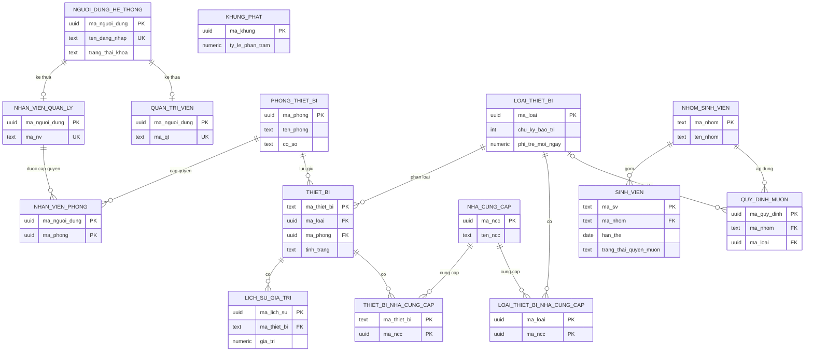
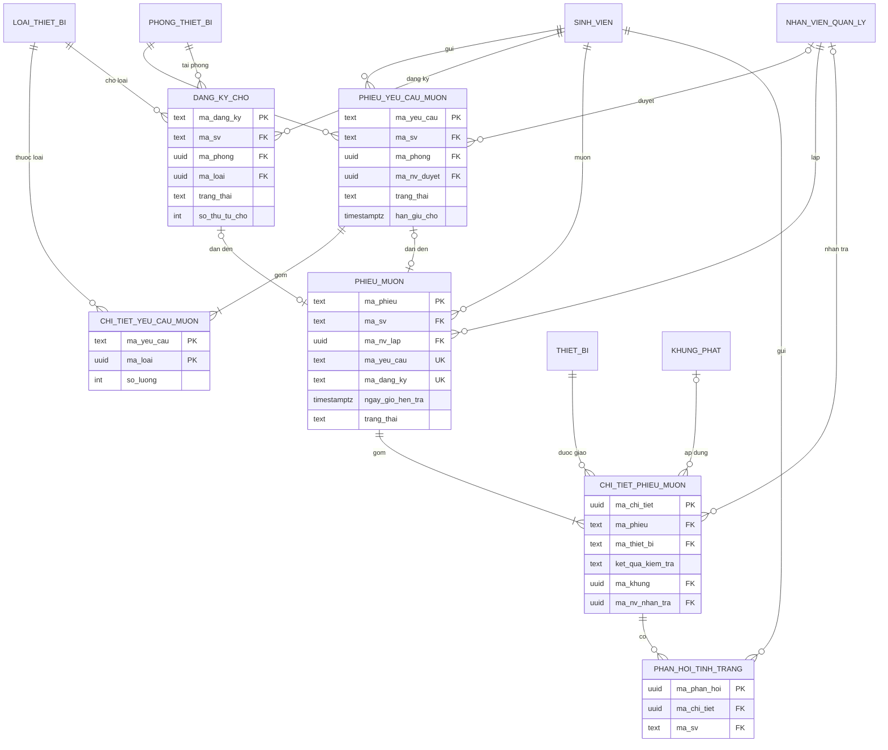
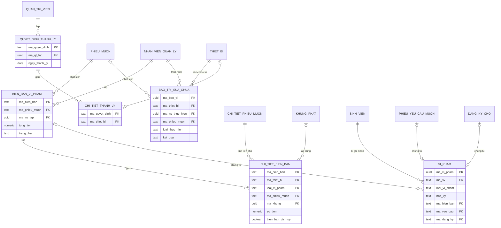
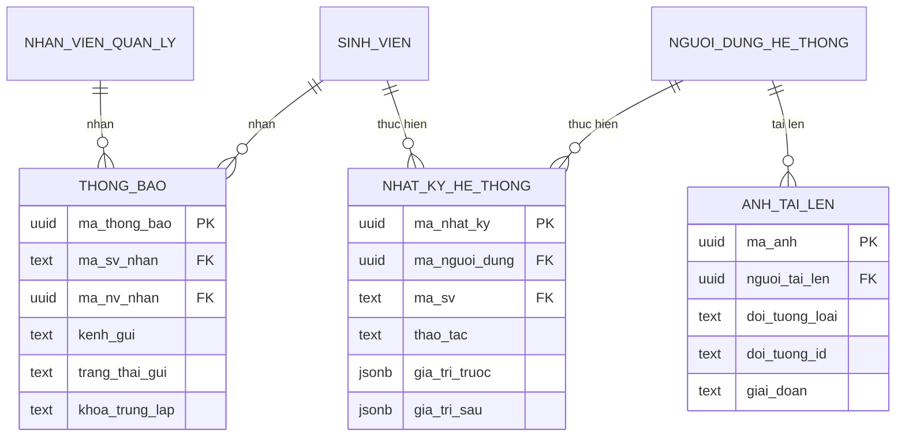

# THIẾT KẾ CƠ SỞ DỮ LIỆU

## Hệ thống quản lý mượn trả thiết bị học tập cho sinh viên

| Trường | Nội dung |
|---|---|
| Môn học / Nhóm | SE100 – Nhóm 13 |
| Tài liệu | DatabaseDesign.md (kèm `schema.sql`) |
| Phiên bản | 1.2 |
| Ngày lập | 27/10/2026 |
| Cập nhật gần nhất | 06/11/2026 (mục 9: câu về khóa tư vấn theo ĐX-KT-13) |
| Trạng thái | Các quyết định bổ sung ĐX-DB-01 đến ĐX-DB-16 đã được nhóm duyệt |
| Căn cứ | SRS.md, Usecase.md (v1.2), BusinessRule.md, Authorization.md, backend-architecture.md (mục 5), Backend-Conventions.md (mục 3, 7) |
| CSDL | PostgreSQL (Supabase), một CSDL, 35 bảng trong 11 schema |

**Tóm tắt.** Thiết kế gồm 35 bảng, 54 khóa ngoại, 10 ràng buộc UNIQUE, 86 ràng buộc CHECK, 40 chỉ mục, 5 sequence sinh mã chứng từ, 9 hàm trigger. Toàn bộ 26 thực thể miền (DM-01 đến DM-26) và 47 quan hệ của SRS Phụ lục B đều có chỗ lưu. `schema.sql` được sinh từ cùng một nguồn metadata với các bảng trong tài liệu này nên hai file luôn khớp nhau.

**Quyết định đã duyệt (mục 14):** nhóm đã duyệt toàn bộ ĐX-DB-01 đến ĐX-DB-16, trong đó đáng chú ý: ĐX-DB-01 (cách hiểu khóa chính), ĐX-DB-05 (mã ba nhóm sinh viên), ĐX-DB-07 (cột bổ sung cho chi tiết biên bản), ĐX-DB-08 (khóa chống trùng thông báo theo kênh), ĐX-DB-11 (tạo sẵn bảng phản hồi tình trạng). Mục 15 nêu bốn điểm của tài liệu nguồn cần cập nhật theo thiết kế đã duyệt.

---

## 1. Giới thiệu

### 1.1 Mục đích và phạm vi

Tài liệu mô tả cấu trúc dữ liệu vật lý của hệ thống: bảng, cột, kiểu, ràng buộc, chỉ mục, trigger, phân quyền ở mức CSDL, dữ liệu khởi tạo, cùng truy vết về yêu cầu. Tài liệu không lặp lại kiến trúc phần mềm (đã có ở backend-architecture.md) và không mô tả API.

Phạm vi theo SRS: 24 use case; giai đoạn 1 là các UC mức "Phải có". Lược đồ được thiết kế đủ cho cả hệ thống để các UC giai đoạn sau (UC-04, UC-21, UC-22, UC-23, UC-24) không phải đổi cấu trúc bảng lớn (KT 18); các bảng và chỉ mục dành riêng cho giai đoạn sau được nêu ở mục 13.2.

### 1.2 Cách đọc và quy ước nhãn

| Nhãn | Ý nghĩa |
|---|---|
| KT x.y | Mục x.y của backend-architecture.md |
| CV x.y | Mục x.y của Backend-Conventions.md |
| BR-xx, FR-xx, GL-xx, UC-xx, DM-xx, NFR-xx | Mã trong BusinessRule.md và SRS.md |
| ĐX-KT, ĐX-CV, ĐX-PQ, ĐX-0x | Quyết định đã được nhóm duyệt trong các tài liệu nguồn |
| **ĐX-DB-xx** | Quyết định bổ sung của tài liệu này, liệt kê đầy đủ ở mục 14, **đã được nhóm duyệt** |

Nguyên tắc ghi nguồn: mọi cột, ràng buộc và chỉ mục đều có cột "Nguồn". Nội dung không có trong nguồn mà phải quyết định khi thiết kế được gắn ĐX-DB-xx; không có chỗ nào được thêm mà không gắn nguồn hoặc nhãn. Mọi nhãn ĐX-DB-xx đã được nhóm duyệt nên có hiệu lực như yêu cầu thiết kế.

### 1.3 Phân chia trách nhiệm giữa CSDL và Domain

Theo KT và CV, quy tắc nghiệp vụ nằm ở lớp Domain; CSDL giữ vai trò toàn vẹn cấu trúc và lưới an toàn cuối cho các tình huống đồng thời (CV 7, KT 8.4). Vì vậy CSDL chỉ ép những điều có thể kiểm tra từ chính dữ liệu: miền giá trị, quan hệ, tính duy nhất, tính nhất quán của trạng thái với các cột đi kèm, và số tiền. Những điều cần ngữ cảnh (ai đăng nhập, giờ hiện tại, tính tiền, chuyển trạng thái hợp lệ, tối đa 5 ảnh) do ứng dụng kiểm tra; mục 8 ghi rõ từng quy tắc do bên nào bảo đảm.

---

## 2. Nguyên tắc thiết kế

| Nguyên tắc | Nội dung | Nguồn |
|---|---|---|
| Một CSDL, nhiều schema | Mỗi module một schema; `truong_gia_lap` mô phỏng nhà trường; không tạo bảng ở `public` | KT 5.1 |
| Tên | `snake_case` không dấu, tên miền tiếng Việt. Tiền tố ràng buộc: `pk_`, `fk_`, `uq_`, `ck_`; chỉ mục `ix_`, chỉ mục duy nhất có điều kiện `ux_`; sequence `seq_` | CV 7, ĐX-DB-10 |
| Khóa chính | Xem ĐX-DB-01: `ma_sv`, `ma_thiet_bi`, `ma_nhom` là khóa nghiệp vụ (text); mã chứng từ do sequence sinh (text); thực thể còn lại dùng `uuid` v7 do ứng dụng sinh, **không có DEFAULT trong CSDL** | KT 5.1 |
| Cột khóa ngoại | Mang đúng tên cột khóa chính được tham chiếu (`ma_phong`, `ma_loai`, `ma_sv`, `ma_thiet_bi`, `ma_phieu`...) nên các câu truy vấn trong KT 8.4 chạy nguyên văn. Khóa ngoại tới NV/QT trỏ vào `ma_nguoi_dung` với tên nêu vai trò (`ma_nv_lap`, `ma_nv_duyet`...) | KT 5.6, 8.4; ĐX-DB-02 |
| Thời gian | `timestamptz` (UTC). Ngày thuần (hạn thẻ, nhập kho, hết bảo hành, thanh lý) dùng `date`; giờ quầy dùng `time`. Tính theo "ngày lịch" dùng múi giờ Asia/Ho_Chi_Minh | KT 5.1, 8.5; ĐX-DB-03 |
| Tiền | `numeric(14,0)` (VNĐ, không phần lẻ); tỷ lệ phạt `numeric(5,2)` | KT 5.1, NFR-09 |
| Số giờ | `integer` (giờ nguyên) | ĐX-DB-03 |
| Trạng thái | `text` kèm `CHECK` theo danh sách mục 6; không dùng kiểu enum của PostgreSQL | KT 5.1, 5.4, CV 3.3 |
| Cờ | `boolean NOT NULL DEFAULT ...` | CV 7 |
| Xóa | Không xóa cứng dữ liệu có lịch sử (BR-18); dùng cờ `ngung_su_dung` / `dang_su_dung`. `ON DELETE` mặc định NO ACTION (chặn); chỉ CASCADE cho bảng nối và lịch sử giá trị khi xóa cứng thiết bị/loại chưa có lịch sử | KT 5.1, 6.5; ĐX-DB-14 |
| Đồng thời | Cột hệ thống `xmin` làm concurrency token cho `thiet_bi`, `phieu_yeu_cau_muon`, `dang_ky_cho`, `phieu_muon`, `bien_ban_vi_pham` (không cần cột trong DDL) | KT 5.1, 8.4 |
| Mật khẩu | Chỉ lưu giá trị băm (`mat_khau_bam`); SV không có mật khẩu trong schema ứng dụng | NFR-05, BR-08, BR-09 |
| Nhật ký | Chỉ thêm; trigger chặn UPDATE/DELETE/TRUNCATE và thu hồi quyền của role ứng dụng | KT 12, NFR-02 |

---

## 3. Tổng quan schema

| Schema | Module | Bảng |
|---|---|---|
| `tai_khoan` | Module TaiKhoan: tài khoản NV/QT, quyền theo phòng, phiên đăng nhập | `nguoi_dung_he_thong`, `nhan_vien_quan_ly`, `quan_tri_vien`, `nhan_vien_phong`, `refresh_token` |
| `sinh_vien` | Module SinhVien: dữ liệu SV và nhóm do nhà trường cung cấp | `nhom_sinh_vien`, `sinh_vien`, `dong_bo_trang_thai` |
| `danh_muc` | Module DanhMuc: phòng, loại thiết bị, thiết bị, giá trị, nhà cung cấp | `phong_thiet_bi`, `loai_thiet_bi`, `nha_cung_cap`, `thiet_bi`, `lich_su_gia_tri`, `thiet_bi_nha_cung_cap`, `loai_thiet_bi_nha_cung_cap` |
| `quy_dinh` | Module QuyDinh: quy định mượn, tham số hệ thống, khung phạt | `tham_so_he_thong`, `khung_phat`, `quy_dinh_muon` |
| `muon_tra` | Module MuonTra: yêu cầu, danh sách chờ, phiếu mượn, nhận trả | `phieu_yeu_cau_muon`, `chi_tiet_yeu_cau_muon`, `dang_ky_cho`, `phieu_muon`, `chi_tiet_phieu_muon`, `phan_hoi_tinh_trang` |
| `vi_pham` | Module ViPham: vi phạm, biên bản, chi tiết biên bản | `bien_ban_vi_pham`, `chi_tiet_bien_ban`, `vi_pham` |
| `bao_tri` | Module BaoTri: bảo trì/sửa chữa, quyết định thanh lý | `bao_tri_sua_chua`, `quyet_dinh_thanh_ly`, `chi_tiet_thanh_ly` |
| `thong_bao` | Module ThongBao: hàng đợi thông báo (outbox) | `thong_bao` |
| `nhat_ky` | Module NhatKy: nhật ký kiểm toán chỉ thêm | `nhat_ky_he_thong` |
| `luu_tru` | Hạ tầng: siêu dữ liệu ảnh tải lên (tệp nằm ở Supabase Storage) | `anh_tai_len` |
| `truong_gia_lap` | Mô phỏng hệ thống nhà trường (KT-05), chỉ dùng cho đồ án | `nhom_sinh_vien_truong`, `sinh_vien_truong` |

**Phụ thuộc giữa các schema (khóa ngoại).** `tai_khoan` → `danh_muc` (quyền theo phòng); `quy_dinh` → `sinh_vien`, `danh_muc`; `muon_tra` → `sinh_vien`, `tai_khoan`, `danh_muc`, `quy_dinh` (khung phạt); `vi_pham` → `muon_tra`, `sinh_vien`, `tai_khoan`, `quy_dinh`; `bao_tri` → `muon_tra`, `danh_muc`, `tai_khoan`; `thong_bao`, `nhat_ky` → `sinh_vien`, `tai_khoan`; `luu_tru` → `tai_khoan`. Có phụ thuộc hai chiều giữa các schema (ví dụ `tai_khoan` ↔ `danh_muc` qua quyền theo phòng và khóa ngoại tới NV), nên `schema.sql` tạo toàn bộ bảng trước rồi gắn khóa ngoại sau (mục 4 và 5 của file).

**Thứ tự trong `schema.sql`:** 0 chặn chạy lại; 1 role `app_backend`; 2 schema; 3 sequence; 4 bảng; 5 khóa ngoại; 6 chỉ mục; 7 hàm và trigger; 8 chú thích bảng/cột; 9 bảo mật; 10 dữ liệu khởi tạo. Mọi thứ nằm trong một giao dịch.

---

## 4. Sơ đồ quan hệ thực thể (ERD)

Chỉ vẽ khóa và cột chính; đầy đủ cột ở mục 5. Ký hiệu: `||--o{` một – không hoặc nhiều; `||--|{` một – một hoặc nhiều; `|o--o|` không hoặc một – không hoặc một.

### 4.1 Tài khoản, sinh viên, danh mục, quy định



### 4.2 Mượn trả



### 4.3 Vi phạm, bảo trì, thanh lý



### 4.4 Thông báo, nhật ký, ảnh



`anh_tai_len.doi_tuong_loai/doi_tuong_id` là tham chiếu đa hình (`THIET_BI` → `thiet_bi.ma_thiet_bi`; `CHI_TIET_PHIEU_MUON` → `chi_tiet_phieu_muon.ma_chi_tiet`), không có khóa ngoại; tương tự `thong_bao.doi_tuong_*` và `refresh_token.chu_so_huu_*`.

### 4.5 Bảng khóa ngoại

| Khóa ngoại | Bảng con (cột) | Bảng cha (cột) | ON DELETE | Quan hệ |
|---|---|---|---|---|
| `fk_nvql_nguoi_dung` | `tai_khoan.nhan_vien_quan_ly` (ma_nguoi_dung) | `tai_khoan.nguoi_dung_he_thong` (ma_nguoi_dung) | NO ACTION | Kế thừa (1) |
| `fk_qtv_nguoi_dung` | `tai_khoan.quan_tri_vien` (ma_nguoi_dung) | `tai_khoan.nguoi_dung_he_thong` (ma_nguoi_dung) | NO ACTION | Kế thừa (2) |
| `fk_nvp_nhan_vien` | `tai_khoan.nhan_vien_phong` (ma_nguoi_dung) | `tai_khoan.nhan_vien_quan_ly` (ma_nguoi_dung) | NO ACTION | Quan hệ 11 |
| `fk_nvp_phong` | `tai_khoan.nhan_vien_phong` (ma_phong) | `danh_muc.phong_thiet_bi` (ma_phong) | NO ACTION | Quan hệ 11 |
| `fk_rt_thay_the_boi` | `tai_khoan.refresh_token` (thay_the_boi) | `tai_khoan.refresh_token` (ma) | NO ACTION | Chuỗi xoay vòng |
| `fk_sv_nhom` | `sinh_vien.sinh_vien` (ma_nhom) | `sinh_vien.nhom_sinh_vien` (ma_nhom) | NO ACTION | Quan hệ 3 |
| `fk_tb_loai` | `danh_muc.thiet_bi` (ma_loai) | `danh_muc.loai_thiet_bi` (ma_loai) | NO ACTION | Quan hệ 7 |
| `fk_tb_phong` | `danh_muc.thiet_bi` (ma_phong) | `danh_muc.phong_thiet_bi` (ma_phong) | NO ACTION | Quan hệ 6 |
| `fk_lsgt_thiet_bi` | `danh_muc.lich_su_gia_tri` (ma_thiet_bi) | `danh_muc.thiet_bi` (ma_thiet_bi) | CASCADE | Quan hệ 8 (hợp thành); xóa kèm khi xóa cứng thiết bị chưa có lịch sử (KT 6.5) |
| `fk_tbncc_thiet_bi` | `danh_muc.thiet_bi_nha_cung_cap` (ma_thiet_bi) | `danh_muc.thiet_bi` (ma_thiet_bi) | CASCADE | Quan hệ 9; xóa kèm (KT 6.5) |
| `fk_tbncc_ncc` | `danh_muc.thiet_bi_nha_cung_cap` (ma_ncc) | `danh_muc.nha_cung_cap` (ma_ncc) | NO ACTION | Quan hệ 9 |
| `fk_lncc_loai` | `danh_muc.loai_thiet_bi_nha_cung_cap` (ma_loai) | `danh_muc.loai_thiet_bi` (ma_loai) | CASCADE | Quan hệ 10; xóa kèm (KT 6.5) |
| `fk_lncc_ncc` | `danh_muc.loai_thiet_bi_nha_cung_cap` (ma_ncc) | `danh_muc.nha_cung_cap` (ma_ncc) | NO ACTION | Quan hệ 10 |
| `fk_qdm_nhom` | `quy_dinh.quy_dinh_muon` (ma_nhom) | `sinh_vien.nhom_sinh_vien` (ma_nhom) | NO ACTION | Quan hệ 4 |
| `fk_qdm_loai` | `quy_dinh.quy_dinh_muon` (ma_loai) | `danh_muc.loai_thiet_bi` (ma_loai) | NO ACTION | Quan hệ 5 |
| `fk_yc_sv` | `muon_tra.phieu_yeu_cau_muon` (ma_sv) | `sinh_vien.sinh_vien` (ma_sv) | NO ACTION | Quan hệ 12 |
| `fk_yc_phong` | `muon_tra.phieu_yeu_cau_muon` (ma_phong) | `danh_muc.phong_thiet_bi` (ma_phong) | NO ACTION | Quan hệ 13 |
| `fk_yc_nv_duyet` | `muon_tra.phieu_yeu_cau_muon` (ma_nv_duyet) | `tai_khoan.nhan_vien_quan_ly` (ma_nguoi_dung) | NO ACTION | Quan hệ 14 |
| `fk_ctyc_phieu` | `muon_tra.chi_tiet_yeu_cau_muon` (ma_yeu_cau) | `muon_tra.phieu_yeu_cau_muon` (ma_yeu_cau) | NO ACTION | Quan hệ 15 (hợp thành) |
| `fk_ctyc_loai` | `muon_tra.chi_tiet_yeu_cau_muon` (ma_loai) | `danh_muc.loai_thiet_bi` (ma_loai) | NO ACTION | Quan hệ 16 |
| `fk_dk_sv` | `muon_tra.dang_ky_cho` (ma_sv) | `sinh_vien.sinh_vien` (ma_sv) | NO ACTION | Quan hệ 17 |
| `fk_dk_loai` | `muon_tra.dang_ky_cho` (ma_loai) | `danh_muc.loai_thiet_bi` (ma_loai) | NO ACTION | Quan hệ 18 |
| `fk_dk_phong` | `muon_tra.dang_ky_cho` (ma_phong) | `danh_muc.phong_thiet_bi` (ma_phong) | NO ACTION | Quan hệ 19 |
| `fk_pm_sv` | `muon_tra.phieu_muon` (ma_sv) | `sinh_vien.sinh_vien` (ma_sv) | NO ACTION | Quan hệ 20 |
| `fk_pm_nv_lap` | `muon_tra.phieu_muon` (ma_nv_lap) | `tai_khoan.nhan_vien_quan_ly` (ma_nguoi_dung) | NO ACTION | Quan hệ 21 |
| `fk_pm_yeu_cau` | `muon_tra.phieu_muon` (ma_yeu_cau) | `muon_tra.phieu_yeu_cau_muon` (ma_yeu_cau) | NO ACTION | Quan hệ 22 |
| `fk_pm_dang_ky` | `muon_tra.phieu_muon` (ma_dang_ky) | `muon_tra.dang_ky_cho` (ma_dang_ky) | NO ACTION | Quan hệ 23 |
| `fk_ctpm_phieu` | `muon_tra.chi_tiet_phieu_muon` (ma_phieu) | `muon_tra.phieu_muon` (ma_phieu) | NO ACTION | Quan hệ 24 (hợp thành) |
| `fk_ctpm_thiet_bi` | `muon_tra.chi_tiet_phieu_muon` (ma_thiet_bi) | `danh_muc.thiet_bi` (ma_thiet_bi) | NO ACTION | Quan hệ 25 |
| `fk_ctpm_khung` | `muon_tra.chi_tiet_phieu_muon` (ma_khung) | `quy_dinh.khung_phat` (ma_khung) | NO ACTION | Quan hệ 26 |
| `fk_ctpm_nv_nhan_tra` | `muon_tra.chi_tiet_phieu_muon` (ma_nv_nhan_tra) | `tai_khoan.nhan_vien_quan_ly` (ma_nguoi_dung) | NO ACTION | Quan hệ 29 |
| `fk_pht_chi_tiet` | `muon_tra.phan_hoi_tinh_trang` (ma_chi_tiet) | `muon_tra.chi_tiet_phieu_muon` (ma_chi_tiet) | NO ACTION | Quan hệ 27 |
| `fk_pht_sv` | `muon_tra.phan_hoi_tinh_trang` (ma_sv) | `sinh_vien.sinh_vien` (ma_sv) | NO ACTION | Quan hệ 28 |
| `fk_bb_phieu` | `vi_pham.bien_ban_vi_pham` (ma_phieu_muon) | `muon_tra.phieu_muon` (ma_phieu) | NO ACTION | Quan hệ 36 |
| `fk_bb_nv_lap` | `vi_pham.bien_ban_vi_pham` (ma_nv_lap) | `tai_khoan.nhan_vien_quan_ly` (ma_nguoi_dung) | NO ACTION | Quan hệ 37 |
| `fk_ctbb_bien_ban` | `vi_pham.chi_tiet_bien_ban` (ma_bien_ban, ma_phieu_muon) | `vi_pham.bien_ban_vi_pham` (ma_bien_ban, ma_phieu_muon) | NO ACTION | Quan hệ 38 (hợp thành), kèm ràng buộc cùng phiếu mượn |
| `fk_ctbb_chi_tiet_phieu` | `vi_pham.chi_tiet_bien_ban` (ma_phieu_muon, ma_thiet_bi) | `muon_tra.chi_tiet_phieu_muon` (ma_phieu, ma_thiet_bi) | NO ACTION | Quan hệ 39: thiết bị phải thuộc phiếu mượn của biên bản |
| `fk_ctbb_khung` | `vi_pham.chi_tiet_bien_ban` (ma_khung) | `quy_dinh.khung_phat` (ma_khung) | NO ACTION | Quan hệ 40 |
| `fk_vp_sv` | `vi_pham.vi_pham` (ma_sv) | `sinh_vien.sinh_vien` (ma_sv) | NO ACTION | Quan hệ 30 |
| `fk_vp_bien_ban` | `vi_pham.vi_pham` (ma_bien_ban) | `vi_pham.bien_ban_vi_pham` (ma_bien_ban) | NO ACTION | Quan hệ 31 |
| `fk_vp_yeu_cau` | `vi_pham.vi_pham` (ma_yeu_cau) | `muon_tra.phieu_yeu_cau_muon` (ma_yeu_cau) | NO ACTION | Quan hệ 32 |
| `fk_vp_dang_ky` | `vi_pham.vi_pham` (ma_dang_ky) | `muon_tra.dang_ky_cho` (ma_dang_ky) | NO ACTION | Quan hệ 33 |
| `fk_bt_thiet_bi` | `bao_tri.bao_tri_sua_chua` (ma_thiet_bi) | `danh_muc.thiet_bi` (ma_thiet_bi) | NO ACTION | Quan hệ 41 |
| `fk_bt_nv` | `bao_tri.bao_tri_sua_chua` (ma_nv_thuc_hien) | `tai_khoan.nhan_vien_quan_ly` (ma_nguoi_dung) | NO ACTION | Quan hệ 42 |
| `fk_bt_phieu` | `bao_tri.bao_tri_sua_chua` (ma_phieu_muon) | `muon_tra.phieu_muon` (ma_phieu) | NO ACTION | Quan hệ 43 |
| `fk_qd_qt` | `bao_tri.quyet_dinh_thanh_ly` (ma_qt_lap) | `tai_khoan.quan_tri_vien` (ma_nguoi_dung) | NO ACTION | Quan hệ 44 |
| `fk_cttl_quyet_dinh` | `bao_tri.chi_tiet_thanh_ly` (ma_quyet_dinh) | `bao_tri.quyet_dinh_thanh_ly` (ma_quyet_dinh) | NO ACTION | Quan hệ 45 |
| `fk_cttl_thiet_bi` | `bao_tri.chi_tiet_thanh_ly` (ma_thiet_bi) | `danh_muc.thiet_bi` (ma_thiet_bi) | NO ACTION | Quan hệ 45 |
| `fk_tb_sv_nhan` | `thong_bao.thong_bao` (ma_sv_nhan) | `sinh_vien.sinh_vien` (ma_sv) | NO ACTION | Quan hệ 34 |
| `fk_tb_nv_nhan` | `thong_bao.thong_bao` (ma_nv_nhan) | `tai_khoan.nhan_vien_quan_ly` (ma_nguoi_dung) | NO ACTION | Quan hệ 35 |
| `fk_nk_nguoi_dung` | `nhat_ky.nhat_ky_he_thong` (ma_nguoi_dung) | `tai_khoan.nguoi_dung_he_thong` (ma_nguoi_dung) | NO ACTION | Quan hệ 46 |
| `fk_nk_sv` | `nhat_ky.nhat_ky_he_thong` (ma_sv) | `sinh_vien.sinh_vien` (ma_sv) | NO ACTION | Quan hệ 47 |
| `fk_anh_nguoi_tai_len` | `luu_tru.anh_tai_len` (nguoi_tai_len) | `tai_khoan.nguoi_dung_he_thong` (ma_nguoi_dung) | NO ACTION | Người tải ảnh (NV hoặc QT) |
| `fk_svt_nhom` | `truong_gia_lap.sinh_vien_truong` (ma_nhom) | `truong_gia_lap.nhom_sinh_vien_truong` (ma_nhom) | NO ACTION | Nhóm của SV mẫu |

---

## 5. Từ điển dữ liệu

Cột "Null": "Không" = `NOT NULL`. Ràng buộc CHECK và UNIQUE của từng bảng ở mục 7.1; chỉ mục ở mục 7.2.


### 5.1 Schema `tai_khoan`

Module TaiKhoan: tài khoản NV/QT, quyền theo phòng, phiên đăng nhập.

#### `tai_khoan.nguoi_dung_he_thong` (DM-01)

Lớp cha (trừu tượng) của NV và QT: tài khoản do hệ thống cấp, mật khẩu băm, có thể bị khóa.

Nguồn: FR-33, FR-34, NFR-05, UC-14, UC-19; KT 5.2.

| Cột | Kiểu | Null | Mặc định | Ý nghĩa | Nguồn |
|---|---|---|---|---|---|
| `ma_nguoi_dung` (PK) | `uuid` | Không |  | Khóa chính, định danh chung của NV và QT (uuid v7 do ứng dụng sinh). | KT 5.1 |
| `ten_dang_nhap` | `text` | Không |  | Tên đăng nhập, duy nhất; trùng thì từ chối. | UC-14 E1 |
| `mat_khau_bam` | `text` | Không |  | Mật khẩu đã băm (PBKDF2 qua PasswordHasher); không bao giờ lưu dạng rõ; bị loại khỏi JSON nhật ký. | NFR-05, BR-09 |
| `ho_ten` | `text` | Không |  | Họ tên người dùng. | DM-01 |
| `email` | `text` | Có |  | Địa chỉ nhận email (nhắc bảo trì cho NV). Cho phép rỗng vì tài khoản QT khởi tạo chỉ có tên đăng nhập và mật khẩu. | ĐX-KT-04; ĐX-DB-04 |
| `trang_thai_khoa` | `text` | Không | `'HOAT_DONG'` | Hoạt động / Tạm khóa đăng nhập (hệ thống đặt khi nhập sai quá mức) / Bị khóa (QT khóa). | SRS 6.3; ĐX-PQ-04 |
| `so_lan_dang_nhap_sai` | `integer` | Không | `0` | Số lần nhập sai liên tiếp; về 0 khi đăng nhập đúng. | BR-10 |

#### `tai_khoan.nhan_vien_quan_ly` (DM-02)

Lớp con của NguoiDungHeThong (kiểu bảng riêng TPT): nhân viên quản lý thiết bị.

Nguồn: FR-34, GL-02; KT 5.2.

| Cột | Kiểu | Null | Mặc định | Ý nghĩa | Nguồn |
|---|---|---|---|---|---|
| `ma_nguoi_dung` (PK) | `uuid` | Không |  | Khóa chính và khóa ngoại tới nguoi_dung_he_thong. | KT 5.1 |
| `ma_nv` | `text` | Không |  | Mã nhân viên, duy nhất; là thuộc tính, không phải khóa chính. | DM-02; KT 5.1 |

Khóa ngoại: (ma_nguoi_dung) → `tai_khoan.nguoi_dung_he_thong`.

#### `tai_khoan.quan_tri_vien` (DM-03)

Lớp con của NguoiDungHeThong (TPT): quản trị viên.

Nguồn: GL-03; KT 5.2.

| Cột | Kiểu | Null | Mặc định | Ý nghĩa | Nguồn |
|---|---|---|---|---|---|
| `ma_nguoi_dung` (PK) | `uuid` | Không |  | Khóa chính và khóa ngoại tới nguoi_dung_he_thong. | KT 5.1 |
| `ma_qt` | `text` | Không |  | Mã quản trị viên, duy nhất; là thuộc tính, không phải khóa chính. | DM-03; KT 5.1 |

Khóa ngoại: (ma_nguoi_dung) → `tai_khoan.nguoi_dung_he_thong`.

#### `tai_khoan.nhan_vien_phong` ((quan hệ 11))

Bảng nối n-n: phòng thiết bị mà NV được QT cấp quyền. Thu hồi quyền = xóa dòng (lịch sử nằm ở nhật ký).

Nguồn: FR-34, UC-14, BR-05; KT 5.5.

| Cột | Kiểu | Null | Mặc định | Ý nghĩa | Nguồn |
|---|---|---|---|---|---|
| `ma_nguoi_dung` (PK) | `uuid` | Không |  | NV được cấp quyền. | Phụ lục B (11) |
| `ma_phong` (PK) | `uuid` | Không |  | Phòng thiết bị được cấp quyền. | Phụ lục B (11) |

Khóa chính ghép: (ma_nguoi_dung, ma_phong). Khóa ngoại: (ma_nguoi_dung) → `tai_khoan.nhan_vien_quan_ly`; (ma_phong) → `danh_muc.phong_thiet_bi`.

#### `tai_khoan.refresh_token` ((KT 5.5))

Refresh token (chỉ lưu giá trị băm), xoay vòng mỗi lần làm mới; dùng cho cả SV, NV, QT.

Nguồn: KT 7.3.

| Cột | Kiểu | Null | Mặc định | Ý nghĩa | Nguồn |
|---|---|---|---|---|---|
| `ma` (PK) | `uuid` | Không |  | Khóa chính của token. | KT 5.5 |
| `chu_so_huu_loai` | `text` | Không |  | Loại chủ sở hữu theo mã vai trò: SINH_VIEN, NHAN_VIEN, QUAN_TRI. | KT 5.4, 5.5 |
| `chu_so_huu_ma` | `text` | Không |  | Mã chủ sở hữu: ma_sv (SV) hoặc ma_nguoi_dung dạng chuỗi (NV, QT). Không có FK vì đa hình. | KT 5.5; ĐX-DB-02 |
| `ma_bam` | `text` | Không |  | Giá trị băm của token; không lưu token gốc. | KT 7.3 |
| `het_han` | `timestamptz` | Không |  | Thời điểm hết hạn (7 ngày kể từ khi cấp). | KT 7.3 |
| `da_thu_hoi` | `boolean` | Không | `false` | Đã thu hồi (đăng xuất, khóa tài khoản, phát hiện dùng lại token cũ). | KT 7.3 |
| `thay_the_boi` | `uuid` | Có |  | Token mới thay thế khi xoay vòng (để thu hồi cả chuỗi). | KT 5.5, 7.3 |

Khóa ngoại: (thay_the_boi) → `tai_khoan.refresh_token`.


### 5.2 Schema `sinh_vien`

Module SinhVien: dữ liệu SV và nhóm do nhà trường cung cấp.

#### `sinh_vien.nhom_sinh_vien` (DM-05)

Nhóm sinh viên do nhà trường cung cấp (đại học; cao học; làm đồ án tốt nghiệp). QT không tạo nhóm.

Nguồn: GL-29, BR-11, UC-13; KT 5.2.

| Cột | Kiểu | Null | Mặc định | Ý nghĩa | Nguồn |
|---|---|---|---|---|---|
| `ma_nhom` (PK) | `text` | Không |  | Khóa chính, mã nhóm do nhà trường cung cấp (khóa nghiệp vụ, không phải uuid). | ĐX-DB-01, ĐX-DB-05 |
| `ten_nhom` | `text` | Không |  | Tên nhóm. | DM-05 |

#### `sinh_vien.sinh_vien` (DM-04)

Dữ liệu SV do nhà trường cung cấp (đồng bộ). Không có cột mật khẩu. trang_thai_quyen_muon do hệ thống này sở hữu, không bị đồng bộ ghi đè.

Nguồn: FR-35, BR-08, NFR-05; KT 5.2, 7.1.

| Cột | Kiểu | Null | Mặc định | Ý nghĩa | Nguồn |
|---|---|---|---|---|---|
| `ma_sv` (PK) | `text` | Không |  | Khóa chính, mã số sinh viên (khóa nghiệp vụ); cũng là nội dung mã thẻ quét. | KT 5.1, BR-38 |
| `ho_ten` | `text` | Không |  | Họ tên. | DM-04 |
| `lop` | `text` | Có |  | Lớp (chỉ để hiển thị). | DM-04; ĐX-DB-04 |
| `khoa` | `text` | Có |  | Khoa (chỉ để hiển thị). | DM-04; ĐX-DB-04 |
| `email` | `text` | Không |  | Email do nhà trường cung cấp, dùng gửi thông báo. | KT 10.2 |
| `ma_nhom` | `text` | Không |  | Nhóm sinh viên quyết định giới hạn mượn. | Phụ lục B (3) |
| `han_the` | `date` | Không |  | Ngày hết hiệu lực của thẻ; thẻ hết hạn thì không đặt trước/mượn. | GL-36, BR-23 |
| `trang_thai_hoc` | `text` | Không |  | Đang học / Tốt nghiệp / Thôi học / Đình chỉ. | FR-35, SRS 6.3 |
| `hoc_ky` | `text` | Không |  | Học kỳ hiện tại theo hệ thống nhà trường (định dạng do nhà trường quy định). | FR-42, DM-04 |
| `trang_thai_quyen_muon` | `text` | Không | `'BINH_THUONG'` | Bình thường / Tạm khóa / Cấm mượn dài hạn. | GL-19, GL-38, SRS 6.3 |

Khóa ngoại: (ma_nhom) → `sinh_vien.nhom_sinh_vien`.

#### `sinh_vien.dong_bo_trang_thai` ((KT 5.5))

Một dòng duy nhất: mốc đồng bộ gần nhất để job DongBoSinhVien kéo thay đổi từ sau mốc đó.

Nguồn: KT 5.5, 7.1.

| Cột | Kiểu | Null | Mặc định | Ý nghĩa | Nguồn |
|---|---|---|---|---|---|
| `id` (PK) | `smallint` | Không | `1` | Luôn bằng 1. | KT 5.5 |
| `moc_dong_bo_gan_nhat` | `timestamptz` | Có |  | Mốc đồng bộ gần nhất; rỗng nghĩa là chưa đồng bộ lần nào. | KT 5.5, 7.1 |


### 5.3 Schema `danh_muc`

Module DanhMuc: phòng, loại thiết bị, thiết bị, giá trị, nhà cung cấp.

#### `danh_muc.phong_thiet_bi` (DM-08)

Phòng thiết bị: thuộc một cơ sở; kệ và tủ là vị trí lưu trữ của thiết bị.

Nguồn: GL-35, FR-18, UC-12.

| Cột | Kiểu | Null | Mặc định | Ý nghĩa | Nguồn |
|---|---|---|---|---|---|
| `ma_phong` (PK) | `uuid` | Không |  | Khóa chính (uuid v7). | KT 5.1 |
| `ten_phong` | `text` | Không |  | Tên phòng. | DM-08 |
| `co_so` | `text` | Không |  | Cơ sở mà phòng thuộc về. | DM-08 |

#### `danh_muc.loai_thiet_bi` (DM-09)

Nhóm phân loại thiết bị; có chu kỳ bảo trì và phí trễ mỗi ngày. Đã có lịch sử thì chỉ ngưng sử dụng.

Nguồn: GL-04, FR-18, FR-37, BR-18.

| Cột | Kiểu | Null | Mặc định | Ý nghĩa | Nguồn |
|---|---|---|---|---|---|
| `ma_loai` (PK) | `uuid` | Không |  | Khóa chính (uuid v7). | KT 5.1 |
| `ten_loai` | `text` | Không |  | Tên loại thiết bị. | DM-09 |
| `mo_ta` | `text` | Có |  | Mô tả. | DM-09 |
| `hang_san_xuat` | `text` | Có |  | Hãng sản xuất. | DM-09, UC-12 |
| `chu_ky_bao_tri` | `integer` | Không |  | Chu kỳ bảo trì (ngày), lớn hơn 0; không có giá trị mặc định. | FR-16, BR-70; ĐX-DB-04 |
| `phi_tre_moi_ngay` | `numeric(14,0)` | Không |  | Phí trả trễ (VNĐ/ngày) của loại, không âm; không có mức mặc định. | FR-37, ĐX-05; ĐX-DB-04 |
| `ngung_su_dung` | `boolean` | Không | `false` | Cờ ngưng sử dụng thay cho xóa cứng khi đã có lịch sử. | BR-18, KT 5.5 |

#### `danh_muc.nha_cung_cap` (DM-12)

Nhà cung cấp; một thiết bị hoặc loại thiết bị có thể do nhiều nhà cung cấp. Giai đoạn 1 chỉ đọc và gán.

Nguồn: GL-22, FR-19, UC-22; ĐX-KT-11.

| Cột | Kiểu | Null | Mặc định | Ý nghĩa | Nguồn |
|---|---|---|---|---|---|
| `ma_ncc` (PK) | `uuid` | Không |  | Khóa chính (uuid v7). | KT 5.1 |
| `ten_ncc` | `text` | Không |  | Tên nhà cung cấp. | DM-12 |
| `thong_tin_lien_he` | `text` | Có |  | Thông tin liên hệ. | DM-12 |

#### `danh_muc.thiet_bi` (DM-10)

Một đơn vị vật lý có mã riêng, thuộc một loại và một phòng. Giá trị hiện hành là bản ghi mới nhất của lich_su_gia_tri; ảnh danh mục nằm ở luu_tru.anh_tai_len.

Nguồn: GL-05, GL-06, GL-07, GL-08, FR-18, BR-12..BR-18.

| Cột | Kiểu | Null | Mặc định | Ý nghĩa | Nguồn |
|---|---|---|---|---|---|
| `ma_thiet_bi` (PK) | `text` | Không |  | Khóa chính, mã thiết bị in chìm (khóa nghiệp vụ, duy nhất); bất biến sau khi tạo. | KT 5.1, UC-12 E1 |
| `ma_loai` | `uuid` | Không |  | Loại thiết bị. | Phụ lục B (7) |
| `ma_phong` | `uuid` | Không |  | Phòng lưu giữ thiết bị. | Phụ lục B (6) |
| `ten_thiet_bi` | `text` | Không |  | Tên thiết bị. | DM-10 |
| `mo_ta` | `text` | Có |  | Mô tả. | DM-10 |
| `thong_so_ky_thuat` | `text` | Có |  | Thông số kỹ thuật. | DM-10 |
| `ngay_nhap_kho` | `date` | Không |  | Ngày nhập kho (mốc tính hạn bảo trì khi chưa có lần bảo trì định kỳ). | BR-70 |
| `thoi_han_bao_hanh` | `date` | Có |  | Ngày hết hạn bảo hành; rỗng nếu không có bảo hành. | GL-23, FR-19; ĐX-DB-04 |
| `tinh_trang` | `text` | Không | `'SAN_SANG'` | Tình trạng hiện tại (5 giá trị); chỉ đổi qua máy trạng thái ở Domain. | BR-15, KT 8.1 |
| `vi_tri_ke` | `text` | Có |  | Kệ lưu trữ. | GL-07 |
| `vi_tri_tu` | `text` | Có |  | Tủ lưu trữ. | GL-07 |
| `ngung_su_dung` | `boolean` | Không | `false` | Cờ ngưng sử dụng; thiết bị ngưng sử dụng không tính vào số lượng khả dụng. | BR-18, KT 5.5, 8.2 |

Khóa ngoại: (ma_loai) → `danh_muc.loai_thiet_bi`; (ma_phong) → `danh_muc.phong_thiet_bi`.

#### `danh_muc.lich_su_gia_tri` (DM-11)

Lịch sử giá trị thiết bị, chỉ thêm. Giá trị hiện hành là dòng có ngay_cap_nhat mới nhất; dùng tính bồi thường.

Nguồn: GL-33, BR-17, FR-18.

| Cột | Kiểu | Null | Mặc định | Ý nghĩa | Nguồn |
|---|---|---|---|---|---|
| `ma_lich_su` (PK) | `uuid` | Không |  | Khóa chính (uuid v7), cũng cho thứ tự thời gian ổn định. | ĐX-DB-06 |
| `ma_thiet_bi` | `text` | Không |  | Thiết bị. | Phụ lục B (8) |
| `gia_tri` | `numeric(14,0)` | Không |  | Giá trị (VNĐ), không âm. | GL-33 |
| `ngay_cap_nhat` | `timestamptz` | Không | `now()` | Thời điểm QT cập nhật giá trị. | DM-11 |

Khóa ngoại: (ma_thiet_bi) → `danh_muc.thiet_bi` [CASCADE].

#### `danh_muc.thiet_bi_nha_cung_cap` ((quan hệ 9))

Bảng nối n-n thiết bị - nhà cung cấp.

Nguồn: FR-19, UC-22.

| Cột | Kiểu | Null | Mặc định | Ý nghĩa | Nguồn |
|---|---|---|---|---|---|
| `ma_thiet_bi` (PK) | `text` | Không |  | Thiết bị. | Phụ lục B (9) |
| `ma_ncc` (PK) | `uuid` | Không |  | Nhà cung cấp. | Phụ lục B (9) |

Khóa chính ghép: (ma_thiet_bi, ma_ncc). Khóa ngoại: (ma_thiet_bi) → `danh_muc.thiet_bi` [CASCADE]; (ma_ncc) → `danh_muc.nha_cung_cap`.

#### `danh_muc.loai_thiet_bi_nha_cung_cap` ((quan hệ 10))

Bảng nối n-n loại thiết bị - nhà cung cấp.

Nguồn: FR-19, UC-22.

| Cột | Kiểu | Null | Mặc định | Ý nghĩa | Nguồn |
|---|---|---|---|---|---|
| `ma_loai` (PK) | `uuid` | Không |  | Loại thiết bị. | Phụ lục B (10) |
| `ma_ncc` (PK) | `uuid` | Không |  | Nhà cung cấp. | Phụ lục B (10) |

Khóa chính ghép: (ma_loai, ma_ncc). Khóa ngoại: (ma_loai) → `danh_muc.loai_thiet_bi` [CASCADE]; (ma_ncc) → `danh_muc.nha_cung_cap`.


### 5.4 Schema `quy_dinh`

Module QuyDinh: quy định mượn, tham số hệ thống, khung phạt.

#### `quy_dinh.tham_so_he_thong` (DM-07)

Bộ tham số dùng chung, một dòng duy nhất; thay đổi chỉ áp dụng cho giao dịch phát sinh sau (không hồi tố).

Nguồn: FR-20, FR-33, UC-13; BR mục 14.

| Cột | Kiểu | Null | Mặc định | Ý nghĩa | Nguồn |
|---|---|---|---|---|---|
| `id` (PK) | `smallint` | Không | `1` | Luôn bằng 1. | KT 5.2 |
| `so_ngay_khoa` | `integer` | Không | `3` | Số ngày quá hạn vượt quá thì khóa quyền mượn mới (soNgayKhoa). | FR-09, BR-66 |
| `thoi_gian_giu_cho_phut` | `integer` | Không | `30` | Thời gian giữ chỗ (phút) (thoiGianGiuChoPhut). | GL-30, BR-29 |
| `an_han_phut` | `integer` | Không | `15` | Ân hạn sau hạn trả (phút) (anHanPhut). | GL-37, BR-57 |
| `so_gio_gia_han_toi_da` | `integer` | Không | `2` | Số giờ gia hạn tối đa (soGioGiaHanToiDa). | FR-07, BR-45 |
| `nguong_vi_pham` | `integer` | Không | `3` | Ngưỡng vi phạm mỗi học kỳ (nguongViPham). | FR-42, BR-68 |
| `so_lan_dang_nhap_sai_toi_da` | `integer` | Không | `5` | Số lần nhập sai mật khẩu tối đa của NV/QT, lớn hơn 0 (ĐX-02). | FR-33, BR-10 |
| `gio_mo_cua` | `time` | Có |  | Giờ mở cửa quầy; rỗng = chưa cấu hình (không có mặc định, ĐX-03). | ĐX-03 |
| `gio_dong_cua` | `time` | Có |  | Giờ đóng cửa quầy; rỗng = chưa cấu hình (không có mặc định, ĐX-03). | ĐX-03 |

#### `quy_dinh.khung_phat` (DM-21)

Khung phạt hư hỏng theo % giá trị hiện hành. Khung đã dùng chỉ được tắt (dang_su_dung = false), không xóa.

Nguồn: GL-32, FR-37, BR-59.

| Cột | Kiểu | Null | Mặc định | Ý nghĩa | Nguồn |
|---|---|---|---|---|---|
| `ma_khung` (PK) | `uuid` | Không |  | Khóa chính (uuid v7). | KT 5.1 |
| `ten_khung` | `text` | Không |  | Tên khung (mặc định Nhẹ, Vừa, Nặng). | DM-21 |
| `ty_le_phan_tram` | `numeric(5,2)` | Không |  | Tỷ lệ bồi thường (% giá trị hiện hành), trong khoảng (0, 100]. | DM-21; ĐX-DB-10 |
| `dang_su_dung` | `boolean` | Không | `true` | Cờ bật/tắt; không phải dấu hiệu 'đã dùng'. | FR-37, KT 6.5 |

#### `quy_dinh.quy_dinh_muon` (DM-06)

Quy định mượn theo nhóm SV. Dòng chung (ma_loai rỗng): số thiết bị tối đa (tính trên tổng) và thời gian tối đa. Dòng ngoại lệ theo loại: chỉ đặt thời gian.

Nguồn: FR-20, BR-24, BR-25; SRS 3.3.

| Cột | Kiểu | Null | Mặc định | Ý nghĩa | Nguồn |
|---|---|---|---|---|---|
| `ma_quy_dinh` (PK) | `uuid` | Không |  | Khóa chính (uuid v7). | KT 5.1 |
| `ma_nhom` | `text` | Không |  | Nhóm sinh viên áp dụng. | Phụ lục B (4) |
| `ma_loai` | `uuid` | Có |  | Rỗng = quy định chung của nhóm; có giá trị = ngoại lệ theo loại thiết bị. | Phụ lục B (5) |
| `so_thiet_bi_toi_da` | `integer` | Có |  | Số thiết bị tối đa mượn cùng lúc (tính trên tổng). Chỉ có ở dòng chung. | CR-06, FR-20 |
| `thoi_gian_muon_toi_da_gio` | `integer` | Không |  | Thời gian mượn tối đa (giờ). | CR-12, FR-20; ĐX-DB-03 |

Khóa ngoại: (ma_nhom) → `sinh_vien.nhom_sinh_vien`; (ma_loai) → `danh_muc.loai_thiet_bi`.


### 5.5 Schema `muon_tra`

Module MuonTra: yêu cầu, danh sách chờ, phiếu mượn, nhận trả.

#### `muon_tra.phieu_yeu_cau_muon` (DM-13)

Phiếu yêu cầu mượn (đặt trước). Chờ duyệt: chưa giữ chỗ, chưa gán thiết bị. Duyệt thì giữ chỗ đến han_giu_cho.

Nguồn: GL-09, FR-03, FR-30, BR-21..BR-32.

| Cột | Kiểu | Null | Mặc định | Ý nghĩa | Nguồn |
|---|---|---|---|---|---|
| `ma_yeu_cau` (PK) | `text` | Không | sequence (xem mục 7.3) | Khóa chính, mã chứng từ dạng YC-yyMMdd-nnnnnn do sequence sinh. | KT 5.1, ĐX-CV-06 |
| `ma_sv` | `text` | Không |  | SV gửi phiếu. | Phụ lục B (12) |
| `ma_phong` | `uuid` | Không |  | Phòng thiết bị nhận yêu cầu. | Phụ lục B (13) |
| `ma_nv_duyet` | `uuid` | Có |  | NV duyệt hoặc từ chối. | Phụ lục B (14); ĐX-DB-02 |
| `thoi_gian_gui` | `timestamptz` | Không | `now()` | Thời điểm SV gửi. | DM-13 |
| `thoi_gian_muon_du_kien_gio` | `integer` | Không |  | Thời gian mượn dự kiến (giờ). | FR-03; ĐX-DB-03 |
| `trang_thai` | `text` | Không | `'CHO_DUYET'` | Trạng thái phiếu (6 giá trị). | SRS 7.2 |
| `ly_do_tu_choi` | `text` | Có |  | Lý do từ chối, bắt buộc khi TU_CHOI. | FR-30 |
| `thoi_diem_duyet` | `timestamptz` | Có |  | Thời điểm duyệt. | DM-13 |
| `han_giu_cho` | `timestamptz` | Có |  | Hạn giữ chỗ lưu lúc duyệt (= thời điểm duyệt + thoiGianGiuChoPhut), không đổi khi tham số đổi sau. | KT 5.5, BR-29 |

Khóa ngoại: (ma_sv) → `sinh_vien.sinh_vien`; (ma_phong) → `danh_muc.phong_thiet_bi`; (ma_nv_duyet) → `tai_khoan.nhan_vien_quan_ly`.

#### `muon_tra.chi_tiet_yeu_cau_muon` (DM-14)

Một dòng của phiếu yêu cầu: loại thiết bị và số lượng (một dòng cho mỗi loại).

Nguồn: FR-03, Phụ lục B (15, 16).

| Cột | Kiểu | Null | Mặc định | Ý nghĩa | Nguồn |
|---|---|---|---|---|---|
| `ma_yeu_cau` (PK) | `text` | Không |  | Phiếu yêu cầu. | Phụ lục B (15) |
| `ma_loai` (PK) | `uuid` | Không |  | Loại thiết bị yêu cầu. | Phụ lục B (16) |
| `so_luong` | `integer` | Không |  | Số lượng, lớn hơn 0. | KT 5.6 |

Khóa chính ghép: (ma_yeu_cau, ma_loai). Khóa ngoại: (ma_yeu_cau) → `muon_tra.phieu_yeu_cau_muon`; (ma_loai) → `danh_muc.loai_thiet_bi`.

#### `muon_tra.dang_ky_cho` (DM-15)

Đăng ký chờ một loại thiết bị đã hết tại một phòng; xếp theo thứ tự đăng ký trước. Mỗi đăng ký giữ một thiết bị khi đến lượt.

Nguồn: GL-14, FR-05, FR-06, FR-28, FR-29, BR-33..BR-37.

| Cột | Kiểu | Null | Mặc định | Ý nghĩa | Nguồn |
|---|---|---|---|---|---|
| `ma_dang_ky` (PK) | `text` | Không | sequence (xem mục 7.3) | Khóa chính, mã chứng từ DK-yyMMdd-nnnnnn. | KT 5.1, ĐX-CV-06 |
| `ma_sv` | `text` | Không |  | SV đăng ký. | Phụ lục B (17) |
| `ma_phong` | `uuid` | Không |  | Phòng thiết bị (danh sách chờ theo từng loại tại từng phòng). | Phụ lục B (19) |
| `ma_loai` | `uuid` | Không |  | Loại thiết bị được chờ. | Phụ lục B (18) |
| `thoi_diem_dang_ky` | `timestamptz` | Không | `now()` | Thời điểm đăng ký; thứ tự phục vụ theo cột này. | BR-34 |
| `so_thu_tu_cho` | `integer` | Có |  | Số thứ tự chờ để hiển thị; cập nhật khi người phía trước rời. Bắt buộc khi DANG_CHO. | DM-15, BR-37; ĐX-DB-10 |
| `trang_thai` | `text` | Không | `'DANG_CHO'` | Trạng thái đăng ký (5 giá trị). | SRS 7.4 |
| `han_giu_cho` | `timestamptz` | Có |  | Hạn giữ chỗ lưu lúc đến lượt (thông báo); rỗng khi còn đang chờ. | KT 5.2, BR-35 |

Khóa ngoại: (ma_sv) → `sinh_vien.sinh_vien`; (ma_loai) → `danh_muc.loai_thiet_bi`; (ma_phong) → `danh_muc.phong_thiet_bi`.

#### `muon_tra.phieu_muon` (DM-16)

Phiếu mượn lập khi giao thiết bị; hạn trả, gia hạn và việc trả tính cho cả phiếu. Hạn trả lưu tại phiếu (không hồi tố).

Nguồn: GL-10, FR-11, BR-38..BR-47.

| Cột | Kiểu | Null | Mặc định | Ý nghĩa | Nguồn |
|---|---|---|---|---|---|
| `ma_phieu` (PK) | `text` | Không | sequence (xem mục 7.3) | Khóa chính, mã chứng từ PM-yyMMdd-nnnnnn. | KT 5.1, ĐX-CV-06 |
| `ma_sv` | `text` | Không |  | SV mượn. | Phụ lục B (20) |
| `ma_nv_lap` | `uuid` | Không |  | NV lập phiếu (giao thiết bị). | Phụ lục B (21); ĐX-DB-02 |
| `ma_yeu_cau` | `text` | Có |  | Phiếu yêu cầu dẫn đến phiếu mượn (nguồn giao theo phiếu yêu cầu). | Phụ lục B (22) |
| `ma_dang_ky` | `text` | Có |  | Đăng ký chờ dẫn đến phiếu mượn (nguồn giao từ danh sách chờ). | Phụ lục B (23) |
| `ngay_gio_muon` | `timestamptz` | Không | `now()` | Giờ giao thực tế. | GL-11 |
| `ngay_gio_hen_tra` | `timestamptz` | Không |  | Hạn trả của cả phiếu = min(giờ giao + thời gian mượn, giờ đóng cửa cùng ngày). | BR-42 |
| `so_lan_gia_han` | `integer` | Không | `0` | Số lần đã gia hạn (tối đa 1). | BR-45, CR-02 |
| `trang_thai` | `text` | Không | `'DANG_MUON'` | Đang mượn / Quá hạn / Đã trả. | SRS 7.3 |

Khóa ngoại: (ma_sv) → `sinh_vien.sinh_vien`; (ma_nv_lap) → `tai_khoan.nhan_vien_quan_ly`; (ma_yeu_cau) → `muon_tra.phieu_yeu_cau_muon`; (ma_dang_ky) → `muon_tra.dang_ky_cho`.

#### `muon_tra.chi_tiet_phieu_muon` (DM-17)

Từng thiết bị trong phiếu mượn: tình trạng lúc giao, phí trễ/ngày lưu lúc giao, kết quả kiểm tra lúc trả. Ảnh lúc giao/trả ở luu_tru.anh_tai_len.

Nguồn: FR-10, FR-12, FR-13, FR-36, BR-40..BR-44, BR-48..BR-53.

| Cột | Kiểu | Null | Mặc định | Ý nghĩa | Nguồn |
|---|---|---|---|---|---|
| `ma_chi_tiet` (PK) | `uuid` | Không |  | Khóa chính (uuid v7); làm doi_tuong_id cho ảnh đính kèm. | ĐX-DB-06 |
| `ma_phieu` | `text` | Không |  | Phiếu mượn. | Phụ lục B (24) |
| `ma_thiet_bi` | `text` | Không |  | Thiết bị được giao. | Phụ lục B (25) |
| `tinh_trang_ban_dau` | `text` | Không |  | Mô tả tình trạng lúc giao (bắt buộc). | FR-10, BR-40; ĐX-DB-04 |
| `phi_tre_moi_ngay` | `numeric(14,0)` | Không |  | Phí trễ/ngày của loại thiết bị tại thời điểm giao; cấu hình đổi sau không ảnh hưởng. | BR-43 |
| `tinh_trang_khi_tra` | `text` | Có |  | Mô tả tình trạng lúc trả; bắt buộc khi hư hỏng hoặc thiếu phụ kiện. | FR-12, BR-50 |
| `ket_qua_kiem_tra` | `text` | Có |  | Nguyên vẹn / Hư hỏng / Thiếu phụ kiện / Mất; rỗng trước khi trả. | FR-36, SRS 6.3 |
| `ngay_gio_tra_thuc_te` | `timestamptz` | Có |  | Giờ trả thực tế; rỗng với kết quả Mất. | BR-52 |
| `ma_nv_nhan_tra` | `uuid` | Có |  | NV nhận trả (NV đang đăng nhập), ghi khi có kết quả kiểm tra. | Phụ lục B (29), BR-52; ĐX-DB-02 |
| `ma_khung` | `uuid` | Có |  | Khung phạt NV chọn khi hư hỏng hoặc thiếu phụ kiện. | Phụ lục B (26), BR-50 |

Khóa ngoại: (ma_phieu) → `muon_tra.phieu_muon`; (ma_thiet_bi) → `danh_muc.thiet_bi`; (ma_khung) → `quy_dinh.khung_phat`; (ma_nv_nhan_tra) → `tai_khoan.nhan_vien_quan_ly`.

#### `muon_tra.phan_hoi_tinh_trang` (DM-24)

Phản hồi của SV về tình trạng thiết bị sau khi bàn giao tại quầy (UC-21, giai đoạn sau; bảng tạo sẵn, trống ở giai đoạn 1).

Nguồn: FR-25, BR-55, UC-21; ĐX-DB-11.

| Cột | Kiểu | Null | Mặc định | Ý nghĩa | Nguồn |
|---|---|---|---|---|---|
| `ma_phan_hoi` (PK) | `uuid` | Không |  | Khóa chính (uuid v7). | ĐX-DB-06 |
| `ma_chi_tiet` | `uuid` | Không |  | Chi tiết phiếu mượn (gắn mã thiết bị và phiếu mượn). | Phụ lục B (27), FR-25 |
| `ma_sv` | `text` | Không |  | SV gửi phản hồi. | Phụ lục B (28) |
| `noi_dung` | `text` | Không |  | Nội dung phản hồi. | DM-24 |
| `thoi_diem_gui` | `timestamptz` | Không | `now()` | Thời điểm gửi. | DM-24 |

Khóa ngoại: (ma_chi_tiet) → `muon_tra.chi_tiet_phieu_muon`; (ma_sv) → `sinh_vien.sinh_vien`.


### 5.6 Schema `vi_pham`

Module ViPham: vi phạm, biên bản, chi tiết biên bản.

#### `vi_pham.bien_ban_vi_pham` (DM-19)

Biên bản vi phạm do NV lập (trả trễ, hư hỏng, mất). Số tiền không đổi sau khi lập; chỉ QT được hủy hoặc điều chỉnh.

Nguồn: GL-34, FR-14, BR-62, BR-65; ĐX-PQ-09.

| Cột | Kiểu | Null | Mặc định | Ý nghĩa | Nguồn |
|---|---|---|---|---|---|
| `ma_bien_ban` (PK) | `text` | Không | sequence (xem mục 7.3) | Khóa chính, mã chứng từ BB-yyMMdd-nnnnnn. | KT 5.1, ĐX-CV-06 |
| `ma_phieu_muon` | `text` | Không |  | Phiếu mượn phát sinh biên bản. | Phụ lục B (36) |
| `ma_nv_lap` | `uuid` | Không |  | NV lập biên bản. | Phụ lục B (37); ĐX-DB-02 |
| `ngay_lap` | `timestamptz` | Không | `now()` | Thời điểm lập. | DM-19 |
| `tong_tien` | `numeric(14,0)` | Không |  | Tổng tiền (VNĐ) = tổng so_tien các chi tiết; được kiểm tra khi commit. | FR-14; ĐX-DB-13 |
| `trang_thai` | `text` | Không | `'CHUA_NOP'` | Chưa nộp / Đã nộp / Đã hủy. | BR-62 |
| `thoi_diem_nop` | `timestamptz` | Có |  | Thời điểm NV ghi nhận đã nộp. | DM-19 |

Khóa ngoại: (ma_phieu_muon) → `muon_tra.phieu_muon`; (ma_nv_lap) → `tai_khoan.nhan_vien_quan_ly`.

#### `vi_pham.chi_tiet_bien_ban` (DM-20)

Khoản tiền theo từng thiết bị của biên bản. Thiếu phụ kiện được xử lý như hư hỏng (HU_HONG).

Nguồn: FR-14, FR-43, BR-58..BR-60.

| Cột | Kiểu | Null | Mặc định | Ý nghĩa | Nguồn |
|---|---|---|---|---|---|
| `ma_bien_ban` (PK) | `text` | Không |  | Biên bản. | Phụ lục B (38) |
| `ma_phieu_muon` | `text` | Không |  | Phiếu mượn (sao chép từ biên bản, đảm bảo bằng khóa ngoại ghép) để chống lập trùng khoản. | KT 5.6; ĐX-DB-07 |
| `ma_thiet_bi` (PK) | `text` | Không |  | Thiết bị (phải thuộc phiếu mượn, khóa ngoại ghép). | Phụ lục B (39) |
| `loai_vi_pham` (PK) | `text` | Không |  | Trả trễ / Hư hỏng / Mất. | SRS 6.3 |
| `so_ngay_tre` | `integer` | Có |  | Số ngày trễ (>= 1), chỉ có với TRA_TRE. | FR-43, BR-57 |
| `so_tien` | `numeric(14,0)` | Không |  | Số tiền của khoản (VNĐ). | FR-14 |
| `ma_khung` | `uuid` | Có |  | Khung phạt áp dụng, bắt buộc với HU_HONG. | Phụ lục B (40) |
| `bien_ban_da_huy` | `boolean` | Không | `false` | Bản sao trạng thái hủy của biên bản; do trigger quản lý, không ghi từ ứng dụng. | KT 5.6; ĐX-DB-07 |

Khóa chính ghép: (ma_bien_ban, ma_thiet_bi, loai_vi_pham). Khóa ngoại: (ma_bien_ban, ma_phieu_muon) → `vi_pham.bien_ban_vi_pham`; (ma_phieu_muon, ma_thiet_bi) → `muon_tra.chi_tiet_phieu_muon`; (ma_khung) → `quy_dinh.khung_phat`.

#### `vi_pham.vi_pham` (DM-18)

Bản ghi mỗi lần vi phạm để thống kê và đếm theo học kỳ. Mỗi dòng gắn đúng một chứng từ phát sinh.

Nguồn: GL-16, FR-26, FR-28, FR-42, BR-56, BR-63; SRS 6.2 (2).

| Cột | Kiểu | Null | Mặc định | Ý nghĩa | Nguồn |
|---|---|---|---|---|---|
| `ma_vi_pham` (PK) | `uuid` | Không |  | Khóa chính (uuid v7). | KT 5.1 |
| `ma_sv` | `text` | Không |  | SV bị ghi nhận. | Phụ lục B (30) |
| `loai_vi_pham` | `text` | Không |  | Trả trễ / Hư hỏng / Mất / Không đến nhận. | BR-56 |
| `thoi_diem_ghi_nhan` | `timestamptz` | Không | `now()` | Thời điểm ghi nhận. | DM-18 |
| `hoc_ky` | `text` | Không |  | Học kỳ của SV tại thời điểm ghi nhận (sao chép từ sinh_vien.hoc_ky). | FR-42, DM-18; ĐX-DB-04 |
| `ma_bien_ban` | `text` | Có |  | Biên bản (với Trả trễ, Hư hỏng, Mất). | Phụ lục B (31) |
| `ma_yeu_cau` | `text` | Có |  | Phiếu yêu cầu hết hạn giữ chỗ (Không đến nhận). | Phụ lục B (32) |
| `ma_dang_ky` | `text` | Có |  | Đăng ký chờ hết hạn giữ chỗ (Không đến nhận). | Phụ lục B (33) |

Khóa ngoại: (ma_sv) → `sinh_vien.sinh_vien`; (ma_bien_ban) → `vi_pham.bien_ban_vi_pham`; (ma_yeu_cau) → `muon_tra.phieu_yeu_cau_muon`; (ma_dang_ky) → `muon_tra.dang_ky_cho`.


### 5.7 Schema `bao_tri`

Module BaoTri: bảo trì/sửa chữa, quyết định thanh lý.

#### `bao_tri.bao_tri_sua_chua` (DM-22)

Lịch và kết quả bảo trì định kỳ hoặc sửa chữa. Bản ghi còn mở (ket_qua rỗng) = đang thực hiện.

Nguồn: GL-20, GL-21, GL-28, FR-16, FR-17, FR-38, BR-69..BR-72.

| Cột | Kiểu | Null | Mặc định | Ý nghĩa | Nguồn |
|---|---|---|---|---|---|
| `ma_bao_tri` (PK) | `uuid` | Không |  | Khóa chính (uuid v7). | KT 5.1 |
| `ma_thiet_bi` | `text` | Không |  | Thiết bị được bảo trì/sửa. | Phụ lục B (41) |
| `ma_nv_thuc_hien` | `uuid` | Không |  | NV thực hiện. | Phụ lục B (42); ĐX-DB-02 |
| `ma_phieu_muon` | `text` | Có |  | Phiếu mượn có thiết bị hư hỏng phát sinh sửa chữa. | Phụ lục B (43), BR-71 |
| `loai_thuc_hien` | `text` | Không |  | Bảo trì định kỳ / Sửa chữa. | SRS 6.3 |
| `ngay_lap` | `timestamptz` | Không | `now()` | Thời điểm lập lịch hoặc tiếp nhận. | DM-22 |
| `noi_dung_thuc_hien` | `text` | Có |  | Nội dung thực hiện, ghi khi hoàn thành. | FR-16 |
| `ket_qua` | `text` | Có |  | Đưa về sẵn sàng / Đề xuất thanh lý; rỗng khi đang thực hiện. | SRS 6.3 |
| `ngay_hoan_thanh` | `timestamptz` | Có |  | Thời điểm hoàn thành; mốc tính hạn bảo trì kế tiếp. | BR-70 |

Khóa ngoại: (ma_thiet_bi) → `danh_muc.thiet_bi`; (ma_nv_thuc_hien) → `tai_khoan.nhan_vien_quan_ly`; (ma_phieu_muon) → `muon_tra.phieu_muon`.

#### `bao_tri.quyet_dinh_thanh_ly` (DM-23)

Quyết định thanh lý của một đợt: mã số riêng, ngày thanh lý, QT lập; danh sách thiết bị ở chi_tiet_thanh_ly.

Nguồn: GL-25, FR-21, UC-15, BR-73.

| Cột | Kiểu | Null | Mặc định | Ý nghĩa | Nguồn |
|---|---|---|---|---|---|
| `ma_quyet_dinh` (PK) | `text` | Không | sequence (xem mục 7.3) | Khóa chính, mã chứng từ QD-yyMMdd-nnnnnn. | KT 5.1, ĐX-CV-06 |
| `ma_qt_lap` | `uuid` | Không |  | QT lập quyết định. | Phụ lục B (44); ĐX-DB-02 |
| `ngay_thanh_ly` | `date` | Không |  | Ngày thanh lý. | FR-21 |

Khóa ngoại: (ma_qt_lap) → `tai_khoan.quan_tri_vien`.

#### `bao_tri.chi_tiet_thanh_ly` ((quan hệ 45))

Bảng nối quyết định - thiết bị; mỗi thiết bị tối đa một quyết định thanh lý.

Nguồn: Phụ lục B (45), KT 5.2.

| Cột | Kiểu | Null | Mặc định | Ý nghĩa | Nguồn |
|---|---|---|---|---|---|
| `ma_quyet_dinh` (PK) | `text` | Không |  | Quyết định thanh lý. | Phụ lục B (45) |
| `ma_thiet_bi` (PK) | `text` | Không |  | Thiết bị được thanh lý. | Phụ lục B (45) |

Khóa chính ghép: (ma_quyet_dinh, ma_thiet_bi). Khóa ngoại: (ma_quyet_dinh) → `bao_tri.quyet_dinh_thanh_ly`; (ma_thiet_bi) → `danh_muc.thiet_bi`.


### 5.8 Schema `thong_bao`

Module ThongBao: hàng đợi thông báo (outbox).

#### `thong_bao.thong_bao` (DM-25)

Thông báo kiêm outbox: ghi cùng giao dịch nghiệp vụ, job GuiEmail gửi sau. Mỗi sự kiện sinh một dòng cho mỗi kênh; mỗi dòng đúng một người nhận.

Nguồn: GL-27, FR-24, FR-39, BR-75, NFR-08; KT 10.

| Cột | Kiểu | Null | Mặc định | Ý nghĩa | Nguồn |
|---|---|---|---|---|---|
| `ma_thong_bao` (PK) | `uuid` | Không |  | Khóa chính (uuid v7). | KT 5.1 |
| `loai_thong_bao` | `text` | Không |  | Loại thông báo (7 giá trị). | SRS 6.3 |
| `noi_dung` | `text` | Không |  | Nội dung (chỉ thông tin cần thiết). | DM-25, KT 10.2 |
| `kenh_gui` | `text` | Không |  | Ứng dụng / Email / SMS (giai đoạn 1 không dùng SMS). | SRS 6.3, ĐX-KT-03 |
| `thoi_diem_gui` | `timestamptz` | Không | `now()` | Thời điểm phát sinh thông báo (dùng sắp xếp danh sách cho SV); thời điểm gửi email thực tế là lan_thu_cuoi khi DA_GUI. | DM-25; ĐX-DB-04 |
| `ma_sv_nhan` | `text` | Có |  | SV nhận (khóa ngoại rỗng được). | Phụ lục B (34), SRS 6.2 (1) |
| `ma_nv_nhan` | `uuid` | Có |  | NV nhận (khóa ngoại rỗng được). | Phụ lục B (35), SRS 6.2 (1); ĐX-DB-02 |
| `trang_thai_gui` | `text` | Không | `'CHO_GUI'` | Trạng thái outbox (5 giá trị). | KT 5.5 |
| `so_lan_thu` | `integer` | Không | `0` | Số lần thử gửi (tối đa 5 lần, giãn cách 1, 5, 15, 60 phút). | KT 10.2 |
| `lan_thu_cuoi` | `timestamptz` | Có |  | Thời điểm thử gần nhất. | KT 5.5 |
| `khoa_trung_lap` | `text` | Có |  | Khóa chống trùng của thông báo tự động, dạng {LOAI}:{maDoiTuong}[:{moc}]; rỗng với nhắc nhở thủ công. | FR-41, KT 9.2; ĐX-DB-08 |
| `doi_tuong_loai` | `text` | Có |  | Loại đối tượng nguồn phát sinh (giá trị do ứng dụng quy định). | KT 5.5 |
| `doi_tuong_id` | `text` | Có |  | Mã đối tượng nguồn phát sinh. | KT 5.5 |

Khóa ngoại: (ma_sv_nhan) → `sinh_vien.sinh_vien`; (ma_nv_nhan) → `tai_khoan.nhan_vien_quan_ly`.


### 5.9 Schema `nhat_ky`

Module NhatKy: nhật ký kiểm toán chỉ thêm.

#### `nhat_ky.nhat_ky_he_thong` (DM-26)

Nhật ký kiểm toán chỉ thêm: trigger chặn UPDATE, DELETE, TRUNCATE; role ứng dụng bị thu hồi quyền. Cả hai cột người thực hiện rỗng = Hệ thống tự động.

Nguồn: FR-40, NFR-02, BR-79; KT 12.

| Cột | Kiểu | Null | Mặc định | Ý nghĩa | Nguồn |
|---|---|---|---|---|---|
| `ma_nhat_ky` (PK) | `uuid` | Không |  | Khóa chính (uuid v7). | KT 5.1 |
| `thoi_diem` | `timestamptz` | Không | `now()` | Thời điểm thao tác. | DM-26 |
| `ma_nguoi_dung` | `uuid` | Có |  | NV hoặc QT thực hiện. | Phụ lục B (46); ĐX-DB-02 |
| `ma_sv` | `text` | Có |  | SV thực hiện. | Phụ lục B (47) |
| `thao_tac` | `text` | Không |  | Thao tác (giá trị do ứng dụng quy định). | DM-26 |
| `doi_tuong` | `text` | Không |  | Đối tượng bị tác động. | DM-26 |
| `doi_tuong_id` | `text` | Có |  | Mã đối tượng bị tác động. | KT 18 (chỉ mục UC-23) |
| `gia_tri_truoc` | `jsonb` | Có |  | Giá trị trước (JSON), đã loại cột nhạy cảm. | DM-26, KT 12.2 |
| `gia_tri_sau` | `jsonb` | Có |  | Giá trị sau (JSON), đã loại cột nhạy cảm. | DM-26, KT 12.2 |

Khóa ngoại: (ma_nguoi_dung) → `tai_khoan.nguoi_dung_he_thong`; (ma_sv) → `sinh_vien.sinh_vien`.


### 5.10 Schema `luu_tru`

Hạ tầng: siêu dữ liệu ảnh tải lên (tệp nằm ở Supabase Storage).

#### `luu_tru.anh_tai_len` ((KT 5.5))

Siêu dữ liệu ảnh (tệp ở Supabase Storage). Ảnh chưa gắn đối tượng sau 24 giờ bị job DonAnhMoCo xóa; ảnh của phiếu đã lập không xóa.

Nguồn: FR-10, FR-12, NFR-07; KT 11.

| Cột | Kiểu | Null | Mặc định | Ý nghĩa | Nguồn |
|---|---|---|---|---|---|
| `ma_anh` (PK) | `uuid` | Không |  | Khóa chính (uuid v7); client nhận về dưới tên maAnh. | KT 5.5, 11.1 |
| `bucket` | `text` | Không |  | thiet-bi-anh (công khai chỉ đọc) hoặc tinh-trang-anh (riêng tư). | KT 11.1 |
| `khoa_luu_tru` | `text` | Không |  | Khóa tệp trong Storage do server sinh ({loai}/{yyyy}/{mm}/{uuid}). | KT 11.2 |
| `loai_noi_dung` | `text` | Không |  | MIME đã kiểm tra magic bytes: jpeg, png, webp. | KT 11.2 |
| `kich_thuoc` | `integer` | Không |  | Kích thước (byte), tối đa 2 MB sau nén. | KT 11.2 |
| `nguoi_tai_len` | `uuid` | Không |  | NV hoặc QT tải lên. | KT 5.5; ĐX-DB-02 |
| `thoi_diem` | `timestamptz` | Không | `now()` | Thời điểm tải lên. | KT 5.5 |
| `doi_tuong_loai` | `text` | Có |  | THIET_BI hoặc CHI_TIET_PHIEU_MUON; rỗng khi chưa gắn. | KT 5.5; ĐX-DB-06 |
| `doi_tuong_id` | `text` | Có |  | ma_thiet_bi (THIET_BI) hoặc ma_chi_tiet dạng chuỗi (CHI_TIET_PHIEU_MUON). | KT 5.5 |
| `giai_doan` | `text` | Có |  | BAN_DAU, KHI_TRA hoặc THIET_BI; rỗng khi chưa gắn. | KT 5.5 |

Khóa ngoại: (nguoi_tai_len) → `tai_khoan.nguoi_dung_he_thong`.


### 5.11 Schema `truong_gia_lap`

Mô phỏng hệ thống nhà trường (KT-05), chỉ dùng cho đồ án.

#### `truong_gia_lap.nhom_sinh_vien_truong` ((KT-05))

Phía nhà trường mô phỏng: nhóm sinh viên.

Nguồn: KT-05, KT 7.1; ĐX-DB-12.

| Cột | Kiểu | Null | Mặc định | Ý nghĩa | Nguồn |
|---|---|---|---|---|---|
| `ma_nhom` (PK) | `text` | Không |  | Khóa chính, mã nhóm. | ĐX-DB-05 |
| `ten_nhom` | `text` | Không |  | Tên nhóm. | GL-29 |

#### `truong_gia_lap.sinh_vien_truong` ((KT-05))

Phía nhà trường mô phỏng: SV mẫu kèm mật khẩu băm (chỉ nằm ở đây, không có ở schema ứng dụng).

Nguồn: KT-05, KT 7.1; ĐX-DB-12.

| Cột | Kiểu | Null | Mặc định | Ý nghĩa | Nguồn |
|---|---|---|---|---|---|
| `ma_sv` (PK) | `text` | Không |  | Khóa chính, MSSV. | KT 7.1 |
| `mat_khau_bam` | `text` | Không |  | Mật khẩu SV mẫu đã băm. | KT 7.1 |
| `ho_ten` | `text` | Không |  | Họ tên. | KT 7.1 |
| `lop` | `text` | Có |  | Lớp. | KT 7.1 |
| `khoa` | `text` | Có |  | Khoa. | KT 7.1 |
| `email` | `text` | Không |  | Email. | KT 7.1 |
| `ma_nhom` | `text` | Không |  | Nhóm sinh viên. | KT 7.1 |
| `han_the` | `date` | Không |  | Hạn thẻ. | KT 7.1 |
| `trang_thai_hoc` | `text` | Không |  | Trạng thái học. | KT 7.1 |
| `hoc_ky` | `text` | Không |  | Học kỳ. | KT 7.1 |
| `cap_nhat_luc` | `timestamptz` | Không | `now()` | Thời điểm thay đổi gần nhất (trigger tự đặt) để LayThayDoiTuAsync kéo thay đổi. | KT 7.1; ĐX-DB-12 |

Khóa ngoại: (ma_nhom) → `truong_gia_lap.nhom_sinh_vien_truong`.


---

## 6. Mã giá trị (CHECK)

Danh sách khớp từng giá trị với KT 5.4 và CV 3.3 (đã đối chiếu tự động, mục 16).

| Cột | Thuộc tính miền | Giá trị cho phép (CHECK) | Nguồn |
|---|---|---|---|
| `thiet_bi.tinh_trang` | ThietBi.tinhTrang | `SAN_SANG`, `DANG_DUOC_MUON`, `DANG_BAO_TRI_SUA_CHUA`, `DA_THANH_LY`, `DA_BAO_MAT` | SRS 6.3; KT 5.4 |
| `phieu_yeu_cau_muon.trang_thai` | PhieuYeuCauMuon.trangThai | `CHO_DUYET`, `DA_DUYET`, `TU_CHOI`, `DA_HUY`, `HET_HAN`, `DA_NHAN` | SRS 6.3; KT 5.4 |
| `phieu_muon.trang_thai` | PhieuMuon.trangThai | `DANG_MUON`, `QUA_HAN`, `DA_TRA` | SRS 6.3; KT 5.4 |
| `dang_ky_cho.trang_thai` | DangKyCho.trangThai | `DANG_CHO`, `DA_THONG_BAO`, `DA_NHAN`, `DA_HUY`, `HET_HAN` | SRS 6.3; KT 5.4 |
| `chi_tiet_phieu_muon.ket_qua_kiem_tra` | ChiTietPhieuMuon.ketQuaKiemTra | `NGUYEN_VEN`, `HU_HONG`, `THIEU_PHU_KIEN`, `MAT` | SRS 6.3; KT 5.4 |
| `bien_ban_vi_pham.trang_thai` | BienBanViPham.trangThai | `CHUA_NOP`, `DA_NOP`, `DA_HUY` | SRS 6.3; KT 5.4 |
| `vi_pham.loai_vi_pham` | ViPham.loaiViPham | `TRA_TRE`, `HU_HONG`, `MAT`, `KHONG_DEN_NHAN` | SRS 6.3; KT 5.4 |
| `chi_tiet_bien_ban.loai_vi_pham` | ChiTietBienBan.loaiViPham | `TRA_TRE`, `HU_HONG`, `MAT` | SRS 6.3; KT 5.4 |
| `sinh_vien.trang_thai_hoc` | SinhVien.trangThaiHoc | `DANG_HOC`, `TOT_NGHIEP`, `THOI_HOC`, `DINH_CHI` | SRS 6.3; KT 5.4 |
| `sinh_vien.trang_thai_quyen_muon` | SinhVien.trangThaiQuyenMuon | `BINH_THUONG`, `TAM_KHOA`, `CAM_MUON_DAI_HAN` | SRS 6.3; KT 5.4 |
| `nguoi_dung_he_thong.trang_thai_khoa` | NguoiDungHeThong.trangThaiKhoa | `HOAT_DONG`, `TAM_KHOA_DANG_NHAP`, `BI_KHOA` | SRS 6.3; KT 5.4 |
| `bao_tri_sua_chua.loai_thuc_hien` | BaoTriSuaChua.loaiThucHien | `BAO_TRI_DINH_KY`, `SUA_CHUA` | SRS 6.3; KT 5.4 |
| `bao_tri_sua_chua.ket_qua` | BaoTriSuaChua.ketQua | `DUA_VE_SAN_SANG`, `DE_XUAT_THANH_LY` | SRS 6.3; KT 5.4 |
| `thong_bao.loai_thong_bao` | ThongBao.loaiThongBao | `NHAC_HAN_TRA`, `QUA_HAN`, `THIET_BI_CHO_SAN_SANG`, `DUYET_HOAC_TU_CHOI`, `VI_PHAM_PHI_PHAT`, `NHAC_NHO_NV`, `NHAC_BAO_TRI` | SRS 6.3; KT 5.4 |
| `thong_bao.kenh_gui` | ThongBao.kenhGui | `UNG_DUNG`, `EMAIL`, `SMS` | SRS 6.3; KT 5.4 (giai đoạn 1 không dùng SMS) |
| `thong_bao.trang_thai_gui` | ThongBao.trangThaiGui | `CHO_GUI`, `DANG_GUI`, `DA_GUI`, `LOI`, `LOI_VINH_VIEN` | KT 5.5 |
| `refresh_token.chu_so_huu_loai` | Vai trò trong token | `SINH_VIEN`, `NHAN_VIEN`, `QUAN_TRI` | KT 5.4 |
| `anh_tai_len.giai_doan` | Giai đoạn ảnh | `BAN_DAU`, `KHI_TRA`, `THIET_BI` | KT 5.5 |
| `anh_tai_len.bucket` | Bucket Storage | `thiet-bi-anh`, `tinh-trang-anh` | KT 11.1 |
| `anh_tai_len.loai_noi_dung` | MIME | `image/jpeg`, `image/png`, `image/webp` | KT 11.2 |
| `anh_tai_len.doi_tuong_loai` | Loại đối tượng ảnh | `THIET_BI`, `CHI_TIET_PHIEU_MUON` | KT 5.5; ĐX-DB-06 |

Các cột sau không có CHECK về miền giá trị vì nguồn không liệt kê danh sách: `thong_bao.doi_tuong_loai`, `nhat_ky_he_thong.thao_tac`, `nhat_ky_he_thong.doi_tuong`. Ứng dụng quy định các giá trị này (ĐX-DB-10).

---

## 7. Ràng buộc, chỉ mục, sequence, trigger

### 7.1 Ràng buộc CHECK và UNIQUE (khai báo trong `CREATE TABLE`)

| Bảng | Ràng buộc | Nội dung | Nguồn |
|---|---|---|---|
| `nguoi_dung_he_thong` | `uq_ndht_ten_dang_nhap` (UNIQUE) | Tên đăng nhập duy nhất (ten_dang_nhap) | UC-14 E1; KT 5.6 |
| `nguoi_dung_he_thong` | `ck_ndht_ten_dang_nhap_khong_rong` (CHECK) | Tên đăng nhập không rỗng | ĐX-DB-10 |
| `nguoi_dung_he_thong` | `ck_ndht_trang_thai_khoa` (CHECK) | Miền giá trị trạng thái khóa | SRS 6.3 |
| `nguoi_dung_he_thong` | `ck_ndht_so_lan_dang_nhap_sai` (CHECK) | Số lần nhập sai không âm | ĐX-DB-10 |
| `nguoi_dung_he_thong` | `ck_ndht_email` (CHECK) | Email (nếu có) chứa ký tự @ | ĐX-DB-10 |
| `nhan_vien_quan_ly` | `uq_nvql_ma_nv` (UNIQUE) | Mã nhân viên duy nhất (ma_nv) | KT 5.2 |
| `nhan_vien_quan_ly` | `ck_nvql_ma_nv_khong_rong` (CHECK) | Mã nhân viên không rỗng | ĐX-DB-10 |
| `quan_tri_vien` | `uq_qtv_ma_qt` (UNIQUE) | Mã quản trị viên duy nhất (ma_qt) | KT 5.2 |
| `quan_tri_vien` | `ck_qtv_ma_qt_khong_rong` (CHECK) | Mã quản trị viên không rỗng | ĐX-DB-10 |
| `refresh_token` | `uq_rt_ma_bam` (UNIQUE) | Giá trị băm duy nhất, tra cứu khi làm mới (ma_bam) | KT 7.3 |
| `refresh_token` | `ck_rt_chu_so_huu_loai` (CHECK) | Miền giá trị vai trò | KT 5.4 |
| `refresh_token` | `ck_rt_chu_so_huu_ma_khong_rong` (CHECK) | Mã chủ sở hữu không rỗng | ĐX-DB-10 |
| `refresh_token` | `ck_rt_thay_the_boi` (CHECK) | Token không tự thay thế chính nó | ĐX-DB-10 |
| `nhom_sinh_vien` | `ck_nsv_khong_rong` (CHECK) | Mã và tên nhóm không rỗng | ĐX-DB-10 |
| `sinh_vien` | `ck_sv_ma_sv_khong_rong` (CHECK) | Mã SV không rỗng | ĐX-DB-10 |
| `sinh_vien` | `ck_sv_trang_thai_hoc` (CHECK) | Miền giá trị trạng thái học | SRS 6.3 |
| `sinh_vien` | `ck_sv_trang_thai_quyen_muon` (CHECK) | Miền giá trị quyền mượn | SRS 6.3 |
| `dong_bo_trang_thai` | `ck_dbtt_mot_dong` (CHECK) | Chỉ cho phép một dòng | KT 5.5 |
| `loai_thiet_bi` | `ck_ltb_chu_ky_bao_tri` (CHECK) | Chu kỳ bảo trì > 0 | KT 5.6 |
| `loai_thiet_bi` | `ck_ltb_phi_tre_moi_ngay` (CHECK) | Phí trễ >= 0 | KT 5.6 |
| `thiet_bi` | `ck_tb_ma_thiet_bi_khong_rong` (CHECK) | Mã thiết bị không rỗng | ĐX-DB-10 |
| `thiet_bi` | `ck_tb_tinh_trang` (CHECK) | Miền giá trị tình trạng | SRS 6.3 |
| `lich_su_gia_tri` | `ck_lsgt_gia_tri` (CHECK) | Giá trị không âm | ĐX-DB-10 |
| `tham_so_he_thong` | `ck_tshs_mot_dong` (CHECK) | Chỉ cho phép một dòng | KT 5.2 |
| `tham_so_he_thong` | `ck_tshs_so_ngay_khoa` (CHECK) | Số ngày khóa không âm | ĐX-DB-10 |
| `tham_so_he_thong` | `ck_tshs_thoi_gian_giu_cho` (CHECK) | Thời gian giữ chỗ dương | ĐX-DB-10 |
| `tham_so_he_thong` | `ck_tshs_an_han` (CHECK) | Ân hạn không âm | ĐX-DB-10 |
| `tham_so_he_thong` | `ck_tshs_so_gio_gia_han` (CHECK) | Số giờ gia hạn dương | ĐX-DB-10 |
| `tham_so_he_thong` | `ck_tshs_nguong_vi_pham` (CHECK) | Ngưỡng vi phạm dương | ĐX-DB-10 |
| `tham_so_he_thong` | `ck_tshs_so_lan_dang_nhap_sai` (CHECK) | Số lần nhập sai tối đa > 0 | BR-10, KT 5.6 |
| `tham_so_he_thong` | `ck_tshs_gio_quay` (CHECK) | Giờ mở < giờ đóng; hoặc cả hai chưa cấu hình | KT 5.6, ĐX-03 |
| `khung_phat` | `ck_kp_ten_khung_khong_rong` (CHECK) | Tên khung không rỗng | ĐX-DB-10 |
| `khung_phat` | `ck_kp_ty_le` (CHECK) | Tỷ lệ trong (0, 100] | ĐX-DB-10 |
| `quy_dinh_muon` | `ck_qdm_chung_hoac_ngoai_le` (CHECK) | Dòng chung có số thiết bị tối đa; dòng ngoại lệ chỉ đặt thời gian | SRS 3.3 |
| `quy_dinh_muon` | `ck_qdm_so_thiet_bi` (CHECK) | Số thiết bị tối đa dương | ĐX-DB-10 |
| `quy_dinh_muon` | `ck_qdm_thoi_gian` (CHECK) | Thời gian tối đa dương | ĐX-DB-10 |
| `phieu_yeu_cau_muon` | `ck_yc_ma_yeu_cau` (CHECK) | Định dạng mã chứng từ | ĐX-CV-06 |
| `phieu_yeu_cau_muon` | `ck_yc_trang_thai` (CHECK) | Miền giá trị trạng thái | SRS 6.3 |
| `phieu_yeu_cau_muon` | `ck_yc_thoi_gian_muon` (CHECK) | Thời gian mượn dự kiến dương | ĐX-DB-10 |
| `phieu_yeu_cau_muon` | `ck_yc_ly_do_tu_choi` (CHECK) | Từ chối thì có lý do; trạng thái khác không có lý do | FR-30 |
| `phieu_yeu_cau_muon` | `ck_yc_duyet` (CHECK) | Thông tin duyệt và giữ chỗ nhất quán với máy trạng thái SRS 7.2 | SRS 7.2, BR-22, BR-29 |
| `phieu_yeu_cau_muon` | `ck_yc_han_giu_cho` (CHECK) | Hạn giữ chỗ sau thời điểm duyệt | ĐX-DB-10 |
| `chi_tiet_yeu_cau_muon` | `ck_ctyc_so_luong` (CHECK) | Số lượng > 0 | KT 5.6 |
| `dang_ky_cho` | `ck_dk_ma_dang_ky` (CHECK) | Định dạng mã chứng từ | ĐX-CV-06 |
| `dang_ky_cho` | `ck_dk_trang_thai` (CHECK) | Miền giá trị trạng thái | SRS 6.3 |
| `dang_ky_cho` | `ck_dk_so_thu_tu` (CHECK) | Số thứ tự dương | ĐX-DB-10 |
| `dang_ky_cho` | `ck_dk_dang_cho_co_so_thu_tu` (CHECK) | Đang chờ thì có số thứ tự | FR-05 |
| `dang_ky_cho` | `ck_dk_han_giu_cho` (CHECK) | Đã thông báo thì có hạn giữ chỗ; đang chờ thì chưa có | SRS 7.4 |
| `phieu_muon` | `uq_pm_ma_yeu_cau` (UNIQUE) | Một phiếu yêu cầu dẫn đến tối đa một phiếu mượn (ma_yeu_cau) | Phụ lục B (22) |
| `phieu_muon` | `uq_pm_ma_dang_ky` (UNIQUE) | Một đăng ký chờ dẫn đến tối đa một phiếu mượn (ma_dang_ky) | Phụ lục B (23) |
| `phieu_muon` | `ck_pm_ma_phieu` (CHECK) | Định dạng mã chứng từ | ĐX-CV-06 |
| `phieu_muon` | `ck_pm_trang_thai` (CHECK) | Miền giá trị trạng thái | SRS 6.3 |
| `phieu_muon` | `ck_pm_so_lan_gia_han` (CHECK) | Mỗi phiếu gia hạn tối đa một lần | BR-45 |
| `phieu_muon` | `ck_pm_han_tra` (CHECK) | Hạn trả sau giờ mượn | BR-42 |
| `phieu_muon` | `ck_pm_mot_nguon` (CHECK) | Phiếu có tối đa một nguồn (yêu cầu hoặc danh sách chờ); cả hai rỗng = mượn trực tiếp | BR-39 |
| `chi_tiet_phieu_muon` | `uq_ctpm_phieu_thiet_bi` (UNIQUE) | Mỗi thiết bị xuất hiện một lần trong một phiếu; làm đích cho khóa ngoại ghép của chi tiết biên bản (ma_phieu, ma_thiet_bi) | ĐX-DB-07 |
| `chi_tiet_phieu_muon` | `ck_ctpm_phi_tre` (CHECK) | Phí trễ >= 0 | KT 5.6 |
| `chi_tiet_phieu_muon` | `ck_ctpm_tinh_trang_ban_dau` (CHECK) | Tình trạng ban đầu không rỗng | FR-10 |
| `chi_tiet_phieu_muon` | `ck_ctpm_ket_qua` (CHECK) | Miền giá trị kết quả kiểm tra | SRS 6.3 |
| `chi_tiet_phieu_muon` | `ck_ctpm_ket_qua_dong_bo` (CHECK) | Kết quả kiểm tra, NV nhận trả, ngày trả, khung phạt, mô tả nhất quán (hư hỏng/thiếu phụ kiện: bắt buộc mô tả + khung phạt; mất: không có ngày trả) | BR-50, BR-52, FR-36 |
| `phan_hoi_tinh_trang` | `ck_pht_noi_dung` (CHECK) | Nội dung không rỗng | ĐX-DB-10 |
| `bien_ban_vi_pham` | `uq_bb_ma_bien_ban_phieu` (UNIQUE) | Đích cho khóa ngoại ghép của chi tiết biên bản (ma_bien_ban, ma_phieu_muon) | ĐX-DB-07 |
| `bien_ban_vi_pham` | `ck_bb_ma_bien_ban` (CHECK) | Định dạng mã chứng từ | ĐX-CV-06 |
| `bien_ban_vi_pham` | `ck_bb_trang_thai` (CHECK) | Miền giá trị trạng thái | SRS 6.3 |
| `bien_ban_vi_pham` | `ck_bb_tong_tien` (CHECK) | Tổng tiền >= 0 | KT 5.6 |
| `bien_ban_vi_pham` | `ck_bb_thoi_diem_nop` (CHECK) | Đã nộp thì có thời điểm nộp; chưa nộp thì không có | BR-65 |
| `chi_tiet_bien_ban` | `ck_ctbb_loai_vi_pham` (CHECK) | Miền giá trị loại vi phạm (không có KHONG_DEN_NHAN) | SRS 6.3 |
| `chi_tiet_bien_ban` | `ck_ctbb_so_tien` (CHECK) | Số tiền >= 0 | ĐX-DB-10 |
| `chi_tiet_bien_ban` | `ck_ctbb_so_ngay_tre` (CHECK) | Trả trễ có số ngày trễ tối thiểu 1; loại khác không có | BR-57 |
| `chi_tiet_bien_ban` | `ck_ctbb_khung_phat` (CHECK) | Hư hỏng bắt buộc có khung phạt; loại khác không có | BR-59, BR-60 |
| `vi_pham` | `ck_vp_loai_vi_pham` (CHECK) | Miền giá trị loại vi phạm | SRS 6.3 |
| `vi_pham` | `ck_vp_dung_mot_chung_tu` (CHECK) | Gắn với đúng một chứng từ phát sinh | SRS 6.2 (2) |
| `vi_pham` | `ck_vp_loai_theo_chung_tu` (CHECK) | Trả trễ/Hư hỏng/Mất gắn biên bản; Không đến nhận gắn phiếu yêu cầu hoặc đăng ký chờ | SRS 6.2 (2) |
| `bao_tri_sua_chua` | `ck_bt_loai_thuc_hien` (CHECK) | Miền giá trị loại thực hiện | SRS 6.3 |
| `bao_tri_sua_chua` | `ck_bt_ket_qua` (CHECK) | Miền giá trị kết quả | SRS 6.3 |
| `bao_tri_sua_chua` | `ck_bt_hoan_thanh_dong_bo` (CHECK) | Có kết quả thì có ngày hoàn thành và ngược lại | FR-16 |
| `bao_tri_sua_chua` | `ck_bt_noi_dung` (CHECK) | Hoàn thành thì có nội dung thực hiện | FR-16 |
| `bao_tri_sua_chua` | `ck_bt_ngay_hoan_thanh` (CHECK) | Hoàn thành không trước lúc lập | ĐX-DB-10 |
| `bao_tri_sua_chua` | `ck_bt_phieu_chi_cho_sua_chua` (CHECK) | Chỉ sửa chữa mới liên kết phiếu mượn | BR-71 |
| `quyet_dinh_thanh_ly` | `ck_qd_ma_quyet_dinh` (CHECK) | Định dạng mã chứng từ | ĐX-CV-06 |
| `chi_tiet_thanh_ly` | `uq_cttl_ma_thiet_bi` (UNIQUE) | Mỗi thiết bị tối đa một quyết định thanh lý (ma_thiet_bi) | KT 5.6 |
| `thong_bao` | `ck_tb_loai_thong_bao` (CHECK) | Miền giá trị loại thông báo | SRS 6.3 |
| `thong_bao` | `ck_tb_kenh_gui` (CHECK) | Miền giá trị kênh gửi | SRS 6.3 |
| `thong_bao` | `ck_tb_trang_thai_gui` (CHECK) | Miền giá trị trạng thái gửi | KT 5.5 |
| `thong_bao` | `ck_tb_so_lan_thu` (CHECK) | Số lần thử không âm | ĐX-DB-10 |
| `thong_bao` | `ck_tb_dung_mot_nguoi_nhan` (CHECK) | Đúng một người nhận (SV hoặc NV) | SRS 6.2 (1), KT 5.6 |
| `thong_bao` | `ck_tb_doi_tuong_dong_bo` (CHECK) | Loại và mã đối tượng cùng có hoặc cùng rỗng | ĐX-DB-10 |
| `nhat_ky_he_thong` | `ck_nk_toi_da_mot_nguoi_thuc_hien` (CHECK) | Tối đa một người thực hiện | SRS 6.2 (3) |
| `nhat_ky_he_thong` | `ck_nk_thao_tac_khong_rong` (CHECK) | Thao tác và đối tượng không rỗng | ĐX-DB-10 |
| `anh_tai_len` | `uq_anh_bucket_khoa` (UNIQUE) | Mỗi khóa lưu trữ một dòng (bucket, khoa_luu_tru) | KT 11.2 |
| `anh_tai_len` | `ck_anh_bucket` (CHECK) | Hai bucket đã chốt | KT 11.1 |
| `anh_tai_len` | `ck_anh_loai_noi_dung` (CHECK) | Định dạng cho phép | KT 11.2 |
| `anh_tai_len` | `ck_anh_kich_thuoc` (CHECK) | Tối đa 2 MB (2097152 byte) | ĐX-KT-10 |
| `anh_tai_len` | `ck_anh_giai_doan` (CHECK) | Miền giá trị giai đoạn | KT 5.5 |
| `anh_tai_len` | `ck_anh_gan_doi_tuong` (CHECK) | Chưa gắn (cả ba rỗng) hoặc gắn nhất quán đối tượng - giai đoạn - bucket | KT 11.1 |
| `sinh_vien_truong` | `ck_svt_trang_thai_hoc` (CHECK) | Miền giá trị trạng thái học | SRS 6.3 |

### 7.2 Chỉ mục

| Chỉ mục | Bảng | Cột | Điều kiện | Mục đích | Nguồn |
|---|---|---|---|---|---|
| `ix_rt_chu_so_huu` | `tai_khoan.refresh_token` | `chu_so_huu_loai, chu_so_huu_ma` |  | Thu hồi toàn bộ token của một chủ sở hữu khi khóa tài khoản | KT 7.3 |
| `ix_nvp_phong` | `tai_khoan.nhan_vien_phong` | `ma_phong` |  | Tìm NV có quyền một phòng (job NhacBaoTri) | UC-17 bước 7 |
| `ix_sv_nhom` | `sinh_vien.sinh_vien` | `ma_nhom` |  | Khóa ngoại nhóm | Phụ lục B (3) |
| `ix_tb_phong_loai_tinh_trang` | `danh_muc.thiet_bi` | `ma_phong, ma_loai, tinh_trang` |  | Tính số lượng khả dụng nhanh | KT 5.6, NFR-03 |
| `ix_tb_loai` | `danh_muc.thiet_bi` | `ma_loai` |  | Kiểm tra tham chiếu khi xóa loại thiết bị | KT 6.5 |
| `ix_lsgt_thiet_bi_ngay` | `danh_muc.lich_su_gia_tri` | `ma_thiet_bi, ngay_cap_nhat DESC` |  | Lấy giá trị hiện hành (bản ghi mới nhất) và giá trị tại thời điểm mất | GL-33 |
| `ix_tbncc_ncc` | `danh_muc.thiet_bi_nha_cung_cap` | `ma_ncc` |  | Khóa ngoại nhà cung cấp | Phụ lục B (9) |
| `ix_lncc_ncc` | `danh_muc.loai_thiet_bi_nha_cung_cap` | `ma_ncc` |  | Khóa ngoại nhà cung cấp | Phụ lục B (10) |
| `ux_qdm_chung` | `quy_dinh.quy_dinh_muon` | UNIQUE `ma_nhom` | `ma_loai IS NULL` | Mỗi nhóm một quy định chung | KT 5.2 |
| `ux_qdm_ngoai_le` | `quy_dinh.quy_dinh_muon` | UNIQUE `ma_nhom, ma_loai` | `ma_loai IS NOT NULL` | Mỗi (nhóm, loại) một ngoại lệ | KT 5.2 |
| `ix_qdm_loai` | `quy_dinh.quy_dinh_muon` | `ma_loai` | `ma_loai IS NOT NULL` | Kiểm tra tham chiếu khi xóa loại thiết bị | KT 6.5 |
| `ix_yc_phong_trang_thai_han` | `muon_tra.phieu_yeu_cau_muon` | `ma_phong, trang_thai, han_giu_cho` |  | Danh sách chờ duyệt, tổng giữ chỗ, job hết hạn giữ chỗ | KT 5.6, BR-20, BR-31 |
| `ix_yc_sv_thoi_gian` | `muon_tra.phieu_yeu_cau_muon` | `ma_sv, thoi_gian_gui DESC` |  | SV xem phiếu yêu cầu của mình | UC-02, UC-20 |
| `ix_ctyc_loai` | `muon_tra.chi_tiet_yeu_cau_muon` | `ma_loai` |  | Tổng giữ chỗ theo loại; kiểm tra tham chiếu khi xóa loại | KT 8.2, 6.5 |
| `ix_dk_hang_cho` | `muon_tra.dang_ky_cho` | `ma_phong, ma_loai, trang_thai, thoi_diem_dang_ky` |  | Xếp hàng theo thứ tự đăng ký trước | KT 5.6, BR-34 |
| `ix_dk_sv_trang_thai` | `muon_tra.dang_ky_cho` | `ma_sv, trang_thai` |  | SV xem số thứ tự chờ của mình | UC-03 A1 |
| `ix_pm_trang_thai_han_tra` | `muon_tra.phieu_muon` | `trang_thai, ngay_gio_hen_tra` |  | Job nhắc hạn, đánh dấu quá hạn | KT 5.6, UC-17 |
| `ix_pm_sv_trang_thai` | `muon_tra.phieu_muon` | `ma_sv, trang_thai` |  | Đếm thiết bị đang cầm, tra cứu lịch sử | KT 5.6, BR-24, UC-05 |
| `ux_ctpm_thiet_bi_dang_muon` | `muon_tra.chi_tiet_phieu_muon` | UNIQUE `ma_thiet_bi` | `ket_qua_kiem_tra IS NULL` | Một thiết bị tại một thời điểm chỉ thuộc tối đa một phiếu mượn đang hiệu lực (lưới an toàn cuối) | KT 5.6, NFR-06, BR-44 |
| `ix_ctpm_thiet_bi` | `muon_tra.chi_tiet_phieu_muon` | `ma_thiet_bi` |  | Lịch sử mượn trả theo từng thiết bị | BR-12 |
| `ix_ctpm_khung` | `muon_tra.chi_tiet_phieu_muon` | `ma_khung` | `ma_khung IS NOT NULL` | Kiểm tra khung phạt đã dùng | KT 6.5 |
| `ix_pht_chi_tiet` | `muon_tra.phan_hoi_tinh_trang` | `ma_chi_tiet` |  | Hiển thị phản hồi khi NV nhận trả | UC-08 bước 1 |
| `ix_bb_phieu` | `vi_pham.bien_ban_vi_pham` | `ma_phieu_muon` |  | Biên bản của phiếu; lịch sử SV | UC-05 |
| `ix_bb_chua_nop` | `vi_pham.bien_ban_vi_pham` | `ma_phieu_muon` | `trang_thai = 'CHUA_NOP'` | Xét khóa/mở khóa: SV còn biên bản chưa nộp | BR-66, BR-67 |
| `ux_ctbb_khoan` | `vi_pham.chi_tiet_bien_ban` | UNIQUE `ma_phieu_muon, ma_thiet_bi, loai_vi_pham` | `NOT bien_ban_da_huy` | Chống lập trùng khoản biên bản (chỉ với biên bản chưa hủy) | KT 5.6, BR-62, BR-63 |
| `ix_ctbb_khung` | `vi_pham.chi_tiet_bien_ban` | `ma_khung` | `ma_khung IS NOT NULL` | Kiểm tra khung phạt đã dùng | KT 6.5 |
| `ix_vp_sv_hoc_ky` | `vi_pham.vi_pham` | `ma_sv, hoc_ky` |  | Đếm vi phạm theo học kỳ (UC-24) và báo cáo vi phạm theo SV | FR-26, FR-42 |
| `ux_vp_bien_ban_loai` | `vi_pham.vi_pham` | UNIQUE `ma_bien_ban, loai_vi_pham` | `ma_bien_ban IS NOT NULL` | Mỗi loại vi phạm trong một biên bản tính một vi phạm | BR-63 |
| `ux_vp_yeu_cau` | `vi_pham.vi_pham` | UNIQUE `ma_yeu_cau` | `ma_yeu_cau IS NOT NULL` | Mỗi lần hết hạn giữ chỗ của phiếu yêu cầu ghi một vi phạm (chạy lại job không trùng) | BR-63, FR-41 |
| `ux_vp_dang_ky` | `vi_pham.vi_pham` | UNIQUE `ma_dang_ky` | `ma_dang_ky IS NOT NULL` | Mỗi lần hết hạn giữ chỗ của đăng ký chờ ghi một vi phạm (chạy lại job không trùng) | BR-63, FR-41 |
| `ix_bt_thiet_bi_hoan_thanh` | `bao_tri.bao_tri_sua_chua` | `ma_thiet_bi, loai_thuc_hien, ngay_hoan_thanh DESC` |  | Tính hạn bảo trì từ lần bảo trì định kỳ gần nhất | BR-70 |
| `ux_bt_mot_ban_ghi_mo` | `bao_tri.bao_tri_sua_chua` | UNIQUE `ma_thiet_bi` | `ket_qua IS NULL` | Mỗi thiết bị tối đa một bản ghi bảo trì/sửa chữa còn mở | UC-11, ĐX-DB-10 |
| `ux_tb_khoa_trung_lap` | `thong_bao.thong_bao` | UNIQUE `khoa_trung_lap, kenh_gui` | `khoa_trung_lap IS NOT NULL` | Chạy lại job không tạo thông báo trùng (tính theo từng kênh) | KT 5.6, FR-41, ĐX-DB-08 |
| `ix_tb_gui_cho` | `thong_bao.thong_bao` | `kenh_gui, trang_thai_gui, lan_thu_cuoi` | `trang_thai_gui IN ('CHO_GUI','LOI')` | Job GuiEmail chọn dòng cần gửi/thử lại | KT 10.2 |
| `ix_tb_sv_thoi_diem` | `thong_bao.thong_bao` | `ma_sv_nhan, thoi_diem_gui DESC` | `ma_sv_nhan IS NOT NULL` | SV xem danh sách thông báo | KT 6.3 |
| `ix_nk_thoi_diem` | `nhat_ky.nhat_ky_he_thong` | `thoi_diem` |  | Lọc nhật ký theo thời gian (UC-23) | KT 18 |
| `ix_nk_doi_tuong` | `nhat_ky.nhat_ky_he_thong` | `doi_tuong, doi_tuong_id` |  | Lọc nhật ký theo đối tượng (UC-23) | KT 18 |
| `ix_anh_doi_tuong` | `luu_tru.anh_tai_len` | `doi_tuong_loai, doi_tuong_id, giai_doan` | `doi_tuong_id IS NOT NULL` | Lấy ảnh của một đối tượng | KT 11.1 |
| `ix_anh_mo_coi` | `luu_tru.anh_tai_len` | `thoi_diem` | `doi_tuong_id IS NULL` | Job DonAnhMoCo tìm ảnh chưa gắn quá 24 giờ | KT 9.2 (J9) |
| `ix_svt_cap_nhat_luc` | `truong_gia_lap.sinh_vien_truong` | `cap_nhat_luc` |  | Kéo thay đổi sau mốc đồng bộ | KT 7.1 |


### 7.3 Sequence và mã chứng từ

Mã chứng từ có dạng `{tiềnTố}-{yyMMdd}-{6 chữ số}`, ngày theo múi giờ Asia/Ho_Chi_Minh, số do sequence sinh (không đặt lại theo ngày; chấp nhận khoảng trống số; quá 999999 thì dài hơn 6 chữ số, nên CHECK dùng `{6,}`). Cột mã chứng từ có `DEFAULT` là biểu thức sinh mã nên ứng dụng không phải tự sinh; nếu ứng dụng muốn biết mã trước khi lưu thì lấy `nextval` của sequence tương ứng.

| Sequence | Cột dùng | Ví dụ giá trị sinh ra |
|---|---|---|
| `muon_tra.seq_ma_yeu_cau` | `ma_yeu_cau` | `YC-261026-000001` |
| `muon_tra.seq_ma_dang_ky` | `ma_dang_ky` | `DK-261026-000001` |
| `muon_tra.seq_ma_phieu` | `ma_phieu` | `PM-261026-000001` |
| `vi_pham.seq_ma_bien_ban` | `ma_bien_ban` | `BB-261026-000001` |
| `bao_tri.seq_ma_quyet_dinh` | `ma_quyet_dinh` | `QD-261026-000001` |

Biểu thức mặc định: `'PM-' || to_char(now() AT TIME ZONE 'Asia/Ho_Chi_Minh', 'YYMMDD') || '-' || to_char(nextval('muon_tra.seq_ma_phieu'), 'FM999999000000')`.

### 7.4 Hàm và trigger

| Trigger | Bảng | Loại | Tác dụng | Nguồn |
|---|---|---|---|---|
| `trg_nhat_ky_chan_sua_xoa` | `nhat_ky_he_thong` | BEFORE UPDATE/DELETE, mỗi dòng | Chặn sửa và xóa nhật ký | KT 12.3, NFR-02 |
| `trg_nhat_ky_chan_truncate` | `nhat_ky_he_thong` | BEFORE TRUNCATE, mỗi câu lệnh | Chặn xóa sạch nhật ký | KT 12.3 |
| `trg_sinh_vien_truong_cap_nhat` | `truong_gia_lap.sinh_vien_truong` | BEFORE UPDATE | Tự đặt `cap_nhat_luc` để kéo thay đổi | KT 7.1; ĐX-DB-12 |
| `trg_ctbb_dat_da_huy` | `chi_tiet_bien_ban` | BEFORE INSERT | Đặt `bien_ban_da_huy` theo biên bản | KT 5.6; ĐX-DB-07 |
| `trg_bien_ban_dong_bo_da_huy` | `bien_ban_vi_pham` | AFTER UPDATE OF `trang_thai` | Đồng bộ `bien_ban_da_huy` sang các chi tiết khi hủy | KT 5.6; ĐX-DB-07 |
| `trg_bien_ban_kiem_tra`, `trg_ctbb_kiem_tra` | `bien_ban_vi_pham`, `chi_tiet_bien_ban` | CONSTRAINT TRIGGER, DEFERRED | Khi COMMIT: biên bản có ít nhất một chi tiết và `tong_tien` = tổng `so_tien` | SRS Phụ lục B (38), FR-14; ĐX-DB-13 |
| `trg_yc_co_chi_tiet` | `phieu_yeu_cau_muon` | CONSTRAINT TRIGGER, DEFERRED | Phiếu yêu cầu có ít nhất một dòng chi tiết | Phụ lục B (15) |
| `trg_pm_co_chi_tiet` | `phieu_muon` | CONSTRAINT TRIGGER, DEFERRED | Phiếu mượn có ít nhất một thiết bị | Phụ lục B (24) |
| `trg_qd_co_chi_tiet` | `quyet_dinh_thanh_ly` | CONSTRAINT TRIGGER, DEFERRED | Quyết định có ít nhất một thiết bị | Phụ lục B (45) |
| `trg_tb_co_gia_tri` | `thiet_bi` | CONSTRAINT TRIGGER, DEFERRED | Thiết bị mới có ít nhất một giá trị trong lịch sử | KT 5.2 (DM-11), UC-12; ĐX-DB-13 |

Các trigger DEFERRED chỉ kiểm tra khi COMMIT nên ứng dụng phải thêm bản ghi cha và bản ghi con trong **cùng một giao dịch** (đúng yêu cầu NFR-06 về giao dịch nguyên tử). Các trigger này báo lỗi mã `23514` (check_violation); ứng dụng ánh xạ về lỗi hệ thống (không phải lỗi nghiệp vụ người dùng gặp thường ngày vì Domain đã chặn từ trước).

---

## 8. Truy vết quy tắc nghiệp vụ sang CSDL

"CSDL" = có cơ chế ép trong schema; "Domain" = ứng dụng kiểm tra (CSDL chỉ lưu dữ liệu cần thiết).

| Quy tắc | Cơ chế trong CSDL | Bên bảo đảm |
|---|---|---|
| BR-05 phạm vi phòng của NV | `nhan_vien_phong` (quyền), `thiet_bi.ma_phong`, `phieu_yeu_cau_muon.ma_phong`; phiếu mượn theo phòng của thiết bị | Domain lọc theo quyền; CSDL lưu quyền |
| BR-08, BR-09 dữ liệu SV, mật khẩu băm | `sinh_vien` không có cột mật khẩu; `mat_khau_bam NOT NULL` | CSDL |
| BR-10 khóa do nhập sai mật khẩu | `so_lan_dang_nhap_sai`, `trang_thai_khoa`, `so_lan_dang_nhap_sai_toi_da > 0` | CSDL (miền) + Domain (logic) |
| BR-11, BR-24, BR-25 nhóm và giới hạn mượn | `nhom_sinh_vien`, `quy_dinh_muon` (dòng chung có số thiết bị; ngoại lệ chỉ thời gian), hai chỉ mục duy nhất có điều kiện | CSDL (cấu hình) + Domain (kiểm tra) |
| BR-12 thiết bị thuộc đúng một loại, mã duy nhất | PK `ma_thiet_bi`; `ma_loai NOT NULL` | CSDL |
| BR-15 năm tình trạng thiết bị | `ck_tb_tinh_trang` | CSDL (miền) + Domain (chuyển trạng thái) |
| BR-17 giá trị hiện hành và lịch sử | `lich_su_gia_tri` chỉ thêm; `ix_lsgt_thiet_bi_ngay`; `trg_tb_co_gia_tri` | CSDL |
| BR-18 không xóa cứng dữ liệu có lịch sử | `ngung_su_dung`; mọi khóa ngoại NO ACTION chặn xóa; CASCADE chỉ ở bảng nối và lịch sử giá trị | CSDL |
| BR-20 số lượng khả dụng | `ix_tb_phong_loai_tinh_trang`, truy vấn 11.1 | Domain/Truy vấn |
| BR-22, BR-29, BR-31 giữ chỗ khi duyệt | `han_giu_cho` lưu lúc duyệt; `ck_yc_duyet`; `ix_yc_phong_trang_thai_han` | CSDL (nhất quán) + Domain/Job |
| BR-23 điều kiện SV được đặt/mượn | Lưu `han_the`, `trang_thai_hoc`, `trang_thai_quyen_muon` | Domain |
| BR-33, BR-34, BR-35, BR-37 danh sách chờ | `dang_ky_cho`, `ix_dk_hang_cho`, `ck_dk_*` | CSDL (nhất quán) + Domain |
| BR-39 ba nguồn giao | `ck_pm_mot_nguon`; `uq_pm_ma_yeu_cau`, `uq_pm_ma_dang_ky` | CSDL |
| BR-40, BR-44 một thiết bị chỉ ở một phiếu đang hiệu lực | `ux_ctpm_thiet_bi_dang_muon`; so sánh và gán nguyên tử (mục 9) | CSDL (lưới cuối) + Domain |
| BR-42, BR-43 hạn trả, phí trễ lưu tại thời điểm giao | `ngay_gio_hen_tra`, `chi_tiet_phieu_muon.phi_tre_moi_ngay` | CSDL (lưu) + Domain (tính) |
| BR-45, BR-47 gia hạn tối đa một lần | `ck_pm_so_lan_gia_han` | CSDL + Domain |
| BR-50, BR-52 kết quả kiểm tra, NV nhận trả | `ck_ctpm_ket_qua_dong_bo` (hư hỏng/thiếu phụ kiện bắt buộc mô tả và khung phạt; mất không có ngày trả) | CSDL |
| BR-53 phiếu Đã trả khi mọi thiết bị có kết quả | Cột `ket_qua_kiem_tra` | Domain |
| BR-55 phản hồi sau bàn giao | `phan_hoi_tinh_trang` (giai đoạn sau) | Domain |
| BR-56 bốn loại vi phạm | `ck_vp_loai_vi_pham`, `ck_vp_loai_theo_chung_tu` | CSDL |
| BR-57, BR-58, BR-59, BR-60 tính tiền | `so_ngay_tre ≥ 1` cho Trả trễ (`ck_ctbb_so_ngay_tre`); Hư hỏng bắt buộc khung phạt (`ck_ctbb_khung_phat`); `numeric(14,0)` | CSDL (hình dạng dữ liệu) + Domain (công thức) |
| BR-62 biên bản theo từng thiết bị | PK (`ma_bien_ban`, `ma_thiet_bi`, `loai_vi_pham`); khóa ngoại ghép bảo đảm thiết bị thuộc phiếu; tổng tiền khớp (`trg_*_kiem_tra`) | CSDL |
| BR-63 cách đếm vi phạm | `ux_vp_bien_ban_loai`, `ux_vp_yeu_cau`, `ux_vp_dang_ky`, `ux_ctbb_khoan`; `ck_vp_dung_mot_chung_tu` | CSDL |
| BR-65 ghi nhận nộp tiền | `thoi_diem_nop`, `ck_bb_thoi_diem_nop` | CSDL |
| BR-66, BR-67 khóa/mở khóa quyền mượn | `ix_bb_chua_nop`, `trang_thai_quyen_muon`, `so_ngay_khoa` | Domain/Job |
| BR-68 cấm mượn dài hạn (giai đoạn sau) | `vi_pham.hoc_ky`, `ix_vp_sv_hoc_ky`, `nguong_vi_pham` | Domain |
| BR-69..BR-71 bảo trì, sửa chữa | `bao_tri_sua_chua`, `ix_bt_thiet_bi_hoan_thanh`, `ux_bt_mot_ban_ghi_mo`, `ck_bt_*` | CSDL + Domain |
| BR-73 thanh lý | `quyet_dinh_thanh_ly`, `chi_tiet_thanh_ly`, `uq_cttl_ma_thiet_bi` | CSDL |
| BR-75 thông báo tự động | `thong_bao` (outbox), `ux_tb_khoa_trung_lap` chống trùng | CSDL + Job |
| BR-79 nhật ký không sửa/xóa | `nhat_ky_he_thong`, trigger, `REVOKE` | CSDL |
| NFR-03 hiệu năng | Các chỉ mục mục 7.2 | CSDL |
| NFR-06 toàn vẹn khi đồng thời | `xmin`, chỉ mục duy nhất có điều kiện, mục 9 | CSDL + Domain |
| NFR-07 ảnh | `anh_tai_len` (MIME, 2 MB, bucket) | CSDL (miền) + Domain (tối đa 5 ảnh) |
| NFR-08 độ tin cậy gửi thông báo | `trang_thai_gui`, `so_lan_thu`, `lan_thu_cuoi` | Job |
| NFR-09 tiền chính xác | `numeric(14,0)`, `numeric(5,2)` | CSDL |

---

## 9. Đồng thời và toàn vẹn

Ba lớp bảo vệ chống giao trùng và vượt số lượng (KT 8.4), phần thuộc CSDL:

1. **So sánh và gán nguyên tử.** Ứng dụng chiếm thiết bị bằng một câu lệnh có điều kiện và kiểm tra số dòng bị ảnh hưởng, ví dụ:

```sql
UPDATE danh_muc.thiet_bi
   SET tinh_trang = 'DANG_DUOC_MUON'
 WHERE ma_thiet_bi = :ma_thiet_bi
   AND tinh_trang = 'SAN_SANG'
   AND ma_phong = :ma_phong
   AND ma_loai = :ma_loai;
-- 0 dòng bị ảnh hưởng: thiết bị đã bị người khác chiếm hoặc sai phòng/loại
```

2. **Chỉ mục duy nhất có điều kiện** `ux_ctpm_thiet_bi_dang_muon` trên `chi_tiet_phieu_muon (ma_thiet_bi) WHERE ket_qua_kiem_tra IS NULL`: lưới an toàn cuối, hai giao dịch cùng giao một thiết bị thì một giao dịch thất bại.
3. **Concurrency token `xmin`** trên năm aggregate; va chạm cập nhật trả `409 XUNG_DOT_CAP_NHAT` (KT 8.4).

Ngoài ra khóa tư vấn theo (phòng, loại) ở mọi thao tác làm giảm số lượng khả dụng (danh sách ở KT 8.2, ĐX-KT-13) để số lượng giữ chỗ không vượt số lượng khả dụng.

**Toàn vẹn nhiều bảng.** Các thao tác nghiệp vụ ghi nhiều bảng (giao thiết bị, nhận trả, lập biên bản, duyệt) phải chạy trong một giao dịch (NFR-06). Thông báo ghi vào `thong_bao` trong cùng giao dịch (outbox), job gửi sau (KT 10).

**Số lượng giữ chỗ không đổi theo cấu hình.** `han_giu_cho` và `chi_tiet_phieu_muon.phi_tre_moi_ngay` lưu giá trị tại thời điểm phát sinh; đổi tham số về sau không hồi tố (SRS 3.3, BR-43).

---

## 10. Bảo mật ở mức CSDL

| Hạng mục | Thiết kế | Nguồn |
|---|---|---|
| Role ứng dụng | `app_backend`, tạo `NOLOGIN` trong `schema.sql`; nhóm đặt `LOGIN` và mật khẩu ngoài kho mã nguồn | KT 5.1, CV 7.5 |
| Quyền | `USAGE` trên các schema; `SELECT/INSERT/UPDATE/DELETE` trên bảng của chín schema ứng dụng; `nhat_ky`: chỉ `SELECT, INSERT`; `truong_gia_lap`: chỉ `SELECT`; `USAGE, SELECT` trên sequence mã chứng từ. `ALTER DEFAULT PRIVILEGES` giữ quyền này cho bảng tạo sau bằng migration | KT 5.1, 12.3 |
| `anon`, `authenticated` | Thu hồi mọi quyền trên các schema ứng dụng (chỉ thực hiện khi hai role này tồn tại, tức trên Supabase); thu hồi `PUBLIC` trên schema | KT 5.1 |
| RLS | Bật cho mọi bảng. `anon`/`authenticated` không có policy nào. `app_backend` có policy cho phép (`FOR ALL` ở bảng thường; `SELECT`, `INSERT` ở `nhat_ky`; `SELECT` ở `truong_gia_lap`) | KT 5.1; ĐX-DB-09 |
| Nhật ký chỉ thêm | Trigger chặn UPDATE/DELETE/TRUNCATE; `REVOKE UPDATE, DELETE, TRUNCATE` khỏi `app_backend` | KT 12.3 |
| Data API | Không đưa các schema ứng dụng vào "Exposed schemas" của Supabase (thiết lập trên giao diện, không nằm trong SQL) | KT 5.1 |
| Dữ liệu nhạy cảm | Mật khẩu băm; loại cột nhạy cảm khỏi `gia_tri_truoc/gia_tri_sau` ở tầng ứng dụng (KT 12.2) | NFR-05 |

Chủ sở hữu bảng (role chạy migration, ví dụ `postgres`) được bỏ qua RLS và dùng cho migration; ứng dụng không bao giờ kết nối bằng role này.

---

## 11. Truy vấn tham chiếu

Minh họa cách các cột phối hợp, không thuộc `schema.sql`. Tham số dạng `:ten`.

**11.1 Số lượng khả dụng** (BR-20, KT 8.2): số thiết bị Sẵn sàng cho mượn của loại tại phòng, đã trừ số lượng đang được giữ chỗ.

```sql
SELECT
  (SELECT count(*) FROM danh_muc.thiet_bi t
    WHERE t.ma_phong = :ma_phong AND t.ma_loai = :ma_loai
      AND t.tinh_trang = 'SAN_SANG' AND NOT t.ngung_su_dung)
  - COALESCE((SELECT sum(c.so_luong)
                FROM muon_tra.phieu_yeu_cau_muon p
                JOIN muon_tra.chi_tiet_yeu_cau_muon c ON c.ma_yeu_cau = p.ma_yeu_cau
               WHERE p.ma_phong = :ma_phong AND c.ma_loai = :ma_loai
                 AND p.trang_thai = 'DA_DUYET' AND p.han_giu_cho > now()), 0)
  - (SELECT count(*) FROM muon_tra.dang_ky_cho d
      WHERE d.ma_phong = :ma_phong AND d.ma_loai = :ma_loai
        AND d.trang_thai = 'DA_THONG_BAO' AND d.han_giu_cho > now())
  AS so_luong_kha_dung;
```

**11.2 Giá trị hiện hành của thiết bị** (BR-17), và giá trị tại thời điểm mất:

```sql
SELECT gia_tri
  FROM danh_muc.lich_su_gia_tri
 WHERE ma_thiet_bi = :ma_thiet_bi
   AND ngay_cap_nhat <= :thoi_diem      -- bỏ dòng này để lấy giá trị hiện hành
 ORDER BY ngay_cap_nhat DESC, ma_lich_su DESC
 LIMIT 1;
```

**11.3 Thiết bị đến hạn bảo trì** (BR-70): ngày hiện tại ≥ ngày hoàn thành bảo trì định kỳ gần nhất (hoặc ngày nhập kho nếu chưa có) + chu kỳ.

```sql
SELECT t.ma_thiet_bi
  FROM danh_muc.thiet_bi t
  JOIN danh_muc.loai_thiet_bi l ON l.ma_loai = t.ma_loai
  LEFT JOIN LATERAL (
        SELECT max(b.ngay_hoan_thanh) AS lan_cuoi
          FROM bao_tri.bao_tri_sua_chua b
         WHERE b.ma_thiet_bi = t.ma_thiet_bi
           AND b.loai_thuc_hien = 'BAO_TRI_DINH_KY'
           AND b.ngay_hoan_thanh IS NOT NULL) bt ON true
 WHERE t.tinh_trang IN ('SAN_SANG', 'DANG_DUOC_MUON')
   AND (now() AT TIME ZONE 'Asia/Ho_Chi_Minh')::date
       >= COALESCE((bt.lan_cuoi AT TIME ZONE 'Asia/Ho_Chi_Minh')::date, t.ngay_nhap_kho) + l.chu_ky_bao_tri;
```

---

## 12. Dữ liệu khởi tạo

`schema.sql` chạy phần dữ liệu bắt buộc sau (idempotent, `ON CONFLICT DO NOTHING` hoặc `WHERE NOT EXISTS`):

| Dữ liệu | Giá trị | Nguồn |
|---|---|---|
| `quy_dinh.tham_so_he_thong` | Một dòng, `id = 1`: `so_ngay_khoa` 3, `thoi_gian_giu_cho_phut` 30, `an_han_phut` 15, `so_gio_gia_han_toi_da` 2, `nguong_vi_pham` 3, `so_lan_dang_nhap_sai_toi_da` 5; `gio_mo_cua`, `gio_dong_cua` để NULL | SRS 3.3, ĐX-02, ĐX-03 |
| `sinh_vien.dong_bo_trang_thai` | Một dòng, `moc_dong_bo_gan_nhat` NULL | KT 5.5 |
| `quy_dinh.khung_phat` | `Nhẹ` 15%, `Vừa` 40%, `Nặng` 80%, `dang_su_dung = true` | FR-37, BR-59 |
| Nhóm sinh viên (cả `truong_gia_lap` và `sinh_vien`) | `DAI_HOC` – Sinh viên đại học; `CAO_HOC` – Học viên cao học; `DO_AN_TOT_NGHIEP` – Sinh viên làm đồ án tốt nghiệp | BR-11; ĐX-DB-05 |
| `quy_dinh.quy_dinh_muon` (dòng chung) | `DAI_HOC`: 2 thiết bị, 5 giờ; `CAO_HOC`: 3 thiết bị, 10 giờ; `DO_AN_TOT_NGHIEP`: 3 thiết bị, 10 giờ | FR-20, ĐX-01 |

**Không seed trong `schema.sql`:**

- Tài khoản QT đầu tiên: ứng dụng tạo từ biến môi trường `Seed__AdminUser`, `Seed__AdminPassword` vì cần băm mật khẩu bằng PasswordHasher của .NET.
- SV mẫu trong `truong_gia_lap.sinh_vien_truong`: cần mật khẩu băm bằng PasswordHasher, do seed demo của ứng dụng tạo (KT 7.1).
- Danh mục thiết bị, phòng, loại, mức phí trễ: hệ thống không có mức phí mặc định (ĐX-05).
- `gio_mo_cua`, `gio_dong_cua`: QT thiết lập; khi chưa đặt thì tính hạn trả báo `CHUA_CAU_HINH_GIO_QUAY` (ĐX-03). Cuối `schema.sql` có một câu lệnh UPDATE đã comment để bật nhanh khi demo, **phải đổi giá trị** theo giờ thực tế.

---

## 13. Migration, vận hành, mở rộng

### 13.1 Quan hệ với migration EF Core

- `schema.sql` là bản thiết kế chuẩn để khởi tạo CSDL mới. Migration EF Core do nhóm tạo từ cấu hình ánh xạ phải cho cùng kết quả; đối chiếu bằng `pg_dump --schema-only` rồi so sánh.
- Lưu ý khi ánh xạ: khóa `uuid` dùng `ValueGeneratedNever` (ứng dụng sinh v7); mã chứng từ dùng `HasDefaultValueSql` với biểu thức ở mục 7.3 và đọc lại sau khi lưu; `chi_tiet_bien_ban.bien_ban_da_huy` do trigger quản lý nên ánh xạ chỉ đọc (`ValueGeneratedOnAddOrUpdate`, không ghi); `xmin` ánh xạ làm concurrency token (KT 5.1); `NguoiDungHeThong` kế thừa kiểu bảng riêng (TPT) với khóa `ma_nguoi_dung`.
- Mọi bảng thêm sau này phải được cấp quyền cho `app_backend` và bật RLS kèm policy (mục 10); `ALTER DEFAULT PRIVILEGES` trong `schema.sql` chỉ lo phần cấp quyền.

### 13.2 Chỗ chừa cho giai đoạn sau

| Use case | Phần CSDL đã có sẵn |
|---|---|
| UC-04 gia hạn | `phieu_muon.so_lan_gia_han`, `ngay_gio_hen_tra`, tham số `so_gio_gia_han_toi_da` |
| UC-21 phản hồi tình trạng | Bảng `phan_hoi_tinh_trang` (ĐX-DB-11) |
| UC-22 nhà cung cấp | `nha_cung_cap`, hai bảng nối với thiết bị và loại |
| UC-23 xem nhật ký | `ix_nk_thoi_diem`, `ix_nk_doi_tuong` (KT 18) |
| UC-24 cấm mượn dài hạn | `vi_pham.hoc_ky`, `ix_vp_sv_hoc_ky`, `nguong_vi_pham`, `trang_thai_quyen_muon = CAM_MUON_DAI_HAN`; việc gỡ cấm kèm lý do được ghi vào nhật ký (không có cột riêng, theo UC-24 và Authorization) |
| Kênh SMS | Giá trị `SMS` đã nằm trong `ck_tb_kenh_gui` |

---

## 14. Quyết định thiết kế bổ sung (ĐX-DB)

Các điểm nguồn chưa nói rõ hoặc chưa đủ để lập DDL. Cả 16 quyết định dưới đây **đã được nhóm duyệt** (27/10/2026) và đã áp dụng trong `schema.sql`. Cột "Phương án đã cân nhắc" ghi lại lựa chọn không được dùng, chỉ để tham khảo; muốn đổi thì phải cập nhật lại cả hai file.

| Mã | Trạng thái | Quyết định đã áp dụng | Lý do | Phương án đã cân nhắc (không chọn) |
|---|---|---|---|---|
| **ĐX-DB-01** | Đã duyệt | Khóa chính: `ma_sv`, `ma_thiet_bi`, `ma_nhom` là khóa nghiệp vụ `text`; mã chứng từ (`ma_yeu_cau`, `ma_dang_ky`, `ma_phieu`, `ma_bien_ban`, `ma_quyet_dinh`) là khóa `text` do sequence sinh; `ma_nguoi_dung` và các thực thể còn lại là `uuid` v7 đặt tên cột theo mã miền (`ma_phong`, `ma_loai`, `ma_khung`...) | Đây là cách đọc nhất quán nhất: đúng cùng lúc KT 5.1 (khóa nghiệp vụ, mã chứng từ do sequence, `ma_nguoi_dung` làm khóa), tên cột trong chỉ mục KT 5.6 và câu `UPDATE ... WHERE ma_thiet_bi = ? AND ma_phong = ? AND ma_loai = ?` ở KT 8.4 | Mọi bảng có `id uuid` và mã nghiệp vụ là cột UNIQUE; khi đó đổi tên cột khóa ngoại thành `phong_id`... và sửa các câu SQL trong KT |
| ĐX-DB-02 | Đã duyệt | Khóa ngoại tới NV/QT trỏ `ma_nguoi_dung`, đặt tên theo vai trò: `ma_nv_duyet`, `ma_nv_lap`, `ma_nv_nhan_tra`, `ma_nv_thuc_hien`, `ma_qt_lap`, `ma_nv_nhan`, `ma_sv_nhan`; nhật ký dùng cặp `ma_nguoi_dung`/`ma_sv`; `refresh_token.chu_so_huu_loai/ma` đa hình, không có FK | KT chỉ nói "qua cột khóa ngoại cho phép rỗng", chưa đặt tên; do `ma_nv` không phải khóa chính nên không dùng làm đích khóa ngoại | Đặt tên cột khác; refresh token tách hai cột FK (nặng hơn, không cần thiết) |
| ĐX-DB-03 | Đã duyệt | Thời gian mượn và gia hạn theo giờ nguyên (`integer`); `date` cho ngày thuần; `time` cho giờ quầy | Mọi ví dụ trong nguồn là giờ nguyên (2, 3, 5, 10) | `numeric(4,1)` nếu cần giờ lẻ |
| ĐX-DB-04 | Đã duyệt | `NOT NULL`/nullable: `email` (tài khoản) nullable; `lop`, `khoa`, `thoi_han_bao_hanh`, `thong_tin_lien_he` nullable; `chu_ky_bao_tri` và `phi_tre_moi_ngay` `NOT NULL` không có mặc định (phải nhập khi tạo loại); `tinh_trang_ban_dau` bắt buộc; `thong_bao.thoi_diem_gui` là thời điểm phát sinh thông báo (`NOT NULL DEFAULT now()`); `vi_pham.hoc_ky` sao chép từ SV | Nguồn không nói; chọn theo nguyên tắc "không có mức mặc định" (ĐX-05) và tính cần thiết trong luồng UC | Cho phép NULL và bắt ứng dụng chặn khi thiếu |
| ĐX-DB-05 | Đã duyệt | Mã ba nhóm: `DAI_HOC`, `CAO_HOC`, `DO_AN_TOT_NGHIEP` | Mã nhóm do nhà trường cung cấp nhưng nguồn chỉ có tên nhóm; cần mã để seed quy định mượn mặc định (FR-20) | Đổi mã cho khớp mã thật của nhà trường; chỉ cần sửa seed ở hai nơi |
| ĐX-DB-06 | Đã duyệt | Thêm khóa thay thế: `chi_tiet_phieu_muon.ma_chi_tiet`, `lich_su_gia_tri.ma_lich_su`, `phan_hoi_tinh_trang.ma_phan_hoi` (uuid); `anh_tai_len.doi_tuong_loai` ∈ {`THIET_BI`, `CHI_TIET_PHIEU_MUON`} | `anh_tai_len` chỉ có một cột `doi_tuong_id` nên chi tiết phiếu mượn (khóa ghép tự nhiên) cần một mã duy nhất; hai bảng còn lại cần khóa chính | Mã hóa khóa ghép thành chuỗi trong `doi_tuong_id` |
| **ĐX-DB-07** | Đã duyệt | `chi_tiet_bien_ban` có thêm `ma_phieu_muon` (sao chép, ép đúng bằng khóa ngoại ghép) và `bien_ban_da_huy` (do trigger quản lý); khóa ngoại ghép tới `chi_tiet_phieu_muon (ma_phieu, ma_thiet_bi)` | Chỉ mục duy nhất của KT 5.6 theo (`ma_phieu_muon`, `ma_thiet_bi`, `loai_vi_pham`) "chỉ với biên bản chưa hủy" không thể viết nếu điều kiện nằm ở bảng khác; hai cột này làm cho chỉ mục khả thi và bảo đảm thiết bị thuộc phiếu | Bỏ chỉ mục, kiểm tra chống trùng ở ứng dụng và bằng trigger |
| **ĐX-DB-08** | Đã duyệt | Chỉ mục duy nhất chống trùng thông báo là (`khoa_trung_lap`, `kenh_gui`), không phải riêng `khoa_trung_lap` | Mỗi sự kiện sinh một dòng cho mỗi kênh với cùng khóa (KT 10.2, CV 13.2), nên khóa riêng lẻ sẽ chặn dòng thứ hai | Gắn khóa chỉ cho dòng email; hoặc đưa kênh vào chuỗi khóa |
| ĐX-DB-09 | Đã duyệt | Tạo policy cho `app_backend` ở mọi bảng | RLS bật mà không có policy sẽ chặn cả `app_backend` (không phải chủ bảng), làm ứng dụng không đọc/ghi được | Cấp thuộc tính `BYPASSRLS` cho role (cần quyền cao hơn trên Supabase) hoặc cho `app_backend` làm chủ bảng |
| ĐX-DB-10 | Đã duyệt | CHECK và UNIQUE suy ra từ nghiệp vụ nhưng không có trong KT 5.6: các CHECK dương/không âm (ví dụ `thoi_gian_giu_cho_phut > 0`), `ty_le_phan_tram` trong (0, 100], không rỗng cho mã/tên, `ck_*_dong_bo` giữa trạng thái và các cột đi kèm, `ux_bt_mot_ban_ghi_mo`, `ux_vp_*`, chỉ mục duy nhất hai dòng cho `quy_dinh_muon`; tiền tố tên ràng buộc | Mỗi ràng buộc có nguồn nghiệp vụ ở cột "Nguồn" mục 7.1 | Bỏ ràng buộc nào không cần; không ảnh hưởng các ràng buộc còn lại |
| **ĐX-DB-11** | Đã duyệt | Tạo sẵn `muon_tra.phan_hoi_tinh_trang` (UC-21) dù là giai đoạn sau | SRS 6.1 có DM-24 và quan hệ 27-28; bảng trống không ảnh hưởng giai đoạn 1 | Bỏ bảng khỏi `schema.sql` và thêm bằng migration khi làm UC-21 (đúng KT 18) |
| ĐX-DB-12 | Đã duyệt | `truong_gia_lap` gồm `nhom_sinh_vien_truong` và `sinh_vien_truong` (cột như CV/KT 7.1 kèm `mat_khau_bam`, `cap_nhat_luc` tự đặt bằng trigger) | KT 7.1 chỉ nêu "bảng SV mẫu"; cần mốc thay đổi để kéo thay đổi từ sau lần đồng bộ trước | Chỉ một bảng, `ma_nhom` là text tự do |
| ĐX-DB-13 | Đã duyệt | Trigger hoãn (DEFERRED) kiểm tra hợp thành 1..\*, thiết bị có ít nhất một giá trị, và `tong_tien` = tổng chi tiết | Phụ lục B nêu bội số 1..\*; KT 5.2 nêu "mỗi thiết bị có giá trị từ lúc nhập kho"; tiền phải chính xác (NFR-09) | Bỏ trigger, ứng dụng tự kiểm tra |
| ĐX-DB-14 | Đã duyệt | `ON DELETE` mặc định NO ACTION; CASCADE chỉ ở `lich_su_gia_tri`, hai bảng nối nhà cung cấp (phía thiết bị/loại) | KT 6.5: xóa cứng thiết bị/loại chưa có lịch sử kèm các bản ghi này; mọi tham chiếu khác chặn xóa (BR-18). Ảnh danh mục của thiết bị nằm ở `anh_tai_len` (tham chiếu đa hình, không có FK) nên ứng dụng xóa kèm trong cùng giao dịch | Tất cả NO ACTION và ứng dụng xóa tay từng bước |
| ĐX-DB-15 | Đã duyệt | Thêm chỉ mục hỗ trợ khóa ngoại và truy vấn của UC ngoài các chỉ mục đã nêu ở KT 5.6 và 18 | PostgreSQL không tự lập chỉ mục cho khóa ngoại; cần cho kiểm tra tham chiếu khi xóa và tra cứu lịch sử | Bỏ chỉ mục nào chưa cần |
| ĐX-DB-16 | Đã duyệt | `schema.sql` chỉ chạy một lần trên CSDL mới (có chặn chạy lại); không seed QT, SV mẫu, danh mục | Cần băm mật khẩu bằng .NET; nguồn không có dữ liệu mẫu | Thêm file seed demo riêng do ứng dụng quản lý |

---

## 15. Điểm cần cập nhật ở tài liệu nguồn

Khi chuyển các quy tắc sang DDL cụ thể, phát hiện bốn chỗ tài liệu nguồn chưa đủ hoặc chưa thể thực hiện nguyên văn. Thiết kế đã duyệt ở mục 14 là căn cứ; các tài liệu nguồn cần sửa cho khớp:

1. **KT 5.5/5.6 và CV 13.2 – khóa chống trùng thông báo.** "`khoa_trung_lap` duy nhất khi khác rỗng" mâu thuẫn với "mỗi sự kiện sinh một dòng cho mỗi kênh" vì hai kênh dùng chung một khóa. Thiết kế dùng (`khoa_trung_lap`, `kenh_gui`) (ĐX-DB-08). Cần sửa KT 5.6.
2. **KT 5.6 – chỉ mục duy nhất của chi tiết biên bản.** Điều kiện "biên bản chưa hủy" nằm ở bảng khác nên không thể là điều kiện của chỉ mục nếu không có cột bổ sung (ĐX-DB-07). Cần bổ sung `ma_phieu_muon` và `bien_ban_da_huy` vào KT 5.5 (CV 7.2 yêu cầu không thêm cột ngoài danh sách khi chưa cập nhật tài liệu thiết kế).
3. **KT 5.1 – RLS.** "Bật RLS không có policy" khiến role ứng dụng không phải chủ bảng cũng bị chặn. Cần chọn cách cho phép `app_backend` (ĐX-DB-09). Cần sửa câu chữ KT 5.1.
4. **KT 5.5 – ảnh gắn chi tiết phiếu mượn.** `anh_tai_len.doi_tuong_id` là một cột nhưng chi tiết phiếu mượn không có mã riêng trong SRS 6.1; thiết kế thêm `ma_chi_tiet` (ĐX-DB-06). Cần ghi vào KT 5.5.

Ngoài ra, việc gỡ cấm mượn dài hạn kèm lý do (UC-24) và mọi thay đổi giá trị cấu hình không có bảng riêng: chỉ được ghi vào nhật ký hệ thống theo đúng nguồn.

---

## 16. Kiểm tra đã thực hiện và giới hạn

**Đã thực hiện (tự động, lặp đến khi không còn lỗi):**

1. Tách và kiểm tra cú pháp bề mặt toàn bộ `schema.sql`: mỗi câu lệnh kết thúc bằng `;`, ngoặc và dấu nháy cân bằng, khối `$$` cân bằng.
2. Đối chiếu cấu trúc: mọi khóa ngoại trỏ đúng bảng/cột tồn tại, cùng kiểu dữ liệu và trỏ vào khóa chính hoặc UNIQUE; cột trong chỉ mục, điều kiện chỉ mục và mọi biểu thức CHECK đều tồn tại; tên ràng buộc không trùng, dưới 63 ký tự, đúng `snake_case` không dấu.
3. Đối chiếu nguồn: mọi danh sách giá trị khớp từng phần tử với KT 5.4 và CV 3.3; mọi bảng nhắc ở KT 5.2 và 5.5 đều có; đủ 26 thực thể DM-01..DM-26; đủ 47 quan hệ Phụ lục B (mỗi quan hệ một khóa ngoại); các ràng buộc và chỉ mục bắt buộc của KT 5.6 đều có; năm sequence đúng tiền tố, đúng cột và có CHECK định dạng mã.
4. Mô phỏng logic các CHECK bằng bộ đánh giá SQL ba trị (có NULL như PostgreSQL) với 138 hàng mẫu và dò toàn bộ tổ hợp giá trị có NULL của từng CHECK hợp lệ và không hợp lệ cho mọi trạng thái của yêu cầu, đăng ký chờ, phiếu mượn, nhận trả, biên bản, vi phạm, bảo trì, thông báo, ảnh, quy định, tham số. Lượt kiểm tra này phát hiện và đã sửa hai CHECK để lọt dòng sai khi cột phân biệt là NULL (`ck_ctpm_ket_qua_dong_bo`, `ck_anh_gan_doi_tuong`).
5. Đối chiếu chéo tài liệu với `schema.sql`: danh sách bảng, cột, kiểu, ràng buộc và chỉ mục trong tài liệu được sinh trực tiếp từ cùng metadata nên không thể lệch.

**Giới hạn cần biết:** môi trường soạn thảo không có PostgreSQL nên **chưa chạy `schema.sql` trên PostgreSQL thật**. Cú pháp PL/pgSQL, trigger hoãn, policy và `DO` đã được rà soát thủ công kỹ nhưng chưa được máy chủ xác nhận. Trước khi dùng cho dự án, chạy một lần trên CSDL trống (Supabase hoặc PostgreSQL 15 trở lên):

```bash
psql "$DATABASE_URL" -v ON_ERROR_STOP=1 -f schema.sql
```

Script nằm trong một giao dịch nên nếu có lỗi sẽ không để lại gì; gửi lại thông báo lỗi để sửa tiếp. Sau khi chạy thành công nên kiểm tra nhanh: `SELECT count(*) FROM information_schema.tables WHERE table_schema IN ('tai_khoan','sinh_vien','danh_muc','quy_dinh','muon_tra','vi_pham','bao_tri','thong_bao','nhat_ky','luu_tru','truong_gia_lap');` phải trả về 35.
