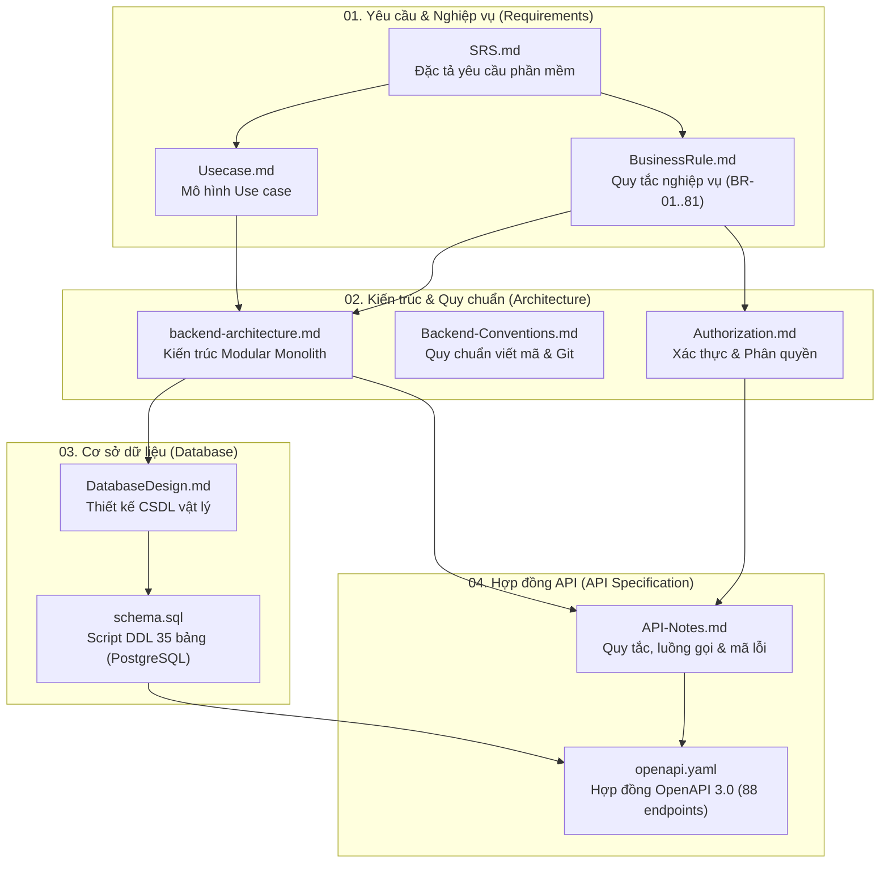

# Tài liệu Kỹ thuật Backend

## Hệ thống Quản lý Mượn Trả Thiết bị Học tập cho Sinh viên
> **Đồ án:** Phát triển phần mềm hướng đối tượng (SE100) — Nhóm 13  
> **Công nghệ cốt lõi:** ASP.NET Core (.NET 8), Modular Monolith, PostgreSQL (Supabase), OpenAPI 3.0.3

---

## 1. Sơ đồ Cấu trúc & Mối quan hệ Tài liệu

Tài liệu backend được tổ chức theo 4 nhóm chuyên biệt tương ứng với quy trình phân tích, thiết kế, quản lý dữ liệu và hiện thực API:

---

## 2. Danh mục Tài liệu Chi tiết

| Thư mục | Tệp tài liệu | Mô tả tóm tắt | Phiên bản | Căn cứ chính |
|---|---|---|---|---|
| **`01-requirements/`** | [SRS.md](01-requirements/SRS.md) | Tài liệu đặc tả yêu cầu phần mềm: mục tiêu, tác nhân (Actor), yêu cầu chức năng (FR) và phi chức năng (NFR). | v1.0 | Đề bài gốc, Phân tích v1.2 |
| | [Usecase.md](01-requirements/Usecase.md) | Mô hình 19 Use case nghiệp vụ: luồng chính, luồng phụ, điều kiện tiên quyết và hậu điều kiện. | v1.2 | SRS.md |
| | [BusinessRule.md](01-requirements/BusinessRule.md) | Tập hợp 81 quy tắc nghiệp vụ (BR-01 đến BR-81) quản lý mượn, trả, bảo trì, thanh lý và tính phạt. | v1.0 | SRS.md, Usecase.md |
| **`02-architecture/`** | [backend-architecture.md](02-architecture/backend-architecture.md) | Kiến trúc Modular Monolith, phân tầng (Domain - Application - Infrastructure - Presentation), giao tiếp module và xử lý bất đồng bộ. | v1.3 | SRS.md, Usecase.md, BR |
| | [Backend-Conventions.md](02-architecture/Backend-Conventions.md) | Quy chuẩn viết mã C#/.NET, đặt tên, cấu trúc response phân trang, mã lỗi chuẩn, quy trình Git Branching và CI/CD. | v1.3 | backend-architecture.md |
| | [Authorization.md](02-architecture/Authorization.md) | Mô hình xác thực JWT, phân quyền theo vai trò (Sinh viên, Nhân viên, Quản trị viên) và phạm vi phòng quản lý. | v1.1 | SRS.md, backend-architecture.md |
| **`03-database/`** | [DatabaseDesign.md](03-database/DatabaseDesign.md) | Thiết kế CSDL PostgreSQL chi tiết: 35 bảng trong 11 schema, giải thích các khóa chính/ngoại, index và trigger. | v1.2 | SRS.md, backend-architecture.md |
| | [schema.sql](03-database/schema.sql) | Toàn bộ script DDL tạo schema, bảng, ràng buộc CHECK, index và trigger cho cơ sở dữ liệu PostgreSQL. | v1.2 | DatabaseDesign.md |
| **`04-api/`** | [API-Notes.md](04-api/API-Notes.md) | Hướng dẫn chi tiết luồng gọi API, bảng mã lỗi, máy trạng thái phiếu mượn/thiết bị và các quy định xử lý ngoại lệ. | v1.1.1 | backend-architecture.md, openapi.yaml |
| | [openapi.yaml](04-api/openapi.yaml) | Hợp đồng API chuẩn OpenAPI 3.0.3 định nghĩa 88 endpoints, request/response schema cho toàn bộ hệ thống. | v1.1.1 | API-Notes.md, schema.sql |

---

## 3. Lộ trình Đọc Tài liệu theo Vai trò (Reading Roadmap)

### 👨‍💻 3.1. Dành cho Backend Developer (Thành viên mới onboard)
1. **Tổng quan yêu cầu:** Đọc [SRS.md](01-requirements/SRS.md) (mục 1, 2) và [Usecase.md](01-requirements/Usecase.md) để nắm phạm vi đồ án.
2. **Kiến trúc hệ thống:** Đọc [backend-architecture.md](02-architecture/backend-architecture.md) (hiểu cấu trúc Modular Monolith và các module nghiệp vụ).
3. **Quy chuẩn lập trình:** Đọc [Backend-Conventions.md](02-architecture/Backend-Conventions.md) để tuân thủ coding conventions, quy tắc đặt tên, xử lý exception và luồng git.
4. **Cơ sở dữ liệu:** Đọc [DatabaseDesign.md](03-database/DatabaseDesign.md) và tham khảo [schema.sql](03-database/schema.sql).
5. **Hiện thực API:** Đọc [API-Notes.md](04-api/API-Notes.md) và đối chiếu với [openapi.yaml](04-api/openapi.yaml) khi viết Controller/Handler.

### 📱 3.2. Dành cho Frontend / Mobile Developer tích hợp API
1. **Hợp đồng API:** Dùng [openapi.yaml](04-api/openapi.yaml) để sinh API client (Android/Next.js) và tra cứu schema.
2. **Luồng gọi & Mã lỗi:** Đọc [API-Notes.md](04-api/API-Notes.md) để xử lý đúng thứ tự API, mã lỗi (400, 401, 403, 404, 409, 422) và luồng refresh token.
3. **Phân quyền người dùng:** Đọc [Authorization.md](02-architecture/Authorization.md) để hiểu ma trận quyền hạn giữa Sinh viên, Nhân viên và Quản trị viên.

### 🧪 3.3. Dành cho QA / Tester
1. **Kịch bản kiểm thử:** Đọc [Usecase.md](01-requirements/Usecase.md) để viết test cases luồng chính và luồng phụ.
2. **Kiểm thử logic nghiệp vụ:** Đọc [BusinessRule.md](01-requirements/BusinessRule.md) để kiểm tra các ràng buộc BR-01 đến BR-81.
3. **Kiểm thử API & Trạng thái:** Tra cứu bảng mã lỗi và máy trạng thái trong [API-Notes.md](04-api/API-Notes.md).

---

## 4. Hệ thống Mã Quyết định & Đề xuất (Traceability Matrix)

Trong toàn bộ tài liệu, mọi điểm bổ sung ngoài đặc tả ban đầu đều được chuẩn hóa bằng mã truy vết:
- **`[ĐX-xx]`**: Quyết định bổ sung trong [SRS.md](01-requirements/SRS.md) (ĐX-01 đến ĐX-07).
- **`[ĐX-KT-xx]`**: Quyết định thiết kế kiến trúc trong [backend-architecture.md](02-architecture/backend-architecture.md).
- **`[ĐX-CV-xx]`**: Đề xuất quy chuẩn viết mã trong [Backend-Conventions.md](02-architecture/Backend-Conventions.md).
- **`[ĐX-PQ-xx]`**: Đề xuất phân quyền trong [Authorization.md](02-architecture/Authorization.md).
- **`[ĐX-DB-xx]`**: Quyết định thiết kế CSDL trong [DatabaseDesign.md](03-database/DatabaseDesign.md) (ĐX-DB-01 đến ĐX-DB-16).
- **`[ĐX-API-xx]`**: Quyết định hợp đồng API trong [API-Notes.md](04-api/API-Notes.md) (ĐX-API-01 đến ĐX-API-30).

