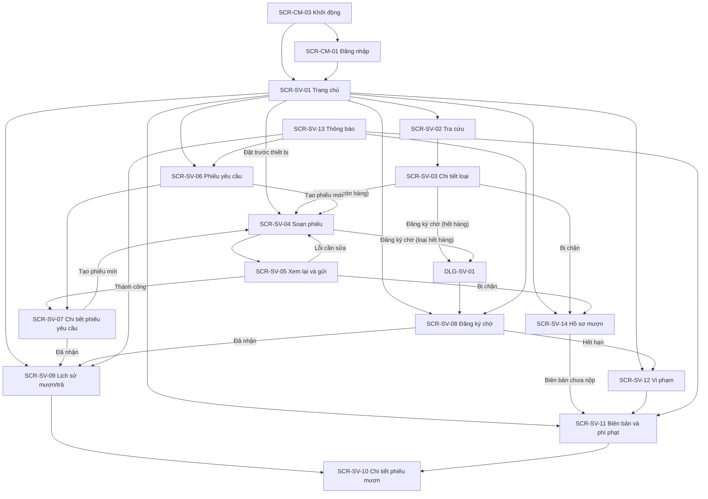
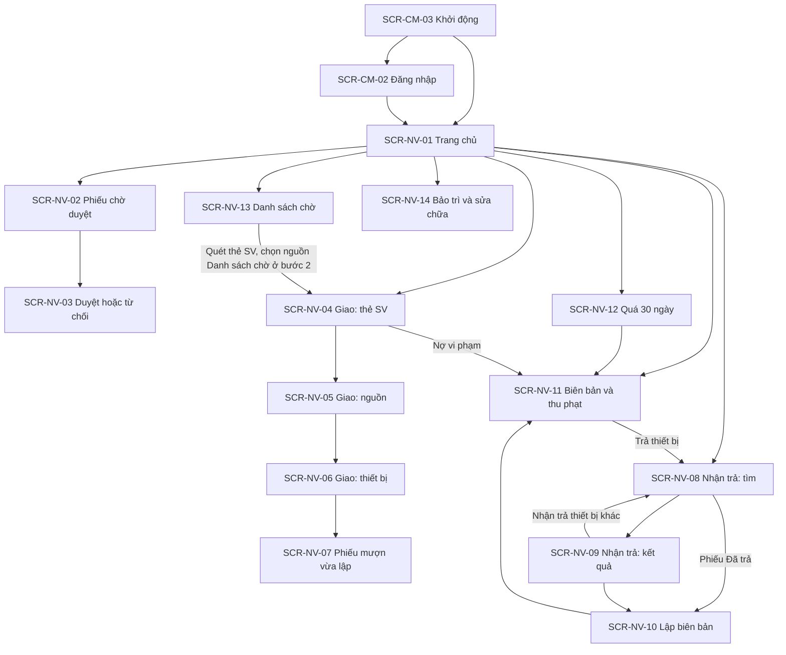
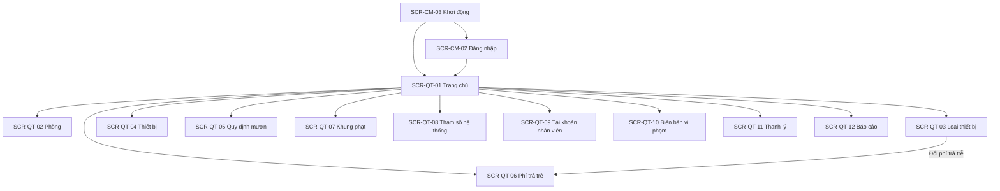

# UI SCREENS

## Hệ thống quản lý mượn trả thiết bị học tập cho sinh viên

| Mục | Nội dung |
|---|---|
| Dự án | SE100 – Nhóm 13 |
| Tài liệu | `UI-Screens.md` |
| Phiên bản | 1.0 |
| Ngày lập | 31/10/2026 |
| Tài liệu căn cứ | `User-Flows.md` v1.0 (30/10/2026); `SRS.md` (22/10/2026); `Usecase.md` v1.2; `BusinessRule.md` (BR-01…BR-81); `Authorization.md` (ĐX-PQ-01…10); `backend-architecture.md` (KT); `Backend-Conventions.md`; `API-Notes.md` v1.1.0 và `openapi.yaml` (88 thao tác); đề bài gốc |

## Mục lục

1. Giới thiệu
2. Danh mục màn hình và điều hướng
3. Quy tắc giao diện dùng chung
4. Khung điều hướng và màn hình dùng chung
5. Màn hình của sinh viên (ứng dụng Android)
6. Màn hình của nhân viên quản lý thiết bị (web)
7. Màn hình của quản trị viên (web)
- Phụ lục A. Truy vết luồng → màn hình
- Phụ lục B. Truy vết endpoint → màn hình

---

## 1. Giới thiệu

### 1.1 Mục đích và đối tượng sử dụng

Tài liệu xác định **danh sách màn hình** của giai đoạn 1, và với từng màn hình: mục đích, luồng và API liên quan, thành phần và dữ liệu hiển thị, hành động và điều hướng, các trạng thái cần có (đang tải, rỗng, lỗi, trạng thái nghiệp vụ). Tài liệu là đầu vào cho Wireframes, Design-System, Frontend-Architecture, Frontend-Conventions và cho kiểm thử chấp nhận giao diện.

| Người đọc | Dùng tài liệu để |
|---|---|
| Thiết kế giao diện | Biết mỗi màn hình cần những thành phần, trạng thái và thông báo nào; vẽ wireframe và thiết kế đủ mọi trạng thái. |
| Lập trình frontend (Android, web) | Biết màn hình nào gọi API nào, hiển thị trường nào, phản ứng ra sao với từng mã lỗi, điều hướng đi đâu. |
| Kiểm thử | Lấy ca kiểm thử từ bảng thành phần, trạng thái đặc thù và bảng lỗi của từng màn hình. |

### 1.2 Ranh giới với các tài liệu khác

| Tài liệu | Quan hệ với tài liệu này |
|---|---|
| `User-Flows.md` | Nguồn trực tiếp. Luồng, thứ tự thao tác, nhánh, ngoại lệ và quyết định ĐX-UF được giữ nguyên; tài liệu này chuyển chúng thành màn hình. Nhãn hiển thị và mã trạng thái theo Phụ lục A của `User-Flows.md`. |
| `openapi.yaml`, `API-Notes.md` | Hợp đồng dữ liệu. Tên trường trong cột "Nguồn dữ liệu" lấy nguyên từ `openapi.yaml`; hình dạng yêu cầu và phản hồi xem ở đó. |
| Nguồn nghiệp vụ (`SRS.md`, `Usecase.md`, `BusinessRule.md`, `Authorization.md`) | Là căn cứ. Tài liệu này không đặt quy tắc nghiệp vụ mới. |
| Wireframes | Bố cục được mô tả trong `Wireframes.md`. Tài liệu này mô tả thành phần và thông tin của từng màn hình, **không quy định vị trí tương đối hoặc bố cục chi tiết**; bố cục do Wireframes quyết định. Một số chỗ mô tả "cạnh nhau" hoặc "đầu màn hình" chỉ khi nguồn nghiệp vụ yêu cầu (ví dụ đối chiếu tình trạng lúc giao và lúc trả). |
| Design-System | Quyết định màu sắc, kiểu chữ, kích thước, kiểu thành phần. Tài liệu này không đề cập; chỉ nêu hành vi và nội dung. |
| Frontend-Architecture, Frontend-Conventions | Quyết định tổ chức mã, quản lý trạng thái, đường dẫn, cách giữ phiên khi tải lại trang web, cách tiếp nhận kết quả quét mã, giá trị thời gian chờ và độ trễ gõ tìm kiếm. Tài liệu này chỉ nêu hành vi giao diện mà kiến trúc phải đáp ứng. |

Các tài liệu Wireframes, Design-System, Frontend-Architecture và Frontend-Conventions chưa được cung cấp khi lập tài liệu này; mã màn hình, tên thành phần và nhãn trong tài liệu này là gốc để các tài liệu đó bám theo.

### 1.3 Nền tảng client

| Vai trò | Nền tảng | Căn cứ |
|---|---|---|
| Sinh viên (SV) | Ứng dụng Android (Java), điện thoại; chỉ tra cứu, đặt trước, đăng ký chờ, xem lịch sử và thông báo; **không** giao nhận thiết bị qua ứng dụng | KT-04, BR-01, CR-11, NFR-04 |
| Nhân viên quản lý thiết bị (NV) | Web, dùng tại quầy | KT-04 |
| Quản trị viên (QT) | Web | KT-04 |

NV và QT dùng chung một màn hình đăng nhập; giao diện được chọn theo `vaiTro` (ĐX-API-05). Giao diện hiển thị bằng tiếng Việt.

### 1.4 Quy ước đọc

**Mã màn hình** `SCR-<nhóm>-<số>`: `CM` dùng chung, `SV`, `NV`, `QT` theo vai trò. Hộp thoại có kết quả nghiệp vụ riêng dùng `DLG-<nhóm>-<số>`. Các hộp xác nhận không có mã riêng và theo mẫu ở mục 3.5.

**Cấu trúc mỗi màn hình.** Bảng thông tin (mục đích, luồng, API, điều kiện vào); bảng thành phần (nội dung và trường dữ liệu); hành động và điều hướng; lỗi; trạng thái đặc thù. Trạng thái chung (đang tải, rỗng, lỗi mạng, lỗi hệ thống) và xử lý lỗi dùng chung nằm ở mục 3, các màn hình chỉ ghi phần riêng.

**Nguồn dữ liệu.** Tên trường trong dấu `` ` `` là trường của `openapi.yaml`. Dữ liệu hiển thị lấy từ máy chủ; client không tự tính phí, số ngày trễ hay trạng thái (mục 3.4).

**Văn bản hiển thị.** Thông điệp trong dấu nháy kép (ví dụ "Không tìm thấy thiết bị phù hợp") là nội dung mặc định đề xuất để mô tả đúng ý nghĩa cần truyền đạt; chữ chính thức do Wireframes và Design-System chốt, miễn không đổi ý nghĩa. Nhãn trạng thái thì bắt buộc theo Phụ lục A của `User-Flows.md`.

**Mã lỗi.** `maLoi` viết trong dấu `` ` ``, kèm mã HTTP khi cần. Client phân nhánh theo `maLoi`, không theo nội dung `detail` (ĐX-CV-02).

**Tham chiếu luồng.** `UF-…` là mã luồng trong `User-Flows.md`; ký hiệu A, E ghi nhánh thay thế và ngoại lệ của luồng đó.

### 1.5 Quyết định bổ sung của tài liệu (ĐX-UI)

Những điểm nguồn không nêu mà màn hình cần quyết định. Các quyết định này không thêm chức năng hay quy tắc nghiệp vụ.

| Mã | Quyết định | Căn cứ |
|---|---|---|
| ĐX-UI-01 | Mỗi bước của luồng nhiều bước (Giao thiết bị bốn bước, Nhận trả hai bước) có mã màn hình riêng; luồng Giao thiết bị có thanh tiến trình; hộp thoại có kết quả nghiệp vụ riêng có mã `DLG`. | Cần đơn vị tham chiếu để thiết kế và kiểm thử |
| ĐX-UI-02 | Ứng dụng SV có thanh điều hướng gồm bốn mục: Trang chủ, Tra cứu, Thông báo, Hồ sơ. Trang chủ là điểm tập trung lối vào các chức năng còn lại (ĐX-UF-02). | ĐX-UF-02 giao nội dung màn hình chính cho UI-Screens; các luồng UF-SV-01 đến 08 |
| ĐX-UI-03 | Web NV và QT có thanh menu bên và thanh đầu trang (họ tên, vai trò, Đăng xuất). Trang chủ NV và QT là điểm tập trung lối vào chức năng. | ĐX-UF-02 |
| ĐX-UI-04 | Trên Trang chủ SV, lỗi khi tải hồ sơ mượn chỉ ảnh hưởng thẻ quyền mượn; các lối vào chức năng vẫn dùng được. | Không làm mất chức năng tra cứu và theo dõi vì một lỗi tải phụ |
| ĐX-UI-05 | Ô tìm theo tên gửi yêu cầu khi SV xác nhận nhập hoặc ngừng gõ trong một khoảng ngắn; giá trị khoảng này do Frontend-Conventions quy định. | NFR-03; tránh gọi API ở mỗi phím |
| ĐX-UI-06 | Khi SV đổi phòng trong lúc soạn phiếu và đã chọn loại thiết bị, hiển thị xác nhận vì các loại đã chọn sẽ bị xóa. | Một phiếu thuộc đúng một phòng (UF-SV-02 bước 1) |
| ĐX-UI-07 | Thời gian giữ chỗ nêu bằng chữ (mặc định 30 phút) chỉ là giá trị cấu hình mặc định; hạn cụ thể luôn hiển thị theo `hanGiuCho` khi có. | UF-HT-01 (độ trễ); User-Flows 3.5 |
| ĐX-UI-08 | Màn hình duyệt phiếu yêu cầu của NV nhận dữ liệu phiếu từ dòng đã chọn; mở mà không có dữ liệu này thì quay về danh sách. | Hợp đồng API không có endpoint chi tiết phiếu yêu cầu cho quầy |
| ĐX-UI-09 | Ở danh sách phiếu Đã duyệt của bước chọn nguồn giao, dòng của SV đang giao được làm nổi bật khi có trong trang đang xem; chỉ để hiển thị, không lọc. | UF-NV-02: NV nhận ra phiếu qua mã số và họ tên SV |
| ĐX-UI-10 | Ở màn hình lập biên bản, khi NV đổi khung phạt so với đề xuất thì số tiền hiển thị là tạm tính; số tiền chính thức hiển thị sau khi lập. | Máy chủ tính số tiền theo khung gửi lúc lập; client không tự tính (KT 8.5) |
| ĐX-UI-11 | Ghi hoàn thành bảo trì chỉ thực hiện được từ bản ghi vừa lập trong phiên làm việc của màn hình. | Hợp đồng API không có endpoint liệt kê bản ghi bảo trì đang thực hiện (xem SCR-NV-14) |
| ĐX-UI-12 | Ngày giờ hiển thị dạng `dd/MM/yyyy HH:mm`, ngày dạng `dd/MM/yyyy`, theo giờ Việt Nam; tiền dạng `240.000 VNĐ`. | User-Flows 3.5 (múi giờ, tiền); định dạng ngày theo thông lệ Việt Nam |
| ĐX-UI-13 | Danh sách của SV trên điện thoại tải thêm khi cuộn; bảng của NV và QT trên web có phân trang; kích thước trang mặc định 20 (tối đa 100). | User-Flows 3.7 (phân trang, mặc định 20) |
| ĐX-UI-14 | Ở bước kiểm tra nguồn giao, cảnh báo SV của nguồn khác thẻ đã quét chỉ hỗ trợ đối chiếu. Chính sách cho tiếp tục, quét lại hay đổi hồ sơ trong trường hợp này chưa được nguồn chốt; không coi cảnh báo là xác nhận hai SV trùng nhau hoặc tự bổ sung điều kiện chặn. | KetQuaKiemTraNguon trả `sinhVien`; cần quyết định nghiệp vụ về đối chiếu thẻ và nguồn |

---

## 2. Danh mục màn hình và điều hướng

### 2.1 Danh mục màn hình

| Mã | Tên màn hình | Nền tảng | Luồng |
|---|---|---|---|
| SCR-CM-01 | Đăng nhập sinh viên | Android | UF-CM-01 |
| SCR-CM-02 | Đăng nhập nhân viên hoặc quản trị viên | Web | UF-CM-02 |
| SCR-CM-03 | Khởi động và khôi phục phiên | Android, Web | UF-CM-03 |
| SCR-SV-01 | Trang chủ sinh viên | Android | ĐX-UF-02, UF-SV-08 |
| SCR-SV-02 | Tra cứu thiết bị | Android | UF-SV-01 |
| SCR-SV-03 | Chi tiết loại thiết bị tại phòng | Android | UF-SV-01, 02, 03 |
| SCR-SV-04 | Soạn phiếu yêu cầu mượn | Android | UF-SV-02 |
| SCR-SV-05 | Xem lại và gửi phiếu yêu cầu | Android | UF-SV-02 |
| SCR-SV-06 | Danh sách phiếu yêu cầu của tôi | Android | UF-SV-05 |
| SCR-SV-07 | Chi tiết phiếu yêu cầu mượn | Android | UF-SV-02, 05 |
| SCR-SV-08 | Danh sách đăng ký chờ của tôi | Android | UF-SV-03, 04 |
| SCR-SV-09 | Lịch sử mượn/trả | Android | UF-SV-06 |
| SCR-SV-10 | Chi tiết phiếu mượn | Android | UF-SV-06 |
| SCR-SV-11 | Biên bản và phí phạt | Android | UF-SV-06 |
| SCR-SV-12 | Danh sách vi phạm | Android | UF-SV-06 |
| SCR-SV-13 | Thông báo | Android | UF-SV-07 |
| SCR-SV-14 | Hồ sơ mượn | Android | UF-SV-08 |
| DLG-SV-01 | Hộp thoại Đã đăng ký chờ | Android | UF-SV-03 |
| SCR-NV-01 | Trang chủ nhân viên | Web | ĐX-UF-02 |
| SCR-NV-02 | Danh sách phiếu yêu cầu chờ duyệt | Web | UF-NV-01 |
| SCR-NV-03 | Duyệt hoặc từ chối phiếu yêu cầu | Web | UF-NV-01 |
| SCR-NV-04 | Giao thiết bị, bước 1: Quét thẻ và hồ sơ sinh viên | Web | UF-NV-02 |
| SCR-NV-05 | Giao thiết bị, bước 2: Chọn nguồn giao và kiểm tra nguồn | Web | UF-NV-02 |
| SCR-NV-06 | Giao thiết bị, bước 3: Thêm thiết bị và ghi tình trạng ban đầu | Web | UF-NV-02 |
| SCR-NV-07 | Giao thiết bị, bước 4: Phiếu mượn vừa lập | Web | UF-NV-02 |
| SCR-NV-08 | Nhận trả, bước 1: Tìm thiết bị hoặc phiếu mượn | Web | UF-NV-03 |
| SCR-NV-09 | Nhận trả, bước 2: Kiểm tra và ghi kết quả | Web | UF-NV-03 |
| SCR-NV-10 | Lập biên bản vi phạm | Web | UF-NV-04 |
| SCR-NV-11 | Biên bản và thu phạt | Web | UF-NV-04 |
| SCR-NV-12 | Phiếu chưa trả quá 30 ngày | Web | UF-NV-05 |
| SCR-NV-13 | Danh sách chờ của phòng | Web | UF-NV-06 |
| SCR-NV-14 | Bảo trì và sửa chữa | Web | UF-NV-07 |
| SCR-QT-01 | Trang chủ quản trị viên | Web | ĐX-UF-02 |
| SCR-QT-02 | Phòng thiết bị | Web | UF-QT-01 |
| SCR-QT-03 | Loại thiết bị | Web | UF-QT-01 |
| SCR-QT-04 | Thiết bị | Web | UF-QT-01 |
| SCR-QT-05 | Cấu hình: Quy định mượn theo nhóm sinh viên | Web | UF-QT-02 |
| SCR-QT-06 | Cấu hình: Phí trả trễ theo loại thiết bị | Web | UF-QT-02 |
| SCR-QT-07 | Cấu hình: Khung phạt hư hỏng | Web | UF-QT-02 |
| SCR-QT-08 | Cấu hình: Tham số hệ thống | Web | UF-QT-02 |
| SCR-QT-09 | Tài khoản nhân viên | Web | UF-QT-03 |
| SCR-QT-10 | Biên bản vi phạm (hủy hoặc điều chỉnh) | Web | UF-QT-04 |
| SCR-QT-11 | Thanh lý thiết bị | Web | UF-QT-05 |
| SCR-QT-12 | Báo cáo | Web | UF-QT-06 |

Giai đoạn 1 **không có** màn hình hoặc hành động cho: gia hạn, hủy phiếu yêu cầu, phản hồi tình trạng thiết bị, nhắc nhở thủ công, quản lý nhà cung cấp và bảo hành, xem nhật ký, gỡ cấm mượn dài hạn (UC-04, 18, 20, 21, 22, 23, 24; ĐX-UF-01). Giai đoạn 1 cũng không có: tự đăng ký tài khoản, quên mật khẩu, đổi mật khẩu (ĐX-PQ-07), thanh toán trực tuyến (BR-02), đánh dấu đã đọc thông báo (User-Flows 3.8).

### 2.2 Điều hướng của sinh viên

### 2.3 Điều hướng của nhân viên

### 2.4 Điều hướng của quản trị viên

---

## 3. Quy tắc giao diện dùng chung

Mục này chuyển các quy tắc dùng chung ở mục 3 của `User-Flows.md` thành hành vi giao diện áp dụng cho mọi màn hình. Màn hình chỉ nhắc lại khi có điểm riêng.

### 3.1 Trạng thái chuẩn của màn hình

| Trạng thái | Khi nào | Hiển thị |
|---|---|---|
| Đang tải | Trong lúc chờ phản hồi | Chỉ báo đang tải ở đúng vùng đang chờ; không chặn các vùng đã có dữ liệu. Hành động gửi dữ liệu bị vô hiệu trong lúc chờ (ĐX-UF-06) |
| Tải chậm do dịch vụ "ngủ dậy" | Lần gọi đầu sau thời gian không dùng có thể chậm khoảng một phút (KT 3.4) | Giữ trạng thái đang tải kèm dòng "Hệ thống đang khởi động, vui lòng chờ"; thời gian chờ tối đa của client phải đủ dài (lớn hơn một phút), giá trị do Frontend-Conventions quy định; không báo lỗi sớm |
| Rỗng | Danh sách không có dòng | Thông điệp rỗng riêng của từng danh sách (ghi ở màn hình); rỗng không phải lỗi; kèm hành động gợi ý do màn hình nêu |
| Lỗi mạng hoặc quá thời gian chờ | Mất kết nối, hết thời gian chờ | Thông báo lỗi kèm nút **Thử lại**; dữ liệu đã nhập được giữ nguyên |
| Lỗi hệ thống | Lỗi 500 | Thông báo lỗi hệ thống chung kèm `traceId` để báo cho nhóm; không hiển thị chi tiết nội bộ |
| Làm mới | SV kéo để làm mới (Android); nút Làm mới (web) | Tải lại dữ liệu từ máy chủ (ĐX-UF-04) |

### 3.2 Xử lý lỗi dùng chung

Áp dụng cho mọi màn hình trừ khi màn hình ghi xử lý riêng. Cách hiển thị gồm thông báo cạnh trường (inline), thông báo ở đầu màn hình (banner) hoặc hộp thoại.

| Lỗi | Hành vi giao diện |
|---|---|
| `CHUA_XAC_THUC` (401) | Làm mới phiên một lần rồi gọi lại yêu cầu ban đầu, người dùng không thấy gián đoạn; thất bại thì xóa phiên, về đăng nhập và báo phiên đã hết hạn. Chỉ một yêu cầu làm mới chạy tại một thời điểm; các yêu cầu khác chờ kết quả (User-Flows 3.1) |
| `TAI_KHOAN_BI_KHOA` (403) khi đang dùng | Thông báo tài khoản bị khóa rồi đăng xuất, về đăng nhập |
| `KHONG_DU_QUYEN` (403) | Banner "Bạn không có quyền thực hiện thao tác này"; quay về màn hình chính của vai trò |
| `PHONG_CHUA_CAP_QUYEN` (403) | Banner "Phòng này chưa được cấp quyền cho bạn"; quay về danh sách đang xem |
| `DU_LIEU_KHONG_HOP_LE` (400) | Lỗi cạnh từng trường theo danh sách `errors` (khóa trường → thông báo); giữ nguyên dữ liệu đã nhập; đưa tiêu điểm tới trường lỗi đầu tiên |
| `KHONG_TIM_THAY` (404) | Banner "Không tìm thấy"; quay về danh sách và tải lại |
| `XUNG_DOT_CAP_NHAT` (409) | Banner nêu dữ liệu vừa bị người khác thay đổi; tải lại đối tượng, hiển thị giá trị mới, để người dùng thực hiện lại |
| `TRANG_THAI_KHONG_HOP_LE` (409) | Banner nêu đối tượng đã đổi trạng thái; tải lại và hiển thị trạng thái mới; không tự thử lại |
| `QUA_NHIEU_YEU_CAU` (429) | Thông báo chờ rồi thử lại; không tự lặp |
| Lỗi nghiệp vụ khác (422, 409) | Theo bảng lỗi của từng màn hình; thông điệp theo `maLoi`, `detail` chỉ để hiển thị |

Thao tác ghi (`POST`, `PUT`, `DELETE`) không tự động gửi lại khi mất kết nối hoặc quá thời gian chờ; trước khi cho gửi lại, màn hình kiểm tra trạng thái hiện tại của đối tượng liên quan (ĐX-UF-06).

### 3.3 Nhãn trạng thái

Mọi trạng thái hiển thị bằng nhãn tiếng Việt ánh xạ từ mã API theo Phụ lục A của `User-Flows.md` (Backend-Conventions 3.3). Mỗi loại trạng thái dùng **một thành phần nhãn dùng chung** với nhãn và quy tắc phân biệt trạng thái do Design-System quy định; màn hình không tự đặt tên nhãn khác. Trạng thái cần được nhận biết không chỉ bằng màu (xem 3.8). Mã chưa biết (giá trị API ngoài danh sách) hiển thị nguyên mã, không làm lỗi màn hình.

### 3.4 Thời gian, tiền và dữ liệu do máy chủ tính

| Nội dung | Quy tắc |
|---|---|
| Thời gian | API trả giờ UTC; hiển thị theo giờ Việt Nam (`Asia/Ho_Chi_Minh`), định dạng theo ĐX-UI-12 |
| Số ngày trễ, số tiền, hạn trả, hạn giữ chỗ | Do máy chủ tính; client chỉ hiển thị, không tự tính phí hay tự đổi trạng thái theo đồng hồ cục bộ (ĐX-UF-04) |
| Tiền | Số nguyên VNĐ, có dấu phân cách hàng nghìn (ĐX-UI-12) |
| Bộ đếm ngược | Tính từ `hanGiuCho` do máy chủ trả. Khi về 0, màn hình tải lại dữ liệu thay vì tự đổi trạng thái |

### 3.5 Hộp xác nhận

Thao tác khó hoàn tác có hộp xác nhận (ĐX-UF-05; danh sách ở User-Flows 3.9; mỗi màn hình nêu nội dung riêng). Cấu trúc chung:

| Thành phần | Nội dung |
|---|---|
| Tiêu đề | Tên hành động |
| Tóm tắt | Đối tượng bị tác động (SV, thiết bị, biên bản, nhóm cấu hình...) |
| Hệ quả | Điều sẽ xảy ra và không thể đổi (ví dụ "số tiền không đổi sau khi lập") |
| Nút | **Hủy** (đóng, không thay đổi dữ liệu) và nút xác nhận mang tên hành động; nút xác nhận vô hiệu và hiển thị đang xử lý trong lúc chờ phản hồi |

### 3.6 Ảnh tình trạng thiết bị

| Quy tắc | Nội dung |
|---|---|
| Khi nào | Ghi tình trạng ban đầu (SCR-NV-06), ghi kết quả kiểm tra khi trả (SCR-NV-09), ảnh danh mục thiết bị (SCR-QT-04) |
| Giới hạn | Tối đa 5 ảnh cho mỗi thiết bị mỗi lần; mỗi ảnh tối đa 2 MB; jpeg, png hoặc webp. Vượt giới hạn thì báo ngay tại khu đính ảnh, không chờ máy chủ |
| Nén | Client nén trước khi tải lên: cạnh dài tối đa 1280 px, JPEG khoảng 80% |
| Cách gửi | Tải từng ảnh lên trước để nhận `maAnh`, rồi gắn vào yêu cầu lập phiếu mượn, ghi kết quả kiểm tra hoặc lưu thiết bị; mỗi ảnh có trạng thái đang tải, đã tải, lỗi (kèm thử lại) và nút gỡ. Ảnh chưa gắn quá 24 giờ bị xóa |
| Xem ảnh | Ảnh tình trạng (lúc giao, lúc trả) là ảnh riêng tư, URL có chữ ký hết hạn sau 10 phút: khi ảnh không tải được do hết hạn, màn hình tải lại chi tiết để lấy URL mới; không lưu URL lâu dài. Ảnh danh mục thiết bị dùng URL công khai. Chạm hoặc chọn ảnh để xem lớn |
| Ảnh tùy chọn | Ảnh không bắt buộc; **mô tả** tình trạng bắt buộc khi giao |

### 3.7 Danh sách và bộ lọc

| Quy tắc | Nội dung |
|---|---|
| Phân trang | `trang`, `kichThuoc` (mặc định 20, tối đa 100); phản hồi có `tongSo`; ĐX-UI-13 |
| Thứ tự | Do máy chủ quyết định theo từng danh sách (ĐX-API-28); client không sắp xếp lại |
| Bộ lọc | Đổi bộ lọc thì tải lại từ trang 1; bộ lọc đang áp dụng luôn nhìn thấy được và có cách xóa |
| Phòng của NV | Bộ lọc phòng chỉ liệt kê các phòng được cấp quyền (`dsPhong` của `GET /auth/toi`) |

### 3.8 Khả năng tiếp cận và khả năng dùng

Nguồn nghiệp vụ không có yêu cầu riêng về tiếp cận; tài liệu chỉ đặt các yêu cầu tối thiểu để giao diện dùng được ổn định:

| Yêu cầu | Nội dung |
|---|---|
| Không chỉ dựa vào màu | Nhãn trạng thái, trạng thái lỗi và nhấn mạnh (quá hạn, hết hàng, không đủ số lượng) luôn kèm chữ |
| Nhãn cho thành phần nhập | Mọi ô nhập có nhãn hiển thị; lỗi gắn với đúng ô |
| Dùng bàn phím (web) | Ô nhập mã quầy có tiêu điểm khi vào màn hình; phím Enter xác nhận mã đã quét hoặc nhập; hộp thoại đóng được bằng phím Esc |
| Vùng chạm (Android) | Điều khiển có kích thước đủ chạm trên điện thoại; kích thước cụ thể do Design-System quy định |

### 3.9 Kích thước màn hình

| Nền tảng | Yêu cầu |
|---|---|
| Android (SV) | Mọi màn hình của SV, kể cả danh sách và chi tiết phiếu, dùng được và không vỡ bố cục trên các kích thước màn hình điện thoại phổ biến (NFR-04); dữ liệu dài (tên thiết bị, mô tả) xuống dòng thay vì tràn |
| Web (NV, QT) | Dùng tại quầy trên máy tính; kích thước màn hình hỗ trợ tối thiểu do Design-System và Frontend-Architecture xác định (nguồn không nêu) |

---

## 4. Khung điều hướng và màn hình dùng chung

### 4.1 Khung điều hướng của sinh viên (Android)

| Thành phần | Nội dung |
|---|---|
| Thanh điều hướng | Bốn mục luôn hiển thị ở các màn hình gốc: **Trang chủ** (SCR-SV-01), **Tra cứu** (SCR-SV-02), **Thông báo** (SCR-SV-13), **Hồ sơ** (SCR-SV-14). Các màn hình chi tiết và biểu mẫu mở chồng lên và quay lại bằng nút Quay lại |
| Đăng xuất | Nút **Đăng xuất** ở SCR-SV-14; thực hiện theo UF-CM-03, không cần hộp xác nhận |
| Không có | Huy hiệu số thông báo chưa đọc; thông báo đẩy (User-Flows 3.8) |

### 4.2 Khung điều hướng của nhân viên (web)

| Thành phần | Nội dung |
|---|---|
| Thanh menu bên | Trang chủ (SCR-NV-01); Phiếu yêu cầu chờ duyệt (SCR-NV-02); Giao thiết bị (SCR-NV-04); Nhận trả thiết bị (SCR-NV-08); Biên bản và thu phạt (SCR-NV-11); Phiếu chưa trả quá 30 ngày (SCR-NV-12); Danh sách chờ (SCR-NV-13); Bảo trì và sửa chữa (SCR-NV-14) |
| Thanh đầu trang | Họ tên và vai trò (Nhân viên quản lý thiết bị); nút **Đăng xuất** |
| Không có | Mục ngoài vai trò NV; thông báo ứng dụng cho NV (User-Flows 3.8) |

### 4.3 Khung điều hướng của quản trị viên (web)

| Thành phần | Nội dung |
|---|---|
| Thanh menu bên | Trang chủ (SCR-QT-01); **Danh mục**: Phòng thiết bị (SCR-QT-02), Loại thiết bị (SCR-QT-03), Thiết bị (SCR-QT-04); **Cấu hình**: Quy định mượn (SCR-QT-05), Phí trả trễ (SCR-QT-06), Khung phạt (SCR-QT-07), Tham số hệ thống (SCR-QT-08); Tài khoản nhân viên (SCR-QT-09); Biên bản vi phạm (SCR-QT-10); Thanh lý (SCR-QT-11); Báo cáo (SCR-QT-12) |
| Thanh đầu trang | Họ tên và vai trò (Quản trị viên); nút **Đăng xuất** |
| Không có | Duyệt, giao, nhận, lập biên bản, bảo trì (ĐX-PQ-02); xem nhật ký (ngoài giai đoạn 1) |

### 4.4 SCR-CM-01 Đăng nhập sinh viên

| Mục | Nội dung |
|---|---|
| Mục đích | SV đăng nhập bằng tài khoản của nhà trường |
| Luồng | UF-CM-01 |
| API | `POST /auth/sinh-vien/dang-nhap` (`mssv`, `matKhau`) |
| Điều kiện vào | Mở ứng dụng khi chưa có phiên hợp lệ; sau khi phiên hết hạn hoặc đăng xuất |

**Thành phần**

| Thành phần | Nội dung | Quy tắc |
|---|---|---|
| Mã số sinh viên | Ô nhập | Bắt buộc |
| Mật khẩu | Ô nhập che ký tự | Bắt buộc |
| Nút **Đăng nhập** | Gửi đăng nhập | Vô hiệu khi thiếu trường hoặc đang chờ phản hồi |
| Thông báo phiên hết hạn | Khi chuyển về từ phiên hết hạn (SCR-CM-03) | "Phiên đăng nhập đã hết hạn, vui lòng đăng nhập lại" |

**Không có** liên kết hoặc nút: đăng ký, quên mật khẩu, đổi mật khẩu (A1; BR-08, ĐX-PQ-07).

**Kết quả và lỗi**

| Kết quả | Hiển thị và điều hướng |
|---|---|
| Thành công | Client lưu phiên; mở SCR-SV-01 |
| `DANG_NHAP_SAI` (401) (E1) | "Thông tin đăng nhập không đúng"; giữ mã số sinh viên, xóa mật khẩu; không hiển thị số lần thử còn lại |
| `QUA_NHIEU_YEU_CAU` (429) (E2) | Thông báo chờ rồi thử lại |
| Lỗi mạng, quá thời gian chờ | Theo mục 3.1; lần đăng nhập đầu có thể chậm (mục 3.1, tải chậm) |

### 4.5 SCR-CM-02 Đăng nhập nhân viên hoặc quản trị viên

| Mục | Nội dung |
|---|---|
| Mục đích | NV và QT đăng nhập bằng một biểu mẫu chung |
| Luồng | UF-CM-02 |
| API | `POST /auth/nhan-vien/dang-nhap` (`tenDangNhap`, `matKhau`); `GET /auth/toi` |
| Điều kiện vào | Mở ứng dụng web khi chưa có phiên hợp lệ; sau khi phiên hết hạn hoặc đăng xuất |

**Thành phần**

| Thành phần | Nội dung | Quy tắc |
|---|---|---|
| Tên đăng nhập | Ô nhập | Bắt buộc |
| Mật khẩu | Ô nhập che ký tự | Bắt buộc |
| Nút **Đăng nhập** | Gửi đăng nhập | Vô hiệu khi thiếu trường hoặc đang chờ phản hồi |
| Thông báo phiên hết hạn | Như SCR-CM-01 | – |

Không có liên kết đăng ký, quên hoặc đổi mật khẩu (mục 2.1).

**Kết quả và lỗi**

| Kết quả | Hiển thị và điều hướng |
|---|---|
| Thành công | Gọi `GET /auth/toi` lấy `hoTen`, `vaiTro`, `dsPhong`; `vaiTro` = `NHAN_VIEN` mở SCR-NV-01; `vaiTro` = `QUAN_TRI` mở SCR-QT-01 |
| `DANG_NHAP_SAI` (401) (E1) | "Thông tin đăng nhập không đúng"; giữ tên đăng nhập, xóa mật khẩu; không hiển thị số lần thử còn lại |
| `TAI_KHOAN_BI_KHOA` (403) (E2, E3) | Thông báo dùng chung cho Tạm khóa đăng nhập và Bị khóa: tài khoản không đăng nhập được; NV liên hệ quản trị viên để mở lại, QT liên hệ bên vận hành hệ thống (ĐX-PQ-04). Sau khi nhập sai liên tiếp đạt `soLanDangNhapSaiToiDa` (mặc định 5) tài khoản bị Tạm khóa đăng nhập |
| `QUA_NHIEU_YEU_CAU` (429) (E4) | Thông báo chờ rồi thử lại |

### 4.6 SCR-CM-03 Khởi động và khôi phục phiên

| Mục | Nội dung |
|---|---|
| Mục đích | Quyết định vào giao diện của vai trò hay về đăng nhập khi mở lại ứng dụng hoặc tải lại trang |
| Luồng | UF-CM-03; UF-CM-01, UF-CM-02 (về đăng nhập khi không còn phiên) |
| API | `POST /auth/lam-moi`; `GET /auth/toi` (NV, QT); `POST /auth/dang-xuat` |
| Điều kiện vào | Mở ứng dụng hoặc tải lại trang web |

| Thành phần | Nội dung |
|---|---|
| Màn hình chờ | Chỉ báo đang tải trong lúc kiểm tra phiên; không hiển thị tạm màn hình đăng nhập hay màn hình chính |

**Quy tắc**

| Trường hợp | Điều hướng |
|---|---|
| Còn access token hợp lệ | Vào thẳng màn hình chính của vai trò (SCR-SV-01, SCR-NV-01 hoặc SCR-QT-01); NV và QT gọi `GET /auth/toi` để lấy lại `hoTen`, `vaiTro`, `dsPhong` |
| Hết hạn nhưng còn refresh token | Làm mới phiên (mục 3.2) rồi vào màn hình chính |
| Không còn phiên hoặc làm mới thất bại | SCR-CM-01 (Android) hoặc SCR-CM-02 (web), kèm thông báo phiên hết hạn nếu trước đó có phiên |
| Đăng xuất | Gửi refresh token để thu hồi phiên; xóa phiên cục bộ rồi về đăng nhập, **kể cả khi yêu cầu đăng xuất lỗi** |

**Nơi lưu phiên (đã chốt ở KT 7.3):** Android lưu trong kho lưu trữ mã hóa của hệ điều hành. Web giữ access token trong bộ nhớ, gửi refresh token qua nội dung yêu cầu, không dùng cookie; cách web khôi phục phiên sau khi tải lại trang do Frontend-Architecture quyết định, miễn đáp ứng quy tắc ở bảng trên.

---

## 5. Màn hình của sinh viên (ứng dụng Android)

Tiền điều kiện chung: SV đã đăng nhập (SCR-CM-01). Mọi màn hình trong mục này nằm trong khung điều hướng SV (mục 4.1) trừ khi ghi khác. Mọi danh sách và chi tiết có thao tác kéo để làm mới (ĐX-UF-04).

### 5.1 SCR-SV-01 Trang chủ sinh viên

| Mục | Nội dung |
|---|---|
| Mục đích | Màn hình chính của vai trò SV (ĐX-UF-02): cho biết tình trạng quyền mượn và dẫn tới mọi chức năng của SV |
| Luồng | UF-CM-01, UF-CM-03, UF-SV-08 |
| API | `GET /sv/toi` |
| Điều kiện vào | Sau đăng nhập; mở lại ứng dụng khi còn phiên; chọn mục Trang chủ |

**Thành phần**

| Thành phần | Nội dung | Nguồn dữ liệu |
|---|---|---|
| Lời chào | Họ tên SV | `hoTen` |
| Thẻ quyền mượn | Nhãn trạng thái quyền mượn. Khi khác Bình thường: nhãn nổi bật kèm dòng "Bạn chưa thể đặt trước hoặc đăng ký chờ" và nút **Xem lý do** (→ SCR-SV-14). Khi Bình thường: hiển thị số thiết bị đang mượn trên số tối đa của nhóm | `trangThaiQuyenMuon`, `soThietBiDangMuon`, `soThietBiToiDa` |
| Lối vào chức năng | Tám mục: Tra cứu thiết bị (→ SCR-SV-02); Đặt trước thiết bị (→ SCR-SV-04); Phiếu yêu cầu của tôi (→ SCR-SV-06); Đăng ký chờ của tôi (→ SCR-SV-08); Lịch sử mượn/trả (→ SCR-SV-09); Biên bản và phí phạt (→ SCR-SV-11); Vi phạm (→ SCR-SV-12); Hồ sơ mượn (→ SCR-SV-14) | – |

**Trạng thái đặc thù**

| Trạng thái | Hiển thị |
|---|---|
| Lỗi tải hồ sơ | Thẻ quyền mượn hiển thị lỗi và nút Thử lại; các lối vào chức năng vẫn dùng được (ĐX-UI-04) |
| Quyền mượn khác Bình thường | Thẻ quyền mượn đổi sang dạng cảnh báo như bảng trên |

**Ghi chú:** Trang chủ không có huy hiệu số thông báo chưa đọc vì danh sách thông báo không có trạng thái đã đọc (User-Flows 3.8).

### 5.2 SCR-SV-02 Tra cứu thiết bị

| Mục | Nội dung |
|---|---|
| Mục đích | Cho SV biết loại thiết bị nào, ở phòng nào, còn bao nhiêu trước khi đến quầy |
| Luồng | UF-SV-01 |
| API | `GET /sv/tra-cuu/thiet-bi` (`ten`, `maLoai`, `maPhong`, `conHang`, `trang`, `kichThuoc`); nguồn của bộ lọc: `GET /sv/loai-thiet-bi`, `GET /sv/phong-thiet-bi` |
| Điều kiện vào | Mục Tra cứu ở khung điều hướng; lối vào ở SCR-SV-01 |

**Thành phần**

| Thành phần | Nội dung | Nguồn dữ liệu |
|---|---|---|
| Ô tìm theo tên | Nhập tên loại thiết bị; tìm khi SV xác nhận nhập hoặc ngừng gõ (ĐX-UI-05) | `ten` |
| Bộ lọc Loại thiết bị | Danh sách chọn một; tùy chọn "Tất cả" | `maLoai` ← `GET /sv/loai-thiet-bi` (`tenLoai`) |
| Bộ lọc Phòng thiết bị | Danh sách chọn một; tùy chọn "Tất cả"; mỗi mục gồm tên phòng và cơ sở | `maPhong` ← `GET /sv/phong-thiet-bi` (`tenPhong`, `coSo`) |
| Bộ lọc Tình trạng hàng | Ba lựa chọn: Tất cả, Còn hàng, Hết hàng | `conHang` (bỏ trống / `true` / `false`) |
| Danh sách kết quả | Mỗi dòng: tên loại, hãng sản xuất, tên phòng và cơ sở, số lượng khả dụng; dòng có số lượng 0 mang nhãn **Hết hàng** | `tenLoai`, `hangSanXuat`, `tenPhong`, `coSo`, `soLuongKhaDung` |
| Nút Xóa bộ lọc | Chỉ hiện khi có ít nhất một bộ lọc đang áp dụng | – |

**Hành động và điều hướng**

| Hành động | Kết quả |
|---|---|
| Chọn một dòng | Mở SCR-SV-03 với `maLoai` và `maPhong` của dòng |
| Đổi tìm kiếm hoặc bộ lọc | Tải lại danh sách từ trang 1 |
| Cuộn tới cuối danh sách | Tải trang kế tiếp cho đến khi đủ `tongSo` |

**Trạng thái đặc thù**

| Trạng thái | Hiển thị |
|---|---|
| Rỗng (UF-SV-01 E1) | "Không tìm thấy thiết bị phù hợp" kèm nút Xóa bộ lọc |
| Lỗi tải danh sách bộ lọc | Danh sách kết quả vẫn dùng được; bộ lọc tương ứng ở trạng thái lỗi kèm Thử lại |

**Ghi chú:** thứ tự do máy chủ quyết định (tên loại, rồi tên phòng). Loại chỉ có thiết bị hư hỏng hoặc đang bảo trì được máy chủ tính là hết hàng (BR-16); client không tự tính.

### 5.3 SCR-SV-03 Chi tiết loại thiết bị tại phòng

| Mục | Nội dung |
|---|---|
| Mục đích | Hiển thị chi tiết một loại thiết bị tại một phòng và đưa SV tới Đặt trước hoặc Đăng ký chờ |
| Luồng | UF-SV-01 (A1, A2, A4), UF-SV-02, UF-SV-03 |
| API | `GET /sv/tra-cuu/thiet-bi/{maLoai}?maPhong=`; `GET /sv/toi` (khi SV chọn Đặt trước hoặc Đăng ký chờ); `POST /sv/dang-ky-cho` (`maPhong`, `maLoai`) |
| Điều kiện vào | Chọn một dòng ở SCR-SV-02 |

**Thành phần**

| Thành phần | Nội dung | Nguồn dữ liệu |
|---|---|---|
| Ảnh | Dải ảnh danh mục của thiết bị thuộc loại tại phòng (URL công khai); không có ảnh thì hiển thị hình thay thế | `dsAnh[].url` |
| Tên loại và hãng | – | `tenLoai`, `hangSanXuat` |
| Phòng | Tên phòng và cơ sở | `tenPhong`, `coSo` |
| Mô tả | Văn bản mô tả; ẩn khối khi không có | `moTa` |
| Thông số kỹ thuật | Danh sách các dòng thông số; ẩn khối khi rỗng | `dsThongSoKyThuat` |
| Số lượng khả dụng | Số lượng; bằng 0 thì nhãn **Hết hàng** | `soLuongKhaDung` |
| Ngày dự kiến có sẵn | Chỉ khi `soLuongKhaDung` = 0: ngày giờ dự kiến theo giờ Việt Nam; khi không có dữ liệu hiển thị "Chưa có ngày dự kiến" | `ngayDuKienCoSan` |
| Nút **Đặt trước** | Hiện khi `soLuongKhaDung` > 0 | – |
| Nút **Đăng ký chờ** | Hiện khi `soLuongKhaDung` = 0 | – |

**Hành động và điều hướng**

| Hành động | Điều kiện | Kết quả |
|---|---|---|
| Đặt trước | Quyền mượn Bình thường | Mở SCR-SV-04 với phòng và loại đã chọn (số lượng ban đầu 1) |
| Đăng ký chờ | Quyền mượn Bình thường | Gọi `POST /sv/dang-ky-cho`; thành công thì hiển thị DLG-SV-01 (mục 5.15) |
| Đặt trước hoặc Đăng ký chờ | Quyền mượn khác Bình thường (ĐX-UF-03) | Không gửi; mở SCR-SV-14 ở chế độ "bị chặn" nêu hành động SV vừa chọn |
| Lỗi `CON_HANG_KHONG_DANG_KY_CHO` | Loại đã còn hàng (UF-SV-03 E1) | Thông báo còn hàng; tải lại chi tiết; mở SCR-SV-04 với loại đã chọn |
| Lỗi `SV_BI_KHOA_QUYEN_MUON` (UF-SV-03 E2) | – | Mở SCR-SV-14 ở chế độ "bị chặn" |

**Trạng thái đặc thù**

| Trạng thái | Hiển thị |
|---|---|
| Lỗi `KHONG_TIM_THAY` | Báo không tìm thấy; quay về SCR-SV-02 và tải lại (mục 3.2) |
| Đang chờ kết quả Đăng ký chờ | Nút Đăng ký chờ vô hiệu và hiển thị đang xử lý, tránh bấm lặp |

**Ghi chú:** kiểm tra trước khi chọn hành động chỉ dựa trên `trangThaiQuyenMuon` (ĐX-UF-03). Các lý do khác (thẻ hết hạn, không còn theo học) do máy chủ từ chối khi gửi và hiển thị theo mã lỗi (SCR-SV-05).

### 5.4 SCR-SV-04 Soạn phiếu yêu cầu mượn

| Mục | Nội dung |
|---|---|
| Mục đích | SV chọn phòng, các loại thiết bị, số lượng và thời gian mượn dự kiến cho một phiếu yêu cầu |
| Luồng | UF-SV-02 (bước 1 đến 3; A1, A2, A3, E2); UF-SV-03 (liên kết Đăng ký chờ) |
| API | `GET /sv/toi` (kiểm tra quyền mượn); `GET /sv/phong-thiet-bi`; `GET /sv/tra-cuu/thiet-bi` (`maPhong`); `POST /sv/dang-ky-cho` (liên kết Đăng ký chờ) |
| Điều kiện vào | Hành động Đặt trước ở SCR-SV-03; lối vào **Đặt trước thiết bị** ở SCR-SV-01; nút Tạo phiếu mới ở SCR-SV-06 hoặc SCR-SV-07; chuyển từ SCR-SV-03 khi Đăng ký chờ báo loại đã còn hàng (UF-SV-03 E1) |

**Kiểm tra quyền mượn:** mọi lối vào SCR-SV-04 đều áp dụng ĐX-UF-03: khi quyền mượn khác Bình thường, màn hình này không mở mà chuyển tới SCR-SV-14 ở chế độ "bị chặn" (hành động Đặt trước).

**Thành phần**

| Thành phần | Nội dung | Quy tắc |
|---|---|---|
| Chọn phòng | Danh sách chọn một phòng (tên phòng, cơ sở) | Một phiếu thuộc đúng một phòng. Có ghi chú: muốn mượn ở phòng khác thì gửi phiếu khác. Đổi phòng khi đã chọn loại thì hiển thị xác nhận vì danh sách loại đã chọn sẽ bị xóa (ĐX-UI-06) |
| Danh sách loại thiết bị của phòng | Mỗi dòng: tên loại, hãng, số lượng khả dụng, bộ chọn số lượng. Dòng hết hàng bị vô hiệu, mang nhãn Hết hàng và có liên kết **Đăng ký chờ** (UF-SV-02 A1) | Số lượng từ 1 đến `soLuongKhaDung`; để 0 hoặc bỏ chọn nghĩa là không đưa loại vào phiếu. Một phiếu có thể gồm nhiều loại. Danh sách dài tải thêm khi cuộn (ĐX-UI-13) |
| Thời gian mượn dự kiến | Ô nhập số nguyên, đơn vị giờ | Số nguyên từ 1 (`thoiGianMuonDuKienGio` min 1) |
| Nút **Xem lại** | Chuyển sang SCR-SV-05 | Chỉ bật khi đã chọn phòng, có ít nhất một loại với số lượng hợp lệ và thời gian hợp lệ |

**Hành động và điều hướng**

| Hành động | Kết quả |
|---|---|
| Chọn phòng | Gọi `GET /sv/tra-cuu/thiet-bi?maPhong=` để nạp danh sách loại của phòng |
| Liên kết Đăng ký chờ ở dòng hết hàng | Thực hiện như hành động Đăng ký chờ ở SCR-SV-03 (kể cả kiểm tra quyền mượn) cho loại và phòng đó; thành công thì hiển thị DLG-SV-01; các lựa chọn đã nhập trong phiếu được giữ nguyên |
| Xem lại | Mở SCR-SV-05 mang theo nội dung đã nhập |

**Trạng thái đặc thù**

| Trạng thái | Hiển thị |
|---|---|
| Phòng không có loại nào | Báo phòng này chưa có thiết bị để đặt; SV chọn phòng khác |
| Quay lại từ SCR-SV-05 sau lỗi | Nội dung đã nhập được giữ nguyên; thông báo lỗi đặt đúng chỗ theo bảng ở SCR-SV-05 |
| Sau `SO_LUONG_KHA_DUNG_THAY_DOI` (UF-SV-02 E2) | Số lượng khả dụng được tải lại; lựa chọn vượt số mới bị đưa về mức tối đa còn lại; loại đã hết hàng bị bỏ khỏi phiếu và hiển thị kèm liên kết Đăng ký chờ (UF-SV-02 A1); SV chọn lại |

**Ghi chú:** hồ sơ `GET /sv/toi` có `soThietBiDangMuon` và `soThietBiToiDa`; mức thời gian mượn tối đa hiệu lực theo nhóm và ngoại lệ loại không có trong hồ sơ này. Các điều kiện mượn và giới hạn vẫn do máy chủ kiểm tra khi gửi (SCR-SV-05), không dựa vào dữ liệu hồ sơ đã tải để quyết định thay máy chủ.

### 5.5 SCR-SV-05 Xem lại và gửi phiếu yêu cầu

| Mục | Nội dung |
|---|---|
| Mục đích | Bước xác nhận trước khi gửi (ĐX-UF-05); xử lý kết quả gửi |
| Luồng | UF-SV-02 (bước 4 đến 6; A2, A3, E1, E2, E3) |
| API | `POST /sv/phieu-yeu-cau-muon` (`maPhong`, `thoiGianMuonDuKienGio`, `dsLoaiVaSoLuong[]`) |
| Điều kiện vào | Chọn Xem lại ở SCR-SV-04 |

**Thành phần**

| Thành phần | Nội dung |
|---|---|
| Tóm tắt phiếu | Phòng (tên, cơ sở); từng loại kèm số lượng; thời gian mượn dự kiến (giờ) |
| Nút **Gửi** | Gửi phiếu; trong khi chờ kết quả vô hiệu để tránh gửi hai lần |
| Nút **Sửa** | Quay về SCR-SV-04, giữ nguyên nội dung |

**Xử lý kết quả gửi**

| Kết quả | Hiển thị và điều hướng |
|---|---|
| Thành công | Mở SCR-SV-07 của phiếu vừa tạo ở chế độ "vừa gửi" (mục 5.7) |
| `VUOT_GIOI_HAN_THIET_BI` (422) | Quay về SCR-SV-04; thông báo nêu điều kiện không đạt (giới hạn số thiết bị của nhóm) đặt cạnh các ô số lượng; dữ liệu giữ nguyên |
| `VUOT_THOI_GIAN_MUON_TOI_DA` (422) | Quay về SCR-SV-04; thông báo nêu mức tối đa cho phép đặt cạnh ô thời gian; dữ liệu giữ nguyên |
| `SV_THE_HET_HAN`, `SV_KHONG_CON_THEO_HOC` (422) | Không cho gửi; hiển thị lý do tương ứng (thẻ đã hết hạn; không còn theo học); không có đường gửi lại cho tới khi tình trạng đổi |
| `SV_BI_KHOA_QUYEN_MUON` (422) | Không cho gửi; mở SCR-SV-14 ở chế độ "bị chặn" |
| `SO_LUONG_KHA_DUNG_THAY_DOI` (409) | Báo số lượng khả dụng đã thay đổi; quay về SCR-SV-04 với số lượng đã tải lại |
| `DU_LIEU_KHONG_HOP_LE` (400) | Quay về SCR-SV-04; lỗi cạnh từng trường theo `errors` |
| Quá thời gian chờ, mất kết nối | Báo lỗi; trước khi cho gửi lại, tải danh sách phiếu yêu cầu (SCR-SV-06) để SV kiểm tra phiếu đã tạo chưa (ĐX-UF-06) |

**Ghi chú:** nội dung chi tiết của thông điệp lấy từ `detail` của phản hồi (chỉ để hiển thị; phân nhánh theo `maLoi`). API không có trường riêng cho mức tối đa nên mức này chỉ hiển thị khi có trong `detail`.

### 5.6 SCR-SV-06 Danh sách phiếu yêu cầu của tôi

| Mục | Nội dung |
|---|---|
| Mục đích | SV theo dõi các phiếu yêu cầu mượn đã gửi |
| Luồng | UF-SV-05 |
| API | `GET /sv/phieu-yeu-cau-muon` |
| Điều kiện vào | Lối vào ở SCR-SV-01; thông báo loại Duyệt hoặc từ chối; kiểm tra sau lỗi quá thời gian chờ (SCR-SV-05) |

**Thành phần**

| Thành phần | Nội dung | Nguồn dữ liệu |
|---|---|---|
| Danh sách | Mới nhất trước. Mỗi dòng: mã phiếu yêu cầu, tên phòng, nhãn trạng thái, thời gian gửi | `maYeuCau`, `tenPhong`, `trangThai`, `thoiGianGui` |
| Nút **Tạo phiếu mới** | Mở SCR-SV-04 trống | – |

**Trạng thái đặc thù:** rỗng thì hiển thị "Bạn chưa gửi phiếu yêu cầu nào" kèm nút Tạo phiếu mới. Chọn một dòng mở SCR-SV-07.

### 5.7 SCR-SV-07 Chi tiết phiếu yêu cầu mượn

| Mục | Nội dung |
|---|---|
| Mục đích | Cho SV biết phiếu đang ở bước nào, còn bao lâu để đến quầy và việc cần làm tiếp |
| Luồng | UF-SV-02 (bước 6, 7), UF-SV-05 |
| API | `GET /sv/phieu-yeu-cau-muon/{ma}` |
| Điều kiện vào | Chọn dòng ở SCR-SV-06; sau khi gửi thành công ở SCR-SV-05 |

**Thành phần**

| Thành phần | Nội dung | Nguồn dữ liệu |
|---|---|---|
| Mã và trạng thái | Mã phiếu yêu cầu, nhãn trạng thái | `maYeuCau`, `trangThai` |
| Phòng | Tên phòng | `tenPhong` |
| Loại và số lượng | Từng loại kèm số lượng | `dsLoaiVaSoLuong[]` (`tenLoai`, `soLuong`) |
| Thời gian | Thời gian mượn dự kiến (giờ); thời gian gửi | `thoiGianMuonDuKienGio`, `thoiGianGui` |
| Khối theo trạng thái | Xem bảng dưới | `lyDoTuChoi` (Từ chối), `thoiDiemDuyet` và `hanGiuCho` (Đã duyệt; Hết hạn dùng `thoiDiemDuyet` để phân biệt nguyên nhân) |

**Khối theo trạng thái**

| Trạng thái | Nội dung hiển thị | Hành động |
|---|---|---|
| Chờ duyệt | Chờ NV duyệt trong ngày; chưa giữ chỗ | Không có |
| Đã duyệt | Đã giữ chỗ; thời điểm duyệt; hạn giữ chỗ kèm bộ đếm ngược; nhắc đến quầy nhận trước hạn. Hết hạn giữ chỗ mà chưa nhận thì phiếu chuyển Hết hạn và ghi 1 vi phạm "Không đến nhận" | Không có (không có chức năng hủy trong giai đoạn 1) |
| Từ chối | Lý do từ chối do NV nhập | Tạo phiếu mới (→ SCR-SV-04 trống) |
| Hết hạn | Có thời điểm duyệt: "Quá thời gian giữ chỗ", đã ghi 1 vi phạm "Không đến nhận". Không có thời điểm duyệt: "Chưa được duyệt trong ngày", không tính vi phạm | Tạo phiếu mới |
| Đã nhận | Thiết bị đã giao tại quầy | Xem lịch sử mượn/trả (→ SCR-SV-09) |
| Đã hủy | Nhãn trạng thái; không có nội dung riêng (trạng thái chỉ xuất hiện khi có chức năng hủy phiếu, ngoài giai đoạn 1) | Không có |

**Chế độ "vừa gửi"** (SV đến từ SCR-SV-05): ở đầu màn hình có khối thông tin gồm sáu ý (UF-SV-02 bước 7):

1. Phiếu **chưa giữ chỗ**.
2. NV sẽ duyệt trong ngày.
3. Khi được duyệt, SV được thông báo và có thời gian giữ chỗ (mặc định 30 phút) để đến quầy nhận.
4. Phiếu chưa được duyệt trong ngày tự hết hiệu lực và không tính vi phạm.
5. Hạn trả thực tế do hệ thống tính khi NV giao thiết bị (không muộn hơn giờ đóng cửa quầy); SV xem hạn trả ở phiếu mượn.
6. Ứng dụng chỉ dùng để đặt trước; việc nhận thiết bị thực hiện tại quầy.

Khối này chỉ hiển thị ở chế độ "vừa gửi"; mở lại phiếu từ danh sách thì không hiển thị. Thời gian giữ chỗ "30 phút" là giá trị mặc định lấy từ cấu hình; hạn cụ thể luôn hiển thị theo `hanGiuCho` (ĐX-UI-07).

**Trạng thái đặc thù**

| Trạng thái | Hiển thị |
|---|---|
| Bộ đếm ngược về 0 | Tải lại phiếu từ máy chủ; không tự đổi trạng thái (ĐX-UF-04) |
| Lỗi `KHONG_TIM_THAY` | Báo không tìm thấy; quay về SCR-SV-06 và tải lại |

### 5.8 SCR-SV-08 Danh sách đăng ký chờ của tôi

| Mục | Nội dung |
|---|---|
| Mục đích | SV theo dõi số thứ tự chờ, nhận biết khi được giữ chỗ và rời danh sách |
| Luồng | UF-SV-03 (kết quả), UF-SV-04 |
| API | `GET /sv/dang-ky-cho`; `POST /sv/dang-ky-cho/{ma}/roi` |
| Điều kiện vào | Lối vào ở SCR-SV-01; DLG-SV-01; thông báo loại Thiết bị chờ sẵn sàng |

**Thành phần**

| Thành phần | Nội dung | Nguồn dữ liệu |
|---|---|---|
| Danh sách | Mới nhất trước. Mỗi dòng: tên loại, tên phòng, thời điểm đăng ký, nhãn trạng thái; nội dung theo trạng thái ở bảng dưới | `tenLoai`, `tenPhong`, `thoiDiemDangKy`, `trangThai`, `soThuTuCho`, `hanGiuCho` |

**Nội dung theo trạng thái**

| Trạng thái | Hiển thị | Hành động |
|---|---|---|
| Đang chờ | Số thứ tự chờ (`soThuTuCho`) | **Rời danh sách** |
| Đã thông báo | "Thiết bị đã sẵn sàng"; hạn giữ chỗ kèm bộ đếm ngược; nhắc đến quầy nhận trước hạn | **Từ chối nhận** |
| Đã nhận | Đã nhận thiết bị | Xem phiếu mượn ở lịch sử (→ SCR-SV-09) |
| Đã hủy | Đã hủy, không tính vi phạm | Không có |
| Hết hạn | Quá thời gian giữ chỗ mà chưa nhận; đã ghi 1 vi phạm "Không đến nhận" | Xem vi phạm (→ SCR-SV-12) |

**Hành động Rời danh sách / Từ chối nhận**

1. SV chọn hành động; hiển thị hộp xác nhận (ĐX-UF-05): với Đang chờ nêu rời danh sách chờ; với Đã thông báo nêu từ chối nhận và lượt sẽ chuyển cho người kế tiếp; cả hai nêu rõ **không tính vi phạm**.
2. SV xác nhận: gọi `POST /sv/dang-ky-cho/{ma}/roi`; thành công thì tải lại danh sách, đăng ký chuyển Đã hủy.
3. Lỗi `TRANG_THAI_KHONG_HOP_LE` (409): đăng ký vừa Hết hạn, Đã nhận hoặc Đã hủy; tải lại và hiển thị trạng thái mới, không tự thử lại (UF-SV-04 E1).

**Trạng thái đặc thù:** rỗng thì hiển thị "Bạn chưa đăng ký chờ thiết bị nào" kèm lối vào Tra cứu thiết bị. Bộ đếm ngược về 0 thì tải lại danh sách (ĐX-UF-04); việc chuyển Hết hạn và ghi vi phạm do hệ thống thực hiện (UF-HT-01).

### 5.9 SCR-SV-09 Lịch sử mượn/trả

| Mục | Nội dung |
|---|---|
| Mục đích | Liệt kê phiếu mượn của SV, gồm phiếu đang mượn và đã thực hiện |
| Luồng | UF-SV-06 bước 1, 2 |
| API | `GET /sv/phieu-muon` |
| Điều kiện vào | Lối vào ở SCR-SV-01; thông báo loại Nhắc hạn trả hoặc Quá hạn; liên kết Xem lịch sử mượn/trả ở SCR-SV-07 và SCR-SV-08 (trạng thái Đã nhận) |

**Thành phần**

| Thành phần | Nội dung | Nguồn dữ liệu |
|---|---|---|
| Danh sách | Mới nhất trước. Mỗi dòng: mã phiếu, ngày giờ mượn, ngày giờ hẹn trả, nhãn trạng thái, số thiết bị. Phiếu Quá hạn được nhấn mạnh bằng nhãn trạng thái | `maPhieu`, `ngayGioMuon`, `ngayGioHenTra`, `trangThai`, `soThietBi` |

**Trạng thái đặc thù:** rỗng thì hiển thị "Bạn chưa có phiếu mượn nào" (UF-SV-06 A2). Chọn một dòng mở SCR-SV-10.

### 5.10 SCR-SV-10 Chi tiết phiếu mượn

| Mục | Nội dung |
|---|---|
| Mục đích | Hiển thị đầy đủ một phiếu mượn, tình trạng và ảnh lúc giao, lúc trả, và biên bản của phiếu; dùng để đối chiếu khi có tranh chấp (BR-80) |
| Luồng | UF-SV-06 bước 3, A1, E2 |
| API | `GET /sv/phieu-muon/{ma}` |
| Điều kiện vào | Chọn dòng ở SCR-SV-09; liên kết mã phiếu từ SCR-SV-11 |

**Thành phần**

| Thành phần | Nội dung | Nguồn dữ liệu |
|---|---|---|
| Đầu phiếu | Mã phiếu, nhãn trạng thái, ngày giờ mượn, ngày giờ hẹn trả, số lần gia hạn | `maPhieu`, `trangThai`, `ngayGioMuon`, `ngayGioHenTra`, `soLanGiaHan` |
| Từng thiết bị | Tên thiết bị và mã; tên loại; tình trạng lúc giao và ảnh lúc giao; kết quả kiểm tra (nhãn); tình trạng lúc trả và ảnh lúc trả; ngày giờ trả thực tế | `dsChiTiet[]`: `tenThietBi`, `maThietBi`, `tenLoai`, `tinhTrangBanDau`, `dsAnhBanDau`, `ketQuaKiemTra`, `tinhTrangKhiTra`, `dsAnhKhiTra`, `ngayGioTraThucTe` |
| Biên bản vi phạm của phiếu | Mỗi biên bản: mã, ngày lập, tổng tiền (VNĐ), nhãn trạng thái, thời điểm nộp khi Đã nộp; các khoản theo thiết bị (thiết bị, loại vi phạm, số ngày trễ nếu có, số tiền) | `dsBienBan[]`: `maBienBan`, `ngayLap`, `tongTien`, `trangThai`, `thoiDiemNop`, `dsChiTiet[]` |

**Quy tắc hiển thị**

| Trường hợp | Hiển thị |
|---|---|
| Thiết bị chưa trả | Các trường lúc trả để trống; ghi "Chưa trả" |
| Kết quả kiểm tra Mất | Không có ngày giờ trả thực tế (UF-SV-06 bước 3) |
| Biên bản Chưa nộp | Nhắc nộp tiền trực tiếp cho NV tại quầy; hệ thống chỉ ghi nhận, không thanh toán trực tuyến (UF-SV-06 A1, BR-02, BR-65) |
| Ảnh | Chạm để xem lớn; ảnh tình trạng là ảnh riêng tư, URL hết hạn sau 10 phút |
| Ảnh không tải được do URL hết hạn | Tải lại chi tiết phiếu để lấy URL mới (UF-SV-06 E2, User-Flows 3.6); không lưu URL |
| Phiếu không có biên bản | Ẩn khối biên bản |

**Trạng thái đặc thù:** lỗi `KHONG_DU_QUYEN` (403) hoặc `KHONG_TIM_THAY` (404): báo lỗi tương ứng và quay về SCR-SV-09 (UF-SV-06 E1).

### 5.11 SCR-SV-11 Biên bản và phí phạt

| Mục | Nội dung |
|---|---|
| Mục đích | Xem toàn bộ biên bản vi phạm và khoản phải nộp |
| Luồng | UF-SV-06 bước 4, A1, A2 |
| API | `GET /sv/bien-ban-vi-pham` |
| Điều kiện vào | Lối vào ở SCR-SV-01; thông báo loại Vi phạm, phí phạt; liên kết từ SCR-SV-12 |

**Thành phần**

| Thành phần | Nội dung | Nguồn dữ liệu |
|---|---|---|
| Danh sách | Mới nhất trước. Mỗi dòng: mã biên bản, mã phiếu mượn (liên kết → SCR-SV-10), ngày lập, tổng tiền (VNĐ), nhãn trạng thái, thời điểm nộp khi Đã nộp; mở rộng để xem các khoản theo thiết bị | `maBienBan`, `maPhieuMuon`, `ngayLap`, `tongTien`, `trangThai`, `thoiDiemNop`, `dsChiTiet[]` |
| Nhắc nộp phạt | Hiển thị ở biên bản Chưa nộp, nội dung như SCR-SV-10 | – |

**Trạng thái đặc thù:** rỗng thì hiển thị "Bạn chưa có biên bản vi phạm nào".

### 5.12 SCR-SV-12 Danh sách vi phạm

| Mục | Nội dung |
|---|---|
| Mục đích | Xem mọi vi phạm đã ghi nhận, kể cả loại "Không đến nhận" không có biên bản |
| Luồng | UF-SV-06 bước 4 |
| API | `GET /sv/vi-pham` |
| Điều kiện vào | Lối vào ở SCR-SV-01; liên kết từ SCR-SV-08 |

**Thành phần**

| Thành phần | Nội dung | Nguồn dữ liệu |
|---|---|---|
| Danh sách | Mới nhất trước. Mỗi dòng: nhãn loại vi phạm, thời điểm ghi nhận, học kỳ; liên kết tới biên bản khi có (→ SCR-SV-11); với Không đến nhận ghi "Không có biên bản" | `loaiViPham`, `thoiDiemGhiNhan`, `hocKy`, `maBienBan` |

**Ghi chú:** `maYeuCau` và `maDangKy` của vi phạm Không đến nhận được hiển thị dạng mã tham chiếu (phiếu yêu cầu hoặc đăng ký chờ phát sinh vi phạm). Trạng thái rỗng: "Bạn chưa có vi phạm nào".

### 5.13 SCR-SV-13 Thông báo

| Mục | Nội dung |
|---|---|
| Mục đích | Xem các thông báo hệ thống đã gửi cho SV (chỉ đọc) |
| Luồng | UF-SV-07 |
| API | `GET /sv/thong-bao` |
| Điều kiện vào | Mục Thông báo ở khung điều hướng |

**Thành phần**

| Thành phần | Nội dung | Nguồn dữ liệu |
|---|---|---|
| Danh sách | Mới nhất trước, phân trang theo cuộn. Mỗi dòng: nhãn loại thông báo, nội dung, thời điểm gửi | `loaiThongBao`, `noiDung`, `thoiDiemGui` |

**Điều hướng khi chọn một thông báo** (theo `loaiThongBao`; không dựa vào `doiTuongLoai` vì API không liệt kê giá trị)

| Loại | Mở |
|---|---|
| Nhắc hạn trả | SCR-SV-09 |
| Quá hạn | SCR-SV-09; tình trạng quyền mượn xem ở SCR-SV-14 (UF-SV-08) |
| Thiết bị chờ sẵn sàng | SCR-SV-08 |
| Duyệt hoặc từ chối | SCR-SV-06 |
| Vi phạm, phí phạt | SCR-SV-11 |
| Nhắc nhở của NV | Không có điều hướng (loại này chỉ phát sinh từ chức năng ngoài giai đoạn 1) |

**Quy tắc:** không có đánh dấu đã đọc, xóa hoặc huy hiệu (User-Flows 3.8); màn hình không thay đổi dữ liệu. Giao diện không tự tạo thông báo. Trạng thái rỗng: "Bạn chưa có thông báo nào".

### 5.14 SCR-SV-14 Hồ sơ mượn

| Mục | Nội dung |
|---|---|
| Mục đích | Cho SV biết tình trạng được mượn, lý do bị chặn và cách mở lại |
| Luồng | UF-SV-08; ĐX-UF-03; UF-CM-03 (Đăng xuất) |
| API | `GET /sv/toi` |
| Điều kiện vào | Lối vào ở SCR-SV-01 và khung điều hướng; chuyển từ SCR-SV-03, SCR-SV-04, SCR-SV-05 khi SV bị chặn |

**Thành phần**

| Thành phần | Nội dung | Nguồn dữ liệu |
|---|---|---|
| Thông tin SV | Mã SV, họ tên, lớp, khoa | `maSV`, `hoTen`, `lop`, `khoa` |
| Nhóm sinh viên | Tên nhóm | `tenNhom` |
| Hạn thẻ và trạng thái học | Hạn thẻ (ngày); nhãn trạng thái học | `hanThe`, `trangThaiHoc` |
| Quyền mượn | Nhãn trạng thái quyền mượn | `trangThaiQuyenMuon` |
| Số thiết bị | Đang mượn trên số tối đa của nhóm | `soThietBiDangMuon`, `soThietBiToiDa` |
| Biên bản chưa nộp | Mỗi biên bản: mã, số tiền (VNĐ), ngày lập; liên kết tới SCR-SV-11 | `dsBienBanChuaNop[]`: `maBienBan`, `tongTien`, `ngayLap` |
| Lý do không được mượn | Chỉ khi `hopLe` = false: danh sách thông điệp; gồm cả lý do thẻ hết hạn, không còn theo học | `dsLyDoKhongHopLe[]` (`thongDiep`) |
| Hướng dẫn mở lại | Theo bảng dưới | – |
| Nút **Đăng xuất** | Thực hiện UF-CM-03; không cần hộp xác nhận | – |

**Hướng dẫn theo trạng thái quyền mượn**

| Trạng thái | Hướng dẫn hiển thị |
|---|---|
| Bình thường | Không có hạn chế do quyền mượn |
| Tạm khóa | Trả đủ thiết bị của các phiếu quá hạn và nộp đủ tiền phạt tại quầy; hệ thống xét mở khóa sau khi NV ghi nhận Đã nộp hoặc chọn Xác nhận đã nhận đủ thiết bị. Chỉ mở khi không còn biên bản Chưa nộp và không còn thiết bị chưa trả của phiếu quá hạn; phiếu chưa đến hạn không giữ khóa, không cần QT |
| Cấm mượn dài hạn | Chỉ quản trị viên gỡ cấm; giai đoạn 1 chưa có chức năng này nên giao diện chỉ hiển thị trạng thái |

**Chế độ "bị chặn"** (đến từ SCR-SV-03, SCR-SV-04 hoặc SCR-SV-05): đầu màn hình có thông báo nêu hành động vừa chọn (Đặt trước hoặc Đăng ký chờ) không thực hiện được và lý do; nội dung còn lại như trên. Các hành động đó không có nút gửi ở màn hình này.

**Trạng thái đặc thù:** thẻ hết hạn hoặc không còn theo học cũng làm SV không được mượn; lý do nằm trong khối "Lý do không được mượn" (UF-SV-08, nhánh).

### 5.15 DLG-SV-01 Hộp thoại Đã đăng ký chờ

| Mục | Nội dung |
|---|---|
| Mục đích | Hiển thị kết quả đăng ký chờ thành công (UF-SV-03 bước 4) |
| API | `POST /sv/dang-ky-cho` (`maPhong`, `maLoai`) |
| Điều kiện vào | Đăng ký chờ thành công ở SCR-SV-03 hoặc SCR-SV-04 |

| Thành phần | Nội dung | Nguồn dữ liệu |
|---|---|---|
| Thông tin đăng ký | Mã đăng ký, tên loại, tên phòng, nhãn trạng thái Đang chờ, số thứ tự chờ | `maDangKy`, `tenLoai`, `tenPhong`, `trangThai`, `soThuTuCho` |
| Giải thích | Mỗi đăng ký chờ dành cho một thiết bị. Khi thiết bị cùng loại tại phòng về Sẵn sàng sau khi trả Nguyên vẹn hoặc hoàn thành bảo trì, hệ thống giữ chỗ (mặc định 30 phút) và ghi thông báo cho người đứng đầu danh sách chờ trong cùng giao dịch; số lượng khả dụng đã trừ giữ chỗ | – |
| Nút **Xem danh sách chờ** | Mở SCR-SV-08 | – |
| Nút **Đóng** | Đóng hộp thoại, ở lại màn hình trước | – |

---

## 6. Màn hình của nhân viên quản lý thiết bị (web)

Tiền điều kiện chung: NV đã đăng nhập (SCR-CM-02) và chỉ thao tác trên các phòng được cấp quyền (User-Flows 3.2). Mọi màn hình trong mục này nằm trong khung điều hướng NV (mục 4.2).

**Nhập mã tại quầy.** Ô nhập mã thẻ sinh viên (mã thẻ là mã số sinh viên) và ô nhập mã thiết bị nhận kết quả quét hoặc nhập tay; ô có tiêu điểm khi mở màn hình và sau mỗi lần xử lý xong một mã, để NV quét liên tiếp. Cách web tiếp nhận kết quả quét thuộc Frontend-Architecture; tài liệu này chỉ yêu cầu ô nhập chấp nhận cả hai cách (BR-13, BR-40).

### 6.1 SCR-NV-01 Trang chủ nhân viên

| Mục | Nội dung |
|---|---|
| Mục đích | Màn hình chính của vai trò NV (ĐX-UF-02): cho biết phạm vi phòng được cấp quyền và dẫn tới các chức năng quầy |
| Luồng | UF-CM-02, UF-CM-03 |
| API | `GET /auth/toi` (đã gọi khi đăng nhập) |
| Điều kiện vào | Sau đăng nhập; mở lại ứng dụng khi còn phiên |

**Thành phần**

| Thành phần | Nội dung | Nguồn dữ liệu |
|---|---|---|
| Thông tin NV | Họ tên | `hoTen` |
| Phòng được cấp quyền | Danh sách phòng (tên phòng, cơ sở) | `dsPhong[]` |
| Lối vào chức năng | Phiếu yêu cầu chờ duyệt (→ SCR-NV-02); Giao thiết bị (→ SCR-NV-04); Nhận trả thiết bị (→ SCR-NV-08); Biên bản và thu phạt (→ SCR-NV-11); Phiếu chưa trả quá 30 ngày (→ SCR-NV-12); Danh sách chờ (→ SCR-NV-13); Bảo trì và sửa chữa (→ SCR-NV-14) | – |

**Trạng thái đặc thù**

| Trạng thái | Hiển thị |
|---|---|
| `dsPhong` rỗng | Thông báo "Bạn chưa được cấp quyền phòng thiết bị nào; liên hệ quản trị viên". Các lối vào vẫn hiển thị nhưng mọi danh sách sẽ rỗng (User-Flows 3.2) |

### 6.2 SCR-NV-02 Danh sách phiếu yêu cầu chờ duyệt

| Mục | Nội dung |
|---|---|
| Mục đích | NV xem các phiếu yêu cầu đang chờ duyệt và chọn phiếu để xử lý |
| Luồng | UF-NV-01 bước 1, 2; E1 |
| API | `GET /quay/phieu-yeu-cau-muon?trangThai=CHO_DUYET` (`maPhong`, `trang`, `kichThuoc`); nguồn của bộ lọc phòng: `GET /auth/toi` |
| Điều kiện vào | Lối vào ở SCR-NV-01 và khung điều hướng |

**Thành phần**

| Thành phần | Nội dung | Nguồn dữ liệu |
|---|---|---|
| Bộ lọc Phòng | Chọn một trong các phòng được cấp quyền hoặc "Tất cả phòng được cấp quyền" | `maPhong` ← `dsPhong` của `GET /auth/toi` |
| Bảng | Gửi trước hiển thị trước. Cột: mã phiếu yêu cầu, SV (mã số, họ tên, lớp), phòng, tóm tắt loại và số lượng, thời gian mượn dự kiến (giờ), thời gian gửi | `maYeuCau`, `sinhVien`, `tenPhong`, `dsLoaiVaSoLuong`, `thoiGianMuonDuKienGio`, `thoiGianGui` |
| Phân trang | Theo `trang`, `kichThuoc` | `tongSo` |

**Hành động:** chọn một dòng mở SCR-NV-03 (mang theo dữ liệu dòng đã chọn, xem ghi chú ở SCR-NV-03).

**Trạng thái đặc thù:** rỗng thì hiển thị "Không có phiếu yêu cầu chờ duyệt". Phiếu đã sang ngày khác chưa duyệt đã tự Hết hạn và không còn trong danh sách (UF-NV-01 E1); NV làm mới để cập nhật.

### 6.3 SCR-NV-03 Duyệt hoặc từ chối phiếu yêu cầu

| Mục | Nội dung |
|---|---|
| Mục đích | NV xem phiếu, xem kết quả kiểm tra điều kiện, rồi Duyệt hoặc Từ chối |
| Luồng | UF-NV-01 bước 3 đến 5; A1, A2, E1 đến E4 |
| API | `GET /quay/phieu-yeu-cau-muon/{ma}/kiem-tra`; `POST /quay/phieu-yeu-cau-muon/{ma}/duyet`; `POST /quay/phieu-yeu-cau-muon/{ma}/tu-choi` (`lyDo`) |
| Điều kiện vào | Chọn một dòng ở SCR-NV-02 |

**Thành phần**

| Thành phần | Nội dung | Nguồn dữ liệu |
|---|---|---|
| Thông tin phiếu | Mã phiếu; SV (mã số, họ tên, lớp); phòng; thời gian mượn dự kiến (giờ); thời gian gửi | Dòng đã chọn ở SCR-NV-02: `maYeuCau`, `sinhVien`, `tenPhong`, `thoiGianMuonDuKienGio`, `thoiGianGui` |
| Bảng số lượng | Mỗi loại: tên loại, số lượng yêu cầu, số lượng khả dụng (đã trừ số đang giữ chỗ). Dòng không đủ được nhấn mạnh | `dsKhaDung[]`: `tenLoai`, `soLuongYeuCau`, `soLuongKhaDung` |
| Kết quả kiểm tra | Kết luận được duyệt hoặc không; danh sách lý do (thẻ, nhóm, quyền mượn, giới hạn tổng số thiết bị, số lượng) | `duocDuyet`, `dsLyDo[].thongDiep` |
| Nút **Duyệt** | Bật khi `duocDuyet` = true; vô hiệu khi false (A1) | – |
| Nút **Từ chối** | Luôn bật với phiếu Chờ duyệt (A2) | – |

**Hộp xác nhận (ĐX-UF-05)**

| Hành động | Nội dung hộp xác nhận |
|---|---|
| Duyệt | Nêu SV, phòng, các loại và số lượng; nêu hệ quả: giữ chỗ từng loại (mặc định 30 phút) và thông báo SV |
| Từ chối | Ô nhập **lý do từ chối** (bắt buộc, không để trống); nêu hệ quả: phiếu chuyển Từ chối và SV được thông báo |

**Kết quả và lỗi**

| Kết quả | Hiển thị |
|---|---|
| Duyệt thành công | Phiếu Đã duyệt; hiển thị hạn giữ chỗ (`hanGiuCho`); nút quay về SCR-NV-02 |
| Từ chối thành công | Phiếu Từ chối; nút quay về SCR-NV-02 |
| `SO_LUONG_KHA_DUNG_THAY_DOI` (409); `SV_THE_HET_HAN`, `SV_KHONG_CON_THEO_HOC`, `SV_BI_KHOA_QUYEN_MUON`, `VUOT_GIOI_HAN_THIET_BI`, `VUOT_THOI_GIAN_MUON_TOI_DA` (422) khi Duyệt (E3) | Tải lại kết quả kiểm tra và hiển thị như trường hợp không được duyệt (Duyệt bị chặn, hiển thị từng lý do); NV có thể Từ chối |
| `TRANG_THAI_KHONG_HOP_LE` (409) (E1: phiếu đã Hết hạn hoặc đã xử lý) | Tải lại, báo trạng thái mới, quay về SCR-NV-02 |
| `PHONG_CHUA_CAP_QUYEN` (403) (E2) | Báo phòng chưa được cấp quyền; quay về SCR-NV-02 |

**Ghi chú:** hợp đồng API không có endpoint xem chi tiết một phiếu yêu cầu cho quầy; thông tin phiếu lấy từ dòng đã chọn ở SCR-NV-02. Khi màn hình được mở mà không có dòng này (ví dụ tải lại trang), màn hình quay về SCR-NV-02 (ĐX-UI-08).

### 6.4 SCR-NV-04 Giao thiết bị, bước 1: Quét thẻ và hồ sơ sinh viên

| Mục | Nội dung |
|---|---|
| Mục đích | Xác định SV tại quầy và kiểm tra SV có hợp lệ để nhận thiết bị |
| Luồng | UF-NV-02 bước 1, 2; E1 |
| API | `GET /quay/sinh-vien/the/{maThe}` |
| Điều kiện vào | Lối vào ở SCR-NV-01 và khung điều hướng |

Màn hình Giao thiết bị gồm bốn bước (SCR-NV-04 đến SCR-NV-07) hiển thị trên một thanh tiến trình: **1 Thẻ SV, 2 Nguồn giao, 3 Thiết bị, 4 Phiếu mượn**. Thanh tiến trình chỉ cho quay lại các bước đã qua.

**Thành phần**

| Thành phần | Nội dung | Nguồn dữ liệu |
|---|---|---|
| Ô nhập mã thẻ | Quét hoặc nhập mã thẻ (mã số sinh viên) | `maThe` |
| Hồ sơ SV | Mã số, họ tên, lớp, khoa, nhóm sinh viên, hạn thẻ, trạng thái học, trạng thái quyền mượn, số thiết bị đang mượn trên số tối đa của nhóm | `maSV`, `hoTen`, `lop`, `khoa`, `tenNhom`, `hanThe`, `trangThaiHoc`, `trangThaiQuyenMuon`, `soThietBiDangMuon`, `soThietBiToiDa` |
| Biên bản chưa nộp | Mỗi biên bản: mã, số tiền (VNĐ), ngày lập; liên kết tới SCR-NV-11 với mã số SV | `dsBienBanChuaNop[]`: `maBienBan`, `tongTien`, `ngayLap` |
| Kết luận | **Hợp lệ** hoặc **Không hợp lệ** kèm danh sách lý do | `hopLe`, `dsLyDoKhongHopLe[].thongDiep` |
| Nút **Tiếp tục** | Sang SCR-NV-05; chỉ bật khi `hopLe` = true | – |
| Nút **Quét thẻ khác** | Xóa hồ sơ hiện tại, đưa tiêu điểm về ô nhập mã thẻ | – |

**Trạng thái đặc thù**

| Trạng thái | Hiển thị |
|---|---|
| Không hợp lệ (E1): `dsLyDoKhongHopLe` có `SV_THE_HET_HAN`, `SV_KHONG_CON_THEO_HOC`, `SV_BI_KHOA_QUYEN_MUON` hoặc `VUOT_GIOI_HAN_THIET_BI` | Dừng giao: hiển thị từng lý do (`thongDiep`); không có đường tới SCR-NV-05 |
| Mã thẻ không có trong hệ thống (`KHONG_TIM_THAY`) | Báo không tìm thấy sinh viên; giữ mã đã nhập để NV sửa |
| Đang tra cứu | Chỉ báo đang tải; không chèn bước trung gian (NFR-03) |

### 6.5 SCR-NV-05 Giao thiết bị, bước 2: Chọn nguồn giao và kiểm tra nguồn

| Mục | Nội dung |
|---|---|
| Mục đích | NV chọn một trong ba nguồn giao và xác nhận nguồn đủ điều kiện, kèm vị trí lấy hàng |
| Luồng | UF-NV-02 bước 3, 4; A1, A2; E2; UF-NV-06 (nguồn Danh sách chờ) |
| API | `GET /quay/phieu-yeu-cau-muon?trangThai=DA_DUYET` (`maPhong`); `GET /quay/danh-sach-cho` (`maPhong`); `GET /quay/loai-thiet-bi` (`maPhong`, `conHang`); `POST /quay/phieu-muon/kiem-tra-nguon` |
| Điều kiện vào | Chọn Tiếp tục ở SCR-NV-04 |

**Thành phần chung:** đầu màn hình nhắc lại SV (mã số, họ tên); bộ lọc Phòng (các phòng được cấp quyền) áp dụng cho cả ba nguồn; ba thẻ chọn nguồn: **Phiếu yêu cầu**, **Danh sách chờ**, **Mượn trực tiếp**.

| Nguồn | Nội dung | Nguồn dữ liệu | Cách chọn |
|---|---|---|---|
| Phiếu yêu cầu | Danh sách phiếu Đã duyệt của phòng. Mỗi dòng: mã phiếu yêu cầu, SV (mã số, họ tên), phòng, loại và số lượng, hạn giữ chỗ. Danh sách không lọc theo SV; dòng của SV đang giao được làm nổi bật khi có trong trang đang xem (chỉ hiển thị, ĐX-UI-09) | `maYeuCau`, `sinhVien`, `tenPhong`, `dsLoaiVaSoLuong`, `hanGiuCho` | Chọn một dòng |
| Danh sách chờ | Danh sách đăng ký chờ của phòng (lọc theo loại được). Mỗi dòng: SV (mã số, họ tên), loại, phòng, số thứ tự hoặc hạn giữ chỗ, nhãn trạng thái. Chỉ dòng **Đã thông báo** chọn được | `maDangKy`, `sinhVien`, `tenLoai`, `tenPhong`, `soThuTuCho`, `hanGiuCho`, `trangThai` | Chọn một dòng Đã thông báo |
| Mượn trực tiếp | Chọn phòng; danh sách loại của phòng kèm số lượng khả dụng, chỉ chọn được loại còn hàng; bộ chọn số lượng từ 1 đến số lượng khả dụng | `maLoai`, `tenLoai`, `soLuongKhaDung` | Chọn phòng, loại và số lượng |

| Thành phần | Nội dung |
|---|---|
| Nút **Kiểm tra nguồn** | Gọi `POST /quay/phieu-muon/kiem-tra-nguon` với nguồn đã chọn (`PHIEU_YEU_CAU` + `maYeuCau`; `DANG_KY_CHO` + `maDangKy`; `TRUC_TIEP` + `maSV`, `maPhong`, `dsLoaiVaSoLuong`) |
| Kết quả kiểm tra | `hopLe`; danh sách lý do (`dsLyDo[].thongDiep`); SV của nguồn (`sinhVien`: mã số, họ tên, lớp); phòng; loại và số lượng cần giao (`dsLoaiVaSoLuong`). Khi mã số SV của nguồn khác SV đã quét ở SCR-NV-04, hiển thị cảnh báo nổi bật "Sinh viên của nguồn khác với thẻ đã quét" để NV đối chiếu (ĐX-UI-14); chính sách xử lý khi hai mã SV khác nhau chưa được nguồn chốt, cảnh báo không xác nhận hai SV trùng nhau |
| Vị trí lấy hàng | Mỗi loại: tên loại, phòng, kệ, tủ, số thiết bị sẵn sàng (`dsViTriLayHang[]`: `tenLoai`, `tenPhong`, `viTriKe`, `viTriTu`, `soThietBiSanSang`); kệ hoặc tủ không có thì ghi "Chưa ghi vị trí" |
| Nút **Tiếp tục** | Sang SCR-NV-06; cần `hopLe` = true. Riêng trường hợp SV của nguồn khác thẻ đã quét, chính sách chuyển bước chưa được nguồn chốt (ĐX-UI-14), không suy ra được tiếp tục chỉ từ `hopLe` |

**Lỗi và trạng thái**

| Trường hợp | Hiển thị |
|---|---|
| `hopLe` = false | Dừng: hiển thị lý do (gồm các mã `SV_THE_HET_HAN`, `SV_KHONG_CON_THEO_HOC`, `SV_BI_KHOA_QUYEN_MUON`, `VUOT_GIOI_HAN_THIET_BI`, `GIU_CHO_HET_HAN`, `SO_LUONG_KHA_DUNG_THAY_DOI`); NV đổi nguồn hoặc kết thúc |
| Kiểm tra nguồn trả 200, `hopLe` = false và `dsLyDo` chứa `maLoi = GIU_CHO_HET_HAN` (E2) | Dừng, không cho Tiếp tục với nguồn cũ; hiển thị lý do và tải lại danh sách hoặc chọn nguồn khác. HTTP 409 `GIU_CHO_HET_HAN` ở lần lập phiếu cuối được xử lý tại SCR-NV-06 |
| Danh sách nguồn rỗng | Phiếu yêu cầu: "Không có phiếu Đã duyệt của phòng". Danh sách chờ: "Không có đăng ký chờ". NV có thể chọn nguồn Mượn trực tiếp nếu còn hàng và đủ điều kiện (A1) |
| `PHONG_CHUA_CAP_QUYEN` (403) | Báo phòng chưa được cấp quyền (User-Flows 3.2) |

### 6.6 SCR-NV-06 Giao thiết bị, bước 3: Thêm thiết bị và ghi tình trạng ban đầu

| Mục | Nội dung |
|---|---|
| Mục đích | NV quét hoặc nhập từng thiết bị, ghi mô tả tình trạng ban đầu, đính ảnh nếu cần, rồi lập phiếu mượn |
| Luồng | UF-NV-02 bước 5 đến 9; A3, E3 đến E7; mục 3.6 |
| API | `POST /quay/phieu-muon/kiem-tra-thiet-bi` (`maThietBi`, `maPhong`, `maLoai`); `POST /anh` (`giaiDoan=BAN_DAU`); `POST /quay/phieu-muon` |
| Điều kiện vào | Chọn Tiếp tục ở SCR-NV-05 |

**Thành phần**

| Thành phần | Nội dung |
|---|---|
| Danh sách cần giao | Mỗi loại từ kết quả kiểm tra nguồn: tên loại, số lượng cần giao, số thiết bị đã thêm, vị trí lấy hàng (kệ, tủ). Loại đang được chọn làm đích nhận thiết bị tiếp theo được đánh dấu |
| Ô nhập mã thiết bị | Quét hoặc nhập tay; thiết bị được gắn vào loại đang chọn ở danh sách cần giao |
| Thẻ thiết bị đã thêm | Mỗi thiết bị đạt kiểm tra: mã, tên thiết bị, tên loại, phòng, kệ, tủ (`ThietBiKiemTra`); ô **mô tả tình trạng ban đầu** (bắt buộc); khu đính ảnh (tối đa 5 ảnh, mỗi ảnh tối đa 2 MB, jpeg, png hoặc webp, không bắt buộc); nút Xóa thiết bị khỏi danh sách giao |
| Nút **Lập phiếu mượn** | Mở hộp xác nhận (bên dưới); cần có ít nhất một thiết bị và mọi thiết bị đã thêm đều có mô tả; chính sách đối chiếu số lượng với nguồn chưa chốt (bảng Quy tắc) |

**Quy tắc**

| Quy tắc | Nội dung |
|---|---|
| Kiểm tra thiết bị | Thiết bị phải Sẵn sàng, thuộc phòng của NV và đúng loại; kiểm tra do máy chủ thực hiện khi NV nhập mã |
| Số lượng | Giao diện hiển thị số lượng của nguồn để NV đối chiếu; `dsThietBi` có ít nhất một phần tử theo ràng buộc cấu trúc API. Chính sách giao thiếu/thừa so với nguồn và hệ quả đối với giữ chỗ, trạng thái nguồn chưa được chốt; không suy ra rằng thiếu/thừa được phép, cũng không tự thêm quy tắc phải khớp tuyệt đối (UF-NV-02 bước 7) |
| Ảnh | Nén trước khi tải (cạnh dài tối đa 1280 px, JPEG khoảng 80%); tải từng ảnh lên để nhận `maAnh`, gắn vào `dsMaAnh` của thiết bị khi lập phiếu; ảnh chưa gắn quá 24 giờ bị xóa |
| Thiết bị bị từ chối (A3: `THIET_BI_KHONG_SAN_SANG`, `THIET_BI_SAI_PHONG`, `THIET_BI_SAI_LOAI`) | Nêu lý do; **không** đưa thiết bị vào danh sách giao; NV quét thiết bị khác |

**Hộp xác nhận Lập phiếu mượn (ĐX-UF-05):** liệt kê SV, nguồn giao, từng thiết bị và mô tả tình trạng; nêu hệ quả: thiết bị chuyển Đang được mượn, giải phóng giữ chỗ, nguồn chuyển Đã nhận; hạn trả do hệ thống tính.

**Lỗi khi lập phiếu**

| Lỗi | Hiển thị |
|---|---|
| `THIET_BI_DA_DUOC_GIAO` (409) (E3) | Không có phiếu nào được tạo; đánh dấu thiết bị vừa được NV khác giao; NV thay bằng thiết bị khác, các thiết bị đã nhập giữ nguyên, rồi lập lại |
| `SO_LUONG_KHA_DUNG_THAY_DOI`, `XUNG_DOT_CAP_NHAT` (409) (E4) | Tải lại số lượng hoặc dữ liệu; NV xử lý lại |
| `GIU_CHO_HET_HAN` (409) | Không giao theo chứng từ cũ; quay về SCR-NV-05, tải lại |
| `GIAO_SAU_GIO_DONG_CUA` (422) (E5) | Từ chối vì thời điểm giao đã từ giờ đóng cửa quầy trở đi; không lập phiếu |
| `CHUA_CAU_HINH_GIO_QUAY` (409) (E6) | Báo NV nhờ QT thiết lập giờ mở và đóng cửa quầy (SCR-QT-08) |
| `DU_LIEU_KHONG_HOP_LE` (400) (E7): thiếu mô tả; ảnh sai định dạng, quá 2 MB hoặc quá 5 ảnh | Lỗi đặt tại thẻ thiết bị và ô ảnh tương ứng; NV sửa và gửi lại |
| `SV_THE_HET_HAN`, `SV_KHONG_CON_THEO_HOC`, `SV_BI_KHOA_QUYEN_MUON`, `VUOT_GIOI_HAN_THIET_BI` (422) | Dừng giao, hiển thị lý do, như SCR-NV-04 (E1) |
| Quá thời gian chờ, mất kết nối | Không tự gửi lại; trước khi cho lập lại, tải lại trạng thái nguồn và danh sách phiếu mượn của SV để kiểm tra phiếu đã được tạo chưa (ĐX-UF-06) |

**Kết quả:** lập phiếu thành công thì mở SCR-NV-07.

**Ghi chú:** việc lập phiếu là một giao dịch duy nhất; lỗi ở bất kỳ bước nào thì không có thay đổi nào được lưu (UF-NV-02 bước 9).

### 6.7 SCR-NV-07 Giao thiết bị, bước 4: Phiếu mượn vừa lập

| Mục | Nội dung |
|---|---|
| Mục đích | Hiển thị kết quả lập phiếu mượn |
| Luồng | UF-NV-02 bước 10 |
| API | Kết quả của `POST /quay/phieu-muon` |
| Điều kiện vào | Lập phiếu mượn thành công ở SCR-NV-06 |

| Thành phần | Nội dung | Nguồn dữ liệu |
|---|---|---|
| Phiếu mượn | Mã phiếu, mã SV lấy từ `maSV` của phiếu mượn trả về, ngày giờ mượn, ngày giờ hẹn trả, nhãn trạng thái Đang mượn. Chỉ hiển thị họ tên từ `KetQuaKiemTraNguon.sinhVien` đã kiểm tra khi `sinhVien.maSV` khớp `maSV` của kết quả cuối; chưa có họ tên khớp thì chỉ hiển thị mã SV, không ghép tên từ thẻ đã quét | `maPhieu`, `maSV`, `ngayGioMuon`, `ngayGioHenTra`, `trangThai` |
| Danh sách thiết bị | Mã, tên thiết bị, tên loại, tình trạng ban đầu | `dsChiTiet[]` |
| Nút **Giao cho sinh viên khác** | Về SCR-NV-04 trống | – |
| Nút **Về trang chủ** | Về SCR-NV-01 | – |

**Ghi chú:** màn hình không có hành động sửa phiếu. Hạn trả là giá trị do hệ thống tính (giờ giao cộng thời gian mượn, không muộn hơn giờ đóng cửa quầy).

### 6.8 SCR-NV-08 Nhận trả, bước 1: Tìm thiết bị hoặc phiếu mượn

| Mục | Nội dung |
|---|---|
| Mục đích | NV xác định phiếu mượn của thiết bị SV mang trả; hoặc tìm phiếu theo mã số SV khi SV báo mất hoặc khi cần lập biên bản |
| Luồng | UF-NV-03 bước 1, 2; A2; E1; UF-NV-04 (điểm bắt đầu "NV tìm phiếu") |
| API | `GET /quay/thiet-bi/{maThietBi}/ban-giao`; `GET /quay/phieu-muon` (`maSV`, `trangThai`, `maPhong`); `GET /quay/phieu-muon/{ma}` |
| Điều kiện vào | Lối vào ở SCR-NV-01 và khung điều hướng; từ SCR-NV-11 khi cần nhận trả thiết bị hoặc tìm phiếu của SV |

**Thành phần**

| Thành phần | Nội dung | Nguồn dữ liệu |
|---|---|---|
| Ô nhập mã thiết bị | Quét hoặc nhập tay mã thiết bị SV trả | `maThietBi` |
| Thông tin bàn giao | Sau khi tra cứu: mã phiếu, SV (mã số, họ tên, lớp), ngày giờ mượn, ngày giờ hẹn trả, tình trạng ban đầu và ảnh lúc giao | `BanGiaoThietBi`: `maPhieu`, `sinhVien`, `ngayGioMuon`, `ngayGioHenTra`, `tinhTrangBanDau`, `dsAnhBanDau` |
| Nút **Nhận trả thiết bị này** | Mở SCR-NV-09 với phiếu `maPhieu`, thiết bị đã quét được chọn sẵn | – |
| Khối **Tìm phiếu theo SV** | Ô nhập mã số sinh viên; ba tab **Đang mượn**, **Quá hạn** và **Đã trả** (bộ lọc trạng thái chỉ nhận một giá trị mỗi lần; tab Đã trả dùng để tìm phiếu cần lập biên bản); danh sách phiếu: mã phiếu, SV, ngày giờ mượn, ngày giờ hẹn trả, nhãn trạng thái, số thiết bị | `maSV`, `trangThai` (`DANG_MUON`, `QUA_HAN` hoặc `DA_TRA`); `PhieuMuonQuayTomTat` |

**Hành động:** chọn một phiếu trong danh sách tìm theo SV: tải `GET /quay/phieu-muon/{ma}`; với phiếu Đang mượn hoặc Quá hạn mở SCR-NV-09 ở chế độ chọn thiết bị từ phiếu (dùng khi SV báo mất, A2); với phiếu Đã trả mở SCR-NV-10 để xem khoản phạt đề xuất của phiếu (UF-NV-04, điểm bắt đầu "NV tìm phiếu").

**Lỗi và trạng thái**

| Trường hợp | Hiển thị |
|---|---|
| `THIET_BI_KHONG_THUOC_PHIEU` (422): thiết bị không thuộc phiếu mượn đang hiệu lực | Báo lỗi, không cho nhận thiết bị; giữ mã đã nhập (UF-NV-03 E1) |
| `KHONG_TIM_THAY` (404) | Báo không tìm thấy thiết bị; giữ mã đã nhập |
| `PHONG_CHUA_CAP_QUYEN` (403) | Báo phòng chưa được cấp quyền |
| Danh sách tìm theo SV rỗng | "Không có phiếu ở trạng thái này của sinh viên" |

**Ghi chú:** SV bị khóa quyền mượn vẫn được trả thiết bị; màn hình không chặn theo quyền mượn (User-Flows 3.3).

### 6.9 SCR-NV-09 Nhận trả, bước 2: Kiểm tra và ghi kết quả

| Mục | Nội dung |
|---|---|
| Mục đích | NV đối chiếu tình trạng lúc giao với thực tế, chọn kết quả kiểm tra và ghi cho một hoặc nhiều thiết bị của cùng phiếu |
| Luồng | UF-NV-03 bước 3 đến 9; A1, A2; E1 đến E3; mục 3.6 |
| API | `GET /quay/phieu-muon/{ma}`; `GET /quay/khung-phat`; `POST /anh` (`giaiDoan=KHI_TRA`); `POST /quay/phieu-muon/{ma}/ket-qua-kiem-tra` |
| Điều kiện vào | Từ SCR-NV-08 |

**Thành phần**

| Thành phần | Nội dung | Nguồn dữ liệu |
|---|---|---|
| Đầu phiếu | Mã phiếu, SV, ngày giờ mượn, ngày giờ hẹn trả, nhãn trạng thái (Đang mượn hoặc Quá hạn) | `PhieuMuon` |
| Danh sách thiết bị của phiếu | Mỗi thiết bị: mã, tên, loại, kết quả kiểm tra đã ghi (nếu có). Thiết bị chưa có kết quả chọn được để thêm vào lần ghi; thiết bị đã có kết quả chỉ xem | `dsChiTiet[]` |
| Ô nhập mã thiết bị | Thêm thiết bị vào lần ghi bằng cách quét hoặc nhập tay (kể cả nhập tay mã thiết bị mất, A2); mã không thuộc phiếu bị từ chối (E1) | `maThietBi` |
| Thẻ kiểm tra của từng thiết bị đã thêm | Cạnh nhau để đối chiếu: **bên trái** tình trạng lúc giao và ảnh lúc giao; **bên phải** ô mô tả tình trạng lúc trả, khu đính ảnh lúc trả (tối đa 5 ảnh), bộ chọn **Kết quả kiểm tra** (Nguyên vẹn, Hư hỏng, Thiếu phụ kiện, Mất), bộ chọn **Khung phạt** | `tinhTrangBanDau`, `dsAnhBanDau`; `moTa`, `dsMaAnh`, `ketQua`, `maKhungPhat` |
| Nút **Ghi kết quả** | Mở hộp xác nhận | – |

**Quy tắc theo kết quả**

| Kết quả | Mô tả | Khung phạt | Ảnh |
|---|---|---|---|
| Nguyên vẹn | Không bắt buộc | Ẩn | Tùy chọn |
| Hư hỏng, Thiếu phụ kiện (xử lý như hư hỏng) | **Bắt buộc** | **Bắt buộc**, chọn trong các khung đang dùng (`GET /quay/khung-phat`, `tenKhung`, `tyLePhanTram`) | Tùy chọn |
| Mất | Không bắt buộc | Ẩn | Không có (vô hiệu); không có ngày giờ trả thực tế |

**Hộp xác nhận Ghi kết quả (ĐX-UF-05):** liệt kê từng thiết bị và kết quả đã chọn. Với kết quả **Mất**, hộp nêu nổi bật rằng thiết bị sẽ chuyển Đã báo mất; kết quả không thể đổi sau khi ghi.

**Kết quả sau khi ghi**

| Thành phần | Nội dung |
|---|---|
| Phiếu cập nhật | Từng thiết bị đã ghi: kết quả, ngày giờ trả thực tế (trừ Mất); nhãn trạng thái phiếu (Đã trả khi mọi thiết bị đã có kết quả, kể cả Mất) |
| Tình trạng thiết bị sau khi ghi | Nguyên vẹn: Sẵn sàng cho mượn (nếu có SV chờ loại này tại phòng, hệ thống tự giữ chỗ và thông báo, NV không thao tác); Hư hỏng hoặc Thiếu phụ kiện: Đang bảo trì/sửa chữa và vào danh sách chờ tiếp nhận sửa chữa (SCR-NV-14); Mất: Đã báo mất |
| Nút **Xem khoản phạt đề xuất** | Mở SCR-NV-10 với `maPhieu`; nhấn mạnh khi có thiết bị khác Nguyên vẹn hoặc phiếu đang ở trạng thái Quá hạn |
| Nút **Nhận trả thiết bị khác** | Về SCR-NV-08 |

**Lỗi**

| Lỗi | Hiển thị |
|---|---|
| `THIET_BI_KHONG_THUOC_PHIEU` (422) (E1) | Báo lỗi, không cho nhận thiết bị đó |
| `THIEU_MO_TA_HOAC_KHUNG_PHAT` (422) hoặc `DU_LIEU_KHONG_HOP_LE` (400) (E2) | Đánh dấu trường thiếu; NV bổ sung và gửi lại |
| `TRANG_THAI_KHONG_HOP_LE` (409) (E3): thiết bị đã có kết quả | Tải lại phiếu và hiển thị kết quả đã ghi |

**Ghi chú:** SV trả thiếu một số thiết bị (A1): phiếu giữ nguyên Đang mượn hoặc Quá hạn; thiết bị chưa trả tiếp tục tính theo hạn trả của phiếu. NV ghi được một hoặc nhiều thiết bị cùng phiếu trong một lần.

### 6.10 SCR-NV-10 Lập biên bản vi phạm

| Mục | Nội dung |
|---|---|
| Mục đích | NV kiểm tra các khoản phạt do hệ thống đề xuất và lập biên bản |
| Luồng | UF-NV-04 bước 1 đến 3; E1, E3 |
| API | `GET /quay/phieu-muon/{ma}/de-xuat-bien-ban`; `GET /quay/khung-phat`; `POST /quay/bien-ban-vi-pham` (`maPhieuMuon`, `dsKhoan[]`) |
| Điều kiện vào | Từ SCR-NV-09; từ SCR-NV-08 khi NV chọn phiếu Đã trả |

**Thành phần**

| Thành phần | Nội dung | Nguồn dữ liệu |
|---|---|---|
| Đầu | Mã phiếu mượn | `maPhieu` |
| Bảng khoản đề xuất | Mỗi khoản: mã và tên thiết bị, nhãn loại vi phạm (Trả trễ, Hư hỏng, Mất), số ngày trễ (khoản Trả trễ), số tiền (VNĐ), khung phạt (khoản Hư hỏng) | `dsKhoan[]`: `maThietBi`, `tenThietBi`, `loaiViPham`, `soNgayTre`, `soTien`, `maKhungPhat` |
| Tổng tiền | Tổng các khoản (VNĐ) | `tongTien` |
| Bộ chọn khung phạt | Ở mỗi khoản Hư hỏng: chọn trong các khung đang dùng; chọn sẵn khung do máy chủ đề xuất. Không có ô sửa số tiền | `GET /quay/khung-phat` |
| Nút **Lập biên bản** | Mở hộp xác nhận | – |

**Quy tắc**

| Quy tắc | Nội dung |
|---|---|
| Số tiền | Do máy chủ tính; NV không sửa số tiền (BR-62). Khoản Trả trễ tính theo số ngày lịch (tối thiểu 1) nhân phí mỗi ngày của loại, tối đa bằng giá trị hiện hành; khi đạt mức trần thì hiển thị số tiền đã giới hạn (E1). Khoản Mất bằng 100% giá trị hiện hành |
| Đổi khung phạt | Số tiền chính thức do máy chủ tính theo khung được gửi khi lập; nếu NV đổi khung so với đề xuất thì số tiền hiển thị là tạm tính và số tiền chính thức hiển thị sau khi lập (ĐX-UI-10) |
| Không có khoản | `dsKhoan` rỗng: hiển thị "Phiếu này không có khoản vi phạm; không cần lập biên bản"; không có nút Lập biên bản; luồng kết thúc |

**Hộp xác nhận Lập biên bản (ĐX-UF-05):** nêu số tiền của từng khoản và tổng tiền, nhấn mạnh **số tiền không đổi sau khi lập** (chỉ QT điều chỉnh hoặc hủy); nêu hệ quả: biên bản Chưa nộp, SV chuyển Tạm khóa và được thông báo.

**Kết quả:** hiển thị biên bản vừa lập (`maBienBan`, `ngayLap`, `tongTien`, nhãn trạng thái Chưa nộp, các khoản) và nút **Thu phạt và mở khóa** (→ SCR-NV-11 với mã số SV).

**Lỗi:** `THIEU_MO_TA_HOAC_KHUNG_PHAT` (422) (E3): đánh dấu khoản Hư hỏng thiếu khung phạt; NV chọn rồi lập lại. `TRANG_THAI_KHONG_HOP_LE` (409): tải lại đề xuất.

### 6.11 SCR-NV-11 Biên bản và thu phạt

| Mục | Nội dung |
|---|---|
| Mục đích | NV tìm biên bản của SV, ghi nhận đã nộp tiền và xác nhận đã nhận đủ thiết bị để hệ thống xét mở khóa |
| Luồng | UF-NV-04 bước 4 đến 7; A1, A2, E2, E4 |
| API | `GET /quay/bien-ban-vi-pham` (`maSV`, `trangThai`, `maPhong`); `GET /quay/sinh-vien/the/{maThe}`; `POST /quay/bien-ban-vi-pham/{ma}/da-nop`; `POST /quay/sinh-vien/{maSV}/xac-nhan-nhan-du-thiet-bi` |
| Điều kiện vào | Lối vào ở SCR-NV-01; từ SCR-NV-04, SCR-NV-10 và SCR-NV-12 kèm mã số SV |

**Thành phần**

| Thành phần | Nội dung | Nguồn dữ liệu |
|---|---|---|
| Bộ lọc | Mã số SV (quét thẻ hoặc nhập); trạng thái biên bản (mặc định Chưa nộp; có Đã nộp, Đã hủy, Tất cả); phòng | `maSV`, `trangThai`, `maPhong` |
| Hồ sơ SV | Khi lọc theo mã số SV: họ tên, lớp, nhóm, trạng thái quyền mượn, số thiết bị đang mượn trên số tối đa | `GET /quay/sinh-vien/the/{maThe}` |
| Danh sách biên bản | Mỗi dòng: mã biên bản, mã phiếu mượn, mã số SV, ngày lập, tổng tiền (VNĐ), nhãn trạng thái, thời điểm nộp khi Đã nộp; mở rộng để xem các khoản theo thiết bị | `BienBanViPham` |
| Nút **Ghi nhận đã nộp** | Ở biên bản Chưa nộp | – |
| Nút **Xác nhận đã nhận đủ thiết bị** | Ở khối hồ sơ SV, khi đã lọc theo mã số SV | – |
| Liên kết | **Tìm phiếu của SV** (→ SCR-NV-08, để nhận trả thiết bị hoặc tìm phiếu cần lập biên bản) | – |

**Hộp xác nhận (ĐX-UF-05)**

| Hành động | Nội dung |
|---|---|
| Ghi nhận đã nộp | Nêu mã biên bản, số tiền; xác nhận SV đã nộp tiền trực tiếp (hệ thống chỉ ghi nhận, BR-02) |
| Xác nhận đã nhận đủ thiết bị | Nêu SV; xác nhận SV đã trả đủ thiết bị của các phiếu quá hạn. Hệ thống xét mở khóa, phiếu chưa đến hạn không giữ khóa |

**Kết quả của Xác nhận đã nhận đủ thiết bị:** hiển thị trạng thái quyền mượn mới (`trangThaiQuyenMuon`). `daMoKhoa` = true: "Đã mở khóa quyền mượn". `daMoKhoa` = false: liệt kê lý do còn khóa (`dsLyDoConKhoa[].thongDiep`) (A1). Sau mỗi lần Ghi nhận đã nộp, hệ thống cũng xét mở khóa; màn hình tải lại hồ sơ SV để hiển thị trạng thái quyền mượn mới. NV và QT không có thao tác mở khóa thủ công.

**Trạng thái đặc thù**

| Trường hợp | Hiển thị |
|---|---|
| SV ở trạng thái Cấm mượn dài hạn (E2) | Hồ sơ nêu rõ: nộp phạt không tự mở khóa; chờ QT gỡ cấm |
| Không có biên bản | "Không có biên bản phù hợp bộ lọc" |
| `TRANG_THAI_KHONG_HOP_LE` (409) khi Ghi nhận đã nộp (E4) | Biên bản đã Đã nộp hoặc Đã hủy: tải lại và hiển thị trạng thái mới |
| Biên bản Đã hủy | Chỉ xem; không còn tính là chưa nộp. NV không có thao tác hủy hoặc điều chỉnh (A2) |

### 6.12 SCR-NV-12 Phiếu chưa trả quá 30 ngày

| Mục | Nội dung |
|---|---|
| Mục đích | NV lập biên bản mất cho thiết bị chưa trả quá 30 ngày kể từ hạn trả |
| Luồng | UF-NV-05 |
| API | `GET /quay/phieu-muon/qua-han-30-ngay` (`maPhong`); `POST /quay/bien-ban-vi-pham` (khoản `MAT`) |
| Điều kiện vào | Lối vào ở SCR-NV-01 và khung điều hướng |

**Thành phần**

| Thành phần | Nội dung | Nguồn dữ liệu |
|---|---|---|
| Bộ lọc Phòng | Như SCR-NV-02 | `maPhong` |
| Danh sách phiếu | Mỗi phiếu: mã phiếu, SV (mã số, họ tên), ngày giờ hẹn trả, số ngày trễ; các thiết bị chưa trả (mã, tên) có ô chọn | `maPhieu`, `sinhVien`, `ngayGioHenTra`, `soNgayTre`, `dsThietBiChuaTra[]` |
| Nút **Lập biên bản mất** | Bật khi chọn ít nhất một thiết bị của một phiếu; mỗi lần lập cho một phiếu | – |

**Hộp xác nhận (ĐX-UF-05):** nêu phiếu, SV, các thiết bị; nêu hệ quả: biên bản Chưa nộp với khoản Mất theo 100% giá trị hiện hành (số tiền do máy chủ tính), thiết bị chuyển Đã báo mất, SV chuyển Tạm khóa và được thông báo.

**Kết quả:** hiển thị biên bản vừa lập (mã, tổng tiền, trạng thái Chưa nộp) và nút **Thu phạt và mở khóa** (→ SCR-NV-11 với mã số SV); các bước tiếp theo giống UF-NV-04 từ bước 4.

**Trạng thái và lỗi:** rỗng thì hiển thị "Không có phiếu chưa trả quá 30 ngày" (A1). `THIET_BI_KHONG_THUOC_PHIEU` (422) hoặc `TRANG_THAI_KHONG_HOP_LE` (409): tải lại danh sách và hiển thị trạng thái mới (E1).

### 6.13 SCR-NV-13 Danh sách chờ của phòng

| Mục | Nội dung |
|---|---|
| Mục đích | NV theo dõi danh sách chờ theo phòng và loại; chuyển lượt thủ công khi SV báo tại quầy không mượn nữa |
| Luồng | UF-NV-06 |
| API | `GET /quay/danh-sach-cho` (`maPhong`, `maLoai`); `POST /quay/danh-sach-cho/{ma}/chuyen-luot` |
| Điều kiện vào | Lối vào ở SCR-NV-01 và khung điều hướng |

**Thành phần**

| Thành phần | Nội dung | Nguồn dữ liệu |
|---|---|---|
| Bộ lọc | Phòng (các phòng được cấp quyền); loại thiết bị | `maPhong`, `maLoai` |
| Bảng | Theo thời điểm đăng ký (đăng ký trước đứng trước). Cột: SV (mã số, họ tên), loại, phòng, số thứ tự chờ (đăng ký Đang chờ), nhãn trạng thái, hạn giữ chỗ (đăng ký Đã thông báo), thời điểm đăng ký | `sinhVien`, `tenLoai`, `tenPhong`, `soThuTuCho`, `trangThai`, `hanGiuCho`, `thoiDiemDangKy` |
| Nút **Chuyển lượt** | Chỉ ở dòng **Đã thông báo** | – |

**Hộp xác nhận Chuyển lượt (ĐX-UF-05):** nêu SV và loại; nêu hệ quả: đăng ký chuyển Đã hủy, **không tính vi phạm**; SV kế tiếp được thông báo, hoặc số lượng trở lại khả dụng nếu không còn ai chờ.

**Ghi chú và lỗi:** hệ thống giữ chỗ đồng bộ khi thiết bị được trả Nguyên vẹn hoặc hoàn thành bảo trì về Sẵn sàng và có người chờ; việc Hết hạn khi quá thời gian giữ chỗ do hệ thống tự thực hiện. NV thấy trạng thái mới khi tải lại (ĐX-UF-04). Giao cho SV từ danh sách chờ bắt đầu ở SCR-NV-04 để quét thẻ, rồi chọn nguồn Danh sách chờ tại SCR-NV-05 (bước 2). `TRANG_THAI_KHONG_HOP_LE` (409) khi chuyển lượt: đăng ký không còn Đã thông báo; tải lại (E2). Đăng ký Đang chờ không có hành động của NV (SV tự rời). Rỗng: "Không có đăng ký chờ".

### 6.14 SCR-NV-14 Bảo trì và sửa chữa

| Mục | Nội dung |
|---|---|
| Mục đích | NV lập lịch bảo trì định kỳ, tiếp nhận sửa chữa và ghi hoàn thành |
| Luồng | UF-NV-07 |
| API | `GET /quay/bao-tri/den-han`; `GET /quay/bao-tri/cho-tiep-nhan-sua-chua`; `POST /quay/bao-tri` (`maThietBi`, `loaiThucHien`, `maPhieuMuon`); `POST /quay/bao-tri/{ma}/hoan-thanh` (`noiDungThucHien`, `ketQua`, `ngayHoanThanh`) |
| Điều kiện vào | Lối vào ở SCR-NV-01 và khung điều hướng |

Màn hình có hai tab, cùng bộ lọc Phòng như SCR-NV-02.

**Tab Đến hạn bảo trì**

| Thành phần | Nội dung | Nguồn dữ liệu |
|---|---|---|
| Bảng | Cột: mã và tên thiết bị, loại, phòng, nhãn tình trạng hiện tại, ngày đến hạn | `ThietBiDenHanBaoTri`: `maThietBi`, `tenThietBi`, `tenLoai`, `tenPhong`, `tinhTrang`, `ngayDenHan` |
| Nút **Lập lịch bảo trì** | Chỉ ở dòng có tình trạng Sẵn sàng; dòng Đang được mượn không có nút và ghi "Lập lịch sau khi thiết bị được trả" (A2) | – |

**Tab Chờ tiếp nhận sửa chữa**

| Thành phần | Nội dung | Nguồn dữ liệu |
|---|---|---|
| Bảng | Cột: mã và tên thiết bị, phòng, mã phiếu mượn liên quan | `ThietBiChoTiepNhanSuaChua`: `maThietBi`, `tenThietBi`, `tenPhong`, `maPhieuMuon` |
| Nút **Tiếp nhận sửa chữa** | Ở mọi dòng | – |

**Lập lịch hoặc tiếp nhận:** hộp xác nhận (ĐX-UF-05) nêu thiết bị, loại thực hiện (Bảo trì định kỳ hoặc Sửa chữa; tiếp nhận sửa chữa mang theo `maPhieuMuon`) và hệ quả: thiết bị chuyển Đang bảo trì/sửa chữa, không còn cho mượn. Thành công: hiển thị bản ghi bảo trì (`maBaoTri`, thiết bị, loại thực hiện, ngày lập) kèm nút **Ghi hoàn thành**.

**Ghi hoàn thành (hộp thoại)**

| Trường | Quy tắc | Nguồn |
|---|---|---|
| Nội dung thực hiện | Bắt buộc | `noiDungThucHien` |
| Kết quả | Chọn một: Đưa về Sẵn sàng; Đề xuất thanh lý | `ketQua` |
| Ngày hoàn thành | Bắt buộc; ngày và giờ; không sớm hơn `ngayLap` của bản ghi bảo trì | `ngayHoanThanh` |

Hộp xác nhận (ĐX-UF-05) nêu hệ quả: Đưa về Sẵn sàng thì thiết bị về `SAN_SANG`; nếu có SV chờ đúng loại tại phòng, hệ thống giữ chỗ và ghi thông báo cho người đứng đầu trong cùng giao dịch, số lượng khả dụng đã trừ giữ chỗ; không có người chờ thì thiết bị trở lại khả dụng. Đề xuất thanh lý thì thiết bị giữ trạng thái Đang bảo trì/sửa chữa và xuất hiện trong danh sách chờ quyết định thanh lý của QT (SCR-QT-11).

**Lỗi và trạng thái:** `TRANG_THAI_KHONG_HOP_LE` (409) khi lập bảo trì định kỳ cho thiết bị không còn Sẵn sàng: tải lại danh sách (E1). `DU_LIEU_KHONG_HOP_LE` (400) khi thiếu nội dung, thiếu ngày hoàn thành hoặc `ngayHoanThanh` sớm hơn `ngayLap`: lỗi cạnh trường tương ứng theo `errors`; lỗi thời điểm đặt cạnh Ngày hoàn thành (E2). Rỗng: "Không có thiết bị đến hạn bảo trì" / "Không có thiết bị chờ tiếp nhận sửa chữa". Giao diện NV không có thông tin nhà cung cấp hoặc bảo hành trong giai đoạn 1 (A1).

**Ràng buộc từ hợp đồng API:** `POST /quay/bao-tri/{ma}/hoan-thanh` cần mã bản ghi bảo trì (`maBaoTri`), mã này chỉ có trong phản hồi của `POST /quay/bao-tri`; hợp đồng API không có endpoint liệt kê các bản ghi bảo trì đang thực hiện. Vì vậy nút Ghi hoàn thành chỉ khả dụng từ bản ghi vừa lập trong cùng phiên làm việc của màn hình (ĐX-UI-11).

---

## 7. Màn hình của quản trị viên (web)

Tiền điều kiện chung: QT đã đăng nhập (SCR-CM-02). QT không bị giới hạn theo phòng và không có chức năng nghiệp vụ quầy (ĐX-PQ-02): giao diện QT không có duyệt, giao, nhận, lập biên bản, bảo trì. Mọi thay đổi dữ liệu được hệ thống ghi nhật ký; QT không có màn hình xem nhật ký trong giai đoạn 1. Mọi màn hình trong mục này nằm trong khung điều hướng QT (mục 4.3).

### 7.1 SCR-QT-01 Trang chủ quản trị viên

| Mục | Nội dung |
|---|---|
| Mục đích | Màn hình chính của vai trò QT (ĐX-UF-02): dẫn tới các chức năng quản trị |
| Luồng | UF-CM-02, UF-CM-03 |
| API | `GET /auth/toi` (đã gọi khi đăng nhập) |
| Điều kiện vào | Sau đăng nhập; mở lại ứng dụng khi còn phiên |

| Thành phần | Nội dung |
|---|---|
| Thông tin QT | Họ tên (`hoTen`) |
| Lối vào chức năng | Danh mục (Phòng thiết bị → SCR-QT-02; Loại thiết bị → SCR-QT-03; Thiết bị → SCR-QT-04); Cấu hình (Quy định mượn → SCR-QT-05; Phí trả trễ → SCR-QT-06; Khung phạt → SCR-QT-07; Tham số hệ thống → SCR-QT-08); Tài khoản nhân viên (→ SCR-QT-09); Biên bản vi phạm (→ SCR-QT-10); Thanh lý (→ SCR-QT-11); Báo cáo (→ SCR-QT-12) |

### 7.2 SCR-QT-02 Phòng thiết bị

| Mục | Nội dung |
|---|---|
| Mục đích | Xem, thêm, sửa phòng thiết bị (không xóa) |
| Luồng | UF-QT-01 |
| API | `GET /quan-tri/phong-thiet-bi`; `POST /quan-tri/phong-thiet-bi`; `PUT /quan-tri/phong-thiet-bi/{ma}` |
| Điều kiện vào | Lối vào ở SCR-QT-01 và thanh menu bên |

**Thành phần**

| Thành phần | Nội dung | Nguồn dữ liệu |
|---|---|---|
| Bảng | Phân trang. Cột: tên phòng, cơ sở | `tenPhong`, `coSo` |
| Nút **Thêm phòng** | Mở biểu mẫu | – |
| Hành động ở dòng | **Sửa** (mở biểu mẫu với giá trị hiện tại). Không có hành động Xóa | – |

**Biểu mẫu Thêm/Sửa phòng**

| Trường | Quy tắc | Nguồn |
|---|---|---|
| Tên phòng | Bắt buộc | `tenPhong` |
| Cơ sở | Bắt buộc | `coSo` |

**Lỗi và trạng thái:** `DU_LIEU_KHONG_HOP_LE` (400): lỗi cạnh trường. `XUNG_DOT_CAP_NHAT` (409): tải lại giá trị mới nhất rồi sửa lại. Rỗng: "Chưa có phòng thiết bị".

### 7.3 SCR-QT-03 Loại thiết bị

| Mục | Nội dung |
|---|---|
| Mục đích | Xem, thêm, sửa, xóa hoặc ngưng sử dụng loại thiết bị |
| Luồng | UF-QT-01; BR-18 |
| API | `GET /quan-tri/loai-thiet-bi` (`ngungSuDung`); `POST /quan-tri/loai-thiet-bi`; `PUT .../{ma}`; `DELETE .../{ma}`; `POST .../{ma}/ngung-su-dung` |
| Điều kiện vào | Lối vào ở SCR-QT-01 và thanh menu bên |

**Thành phần**

| Thành phần | Nội dung | Nguồn dữ liệu |
|---|---|---|
| Bộ lọc Ngưng sử dụng | Tất cả, Đang sử dụng, Đã ngưng sử dụng | `ngungSuDung` (bỏ trống / `false` / `true`) |
| Bảng | Phân trang. Cột: tên loại, hãng sản xuất, mô tả, chu kỳ bảo trì (ngày), phí trả trễ mỗi ngày (VNĐ), nhãn Đã ngưng sử dụng khi `ngungSuDung` = true | `tenLoai`, `hangSanXuat`, `moTa`, `chuKyBaoTri`, `phiTreMoiNgay`, `ngungSuDung` |
| Nút **Thêm loại** | Mở biểu mẫu | – |
| Hành động ở dòng | **Sửa**; **Xóa**. Loại đã ngưng sử dụng không còn đề nghị Ngưng sử dụng | – |

**Biểu mẫu Thêm/Sửa loại thiết bị**

| Trường | Quy tắc | Nguồn |
|---|---|---|
| Tên loại | Bắt buộc | `tenLoai` |
| Hãng sản xuất | Tùy chọn | `hangSanXuat` |
| Mô tả | Tùy chọn | `moTa` |
| Chu kỳ bảo trì (ngày) | Bắt buộc, số nguyên từ 1 | `chuKyBaoTri` |
| Phí trả trễ mỗi ngày (VNĐ) | Chỉ nhập khi thêm (số nguyên không âm). Khi sửa: hiển thị chỉ đọc kèm liên kết "Đổi phí trả trễ ở Cấu hình" (→ SCR-QT-06) | `phiTreMoiNgay` |

**Xóa và ngưng sử dụng**

1. QT chọn Xóa; hộp xác nhận (ĐX-UF-05) nêu loại sẽ bị xóa.
2. Chưa có lịch sử và không còn đối tượng phụ thuộc: hệ thống xóa; danh sách tải lại.
3. `DA_CO_LICH_SU_CHI_NGUNG_SU_DUNG` (409): hiển thị rằng loại này chỉ được ngưng sử dụng; đề nghị **Ngưng sử dụng**; QT xác nhận (hộp nêu loại vẫn giữ lịch sử, không còn dùng cho thiết bị mới) rồi gọi `POST .../{ma}/ngung-su-dung`.

**Lỗi và trạng thái:** `DU_LIEU_KHONG_HOP_LE` (400): lỗi cạnh trường. `XUNG_DOT_CAP_NHAT` (409): tải lại và sửa lại. Rỗng: "Chưa có loại thiết bị". Hợp đồng API không có thao tác hoàn tác ngưng sử dụng; hộp xác nhận không hứa hẹn khả năng này.

### 7.4 SCR-QT-04 Thiết bị

| Mục | Nội dung |
|---|---|
| Mục đích | Xem, nhập kho, sửa, xóa hoặc ngưng sử dụng thiết bị; cập nhật giá trị |
| Luồng | UF-QT-01; mục 3.6 |
| API | `GET /quan-tri/thiet-bi` (`ten`, `maLoai`, `maPhong`, `tinhTrang`); `POST /quan-tri/thiet-bi`; `PUT .../{ma}`; `DELETE .../{ma}`; `POST .../{ma}/ngung-su-dung`; `PUT .../{ma}/gia-tri`; `GET /quan-tri/nha-cung-cap`; `GET /quan-tri/loai-thiet-bi`; `GET /quan-tri/phong-thiet-bi`; `POST /anh` (`giaiDoan=THIET_BI`) |
| Điều kiện vào | Lối vào ở SCR-QT-01 và thanh menu bên |

**Thành phần**

| Thành phần | Nội dung | Nguồn dữ liệu |
|---|---|---|
| Bộ lọc | Tên thiết bị; Loại; Phòng; Tình trạng (một giá trị: Sẵn sàng cho mượn, Đang được mượn, Đang bảo trì/sửa chữa, Đã thanh lý, Đã báo mất, hoặc Tất cả) | `ten`, `maLoai`, `maPhong`, `tinhTrang` |
| Bảng | Phân trang. Cột: mã thiết bị, tên, loại, phòng, kệ và tủ, nhãn tình trạng, giá trị hiện hành (VNĐ), nhãn Đã ngưng sử dụng | `maThietBi`, `tenThietBi`, `tenLoai`, `tenPhong`, `viTriKe`, `viTriTu`, `tinhTrang`, `giaTriHienHanh`, `ngungSuDung` |
| Nút **Nhập kho thiết bị** | Mở biểu mẫu thêm | – |
| Hành động ở dòng | **Sửa**; **Cập nhật giá trị**; **Xóa** | – |

**Biểu mẫu Thêm/Sửa thiết bị**

| Trường | Quy tắc | Nguồn |
|---|---|---|
| Mã thiết bị | Bắt buộc, duy nhất; nhập khi thêm; **chỉ đọc khi sửa** | `maThietBi` |
| Tên thiết bị | Bắt buộc | `tenThietBi` |
| Loại | Bắt buộc; chọn từ danh sách loại (loại đã ngưng sử dụng có nhãn) | `maLoai` |
| Phòng | Bắt buộc; chọn từ danh sách phòng | `maPhong` |
| Mô tả | Tùy chọn | `moTa` |
| Thông số kỹ thuật | Tùy chọn, văn bản | `thongSoKyThuat` |
| Ngày nhập kho | Bắt buộc, ngày | `ngayNhapKho` |
| Thời hạn bảo hành | Tùy chọn, ngày | `thoiHanBaoHanh` |
| Kệ, Tủ | Tùy chọn | `viTriKe`, `viTriTu` |
| Nhà cung cấp | Chọn một hoặc nhiều từ danh sách có sẵn (tên nhà cung cấp, thông tin liên hệ); không thêm nhà cung cấp mới ở màn hình này | `dsMaNCC` ← `GET /quan-tri/nha-cung-cap` |
| Ảnh | Tối đa 5 ảnh, mỗi ảnh tối đa 2 MB, jpeg, png hoặc webp; nén trước khi tải; ảnh đã có hiển thị kèm nút gỡ | `dsMaAnh`; ảnh hiện có: `dsAnh[]` |
| Giá trị (VNĐ) | **Chỉ khi thêm**: bắt buộc, số nguyên không âm. Khi sửa: hiển thị giá trị hiện hành chỉ đọc kèm nút Cập nhật giá trị | `giaTri` |
| Tình trạng | Không có ô nhập: thiết bị mới có tình trạng Sẵn sàng; tình trạng chỉ đổi qua nghiệp vụ giao, nhận, bảo trì, thanh lý (E2) | – |

**Cập nhật giá trị (hộp thoại):** ô giá trị mới (VNĐ, số nguyên không âm); xác nhận; hệ thống lưu giá trị hiện hành mới và giữ lịch sử giá trị; nêu rằng giá trị hiện hành dùng để tính bồi thường (BR-17). Gọi `PUT .../{ma}/gia-tri`.

**Xóa và ngưng sử dụng:** như SCR-QT-03 (xóa → `DA_CO_LICH_SU_CHI_NGUNG_SU_DUNG` → đề nghị Ngưng sử dụng; thiết bị đã ngưng sử dụng không còn đề nghị này).

**Lỗi và trạng thái:** `MA_THIET_BI_TRUNG` (409): báo mã đã tồn tại; QT nhập mã khác (E1). `DU_LIEU_KHONG_HOP_LE` (400): lỗi cạnh trường, gồm ảnh sai định dạng, quá 2 MB hoặc quá 5 ảnh (E3). `XUNG_DOT_CAP_NHAT` (409): tải lại và sửa lại (E4). Rỗng: "Không có thiết bị phù hợp bộ lọc".

### 7.5 SCR-QT-05 Cấu hình: Quy định mượn theo nhóm sinh viên

| Mục | Nội dung |
|---|---|
| Mục đích | Cấu hình số thiết bị tối đa, thời gian mượn tối đa và ngoại lệ theo loại cho từng nhóm sinh viên |
| Luồng | UF-QT-02 (mục Quy định mượn) |
| API | `GET /quan-tri/cau-hinh/quy-dinh-muon`; `PUT /quan-tri/cau-hinh/quy-dinh-muon`; `GET /quan-tri/loai-thiet-bi` (nguồn của bộ chọn loại ngoại lệ) |
| Điều kiện vào | Lối vào ở SCR-QT-01 và thanh menu bên |

**Thành phần**

| Thành phần | Nội dung | Nguồn dữ liệu |
|---|---|---|
| Danh sách nhóm | Mỗi nhóm một khối: tên nhóm, số thiết bị tối đa, thời gian mượn tối đa (giờ), danh sách ngoại lệ (loại, giờ). Nhóm do nhà trường cung cấp; không có nút thêm hoặc xóa nhóm | `dsNhom[]`: `maNhom`, `tenNhom`, `soThietBiToiDa`, `thoiGianMuonToiDaGio`, `dsNgoaiLeTheoLoai[]` |
| Nút **Sửa** ở mỗi nhóm | Mở biểu mẫu | – |

**Biểu mẫu sửa quy định của một nhóm**

| Trường | Quy tắc | Nguồn |
|---|---|---|
| Số thiết bị tối đa mượn cùng lúc | Số nguyên lớn hơn 0; tính trên tổng, không phân biệt loại | `soThietBiToiDa` |
| Thời gian mượn tối đa (giờ) | Số nguyên lớn hơn 0 | `thoiGianMuonToiDaGio` |
| Ngoại lệ thời gian theo loại | Danh sách dòng gồm loại và số giờ (lớn hơn 0); mỗi loại tối đa một dòng; thêm, xóa dòng | `dsNgoaiLeTheoLoai[]`: `maLoai`, `thoiGianMuonToiDaGio` |

**Lưu:** lưu từng nhóm và **thay thế toàn bộ** quy định của nhóm đó (loại không có trong danh sách ngoại lệ thì không còn ngoại lệ); hộp xác nhận (ĐX-UF-05) nêu điều này và nêu **giá trị mới chỉ áp dụng cho giao dịch phát sinh sau, phiếu và biên bản đã lập giữ nguyên** (không hồi tố).

**Lỗi:** `GIA_TRI_CAU_HINH_KHONG_HOP_LE` (422): hiển thị giá trị vi phạm ràng buộc, không lưu (E1). `XUNG_DOT_CAP_NHAT` (409): tải lại giá trị mới nhất rồi sửa lại (E3).

### 7.6 SCR-QT-06 Cấu hình: Phí trả trễ theo loại thiết bị

| Mục | Nội dung |
|---|---|
| Mục đích | Cấu hình phí trả trễ mỗi ngày theo từng loại thiết bị (không theo nhóm) |
| Luồng | UF-QT-02 (mục Phí trả trễ) |
| API | `GET /quan-tri/loai-thiet-bi`; `PUT /quan-tri/cau-hinh/phi-tre/{maLoai}` |
| Điều kiện vào | Lối vào ở SCR-QT-01 và thanh menu bên; liên kết "Đổi phí trả trễ ở Cấu hình" ở SCR-QT-03 |

| Thành phần | Nội dung | Nguồn dữ liệu |
|---|---|---|
| Bảng | Mỗi loại một dòng: tên loại, phí trả trễ mỗi ngày hiện tại (VNĐ), nút **Sửa phí** | `tenLoai`, `phiTreMoiNgay` |
| Sửa phí | Ô số nguyên không âm (VNĐ); lưu theo loại | `phiTreMoiNgay` |

Hộp xác nhận khi lưu nêu quy tắc không hồi tố như SCR-QT-05 (phí trả trễ của phiếu đã giao được lưu tại thời điểm giao). Rỗng: "Chưa có loại thiết bị". Lỗi `GIA_TRI_CAU_HINH_KHONG_HOP_LE` (422), `XUNG_DOT_CAP_NHAT` (409): như SCR-QT-05.

### 7.7 SCR-QT-07 Cấu hình: Khung phạt hư hỏng

| Mục | Nội dung |
|---|---|
| Mục đích | Quản lý các khung phạt hư hỏng (tên và tỷ lệ phần trăm giá trị hiện hành) |
| Luồng | UF-QT-02 (mục Khung phạt; A1, E2) |
| API | `GET /quan-tri/cau-hinh/khung-phat`; `POST ...`; `PUT .../{ma}`; `DELETE .../{ma}`; `POST .../{ma}/tat` |
| Điều kiện vào | Lối vào ở SCR-QT-01 và thanh menu bên |

| Thành phần | Nội dung | Nguồn dữ liệu |
|---|---|---|
| Bảng | Cột: tên khung, tỷ lệ (%), nhãn Đang sử dụng hoặc Đã tắt. Hành động ở dòng: **Sửa**, **Tắt** (khung đang sử dụng), **Xóa** | `tenKhung`, `tyLePhanTram`, `dangSuDung` |
| Nút **Thêm khung phạt** | Mở biểu mẫu | – |

**Biểu mẫu Thêm/Sửa khung phạt:** Tên khung (bắt buộc), Tỷ lệ phần trăm (bắt buộc, số) (`tenKhung`, `tyLePhanTram`). Lưu cần hộp xác nhận (ĐX-UF-05) nêu quy tắc không hồi tố như SCR-QT-05.

**Xóa và tắt:** Xóa cần hộp xác nhận. `KHUNG_PHAT_DA_DUNG_KHONG_XOA` (409): báo khung đã được dùng, chỉ được tắt; đề nghị **Tắt khung phạt** và QT xác nhận (E2). Khung đã tắt không còn trong danh sách chọn ở màn hình nhận trả của NV.

**Lỗi:** `GIA_TRI_CAU_HINH_KHONG_HOP_LE` (422), `XUNG_DOT_CAP_NHAT` (409), `DU_LIEU_KHONG_HOP_LE` (400): như SCR-QT-05. Rỗng: "Chưa có khung phạt".

### 7.8 SCR-QT-08 Cấu hình: Tham số hệ thống

| Mục | Nội dung |
|---|---|
| Mục đích | Xem và lưu toàn bộ bộ tham số hệ thống một lần |
| Luồng | UF-QT-02 (mục Tham số hệ thống; A2, E1, E3) |
| API | `GET /quan-tri/cau-hinh/tham-so`; `PUT /quan-tri/cau-hinh/tham-so` |
| Điều kiện vào | Lối vào ở SCR-QT-01 và thanh menu bên |

**Biểu mẫu**

| Trường | Đơn vị | Quy tắc | Nguồn |
|---|---|---|---|
| Số ngày quá hạn để khóa quyền mượn | ngày | Số nguyên không âm | `soNgayKhoa` |
| Thời gian giữ chỗ | phút | Số nguyên lớn hơn 0 | `thoiGianGiuChoPhut` |
| Ân hạn trả trễ | phút | Số nguyên không âm | `anHanPhut` |
| Số giờ gia hạn tối đa | giờ | Số nguyên lớn hơn 0 | `soGioGiaHanToiDa` |
| Ngưỡng vi phạm mỗi học kỳ | lần | Số nguyên lớn hơn 0 | `nguongViPham` |
| Số lần nhập sai mật khẩu tối đa (nhân viên, quản trị viên) | lần | Số nguyên lớn hơn 0 | `soLanDangNhapSaiToiDa` |
| Giờ mở cửa quầy | giờ Việt Nam, HH:mm | Cùng để trống hoặc cùng có giá trị với giờ đóng cửa; giờ mở nhỏ hơn giờ đóng | `gioMoCua` |
| Giờ đóng cửa quầy | giờ Việt Nam, HH:mm | như trên | `gioDongCua` |

**Quy tắc**

| Quy tắc | Nội dung |
|---|---|
| Lưu cả bộ | Tải bộ tham số hiện tại, sửa, lưu **toàn bộ** một lần; không có nút lưu từng trường |
| Giờ quầy chưa thiết lập (A2) | Khi `gioMoCua` và `gioDongCua` trống: hiển thị "Chưa thiết lập" và cảnh báo nổi bật: cho đến khi thiết lập, NV không lập được phiếu mượn (`CHUA_CAU_HINH_GIO_QUAY`). Không điền giá trị mặc định |
| Không hồi tố | Hộp xác nhận khi lưu (ĐX-UF-05) nêu giá trị mới chỉ áp dụng cho giao dịch phát sinh sau; phiếu và biên bản đã lập giữ nguyên |

**Lỗi:** `GIA_TRI_CAU_HINH_KHONG_HOP_LE` (422): hiển thị giá trị vi phạm ràng buộc, không lưu. `XUNG_DOT_CAP_NHAT` (409): tải lại giá trị mới nhất rồi sửa lại.

### 7.9 SCR-QT-09 Tài khoản nhân viên

| Mục | Nội dung |
|---|---|
| Mục đích | Tạo, sửa, khóa, mở khóa, đặt lại mật khẩu và cấp quyền theo phòng cho tài khoản nhân viên |
| Luồng | UF-QT-03 |
| API | `GET /quan-tri/nhan-vien`; `POST /quan-tri/nhan-vien`; `PUT .../{ma}`; `POST .../{ma}/khoa`; `POST .../{ma}/mo-khoa`; `PUT .../{ma}/quyen-phong`; `POST .../{ma}/dat-lai-mat-khau`; `GET /quan-tri/phong-thiet-bi` |
| Điều kiện vào | Lối vào ở SCR-QT-01 và thanh menu bên |

**Thành phần**

| Thành phần | Nội dung | Nguồn dữ liệu |
|---|---|---|
| Bảng | Phân trang. Cột: mã nhân viên, tên đăng nhập, họ tên, email, nhãn trạng thái tài khoản, các phòng được cấp quyền | `maNV`, `tenDangNhap`, `hoTen`, `email`, `trangThaiKhoa`, `dsPhong[]` |
| Nút **Tạo tài khoản** | Mở biểu mẫu | – |
| Hành động ở dòng | Sửa; Cấp quyền phòng; Khóa; Mở khóa; Đặt lại mật khẩu | – |

**Hiển thị hành động theo trạng thái tài khoản:** **Khóa** hiện khi trạng thái là Hoạt động hoặc Tạm khóa đăng nhập; **Mở khóa** hiện khi trạng thái là Bị khóa hoặc Tạm khóa đăng nhập (mở khóa áp dụng cho cả hai).

**Thao tác**

| Thao tác | Dữ liệu | Quy tắc | Hệ quả nêu trong hộp xác nhận |
|---|---|---|---|
| Tạo tài khoản | Tên đăng nhập, mật khẩu, họ tên, mã nhân viên, email | Mật khẩu tối thiểu 8 ký tự; email tùy chọn; mã nhân viên và tên đăng nhập duy nhất | Tài khoản Hoạt động; chưa có quyền phòng nào |
| Sửa | Họ tên, email | Tên đăng nhập và mã nhân viên chỉ đọc | – |
| Cấp hoặc thu hồi quyền phòng | Chọn tập các phòng từ danh sách phòng (hộp chọn nhiều) | Lưu thay thế toàn bộ danh sách phòng của nhân viên | NV chỉ thấy và thao tác với các phòng trong danh sách mới |
| Khóa | – | – | Tài khoản Bị khóa; token còn hạn bị từ chối ngay ở yêu cầu kế tiếp |
| Mở khóa | – | – | Tài khoản trở lại Hoạt động |
| Đặt lại mật khẩu | Mật khẩu mới | Tối thiểu 8 ký tự | NV dùng mật khẩu mới; đây là cách cấp lại mật khẩu cho NV |

Thao tác Khóa, Mở khóa, Đặt lại mật khẩu, và lưu quyền phòng cần hộp xác nhận (ĐX-UF-05).

**Lỗi:** `TEN_DANG_NHAP_TRUNG` (409): báo tên đăng nhập đã tồn tại (E1). `MA_NV_TRUNG` (409): báo mã nhân viên đã tồn tại (E2). `DU_LIEU_KHONG_HOP_LE` (400): lỗi tại trường, gồm mật khẩu ngắn hơn 8 ký tự (E3). `TRANG_THAI_KHONG_HOP_LE` (409): tải lại và hiển thị trạng thái hiện tại (E4).

Rỗng: "Chưa có tài khoản nhân viên".

**Phạm vi:** màn hình chỉ quản lý tài khoản nhân viên; không có quản lý tài khoản QT hay SV (E5).

### 7.10 SCR-QT-10 Biên bản vi phạm (hủy hoặc điều chỉnh)

| Mục | Nội dung |
|---|---|
| Mục đích | QT xem biên bản, hủy hoặc điều chỉnh số tiền khi có sai sót hoặc tranh chấp |
| Luồng | UF-QT-04 |
| API | `GET /quan-tri/bien-ban-vi-pham` (`maSV`, `trangThai`); `POST /quan-tri/bien-ban-vi-pham/{ma}/huy`; `PUT /quan-tri/bien-ban-vi-pham/{ma}/dieu-chinh` |
| Điều kiện vào | Lối vào ở SCR-QT-01 và thanh menu bên |

**Thành phần**

| Thành phần | Nội dung | Nguồn dữ liệu |
|---|---|---|
| Bộ lọc | Mã số sinh viên; trạng thái (Chưa nộp, Đã nộp, Đã hủy, Tất cả) | `maSV`, `trangThai` |
| Bảng | Phân trang. Cột: mã biên bản, mã phiếu mượn, mã số SV, ngày lập, tổng tiền (VNĐ), nhãn trạng thái | `maBienBan`, `maPhieuMuon`, `maSV`, `ngayLap`, `tongTien`, `trangThai` |
| Chi tiết biên bản | Mở khi chọn một dòng: phiếu mượn, SV, ngày lập, trạng thái, thời điểm nộp (Đã nộp), các khoản theo thiết bị (mã thiết bị, nhãn loại vi phạm, số ngày trễ, số tiền) và tổng tiền | `dsChiTiet[]`: `maThietBi`, `loaiViPham`, `soNgayTre`, `soTien` |
| Nút **Hủy biên bản** | Bật với biên bản Chưa nộp hoặc Đã nộp | – |
| Nút **Điều chỉnh** | Bật chỉ với biên bản Chưa nộp | – |

**Điều chỉnh:** QT sửa số tiền của từng khoản đã có (số nguyên không âm, VNĐ); không thêm hoặc xóa khoản; tổng tiền do hệ thống tính lại và hiển thị sau khi lưu. **Hủy:** biên bản chuyển Đã hủy; biên bản Đã hủy không còn tính là chưa nộp; hệ thống xét lại mở khóa quyền mượn của SV. Cả hai cần hộp xác nhận (ĐX-UF-05); hộp Hủy nêu hệ quả về quyền mượn. Không yêu cầu nhập lý do; hệ thống ghi nhật ký giá trị trước và sau.

**Lỗi:** `TRANG_THAI_KHONG_HOP_LE` (409): điều chỉnh biên bản Đã nộp hoặc Đã hủy, hoặc hủy biên bản đã hủy: tải lại, hiển thị trạng thái mới, không thực hiện (E1). Rỗng: "Không có biên bản phù hợp bộ lọc".

### 7.11 SCR-QT-11 Thanh lý thiết bị

| Mục | Nội dung |
|---|---|
| Mục đích | QT lập quyết định thanh lý cho các thiết bị đã chọn |
| Luồng | UF-QT-05 |
| API | `GET /quan-tri/thanh-ly/cho-quyet-dinh`; `GET /quan-tri/thiet-bi`; `GET /quan-tri/loai-thiet-bi`; `POST /quan-tri/quyet-dinh-thanh-ly` (`ngayThanhLy`, `dsMaThietBi`) |
| Điều kiện vào | Lối vào ở SCR-QT-01 và thanh menu bên |

**Thành phần**

| Thành phần | Nội dung | Nguồn dữ liệu |
|---|---|---|
| Danh sách chờ quyết định | Thiết bị do NV đề xuất thanh lý (UF-NV-07), có ô chọn. Cột: mã và tên thiết bị, loại, phòng, nội dung thực hiện, ngày hoàn thành, giá trị hiện hành (VNĐ). Tên loại lấy bằng cách đối chiếu `maLoai` với danh sách loại (nạp đủ các trang của `GET /quan-tri/loai-thiet-bi`) | `maThietBi`, `tenThietBi`, `maLoai`, `tenPhong`, `noiDungThucHien`, `ngayHoanThanh`, `giaTriHienHanh` |
| Nút **Chọn thêm từ danh mục** | Mở bảng chọn thiết bị từ danh mục (thiết bị cũ hoặc hết khấu hao không nằm trong danh sách đề xuất); bộ lọc tên, loại, phòng, tình trạng; chỉ cho chọn thiết bị Sẵn sàng hoặc Đang bảo trì/sửa chữa | `GET /quan-tri/thiet-bi` (`ten`, `maLoai`, `maPhong`, `tinhTrang`) |
| Danh sách đã chọn | Tổng hợp các thiết bị đã chọn từ cả hai nguồn, có thể bỏ chọn | – |
| Ngày thanh lý | Bắt buộc, ngày | `ngayThanhLy` |
| Nút **Lập quyết định thanh lý** | Bật khi đã chọn ít nhất một thiết bị và có ngày thanh lý | – |

**Hộp xác nhận (ĐX-UF-05):** liệt kê các thiết bị và ngày thanh lý; nêu hệ quả: thiết bị chuyển Đã thanh lý, vẫn giữ lịch sử, không còn xuất hiện trong số lượng khả dụng.

**Kết quả:** hiển thị quyết định vừa lập: mã quyết định, ngày thanh lý, danh sách thiết bị (`maQuyetDinh`, `ngayThanhLy`, `dsThietBi[]`). Mỗi đợt thanh lý có một quyết định riêng; danh sách chờ tải lại.

**Lỗi:** `TRANG_THAI_KHONG_HOP_LE` (409): có thiết bị không ở trạng thái cho phép thanh lý (đang được mượn, đã báo mất, đã thanh lý): nêu thiết bị vi phạm; QT bỏ thiết bị đó và lập lại (E1). `DU_LIEU_KHONG_HOP_LE` (400): chưa chọn thiết bị hoặc thiếu ngày: lỗi tại trường (E2). Rỗng: "Không có thiết bị chờ quyết định thanh lý".

### 7.12 SCR-QT-12 Báo cáo

| Mục | Nội dung |
|---|---|
| Mục đích | QT xem sáu báo cáo dạng bảng và xuất ra Excel hoặc CSV |
| Luồng | UF-QT-06 |
| API | `GET /quan-tri/bao-cao/{loai}` (`tuNgay`, `denNgay`, `dinhDang` = `json`, `xlsx` hoặc `csv`) |
| Điều kiện vào | Lối vào ở SCR-QT-01 và thanh menu bên |

**Thành phần**

| Thành phần | Nội dung |
|---|---|
| Bộ chọn báo cáo | Sáu báo cáo (bảng dưới) |
| Bộ chọn thời gian | Từ ngày, đến ngày; bỏ trống một đầu nghĩa là không giới hạn đầu đó. Ẩn với báo cáo tình trạng kho. Bên cạnh ghi **mốc lọc** của báo cáo đang chọn |
| Nút **Xem báo cáo** | Gọi với `dinhDang=json`, hiển thị bảng và thời điểm tạo (`taoLuc`) |
| Nút **Xuất Excel** và **Xuất CSV** | Gọi với `dinhDang=xlsx` hoặc `csv` cùng khoảng thời gian đang chọn; client tải tệp về. Tệp có đúng các cột như bảng hiển thị, tiêu đề tiếng Việt, CSV mã hóa UTF-8 |

**Sáu báo cáo**

| Báo cáo (`loai`) | Mốc lọc thời gian | Cột hiển thị (trường dữ liệu) |
|---|---|---|
| Tình trạng thiết bị trong kho (`tinh-trang-kho`) | Ảnh chụp hiện tại, không lọc theo thời gian | Mã loại (`maLoai`), Tên loại (`tenLoai`), Mã phòng (`maPhong`), Phòng (`tenPhong`), Sẵn sàng (`soSanSang`), Đang mượn (`soDangDuocMuon`), Bảo trì/sửa chữa (`soDangBaoTriSuaChua`), Đã thanh lý (`soDaThanhLy`), Đã báo mất (`soDaBaoMat`), Tổng (`tong`) |
| Sinh viên mượn quá hạn (`qua-han`) | Ngày giờ hẹn trả | Mã phiếu (`maPhieu`), Mã SV (`maSV`), Họ tên (`hoTen`), Lớp (`lop`), Ngày giờ mượn (`ngayGioMuon`), Ngày giờ hẹn trả (`ngayGioHenTra`), Số ngày trễ (`soNgayTre`), Mã thiết bị (`maThietBi`), Tên thiết bị (`tenThietBi`), Phòng (`tenPhong`) |
| Thiết bị hư hỏng hoặc mất (`hu-hong-mat`) | Ngày giờ mượn của phiếu | Mã thiết bị, Tên thiết bị, Loại (`tenLoai`), Phòng, Kết quả kiểm tra (`ketQuaKiemTra`), Tình trạng khi trả (`tinhTrangKhiTra`), Mã phiếu, Mã SV, Họ tên, Ngày giờ mượn, Ngày giờ trả thực tế (`ngayGioTraThucTe`), Mã biên bản (`maBienBan`) |
| Tần suất mượn theo loại (`tan-suat-muon`) | Ngày giờ mượn của phiếu | Mã loại (`maLoai`), Tên loại (`tenLoai`), Số lượt mượn (`soLuotMuon`), Số phiếu mượn (`soPhieuMuon`) |
| Vi phạm theo sinh viên (`vi-pham-sinh-vien`) | Thời điểm ghi nhận vi phạm | Mã SV, Họ tên, Lớp, Trả trễ (`soTraTre`), Hư hỏng (`soHuHong`), Mất (`soMat`), Không đến nhận (`soKhongDenNhan`), Tổng số vi phạm (`tongSoViPham`) |
| Lịch sử bảo trì và thanh lý (`bao-tri-thanh-ly`) | Ngày lập (bảo trì) hoặc ngày thanh lý | Loại bản ghi (`loaiBanGhi`: Bảo trì hoặc Thanh lý), Mã thiết bị, Tên thiết bị, Phòng, Loại thực hiện (`loaiThucHien`), Ngày lập (`ngayLap`), Ngày hoàn thành (`ngayHoanThanh`), Kết quả bảo trì (`ketQuaBaoTri`), Nội dung thực hiện (`noiDungThucHien`), Mã quyết định (`maQuyetDinh`), Ngày thanh lý (`ngayThanhLy`) |

Giá trị mã `ketQuaKiemTra`, `loaiThucHien`, `ketQuaBaoTri` hiển thị bằng nhãn ở Phụ lục A của `User-Flows.md`; `loaiBanGhi` hiển thị "Bảo trì" (`BAO_TRI`) hoặc "Thanh lý" (`THANH_LY`). Tên cột trong bảng trên là tên hiển thị do tài liệu này quy định; tệp xuất do máy chủ tạo phải dùng cùng các cột (UF-QT-06 bước 4); thời gian theo giờ Việt Nam; tiền theo mục 3.4.

**Trạng thái và lỗi:** không có dữ liệu trong kỳ: hiển thị bảng trống kèm "Không có dữ liệu trong kỳ đã chọn" (không phải lỗi) (A1). `DU_LIEU_KHONG_HOP_LE` (400) khi đến ngày sớm hơn từ ngày: lỗi đặt tại bộ chọn thời gian (E1); client cũng kiểm tra trước khi gọi.

---

## Phụ lục A. Truy vết luồng → màn hình

| Luồng | Màn hình |
|---|---|
| UF-CM-01 | SCR-CM-01, SCR-CM-03, SCR-SV-01 (màn hình chính sau đăng nhập) |
| UF-CM-02 | SCR-CM-02, SCR-CM-03, SCR-NV-01 và SCR-QT-01 (màn hình chính sau đăng nhập) |
| UF-CM-03 | SCR-CM-03, SCR-SV-01, SCR-NV-01, SCR-QT-01 (màn hình chính sau khi khôi phục phiên), SCR-SV-14 (Đăng xuất của SV), khung điều hướng 4.2 và 4.3 (Đăng xuất của NV, QT) |
| UF-SV-01 | SCR-SV-02, SCR-SV-03 |
| UF-SV-02 | SCR-SV-03, SCR-SV-04, SCR-SV-05, SCR-SV-07 |
| UF-SV-03 | SCR-SV-03, SCR-SV-04, DLG-SV-01, SCR-SV-08 |
| UF-SV-04 | SCR-SV-08 |
| UF-SV-05 | SCR-SV-06, SCR-SV-07 |
| UF-SV-06 | SCR-SV-09, SCR-SV-10, SCR-SV-11, SCR-SV-12 |
| UF-SV-07 | SCR-SV-13 |
| UF-SV-08 | SCR-SV-14, SCR-SV-01 |
| UF-NV-01 | SCR-NV-02, SCR-NV-03 |
| UF-NV-02 | SCR-NV-04, SCR-NV-05, SCR-NV-06, SCR-NV-07 |
| UF-NV-03 | SCR-NV-08, SCR-NV-09 |
| UF-NV-04 | SCR-NV-08 (tab Đã trả), SCR-NV-10, SCR-NV-11 |
| UF-NV-05 | SCR-NV-12 |
| UF-NV-06 | SCR-NV-13 (và nguồn Danh sách chờ ở SCR-NV-05) |
| UF-NV-07 | SCR-NV-14 |
| UF-QT-01 | SCR-QT-02, SCR-QT-03, SCR-QT-04 |
| UF-QT-02 | SCR-QT-05, SCR-QT-06, SCR-QT-07, SCR-QT-08 |
| UF-QT-03 | SCR-QT-09 |
| UF-QT-04 | SCR-QT-10 |
| UF-QT-05 | SCR-QT-11 |
| UF-QT-06 | SCR-QT-12 |
| UF-HT-01 | Không có màn hình riêng; kết quả hiển thị ở SCR-SV-06, 07, 08, 09, 13, 14; SCR-NV-02, 05, 11, 13, 14; SCR-QT-12 |
| UF-E2E-01…04 | Chuỗi các màn hình của UF thành phần |
| UF-MR-01…07 | Không có màn hình (ngoài giai đoạn 1) |

## Phụ lục B. Truy vết endpoint → màn hình

Các endpoint ngoài danh sách dưới đây (`GET /health`, `GET /health/ready`) là điểm kiểm tra hạ tầng, không do giao diện người dùng gọi.

| Endpoint | Màn hình |
|---|---|
| `POST /auth/sinh-vien/dang-nhap` | SCR-CM-01 |
| `POST /auth/nhan-vien/dang-nhap`, `GET /auth/toi` | SCR-CM-02; `GET /auth/toi` cũng ở SCR-NV-01, SCR-QT-01 và làm nguồn bộ lọc phòng của NV (SCR-NV-02, SCR-NV-05, SCR-NV-12, SCR-NV-13, SCR-NV-14) |
| `POST /auth/lam-moi`, `POST /auth/dang-xuat` | SCR-CM-03 |
| `POST /anh` | SCR-NV-06 (`BAN_DAU`), SCR-NV-09 (`KHI_TRA`), SCR-QT-04 (`THIET_BI`) |
| `GET /sv/tra-cuu/thiet-bi` | SCR-SV-02, SCR-SV-04 |
| `GET /sv/tra-cuu/thiet-bi/{maLoai}` | SCR-SV-03 |
| `GET /sv/loai-thiet-bi`, `GET /sv/phong-thiet-bi` | SCR-SV-02 (bộ lọc), SCR-SV-04 (chọn phòng) |
| `POST /sv/phieu-yeu-cau-muon` | SCR-SV-05 |
| `GET /sv/phieu-yeu-cau-muon`, `GET /sv/phieu-yeu-cau-muon/{ma}` | SCR-SV-06, SCR-SV-07 |
| `POST /sv/dang-ky-cho` | SCR-SV-03, SCR-SV-04, DLG-SV-01 |
| `GET /sv/dang-ky-cho`, `POST /sv/dang-ky-cho/{ma}/roi` | SCR-SV-08 |
| `GET /sv/phieu-muon`, `GET /sv/phieu-muon/{ma}` | SCR-SV-09, SCR-SV-10 |
| `GET /sv/bien-ban-vi-pham` | SCR-SV-11 |
| `GET /sv/vi-pham` | SCR-SV-12 |
| `GET /sv/thong-bao` | SCR-SV-13 |
| `GET /sv/toi` | SCR-SV-01, SCR-SV-03, SCR-SV-04, SCR-SV-14 |
| `GET /quay/phieu-yeu-cau-muon` | SCR-NV-02, SCR-NV-05 |
| `GET /quay/phieu-yeu-cau-muon/{ma}/kiem-tra`, `POST .../duyet`, `POST .../tu-choi` | SCR-NV-03 |
| `GET /quay/sinh-vien/the/{maThe}` | SCR-NV-04, SCR-NV-11 |
| `GET /quay/danh-sach-cho` | SCR-NV-05, SCR-NV-13 |
| `GET /quay/loai-thiet-bi` | SCR-NV-05 |
| `POST /quay/phieu-muon/kiem-tra-nguon` | SCR-NV-05 |
| `POST /quay/phieu-muon/kiem-tra-thiet-bi` | SCR-NV-06 |
| `POST /quay/phieu-muon` | SCR-NV-06, SCR-NV-07 |
| `GET /quay/thiet-bi/{maThietBi}/ban-giao` | SCR-NV-08 |
| `GET /quay/phieu-muon`, `GET /quay/phieu-muon/{ma}` | SCR-NV-08, SCR-NV-09 |
| `GET /quay/khung-phat` | SCR-NV-09, SCR-NV-10 |
| `POST /quay/phieu-muon/{ma}/ket-qua-kiem-tra` | SCR-NV-09 |
| `GET /quay/phieu-muon/{ma}/de-xuat-bien-ban`, `POST /quay/bien-ban-vi-pham` | SCR-NV-10 (và SCR-NV-12 cho khoản `MAT`) |
| `GET /quay/bien-ban-vi-pham`, `POST .../{ma}/da-nop` | SCR-NV-11 |
| `POST /quay/sinh-vien/{maSV}/xac-nhan-nhan-du-thiet-bi` | SCR-NV-11 |
| `GET /quay/phieu-muon/qua-han-30-ngay` | SCR-NV-12 |
| `POST /quay/danh-sach-cho/{ma}/chuyen-luot` | SCR-NV-13 |
| `GET /quay/bao-tri/den-han`, `GET /quay/bao-tri/cho-tiep-nhan-sua-chua`, `POST /quay/bao-tri`, `POST /quay/bao-tri/{ma}/hoan-thanh` | SCR-NV-14 |
| `GET/POST /quan-tri/phong-thiet-bi`, `PUT .../{ma}` | SCR-QT-02 (`GET` cũng ở SCR-QT-04, SCR-QT-09) |
| `GET/POST /quan-tri/loai-thiet-bi`, `PUT`, `DELETE`, `POST .../ngung-su-dung` | SCR-QT-03 (`GET` cũng ở SCR-QT-04, 05, 06, 11) |
| `GET/POST /quan-tri/thiet-bi`, `PUT`, `DELETE`, `POST .../ngung-su-dung`, `PUT .../gia-tri` | SCR-QT-04 (`GET` cũng ở SCR-QT-11) |
| `GET /quan-tri/nha-cung-cap` | SCR-QT-04 |
| `GET/PUT /quan-tri/cau-hinh/quy-dinh-muon` | SCR-QT-05 |
| `PUT /quan-tri/cau-hinh/phi-tre/{maLoai}` | SCR-QT-06 |
| `GET/POST /quan-tri/cau-hinh/khung-phat`, `PUT`, `DELETE`, `POST .../tat` | SCR-QT-07 |
| `GET/PUT /quan-tri/cau-hinh/tham-so` | SCR-QT-08 |
| `GET/POST /quan-tri/nhan-vien`, `PUT`, `POST .../khoa`, `.../mo-khoa`, `PUT .../quyen-phong`, `POST .../dat-lai-mat-khau` | SCR-QT-09 |
| `GET /quan-tri/bien-ban-vi-pham`, `POST .../huy`, `PUT .../dieu-chinh` | SCR-QT-10 |
| `GET /quan-tri/thanh-ly/cho-quyet-dinh`, `POST /quan-tri/quyet-dinh-thanh-ly` | SCR-QT-11 |
| `GET /quan-tri/bao-cao/{loai}` | SCR-QT-12 |
