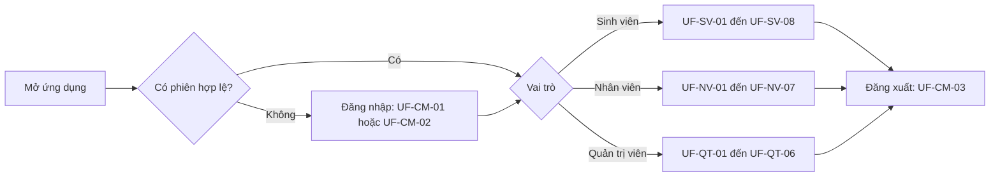
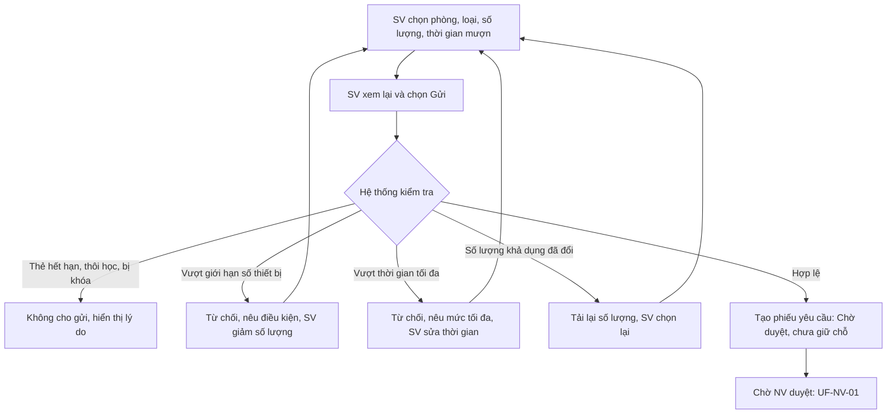
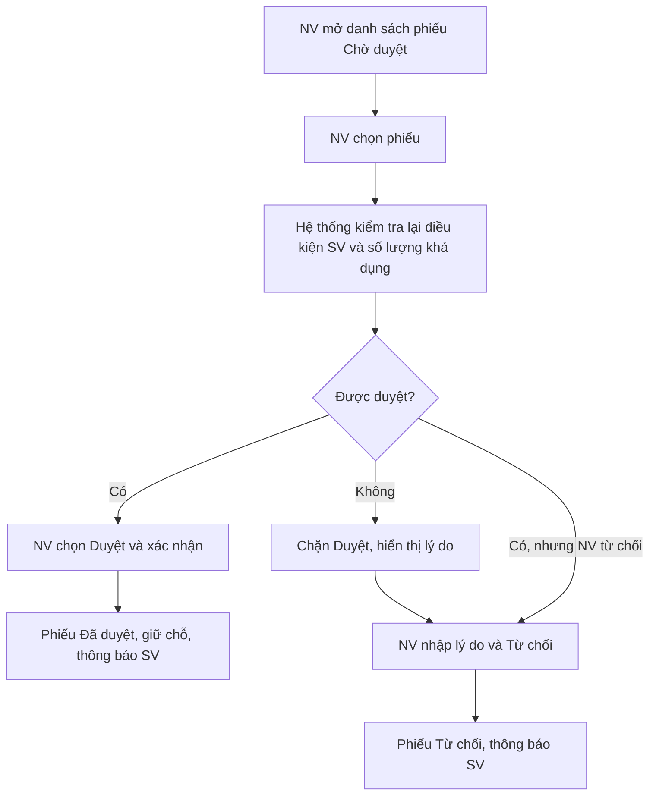
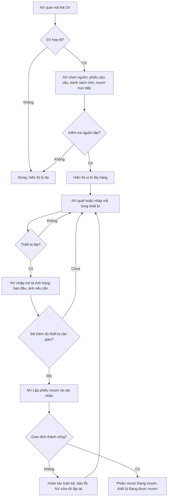
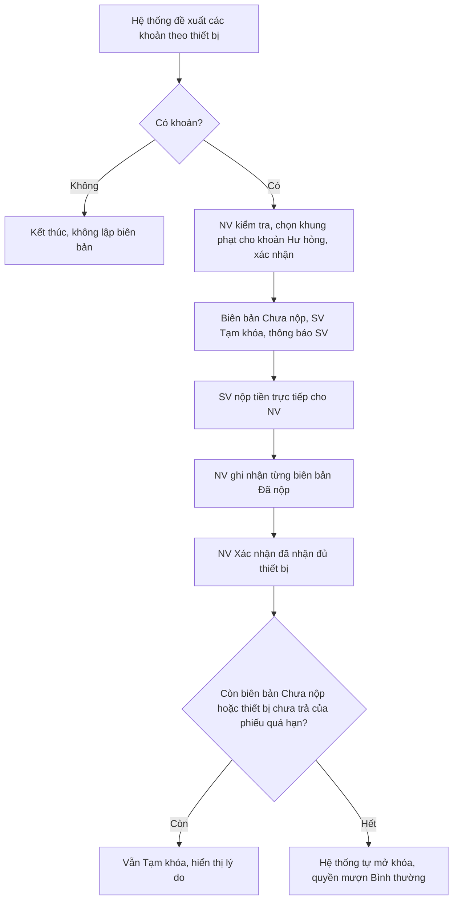
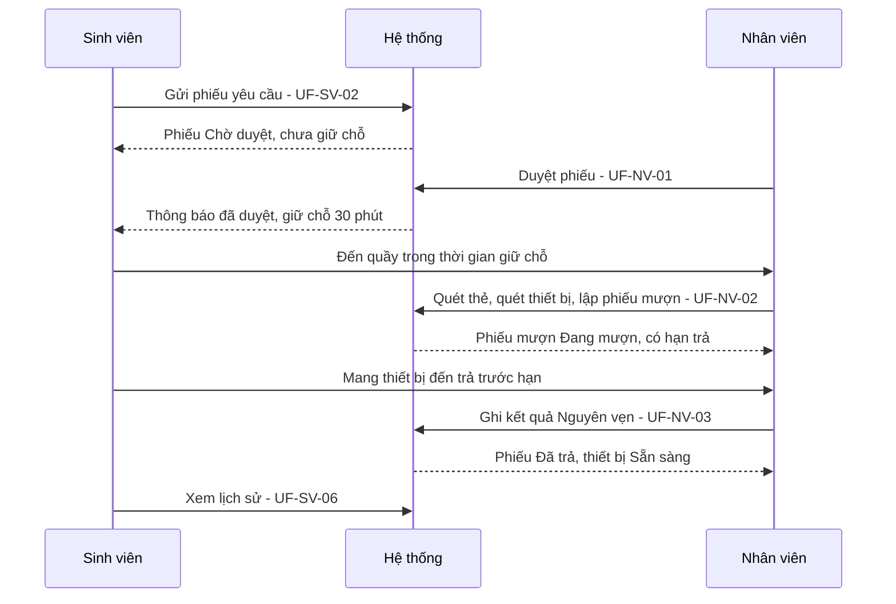
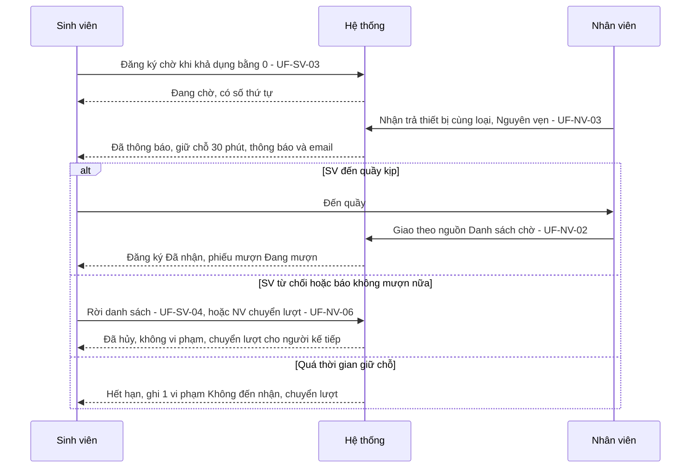
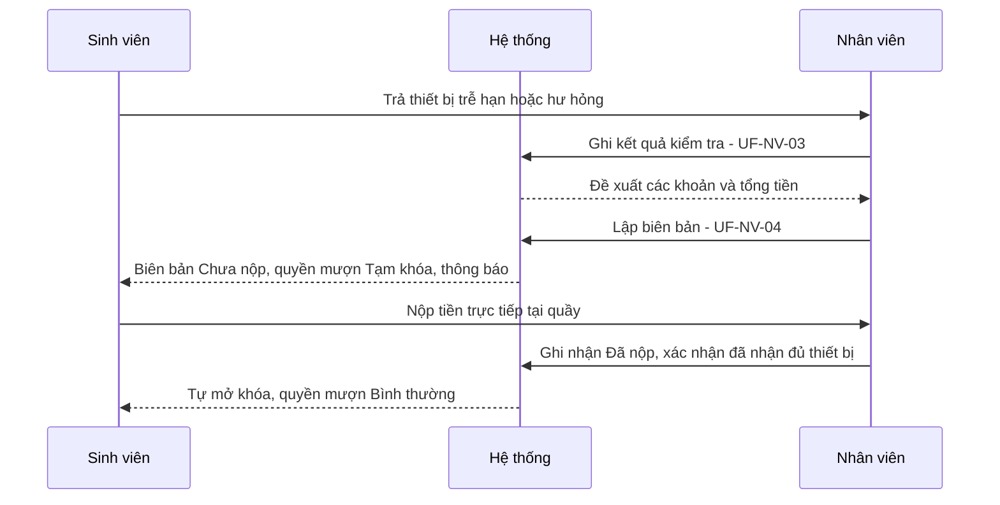

# USER FLOWS

## Hệ thống quản lý mượn trả thiết bị học tập cho sinh viên

| Mục | Nội dung |
|---|---|
| Dự án | SE100 – Nhóm 13 |
| Tài liệu | `User-Flows.md` |
| Phiên bản | 1.0 |
| Ngày lập | 30/10/2026 |
| Tài liệu căn cứ | `SRS.md` (22/10/2026); `Usecase.md` v1.2; `BusinessRule.md` (BR-01…BR-81); `Authorization.md` (ĐX-PQ-01…10); `backend-architecture.md` (KT); `API-Notes.md` v1.1.0 và `openapi.yaml` (88 thao tác); đề bài gốc |

## Mục lục

1. Giới thiệu
2. Tác nhân, phạm vi và danh mục luồng
3. Quy tắc dùng chung cho mọi luồng
4. Luồng chung: đăng nhập và phiên
5. Luồng của sinh viên
6. Luồng của nhân viên quản lý thiết bị
7. Luồng của quản trị viên
8. Sự kiện tự động và tác động lên người dùng
9. Luồng đầu–cuối liên vai trò
10. Luồng ngoài giai đoạn 1
- Phụ lục A. Nhãn hiển thị và mã trạng thái
- Phụ lục B. Truy vết use case → luồng

---

## 1. Giới thiệu

### 1.1 Mục đích và đối tượng sử dụng

Tài liệu mô tả **hành vi của người dùng và phản hồi của hệ thống** trong từng luồng thao tác: điểm bắt đầu, điều kiện, các bước, các nhánh rẽ, lỗi và kết quả. Tài liệu là đầu vào cho thiết kế màn hình (Wireframes, UI-Screens), kiến trúc và quy ước frontend, và cho kiểm thử chấp nhận.

| Người đọc | Dùng tài liệu để |
|---|---|
| Thiết kế giao diện | Biết mỗi luồng cần những màn hình, trạng thái và thông báo nào; biết nhánh nào phải có giao diện riêng. |
| Lập trình frontend (app Android, web) | Biết thứ tự thao tác, điều kiện chuyển bước, cách phản ứng với từng lỗi nghiệp vụ. |
| Kiểm thử | Lấy ca kiểm thử từ luồng chính, nhánh thay thế (A) và ngoại lệ (E). |

### 1.2 Ranh giới với các tài liệu khác

| Tài liệu | Quan hệ với tài liệu này |
|---|---|
| Nguồn nghiệp vụ (`SRS.md`, `Usecase.md`, `BusinessRule.md`, `Authorization.md`) | Là căn cứ. Tài liệu này không đặt quy tắc nghiệp vụ mới; chỉ chuyển quy tắc đã có thành luồng thao tác. |
| `openapi.yaml`, `API-Notes.md` | Là hợp đồng dữ liệu. Mỗi luồng ghi các endpoint liên quan để người làm frontend biết thứ tự gọi; hình dạng yêu cầu và phản hồi xem ở `openapi.yaml`. |
| Wireframes, UI-Screens | Quyết định bố cục, tên màn hình, thành phần. Tài liệu này **không** quy định bố cục. Tên chức năng ở đây (ví dụ "danh sách phiếu chờ duyệt") là tên chức năng, không phải mã màn hình. |
| Design-System | Quyết định màu sắc, kiểu chữ, thành phần. Tài liệu này không đề cập. |
| Frontend-Architecture, Frontend-Conventions | Quyết định cách tổ chức mã, quản lý trạng thái, cách giữ phiên khi tải lại trang web, cách tiếp nhận kết quả quét mã. Tài liệu này chỉ nêu hành vi mà kiến trúc phải đáp ứng. Những điểm kỹ thuật đã chốt ở `backend-architecture.md` (ví dụ nơi lưu token, không dùng cookie) được giữ nguyên. |

Các tài liệu Wireframes, UI-Screens, Design-System, Frontend-Architecture và Frontend-Conventions chưa tồn tại khi lập tài liệu này. Tên gọi, nhãn trạng thái và mã trong tài liệu này lấy từ `SRS.md` và `openapi.yaml` để các tài liệu đó bám theo (xem Phụ lục A).

### 1.3 Nền tảng client

| Vai trò | Nền tảng | Căn cứ |
|---|---|---|
| Sinh viên (SV) | Ứng dụng Android (Java), chỉ dùng để tra cứu, đặt trước, đăng ký chờ, xem lịch sử và thông báo; **không** giao nhận thiết bị qua ứng dụng | KT-04, BR-01, CR-11 |
| Nhân viên quản lý thiết bị (NV) | Web, dùng tại quầy | KT-04, SRS 2.4 |
| Quản trị viên (QT) | Web | KT-04 |

Cả ba nền tảng gọi cùng một REST API. NV và QT dùng chung một biểu mẫu và endpoint đăng nhập; giao diện được chọn theo `vaiTro` trong phản hồi (ĐX-API-05).

### 1.4 Quy ước đọc

**Cấu trúc mỗi luồng.** Mã luồng `UF-<nhóm>-<số>`; bảng thông tin (tác nhân, nguồn, điểm bắt đầu, API; tiền điều kiện khi khác với tiền điều kiện chung ghi ở đầu mỗi mục); luồng chính đánh số, trong đó "Hệ thống" là phản hồi nhìn thấy được; bảng nhánh thay thế (A) và ngoại lệ (E) khi có; hậu điều kiện hoặc ghi chú kết thúc.

| Nhóm mã | Ý nghĩa |
|---|---|
| `UF-CM` | Luồng chung (đăng nhập, phiên) |
| `UF-SV`, `UF-NV`, `UF-QT` | Luồng của sinh viên, nhân viên, quản trị viên |
| `UF-HT` | Sự kiện tự động của hệ thống, nhìn thấy được ở giao diện |
| `UF-E2E` | Luồng đầu–cuối liên vai trò |
| `UF-MR` | Luồng mở rộng, ngoài giai đoạn 1 |

**Nguồn truy vết.** `UC-nn` (A = luồng thay thế, E = ngoại lệ), `FR-nn`, `NFR-nn`, `BR-nn`, `US-nn`, `SSD-nn`, `KT` (backend-architecture, kèm số mục), `ĐX-API-nn`, `ĐX-PQ-nn`, `ĐX-KT-nn`, `ĐX-CV-nn` (Backend-Conventions), `ĐX-nn` (SRS).

**Nhãn ĐX-UF-nn.** Quyết định của tài liệu này cho những điểm nguồn không nêu. Danh sách ở mục 1.5.

**Mã lỗi.** `maLoi` viết trong dấu `` ` ``; client phân nhánh theo `maLoi`, không theo nội dung `detail` (ĐX-CV-02). Cách xử lý lỗi dùng chung ở mục 3.4; các luồng chỉ nêu lỗi có xử lý riêng.

**Sơ đồ.** Dùng Mermaid, chỉ cho những luồng có nhiều nhánh.

### 1.5 Quyết định bổ sung của tài liệu (ĐX-UF)

| Mã | Quyết định | Căn cứ |
|---|---|---|
| ĐX-UF-01 | Luồng chi tiết được lập cho các use case thuộc **giai đoạn 1**: UC-01, 02, 03, 05, 06, 07, 08, 09, 10, 11, 12, 13, 14, 15, 16, 19 và các hiệu ứng nhìn thấy được của UC-17. Bảy use case còn lại (UC-04, 18, 20, 21, 22, 23, 24) được mô tả ngắn ở mục 10, đánh dấu ngoài giai đoạn 1; giao diện giai đoạn 1 không có hành động tương ứng. | KT-10, ĐX-KT-01, API-Notes (phạm vi); hợp đồng API không có endpoint cho bảy use case này |
| ĐX-UF-02 | Sau khi đăng nhập, người dùng vào "màn hình chính của vai trò". Nội dung màn hình chính do UI-Screens quy định; tài liệu này chỉ yêu cầu màn hình đó dẫn tới các luồng của đúng vai trò. | UC-19 bước 3 |
| ĐX-UF-03 | Khi quyền mượn của SV là Tạm khóa hoặc Cấm mượn dài hạn, các hành động Đặt trước và Đăng ký chờ **vẫn hiển thị** nhưng khi SV chọn thì hệ thống hiển thị lý do và không cho gửi. Lý do lấy từ hồ sơ mượn của SV. | UC-17 bước 4, BR-66, ĐX-PQ-08 |
| ĐX-UF-04 | Mọi trạng thái phụ thuộc thời gian (giữ chỗ, phiếu quá hạn, phiếu hết hiệu lực, thông báo) được lấy từ máy chủ khi mở màn hình, khi người dùng làm mới và khi bộ đếm ngược về 0. Client không tự đổi trạng thái theo đồng hồ cục bộ. Ứng dụng không có push nên không có luồng "nhận thông báo tức thời" trong ứng dụng. | ĐX-KT-03, ĐX-KT-12 |
| ĐX-UF-05 | Các thao tác khó hoàn tác có bước xác nhận (danh sách ở mục 3.9). | Thực hành thiết kế giao diện cho thao tác khó hoàn tác; UC-02 bước 3 đã có bước SV xác nhận gửi |
| ĐX-UF-06 | Thao tác ghi (`POST`, `PUT`, `DELETE`) không tự động gửi lại khi mất kết nối hoặc quá thời gian chờ; trước khi cho người dùng gửi lại, client kiểm tra trạng thái hiện tại. | KT 8: không dùng Idempotency-Key; chống trùng dựa vào máy trạng thái |

---

## 2. Tác nhân, phạm vi và danh mục luồng

### 2.1 Tác nhân

| Tác nhân | Nền tảng | Phạm vi dữ liệu | Ghi chú |
|---|---|---|---|
| Sinh viên (SV) | App Android | Chỉ dữ liệu của chính mình (BR-06) | Tài khoản do nhà trường cấp; không tự đăng ký (BR-08) |
| Nhân viên quản lý thiết bị (NV) | Web | Thiết bị, phiếu yêu cầu, phiếu mượn của các phòng thiết bị được QT cấp quyền (BR-05) | Làm việc tại quầy; thực hiện giao, nhận, kiểm tra |
| Quản trị viên (QT) | Web | Không giới hạn theo phòng (ĐX-PQ-02) | Không có chức năng nghiệp vụ quầy; không duyệt, giao, nhận |
| Hệ thống (bộ hẹn giờ) | – | – | Không phải người dùng; tác động của nó nhìn thấy ở mục 8 |

### 2.2 Phạm vi giai đoạn 1

| Nhóm | Use case |
|---|---|
| Trong giai đoạn 1 (có luồng chi tiết) | UC-01, UC-02, UC-03, UC-05, UC-06, UC-07, UC-08, UC-09, UC-10, UC-11, UC-12, UC-13, UC-14, UC-15, UC-16, UC-19; UC-17 (chỉ hiệu ứng nhìn thấy được) |
| Ngoài giai đoạn 1 (mục 10) | UC-04 Gia hạn; UC-18 Nhắc nhở thủ công; UC-20 Hủy phiếu yêu cầu; UC-21 Phản hồi tình trạng thiết bị; UC-22 Quản lý nhà cung cấp và bảo hành; UC-23 Xem nhật ký; UC-24 Cấm mượn dài hạn |

### 2.3 Danh mục luồng

| Mã luồng | Tên luồng | Tác nhân | Use case |
|---|---|---|---|
| UF-CM-01 | Đăng nhập sinh viên | SV | UC-19 |
| UF-CM-02 | Đăng nhập nhân viên hoặc quản trị viên | NV, QT | UC-19 |
| UF-CM-03 | Duy trì phiên và đăng xuất | SV, NV, QT | UC-19 |
| UF-SV-01 | Tra cứu thiết bị và xem chi tiết | SV | UC-01 |
| UF-SV-02 | Đặt trước thiết bị | SV | UC-02 |
| UF-SV-03 | Đăng ký chờ | SV | UC-03 |
| UF-SV-04 | Theo dõi, nhận lượt và rời danh sách chờ | SV | UC-03, UC-10 |
| UF-SV-05 | Theo dõi phiếu yêu cầu mượn | SV | UC-02, UC-06 |
| UF-SV-06 | Xem lịch sử mượn/trả, biên bản, vi phạm và phí phạt | SV | UC-05 |
| UF-SV-07 | Xem thông báo | SV | UC-17, FR-24 |
| UF-SV-08 | Xem hồ sơ mượn và lý do bị khóa quyền mượn | SV | UC-17, UC-02 |
| UF-NV-01 | Duyệt hoặc từ chối phiếu yêu cầu mượn | NV | UC-06 |
| UF-NV-02 | Giao thiết bị và lập phiếu mượn | NV | UC-07 |
| UF-NV-03 | Nhận trả và kiểm tra thiết bị | NV | UC-08 |
| UF-NV-04 | Lập biên bản vi phạm, ghi nhận nộp phạt và mở khóa | NV | UC-09 |
| UF-NV-05 | Lập biên bản mất cho thiết bị chưa trả quá 30 ngày | NV | UC-09 A3 |
| UF-NV-06 | Xử lý danh sách chờ tại quầy | NV | UC-10 |
| UF-NV-07 | Bảo trì định kỳ và sửa chữa | NV | UC-11 |
| UF-QT-01 | Quản lý danh mục phòng, loại thiết bị, thiết bị | QT | UC-12 |
| UF-QT-02 | Cấu hình quy định mượn, phí và tham số | QT | UC-13 |
| UF-QT-03 | Quản lý tài khoản nhân viên và quyền theo phòng | QT | UC-14 |
| UF-QT-04 | Hủy hoặc điều chỉnh biên bản vi phạm | QT | UC-09 A2 |
| UF-QT-05 | Lập quyết định thanh lý | QT | UC-15 |
| UF-QT-06 | Xem và xuất báo cáo | QT | UC-16 |
| UF-HT-01 | Sự kiện tự động và tác động lên người dùng | Hệ thống | UC-17 |
| UF-E2E-01…04 | Bốn luồng đầu–cuối | SV, NV, QT | – |
| UF-MR-01…07 | Luồng mở rộng ngoài giai đoạn 1 | SV, NV, QT | UC-04, 18, 20, 21, 22, 23, 24 |

### 2.4 Điểm vào theo vai trò



---

## 3. Quy tắc dùng chung cho mọi luồng

### 3.1 Phiên và xác thực

| Tình huống | Hành vi của client | Nguồn |
|---|---|---|
| Yêu cầu bị `CHUA_XAC_THUC` (401): access token hết hạn hoặc không hợp lệ | Gọi làm mới token **một lần**. Thành công thì gọi lại yêu cầu ban đầu, người dùng không thấy gián đoạn. Thất bại thì xóa phiên, về màn hình đăng nhập và báo phiên đã hết hạn. | API-Notes 10, KT 7.3 |
| Nhiều yêu cầu cùng gặp 401 | Chỉ **một** yêu cầu làm mới được chạy tại một thời điểm; các yêu cầu khác chờ kết quả. Lý do: refresh token được xoay vòng; dùng lại token đã xoay vòng thì toàn bộ chuỗi bị thu hồi và người dùng phải đăng nhập lại. | KT 7.3 |
| `TAI_KHOAN_BI_KHOA` (403) khi đang dùng | Hiển thị tài khoản bị khóa, đăng xuất. Token còn hạn vẫn bị từ chối ngay (trạng thái được đọc ở mỗi yêu cầu). | KT 7.2, API-Notes 10 |
| `QUA_NHIEU_YEU_CAU` (429) ở đăng nhập, làm mới, đăng xuất | Báo chờ rồi thử lại; không tự lặp. | KT 7.4 |
| Không có chức năng tự đăng ký, quên mật khẩu, đổi mật khẩu | Giao diện không cung cấp các hành động này. SV: mật khẩu thuộc hệ thống tài khoản của nhà trường. NV: QT đặt lại tại UF-QT-03. QT: bên vận hành hệ thống xử lý ngoài ứng dụng. | BR-08, ĐX-PQ-07 |

### 3.2 Phân quyền và phạm vi dữ liệu

| Quy tắc | Hành vi | Nguồn |
|---|---|---|
| Mỗi vai trò chỉ thấy điểm vào của chính vai trò | Giao diện không đưa ra lối vào chức năng ngoài vai trò. Việc ngăn truy cập thực sự do máy chủ thực hiện (`KHONG_DU_QUYEN`, 403); khi gặp lỗi này client báo không có quyền và quay về màn hình chính của vai trò. | NFR-01, BR-04 |
| SV chỉ thấy dữ liệu của mình | Client không bao giờ gửi mã SV trong đường dẫn hay nội dung; mã SV lấy từ phiên. | BR-06, API-Notes 2 |
| NV chỉ thấy các phòng được cấp quyền | Mọi danh sách tự lọc theo phòng được cấp; bộ lọc `maPhong` ngoài quyền cho kết quả rỗng. Truy cập một đối tượng thuộc phòng chưa cấp trả `PHONG_CHUA_CAP_QUYEN` (403): báo phòng chưa được cấp quyền và quay về danh sách. NV chưa được cấp phòng nào thì mọi danh sách rỗng; cần QT cấp quyền (UF-QT-03). | BR-05, ĐX-API-22 |
| QT không có chức năng quầy | Giao diện QT không có duyệt, giao, nhận, lập biên bản, bảo trì. | ĐX-PQ-02 |

### 3.3 Quyền mượn của SV và các hành động bị chặn

Trạng thái quyền mượn: Bình thường, Tạm khóa, Cấm mượn dài hạn (xem Phụ lục A). Khi khác Bình thường:

| Bị chặn (lỗi `SV_BI_KHOA_QUYEN_MUON`, 422) | Không bị chặn |
|---|---|
| SV gửi phiếu yêu cầu (UF-SV-02); SV đăng ký chờ (UF-SV-03); NV duyệt phiếu yêu cầu (UF-NV-01); NV lập phiếu mượn ở cả ba nguồn (UF-NV-02) | Tra cứu; xem lịch sử, biên bản, thông báo; rời danh sách chờ; trả thiết bị tại quầy (UF-NV-03) |

Cách hiển thị lý do bị chặn: ĐX-UF-03 và UF-SV-08. Nguồn: ĐX-PQ-08; việc duyệt kiểm tra lại quyền mượn theo UC-06 bước 2 và BR-28.

### 3.4 Xử lý lỗi dùng chung

| Lỗi | Hành vi |
|---|---|
| `DU_LIEU_KHONG_HOP_LE` (400) | Hiển thị lỗi cạnh từng trường theo danh sách `errors`; giữ nguyên dữ liệu đã nhập. |
| `KHONG_TIM_THAY` (404) | Báo không tìm thấy; quay về danh sách và tải lại. |
| `XUNG_DOT_CAP_NHAT` (409) | Dữ liệu vừa bị người khác thay đổi: tải lại đối tượng, hiển thị giá trị mới, để người dùng thực hiện lại. |
| `TRANG_THAI_KHONG_HOP_LE` (409) | Đối tượng đã đổi trạng thái (người khác hoặc hệ thống vừa xử lý): tải lại, hiển thị trạng thái mới, không tự thử lại. |
| Lỗi 500 (chỉ có `traceId`) | Báo lỗi hệ thống chung, kèm `traceId` để báo cho nhóm; không hiển thị chi tiết nội bộ. |
| Mất kết nối, quá thời gian chờ | Báo lỗi và cho thử lại. Với thao tác ghi áp dụng ĐX-UF-06: ví dụ sau khi gửi phiếu yêu cầu bị quá thời gian chờ, kiểm tra danh sách phiếu yêu cầu của mình trước khi cho gửi lại. |
| Dịch vụ vừa "ngủ dậy" | Lần gọi đầu sau thời gian không dùng có thể chậm khoảng một phút (hạ tầng miễn phí, KT 3.4). Hiển thị trạng thái đang tải và chờ đủ lâu, không báo lỗi sớm. |
| Lỗi nghiệp vụ khác (422, 409) | Nêu ở từng luồng. Thông điệp theo `maLoi`; nội dung `detail` chỉ để hiển thị, không để phân nhánh. |

### 3.5 Hiển thị thời gian và tiền

| Nội dung | Quy tắc | Nguồn |
|---|---|---|
| Thời gian | API trả giờ UTC; client hiển thị theo giờ Việt Nam (`Asia/Ho_Chi_Minh`). | KT 6.1 |
| Số ngày trễ và số tiền | Do máy chủ tính; client chỉ hiển thị, không tự tính phí. | KT 8.5, BR-62 |
| Tiền | Số nguyên VNĐ, hiển thị có dấu phân cách hàng nghìn (ví dụ 240.000 VNĐ). | KT 6.1 |
| Đếm ngược giữ chỗ | Tính từ `hanGiuCho` do máy chủ trả. Khi về 0, client tải lại trạng thái (ĐX-UF-04) thay vì tự đổi. | ĐX-KT-12 |

### 3.6 Ảnh tình trạng thiết bị

| Quy tắc | Nội dung | Nguồn |
|---|---|---|
| Khi nào | Ghi tình trạng ban đầu (UF-NV-02), ghi kết quả kiểm tra khi trả (UF-NV-03), ảnh danh mục thiết bị (UF-QT-01) | UC-07, UC-08, UC-12 |
| Giới hạn | Tối đa 5 ảnh cho mỗi thiết bị mỗi lần; mỗi ảnh tối đa 2 MB; định dạng jpeg, png, webp | API-Notes 5.5 |
| Nén | Client nén trước khi tải lên: cạnh dài tối đa 1280 px, JPEG khoảng 80% | KT 11 |
| Cách gửi | Tải từng ảnh lên trước để nhận `maAnh`, rồi gắn `maAnh` vào yêu cầu lập phiếu mượn, ghi kết quả kiểm tra hoặc lưu thiết bị. Ảnh chưa gắn quá 24 giờ bị xóa. | API-Notes 5.5 |
| Xem ảnh tình trạng | Ảnh tình trạng (lúc giao, lúc trả) là ảnh riêng tư: URL có chữ ký, hết hạn sau 10 phút. Khi ảnh không tải được do hết hạn, client gọi lại endpoint để lấy URL mới; không lưu URL lâu dài. Ảnh danh mục thiết bị là URL công khai. | API-Notes 5.5, 13 |
| Ảnh tùy chọn | Ảnh không bắt buộc ("nếu cần"); **mô tả** tình trạng bắt buộc. | UC-07, `ThietBiGiao.moTa` |

### 3.7 Danh sách

| Quy tắc | Nội dung |
|---|---|
| Phân trang | Có `trang`, `kichThuoc` (mặc định 20, tối đa 100); phản hồi có `tongSo`. |
| Thứ tự mặc định | Theo từng danh sách (ĐX-API-28): danh sách của SV và thông báo mới nhất trước; phiếu yêu cầu chờ duyệt cũ nhất trước; danh sách chờ theo thời điểm đăng ký; danh mục theo tên hoặc mã. |
| Rỗng | Mỗi danh sách có trạng thái rỗng; rỗng không phải lỗi. |

### 3.8 Thông báo

| Quy tắc | Nội dung | Nguồn |
|---|---|---|
| Kênh | Hệ thống gửi thông báo cho SV qua email và lưu bản ghi thông báo "ứng dụng". Giai đoạn 1 không có SMS. | BR-75, KT 10, ĐX-KT-03 |
| Không có push | Ứng dụng đọc danh sách thông báo khi SV mở màn hình thông báo hoặc làm mới (UF-SV-07). Các mốc gấp (giữ chỗ 30 phút, nhắc trước hạn 1 giờ) vì thế phụ thuộc vào email; ứng dụng bổ sung bằng thời điểm hạn hiển thị ở phiếu. | ĐX-KT-03 |
| Không có trạng thái đã đọc | Danh sách thông báo không có đánh dấu đã đọc hay xóa; vì vậy không có huy hiệu số thông báo chưa đọc. | `openapi.yaml` (`ThongBao`) |
| NV | API không có danh sách thông báo ứng dụng cho NV; nhắc bảo trì đến NV qua email và qua danh sách "đến hạn bảo trì" (UF-NV-07). | `openapi.yaml`, KT 10 |

### 3.9 Thao tác cần xác nhận (ĐX-UF-05)

| Vai trò | Thao tác cần bước xác nhận |
|---|---|
| SV | Gửi phiếu yêu cầu (xem lại nội dung trước khi gửi); rời danh sách chờ hoặc từ chối nhận |
| NV | Duyệt; Từ chối; Lập phiếu mượn; Ghi kết quả kiểm tra (đặc biệt kết quả Mất); Lập biên bản (số tiền không đổi sau khi lập); Ghi nhận đã nộp; Xác nhận đã nhận đủ thiết bị; Chuyển lượt thủ công; Lập lịch bảo trì |
| QT | Xóa hoặc ngưng sử dụng; khóa tài khoản; đặt lại mật khẩu; hủy hoặc điều chỉnh biên bản; lập quyết định thanh lý; lưu cấu hình |

### 3.10 Yêu cầu phi chức năng ảnh hưởng đến luồng

| Yêu cầu | Tác động lên luồng | Luồng liên quan |
|---|---|---|
| NFR-01 Phân quyền theo vai trò và phòng | Mục 3.2: không có lối vào ngoài quyền; máy chủ là nơi chặn thực sự | Mọi luồng |
| NFR-03 Tra cứu và quét mã phản hồi nhanh (95% dưới 1,5 giây với 100 người dùng đồng thời) | Tra cứu, kiểm tra thẻ và kiểm tra thiết bị không chèn thêm bước trung gian không cần thiết; hiển thị trạng thái đang tải trong lúc chờ | UF-SV-01, UF-NV-02, UF-NV-03 |
| NFR-04 Giao diện không vỡ bố cục trên các kích thước màn hình điện thoại phổ biến | Mọi luồng của SV phải dùng được trên màn hình điện thoại, kể cả bảng danh sách và chi tiết phiếu | UF-SV-01 đến UF-SV-08 |
| NFR-06 Toàn vẹn khi nhiều giao dịch đồng thời | Khi xung đột, người dùng nhận lỗi rõ và chọn lại (số lượng khả dụng đổi, thiết bị vừa được giao); không có trạng thái giữa chừng | UF-SV-02, UF-NV-01, UF-NV-02 |
| NFR-08 Thông báo đúng mốc | Các mốc nhắc hạn, quá hạn, thiết bị sẵn sàng hiển thị đúng thời điểm máy chủ ghi; giao diện không tự phát sinh thông báo | UF-SV-07, UF-HT-01 |
| NFR-09 Tính phí chính xác | Số tiền do máy chủ tính, client chỉ hiển thị (mục 3.5) | UF-NV-04, UF-NV-05, UF-SV-06 |

---

## 4. Luồng chung: đăng nhập và phiên

### UF-CM-01 Đăng nhập sinh viên

| Mục | Nội dung |
|---|---|
| Tác nhân | SV |
| Nguồn | UC-19, FR-33, BR-08, BR-10, US-24, ĐX-PQ-05, ĐX-PQ-07 |
| Điểm bắt đầu | Mở ứng dụng khi chưa có phiên hợp lệ |
| Tiền điều kiện | Nhà trường đã cấp tài khoản cho SV |
| API | `POST /auth/sinh-vien/dang-nhap` |

**Luồng chính**

1. SV nhập mã số sinh viên và mật khẩu của nhà trường, chọn Đăng nhập.
2. Hệ thống xác thực với hệ thống tài khoản của nhà trường (hệ thống này không lưu mật khẩu SV).
3. Hệ thống trả phiên đăng nhập kèm vai trò Sinh viên; client lưu phiên.
4. Hệ thống đưa SV vào giao diện sinh viên (màn hình chính của vai trò, ĐX-UF-02).

**Nhánh thay thế và ngoại lệ**

| Mã | Điều kiện | Hành vi |
|---|---|---|
| A1 | SV muốn tự đăng ký, quên hoặc đổi mật khẩu | Màn hình đăng nhập không có các chức năng này (BR-08, ĐX-PQ-07). |
| E1 | `DANG_NHAP_SAI` (401) | Báo thông tin đăng nhập không đúng; giữ mã số sinh viên, xóa mật khẩu. Không hiển thị số lần thử còn lại (hệ thống này không đếm lần nhập sai của SV, ĐX-PQ-05). |
| E2 | `QUA_NHIEU_YEU_CAU` (429) | Báo chờ rồi thử lại (mục 3.1). |

**Hậu điều kiện:** SV ở giao diện sinh viên và chỉ thấy dữ liệu của chính mình.

### UF-CM-02 Đăng nhập nhân viên hoặc quản trị viên

| Mục | Nội dung |
|---|---|
| Tác nhân | NV, QT |
| Nguồn | UC-19, FR-33, FR-34, BR-09, BR-10, ĐX-PQ-04, ĐX-API-05, ĐX-API-07 |
| Điểm bắt đầu | Mở ứng dụng web khi chưa có phiên hợp lệ |
| Tiền điều kiện | Tài khoản đã được cấp (NV do QT tạo ở UF-QT-03) và không bị khóa |
| API | `POST /auth/nhan-vien/dang-nhap`, `GET /auth/toi` |

**Luồng chính**

1. Người dùng nhập tên đăng nhập và mật khẩu, chọn Đăng nhập (một biểu mẫu chung cho NV và QT).
2. Hệ thống xác thực và trả phiên kèm `vaiTro`.
3. Client lấy thông tin người đăng nhập (họ tên; với NV có danh sách phòng được cấp quyền).
4. Hệ thống đưa người dùng vào giao diện NV hoặc QT theo `vaiTro` (ĐX-UF-02).

**Nhánh thay thế và ngoại lệ**

| Mã | Điều kiện | Hành vi |
|---|---|---|
| E1 | `DANG_NHAP_SAI` (401) | Báo thông tin không đúng; giữ tên đăng nhập, xóa mật khẩu. Không hiển thị số lần thử còn lại (API không trả). |
| E2 | Nhập sai liên tiếp đạt `soLanDangNhapSaiToiDa` (mặc định 5) | Tài khoản chuyển sang Tạm khóa đăng nhập; từ lúc đó đăng nhập nhận `TAI_KHOAN_BI_KHOA` (E3). |
| E3 | `TAI_KHOAN_BI_KHOA` (403): tài khoản Tạm khóa đăng nhập hoặc Bị khóa | Báo tài khoản không đăng nhập được và hướng dẫn: NV liên hệ QT để mở lại; QT liên hệ bên vận hành hệ thống (ĐX-PQ-04). Phản hồi không phân biệt hai trạng thái nên thông báo dùng chung. |
| E4 | `QUA_NHIEU_YEU_CAU` (429) | Báo chờ rồi thử lại. |

**Hậu điều kiện:** người dùng ở giao diện đúng vai trò; NV chỉ thấy các phòng được cấp quyền.

### UF-CM-03 Duy trì phiên và đăng xuất

| Mục | Nội dung |
|---|---|
| Tác nhân | SV, NV, QT |
| Nguồn | UC-19, KT 7.3, API-Notes 3.1, ĐX-CV-08 |
| Điểm bắt đầu | Mở lại ứng dụng hoặc tải lại trang; hoặc người dùng chọn Đăng xuất |
| API | `POST /auth/lam-moi`, `POST /auth/dang-xuat` |

**Luồng chính: mở lại ứng dụng**

1. Client kiểm tra phiên đã lưu.
2. Còn access token hợp lệ: vào thẳng giao diện của vai trò.
3. Hết hạn nhưng còn refresh token: làm mới phiên (quy tắc ở mục 3.1) rồi vào giao diện.
4. Không còn phiên hoặc làm mới thất bại: về màn hình đăng nhập.

**Luồng chính: đăng xuất**

1. Người dùng chọn Đăng xuất.
2. Client gửi refresh token để thu hồi phiên (không cần access token còn hạn).
3. Client xóa phiên cục bộ và về màn hình đăng nhập. Nếu yêu cầu đăng xuất lỗi, client vẫn xóa phiên cục bộ.

**Nơi lưu phiên (đã chốt ở KT 7.3):** Android lưu trong kho lưu trữ mã hóa của hệ điều hành. Web giữ access token trong bộ nhớ, gửi refresh token qua nội dung yêu cầu, không dùng cookie. Cách web khôi phục phiên sau khi tải lại trang (access token trong bộ nhớ đã mất) do Frontend-Architecture quyết định, miễn đáp ứng bước 3 của luồng mở lại ứng dụng.

**Hậu điều kiện:** người dùng ở giao diện của vai trò với phiên hợp lệ, hoặc ở màn hình đăng nhập khi không còn phiên. Sau đăng xuất, phiên và cache cục bộ đã được xóa; chỉ xác nhận refresh token đã bị máy chủ thu hồi khi nhận phản hồi đăng xuất thành công. Nếu mất kết nối hoặc quá thời gian chờ, kết quả thu hồi từ xa chưa xác định; không tự gửi lại yêu cầu đăng xuất.

---

## 5. Luồng của sinh viên

Tiền điều kiện chung của mọi luồng ở mục này: SV đã đăng nhập (UF-CM-01).

### UF-SV-01 Tra cứu thiết bị và xem chi tiết

| Mục | Nội dung |
|---|---|
| Tác nhân | SV |
| Nguồn | UC-01, FR-01, FR-02, BR-16, BR-19, BR-20, US-01, NFR-03, NFR-04 |
| Điểm bắt đầu | SV chọn Tra cứu thiết bị |
| API | `GET /sv/tra-cuu/thiet-bi` (bộ lọc `ten`, `maLoai`, `maPhong`, `conHang`); `GET /sv/loai-thiet-bi`, `GET /sv/phong-thiet-bi` (nguồn của bộ lọc); `GET /sv/tra-cuu/thiet-bi/{maLoai}?maPhong=` (chi tiết) |

**Luồng chính**

1. Hệ thống hiển thị danh sách loại thiết bị theo từng phòng; mỗi dòng gồm tên loại, hãng, phòng và cơ sở, số lượng khả dụng.
2. SV nhập tên thiết bị và/hoặc chọn bộ lọc: loại thiết bị, phòng thiết bị, còn hàng hoặc hết hàng.
3. Hệ thống hiển thị kết quả khớp bộ lọc (phân trang).
4. SV chọn một dòng.
5. Hệ thống hiển thị chi tiết: mô tả, thông số kỹ thuật, ảnh, phòng và cơ sở, số lượng khả dụng.

**Nhánh thay thế và ngoại lệ**

| Mã | Điều kiện | Hành vi |
|---|---|---|
| A1 | Số lượng khả dụng lớn hơn 0 | Chi tiết có hành động Đặt trước; chọn thì chuyển sang UF-SV-02 với phòng và loại đã chọn. |
| A2 | Số lượng khả dụng bằng 0 | Chi tiết hiển thị ngày dự kiến có sẵn tại phòng đó và có hành động Đăng ký chờ (UF-SV-03). Nếu hệ thống không có ngày dự kiến (không có phiếu đang mượn loại này tại phòng) thì hiển thị chưa có ngày dự kiến. |
| A3 | Thiết bị hư hỏng hoặc đang bảo trì | Không được tính vào số lượng khả dụng; loại chỉ có thiết bị như vậy được xem là hết hàng (BR-16). |
| A4 | Quyền mượn của SV khác Bình thường | Tra cứu vẫn dùng được. Đặt trước và Đăng ký chờ theo ĐX-UF-03. |
| E1 | Không có kết quả | Hiển thị không tìm thấy thiết bị phù hợp và cách bỏ bộ lọc. |

**Hậu điều kiện:** SV biết số lượng khả dụng trước khi đến quầy; có thể chuyển sang đặt trước hoặc đăng ký chờ.

### UF-SV-02 Đặt trước thiết bị

| Mục | Nội dung |
|---|---|
| Tác nhân | SV |
| Nguồn | UC-02 (A1, A2, A3, E1, E2), SSD-01, FR-03, FR-04, FR-35, BR-21 đến BR-26, BR-30 |
| Điểm bắt đầu | Hành động Đặt trước ở chi tiết loại thiết bị (UF-SV-01), hoặc SV chọn chức năng Đặt trước |
| Tiền điều kiện | SV đã đăng nhập; thẻ còn hạn; còn theo học; quyền mượn Bình thường |
| API | `GET /sv/phong-thiet-bi`, `GET /sv/tra-cuu/thiet-bi`; `POST /sv/phieu-yeu-cau-muon` |

**Luồng chính**

1. SV chọn phòng thiết bị. Một phiếu yêu cầu thuộc đúng một phòng; muốn mượn ở phòng khác thì gửi phiếu khác.
2. SV chọn các loại thiết bị còn hàng tại phòng đó và số lượng (từ 1) của từng loại; một phiếu có thể gồm nhiều loại. Số lượng không vượt số lượng khả dụng đang hiển thị.
3. SV nhập thời gian mượn dự kiến, tính bằng giờ (số nguyên, từ 1).
4. SV xem lại nội dung phiếu và chọn Gửi.
5. Hệ thống kiểm tra: thẻ còn hạn và nhóm sinh viên, còn theo học, quyền mượn, số lượng khả dụng, giới hạn số thiết bị theo nhóm (tính trên tổng, không phân biệt loại), thời gian mượn tối đa của nhóm.
6. Hợp lệ: hệ thống tạo phiếu yêu cầu có mã duy nhất, trạng thái Chờ duyệt, và hiển thị phiếu (mã, phòng, loại và số lượng, thời gian dự kiến, trạng thái).
7. Giao diện nêu rõ cho SV: phiếu **chưa giữ chỗ**; NV sẽ duyệt trong ngày; khi được duyệt SV được thông báo và có thời gian giữ chỗ (mặc định 30 phút) để đến quầy nhận; phiếu chưa được duyệt trong ngày tự hết hiệu lực và không tính vi phạm; hạn trả thực tế do hệ thống tính khi NV giao thiết bị (không muộn hơn giờ đóng cửa quầy) và SV xem ở phiếu mượn; ứng dụng chỉ dùng để đặt trước, việc nhận thiết bị thực hiện tại quầy.

**Nhánh thay thế và ngoại lệ**

| Mã | Điều kiện | Hành vi |
|---|---|---|
| A1 | Loại đã hết hàng (khi chọn, hoặc khi gửi) | Đề nghị Đăng ký chờ cho loại đó (UF-SV-03); các loại còn hàng trong cùng phiếu vẫn đặt được. |
| A2 | `VUOT_GIOI_HAN_THIET_BI` (422) | Từ chối, nêu rõ điều kiện không đạt (giới hạn số thiết bị của nhóm); SV giảm số lượng và gửi lại; dữ liệu đã nhập được giữ nguyên. |
| A3 | `VUOT_THOI_GIAN_MUON_TOI_DA` (422) | Từ chối, nêu mức tối đa cho phép (phiếu nhiều loại: mức nhỏ nhất theo các loại); SV sửa thời gian và gửi lại. |
| E1 | `SV_THE_HET_HAN`, `SV_KHONG_CON_THEO_HOC`, `SV_BI_KHOA_QUYEN_MUON` (422) | Không cho gửi; hiển thị lý do tương ứng. Với `SV_BI_KHOA_QUYEN_MUON`, lý do chi tiết ở hồ sơ mượn (UF-SV-08). |
| E2 | `SO_LUONG_KHA_DUNG_THAY_DOI` (409) | Báo số lượng khả dụng đã thay đổi; tải lại số lượng; SV chọn lại. |
| E3 | Quá thời gian chờ khi gửi | Áp dụng ĐX-UF-06: kiểm tra danh sách phiếu yêu cầu (UF-SV-05) trước khi cho gửi lại. |

**Hậu điều kiện:** phiếu yêu cầu ở trạng thái Chờ duyệt; chưa giữ chỗ; chưa gán thiết bị cụ thể.



### UF-SV-03 Đăng ký chờ

| Mục | Nội dung |
|---|---|
| Tác nhân | SV |
| Nguồn | UC-03, FR-05, BR-33, BR-34, ĐX-PQ-08, ĐX-KT-05 |
| Điểm bắt đầu | Hành động Đăng ký chờ ở chi tiết loại hết hàng (UF-SV-01 A2), hoặc đề nghị từ UF-SV-02 A1 |
| Tiền điều kiện | SV đã đăng nhập; số lượng khả dụng của loại tại phòng bằng 0; quyền mượn Bình thường |
| API | `POST /sv/dang-ky-cho` |

**Luồng chính**

1. SV mở chi tiết loại thiết bị hết hàng tại một phòng và chọn Đăng ký chờ. SV không chọn số lượng: mỗi đăng ký chờ dành cho một thiết bị.
2. Hệ thống kiểm tra loại đã hết số lượng khả dụng tại phòng đó.
3. Hệ thống thêm SV vào cuối danh sách chờ của loại tại phòng (đăng ký trước, phục vụ trước), ghi mã đăng ký, thời điểm đăng ký và số thứ tự chờ.
4. Hệ thống hiển thị đăng ký với trạng thái Đang chờ và số thứ tự; giao diện nêu: khi thiết bị cùng loại tại phòng về Sẵn sàng sau khi trả Nguyên vẹn hoặc hoàn thành bảo trì, hệ thống giữ chỗ (mặc định 30 phút) và ghi thông báo cho người đứng đầu danh sách chờ trong cùng giao dịch; số lượng khả dụng đã trừ giữ chỗ.

**Nhánh thay thế và ngoại lệ**

| Mã | Điều kiện | Hành vi |
|---|---|---|
| E1 | `CON_HANG_KHONG_DANG_KY_CHO` (422): loại đã còn hàng | Không đăng ký; báo còn hàng và chuyển sang Đặt trước (UF-SV-02) với loại đã chọn. |
| E2 | `SV_BI_KHOA_QUYEN_MUON` (422) | Hiển thị lý do bị khóa (UF-SV-08). |

**Hậu điều kiện:** đăng ký chờ ở trạng thái Đang chờ, có số thứ tự.

### UF-SV-04 Theo dõi, nhận lượt và rời danh sách chờ

| Mục | Nội dung |
|---|---|
| Tác nhân | SV |
| Nguồn | UC-03 (A1, A2), UC-10, BR-35 đến BR-37, BR-64, FR-06, FR-28, FR-29 |
| Điểm bắt đầu | SV mở danh sách đăng ký chờ của mình |
| API | `GET /sv/dang-ky-cho`, `POST /sv/dang-ky-cho/{ma}/roi` |

**Luồng chính: theo dõi**

1. Hệ thống hiển thị các đăng ký chờ của SV: loại, phòng, trạng thái; số thứ tự với đăng ký Đang chờ; hạn giữ chỗ với đăng ký Đã thông báo.
2. Giao diện xử lý theo trạng thái:

| Trạng thái | Giao diện | Hành động của SV |
|---|---|---|
| Đang chờ | Số thứ tự chờ | Rời danh sách |
| Đã thông báo | Thiết bị đã sẵn sàng; hạn giữ chỗ với bộ đếm ngược; nhắc đến quầy nhận trước hạn | Đến quầy để NV giao (UF-NV-02); hoặc Từ chối nhận |
| Đã nhận | Đã nhận thiết bị; phiếu mượn xem ở UF-SV-06 | Chỉ xem |
| Đã hủy | Đã hủy, không tính vi phạm | Chỉ xem |
| Hết hạn | Quá thời gian giữ chỗ mà chưa nhận; đã ghi 1 vi phạm "Không đến nhận" (xem ở UF-SV-06) | Chỉ xem |

**Luồng chính: rời danh sách hoặc từ chối nhận**

1. SV chọn Rời danh sách (với đăng ký Đã thông báo, nhãn hành động là Từ chối nhận) và xác nhận.
2. Hệ thống chuyển đăng ký sang Đã hủy, **không tính vi phạm**.
3. Hệ thống cập nhật số thứ tự của những SV phía sau. Nếu đăng ký đang giữ chỗ, SV kế tiếp được thông báo ngay; không còn ai chờ thì số lượng trở lại khả dụng.

**Nhánh thay thế và ngoại lệ**

| Mã | Điều kiện | Hành vi |
|---|---|---|
| A1 | SV báo tại quầy không mượn nữa | NV chuyển lượt thủ công (UF-NV-06); đăng ký chuyển Đã hủy, không tính vi phạm. |
| E1 | `TRANG_THAI_KHONG_HOP_LE` (409): đăng ký vừa Hết hạn, Đã nhận hoặc Đã hủy | Tải lại và hiển thị trạng thái mới (mục 3.4). |
| E2 | Quá thời gian giữ chỗ khi SV chưa nhận | Không cần SV thao tác: hệ thống tự chuyển Hết hạn, ghi 1 vi phạm, chuyển lượt (UF-HT-01). |

**Hậu điều kiện:** số thứ tự và trạng thái đăng ký phản ánh đúng máy chủ.

### UF-SV-05 Theo dõi phiếu yêu cầu mượn

| Mục | Nội dung |
|---|---|
| Tác nhân | SV |
| Nguồn | UC-02, UC-06, FR-03, FR-30, BR-22, BR-27 đến BR-31 |
| Điểm bắt đầu | SV mở danh sách phiếu yêu cầu của mình, hoặc sau khi gửi phiếu (UF-SV-02) |
| API | `GET /sv/phieu-yeu-cau-muon`, `GET /sv/phieu-yeu-cau-muon/{ma}` |

**Luồng chính**

1. Hệ thống hiển thị danh sách phiếu yêu cầu của SV (mới nhất trước), mỗi dòng có mã, phòng, trạng thái, thời gian gửi.
2. SV chọn một phiếu.
3. Hệ thống hiển thị chi tiết: phòng, loại và số lượng, thời gian mượn dự kiến, thời gian gửi, trạng thái; lý do từ chối nếu có; thời điểm duyệt và hạn giữ chỗ nếu đã duyệt.

**Giao diện theo trạng thái**

| Trạng thái | Nội dung giao diện | Hành động của SV |
|---|---|---|
| Chờ duyệt | Chờ NV duyệt trong ngày; chưa giữ chỗ | Không có hành động trong giai đoạn 1 (hủy phiếu ở UF-MR-02) |
| Đã duyệt | Đã giữ chỗ; hạn giữ chỗ với bộ đếm ngược; nhắc đến quầy nhận trước hạn. Quá hạn mà chưa nhận thì phiếu Hết hạn và ghi 1 vi phạm "Không đến nhận". | Đến quầy (UF-NV-02). Giai đoạn 1 không có hành động hủy phiếu đã duyệt. |
| Từ chối | Lý do từ chối do NV nhập | Có thể tạo phiếu mới (UF-SV-02) |
| Hết hạn | Nêu nguyên nhân, phân biệt dựa vào việc phiếu có thời điểm duyệt hay không: chưa từng được duyệt thì "chưa được duyệt trong ngày", không vi phạm; đã duyệt thì "quá thời gian giữ chỗ", đã ghi 1 vi phạm | Có thể tạo phiếu mới |
| Đã nhận | Thiết bị đã giao tại quầy | Xem phiếu mượn ở UF-SV-06 |
| Đã hủy | Chỉ xuất hiện khi có chức năng hủy phiếu (UF-MR-02, ngoài giai đoạn 1) | – |

**Nhánh:** danh sách chưa có phiếu thì hiển thị rỗng. SV chỉ thấy phiếu của mình.

**Hậu điều kiện:** SV biết phiếu đang ở bước nào, còn bao lâu để đến quầy và việc cần làm tiếp.

### UF-SV-06 Xem lịch sử mượn/trả, biên bản, vi phạm và phí phạt

| Mục | Nội dung |
|---|---|
| Tác nhân | SV |
| Nguồn | UC-05 (E1), FR-32, BR-06, BR-62, BR-65, BR-80, FR-26 |
| Điểm bắt đầu | SV mở lịch sử mượn/trả |
| API | `GET /sv/phieu-muon`, `GET /sv/phieu-muon/{ma}`, `GET /sv/bien-ban-vi-pham`, `GET /sv/vi-pham` |

**Luồng chính**

1. Hệ thống hiển thị danh sách phiếu mượn của SV, gồm phiếu đang mượn và đã thực hiện (mới nhất trước): mã phiếu, ngày giờ mượn, ngày giờ hẹn trả, trạng thái (Đang mượn, Quá hạn, Đã trả), số thiết bị.
2. SV chọn một phiếu.
3. Hệ thống hiển thị chi tiết: ngày giờ mượn, hẹn trả, số lần gia hạn; với từng thiết bị: tên, loại, tình trạng và ảnh lúc giao, tình trạng và ảnh lúc trả, kết quả kiểm tra, ngày giờ trả thực tế (kết quả Mất không có ngày trả); biên bản vi phạm của phiếu (mã, ngày lập, tổng tiền, trạng thái Chưa nộp, Đã nộp hoặc Đã hủy, các khoản theo thiết bị).
4. SV mở danh sách biên bản và phí phạt, hoặc danh sách vi phạm, để xem toàn bộ. Danh sách vi phạm gồm cả "Không đến nhận", loại vi phạm không có biên bản.

**Nhánh thay thế và ngoại lệ**

| Mã | Điều kiện | Hành vi |
|---|---|---|
| A1 | Biên bản ở trạng thái Chưa nộp | Giao diện nhắc nộp tiền trực tiếp cho NV tại quầy; hệ thống chỉ ghi nhận, không thanh toán trực tuyến (BR-02, BR-65). |
| A2 | Chưa có phiếu hoặc vi phạm nào | Hiển thị danh sách rỗng. |
| E1 | `KHONG_DU_QUYEN` (403): dữ liệu của người khác | Giao diện không có lối vào dữ liệu của người khác; nếu xảy ra, báo không có quyền và quay về danh sách của SV (BR-06). |
| E2 | Ảnh lúc giao hoặc lúc trả không tải được do URL hết hạn | Lấy lại URL bằng cách tải lại chi tiết phiếu (mục 3.6). |

**Hậu điều kiện:** SV nắm được lịch sử, hạn trả, vi phạm và khoản phải nộp; dùng để đối chiếu khi có tranh chấp (BR-80).

### UF-SV-07 Xem thông báo

| Mục | Nội dung |
|---|---|
| Tác nhân | SV |
| Nguồn | FR-24, BR-75, UC-17, ĐX-KT-03 |
| Điểm bắt đầu | SV mở màn hình thông báo, hoặc làm mới danh sách |
| API | `GET /sv/thong-bao` |

**Luồng chính**

1. Hệ thống hiển thị danh sách thông báo của SV (mới nhất trước, phân trang): loại, nội dung, thời điểm gửi.
2. SV đọc; muốn thao tác thì mở chức năng liên quan (UF-SV-04, UF-SV-05, UF-SV-06).

**Các loại thông báo SV nhận trong giai đoạn 1**

| Loại | Ý nghĩa | Chức năng liên quan |
|---|---|---|
| Nhắc hạn trả | Phiếu mượn sắp đến hạn (trước 1 giờ) | UF-SV-06 |
| Quá hạn | Phiếu mượn đã quá hạn trả | UF-SV-06, UF-SV-08 |
| Thiết bị chờ sẵn sàng | Đến lượt đăng ký chờ; bắt đầu giữ chỗ | UF-SV-04 |
| Duyệt hoặc từ chối | Phiếu yêu cầu được duyệt hoặc bị từ chối | UF-SV-05 |
| Vi phạm, phí phạt | Có vi phạm hoặc biên bản mới | UF-SV-06 |

**Ghi chú:** danh sách chỉ đọc, không có đánh dấu đã đọc (mục 3.8); nội dung do hệ thống cung cấp. Loại "nhắc nhở của NV" chỉ phát sinh từ chức năng ngoài giai đoạn 1 (UF-MR-04).

**Nhánh:** chưa có thông báo thì hiển thị rỗng.

**Hậu điều kiện:** SV nắm được các mốc hệ thống đã thông báo; không có thao tác nào làm thay đổi dữ liệu.

### UF-SV-08 Xem hồ sơ mượn và lý do bị khóa quyền mượn

| Mục | Nội dung |
|---|---|
| Tác nhân | SV |
| Nguồn | UC-17 bước 4, FR-09, BR-23, BR-66, BR-67, ĐX-API-25, ĐX-PQ-08, ĐX-UF-03 |
| Điểm bắt đầu | SV mở hồ sơ mượn của mình; hoặc hệ thống chuyển tới khi SV chọn Đặt trước hoặc Đăng ký chờ lúc đang bị chặn |
| API | `GET /sv/toi` |

**Luồng chính**

1. Hệ thống hiển thị hồ sơ mượn: nhóm sinh viên, hạn thẻ, trạng thái học, trạng thái quyền mượn, số thiết bị đang mượn và số tối đa của nhóm, các biên bản chưa nộp (mã, số tiền, ngày lập).
2. Khi quyền mượn khác Bình thường, hệ thống hiển thị lý do không được mượn.
3. Giao diện hướng dẫn cách mở lại theo trạng thái.

**Hướng dẫn theo trạng thái**

| Trạng thái quyền mượn | Lý do thường gặp | Hướng dẫn |
|---|---|---|
| Bình thường | – | Không có hạn chế do quyền mượn |
| Tạm khóa | Có phiếu quá hạn trả quá số ngày quy định, hoặc còn biên bản chưa nộp | Trả đủ thiết bị của các phiếu quá hạn và nộp đủ tiền phạt tại quầy. Hệ thống xét mở khóa sau sự kiện NV/QT ở UF-NV-04; chỉ mở khi không còn biên bản Chưa nộp và thiết bị chưa trả của phiếu quá hạn. Phiếu chưa đến hạn không giữ khóa |
| Cấm mượn dài hạn | Vượt ngưỡng vi phạm trong học kỳ | Chỉ QT gỡ cấm (UF-MR-07, ngoài giai đoạn 1) |

**Nhánh:** thẻ hết hạn hoặc không còn theo học cũng làm SV không được mượn; lý do hiển thị cùng danh sách lý do ở bước 2.

**Hậu điều kiện:** SV hiểu vì sao bị chặn và cần làm gì.

---

## 6. Luồng của nhân viên quản lý thiết bị

Tiền điều kiện chung: NV đã đăng nhập (UF-CM-02) và chỉ thao tác trên các phòng được cấp quyền (mục 3.2).

**Nhập mã tại quầy.** NV quét mã thẻ sinh viên (mã thẻ là mã số sinh viên, ĐX-KT-05, BR-38). Mã thiết bị được quét, hoặc nhập tay khi không quét được (BR-13, BR-40). Tích hợp quét tự động bằng phần cứng/RFID nằm ngoài phạm vi hệ thống (BR-02); cách giao diện web tiếp nhận kết quả quét thuộc Frontend-Architecture.

### UF-NV-01 Duyệt hoặc từ chối phiếu yêu cầu mượn

| Mục | Nội dung |
|---|---|
| Tác nhân | NV |
| Nguồn | UC-06 (A1, E1, E2, E3), SSD-02, SSD-03, FR-30, BR-28 đến BR-32 |
| Điểm bắt đầu | NV mở danh sách phiếu yêu cầu chờ duyệt |
| Tiền điều kiện | Có phiếu Chờ duyệt thuộc phòng NV được cấp quyền |
| API | `GET /quay/phieu-yeu-cau-muon?trangThai=CHO_DUYET`; `GET /quay/phieu-yeu-cau-muon/{ma}/kiem-tra`; `POST /quay/phieu-yeu-cau-muon/{ma}/duyet`; `POST /quay/phieu-yeu-cau-muon/{ma}/tu-choi` |

**Luồng chính**

1. Hệ thống hiển thị danh sách phiếu Chờ duyệt của các phòng NV được cấp quyền (gửi trước hiển thị trước); NV có thể lọc theo phòng.
2. NV chọn một phiếu.
3. Hệ thống hiển thị phiếu (SV: mã số, họ tên, lớp; phòng; loại và số lượng yêu cầu; thời gian mượn dự kiến; thời gian gửi) và kiểm tra lại: điều kiện của SV (thẻ, nhóm, quyền mượn, giới hạn tổng số thiết bị) và số lượng khả dụng của từng loại (đã trừ số đang giữ chỗ). Kết quả: được duyệt hay không, danh sách lý do, số lượng yêu cầu so với khả dụng theo từng loại.
4. Đủ điều kiện: NV chọn Duyệt và xác nhận.
5. Hệ thống chuyển phiếu sang Đã duyệt; giữ chỗ từng loại thiết bị trong phiếu (mặc định 30 phút); thông báo SV; ghi nhật ký; hiển thị hạn giữ chỗ.

**Nhánh thay thế và ngoại lệ**

| Mã | Điều kiện | Hành vi |
|---|---|---|
| A1 | Không đủ điều kiện hoặc không đủ số lượng | Hành động Duyệt bị chặn, hiển thị từng lý do. NV chọn Từ chối và nhập lý do (bắt buộc); phiếu chuyển Từ chối; SV được thông báo. |
| A2 | NV từ chối phiếu dù đủ điều kiện | Cho phép từ chối phiếu Chờ duyệt kèm lý do (FR-30). |
| E1 | Phiếu đã sang ngày khác chưa duyệt | Phiếu đã tự hết hiệu lực (Hết hạn), không còn trong danh sách chờ duyệt; nếu NV đang mở thì nhận `TRANG_THAI_KHONG_HOP_LE`, tải lại. |
| E2 | `PHONG_CHUA_CAP_QUYEN` (403) | Từ chối truy cập phiếu của phòng chưa được cấp quyền (mục 3.2). |
| E3 | Khi bấm Duyệt, máy chủ kiểm tra lại và trả `SO_LUONG_KHA_DUNG_THAY_DOI` (409), hoặc một trong `SV_THE_HET_HAN`, `SV_KHONG_CON_THEO_HOC`, `SV_BI_KHOA_QUYEN_MUON`, `VUOT_GIOI_HAN_THIET_BI`, `VUOT_THOI_GIAN_MUON_TOI_DA` (422) | Tải lại kết quả kiểm tra và xử lý như A1. |
| E4 | SV đã được duyệt nhưng không đến nhận đúng hạn | Hệ thống tự hủy giữ chỗ, phiếu Hết hạn, ghi 1 vi phạm (UF-HT-01). NV không thao tác. |

**Hậu điều kiện:** phiếu Đã duyệt (còn giữ chỗ) hoặc Từ chối; SV được thông báo; ghi nhật ký.



### UF-NV-02 Giao thiết bị và lập phiếu mượn

| Mục | Nội dung |
|---|---|
| Tác nhân | NV (SV có mặt tại quầy) |
| Nguồn | UC-07 (A1, A2, A3, E1, E2, E3), SSD-04, SSD-05, SSD-06, FR-08, FR-10, FR-11, FR-31, BR-38 đến BR-44 |
| Điểm bắt đầu | SV đến quầy để nhận thiết bị |
| Tiền điều kiện | SV có mặt; thiết bị thuộc phòng của NV |
| API | `GET /quay/sinh-vien/the/{maThe}`; `GET /quay/phieu-yeu-cau-muon?trangThai=DA_DUYET`; `GET /quay/danh-sach-cho`; `GET /quay/loai-thiet-bi`; `POST /quay/phieu-muon/kiem-tra-nguon`; `POST /quay/phieu-muon/kiem-tra-thiet-bi`; `POST /anh` (`giaiDoan=BAN_DAU`); `POST /quay/phieu-muon` (nguyên tử) |

**Ba nguồn giao**

| Nguồn | Khi nào | NV chọn gì | Hạn trả (do hệ thống tính) | Sau khi lập phiếu |
|---|---|---|---|---|
| Phiếu yêu cầu | SV đã đặt trước và phiếu Đã duyệt còn giữ chỗ | Phiếu Đã duyệt của SV, từ danh sách phiếu Đã duyệt của phòng (danh sách lọc theo trạng thái và phòng, không lọc theo SV; NV nhận ra phiếu qua mã số và họ tên SV hiển thị) | Giờ giao + thời gian mượn dự kiến của phiếu | Phiếu yêu cầu chuyển Đã nhận |
| Danh sách chờ | SV đến từ danh sách chờ, đang được giữ chỗ | Đăng ký Đã thông báo của SV, từ danh sách chờ của phòng | Giờ giao + thời gian mượn tối đa của nhóm | Đăng ký chuyển Đã nhận |
| Mượn trực tiếp | SV không đặt trước | Phòng, loại và số lượng (từ danh sách loại của phòng NV kèm số lượng khả dụng; chỉ chọn được loại còn hàng) | Giờ giao + thời gian mượn tối đa của nhóm | Không có chứng từ nguồn |

Với cả ba nguồn, hạn trả không vượt mức tối đa của nhóm (nhỏ nhất theo các loại trong phiếu) và không muộn hơn giờ đóng cửa quầy trong ngày (BR-42).

**Luồng chính**

1. NV quét mã thẻ sinh viên.
2. Hệ thống hiển thị họ tên, lớp, khoa, nhóm sinh viên, hạn thẻ, trạng thái học, trạng thái quyền mượn, số thiết bị đang mượn so với tối đa của nhóm, các biên bản chưa nộp (nợ vi phạm) và kết luận hợp lệ hoặc không hợp lệ kèm lý do.
3. SV hợp lệ: NV chọn nguồn giao và chọn phiếu, đăng ký hoặc loại và số lượng theo bảng trên.
4. Hệ thống kiểm tra nguồn (còn giữ chỗ, điều kiện SV, giới hạn tổng: số đang cầm cộng số giao mới) và hiển thị SV của nguồn cùng vị trí lấy hàng: loại, phòng, kệ, tủ, số thiết bị sẵn sàng. Nếu SV của nguồn khác thẻ đã quét, cảnh báo chỉ hỗ trợ đối chiếu; chính sách cho tiếp tục, quét lại hay đổi hồ sơ chưa được nguồn chốt, không tự bổ sung điều kiện chặn.
5. NV lấy thiết bị. Với từng thiết bị NV quét hoặc nhập mã và gắn vào đúng loại trong danh sách cần giao; hệ thống kiểm tra thiết bị đang Sẵn sàng, thuộc phòng của NV và đúng loại.
6. Với từng thiết bị đạt, NV nhập mô tả tình trạng ban đầu (bắt buộc) và đính ảnh nếu cần (mục 3.6).
7. Lặp bước 5 và 6 cho các thiết bị cần giao; `dsThietBi` phải có ít nhất một phần tử theo ràng buộc cấu trúc API. Giao diện hiển thị số lượng của nguồn để NV đối chiếu. Chính sách giao thiếu/thừa so với nguồn và hệ quả đối với giữ chỗ, trạng thái nguồn chưa được chốt; không suy ra thiếu/thừa là được phép, cũng không tự đặt quy tắc phải khớp tuyệt đối.
8. NV chọn Lập phiếu mượn và xác nhận.
9. Hệ thống thực hiện trong **một giao dịch**: tạo phiếu mượn có mã riêng, ngày giờ mượn (giờ giao thực tế), ngày giờ hẹn trả, danh sách thiết bị, tình trạng ban đầu, phí trả trễ mỗi ngày của từng loại (lưu tại thời điểm giao); thiết bị chuyển Đang được mượn; giải phóng giữ chỗ; chuyển nguồn sang Đã nhận; ghi nhật ký. Lỗi ở bước nào thì hoàn tác toàn bộ.
10. Hệ thống hiển thị phiếu mượn (mã phiếu, SV, ngày giờ mượn, hẹn trả, danh sách thiết bị).

**Nhánh thay thế và ngoại lệ**

| Mã | Điều kiện | Hành vi |
|---|---|---|
| A1 | Mượn trực tiếp (không đặt trước) | Kiểm tra điều kiện SV (bước 2) và số lượng khả dụng, giới hạn tổng (bước 4) như các nguồn khác (FR-31). SV có phiếu yêu cầu hoặc đăng ký đã hết hạn giữ chỗ (E2) vẫn có thể được giao theo nguồn này nếu đủ điều kiện và còn hàng. |
| A2 | Giao từ danh sách chờ | NV xác nhận SV đang được giữ chỗ và chọn đăng ký Đã thông báo của SV; đăng ký chuyển Đã nhận sau khi lập phiếu. |
| A3 | `THIET_BI_KHONG_SAN_SANG`, `THIET_BI_SAI_PHONG`, `THIET_BI_SAI_LOAI` (422) khi kiểm tra thiết bị | Từ chối, nêu lý do, **không** đưa thiết bị vào danh sách giao; NV quét thiết bị khác. |
| E1 | SV không hợp lệ: thẻ hết hạn, không còn theo học, quyền mượn bị khóa, vượt giới hạn (`SV_THE_HET_HAN`, `SV_KHONG_CON_THEO_HOC`, `SV_BI_KHOA_QUYEN_MUON`, `VUOT_GIOI_HAN_THIET_BI`) | Dừng giao, hiển thị lý do; không cho đến bước lập phiếu. |
| E2 | `GIU_CHO_HET_HAN` (409): giữ chỗ quá hạn | Không giao theo phiếu hoặc đăng ký cũ; tải lại để thấy trạng thái Hết hạn (SV đã bị ghi 1 vi phạm "Không đến nhận"). |
| E3 | `THIET_BI_DA_DUOC_GIAO` (409): thiết bị vừa được NV khác giao | Không có phiếu nào được tạo. NV thay thiết bị đó bằng thiết bị khác, giữ nguyên các thiết bị đã nhập, rồi lập lại. |
| E4 | `SO_LUONG_KHA_DUNG_THAY_DOI` (409) khi lập, hoặc `XUNG_DOT_CAP_NHAT` (409) | Tải lại số lượng hoặc dữ liệu; NV xử lý lại. |
| E5 | `GIAO_SAU_GIO_DONG_CUA` (422) | Từ chối vì thời điểm giao đã từ giờ đóng cửa quầy trở đi; không lập phiếu. |
| E6 | `CHUA_CAU_HINH_GIO_QUAY` (409) | Không lập được; báo NV nhờ QT thiết lập giờ mở và đóng cửa quầy (UF-QT-02). |
| E7 | Thiếu mô tả tình trạng, hoặc ảnh sai định dạng, quá 2 MB, quá 5 ảnh (`DU_LIEU_KHONG_HOP_LE`, 400) | Báo lỗi tại trường tương ứng; NV sửa và gửi lại. |

**Hậu điều kiện:** phiếu mượn ở trạng thái Đang mượn; các thiết bị ở trạng thái Đang được mượn; tình trạng ban đầu và ảnh được lưu để đối chiếu khi trả.



### UF-NV-03 Nhận trả và kiểm tra thiết bị

| Mục | Nội dung |
|---|---|
| Tác nhân | NV (SV có mặt tại quầy) |
| Nguồn | UC-08 (A1, A2, A3, E1), SSD-07, FR-12, FR-13, FR-36, BR-48 đến BR-54 |
| Điểm bắt đầu | SV mang thiết bị đến trả tại quầy |
| Tiền điều kiện | Thiết bị thuộc phiếu mượn đang hiệu lực (Đang mượn hoặc Quá hạn). SV bị khóa quyền mượn vẫn được trả. |
| API | `GET /quay/thiet-bi/{maThietBi}/ban-giao`; `GET /quay/phieu-muon?maSV=&trangThai=`, `GET /quay/phieu-muon/{ma}`; `GET /quay/khung-phat`; `POST /anh` (`giaiDoan=KHI_TRA`); `POST /quay/phieu-muon/{ma}/ket-qua-kiem-tra` |

**Luồng chính**

1. NV quét hoặc nhập mã thiết bị SV trả.
2. Hệ thống hiển thị thông tin bàn giao: mã phiếu, SV, ngày giờ mượn, ngày giờ hẹn trả, tình trạng và ảnh lúc giao.
3. NV kiểm tra thiết bị thực tế, nhập tình trạng lúc trả (mô tả; ảnh nếu cần). Giao diện đặt tình trạng và ảnh lúc giao cạnh tình trạng lúc trả để đối chiếu.
4. NV chọn kết quả kiểm tra cho thiết bị: Nguyên vẹn, Hư hỏng, Thiếu phụ kiện hoặc Mất.
5. Với Hư hỏng hoặc Thiếu phụ kiện: NV nhập mô tả (bắt buộc) và chọn khung phạt trong danh sách khung đang dùng (thiếu phụ kiện xử lý như hư hỏng).
6. NV xác nhận ghi kết quả (có thể ghi một hoặc nhiều thiết bị của cùng phiếu trong một lần).
7. Hệ thống ghi NV đang đăng nhập là người nhận trả và ngày giờ trả thực tế của từng thiết bị (kết quả Mất không có ngày trả), xác định trễ hạn (sau ân hạn), cập nhật tình trạng thiết bị (bảng dưới).
8. Hệ thống chuyển phiếu sang Đã trả khi mọi thiết bị trong phiếu đã có kết quả (kể cả Mất).
9. Nếu có trả trễ, hư hỏng, thiếu phụ kiện hoặc mất, NV chuyển sang lập biên bản (UF-NV-04).

| Kết quả kiểm tra | Tình trạng thiết bị sau khi ghi |
|---|---|
| Nguyên vẹn | Sẵn sàng cho mượn. Nếu có SV đang chờ loại này tại phòng, hệ thống tự giữ chỗ cho người đứng đầu và thông báo (UF-NV-06); NV không phải thao tác. |
| Hư hỏng, Thiếu phụ kiện | Đang bảo trì/sửa chữa; thiết bị vào danh sách chờ tiếp nhận sửa chữa (UF-NV-07) |
| Mất | Đã báo mất |

**Nhánh thay thế và ngoại lệ**

| Mã | Điều kiện | Hành vi |
|---|---|---|
| A1 | SV trả thiếu một số thiết bị | Phiếu giữ trạng thái Đang mượn hoặc Quá hạn; thiết bị chưa trả tiếp tục tính theo hạn trả của phiếu. |
| A2 | SV báo mất thiết bị tại quầy | NV tìm phiếu của SV theo mã số sinh viên (lọc trạng thái Đang mượn và Quá hạn; bộ lọc trạng thái nhận một giá trị mỗi lần), chọn phiếu, nhập tay mã thiết bị mất theo phiếu và ghi kết quả Mất (không có ảnh, không có ngày trả). |
| E1 | `THIET_BI_KHONG_THUOC_PHIEU` (422) | Báo lỗi, không cho nhận thiết bị. |
| E2 | `THIEU_MO_TA_HOAC_KHUNG_PHAT` (422) hoặc 400 khi thiếu mô tả, khung phạt | Đánh dấu trường thiếu; NV bổ sung và gửi lại. |
| E3 | `TRANG_THAI_KHONG_HOP_LE` (409): thiết bị đã có kết quả | Tải lại phiếu, hiển thị kết quả đã ghi. |

**Hậu điều kiện:** mỗi thiết bị đã trả có kết quả kiểm tra và tình trạng mới; phiếu Đã trả khi mọi thiết bị có kết quả.

### UF-NV-04 Lập biên bản vi phạm, ghi nhận nộp phạt và mở khóa

| Mục | Nội dung |
|---|---|
| Tác nhân | NV (SV có mặt tại quầy) |
| Nguồn | UC-09 (A1, E1, E2), BR-56 đến BR-67, FR-14, FR-15, FR-43 |
| Điểm bắt đầu | Từ UF-NV-03 khi có vi phạm; hoặc NV tìm phiếu hoặc SV bị khóa cần xử lý |
| Tiền điều kiện | Phiếu mượn có thiết bị đã có kết quả kiểm tra |
| API | `GET /quay/phieu-muon/{ma}/de-xuat-bien-ban`; `GET /quay/khung-phat`; `POST /quay/bien-ban-vi-pham`; `GET /quay/bien-ban-vi-pham?maSV=&trangThai=CHUA_NOP`; `POST /quay/bien-ban-vi-pham/{ma}/da-nop`; `POST /quay/sinh-vien/{maSV}/xac-nhan-nhan-du-thiet-bi` |

**Luồng chính**

1. Hệ thống đề xuất các khoản theo từng thiết bị và tổng tiền: Trả trễ (số ngày trễ theo ngày lịch, tối thiểu 1, nhân phí mỗi ngày của loại, tối đa bằng giá trị hiện hành); Hư hỏng (tỷ lệ khung phạt nhân giá trị hiện hành); Mất (100% giá trị hiện hành). Nếu không có khoản nào thì không có biên bản và luồng kết thúc.
2. NV kiểm tra các khoản. NV không sửa số tiền; với khoản Hư hỏng NV chọn khung phạt; sau đó chọn Lập biên bản và xác nhận.
3. Hệ thống tạo biên bản trạng thái Chưa nộp (số tiền không đổi sau khi lập), ghi vi phạm (mỗi loại vi phạm có trong biên bản tính một vi phạm), chuyển quyền mượn của SV sang Tạm khóa, thông báo vi phạm và phí phạt cho SV, ghi nhật ký.
4. SV nộp tiền trực tiếp cho NV (ngoài hệ thống).
5. NV tìm các biên bản Chưa nộp của SV và ghi nhận từng biên bản Đã nộp.
6. Khi SV đã trả đủ thiết bị của các phiếu quá hạn, NV chọn Xác nhận đã nhận đủ thiết bị; phiếu chưa đến hạn không giữ khóa.
7. Hệ thống xét mở khóa sau mỗi lần NV ghi nhận Đã nộp và sau khi NV xác nhận đã nhận đủ thiết bị: nếu không còn biên bản Chưa nộp và không còn thiết bị chưa trả của phiếu quá hạn thì quyền mượn trở lại Bình thường. Kết quả xác nhận cho NV biết đã mở khóa hay còn lý do khóa. NV và QT không có thao tác mở khóa thủ công.

**Nhánh thay thế và ngoại lệ**

| Mã | Điều kiện | Hành vi |
|---|---|---|
| A1 | Còn biên bản Chưa nộp hoặc còn thiết bị chưa trả của phiếu quá hạn | Quyền mượn vẫn Tạm khóa; hệ thống hiển thị các lý do còn khóa. Phiếu chưa đến hạn không giữ khóa. |
| A2 | Cần hủy hoặc điều chỉnh biên bản | NV không có thao tác này; chỉ QT (UF-QT-04). Biên bản Đã hủy không còn tính là chưa nộp khi xét mở khóa. |
| A3 | Thiết bị chưa trả quá 30 ngày | UF-NV-05. |
| E1 | Phí trả trễ đạt mức trần giá trị hiện hành | Khoản hiển thị số tiền đã giới hạn. |
| E2 | SV ở trạng thái Cấm mượn dài hạn | Không mở khóa tự động khi nộp phạt; chờ QT gỡ cấm (UF-MR-07, ngoài giai đoạn 1). |
| E3 | `THIEU_MO_TA_HOAC_KHUNG_PHAT` (422): khoản Hư hỏng thiếu khung phạt | NV chọn khung phạt rồi lập lại. |
| E4 | `TRANG_THAI_KHONG_HOP_LE` (409) khi ghi nhận Đã nộp: biên bản đã Đã nộp hoặc Đã hủy | Tải lại, hiển thị trạng thái mới. |

**Hậu điều kiện:** biên bản Chưa nộp, Đã nộp; quyền mượn Tạm khóa hoặc đã mở khóa tùy điều kiện.



### UF-NV-05 Lập biên bản mất cho thiết bị chưa trả quá 30 ngày

| Mục | Nội dung |
|---|---|
| Tác nhân | NV |
| Nguồn | UC-09 A3, BR-60, BR-61, FR-43, ĐX-04 |
| Điểm bắt đầu | NV mở danh sách phiếu chưa trả quá 30 ngày |
| Tiền điều kiện | Có thiết bị chưa trả quá 30 ngày lịch kể từ ngày giờ hẹn trả của phiếu |
| API | `GET /quay/phieu-muon/qua-han-30-ngay`; `POST /quay/bien-ban-vi-pham` (khoản `MAT`) |

**Luồng chính**

1. Hệ thống hiển thị danh sách phiếu có thiết bị chưa trả quá 30 ngày: mã phiếu, SV, ngày giờ hẹn trả, số ngày trễ, các thiết bị chưa trả.
2. NV chọn phiếu và các thiết bị cần lập biên bản mất.
3. NV chọn Lập biên bản mất và xác nhận.
4. Hệ thống tạo biên bản Chưa nộp với khoản Mất theo 100% giá trị hiện hành (số tiền do máy chủ tính); thiết bị chuyển Đã báo mất; SV chuyển Tạm khóa; thông báo SV; ghi nhật ký.
5. Tiếp tục từ bước 4 của UF-NV-04 (nộp phạt, xác nhận, mở khóa).

**Nhánh thay thế và ngoại lệ**

| Mã | Điều kiện | Hành vi |
|---|---|---|
| A1 | Không có phiếu nào quá 30 ngày | Hiển thị danh sách rỗng. |
| E1 | `THIET_BI_KHONG_THUOC_PHIEU` (422) hoặc `TRANG_THAI_KHONG_HOP_LE` (409) | Tải lại danh sách, hiển thị trạng thái mới. |

**Hậu điều kiện:** biên bản mất ở trạng thái Chưa nộp; thiết bị Đã báo mất; SV Tạm khóa.

### UF-NV-06 Xử lý danh sách chờ tại quầy

| Mục | Nội dung |
|---|---|
| Tác nhân | NV; Hệ thống |
| Nguồn | UC-10 (A1, A2, E1), BR-32, BR-34 đến BR-37, BR-54, FR-28 |
| Điểm bắt đầu | NV mở danh sách chờ của phòng; hoặc SV từ danh sách chờ đến quầy |
| API | `GET /quay/danh-sach-cho` (lọc `maPhong`, `maLoai`); `POST /quay/danh-sach-cho/{ma}/chuyen-luot` |

**Luồng chính**

1. NV mở danh sách chờ theo phòng và loại: SV, số thứ tự (đăng ký trước đứng trước), trạng thái, hạn giữ chỗ.
2. Khi thiết bị loại X tại phòng về Sẵn sàng sau khi trả Nguyên vẹn hoặc hoàn thành bảo trì và có SV đang chờ, hệ thống giữ chỗ (mặc định 30 phút), chuyển đăng ký đầu hàng sang Đã thông báo và ghi thông báo trong cùng giao dịch. Số lượng khả dụng đã trừ giữ chỗ; không có người chờ thì thiết bị trở lại khả dụng. NV không thao tác; NV thấy trạng thái mới khi tải lại.
3. SV đến quầy trong thời gian giữ chỗ: NV giao thiết bị theo UF-NV-02 với nguồn Danh sách chờ; đăng ký chuyển Đã nhận.

**Nhánh thay thế và ngoại lệ**

| Mã | Điều kiện | Hành vi |
|---|---|---|
| A1 | SV từ chối nhận hoặc rời danh sách trên ứng dụng | Đăng ký Đã hủy, không vi phạm, SV kế tiếp được thông báo ngay (UF-SV-04). |
| A2 | SV báo tại quầy không mượn nữa | NV chọn đăng ký Đã thông báo của SV, chọn Chuyển lượt và xác nhận; đăng ký chuyển Đã hủy, không tính vi phạm; SV kế tiếp được thông báo, hoặc số lượng trở lại khả dụng nếu không còn ai chờ. |
| E1 | Quá thời gian giữ chỗ mà SV chưa nhận | Hệ thống tự chuyển đăng ký Hết hạn, ghi 1 vi phạm, chuyển lượt cho SV kế tiếp. |
| E2 | `TRANG_THAI_KHONG_HOP_LE` (409) khi chuyển lượt | Đăng ký không còn ở trạng thái Đã thông báo: tải lại. Chuyển lượt thủ công chỉ áp dụng cho đăng ký Đã thông báo; đăng ký Đang chờ do SV tự rời. |

**Hậu điều kiện:** danh sách chờ và số thứ tự cập nhật đúng; không có vi phạm khi hủy hoặc chuyển lượt thủ công.

### UF-NV-07 Bảo trì định kỳ và sửa chữa

| Mục | Nội dung |
|---|---|
| Tác nhân | NV |
| Nguồn | UC-11 (A1, A2), BR-69 đến BR-72, FR-16, FR-17, FR-36, FR-38 |
| Điểm bắt đầu | NV mở danh sách thiết bị đến hạn bảo trì hoặc danh sách thiết bị chờ tiếp nhận sửa chữa |
| API | `GET /quay/bao-tri/den-han`; `GET /quay/bao-tri/cho-tiep-nhan-sua-chua`; `POST /quay/bao-tri`; `POST /quay/bao-tri/{ma}/hoan-thanh` |

**Luồng chính: bảo trì định kỳ**

1. Hệ thống nhắc NV bằng email và hiển thị thiết bị đến hạn bảo trì: thiết bị, loại, phòng, ngày đến hạn, tình trạng hiện tại.
2. NV chọn thiết bị đang Sẵn sàng và lập lịch bảo trì với loại thực hiện Bảo trì định kỳ; xác nhận.
3. Hệ thống chuyển thiết bị sang Đang bảo trì/sửa chữa; thiết bị không còn cho mượn.
4. NV thực hiện bảo trì ngoài hệ thống.
5. NV ghi hoàn thành: nội dung thực hiện (bắt buộc), kết quả (Đưa về Sẵn sàng hoặc Đề xuất thanh lý), ngày giờ hoàn thành không sớm hơn `ngayLap` của bản ghi bảo trì; xác nhận.
6. Kết quả Đưa về Sẵn sàng: thiết bị về `SAN_SANG`; nếu có SV chờ đúng loại tại phòng, hệ thống giữ chỗ và ghi thông báo cho người đứng đầu trong cùng giao dịch (UF-NV-06), số lượng khả dụng đã trừ giữ chỗ; không có người chờ thì thiết bị trở lại khả dụng. Kết quả Đề xuất thanh lý: thiết bị giữ trạng thái Đang bảo trì/sửa chữa và xuất hiện trong danh sách chờ quyết định thanh lý của QT (UF-QT-05).

**Luồng chính: sửa chữa**

1. Thiết bị Hư hỏng hoặc Thiếu phụ kiện từ UF-NV-03 xuất hiện trong danh sách chờ tiếp nhận sửa chữa (kèm phiếu mượn liên quan).
2. NV chọn thiết bị và tiếp nhận sửa chữa (loại thực hiện Sửa chữa, liên kết phiếu mượn); xác nhận.
3. Tiếp tục từ bước 4 của luồng bảo trì định kỳ.

**Nhánh thay thế và ngoại lệ**

| Mã | Điều kiện | Hành vi |
|---|---|---|
| A1 | Thiết bị còn trong thời hạn bảo hành | NV liên hệ nhà cung cấp ngoài hệ thống. Giai đoạn 1 giao diện NV không có thông tin nhà cung cấp hoặc bảo hành (API quầy không trả; UC-22 ngoài giai đoạn 1). |
| A2 | Thiết bị đến hạn đang được mượn | Danh sách vẫn hiển thị thiết bị với tình trạng Đang được mượn; NV lập lịch sau khi thiết bị được trả và về Sẵn sàng. |
| E1 | `TRANG_THAI_KHONG_HOP_LE` (409): lập bảo trì định kỳ cho thiết bị không ở Sẵn sàng | Tải lại danh sách. |
| E2 | Thiếu nội dung thực hiện, thiếu ngày hoàn thành hoặc `ngayHoanThanh` sớm hơn `ngayLap` (`DU_LIEU_KHONG_HOP_LE`, 400) | Báo lỗi theo `errors` tại trường tương ứng; lỗi thời điểm đặt cạnh Ngày hoàn thành để NV sửa. |

**Hậu điều kiện:** thiết bị Sẵn sàng hoặc chờ quyết định thanh lý; ghi lại nội dung, kết quả và ngày hoàn thành.

---

## 7. Luồng của quản trị viên

Tiền điều kiện chung: QT đã đăng nhập (UF-CM-02). QT không bị giới hạn theo phòng và không có chức năng nghiệp vụ quầy (ĐX-PQ-02). Mọi thay đổi dữ liệu ở mục này được hệ thống ghi nhật ký; QT không có màn hình xem nhật ký trong giai đoạn 1 (UF-MR-06).

### UF-QT-01 Quản lý danh mục phòng, loại thiết bị, thiết bị

| Mục | Nội dung |
|---|---|
| Tác nhân | QT |
| Nguồn | UC-12 (E1, E2), BR-12 đến BR-18, FR-18, ĐX-API-20 |
| Điểm bắt đầu | QT mở Danh mục |
| API | `GET/POST /quan-tri/phong-thiet-bi`, `PUT .../{ma}`; `GET/POST /quan-tri/loai-thiet-bi`, `PUT .../{ma}`, `DELETE .../{ma}`, `POST .../{ma}/ngung-su-dung`; `GET/POST /quan-tri/thiet-bi`, `PUT .../{ma}`, `DELETE .../{ma}`, `POST .../{ma}/ngung-su-dung`, `PUT .../{ma}/gia-tri`; `GET /quan-tri/nha-cung-cap`; `POST /anh` (`giaiDoan=THIET_BI`) |

**Dữ liệu từng đối tượng**

| Đối tượng | Thao tác | Trường |
|---|---|---|
| Phòng thiết bị | Xem, thêm, sửa (không xóa) | Tên phòng, cơ sở |
| Loại thiết bị | Xem (lọc theo ngưng sử dụng), thêm, sửa, xóa hoặc ngưng sử dụng | Tên loại, mô tả, hãng sản xuất, chu kỳ bảo trì (ngày, từ 1); phí trả trễ mỗi ngày (không âm) chỉ nhập khi thêm, muốn đổi về sau thì dùng UF-QT-02 |
| Thiết bị | Xem (lọc theo tên, loại, phòng, tình trạng), thêm (nhập kho), sửa, xóa hoặc ngưng sử dụng, cập nhật giá trị | Mã thiết bị (duy nhất, nhập khi thêm, không sửa được), tên, loại, phòng, mô tả, thông số kỹ thuật, ngày nhập kho, thời hạn bảo hành, kệ, tủ, nhà cung cấp (chọn một hoặc nhiều từ danh sách có sẵn), ảnh (tối đa 5); giá trị nhập khi thêm, đổi về sau bằng Cập nhật giá trị |

**Luồng chính**

1. QT chọn đối tượng cần quản lý; hệ thống hiển thị danh sách (có lọc, phân trang).
2. QT chọn Thêm hoặc chọn một dòng để Sửa; nhập các trường ở bảng trên; với thiết bị có thể đính ảnh (mục 3.6).
3. QT lưu; hệ thống kiểm tra, lưu và ghi nhật ký. Thiết bị mới có tình trạng Sẵn sàng.
4. Cập nhật giá trị thiết bị: QT chọn Cập nhật giá trị và nhập giá trị mới; hệ thống lưu giá trị hiện hành mới và giữ lịch sử giá trị. Giá trị hiện hành dùng để tính bồi thường (BR-17).

**Xóa và ngưng sử dụng (loại thiết bị, thiết bị)**

1. QT chọn Xóa và xác nhận.
2. Chưa có lịch sử và không còn đối tượng phụ thuộc: hệ thống xóa.
3. Đã có lịch sử hoặc còn đối tượng phụ thuộc (`DA_CO_LICH_SU_CHI_NGUNG_SU_DUNG`, 409): hệ thống báo chỉ được ngưng sử dụng; giao diện đề nghị Ngưng sử dụng và QT xác nhận. Đối tượng ngưng sử dụng vẫn giữ lịch sử (BR-18).

**Nhánh thay thế và ngoại lệ**

| Mã | Điều kiện | Hành vi |
|---|---|---|
| E1 | `MA_THIET_BI_TRUNG` (409) | Từ chối, báo mã đã tồn tại; QT nhập mã khác. |
| E2 | Không có thao tác sửa trực tiếp tình trạng thiết bị | Tình trạng chỉ đổi qua nghiệp vụ giao, nhận, bảo trì, thanh lý. |
| E3 | `DU_LIEU_KHONG_HOP_LE` (400): thiếu trường bắt buộc, sai định dạng, ảnh vượt giới hạn | Báo lỗi tại trường. |
| E4 | `XUNG_DOT_CAP_NHAT` (409) | Tải lại và sửa lại (mục 3.4). |

**Hậu điều kiện:** danh mục được cập nhật; thiết bị Sẵn sàng được tính vào số lượng khả dụng.

### UF-QT-02 Cấu hình quy định mượn, phí và tham số

| Mục | Nội dung |
|---|---|
| Tác nhân | QT |
| Nguồn | UC-13 (A1, E1, E2), BR-10, BR-11, BR-24, BR-25, BR-43, BR-59, FR-20, FR-37, ĐX-03, ĐX-API-14, ĐX-API-15 |
| Điểm bắt đầu | QT mở Cấu hình |
| API | `GET/PUT /quan-tri/cau-hinh/quy-dinh-muon`; `GET/PUT /quan-tri/cau-hinh/tham-so`; `GET/POST /quan-tri/cau-hinh/khung-phat`, `PUT .../{ma}`, `DELETE .../{ma}`, `POST .../{ma}/tat`; `PUT /quan-tri/cau-hinh/phi-tre/{maLoai}` |

**Các mục cấu hình**

| Mục | Nội dung | Cách lưu |
|---|---|---|
| Quy định mượn theo nhóm sinh viên | Với mỗi nhóm (do nhà trường cung cấp; QT không tạo, xóa nhóm): số thiết bị tối đa mượn cùng lúc (tính trên tổng); thời gian mượn tối đa (giờ); ngoại lệ thời gian theo loại thiết bị | Lưu từng nhóm (thay thế quy định của nhóm đó) |
| Phí trả trễ | Phí mỗi ngày (VNĐ, không âm) theo từng loại thiết bị, không theo nhóm | Lưu theo loại |
| Khung phạt hư hỏng | Tên và tỷ lệ phần trăm giá trị hiện hành (mặc định Nhẹ 15%, Vừa 40%, Nặng 80%); thêm, sửa, tắt; xóa khi chưa dùng | Lưu từng khung |
| Tham số hệ thống | Số ngày quá hạn để khóa quyền mượn, thời gian giữ chỗ (phút), ân hạn trả trễ (phút), số giờ gia hạn tối đa, ngưỡng vi phạm, số lần nhập sai mật khẩu tối đa (lớn hơn 0), giờ mở cửa, giờ đóng cửa (giờ mở nhỏ hơn giờ đóng) | Lưu **toàn bộ** bộ tham số một lần |

**Luồng chính**

1. QT chọn một mục cấu hình; hệ thống hiển thị giá trị hiện tại.
2. QT sửa giá trị (với tham số hệ thống: tải bộ tham số hiện tại, sửa, rồi lưu cả bộ).
3. QT lưu và xác nhận.
4. Hệ thống kiểm tra hợp lệ, lưu, ghi nhật ký giá trị trước và sau. Giá trị mới chỉ áp dụng cho giao dịch phát sinh sau; phiếu và biên bản đã lập giữ nguyên (không hồi tố). Giao diện nêu rõ điều này khi lưu.

**Nhánh thay thế và ngoại lệ**

| Mã | Điều kiện | Hành vi |
|---|---|---|
| A1 | Thêm khung phạt | QT nhập tên và tỷ lệ; hệ thống thêm khung mới. |
| A2 | Giờ mở và giờ đóng cửa chưa được thiết lập | Giao diện hiển thị chưa thiết lập và cảnh báo rằng cho đến khi thiết lập, NV không lập được phiếu mượn (`CHUA_CAU_HINH_GIO_QUAY`). Không có giá trị mặc định (ĐX-03). |
| E1 | `GIA_TRI_CAU_HINH_KHONG_HOP_LE` (422) | Từ chối, hiển thị giá trị vi phạm ràng buộc; không lưu. |
| E2 | `KHUNG_PHAT_DA_DUNG_KHONG_XOA` (409) | Báo khung đã dùng chỉ được tắt; giao diện đề nghị Tắt khung phạt. |
| E3 | `XUNG_DOT_CAP_NHAT` (409) | Tải lại giá trị mới nhất rồi sửa lại. |

**Hậu điều kiện:** cấu hình mới áp dụng cho giao dịch sau; ghi nhật ký giá trị trước và sau.

### UF-QT-03 Quản lý tài khoản nhân viên và quyền theo phòng

| Mục | Nội dung |
|---|---|
| Tác nhân | QT |
| Nguồn | UC-14 (E1, E2), FR-34, BR-05, BR-09, US-17, US-25, ĐX-PQ-01, ĐX-PQ-04, ĐX-PQ-07, ĐX-API-23, ĐX-API-26, ĐX-API-27 |
| Điểm bắt đầu | QT mở Quản lý tài khoản nhân viên |
| API | `GET/POST /quan-tri/nhan-vien`; `PUT .../{ma}`; `POST .../{ma}/khoa`; `POST .../{ma}/mo-khoa`; `PUT .../{ma}/quyen-phong`; `POST .../{ma}/dat-lai-mat-khau`; `GET /quan-tri/phong-thiet-bi` |

**Luồng chính**

1. Hệ thống hiển thị danh sách nhân viên: mã nhân viên, tên đăng nhập, họ tên, email, trạng thái tài khoản (Hoạt động, Tạm khóa đăng nhập, Bị khóa), các phòng được cấp quyền.
2. QT chọn một thao tác:

| Thao tác | Dữ liệu | Kết quả |
|---|---|---|
| Tạo tài khoản | Tên đăng nhập, mật khẩu (tối thiểu 8 ký tự), họ tên, mã nhân viên, email (tùy chọn) | Tài khoản Hoạt động; mật khẩu được băm khi lưu; chưa có quyền phòng nào |
| Sửa | Họ tên, email | Cập nhật thông tin |
| Cấp hoặc thu hồi quyền phòng | Chọn tập các phòng từ danh sách phòng; lưu thay thế toàn bộ danh sách phòng của nhân viên | NV chỉ thấy và thao tác với các phòng trong danh sách mới |
| Khóa | – | Tài khoản Bị khóa; token còn hạn của NV bị từ chối ngay ở yêu cầu kế tiếp |
| Mở khóa | – | Tài khoản trở lại Hoạt động, áp dụng cho cả Bị khóa và Tạm khóa đăng nhập |
| Đặt lại mật khẩu | Mật khẩu mới (tối thiểu 8 ký tự) | NV dùng mật khẩu mới; đây là cách cấp lại mật khẩu cho NV |

3. QT xác nhận (mục 3.9); hệ thống lưu và ghi nhật ký.

**Nhánh thay thế và ngoại lệ**

| Mã | Điều kiện | Hành vi |
|---|---|---|
| E1 | `TEN_DANG_NHAP_TRUNG` (409) | Từ chối, báo tên đăng nhập đã tồn tại. |
| E2 | `MA_NV_TRUNG` (409) | Từ chối, báo mã nhân viên đã tồn tại. |
| E3 | Mật khẩu ngắn hơn 8 ký tự (`DU_LIEU_KHONG_HOP_LE`, 400) | Báo lỗi tại trường mật khẩu. |
| E4 | `TRANG_THAI_KHONG_HOP_LE` (409): khóa tài khoản đã bị khóa; mở khóa tài khoản đang Hoạt động | Tải lại, hiển thị trạng thái hiện tại. |
| E5 | Phạm vi | Chức năng chỉ dành cho tài khoản nhân viên; không quản lý tài khoản QT hay SV (ĐX-PQ-01, BR-08). |

**Hậu điều kiện:** tài khoản và quyền phòng được cập nhật; tài khoản bị khóa không đăng nhập được.

### UF-QT-04 Hủy hoặc điều chỉnh biên bản vi phạm

| Mục | Nội dung |
|---|---|
| Tác nhân | QT |
| Nguồn | UC-09 A2, BR-07, BR-62, ĐX-PQ-09, ĐX-API-13 |
| Điểm bắt đầu | QT mở danh sách biên bản vi phạm |
| Tiền điều kiện | Có biên bản cần xử lý (sai sót hoặc tranh chấp) |
| API | `GET /quan-tri/bien-ban-vi-pham`; `POST /quan-tri/bien-ban-vi-pham/{ma}/huy`; `PUT /quan-tri/bien-ban-vi-pham/{ma}/dieu-chinh` |

**Luồng chính**

1. Hệ thống hiển thị danh sách biên bản (lọc theo mã số sinh viên và trạng thái). QT chọn một biên bản; hệ thống hiển thị chi tiết: phiếu mượn, SV, ngày lập, trạng thái, các khoản theo thiết bị (loại vi phạm, số ngày trễ, số tiền) và tổng tiền.
2. QT chọn một trong hai hành động:
   - **Hủy:** xác nhận; biên bản (Chưa nộp hoặc Đã nộp) chuyển Đã hủy; biên bản Đã hủy không còn tính là chưa nộp; hệ thống xét lại mở khóa quyền mượn của SV.
   - **Điều chỉnh** (chỉ biên bản Chưa nộp): QT sửa số tiền của từng khoản đã có (không âm; không thêm hoặc xóa khoản); hệ thống tính lại tổng tiền.
3. Hệ thống lưu và ghi nhật ký giá trị trước và sau. Không yêu cầu nhập lý do.

**Nhánh thay thế và ngoại lệ**

| Mã | Điều kiện | Hành vi |
|---|---|---|
| E1 | `TRANG_THAI_KHONG_HOP_LE` (409): điều chỉnh biên bản Đã nộp hoặc Đã hủy; hủy biên bản đã hủy | Tải lại, không thực hiện. |
| E2 | Phạm vi | NV và hệ thống không sửa số tiền sau khi lập; chỉ QT có hai hành động này (BR-07). |

**Hậu điều kiện:** biên bản Đã hủy hoặc có số tiền đã điều chỉnh; trạng thái quyền mượn của SV được xét lại.

### UF-QT-05 Lập quyết định thanh lý

| Mục | Nội dung |
|---|---|
| Tác nhân | QT |
| Nguồn | UC-15, BR-18, BR-71, BR-73, FR-21, FR-38 |
| Điểm bắt đầu | QT mở danh sách thiết bị chờ quyết định thanh lý |
| Tiền điều kiện | Có thiết bị cũ, hư hỏng nặng không sửa được, hết khấu hao, hoặc được NV đề xuất thanh lý |
| API | `GET /quan-tri/thanh-ly/cho-quyet-dinh`; `GET /quan-tri/thiet-bi`; `POST /quan-tri/quyet-dinh-thanh-ly` |

**Luồng chính**

1. Hệ thống hiển thị thiết bị chờ quyết định thanh lý (do NV đề xuất ở UF-NV-07): thiết bị, loại, phòng, nội dung thực hiện, ngày hoàn thành, giá trị hiện hành.
2. QT xem xét dựa trên kết quả bảo trì, báo cáo hư hỏng hoặc đề xuất của NV (UC-15 bước 1) và chọn các thiết bị cần thanh lý. Với thiết bị cũ hoặc hết khấu hao không nằm trong danh sách đề xuất, QT chọn từ danh mục thiết bị (thiết bị Sẵn sàng hoặc Đang bảo trì/sửa chữa, theo máy trạng thái thiết bị).
3. QT nhập ngày thanh lý và xác nhận.
4. Hệ thống tạo quyết định thanh lý có mã số riêng, ngày thanh lý, danh sách thiết bị; thiết bị chuyển Đã thanh lý (vẫn giữ lịch sử); ghi nhật ký; hiển thị quyết định.

**Nhánh thay thế và ngoại lệ**

| Mã | Điều kiện | Hành vi |
|---|---|---|
| E1 | `TRANG_THAI_KHONG_HOP_LE` (409): thiết bị không ở trạng thái cho phép thanh lý (đang được mượn, đã báo mất, đã thanh lý) | Từ chối, nêu thiết bị vi phạm; QT bỏ thiết bị đó và lập lại. |
| E2 | `DU_LIEU_KHONG_HOP_LE` (400): chưa chọn thiết bị hoặc thiếu ngày | Báo lỗi tại trường. |

**Hậu điều kiện:** mỗi đợt thanh lý có một quyết định riêng; thiết bị Đã thanh lý không còn xuất hiện trong khả dụng.

### UF-QT-06 Xem và xuất báo cáo

| Mục | Nội dung |
|---|---|
| Tác nhân | QT |
| Nguồn | UC-16, BR-81, FR-22, FR-23, FR-26, FR-27, ĐX-API-29 |
| Điểm bắt đầu | QT mở Báo cáo |
| API | `GET /quan-tri/bao-cao/{loai}?tuNgay=&denNgay=&dinhDang=` |

**Luồng chính**

1. QT chọn một trong sáu báo cáo (bảng dưới).
2. QT chọn khoảng thời gian (từ ngày, đến ngày; bỏ trống một đầu là không giới hạn đầu đó). Với báo cáo tình trạng kho, giao diện không có bộ lọc thời gian.
3. Hệ thống tổng hợp và hiển thị báo cáo dạng bảng.
4. QT chọn Xuất ra Excel (xlsx) hoặc CSV (UTF-8); client tải tệp về. Tệp có đúng các cột như bảng hiển thị, tiêu đề tiếng Việt.

| Báo cáo | Nội dung | Mốc lọc thời gian |
|---|---|---|
| Tình trạng thiết bị trong kho | Số thiết bị theo từng tình trạng, theo loại và phòng | Ảnh chụp hiện tại, không lọc theo thời gian |
| Sinh viên mượn quá hạn | Từng thiết bị chưa trả của phiếu Quá hạn | Ngày giờ hẹn trả |
| Thiết bị hư hỏng hoặc mất | Thiết bị có kết quả kiểm tra Hư hỏng, Thiếu phụ kiện hoặc Mất, kèm SV và phiếu mượn liên quan | Ngày giờ mượn của phiếu |
| Tần suất mượn theo loại | Số lượt mượn và số phiếu theo loại | Ngày giờ mượn của phiếu |
| Vi phạm theo sinh viên | Số vi phạm Trả trễ, Hư hỏng, Mất, Không đến nhận theo SV | Thời điểm ghi nhận vi phạm |
| Lịch sử bảo trì và thanh lý | Các lần bảo trì, sửa chữa và các đợt thanh lý | Ngày lập (bảo trì) hoặc ngày thanh lý |

Giao diện ghi mốc lọc bên cạnh bộ chọn thời gian để QT hiểu khoảng thời gian áp dụng cho trường nào.

**Nhánh thay thế và ngoại lệ**

| Mã | Điều kiện | Hành vi |
|---|---|---|
| A1 | Không có dữ liệu trong kỳ | Hiển thị báo cáo trống (không phải lỗi). |
| E1 | Đến ngày sớm hơn từ ngày (`DU_LIEU_KHONG_HOP_LE`, 400) | Báo lỗi tại bộ chọn thời gian. |

**Hậu điều kiện:** QT xem được số liệu khớp với dữ liệu thực tế trong hệ thống (FR-22) và có tệp xuất.

---

## 8. Sự kiện tự động và tác động lên người dùng

### UF-HT-01 Sự kiện tự động của hệ thống

Hệ thống có tác vụ theo lịch (UC-17, FR-41, BR-76, BR-78) và tác động đồng bộ theo sự kiện nghiệp vụ. Giữ chỗ khi thiết bị về Sẵn sàng sau trả hoặc bảo trì được tạo trong cùng giao dịch; mở khóa được xét theo hành động NV/QT, không do bộ hẹn giờ. Bảng dưới là những gì người dùng **nhìn thấy**; frontend không tái hiện các quy tắc này mà chỉ hiển thị kết quả từ máy chủ (ĐX-UF-04).

| Sự kiện | Điều kiện kích hoạt | SV nhìn thấy | NV, QT nhìn thấy |
|---|---|---|---|
| Nhắc hạn trả | Phiếu Đang mượn, hạn trả trong vòng 1 giờ tới | Thông báo "nhắc hạn trả" (ứng dụng và email) | – |
| Đánh dấu quá hạn | Quá ngày giờ hẹn trả sau ân hạn (mặc định 15 phút) | Phiếu mượn Quá hạn; thông báo "quá hạn" | NV: phiếu Quá hạn khi tìm phiếu (UF-NV-03); QT: báo cáo quá hạn |
| Khóa quyền mượn | Phiếu quá hạn vượt số ngày khóa (mặc định 3 ngày), hoặc còn biên bản Chưa nộp | Quyền mượn Tạm khóa; Đặt trước, Đăng ký chờ bị chặn kèm lý do (UF-SV-08) | NV: không giao được cho SV này (UF-NV-02 E1) |
| Hết hạn giữ chỗ | Phiếu Đã duyệt hoặc đăng ký Đã thông báo quá thời gian giữ chỗ (mặc định 30 phút) | Phiếu hoặc đăng ký Hết hạn; 1 vi phạm "Không đến nhận" | NV: không giao theo chứng từ cũ (`GIU_CHO_HET_HAN`) |
| Chuyển lượt danh sách chờ | Giữ chỗ hết hạn hoặc SV rời; khi thiết bị loại X về Sẵn sàng sau trả Nguyên vẹn hoặc hoàn thành bảo trì và có người chờ, tạo giữ chỗ và ghi thông báo trong cùng giao dịch | SV đứng đầu: đăng ký Đã thông báo, thông báo "thiết bị chờ sẵn sàng" và có giữ chỗ; số lượng khả dụng đã trừ giữ chỗ | NV: trạng thái mới trong danh sách chờ (UF-NV-06) |
| Hết hiệu lực phiếu chờ duyệt | Phiếu Chờ duyệt sang ngày lịch kế tiếp mà chưa được duyệt | Phiếu Hết hạn, không vi phạm | NV: phiếu không còn trong danh sách chờ duyệt |
| Nhắc bảo trì đến hạn | Ngày hiện tại ≥ ngày bảo trì gần nhất (hoặc ngày nhập kho) + chu kỳ của loại | – | NV: email nhắc và danh sách đến hạn (UF-NV-07) |
| Mở khóa quyền mượn | Xét ngay theo sự kiện NV ghi nhận Đã nộp, NV Xác nhận đã nhận đủ thiết bị hoặc QT hủy biên bản; không do bộ hẹn giờ. Mở khi không còn biên bản Chưa nộp và không còn thiết bị chưa trả của phiếu quá hạn; không mở Cấm mượn dài hạn | Quyền mượn trở lại Bình thường nếu đủ điều kiện; phiếu chưa đến hạn không giữ khóa | NV thấy kết quả ở UF-NV-04 |
| Đồng bộ dữ liệu SV | Định kỳ 30 phút và khi SV đăng nhập | Hạn thẻ, nhóm, trạng thái học cập nhật; áp dụng cho giao dịch phát sinh sau | – |

**Độ trễ.** Các mốc do tác vụ theo lịch xử lý có thể trễ khoảng một phút so với giờ danh nghĩa; giữ chỗ đồng bộ và xét mở khóa theo sự kiện không chờ lượt chạy bộ hẹn giờ. Khi dịch vụ ngủ, trạng thái đúng vẫn được áp dụng khi có truy cập (ĐX-KT-12) nhưng thông báo nhắc và việc gửi email có thể chậm. Vì vậy giao diện luôn hiển thị hạn trả và hạn giữ chỗ cụ thể trên phiếu thay vì chỉ dựa vào thông báo.

---

## 9. Luồng đầu–cuối liên vai trò

Bốn luồng dưới đây nối các luồng ở mục 5–7 để người đọc thấy trình tự giữa các vai trò. Chi tiết từng bước ở luồng được dẫn.

### UF-E2E-01 Đặt trước, giao và trả nguyên vẹn đúng hạn



### UF-E2E-02 Hết hàng, đăng ký chờ, được giữ chỗ và nhận



### UF-E2E-03 Trả trễ hoặc hư hỏng, nộp phạt và mở khóa



### UF-E2E-04 Hư hỏng, sửa chữa và thanh lý hoặc đưa về sẵn sàng

```mermaid
sequenceDiagram
    participant NV as Nhân viên
    participant HT as Hệ thống
    participant QT as Quản trị viên
    NV->>HT: Ghi kết quả Hư hỏng khi nhận trả - UF-NV-03
    HT-->>NV: Thiết bị Đang bảo trì/sửa chữa, chờ tiếp nhận
    NV->>HT: Tiếp nhận sửa chữa - UF-NV-07
    NV->>HT: Hoàn thành, ghi kết quả
    alt Đưa về Sẵn sàng
        HT-->>NV: Thiết bị Sẵn sàng; có người chờ thì giữ chỗ và ghi thông báo trong cùng giao dịch
    else Đề xuất thanh lý
        HT-->>QT: Thiết bị vào danh sách chờ quyết định
        QT->>HT: Lập quyết định thanh lý - UF-QT-05
        HT-->>QT: Thiết bị Đã thanh lý, giữ lịch sử
    end
```

---

## 10. Luồng ngoài giai đoạn 1

Bảy use case dưới đây có trong `SRS.md` nhưng ngoài giai đoạn 1; hợp đồng API giai đoạn 1 không có endpoint cho chúng (ĐX-UF-01). Giao diện giai đoạn 1 **không** hiển thị các hành động này. Nội dung chỉ tóm tắt luồng theo `Usecase.md` và `BusinessRule.md` để các tài liệu thiết kế không bỏ sót các chức năng này; chi tiết từng bước và dữ liệu API không thuộc phạm vi giai đoạn 1 nên không được mô tả ở đây.

| Mã | Use case | Tác nhân | Ưu tiên | Nguồn | Tóm tắt luồng |
|---|---|---|---|---|---|
| UF-MR-01 | UC-04 Gia hạn thời gian mượn | SV | Nên có | FR-07, BR-45 đến BR-47 | SV chọn phiếu Đang mượn, chọn Gia hạn và số giờ thêm. Hệ thống tự kiểm tra và tự duyệt (không cần NV): phiếu chưa gia hạn (tối đa một lần), chưa quá hạn trả, không có SV đang chờ các loại trong phiếu, thêm tối đa 2 giờ, hạn mới không muộn hơn giờ đóng cửa. Thành công: cập nhật hẹn trả, tăng số lần gia hạn, ghi nhật ký. Từ chối kèm lý do ở từng điều kiện. Không bị chặn khi quyền mượn khóa. |
| UF-MR-02 | UC-20 Hủy phiếu yêu cầu mượn | SV | Nên có | FR-29, BR-27 | SV mở danh sách phiếu yêu cầu, chọn phiếu Chờ duyệt hoặc Đã duyệt (chưa nhận thiết bị) và hủy. Phiếu chuyển Đã hủy, giải phóng giữ chỗ, không tính vi phạm. Không bị chặn khi quyền mượn khóa. |
| UF-MR-03 | UC-21 Phản hồi tình trạng thiết bị sau khi trả | SV | Có thể có | FR-25, BR-55 | Sau khi thiết bị đã được NV nhận trả, SV chọn phiếu và thiết bị đã bàn giao, nhập phản hồi tình trạng. Phản hồi gắn với thiết bị và phiếu mượn, NV xem khi đối chiếu ở UF-NV-03. |
| UF-MR-04 | UC-18 Nhắc nhở sinh viên sắp đến hạn hoặc quá hạn | NV | Nên có | FR-39, BR-77 | NV xem danh sách SV sắp đến hạn hoặc quá hạn, lọc theo phòng được cấp quyền, và gửi thông báo nhắc; mỗi lần nhắc được ghi lại. Phiếu thuộc phòng chưa cấp quyền bị từ chối. |
| UF-MR-05 | UC-22 Quản lý nhà cung cấp và thời hạn bảo hành | QT | Nên có | FR-19, BR-74 | QT thêm, sửa thông tin liên hệ nhà cung cấp, gán một hoặc nhiều nhà cung cấp cho loại thiết bị hoặc thiết bị, cập nhật thời hạn bảo hành của thiết bị, theo dõi ngày hết hạn bảo hành. Giai đoạn 1 chỉ có thể chọn nhà cung cấp có sẵn khi lưu thiết bị (UF-QT-01). |
| UF-MR-06 | UC-23 Xem nhật ký hệ thống | QT | Nên có | FR-40, BR-79 | QT xem và lọc nhật ký theo người dùng, đối tượng, thời gian; thấy người thực hiện, thời điểm, thao tác, giá trị trước và sau. Chỉ xem, không sửa hoặc xóa. |
| UF-MR-07 | UC-24 Quản lý cấm mượn dài hạn | Hệ thống; QT | Có thể có | FR-42, BR-68 | Hệ thống đếm vi phạm của SV trong học kỳ; vượt ngưỡng (mặc định 3) thì chuyển SV sang Cấm mượn dài hạn. QT chọn SV bị cấm, chọn Gỡ cấm và nhập lý do; quyền mượn mở lại và thao tác được ghi lại. SV thuộc diện này không được mở khóa tự động khi nộp phạt. |

**Hệ quả của phạm vi giai đoạn 1 đối với giao diện hiện hành**

| Nội dung | Hệ quả |
|---|---|
| Không có hủy phiếu yêu cầu (UF-MR-02) | SV không tự hủy được phiếu Chờ duyệt hay Đã duyệt. Phiếu Chờ duyệt tự hết hiệu lực trong ngày (không vi phạm); phiếu Đã duyệt mà không đến nhận trong thời gian giữ chỗ bị ghi 1 vi phạm. Giao diện nêu rõ điều này ở UF-SV-02 và UF-SV-05. |
| Không có gia hạn (UF-MR-01) | Giao diện phiếu mượn không có hành động Gia hạn; số lần gia hạn hiển thị là thông tin chỉ đọc. |
| Không có nhắc nhở thủ công, phản hồi, nhật ký, nhà cung cấp, cấm mượn dài hạn | Không có màn hình hoặc hành động tương ứng. Trạng thái Cấm mượn dài hạn, nếu xuất hiện trong dữ liệu, chỉ được hiển thị (UF-SV-08). |

---

## Phụ lục A. Nhãn hiển thị và mã trạng thái

Nhãn lấy từ `SRS.md` mục 6.3; mã lấy từ `openapi.yaml`. API trả mã; client ánh xạ sang nhãn (Backend-Conventions 3.3).

| Đối tượng | Nhãn hiển thị (mã) |
|---|---|
| Vai trò | Sinh viên (`SINH_VIEN`); Nhân viên quản lý thiết bị (`NHAN_VIEN`); Quản trị viên (`QUAN_TRI`) |
| Tình trạng thiết bị | Sẵn sàng cho mượn (`SAN_SANG`); Đang được mượn (`DANG_DUOC_MUON`); Đang bảo trì/sửa chữa (`DANG_BAO_TRI_SUA_CHUA`); Đã thanh lý (`DA_THANH_LY`); Đã báo mất (`DA_BAO_MAT`) |
| Phiếu yêu cầu mượn | Chờ duyệt (`CHO_DUYET`); Đã duyệt (`DA_DUYET`); Từ chối (`TU_CHOI`); Đã hủy (`DA_HUY`); Hết hạn (`HET_HAN`); Đã nhận (`DA_NHAN`) |
| Phiếu mượn | Đang mượn (`DANG_MUON`); Quá hạn (`QUA_HAN`); Đã trả (`DA_TRA`) |
| Đăng ký chờ | Đang chờ (`DANG_CHO`); Đã thông báo (`DA_THONG_BAO`); Đã nhận (`DA_NHAN`); Đã hủy (`DA_HUY`); Hết hạn (`HET_HAN`) |
| Kết quả kiểm tra | Nguyên vẹn (`NGUYEN_VEN`); Hư hỏng (`HU_HONG`); Thiếu phụ kiện (`THIEU_PHU_KIEN`); Mất (`MAT`) |
| Biên bản vi phạm | Chưa nộp (`CHUA_NOP`); Đã nộp (`DA_NOP`); Đã hủy (`DA_HUY`) |
| Loại vi phạm | Trả trễ (`TRA_TRE`); Hư hỏng (`HU_HONG`); Mất (`MAT`); Không đến nhận (`KHONG_DEN_NHAN`, không có biên bản) |
| Trạng thái học | Đang học (`DANG_HOC`); Tốt nghiệp (`TOT_NGHIEP`); Thôi học (`THOI_HOC`); Đình chỉ (`DINH_CHI`) |
| Quyền mượn của SV | Bình thường (`BINH_THUONG`); Tạm khóa (`TAM_KHOA`); Cấm mượn dài hạn (`CAM_MUON_DAI_HAN`) |
| Tài khoản NV, QT | Hoạt động (`HOAT_DONG`); Tạm khóa đăng nhập (`TAM_KHOA_DANG_NHAP`); Bị khóa (`BI_KHOA`) |
| Loại thực hiện bảo trì | Bảo trì định kỳ (`BAO_TRI_DINH_KY`); Sửa chữa (`SUA_CHUA`) |
| Kết quả bảo trì | Đưa về Sẵn sàng (`DUA_VE_SAN_SANG`); Đề xuất thanh lý (`DE_XUAT_THANH_LY`) |
| Nguồn giao thiết bị | Phiếu yêu cầu (`PHIEU_YEU_CAU`); Danh sách chờ (`DANG_KY_CHO`); Mượn trực tiếp (`TRUC_TIEP`) |
| Loại thông báo | Nhắc hạn trả (`NHAC_HAN_TRA`); Quá hạn (`QUA_HAN`); Thiết bị chờ sẵn sàng (`THIET_BI_CHO_SAN_SANG`); Duyệt hoặc từ chối (`DUYET_HOAC_TU_CHOI`); Vi phạm, phí phạt (`VI_PHAM_PHI_PHAT`); Nhắc nhở của NV (`NHAC_NHO_NV`, ngoài giai đoạn 1); Nhắc bảo trì (`NHAC_BAO_TRI`, gửi NV qua email) |

## Phụ lục B. Truy vết use case → luồng

| Use case | Luồng |
|---|---|
| UC-01 Tra cứu thiết bị | UF-SV-01 |
| UC-02 Đặt trước thiết bị | UF-SV-02, UF-SV-05, UF-SV-08 |
| UC-03 Đăng ký chờ | UF-SV-03, UF-SV-04 |
| UC-04 Gia hạn thời gian mượn | UF-MR-01 (ngoài giai đoạn 1) |
| UC-05 Xem lịch sử mượn/trả, biên bản và phí phạt | UF-SV-06 |
| UC-06 Duyệt hoặc từ chối phiếu yêu cầu | UF-NV-01, UF-SV-05 |
| UC-07 Giao thiết bị và lập phiếu mượn | UF-NV-02 |
| UC-08 Nhận trả và kiểm tra thiết bị | UF-NV-03 |
| UC-09 Lập biên bản, thu phạt và mở khóa | UF-NV-04, UF-NV-05, UF-QT-04 |
| UC-10 Xử lý danh sách chờ | UF-NV-06, UF-SV-04 |
| UC-11 Bảo trì và sửa chữa | UF-NV-07 |
| UC-12 Quản lý loại thiết bị và thiết bị | UF-QT-01 |
| UC-13 Cấu hình quy định mượn, phí, khung phạt | UF-QT-02 |
| UC-14 Quản lý tài khoản nhân viên và phân quyền | UF-QT-03 |
| UC-15 Lập quyết định thanh lý | UF-QT-05 |
| UC-16 Xem báo cáo, thống kê | UF-QT-06 |
| UC-17 Theo dõi hạn trả, giữ chỗ và khóa quyền mượn tự động | UF-HT-01, UF-SV-07, UF-SV-08 |
| UC-18 Nhắc nhở sinh viên | UF-MR-04 (ngoài giai đoạn 1) |
| UC-19 Đăng nhập | UF-CM-01, UF-CM-02, UF-CM-03 |
| UC-20 Hủy phiếu yêu cầu mượn | UF-MR-02 (ngoài giai đoạn 1) |
| UC-21 Phản hồi tình trạng thiết bị | UF-MR-03 (ngoài giai đoạn 1) |
| UC-22 Quản lý nhà cung cấp và bảo hành | UF-MR-05 (ngoài giai đoạn 1) |
| UC-23 Xem nhật ký hệ thống | UF-MR-06 (ngoài giai đoạn 1) |
| UC-24 Quản lý cấm mượn dài hạn | UF-MR-07 (ngoài giai đoạn 1) |
