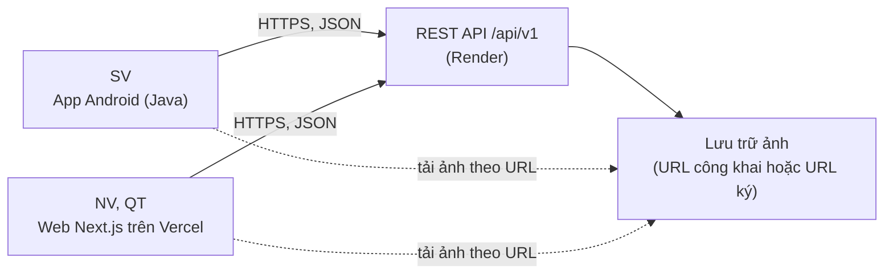
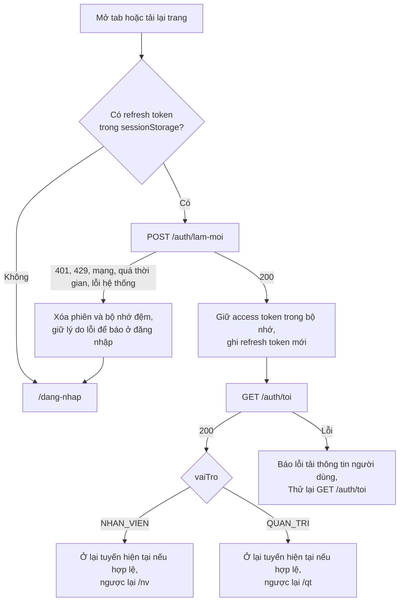

# FRONTEND ARCHITECTURE

## Hệ thống quản lý mượn trả thiết bị học tập cho sinh viên

| Mục | Nội dung |
|---|---|
| Dự án | SE100 – Nhóm 13 |
| Tài liệu | `Frontend-Architecture.md` |
| Phiên bản | 1.0 |
| Ngày lập | 01/11/2026 |
| Tài liệu căn cứ | `User-Flows.md` v1.0 (30/10/2026); `UI-Screens.md` v1.0 (31/10/2026); `backend-architecture.md` (mã KT); `Backend-Conventions.md` (mã ĐX-CV); `API-Notes.md` và `openapi.yaml` (mã ĐX-API); `SRS.md`; `Authorization.md`; các xác nhận của nhóm về phạm vi và công nghệ web (mục 1.4) |

---

## Mục lục

1. Giới thiệu
2. Tổng quan kiến trúc
3. Hành vi dùng chung của hai nền tảng
4. Web (Nhân viên, Quản trị viên)
5. Android (Sinh viên)
6. Truy vết yêu cầu phi chức năng và phụ thuộc

---

## 1. Giới thiệu

### 1.1 Mục đích và đối tượng sử dụng

Tài liệu này mô tả kiến trúc frontend của hệ thống: cách tổ chức mã nguồn, định tuyến và điều hướng, quản lý phiên và trạng thái, tích hợp với REST API, xử lý lỗi, xử lý ảnh và các quyết định kỹ thuật đi kèm. Tài liệu bao phủ hai ứng dụng:

| Ứng dụng | Người dùng | Công nghệ | Số màn hình (theo `UI-Screens.md`) |
|---|---|---|---|
| App Android | Sinh viên (SV) | Android native, Java | 14 màn hình và 1 hộp thoại dành cho SV, cộng `SCR-CM-01` và `SCR-CM-03` |
| Web | Nhân viên quản lý thiết bị (NV), Quản trị viên (QT) | Next.js, React, TypeScript | 14 màn hình NV, 12 màn hình QT, cộng `SCR-CM-02` và `SCR-CM-03` |

Phạm vi gồm cả hai ứng dụng theo FA-01. Đối tượng sử dụng: lập trình viên frontend (Android, web), người kiểm thử và người rà soát thiết kế. Người đọc cần có sẵn `UI-Screens.md` và `openapi.yaml`; tài liệu này không lặp lại nội dung màn hình hay hợp đồng API.

### 1.2 Ranh giới với các tài liệu khác

| Nội dung | Tài liệu có thẩm quyền | Quan hệ với tài liệu này |
|---|---|---|
| Luồng thao tác, nhánh, điều kiện chuyển bước | `User-Flows.md` | Kiến trúc phải hiện thực đúng, không thay đổi luồng |
| Danh sách màn hình, thành phần, trạng thái, tương tác | `UI-Screens.md` | Mỗi màn hình được ánh xạ tới tuyến (web) hoặc Fragment (Android) ở mục 4.3 và 5.3 |
| Hợp đồng API, mã lỗi, phân quyền theo endpoint | `openapi.yaml`, `API-Notes.md` | Frontend là bên tiêu thụ, không định nghĩa lại |
| Quy tắc nghiệp vụ, tính phí, trạng thái | Backend | Frontend chỉ hiển thị, không tính lại (mục 2.2) |
| Màu sắc, typography, thành phần giao diện | `Design-System.md` | Quy định giao diện thị giác; tài liệu này tham chiếu các thành phần và token đó |
| Cấu trúc màn hình dạng khung | `Wireframes.md` | Cụ thể hóa bố cục và trạng thái của các màn hình, dùng cùng ánh xạ tuyến/Fragment |
| Quy ước đặt tên, định dạng mã, xử lý lỗi ở mức mã nguồn | `Frontend-Conventions.md` | Cụ thể hóa các quy tắc kiến trúc (thư mục, phụ thuộc, tên theo nghiệp vụ) ở mức mã nguồn |

### 1.3 Quy ước đọc

| Ký hiệu | Ý nghĩa |
|---|---|
| `FA-nn` | Quyết định đã được nhóm xác nhận hoặc đã chốt trong tài liệu nguồn (mục 1.4) |
| `ĐX-FA-nn` | Quyết định bổ sung của tài liệu này, thuộc phần nguồn giao cho kiến trúc frontend hoặc chưa được nguồn nêu; cần nhóm duyệt (mục 1.5) |
| `KT-nn`, `ĐX-KT-nn`, `ĐX-API-nn`, `ĐX-CV-nn` | Quyết định trong tài liệu backend |
| `ĐX-UF-nn`, `ĐX-UI-nn` | Quyết định trong `User-Flows.md`, `UI-Screens.md` |
| `UF-…`, `SCR-…`, `DLG-…` | Mã luồng, màn hình, hộp thoại theo `User-Flows.md`, `UI-Screens.md` |
| Tên theo nghiệp vụ | Thuật ngữ nghiệp vụ giữ tiếng Việt không dấu trong tên thư mục, tuyến, lớp, hàm (theo KT-11 và Backend-Conventions 3.1); thành phần kỹ thuật dùng hậu tố tiếng Anh (`Fragment`, `ViewModel`, `Repository`, `Provider`) |

### 1.4 Quyết định đã chốt

| Mã | Quyết định | Căn cứ |
|---|---|---|
| FA-01 | Tài liệu bao phủ cả app Android (SV) và web (NV, QT) | Nhóm xác nhận |
| FA-02 | Client SV là app Android native viết bằng Java | KT-04 |
| FA-03 | Client NV và QT là web, triển khai trên Vercel | KT-04, KT-12 |
| FA-04 | Web dùng Next.js, React, TypeScript, TailwindCSS, React Hook Form, TanStack Query, Axios | Nhóm xác nhận |
| FA-05 | Cả hai client dùng chung một REST API có hợp đồng OpenAPI; client Android được sinh từ `openapi.yaml` bằng openapi-generator (Java, Retrofit) | KT-04, KT-18 |
| FA-06 | Android lưu token trong kho lưu trữ mã hóa của hệ điều hành. Web giữ access token trong bộ nhớ, gửi refresh token qua nội dung yêu cầu, không dùng cookie | KT 7.3 |
| FA-07 | Frontend không chứa nghiệp vụ: không tự tính phí, số ngày trễ, trạng thái hay điều kiện mượn; mọi thời điểm và số tiền lấy từ máy chủ | `User-Flows.md` 3.5, ĐX-UF-04 |
| FA-08 | Thao tác ghi không tự gửi lại; khi mất kết nối hoặc quá thời gian, giao diện không coi là thành công cũng không coi là thất bại | ĐX-UF-06 |
| FA-09 | Không có màn hình cho UC-04, UC-18 và các use case ngoài phạm vi giai đoạn 1 | ĐX-UF-01 |
| FA-10 | Không có đẩy thông báo ngoài app; thông báo trong app chỉ là danh sách, không có trạng thái đã đọc | ĐX-KT-03, `UI-Screens.md` SCR-SV-13 |
| FA-11 | Máy chủ API chạy gói miễn phí và có thể "ngủ" khoảng một phút; giao diện chịu được phản hồi chậm | KT 3.4, `UI-Screens.md` 3.1 |
| FA-12 | Quầy chỉ có laptop, không có máy quét mã hay camera ngoài | Nhóm xác nhận |

### 1.5 Quyết định bổ sung

Một số giá trị (thời gian chờ HTTP, độ trễ khi gõ tìm kiếm) được `UI-Screens.md` giao cho `Frontend-Conventions.md`. Các giá trị kiến trúc được nêu tại đây và được `Frontend-Conventions.md` mục 7.1 ánh xạ thành hằng số; hai tài liệu phải dùng cùng giá trị.

| Mã | Quyết định | Căn cứ |
|---|---|---|
| ĐX-FA-01 | Web dùng Next.js App Router; mọi trang là Client Component; không lấy dữ liệu nghiệp vụ phía máy chủ Next, không dùng Route Handler, Server Action, middleware hay proxy API; trình duyệt gọi thẳng API | Phiên chỉ có trong bộ nhớ trình duyệt, không cookie (FA-06) nên máy chủ Next không có phiên để đọc; tránh thêm một lần khởi động nguội |
| ĐX-FA-02 | Web lưu refresh token trong `sessionStorage` của từng tab; mỗi tab là một chuỗi phiên riêng | `UF-CM-03` giao cho kiến trúc; refresh token xoay vòng và dùng lại token cũ sẽ thu hồi cả chuỗi (KT 7.3), nên không dùng chung một refresh token giữa nhiều tab |
| ĐX-FA-03 | Ô nhập mã thẻ SV và mã thiết bị là ô văn bản nhận bàn phím, xác nhận bằng Enter; không tích hợp camera hay thư viện quét | FA-12; `UI-Screens.md` 3.8 và `SCR-NV-04`: ô nhập mã thẻ (là mã số sinh viên) và mã thiết bị nhận kết quả quét hoặc nhập tay; BR-13, BR-40 (nhập tay mã thiết bị) và BR-38 (mã thẻ); BR-02 loại quét phần cứng khỏi phạm vi. Máy quét giả lập bàn phím cắm vào sau này hoạt động không cần sửa mã |
| ĐX-FA-04 | Thời gian chờ HTTP là 90 giây ở cả hai client; sau 8 giây chưa có phản hồi thì hiện thông điệp "Hệ thống đang khởi động, vui lòng chờ" | `UI-Screens.md` 3.1 yêu cầu chờ lâu hơn một phút |
| ĐX-FA-05 | Ô tìm kiếm của SV gửi yêu cầu sau khi ngừng gõ 400 ms hoặc khi xác nhận nhập | ĐX-UI-05 |
| ĐX-FA-06 | Giao diện web thiết kế cho màn hình rộng từ 1024 px trở lên và cho các bản hiện hành của Chrome, Edge, Firefox, Safari (cần cho `<dialog>`, `createImageBitmap`, `sessionStorage`); không có bố cục riêng cho điện thoại | `UI-Screens.md` 3.9 giao cho kiến trúc và Design-System; NV, QT dùng laptop tại quầy (FA-12) |
| ĐX-FA-07 | Web sinh kiểu TypeScript từ `openapi.yaml` bằng openapi-typescript (chỉ sinh kiểu, không sinh mã gọi API); tệp kiểu được đưa vào kho mã và CI kiểm tra không lệch hợp đồng | Mục tiêu "client không lệch hợp đồng" của KT-18; Axios do nhóm chọn (FA-04) |
| ĐX-FA-08 | Kiểm tra dữ liệu nhập dùng quy tắc có sẵn của React Hook Form, không thêm thư viện schema | YAGNI; ràng buộc nghiệp vụ do máy chủ quyết định (FA-07) |
| ĐX-FA-09 | Ảnh tình trạng được nén bằng canvas của trình duyệt (không thêm thư viện), tải lên tuần tự từng ảnh, tối đa 5 ảnh cho mỗi thiết bị mỗi lần; nút gửi bị vô hiệu khi còn ảnh đang tải hoặc ảnh lỗi chưa gỡ | `UI-Screens.md` 3.6; giới hạn 2 MB sau nén (`TaiAnhRequest`); tránh gửi thiếu ảnh mà không báo |
| ĐX-FA-10 | Định dạng thời gian dùng `Intl` của trình duyệt, không thêm thư viện ngày; giờ do người dùng nhập tay được gửi với múi giờ cố định +07:00 | KT 6.1; Việt Nam không áp dụng giờ mùa hè |
| ĐX-FA-11 | Web hiển thị ảnh bằng thẻ `img` thường, không dùng `next/image` | URL ảnh tình trạng có chữ ký và hết hạn sau 10 phút; trình tối ưu ảnh sẽ lưu đệm URL đã hết hạn và tiêu tốn hạn mức Vercel |
| ĐX-FA-12 | Android dùng Java, XML Views kèm Material Components, một Activity với Navigation Component, mô hình MVVM (ViewModel, LiveData), không dùng framework DI, không lưu dữ liệu nghiệp vụ cục bộ | KT-04 (Java); ĐX-UF-04 (máy chủ là nguồn sự thật); YAGNI |
| ĐX-FA-13 | Android đặt `minSdk` 26 (Android 8.0) | `java.time` có sẵn không cần desugaring; Android Keystore hỗ trợ AES-GCM từ API 23, thấp hơn mức này |
| ĐX-FA-14 | Android mã hóa token bằng khóa AES-256-GCM trong Android Keystore trước khi ghi vào `SharedPreferences` riêng của app và loại tệp này khỏi sao lưu; không dùng thư viện `androidx.security:security-crypto` | FA-06; thư viện này đã bị Google đánh dấu ngừng dùng, tài liệu Android khuyến nghị dùng trực tiếp `KeyGenerator` với `AndroidKeyStore` |
| ĐX-FA-15 | Android hiển thị ảnh bằng Glide, không ghi ảnh có URL ký xuống bộ nhớ đệm đĩa | Ảnh tình trạng là ảnh riêng tư có URL hết hạn |
| ĐX-FA-16 | Bộ sinh client Android chỉ sinh nhóm API Xác thực và Sinh viên | App SV không gọi nhóm Quầy và Quản trị; nhóm đó chứa `oneOf` có `discriminator` mà `API-Notes.md` mục 13 cảnh báo bộ sinh có thể xử lý kém |
| ĐX-FA-17 | Kiểm thử tự động: Vitest và React Testing Library (web), JUnit và MockWebServer (Android) cho phần không phụ thuộc giao diện; không bắt buộc kiểm thử đầu cuối | Đáp ứng mục tiêu dễ kiểm thử với phạm vi tối thiểu |
| ĐX-FA-18 | Khi đếm ngược về 0 mà máy chủ vẫn trả trạng thái cũ, giao diện tải lại tối đa 6 lần, cách nhau 10 giây, rồi dừng | `UI-Screens.md` 3.4 yêu cầu tải lại khi về 0; đồng hồ client có thể lệch và API không trả thời điểm máy chủ trong nội dung |
| ĐX-FA-19 | Tuyến web có tiền tố `/nv` và `/qt`; luồng giao thiết bị gồm bốn tuyến con dùng chung ngữ cảnh; ngữ cảnh mất khi tải lại thì quay về bước đầu | `UI-Screens.md` giao việc định tuyến cho kiến trúc; cùng nguyên tắc với ĐX-UI-08 |
| ĐX-FA-20 | Mọi lối từ danh sách chờ (`SCR-NV-13`) sang giao thiết bị bắt đầu ở `SCR-NV-04` (quét thẻ SV) | `UF-NV-02` bước 1, điều kiện vào của `SCR-NV-05` và sơ đồ 2.3 của `UI-Screens.md`: từ `SCR-NV-13` bắt đầu ở `SCR-NV-04`, chọn nguồn Danh sách chờ ở bước 2 (mục 4.3) |
| ĐX-FA-21 | Web đặt ba tiêu đề bảo mật cơ bản và không áp dụng CSP chặt | Mục 4.13; CSP chặt cần nonce cho script nội tuyến của Next.js, vượt mức cần thiết của giai đoạn này |
| ĐX-FA-22 | Các `POST` kiểm tra thẻ SV, nguồn giao, thiết bị và điều kiện phiếu không thay đổi dữ liệu nghiệp vụ nên cho người dùng chủ động **Thử lại** khi lỗi mạng hoặc quá thời gian chờ. Đăng nhập và tải ảnh có tác dụng ghi nhưng vẫn có cách thử lại bằng tay riêng ở mục 3.11; không tự gửi lại | KT 7.1, 7.3, 7.4: đăng nhập có thể cập nhật hồ sơ, bộ đếm sai mật khẩu và tạo phiên; `UI-Screens.md` 3.6 cho thử lại từng ảnh, ảnh chưa gắn bị xóa sau 24 giờ |
| ĐX-FA-23 | Mọi lần làm mới thất bại (401, 429, mất kết nối, quá thời gian chờ hoặc lỗi hệ thống) đều dừng yêu cầu gốc, xóa phiên và dữ liệu đã tải, về đăng nhập với lý do phù hợp; không gọi lại tự động | `API-Notes.md` 10, KT 7.3, `User-Flows.md` 3.1 và `UI-Screens.md` 3.2: làm mới thất bại thì kết thúc phiên; giữ `ApiError` để 429 vẫn hướng dẫn chờ, lỗi hệ thống vẫn có `traceId` |

---

## 2. Tổng quan kiến trúc

### 2.1 Bối cảnh hệ thống



Hai client gọi trực tiếp API, không qua lớp trung gian. Web (Vercel) và API (Render) khác miền nên việc gọi từ trình duyệt phụ thuộc cấu hình CORS của API (mục 6.2).

### 2.2 Nguyên tắc kiến trúc

| Nguyên tắc | Nội dung | Căn cứ |
|---|---|---|
| Máy chủ là nguồn sự thật | Dữ liệu hiển thị lấy từ máy chủ mỗi khi mở hoặc làm mới màn hình; không lưu bản sao nghiệp vụ lâu dài trên client | ĐX-UF-04 |
| Client không tính nghiệp vụ | Không tính phí, số ngày trễ, trạng thái, điều kiện mượn, giờ cho phép giao; chỉ định dạng giá trị máy chủ trả về | FA-07, KT 8.5 |
| Không tự gửi lại thao tác ghi | Không retry tự động cho `POST`, `PUT`, `DELETE`; người dùng chủ động thử lại | FA-08 |
| Một nơi cho mỗi mối quan tâm | Mỗi mối quan tâm chung (gọi API, phiên, lỗi, nhãn trạng thái, định dạng, ảnh) có đúng một module; màn hình không tự xử lý lại | Tránh lệch hành vi giữa màn hình |
| Phân quyền thật ở máy chủ | Việc ẩn menu hoặc chặn tuyến phía client chỉ để điều hướng; máy chủ vẫn từ chối mọi thao tác ngoài quyền | NFR-01, `API-Notes.md` |
| Không suy diễn mã chưa biết | Mã trạng thái chưa có trong bảng ánh xạ được hiển thị nguyên mã; `maLoi` chưa có trong bảng ở mục 3.4 được xử lý như lỗi nghiệp vụ theo màn hình. Cả hai không làm app lỗi | `UI-Screens.md` 3.3 |
| Tối giản thành phần | Không thêm thư viện hay tầng trừu tượng khi chưa có yêu cầu dùng đến (mục 2.5) | YAGNI |

### 2.3 Công nghệ web

| Thành phần | Lựa chọn | Vai trò | Nguồn |
|---|---|---|---|
| Framework | Next.js (App Router), React, TypeScript | Khung ứng dụng, định tuyến theo thư mục, tách mã theo tuyến | FA-04, ĐX-FA-01 |
| Giao diện | TailwindCSS | Tạo kiểu; token và thành phần cụ thể do `Design-System.md` quy định | FA-04 |
| Biểu mẫu | React Hook Form | Quản lý trường, lỗi theo trường, trạng thái gửi | FA-04, ĐX-FA-08 |
| Dữ liệu từ máy chủ | TanStack Query | Tải, đệm ngắn hạn, làm mới, đánh dấu lỗi thời sau khi ghi | FA-04 |
| HTTP | Axios | Gọi API, gắn token, làm mới phiên, chuẩn hóa lỗi | FA-04 |
| Kiểu API | openapi-typescript (công cụ phát triển) | Sinh kiểu từ `openapi.yaml` | ĐX-FA-07 |
| Kiểm thử | Vitest, React Testing Library (công cụ phát triển) | Kiểm thử đơn vị và thành phần | ĐX-FA-17 |
| Triển khai | Vercel | Lưu trữ và phân phối web | FA-03 |

### 2.4 Công nghệ Android

| Thành phần | Lựa chọn | Vai trò | Nguồn |
|---|---|---|---|
| Ngôn ngữ, nền tảng | Java, `minSdk` 26 | Ngôn ngữ app | FA-02, ĐX-FA-13 |
| Giao diện | XML Views, ViewBinding, Material Components, `SwipeRefreshLayout`, `RecyclerView` | Màn hình, danh sách, kéo để làm mới | ĐX-FA-12 |
| Điều hướng | Navigation Component (một Activity, nhiều Fragment, thanh điều hướng dưới) | Điều hướng và ngăn xếp quay lại theo từng tab | ĐX-FA-12 |
| Trạng thái | `ViewModel`, `LiveData` | Giữ trạng thái màn hình qua xoay màn hình | ĐX-FA-12 |
| Gọi API | Client sinh bởi openapi-generator (Java, Retrofit, OkHttp) | Gọi API đúng hợp đồng | FA-05, ĐX-FA-16 |
| Lưu token | Android Keystore (AES-GCM), `SharedPreferences` riêng của app | Giữ phiên giữa các lần mở app | FA-06, ĐX-FA-14 |
| Ảnh | Glide | Tải và hiển thị ảnh | ĐX-FA-15 |
| Kiểm thử | JUnit, MockWebServer | Kiểm thử lớp không phụ thuộc giao diện | ĐX-FA-17 |

### 2.5 Những thứ không dùng

| Không dùng | Lý do |
|---|---|
| Thư viện quản lý trạng thái toàn cục (Redux, Zustand,…) | Dữ liệu từ máy chủ do TanStack Query quản lý; trạng thái phiên và luồng nhiều bước dùng React Context, còn lại là trạng thái cục bộ của component |
| Thư viện schema cho biểu mẫu (Zod, Yup,…) | ĐX-FA-08 |
| Thư viện thành phần giao diện dựng sẵn (MUI, shadcn/ui,…) | Thành phần dùng chung theo phạm vi mục 4.2 và hình thức của `Design-System.md`, không bổ sung thư viện dựng sẵn |
| Thư viện ngày giờ (date-fns, dayjs,…) | ĐX-FA-10 |
| Thư viện bảng hoặc biểu đồ | Báo cáo chỉ là bảng hoặc tệp tải về (`SCR-QT-12`); bảng dữ liệu dùng thẻ `table` thường |
| Proxy API qua máy chủ Next.js, Server Action | ĐX-FA-01 |
| Room, cơ sở dữ liệu cục bộ, chế độ ngoại tuyến (Android) | ĐX-UF-04; `UI-Screens.md` 3.1 quy định xử lý khi mất mạng là báo lỗi và thử lại |
| Framework DI (Hilt, Dagger) | ĐX-FA-12; các phụ thuộc được tạo thủ công một lần trong lớp `Application` |
| Quét mã bằng camera | ĐX-FA-03 |

---

## 3. Hành vi dùng chung của hai nền tảng

Mục này quy định hành vi mà web và Android phải thực hiện giống nhau. Cách hiện thực riêng của từng nền tảng nằm ở mục 4 và 5. Hành vi hiển thị cụ thể của lỗi trên từng màn hình do `UI-Screens.md` quy định; mục này chỉ quy định cách client phân loại và xử lý lỗi ở tầng chung.

### 3.1 Phân lớp

| Lớp | Web | Android | Trách nhiệm |
|---|---|---|---|
| Giao diện | Trang và component | Fragment, Adapter | Hiển thị, nhận thao tác; không gọi HTTP trực tiếp |
| Trạng thái màn hình | Hook theo tính năng (TanStack Query, React Hook Form) | `ViewModel`, `LiveData` | Giữ trạng thái đang tải, dữ liệu, lỗi, dữ liệu nhập |
| Truy cập dữ liệu | Hàm API theo tính năng | `Repository` | Gọi API, trả dữ liệu hoặc `ApiError` |
| Hạ tầng gọi API | Axios (client chung) | OkHttp, Retrofit (client sinh) | Gắn token, làm mới phiên, chuẩn hóa lỗi, thời gian chờ |
| Phiên | Module `session` | `SessionManager` | Giữ token, khôi phục, xóa phiên |

Quy tắc phụ thuộc: mỗi lớp chỉ gọi lớp ngay bên dưới; lớp dưới không biết lớp trên. Lỗi được chuẩn hóa thành `ApiError` ở lớp hạ tầng, các lớp trên không đọc phản hồi HTTP thô.

### 3.2 Hợp đồng API và sinh mã

| Nội dung | Quy tắc |
|---|---|
| Nguồn duy nhất | `openapi.yaml` hiện hành là hợp đồng; client không tự định nghĩa lại kiểu dữ liệu, tên trường hay đường dẫn |
| Địa chỉ | Địa chỉ gốc của API lấy từ cấu hình triển khai (mục 4.14, 5.8); tiền tố `/api/v1` là hằng số của client |
| Web | `openapi-typescript` sinh tệp kiểu từ `openapi.yaml` (ĐX-FA-07); tệp sinh được đưa vào kho mã; CI sinh lại và so sánh, lệch thì thất bại |
| Android | `openapi-generator` (Java, Retrofit) sinh client từ `openapi.yaml` lúc build, chỉ nhóm Xác thực và Sinh viên (ĐX-FA-16); mã sinh không đưa vào kho mã |
| Khi API đổi | Thay bản `openapi.yaml`, sinh lại, sửa lỗi biên dịch, chạy lại kiểm thử; không sửa tay tệp sinh |
| Trường và giá trị lạ | Client bỏ qua trường lạ trong phản hồi. Mã trạng thái lạ được hiển thị nguyên mã (`UI-Screens.md` 3.3); `maLoi` lạ xử lý theo mục 3.4. Cả hai không làm app lỗi |

### 3.3 Chuẩn hóa lỗi

Mọi lỗi từ lớp hạ tầng được chuyển thành một đối tượng `ApiError` có cùng ý nghĩa trên hai nền tảng:

```ts
type ApiError = {
  loai: "HTTP" | "MANG" | "QUA_THOI_GIAN" | "HUY";
  status?: number;
  maLoi?: string;
  detail?: string;
  traceId?: string;
  errors?: Record<string, string[]>;
};
```

| Trường | Nguồn | Ghi chú |
|---|---|---|
| `loai` | Hạ tầng | `HTTP` khi có phản hồi; `MANG` khi mất kết nối; `QUA_THOI_GIAN` khi quá thời gian chờ (ĐX-FA-04); `HUY` khi yêu cầu bị hủy chủ động (đóng màn hình) |
| `status`, `maLoi`, `detail`, `traceId`, `errors` | `ProblemDetails`, `ValidationProblemDetails` | Đọc từ `application/problem+json`; lỗi 500 chỉ có `traceId` |

Quy tắc:

1. Phản hồi lỗi không phải `application/problem+json` (ví dụ trang lỗi của hạ tầng) được chuẩn hóa thành `ApiError` loại `HTTP` không có `maLoi`, và xử lý như lỗi hệ thống chung.
2. Việc phân nhánh dựa vào `maLoi`, `status` và `loai`; không đọc nội dung `detail` để phân nhánh (ĐX-CV-02).
3. `loai` là `MANG`, `QUA_THOI_GIAN` hoặc `HUY` sau khi thao tác ghi nghiệp vụ đã được phát nghĩa là chưa biết kết quả (mục 3.11); hủy ở client không chứng minh máy chủ đã dừng hoặc rollback.
4. Chỉ lỗi `HUY` của truy vấn hoặc kiểm tra không thay đổi dữ liệu nghiệp vụ được bỏ qua im lặng; thao tác ghi đã phát phải theo quy tắc 3.

### 3.4 Phân loại `maLoi` ở tầng chung

Bảng sau phân 32 mã của `MaLoi` trong `openapi.yaml` thành các nhóm xử lý. Cột "Xử lý ở tầng chung" là việc client làm cho mọi màn hình; cách hiển thị và các việc riêng của màn hình theo `UI-Screens.md` 3.2 và bảng lỗi của từng màn hình.

| Nhóm | `maLoi` | Xử lý ở tầng chung |
|---|---|---|
| Phiên | `CHUA_XAC_THUC` | Làm mới phiên một lần rồi gọi lại yêu cầu (mục 3.5) |
| Đăng nhập sai | `DANG_NHAP_SAI` | Chuyển cho màn hình đăng nhập hiển thị; không làm mới phiên |
| Khóa tài khoản | `TAI_KHOAN_BI_KHOA` | Đang dùng: xóa phiên, về đăng nhập kèm thông báo tài khoản bị khóa. Khi gặp ở đăng nhập NV/QT: màn hình đăng nhập hiển thị thông báo (`UI-Screens.md` 4.5) |
| Quyền | `KHONG_DU_QUYEN`, `PHONG_CHUA_CAP_QUYEN` | Báo và điều hướng theo `UI-Screens.md` 3.2; `PHONG_CHUA_CAP_QUYEN` còn đánh dấu lỗi thời thông tin người đăng nhập để tải lại `dsPhong` |
| Dữ liệu nhập | `DU_LIEU_KHONG_HOP_LE` | Chuyển `errors` cho biểu mẫu để gắn vào từng trường (mục 3.11) |
| Không tồn tại | `KHONG_TIM_THAY` | Báo, quay về danh sách và tải lại |
| Cần tải lại | `XUNG_DOT_CAP_NHAT`, `TRANG_THAI_KHONG_HOP_LE` | Tải lại đối tượng và danh sách liên quan, báo; không tự thử lại |
| Tần suất | `QUA_NHIEU_YEU_CAU` | Báo chờ; không tự lặp |
| Nghiệp vụ theo màn hình | `SV_THE_HET_HAN`, `SV_KHONG_CON_THEO_HOC`, `SV_BI_KHOA_QUYEN_MUON`, `VUOT_GIOI_HAN_THIET_BI`, `VUOT_THOI_GIAN_MUON_TOI_DA`, `CON_HANG_KHONG_DANG_KY_CHO`, `THIET_BI_KHONG_SAN_SANG`, `THIET_BI_SAI_PHONG`, `THIET_BI_SAI_LOAI`, `THIET_BI_KHONG_THUOC_PHIEU`, `THIEU_MO_TA_HOAC_KHUNG_PHAT`, `GIA_TRI_CAU_HINH_KHONG_HOP_LE`, `GIAO_SAU_GIO_DONG_CUA`, `SO_LUONG_KHA_DUNG_THAY_DOI`, `GIU_CHO_HET_HAN`, `THIET_BI_DA_DUOC_GIAO`, `MA_THIET_BI_TRUNG`, `TEN_DANG_NHAP_TRUNG`, `MA_NV_TRUNG`, `KHUNG_PHAT_DA_DUNG_KHONG_XOA`, `CHUA_CAU_HINH_GIO_QUAY`, `DA_CO_LICH_SU_CHI_NGUNG_SU_DUNG` | Chuyển nguyên `ApiError` cho màn hình; màn hình hiển thị theo bảng lỗi riêng của mình |
| Hệ thống | Lỗi 500 không có `maLoi` | Thông báo lỗi hệ thống chung kèm `traceId`; không hiển thị chi tiết nội bộ |
| Mạng | `loai` là `MANG` hoặc `QUA_THOI_GIAN` | Thông báo lỗi kèm nút **Thử lại**, giữ nguyên dữ liệu đã nhập |

Mã không có trong bảng được xử lý như nhóm "Nghiệp vụ theo màn hình": chuyển cho màn hình, và nếu màn hình không có xử lý riêng thì hiển thị thông báo chung kèm `traceId`.

### 3.5 Phiên và làm mới token

Thông số do máy chủ quy định (KT 7.3): access token là JWT hạn 15 phút; refresh token ngẫu nhiên, hạn 7 ngày, xoay vòng mỗi lần làm mới; dùng lại refresh token đã xoay vòng thì cả chuỗi bị thu hồi.

| Quy tắc | Nội dung |
|---|---|
| Gắn token | Mọi yêu cầu gắn `Authorization: Bearer <accessToken>`, trừ bốn endpoint không yêu cầu xác thực: đăng nhập SV, đăng nhập NV/QT, làm mới, đăng xuất |
| Khi nào làm mới | Chỉ khi phản hồi là `CHUA_XAC_THUC` (401) của yêu cầu không thuộc bốn endpoint trên và yêu cầu đó chưa được gọi lại lần nào |
| Một lần làm mới tại một thời điểm | Nhiều yêu cầu cùng gặp 401 thì chỉ một yêu cầu làm mới chạy; các yêu cầu còn lại chờ cùng kết quả. Thành công mới gọi lại với token mới; thất bại kết thúc mọi yêu cầu đang chờ, không mở lần làm mới khác bằng token cũ. Lý do: xoay vòng và thu hồi chuỗi (User-Flows 3.1) |
| Ghi token mới | Cặp token mới được ghi vào nơi lưu trước khi các yêu cầu đang chờ được gọi lại |
| Làm mới thành công | Gọi lại yêu cầu ban đầu đúng một lần; người dùng không thấy gián đoạn |
| Làm mới thất bại | Với 401, 429, mất kết nối, quá thời gian chờ hoặc lỗi hệ thống: dừng yêu cầu gốc và mọi yêu cầu đang chờ, không gọi lại; xóa token và dữ liệu đã tải, về đăng nhập (ĐX-FA-23) |
| Lý do khi về đăng nhập | Giữ `ApiError` của lần làm mới để hiển thị đúng nguyên nhân: 401 báo hết phiên; 429 hướng dẫn chờ rồi chủ động đăng nhập lại; lỗi mạng/quá thời gian báo đúng loại, lỗi hệ thống kèm `traceId`. Không tự gửi lại lần làm mới hoặc yêu cầu gốc |
| `TAI_KHOAN_BI_KHOA` khi đang dùng | Xóa phiên, về đăng nhập kèm thông báo tài khoản bị khóa |
| Đăng xuất | Gửi refresh token để thu hồi (không cần access token còn hạn); dù yêu cầu thành công hay lỗi vẫn xóa phiên cục bộ rồi về đăng nhập |
| Dọn dữ liệu | Khi đăng xuất, hết phiên hoặc bị khóa, mọi dữ liệu đã tải của người dùng trước bị xóa khỏi bộ nhớ ứng dụng; đăng nhập mới không được thấy dữ liệu của phiên trước |
| Mật khẩu | Không lưu và không ghi nhật ký mật khẩu. Sau khi đã lấy kết quả hoặc lỗi để hiển thị của đăng nhập, tạo hay đặt lại mật khẩu nhân viên, xóa ô mật khẩu và tham chiếu request nhạy cảm; web còn `reset` mutation theo mục 4.8. Giữ tên đăng nhập/mã SV và dữ liệu khác được phép khi lỗi (`UI-Screens.md` 4.4, 4.5). Máy chủ băm mật khẩu và không lưu mật khẩu SV (NFR-05); client không giữ thêm tham chiếu, không cam kết xóa vật lý mọi chuỗi khỏi bộ nhớ runtime |
| Không có chức năng | Không có đăng ký, quên mật khẩu, đổi mật khẩu (User-Flows 3.1) |

### 3.6 Lấy dữ liệu từ máy chủ

| Thời điểm tải lại | Ghi chú |
|---|---|
| Khi mở màn hình | Luôn tải từ máy chủ; không dùng bản đệm làm dữ liệu hiển thị chính (ĐX-UF-04) |
| Khi người dùng làm mới | Kéo để làm mới (Android), nút Làm mới (web) |
| Khi bộ đếm ngược về 0 | Mục 3.8 |
| Sau khi ghi thành công | Tải lại dữ liệu bị ảnh hưởng; dùng nội dung phản hồi của thao tác ghi để hiển thị kết quả ngay khi màn hình cần (ví dụ phiếu mượn vừa lập) |
| Sau lỗi nhóm "Cần tải lại" | Mục 3.4 |

Không cập nhật lạc quan: giao diện không hiển thị kết quả của thao tác ghi trước khi máy chủ xác nhận (NFR-06). Không có chế độ ngoại tuyến hoặc hàng chờ thao tác ghi để phát khi kết nối trở lại. Web đặt `networkMode: "always"` cùng `retry: 0` cho mutation (mục 4.7): khi mất mạng, lần gọi HTTP kết thúc qua cơ chế lỗi mạng hiện có; chỉ nối mạng lại không phát thao tác đã bấm.

### 3.7 Thời gian, tiền và nhãn

| Nội dung | Quy tắc |
|---|---|
| Thời điểm (`date-time`) | API trả UTC; hiển thị theo `Asia/Ho_Chi_Minh`, dạng `dd/MM/yyyy HH:mm` (ĐX-UI-12) |
| Ngày (`date`) | Giá trị không có giờ được hiển thị nguyên ngày, dạng `dd/MM/yyyy`, không đổi múi giờ |
| Giờ nhập tay | Giờ do người dùng nhập (ví dụ ngày giờ hoàn thành bảo trì) được hiểu là giờ Việt Nam và gửi lên với độ lệch +07:00 (ĐX-FA-10); không dùng múi giờ của thiết bị |
| Tiền | Số nguyên VNĐ, dấu chấm phân cách hàng nghìn, hậu tố `VNĐ` (ví dụ `240.000 VNĐ`); nhập tiền chỉ nhận số nguyên không âm |
| Tính toán | Client không tính số ngày trễ, số tiền, hạn trả, hạn giữ chỗ; chỉ định dạng giá trị máy chủ trả về (FA-07) |
| Nhãn trạng thái | Một module ánh xạ mã API sang nhãn tiếng Việt theo Phụ lục A của `User-Flows.md`; mỗi họ trạng thái (phiếu yêu cầu, phiếu mượn, thiết bị, biên bản, quyền mượn,…) dùng một thành phần nhãn dùng chung; màn hình không tự đặt nhãn khác |
| Mã chưa biết | Hiển thị nguyên mã |
| Chữ | Giao diện tiếng Việt; thông điệp lỗi theo `maLoi`, không hiển thị `detail` làm thông điệp chính |

### 3.8 Đếm ngược giữ chỗ

| Quy tắc | Nội dung |
|---|---|
| Nguồn | Đếm từ `hanGiuCho` do máy chủ trả; hạn cụ thể luôn lấy theo trường này (ĐX-UI-07) |
| Cập nhật | Cập nhật mỗi giây khi màn hình đang hiển thị; dừng khi màn hình ẩn hoặc đóng |
| Khi về 0 | Tải lại dữ liệu từ máy chủ; không tự đổi trạng thái |
| Nhiều bộ đếm trên một màn hình | Danh sách có nhiều dòng đếm ngược (ví dụ `SCR-SV-08`) dùng một nhịp đếm chung mỗi giây; khi có dòng về 0 thì tải lại màn hình một lần; việc lặp tải lại theo ĐX-FA-18 áp dụng cho cả màn hình |
| Máy chủ vẫn trả trạng thái cũ | Đồng hồ thiết bị có thể lệch và API không trả thời điểm máy chủ trong nội dung, nên giao diện hiển thị `00:00` kèm trạng thái đang cập nhật và tải lại tối đa 6 lần, mỗi lần cách 10 giây (ĐX-FA-18); sau đó dừng và để người dùng làm mới |

### 3.9 Ảnh tình trạng thiết bị

Quy tắc chung (User-Flows 3.6, `UI-Screens.md` 3.6):

| Nội dung | Quy tắc |
|---|---|
| Giới hạn | Tối đa 5 ảnh cho mỗi thiết bị mỗi lần; mỗi ảnh tối đa 2 MB sau nén; `image/jpeg`, `image/png`, `image/webp`. Vượt giới hạn thì báo ngay tại khu đính ảnh |
| Nén | Cạnh dài tối đa 1280 px, JPEG khoảng 80% |
| Cách gửi | Tải từng ảnh lên trước (`giaiDoan` theo ngữ cảnh), nhận `maAnh`, rồi đưa `dsMaAnh` vào yêu cầu lập phiếu mượn, ghi kết quả kiểm tra hoặc lưu thiết bị |
| Xem ảnh | Ảnh danh mục (URL công khai) dùng trực tiếp. Ảnh tình trạng (URL ký, hết hạn sau 10 phút) không được lưu: khi ảnh không tải được, tải lại chi tiết để lấy URL mới đúng một lần cho mỗi lần hiển thị rồi dừng |
| Hiển thị trước | `TaiAnhResponse` chỉ trả `maAnh`, không trả URL; ảnh vừa chọn được xem trước từ chính tệp trên thiết bị cho đến khi gắn vào yêu cầu |

Quy tắc bổ sung (ĐX-FA-09): tải tuần tự từng ảnh; mỗi ảnh có trạng thái đang tải, đã tải hoặc lỗi; ảnh lỗi có nút thử lại và nút gỡ; nút gửi của biểu mẫu bị vô hiệu khi còn ảnh đang tải hoặc ảnh lỗi chưa gỡ. Ảnh đã tải nhưng bị gỡ khỏi biểu mẫu chỉ cần bỏ `maAnh` khỏi danh sách, máy chủ tự xóa ảnh chưa gắn sau 24 giờ.

App Android của SV chỉ xem ảnh, không chọn hay tải ảnh lên.

### 3.10 Danh sách, phân trang và tìm kiếm

| Quy tắc | Nội dung |
|---|---|
| Tham số | `trang`, `kichThuoc` (mặc định 20, tối đa 100); phản hồi có `tongSo` |
| Thứ tự | Do máy chủ quyết định; client không sắp xếp lại |
| Đổi bộ lọc | Tải lại từ trang 1; bộ lọc đang áp dụng luôn nhìn thấy được và có cách xóa |
| Hiển thị | Web: phân trang. Android: tải thêm khi cuộn đến cuối cho đến khi đủ `tongSo` (ĐX-UI-13) |
| Tìm theo tên (SV) | Gửi khi xác nhận nhập hoặc sau khi ngừng gõ 400 ms (ĐX-FA-05); yêu cầu cũ chưa xong bị hủy khi có yêu cầu mới |
| Rỗng | Rỗng không phải lỗi; thông điệp rỗng do từng màn hình quy định |
| Phòng của NV | Bộ lọc phòng chỉ liệt kê `dsPhong` của `GET /auth/toi` |

### 3.11 Thao tác ghi và xác nhận

| Quy tắc | Nội dung |
|---|---|
| Chống gửi trùng | API không dùng khóa chống trùng (KT 8) nên client chống gửi trùng: nút gửi bị vô hiệu ngay từ lần bấm đầu tiên, đồng bộ với sự kiện bấm (không chờ lần vẽ lại giao diện), cho đến khi có phản hồi |
| Không tự gửi lại | Không retry tự động cho `POST`, `PUT`, `DELETE`; Android tắt tự thử lại khi mất kết nối của OkHttp |
| Kiểm tra không thay đổi dữ liệu nghiệp vụ (ĐX-FA-22) | Kiểm tra thẻ SV, nguồn giao, thiết bị và điều kiện phiếu: khi lỗi mạng hoặc quá thời gian chờ hiển thị **Thử lại** để người dùng chủ động gọi lại; không cần kiểm tra trạng thái trước |
| Đăng nhập và tải ảnh (ĐX-FA-22) | Cho thử lại bằng tay tại màn hình đăng nhập hoặc từng ảnh, không tự retry. Đăng nhập mất phản hồi có thể đã cập nhật hồ sơ/bộ đếm hoặc tạo phiên; client không tự đếm số lần còn lại, luôn tôn trọng 429/khóa do BE trả. Tải lại ảnh có thể tạo ảnh chưa gắn, được BE dọn sau 24 giờ; không gọi hai thao tác này là chỉ đọc |
| Chưa biết kết quả | Khi `loai` là `MANG`, `QUA_THOI_GIAN` hoặc `HUY` sau khi thao tác ghi nghiệp vụ đã phát, giao diện không báo thành công cũng không báo thất bại: hiển thị "Chưa xác định được kết quả" kèm hành động kiểm tra trạng thái hiện tại qua API danh sách/chi tiết hiện hữu theo `UI-Screens.md`, và chỉ cho gửi lại sau khi đã kiểm tra |
| Điều hướng và vòng đời khi đang ghi | Giữ trạng thái đang chờ cho tới phản hồi; không hủy im lặng thao tác ghi đã phát khi rời màn hình hoặc hủy `ViewModel`. Nếu mất theo dõi/hủy sau khi phát thì áp dụng nhánh chưa biết kết quả ở trên khi quay lại, không coi là rollback hay cho gửi lại ngay. Không thêm API, hàng chờ nền hay kho dữ liệu nghiệp vụ cục bộ |
| Lỗi theo trường | `errors` có khóa dạng `dsLoaiVaSoLuong[0].soLuong`; client chuyển về đường dẫn trường của biểu mẫu, gắn thông báo vào đúng trường, giữ nguyên dữ liệu đã nhập và đưa tiêu điểm tới trường lỗi đầu tiên. Khóa không khớp trường nào thì hiển thị ở đầu biểu mẫu |
| Kiểm tra phía client | Chỉ kiểm tra bắt buộc nhập, định dạng và giới hạn đã khai báo trong `openapi.yaml` để báo sớm; không kiểm tra nghiệp vụ (ĐX-FA-08) |
| Hộp xác nhận | Thao tác ở danh sách ĐX-UF-05 dùng một thành phần xác nhận dùng chung có đủ tiêu đề, tóm tắt, hệ quả, nút **Hủy** và nút xác nhận mang tên hành động; nút xác nhận bị vô hiệu và hiển thị đang xử lý trong lúc chờ (`UI-Screens.md` 3.5) |

---

## 4. Web (Nhân viên, Quản trị viên)

### 4.1 Mô hình hiển thị

Web dùng Next.js App Router theo ĐX-FA-01:

| Quy tắc | Nội dung |
|---|---|
| Trang | Mọi trang và layout có dữ liệu hoặc trạng thái người dùng là Client Component |
| Lấy dữ liệu | Chỉ từ trình duyệt, bằng TanStack Query và Axios; không lấy dữ liệu nghiệp vụ ở máy chủ Next |
| Không dùng | Route Handler, Server Action, `middleware`, proxy API, `next/image` (ĐX-FA-11) |
| Lý do | Access token chỉ nằm trong bộ nhớ trình duyệt và không có cookie (FA-06), nên máy chủ Next không có phiên để đọc; gọi qua máy chủ Next còn thêm một chặng và một lần khởi động nguội |
| Chống lệch khi dựng trang | Phiên được đọc trong `useEffect` sau khi dựng trang; trước đó chỉ hiển thị màn hình khởi động (`SCR-CM-03`) để tránh lệch giữa giao diện dựng ở máy chủ và ở trình duyệt |
| Tách mã | Tách mã theo tuyến do Next.js thực hiện; không cấu hình thêm |

### 4.2 Cấu trúc thư mục

```text
src/
  app/
    layout.tsx
    page.tsx
    dang-nhap/page.tsx
    nv/
      layout.tsx
      page.tsx
      phieu-yeu-cau/
        layout.tsx
        page.tsx
        duyet/page.tsx
      giao-thiet-bi/
        layout.tsx
        the/page.tsx
        nguon/page.tsx
        thiet-bi/page.tsx
        phieu/page.tsx
      nhan-tra/
        page.tsx
        kiem-tra/page.tsx
      bien-ban/
        page.tsx
        lap/page.tsx
      qua-han-30-ngay/page.tsx
      danh-sach-cho/page.tsx
      bao-tri/page.tsx
    qt/
      layout.tsx
      page.tsx
      danh-muc/{phong,loai-thiet-bi,thiet-bi}/page.tsx
      cau-hinh/{quy-dinh-muon,phi-tre,khung-phat,tham-so}/page.tsx
      tai-khoan-nhan-vien/page.tsx
      bien-ban/page.tsx
      thanh-ly/page.tsx
      bao-cao/page.tsx
  features/
    xac-thuc/
    quay/
    quan-tri/
  shared/
    api/
    components/
    hooks/
    format/
    labels/
    anh/
  providers/
```

| Thư mục | Nội dung |
|---|---|
| `app/` | Chỉ ghép màn hình: mỗi `page.tsx` import một màn hình từ `features/`; không chứa nghiệp vụ hiển thị |
| `features/xac-thuc/` | Màn hình đăng nhập (`SCR-CM-02`), `AuthGate` (`SCR-CM-03`), `AuthProvider`, trình đơn theo vai trò |
| `features/quay/` | Tính năng của NV, mỗi thư mục con một nhóm màn hình: `phieu-yeu-cau`, `giao-thiet-bi`, `nhan-tra`, `bien-ban`, `qua-han-30-ngay`, `danh-sach-cho`, `bao-tri` |
| `features/quan-tri/` | Tính năng của QT: `danh-muc`, `cau-hinh`, `tai-khoan-nhan-vien`, `bien-ban`, `thanh-ly`, `bao-cao` |
| `features/<nhóm>/<tính năng>/` | `api.ts` (hàm gọi API và khóa truy vấn), `hooks.ts` (truy vấn và thao tác ghi), `components/`, màn hình |
| `shared/api/` | Axios client chung, module `session`, chuẩn hóa lỗi, tệp kiểu sinh từ OpenAPI |
| `shared/components/` | Thành phần dùng chung (bảng bên dưới) |
| `shared/hooks/` | Hook dùng chung (đếm ngược, thông báo khởi động) |
| `shared/format/` | Định dạng thời gian và tiền (mục 3.7) |
| `shared/labels/` | Ánh xạ mã trạng thái sang nhãn (Phụ lục A của `User-Flows.md`) |
| `shared/anh/` | Kiểm tra và nén ảnh (mục 4.10) |
| `providers/` | `QueryClientProvider` và các provider gốc |

Ký hiệu `{a,b,c}` trong cây thư mục là cách viết gọn cho nhiều thư mục cùng cấp.

Quy tắc phụ thuộc: `app` chỉ import `features` và `shared`; `features` chỉ import `shared` và không import lẫn nhau giữa các nhóm; `shared` không import `features`. Quy tắc được cưỡng chế bằng quy tắc `no-restricted-imports` của ESLint.

Đặt tên theo quy ước tên theo nghiệp vụ (mục 1.3): thư mục và tuyến dạng kebab-case không dấu; component dạng PascalCase kèm hậu tố kỹ thuật tiếng Anh khi cần (ví dụ `PhieuYeuCauTable`, `AuthProvider`). Chi tiết quy ước mã thuộc `Frontend-Conventions.md`.

Thành phần dùng chung trong `shared/components/` (hình thức do `Design-System.md` quy định):

| Thành phần | Trách nhiệm |
|---|---|
| `ConfirmDialog` | Hộp xác nhận theo `UI-Screens.md` 3.5, dùng phần tử `<dialog>` gốc để có sẵn khóa tiêu điểm và đóng bằng Esc |
| `CodeInput` | Ô nhập mã quầy (mục 4.9) |
| `AnhUploader` | Khu đính ảnh: chọn, nén, tải lên, trạng thái từng ảnh (mục 4.10) |
| `AnhGallery` | Xem ảnh có URL, xử lý ảnh hết hạn, xem lớn |
| `StatusBadge` | Nhãn trạng thái, nhận họ trạng thái và mã, lấy nhãn từ `shared/labels` |
| `DataTable`, `Pagination` | Bảng bằng thẻ `table` và phân trang theo `trang`, `kichThuoc`, `tongSo` |
| `ErrorBanner` | Banner lỗi đầu màn hình hoặc đầu biểu mẫu, hiển thị `ApiError` theo mục 3.4 |
| `LoadingBlock` | Vùng đang tải; sau 8 giây hiển thị "Hệ thống đang khởi động, vui lòng chờ" (ĐX-FA-04) |
| `EmptyState` | Trạng thái rỗng với thông điệp do màn hình truyền vào |
| `FormField` | Nhãn, ô nhập, lỗi gắn đúng ô |

### 4.3 Định tuyến và ánh xạ màn hình

Tuyến có tiền tố theo vai trò (ĐX-FA-19). Tên đoạn tuyến dùng tên theo nghiệp vụ, không dấu.

**Chung**

| Màn hình | Tuyến | Ghi chú |
|---|---|---|
| `SCR-CM-03` Khởi động và khôi phục phiên | `/` và lớp bao `AuthGate` của mọi tuyến | Tại `/`: khôi phục phiên rồi chuyển tới `/nv` hoặc `/qt`, hoặc `/dang-nhap` |
| `SCR-CM-02` Đăng nhập NV, QT | `/dang-nhap` | Đã có phiên hợp lệ thì chuyển tới trang chủ của vai trò |

**Nhân viên (`/nv`)**

| Màn hình | Tuyến | Dữ liệu đầu vào của tuyến |
|---|---|---|
| `SCR-NV-01` | `/nv` | – |
| `SCR-NV-02` | `/nv/phieu-yeu-cau` | – |
| `SCR-NV-03` | `/nv/phieu-yeu-cau/duyet` | Dòng phiếu đã chọn, lấy từ ngữ cảnh `PhieuYeuCauDuocChon`; không có ngữ cảnh thì chuyển về `/nv/phieu-yeu-cau` (ĐX-UI-08) |
| `SCR-NV-04` | `/nv/giao-thiet-bi/the` | – |
| `SCR-NV-05` | `/nv/giao-thiet-bi/nguon` | Ngữ cảnh giao thiết bị có SV đã kiểm tra; thiếu thì chuyển về `.../the` |
| `SCR-NV-06` | `/nv/giao-thiet-bi/thiet-bi` | Ngữ cảnh có nguồn giao đã qua kiểm tra; thiếu thì chuyển về bước đầu |
| `SCR-NV-07` | `/nv/giao-thiet-bi/phieu` | Kết quả lập phiếu mượn trong ngữ cảnh; thiếu thì chuyển về bước đầu |
| `SCR-NV-08` | `/nv/nhan-tra` | Tham số tùy chọn `maSV` khi đến từ `SCR-NV-11` |
| `SCR-NV-09` | `/nv/nhan-tra/kiem-tra` | Tham số bắt buộc `maPhieu`; tham số tùy chọn `maThietBi` là thiết bị đã quét chọn sẵn ở `SCR-NV-08` (không có thì màn hình ở chế độ chọn thiết bị từ phiếu); thiếu `maPhieu` thì chuyển về `/nv/nhan-tra` |
| `SCR-NV-10` | `/nv/bien-ban/lap` | Tham số bắt buộc `maPhieu`; thiếu thì chuyển về `/nv/nhan-tra` |
| `SCR-NV-11` | `/nv/bien-ban` | Tham số tùy chọn `maSV` khi đến từ `SCR-NV-04`, `SCR-NV-10`, `SCR-NV-12` |
| `SCR-NV-12` | `/nv/qua-han-30-ngay` | – |
| `SCR-NV-13` | `/nv/danh-sach-cho` | – |
| `SCR-NV-14` | `/nv/bao-tri` | – |

**Quản trị viên (`/qt`)**

| Màn hình | Tuyến |
|---|---|
| `SCR-QT-01` | `/qt` |
| `SCR-QT-02` | `/qt/danh-muc/phong` |
| `SCR-QT-03` | `/qt/danh-muc/loai-thiet-bi` |
| `SCR-QT-04` | `/qt/danh-muc/thiet-bi` |
| `SCR-QT-05` | `/qt/cau-hinh/quy-dinh-muon` |
| `SCR-QT-06` | `/qt/cau-hinh/phi-tre` |
| `SCR-QT-07` | `/qt/cau-hinh/khung-phat` |
| `SCR-QT-08` | `/qt/cau-hinh/tham-so` |
| `SCR-QT-09` | `/qt/tai-khoan-nhan-vien` |
| `SCR-QT-10` | `/qt/bien-ban` |
| `SCR-QT-11` | `/qt/thanh-ly` |
| `SCR-QT-12` | `/qt/bao-cao` |

Quy tắc định tuyến:

1. Chỉ dữ liệu chuyển giữa hai màn hình mà máy chủ có thể cấp lại được (`maSV`, `maPhieu`) đi qua tham số truy vấn, để tải lại trang không làm mất màn hình. Dữ liệu chỉ có ở client (dòng phiếu yêu cầu đã chọn, kết quả kiểm tra nguồn, danh sách thiết bị đang thêm) đi qua ngữ cảnh React (mục 4.7).
2. Bộ lọc và trang hiện tại là trạng thái của component, không đưa lên URL.
3. Bốn bước giao thiết bị là bốn tuyến con dùng chung một layout giữ ngữ cảnh; thanh tiến trình chỉ cho quay lại các bước đã qua (`UI-Screens.md` `SCR-NV-04`).
4. `SCR-NV-14` ghi hoàn thành bảo trì chỉ từ bản ghi vừa lập trong phiên làm việc của màn hình (ĐX-UI-11), nên bản ghi này là trạng thái component và mất khi rời màn hình hoặc tải lại.
5. Theo sơ đồ 2.3 của `UI-Screens.md` và `UF-NV-02` bước 1, mọi lối từ danh sách chờ sang giao thiết bị bắt đầu ở `SCR-NV-04` (`/nv/giao-thiet-bi/the`); `SCR-NV-05` chỉ vào được sau bước quét thẻ. Chọn nguồn Danh sách chờ ở bước 2 (ĐX-FA-20).
6. Tuyến không có trong bảng không tồn tại; tuyến sai trả về trang "Không tìm thấy" mặc định của Next.js. Luồng không tạo tuyến cho `UC-04`, `UC-18` và các use case ngoài giai đoạn 1 (FA-09).

### 4.4 Khung ứng dụng và bảo vệ tuyến

| Thành phần | Nội dung |
|---|---|
| `AuthGate` | Bao quanh mọi tuyến. Trạng thái khởi động: hiển thị `SCR-CM-03`. Có phiên: hiển thị nội dung. Không có phiên: chuyển tới `/dang-nhap`. Riêng `/dang-nhap` chỉ dùng trạng thái phiên để chuyển tới trang chủ của vai trò khi đã có phiên |
| Layout theo vai trò | `app/nv/layout.tsx` chỉ cho `NHAN_VIEN`; `app/qt/layout.tsx` chỉ cho `QUAN_TRI`. Sai vai trò thì chuyển tới trang chủ của vai trò hiện tại kèm banner "Bạn không có quyền thực hiện thao tác này" (`UI-Screens.md` 3.2) |
| Khung | Thanh menu bên và thanh đầu trang theo `UI-Screens.md` 4.2 (NV) và 4.3 (QT); thanh đầu trang có họ tên, vai trò, nút **Đăng xuất** |
| Cấu hình menu | Mỗi vai trò có một mảng cấu hình menu (nhãn, tuyến, nhóm) trong `features/xac-thuc/`; menu không chứa mục ngoài vai trò |
| Thông tin người đăng nhập | Lấy từ `GET /auth/toi` (`ThongTinToi`: `hoTen`, `vaiTro`, `dsPhong`) khi đăng nhập hoặc khôi phục phiên và giữ trong `TrangThaiPhien`; gọi lại và cập nhật khi gặp `PHONG_CHUA_CAP_QUYEN`; `dsPhong` là nguồn của bộ lọc phòng của NV |
| Phạm vi của chặn tuyến | Chặn tuyến phía client chỉ để điều hướng đúng; việc từ chối thật do máy chủ (mục 2.2) |

### 4.5 Phiên trên web

Thông số chung ở mục 3.5. Phần riêng của web:

| Nội dung | Quy tắc |
|---|---|
| Access token | Biến của module `session`, trong bộ nhớ; mất khi tải lại trang (FA-06) |
| Refresh token | Lưu trong `sessionStorage` của tab (ĐX-FA-02); ghi lại mỗi khi làm mới thành công; xóa khi đăng xuất hoặc hết phiên |
| Lý do chọn `sessionStorage` | Tải lại trang giữ được phiên (`UF-CM-03` bước 3). Mỗi tab có chuỗi phiên riêng nên hai tab không làm mới cùng một refresh token, tránh việc dùng lại token đã xoay vòng khiến cả chuỗi bị thu hồi (KT 7.3). Đóng tab thì phiên kết thúc, người dùng đăng nhập lại khi mở tab mới |
| Hạn chế đã biết | Nhân bản tab (duplicate) sao chép cả `sessionStorage`, hai tab dùng chung một refresh token; khi một tab làm mới trước, tab kia dùng lại token đã xoay vòng nên cả chuỗi bị thu hồi và cả hai tab phải đăng nhập lại ở lần làm mới kế tiếp. Chấp nhận vì hiếm và an toàn (không lộ dữ liệu) |
| Rủi ro | `sessionStorage` đọc được bằng script chạy trong trang; giảm rủi ro bằng các quy tắc ở mục 4.13 |
| Trạng thái phiên | `AuthProvider` giữ `TrangThaiPhien` cho toàn ứng dụng |
| Báo hết phiên | Module `session` (ngoài React) cung cấp hàm đăng ký lắng nghe; khi phiên bị xóa (bất kỳ lần làm mới thất bại hoặc `TAI_KHOAN_BI_KHOA`), module phát sự kiện kèm `lyDo` và `ApiError` nếu có. `AuthProvider` lắng nghe, đặt `TrangThaiPhien` thành `CHUA_DANG_NHAP`, xóa bộ nhớ đệm truy vấn và chuyển tới `/dang-nhap`; giữ lỗi để hiển thị đúng lý do theo mục 3.5 |
| Khôi phục dùng chung một lần làm mới | Việc khôi phục lúc khởi động gọi cùng `Promise` làm mới dùng chung với interceptor (mục 4.6), để các lần dựng lại của React (kể cả Strict Mode chạy effect hai lần ở môi trường phát triển) không tạo hai lần làm mới với cùng một refresh token |
| Đăng nhập (`SCR-CM-02`) | `POST /auth/nhan-vien/dang-nhap`, ghi token theo bảng trên, `GET /auth/toi`, rồi chuyển tới `/nv` khi `vaiTro` là `NHAN_VIEN` hoặc `/qt` khi là `QUAN_TRI` |

```ts
type TrangThaiPhien =
  | { loai: "KHOI_DONG" }
  | { loai: "CHUA_DANG_NHAP"; lyDo?: "HET_PHIEN" | "BI_KHOA"; loi?: ApiError }
  | { loai: "DA_DANG_NHAP"; nguoiDung: ThongTinToi };
```

`lyDo` cho `SCR-CM-02` biết ngữ cảnh kết thúc phiên (hết phiên hoặc tài khoản bị khóa); `loi` giữ nguyên lỗi làm mới để thông báo mạng/quá thời gian/429/lỗi hệ thống đúng nguyên nhân, gồm `traceId` nếu có. Đây là trạng thái client, không thêm trường hay mã lỗi vào hợp đồng API.

Khôi phục phiên khi mở tab hoặc tải lại trang (`UF-CM-03`):



Làm mới khi gặp 401 trong lúc dùng: interceptor của Axios (mục 4.6) thực hiện đúng các quy tắc ở mục 3.5. Đăng xuất: gọi `POST /auth/dang-xuat` với refresh token, bỏ qua kết quả, xóa `sessionStorage`, xóa bộ nhớ đệm truy vấn và chuyển tới `/dang-nhap`.

### 4.6 Tầng gọi API

| Thành phần | Quy tắc |
|---|---|
| Client chung | Một thể hiện Axios trong `shared/api/`: `baseURL` là địa chỉ gốc API cộng `/api/v1`, `timeout` 90 giây (ĐX-FA-04); không đặt tiêu đề `Accept` vì kiểu nội dung báo cáo do `dinhDang` quyết định (`API-Notes.md` mục 13) |
| Interceptor yêu cầu | Gắn `Authorization: Bearer` theo mục 3.5, bỏ qua bốn endpoint không yêu cầu xác thực |
| Interceptor phản hồi | Với `CHUA_XAC_THUC` đủ điều kiện (mục 3.5): dùng một `Promise` làm mới dùng chung để chỉ một lần làm mới chạy; các yêu cầu khác `await` cùng `Promise`; chỉ khi thành công mới gọi lại yêu cầu một lần, đánh dấu để không lặp. Thất bại kết thúc tất cả waiter, không replay và không tạo lần làm mới khác bằng token cũ |
| Gọi làm mới | Dùng một thể hiện Axios riêng không có interceptor để không tự gọi đệ quy; mọi lỗi làm mới kết thúc phiên theo mục 3.5, giữ `ApiError` để báo ở đăng nhập |
| Chuẩn hóa lỗi | Mọi lỗi đi qua một hàm chuyển thành `ApiError` (mục 3.3) trước khi ra khỏi `shared/api/` |
| Hàm API theo tính năng | Mỗi hàm gọi client chung với kiểu sinh từ OpenAPI, trả dữ liệu đã bóc phản hồi (phản hồi 204 không có thân nên trả không có giá trị); không hiển thị, không điều hướng |
| Hủy yêu cầu | Truy vấn dùng `AbortSignal` do TanStack Query cấp để hủy khi màn hình đóng (lỗi `HUY` không hiển thị) |
| Không retry ghi | Không cấu hình retry ở Axios; TanStack Query tắt retry cho thao tác ghi (mục 4.7) |

### 4.7 Quản lý trạng thái

Dữ liệu từ máy chủ do TanStack Query quản lý; trạng thái còn lại tối thiểu:

| Loại trạng thái | Công cụ | Ví dụ |
|---|---|---|
| Dữ liệu từ máy chủ | TanStack Query | Danh sách phiếu, thiết bị, biên bản, cấu hình |
| Thao tác ghi | `useMutation` | Duyệt, lập phiếu mượn, lập biên bản, lưu cấu hình |
| Phiên | `AuthProvider` (React Context) | `TrangThaiPhien`, kèm `ThongTinToi` |
| Luồng nhiều bước | React Context đặt tại layout của luồng | Ngữ cảnh giao thiết bị; dòng phiếu yêu cầu đã chọn |
| Dữ liệu nhập | React Hook Form | Mọi biểu mẫu |
| Bộ lọc, trang, hộp thoại mở | `useState` của component | Mọi màn hình |

Cấu hình mặc định của `QueryClient` (ĐX-UF-04, FA-08):

| Tùy chọn | Giá trị | Lý do |
|---|---|---|
| `staleTime` | 0 | Dữ liệu luôn được coi là cũ để tải lại từ máy chủ mỗi khi mở màn hình |
| `refetchOnWindowFocus` | `false` | Không tải lại bất ngờ khi chuyển cửa sổ; người dùng chủ động dùng nút Làm mới |
| `retry` (truy vấn) | `0` | Thời gian chờ đã dài (90 giây); lỗi hiển thị kèm nút **Thử lại** |
| `retry` (thao tác ghi) | `0` | Không tự gửi lại (FA-08) |
| `networkMode` (thao tác ghi) | `"always"` | Không pause mutation khi offline để tự phát khi reconnect; lần gọi HTTP trả lỗi mạng theo cơ chế hiện có, người dùng chủ động gửi lại |
| `placeholderData` cho danh sách phân trang | giữ dữ liệu trang trước | Tránh nhấp nháy khi đổi trang hoặc bộ lọc |
| Bộ nhớ đệm | Xóa toàn bộ khi đăng nhập, đăng xuất, hết phiên, bị khóa | Không lộ dữ liệu của phiên trước (mục 3.5) |

Không lưu mutation để khôi phục hoặc gọi `resumePausedMutations`; `retry: 0` riêng lẻ không ngăn mutation chờ mạng trước lần gọi HTTP đầu tiên. Cấu hình trên chỉ dùng cơ chế của TanStack Query đã chọn, không tạo chức năng ngoại tuyến.

Khóa truy vấn có dạng `[vùng, tài nguyên, tham số]`, ví dụ `["quay", "phieu-yeu-cau", { trangThai, maPhong, trang }]`; mỗi tính năng tự khai báo khóa của mình trong `api.ts`. Trong bảng dưới, `quay/phieu-yeu-cau` là cách viết gọn của tiền tố khóa `["quay", "phieu-yeu-cau"]`. Sau thao tác ghi thành công, tính năng đánh dấu lỗi thời các khóa bị ảnh hưởng:

| Thao tác ghi | Khóa bị đánh dấu lỗi thời |
|---|---|
| Duyệt, từ chối phiếu yêu cầu | `quay/phieu-yeu-cau`, `quay/loai-thiet-bi`, `quay/danh-sach-cho` |
| Lập phiếu mượn | `quay/phieu-yeu-cau`, `quay/danh-sach-cho`, `quay/loai-thiet-bi`, `quay/phieu-muon` |
| Ghi kết quả kiểm tra | `quay/phieu-muon`, `quay/danh-sach-cho`, `quay/loai-thiet-bi`, `quay/bao-tri` |
| Lập biên bản, ghi nhận đã nộp, xác nhận nhận đủ thiết bị | `quay/bien-ban`, `quay/phieu-muon`, `quay/sinh-vien` |
| Chuyển lượt danh sách chờ | `quay/danh-sach-cho`, `quay/loai-thiet-bi` |
| Lập lịch bảo trì, ghi hoàn thành | `quay/bao-tri` |
| Thao tác danh mục, cấu hình, tài khoản nhân viên, thanh lý, hủy hoặc điều chỉnh biên bản | Danh sách của chính tài nguyên đó trong `quan-tri`; cấu hình phí trả trễ còn đánh dấu `quan-tri/loai-thiet-bi` |

Ngữ cảnh luồng nhiều bước:

| Ngữ cảnh | Đặt tại | Nội dung | Khi nào xóa |
|---|---|---|---|
| `PhieuYeuCauDuocChon` | `nv/phieu-yeu-cau/layout.tsx` | Dòng phiếu yêu cầu được chọn ở `SCR-NV-02` | Rời nhóm tuyến `phieu-yeu-cau` hoặc tải lại trang |
| `LuongGiaoThietBi` | `nv/giao-thiet-bi/layout.tsx` | SV đã kiểm tra, nguồn giao đã qua kiểm tra, danh sách thiết bị đã thêm kèm mô tả và ảnh, kết quả lập phiếu | Rời nhóm tuyến `giao-thiet-bi`, tải lại trang, hoặc NV chọn **Quét thẻ khác** (`SCR-NV-04`), **Giao cho sinh viên khác** (`SCR-NV-07`) hay mục menu Giao thiết bị |

Sau khi lập phiếu mượn thành công, `LuongGiaoThietBi` giữ kết quả; mở lại bước 1 đến 3 (kể cả bằng nút Quay lại của trình duyệt) chuyển về bước 4 cho đến khi NV chọn **Giao cho sinh viên khác**, mục menu Giao thiết bị (cả hai đặt lại ngữ cảnh và về bước 1) hoặc **Về trang chủ**. Tải lại trang giữa luồng giao thiết bị thì mất ngữ cảnh và quay về bước đầu (ĐX-FA-19). Thao tác ghi nghiệp vụ duy nhất của luồng là lập phiếu mượn ở bước 3, nên tải lại trước khi gửi không để lại dữ liệu nghiệp vụ dở dang trên máy chủ (ảnh đã tải mà chưa gắn bị máy chủ xóa sau 24 giờ).

### 4.8 Biểu mẫu

| Quy tắc | Nội dung |
|---|---|
| Thư viện | React Hook Form; kiểm tra bằng quy tắc có sẵn (`required`, `min`, `max`, `maxLength`, `pattern`) theo `openapi.yaml` (ĐX-FA-08) |
| Lỗi từ máy chủ | Hàm dùng chung chuyển khóa của `errors` (dạng `dsLoaiVaSoLuong[0].soLuong`) thành đường dẫn trường (`dsLoaiVaSoLuong.0.soLuong`) rồi gọi `setError`; khóa không khớp trường nào hiển thị ở `ErrorBanner` đầu biểu mẫu; sau đó đưa tiêu điểm tới trường lỗi đầu tiên |
| Giữ dữ liệu | Không `reset` toàn bộ biểu mẫu khi lỗi; chỉ `reset` sau khi thao tác thành công và biểu mẫu cần trống. Riêng mật khẩu xóa ở điểm kết thúc cả thành công/lỗi theo mục 3.5, giữ các trường khác được phép |
| Gửi | Nút gửi vô hiệu theo mục 3.11; trạng thái gửi lấy từ `useMutation` kết hợp cờ chặn bấm đúp dùng `useRef` |
| Số tiền, số lượng | Ô nhập `inputMode="numeric"`; chuyển về số nguyên trước khi gửi; từ chối giá trị âm hoặc có phần thập phân |
| Ngày giờ nhập tay | Ô `datetime-local` được hiểu là giờ Việt Nam và chuyển thành chuỗi ISO có độ lệch `+07:00` trước khi gửi (ĐX-FA-10) |
| Ngày | Mọi trường kiểu `date` (ví dụ `tuNgay`, `denNgay`, ngày thanh lý) là chuỗi `yyyy-MM-dd` gửi nguyên giá trị của ô `date`, không chuyển múi giờ |
| Mật khẩu | Thao tác đăng nhập, tạo và đặt lại mật khẩu nhân viên dùng `useMutation` với `gcTime: 0`. Sau khi lấy kết quả/lỗi cần cho giao diện, gọi `reset()` của mutation, xóa tham chiếu request nhạy cảm và `resetField` ô mật khẩu kể cả form vẫn mounted; không giữ payload trong thông báo lỗi. `gcTime: 0` chỉ thu gom mutation không còn được dùng, không tự xóa `variables` khi còn observer; không reset trong khi request đang chờ |

### 4.9 Nhập mã tại quầy

Áp dụng cho ô mã thẻ SV (`SCR-NV-04`, tham số `maThe`), ô mã thiết bị (`SCR-NV-06`, `SCR-NV-08`) và các ô nhập mã tương tự. Nhóm chỉ có laptop, không có máy quét hay camera (FA-12), nên mọi mã nhập bằng bàn phím (ĐX-FA-03). Nguồn cho phép nhập tay thay quét (BR-13, BR-40) và loại quét phần cứng khỏi phạm vi (BR-02).

| Hành vi của `CodeInput` | Nội dung |
|---|---|
| Nhập | Ô văn bản một dòng, nhận gõ phím và dán |
| Xác nhận | Phím Enter hoặc nút xác nhận do màn hình đặt tên; giá trị được cắt khoảng trắng hai đầu; ô rỗng không gửi |
| Tiêu điểm | Có tiêu điểm khi vào màn hình và sau mỗi lần xử lý xong, để NV nhập mã kế tiếp ngay (`UI-Screens.md` 3.8) |
| Trong lúc chờ | Ô và nút bị vô hiệu cho đến khi có phản hồi |
| Thành công | Xóa ô, trả tiêu điểm |
| Lỗi | Giữ giá trị và bôi chọn toàn bộ để gõ lại; hiển thị lỗi theo màn hình |
| Máy quét giả lập bàn phím | Máy quét kiểu này gõ chuỗi mã rồi gửi Enter nên dùng được ngay không cần sửa mã; thành phần không đo tốc độ gõ và không có logic riêng cho máy quét |
| Camera | Không hỗ trợ (FA-12) |

### 4.10 Ảnh trên web

Quy tắc chung ở mục 3.9. Hiện thực trong `shared/anh/` và `AnhUploader`:

| Bước | Hiện thực |
|---|---|
| 1. Chọn tệp | Ô `input type="file"` có `accept="image/jpeg,image/png,image/webp"` và `multiple`; không dùng thuộc tính `capture` |
| 2. Kiểm tra | Từ chối tệp sai loại hoặc làm tổng số ảnh của thiết bị vượt 5; báo ngay tại khu đính ảnh |
| 3. Nén | Giải mã bằng `createImageBitmap`; nếu cạnh dài hơn 1280 px thì thu nhỏ theo tỉ lệ (không phóng to); vẽ lên canvas có nền trắng; xuất `toBlob("image/jpeg", 0.8)` |
| 4. Kiểm tra dung lượng | Kết quả lớn hơn 2 MB thì thử lại với chất lượng thấp hơn (0,7 rồi 0,6); vẫn lớn hơn thì đánh dấu ảnh lỗi kèm lý do "ảnh quá lớn" |
| 5. Tải lên | `POST /anh` dạng `multipart/form-data` với `file` và `giaiDoan` (`BAN_DAU` ở `SCR-NV-06`, `KHI_TRA` ở `SCR-NV-09`; `THIET_BI` ở `SCR-QT-04`); mỗi lần một ảnh |
| 6. Xem trước | Tạo URL tạm bằng `URL.createObjectURL` từ ảnh đã nén; thu hồi bằng `URL.revokeObjectURL` khi gỡ ảnh, khi gắn xong hoặc khi component bị gỡ |
| 7. Kết quả | Lưu `maAnh` vào danh sách của thiết bị; ảnh đã tải có nút gỡ; ảnh lỗi có nút thử lại và nút gỡ |

Xem ảnh đã lưu (`AnhGallery`): dùng thẻ `img` với `loading="lazy"` (ĐX-FA-11). Khi `onError` của ảnh tình trạng, component gọi `refetch` của truy vấn chi tiết đúng một lần; nếu ảnh vẫn lỗi thì hiển thị khung "Không tải được ảnh" và dừng. Không lưu URL ký vào `localStorage`, `sessionStorage` hay tham số tuyến.

### 4.11 Tải tệp báo cáo

`SCR-QT-12` gọi `GET /quan-tri/bao-cao/{loai}` với tham số `dinhDang` (`json`, `xlsx`, `csv`):

| `dinhDang` | Xử lý |
|---|---|
| `json` | Hiển thị bảng từ `BaoCaoJson` theo loại báo cáo |
| `xlsx`, `csv` | Gọi với `responseType: "blob"`, tạo URL tạm và kích hoạt tải bằng thẻ `a`, rồi thu hồi URL |

Quy tắc:

1. `openapi.yaml` không khai báo tên tệp trả về, nên client đặt tên: `bao-cao-<loai>-<tuNgay>-<denNgay>.<đuôi>`; báo cáo không có khoảng ngày thì bỏ phần ngày.
2. Khi `responseType` là `blob`, thân lỗi JSON cũng bị bọc thành `Blob`; lớp chuẩn hóa lỗi đọc `Blob` thành văn bản và phân tích `application/problem+json` trước khi tạo `ApiError`.
3. Thời gian chờ và xử lý lỗi theo các mục 3.3 và 3.4.

### 4.12 Hiển thị lỗi trên web

| Loại lỗi | Nơi hiển thị |
|---|---|
| Lỗi khi tải dữ liệu của một vùng | Trong vùng đó (`ErrorBanner` kèm **Thử lại**); các vùng khác vẫn dùng được |
| Lỗi khi ghi | `ErrorBanner` đầu biểu mẫu hoặc đầu hộp thoại |
| Lỗi theo trường | Cạnh trường qua `FormField` |
| Lỗi nhóm "Quyền", "Không tồn tại", "Cần tải lại" | Banner ở đầu màn hình theo `UI-Screens.md` 3.2, kèm điều hướng hoặc tải lại đã quy định |
| Lỗi dựng giao diện không lường trước | `error.tsx` của nhóm tuyến hiển thị thông báo chung và nút tải lại; `global-error.tsx` cho lỗi ở layout gốc |

### 4.13 Hiệu năng, khả năng tiếp cận và bảo mật

**Hiệu năng (NFR-03)**

| Biện pháp | Nội dung |
|---|---|
| Không bước thừa | Kiểm tra thẻ SV, kiểm tra thiết bị, kiểm tra nguồn mỗi thao tác chỉ một lần gọi API |
| Không gọi nối tiếp không cần thiết | Các truy vấn độc lập của một màn hình chạy song song |
| Tải ảnh | `loading="lazy"`, ảnh gửi lên đã nén |
| Gói mã | Chỉ các thư viện ở mục 2.3; tách mã theo tuyến của Next.js |
| Khởi động nguội | Hiển thị trạng thái đang tải và thông điệp khởi động, không báo lỗi sớm |

**Khả năng tiếp cận và kích thước**

| Nội dung | Quy tắc |
|---|---|
| Màn hình và trình duyệt | Thiết kế cho chiều rộng từ 1024 px và các bản hiện hành của Chrome, Edge, Firefox, Safari (ĐX-FA-06); bảng rộng hơn khung thì cuộn ngang trong chính khung bảng |
| Bàn phím | Theo `UI-Screens.md` 3.8: tiêu điểm ô mã, Enter xác nhận, Esc đóng hộp thoại; `<dialog>` gốc đảm bảo khóa tiêu điểm |
| Nhãn và màu | Mọi ô nhập có nhãn; trạng thái và lỗi luôn có chữ, không chỉ màu |

**Bảo mật (ĐX-FA-21)**

| Biện pháp | Nội dung |
|---|---|
| Không lộ token | Token không nằm trong URL, `localStorage`, nhật ký console hay thông điệp lỗi |
| Chống chèn mã | Không dùng `dangerouslySetInnerHTML`; mọi chuỗi từ API hiển thị qua React (tự thoát ký tự); không nhúng script bên thứ ba |
| Tiêu đề bảo mật | `next.config` đặt `X-Content-Type-Options: nosniff`, `Referrer-Policy: strict-origin-when-cross-origin`, `X-Frame-Options: DENY` |
| Không áp dụng CSP chặt | Next.js cần nonce cho script nội tuyến để dùng CSP chặt, vượt mức cần thiết của giai đoạn này; rủi ro được giảm bằng ba biện pháp trên và bằng việc không dùng thư viện ngoài danh sách ở mục 2.3 |
| Phụ thuộc | Khóa phiên bản thư viện bằng tệp khóa của trình quản lý gói; cập nhật có chủ đích |
| Phân quyền | Máy chủ là nơi quyết định (mục 2.2) |

### 4.14 Cấu hình và triển khai

| Mục | Quy tắc |
|---|---|
| Biến môi trường | `NEXT_PUBLIC_API_BASE_URL`: địa chỉ gốc API (không có `/api/v1`). Là giá trị công khai, được nhúng lúc build, không chứa bí mật |
| Môi trường Vercel | `Production` trỏ API production; `Preview` trỏ API ở môi trường dev hoặc staging, nơi miền preview được phép. Máy chủ API production chỉ cho phép miền production (KT 16.3) |
| Phụ thuộc CORS | Miền Vercel production phải có trong danh sách nguồn được phép của API (`Cors__AllowedOrigins`, KT 7.5) trước khi web hoạt động (mục 6.2) |
| Triển khai | Vercel build từ kho mã; không có hàm máy chủ nghiệp vụ |
| Kiểu API | Tệp kiểu sinh từ `openapi.yaml` nằm trong kho mã (mục 3.2) |

### 4.15 Kiểm thử và CI

| Phạm vi kiểm thử (ĐX-FA-17) | Nội dung |
|---|---|
| Module thuần | `shared/format` (thời gian, tiền), `shared/labels` (mã lạ hiển thị nguyên mã), nén và kiểm tra ảnh, chuyển khóa `errors` thành đường dẫn trường, chuẩn hóa lỗi (kể cả thân lỗi `Blob`) |
| Phiên | Nhiều yêu cầu cùng 401 chỉ một lần làm mới; 200 ghi cặp token mới rồi replay mỗi yêu cầu một lần. Mọi refresh failure (401/429/mạng/timeout/500) xóa phiên/cache, về đăng nhập, kết thúc mọi waiter và không replay; 429 vẫn báo chờ, lỗi hệ thống giữ `traceId` |
| Thành phần | `CodeInput` (Enter, tiêu điểm, giữ giá trị khi lỗi), `ConfirmDialog` (Esc, vô hiệu khi đang xử lý), `AnhUploader` (trạng thái từng ảnh, chặn gửi) |
| Bảo vệ tuyến | Sai vai trò chuyển về trang chủ đúng vai trò; thiếu ngữ cảnh luồng chuyển về bước đầu; sau khi lập phiếu mượn thì bước 1 đến 3 chuyển về bước 4 |
| Đếm ngược | Về 0 thì tải lại; lặp tối đa 6 lần cách 10 giây rồi dừng (ĐX-FA-18) |
| Chống gửi trùng và kết quả chưa xác định | Bấm hai lần liên tiếp chỉ gửi một yêu cầu; máy chủ commit rồi client hủy/mất phản hồi không được coi rollback hoặc POST lại ngay, phải kiểm tra bằng API đọc hiện hữu; hủy tìm kiếm vẫn im lặng |
| Mutation và mật khẩu | Offline trước khi bấm không giữ write chờ reconnect; nối mạng lại không tự phát write. Sau kết quả thành công/lỗi, form còn mounted không giữ password trong control/current mutation variables, vẫn giữ username và thông báo lỗi cần thiết |

CI (GitHub Actions, đã dùng cho backend ở KT 16.4) chạy theo thứ tự: kiểm tra kiểu từ `openapi.yaml` không lệch, lint, kiểm tra kiểu TypeScript, kiểm thử, build.

---

## 5. Android (Sinh viên)

### 5.1 Mô hình

App dùng Java, một Activity và nhiều Fragment, mô hình MVVM (ĐX-FA-12):

| Thành phần | Trách nhiệm |
|---|---|
| `Fragment` | Hiển thị theo `UiState`, nhận thao tác của người dùng; không gọi API |
| `ViewModel` | Giữ `LiveData<UiState<T>>` và dữ liệu nhập; gọi `Repository`; hủy truy vấn/kiểm tra không đổi nghiệp vụ khi `onCleared`. Thao tác ghi đã phát phải giữ theo dõi đến phản hồi hoặc chuyển sang nhánh chưa biết kết quả khi mất theo dõi, theo mục 3.11; không hủy im lặng |
| `Repository` | Gọi client Retrofit sinh từ OpenAPI bằng `Call.enqueue`, chuyển lỗi thành `ApiError` (mục 3.3), trả kết quả qua callback |
| `SessionManager` | Giữ token và `LiveData` trạng thái phiên (mục 5.4) |
| `AppContainer` | Tạo một lần trong lớp `Application`: `OkHttpClient`, client Retrofit, `SessionManager`, các `Repository`; các `ViewModel` nhận phụ thuộc qua `ViewModelProvider.Factory`. Không dùng framework DI |

`UiState<T>` gồm trạng thái (`DANG_TAI`, `THANH_CONG`, `RONG`, `LOI`), dữ liệu và `ApiError`. Khi tải lại, dữ liệu cũ vẫn hiển thị cho đến khi có kết quả mới để không nhấp nháy. Sự kiện một lần (điều hướng, hiển thị thông báo lỗi) đi qua `LiveData<Event<T>>` để không phát lại khi xoay màn hình.

### 5.2 Cấu trúc gói

Tên gói gốc do nhóm đặt khi tạo dự án; cấu trúc dưới đây là thư mục tương đối. Tên gói dùng chữ thường không dấu, tên lớp theo mục 1.3.

```text
(thư mục gói gốc của ứng dụng)/
  UngDung.java
  MainActivity.java
  AppContainer.java
  data/
    api/
    session/
    repository/
    model/
  ui/
    khoidong/
    dangnhap/
    trangchu/
    tracuu/
    phieuyeucau/
    dangkycho/
    lichsu/
    bienban/
    thongbao/
    hoso/
  common/
    format/
    nhan/
    widget/
res/
  layout/
  navigation/
  values/
```

| Gói | Nội dung |
|---|---|
| `data/api` | Cấu hình `OkHttpClient`, `AuthInterceptor`, `TokenAuthenticator`, `ApiErrorParser` |
| `data/session` | `SessionManager`, `TokenStore`, `KeystoreCipher` |
| `data/repository` | Mỗi `Repository` ứng với một nhóm API: `XacThucRepository`, `TraCuuRepository`, `PhieuYeuCauRepository`, `DangKyChoRepository`, `PhieuMuonRepository`, `ViPhamRepository`, `ThongBaoRepository`, `HoSoMuonRepository` |
| `data/model` | `ApiError`, `UiState`, `Event` |
| `ui/<tính năng>` | `Fragment`, `ViewModel`, `Adapter` của tính năng |
| `common/format` | Định dạng thời gian và tiền (mục 3.7) |
| `common/nhan` | Ánh xạ mã trạng thái sang nhãn (Phụ lục A của `User-Flows.md`), nhãn nằm trong `strings.xml` |
| `common/widget` | `ErrorView`, `LoadingView` (hiển thị thông điệp khởi động sau 8 giây), `EmptyView`, nhãn trạng thái dùng chung, `XacNhanDialogFragment` (hộp xác nhận theo `UI-Screens.md` 3.5, dùng cho gửi phiếu yêu cầu, rời danh sách chờ, đổi phòng khi đã chọn loại) |

Quy tắc phụ thuộc: `ui` gọi `data/repository`, `data/model` và `common`; `data` không phụ thuộc `ui`.

### 5.3 Điều hướng và ánh xạ màn hình

Navigation Component với một nav graph; `MainActivity` chứa `NavHostFragment` và thanh điều hướng dưới (Trang chủ, Tra cứu, Thông báo, Hồ sơ) theo `UI-Screens.md` 4.1; mỗi tab giữ ngăn xếp quay lại riêng (`NavigationUI` với lưu trạng thái). Điểm bắt đầu của graph là `KhoiDongFragment`.

| Màn hình | Fragment | Ghi chú |
|---|---|---|
| `SCR-CM-03` | `KhoiDongFragment` | Điểm bắt đầu; không có thanh điều hướng dưới; khôi phục phiên (mục 5.4) |
| `SCR-CM-01` | `DangNhapSinhVienFragment` | Không có thanh điều hướng dưới |
| `SCR-SV-01` | `TrangChuFragment` | Tab Trang chủ |
| `SCR-SV-02` | `TraCuuThietBiFragment` | Tab Tra cứu |
| `SCR-SV-03` | `ChiTietLoaiThietBiFragment` | Tham số `maLoai`, `maPhong` |
| `SCR-SV-04` | `SoanPhieuYeuCauFragment` | Tham số tùy chọn `maPhong`, `maLoai`; số lượng ban đầu 1 |
| `SCR-SV-05` | `XemLaiPhieuYeuCauFragment` | Dùng chung `SoanPhieuViewModel` với `SCR-SV-04` |
| `SCR-SV-06` | `DanhSachPhieuYeuCauFragment` | – |
| `SCR-SV-07` | `ChiTietPhieuYeuCauFragment` | Tham số `maPhieu`, `cheDoVuaGui` |
| `SCR-SV-08` | `DanhSachDangKyChoFragment` | – |
| `SCR-SV-09` | `LichSuMuonTraFragment` | – |
| `SCR-SV-10` | `ChiTietPhieuMuonFragment` | Tham số `maPhieu` |
| `SCR-SV-11` | `BienBanPhiPhatFragment` | – |
| `SCR-SV-12` | `DanhSachViPhamFragment` | – |
| `SCR-SV-13` | `ThongBaoFragment` | Tab Thông báo |
| `SCR-SV-14` | `HoSoMuonFragment` | Tab Hồ sơ; tham số `cheDoBiChan`, `hanhDongDaChon` |
| `DLG-SV-01` | `DaDangKyChoDialogFragment` | Hộp thoại có nút tới `SCR-SV-08` |

Quy tắc:

1. Truyền tham số giữa các màn hình bằng Safe Args. Chỉ truyền mã (`maPhieu`, `maLoai`, `maPhong`) và cờ chế độ; dữ liệu hiển thị luôn tải lại từ máy chủ.
2. Soạn phiếu: `SCR-SV-04` và `SCR-SV-05` nằm trong một nav graph con và dùng chung `SoanPhieuViewModel` (phạm vi nav graph con) để **Sửa** quay về với nội dung nguyên vẹn; ViewModel hủy khi rời nav graph con.
3. Kiểm tra quyền mượn khi vào `SCR-SV-04` từ bất kỳ lối nào (`SCR-SV-01`, `SCR-SV-03`, `SCR-SV-06`, `SCR-SV-07`) và khi SV chọn Đăng ký chờ (`SCR-SV-03`, `SCR-SV-04`): `HoSoMuonRepository` gọi `GET /sv/toi` tại thời điểm đó, không dùng giá trị đã đệm (ĐX-UF-03, ĐX-UF-04). Quyền khác Bình thường thì mở `HoSoMuonFragment` với `cheDoBiChan` và `hanhDongDaChon`; không gửi gì lên máy chủ. Gọi lỗi thì hiển thị lỗi và không đi tiếp.
4. Chọn thông báo: một hàm ánh xạ `loaiThongBao` sang đích điều hướng theo bảng ở `UI-Screens.md` `SCR-SV-13`; loại không có điều hướng hoặc loại lạ thì không làm gì. Danh sách thông báo không có trạng thái đã đọc, xóa hay huy hiệu (FA-10).
5. Phiên kết thúc (hết hạn hoặc bị khóa): `MainActivity` quan sát trạng thái phiên và dùng một action toàn cục về `DangNhapSinhVienFragment`, xóa ngăn xếp quay lại.

### 5.4 Phiên trên Android

Thông số chung ở mục 3.5. Phần riêng của Android:

| Nội dung | Quy tắc |
|---|---|
| Nơi lưu | `SharedPreferences` riêng của app, giá trị là chuỗi đã mã hóa (ĐX-FA-14); lưu cả access token và refresh token |
| Mã hóa | Khóa AES-256 tạo bằng `KeyGenerator` với `AndroidKeyStore`; mã hóa `AES/GCM/NoPadding` với IV ngẫu nhiên mỗi lần ghi; lưu IV cùng bản mã dạng Base64 |
| Giải mã lỗi | Khóa bị mất hoặc bản mã hỏng thì coi như không có phiên: xóa dữ liệu và về đăng nhập |
| Sao lưu | `android:allowBackup="false"` và quy tắc trích xuất dữ liệu loại tệp phiên khỏi sao lưu đám mây và chuyển thiết bị |
| Khởi động | `KhoiDongFragment` đọc phiên: không có thì về đăng nhập; có access token chưa hết hạn (đọc `exp` trong JWT, chỉ để tránh một lần gọi chắc chắn bị 401) thì vào Trang chủ; hết hạn mà còn refresh token thì làm mới. 200 ghi cặp token mới rồi vào Trang chủ; mọi lỗi làm mới (401/429/mạng/quá thời gian/500) xóa token và dữ liệu đã tải, về đăng nhập với `ApiError` phù hợp; 429 hướng dẫn chờ, không tự làm mới hoặc đăng nhập lại |
| Làm mới khi dùng | `TokenAuthenticator` (OkHttp `Authenticator`) xử lý 401 theo mục 3.5: khối `synchronized` dùng chung; chỉ khi còn phiên hợp lệ và token đã được một lần làm mới thành công thay thế thì gọi lại với token hiện tại; ngược lại gọi `POST /auth/lam-moi` bằng một `OkHttpClient` riêng không có `Authenticator`, ghi cặp token mới rồi gọi lại một lần. Bất kỳ lỗi làm mới nào đều dừng yêu cầu gốc và các waiter, xóa phiên/cache, về đăng nhập; waiter không mở lần làm mới khác bằng token cũ. Bảo toàn `ApiError` (status/maLoi/traceId nếu có) qua kết quả hoặc wrapper nội bộ của tầng mạng; không biến refresh 429 thành `IOException` mạng chung và không trả lại lỗi 401 gốc thay cho nguyên nhân làm mới |
| Không lặp | `TokenAuthenticator` trả `null` nếu yêu cầu đã là lần gọi lại sau một lần làm mới |
| Nhật ký | Không ghi thân yêu cầu hoặc tiêu đề `Authorization`; nếu dùng `HttpLoggingInterceptor` thì chỉ ở build debug, mức `BASIC` |
| Đăng nhập (`SCR-CM-01`) | `POST /auth/sinh-vien/dang-nhap`, ghi token theo bảng trên, rồi vào `SCR-SV-01` |
| Đăng xuất | Nút ở `SCR-SV-14`, không hộp xác nhận (`UI-Screens.md` 4.1): gọi `POST /auth/dang-xuat`, bỏ qua kết quả, xóa dữ liệu phiên, về đăng nhập |

### 5.5 Tầng mạng

| Thành phần | Quy tắc |
|---|---|
| `OkHttpClient` | `callTimeout`, `readTimeout`, `connectTimeout` đủ để tổng thời gian chờ tối đa là 90 giây (ĐX-FA-04); `retryOnConnectionFailure(false)` để không tự gửi lại thao tác ghi (FA-08) |
| Retrofit | Địa chỉ gốc từ `BuildConfig.API_BASE_URL`; bộ chuyển đổi JSON do bộ sinh cấu hình, bỏ qua trường lạ |
| `AuthInterceptor` | Gắn `Authorization: Bearer` cho mọi yêu cầu trừ đăng nhập SV, làm mới, đăng xuất |
| `ApiErrorParser` | Chuyển phản hồi lỗi (`errorBody`, `application/problem+json`) và ngoại lệ thành `ApiError`: ưu tiên lấy nguyên `ApiError` làm mới đã được tầng mạng bảo toàn theo mục 5.4; sau đó `Call.isCanceled()` thành `HUY`, `SocketTimeoutException` hoặc `InterruptedIOException` thành `QUA_THOI_GIAN`, `IOException` khác thành `MANG`; thân không phải `problem+json` thành `HTTP` không có `maLoi`. Việc hiển thị `HUY` phụ thuộc loại thao tác theo mục 3.3, không nuốt lỗi ghi đã phát |
| Mã giá trị lạ | Trường mã trạng thái phải đọc được khi giá trị không có trong enum đã sinh và vẫn hiển thị nguyên mã (mục 3.2). Yêu cầu này có kiểm thử riêng (mục 5.10) |
| HTTPS | Bản release chỉ cho phép HTTPS (`usesCleartextTraffic="false"`) |

### 5.6 Trạng thái màn hình, danh sách và làm mới

| Quy tắc | Nội dung |
|---|---|
| Tải khi mở | `ViewModel` tải dữ liệu mỗi khi view của Fragment được tạo (`onViewCreated`), kể cả khi quay lại từ ngăn xếp, để dữ liệu luôn lấy từ máy chủ (ĐX-UF-04); xoay màn hình không tải lại vì `ViewModel` còn dữ liệu |
| Làm mới | Danh sách và chi tiết dùng `SwipeRefreshLayout`; danh sách tải lại từ trang 1 |
| Phân trang | Danh sách của SV tải thêm khi cuộn đến cuối (`RecyclerView.OnScrollListener`) cho đến khi đủ `tongSo`; đổi bộ lọc hoặc làm mới thì về trang 1; lỗi khi tải thêm hiển thị dòng cuối kèm **Thử lại** mà không mất các dòng đã có |
| Tìm kiếm | Ô tìm theo tên của `SCR-SV-02` gửi sau 400 ms ngừng gõ hoặc khi bấm hành động tìm của bàn phím; `ViewModel` hủy `Call` cũ khi có yêu cầu mới (ĐX-FA-05) |
| Chống gửi trùng | Nút gửi (`SCR-SV-05`, đăng ký chờ, rời danh sách chờ) bị vô hiệu ngay trong lần bấm đầu, trước khi `Call` được tạo (mục 3.11) |
| Chưa biết kết quả | Sau khi đã phát, gửi phiếu yêu cầu bị `MANG`, `QUA_THOI_GIAN` hoặc `HUY` thì tải danh sách phiếu yêu cầu (`SCR-SV-06`) để SV kiểm tra trước khi gửi lại (`UI-Screens.md` `SCR-SV-05`); đăng ký chờ hoặc rời danh sách chờ bị lỗi tương tự thì tải danh sách đăng ký chờ (`SCR-SV-08`), kể cả quay lại sau khi rời màn hình |
| Đếm ngược | Trình đếm dùng `Handler` hoặc `CountDownTimer` khởi động ở `onStart` và dừng ở `onStop`; khi về 0 gọi `ViewModel` tải lại; lặp tải lại theo ĐX-FA-18 nằm trong `ViewModel` |
| Khung bố cục | Bố cục dùng kích thước co giãn (`ConstraintLayout`, `0dp`, `wrap_content`); văn bản dài xuống dòng; không dùng chiều rộng cố định cho nội dung (NFR-04) |

### 5.7 Ảnh trên Android

| Nội dung | Quy tắc |
|---|---|
| Thư viện | Glide (ĐX-FA-15) |
| Ảnh danh mục (`SCR-SV-03`) | URL công khai; bộ nhớ đệm mặc định; thiếu ảnh hiển thị hình thay thế |
| Ảnh tình trạng (`SCR-SV-10`) | URL có chữ ký, hết hạn sau 10 phút: tắt bộ nhớ đệm đĩa (`DiskCacheStrategy.NONE`); không lưu URL |
| Ảnh hết hạn | Khi tải ảnh thất bại, `ViewModel` tải lại chi tiết phiếu mượn một lần để lấy URL mới; nếu vẫn lỗi thì hiển thị khung "Không tải được ảnh" và dừng |
| Xem lớn | Chạm ảnh mở `DialogFragment` toàn màn hình hiển thị ảnh (`UI-Screens.md` 3.6) |
| Tải lên | Không có; SV không chọn hay gửi ảnh |

### 5.8 Cấu hình và build

| Mục | Quy tắc |
|---|---|
| Phiên bản tối thiểu | `minSdk` 26 (ĐX-FA-13) |
| Địa chỉ API | Khai báo bằng `buildConfigField` `API_BASE_URL` theo `buildType`: `debug` trỏ máy chủ dev, `release` trỏ máy chủ production; địa chỉ gốc không có `/api/v1` |
| Sinh client | Bản `openapi.yaml` hiện hành nằm trong dự án; tác vụ `openApiGenerate` của Gradle (generator `java`, thư viện `retrofit2`) sinh mã vào thư mục build, chỉ nhóm Xác thực và Sinh viên (ĐX-FA-16); tác vụ chạy trước khi biên dịch |
| Mã sinh | Không đưa vào kho mã, không sửa tay |
| Giao diện | XML Views với ViewBinding và Material Components; token thiết kế do `Design-System.md` quy định |

### 5.9 Hiển thị lỗi trên Android

| Loại lỗi | Nơi hiển thị |
|---|---|
| Lỗi khi tải dữ liệu của màn hình hoặc vùng | `ErrorView` trong vùng đó kèm **Thử lại**; ở `SCR-SV-01` lỗi tải hồ sơ mượn chỉ ảnh hưởng thẻ quyền mượn (ĐX-UI-04) |
| Lỗi khi ghi | Thông báo ở đầu màn hình hoặc hộp thoại đang mở (`Snackbar` hoặc vùng thông báo cố định theo `Design-System.md`) |
| Lỗi theo trường | `TextInputLayout.setError` ở đúng ô; `errors` chuyển sang trường theo tên (ví dụ `thoiGianMuonDuKienGio`, `dsLoaiVaSoLuong[i].soLuong` thành ô số lượng của dòng `i`) |
| Nhóm "Quyền", "Không tồn tại", "Cần tải lại" | Theo `UI-Screens.md` 3.2 và bảng lỗi của từng màn hình |
| Lỗi 500 | Thông báo chung kèm `traceId` |

### 5.10 Kiểm thử

| Phạm vi kiểm thử (ĐX-FA-17) | Nội dung |
|---|---|
| `ApiErrorParser` | `problem+json` có `maLoi`; `ValidationProblemDetails` có `errors`; lỗi 500 chỉ có `traceId`; thân không phải JSON; timeout, mất kết nối, hủy |
| Mã lạ | Giải mã phản hồi chứa mã trạng thái không có trong enum đã sinh không gây lỗi và nhãn hiển thị nguyên mã; `maLoi` lạ không gây lỗi và được xử lý theo mục 3.4 |
| `TokenAuthenticator` | Nhiều yêu cầu cùng 401 chỉ một lần làm mới; token đã được làm mới thành công thì không làm mới lại; 200 ghi cặp token rồi replay một lần. Mọi refresh failure (401/429/mạng/timeout/500) xóa phiên/cache và kết thúc mọi waiter, không replay; 429 giữ status/maLoi/traceId và báo chờ ở đăng nhập (dùng `MockWebServer`) |
| Định dạng | Chuyển UTC sang giờ Việt Nam; ngày không đổi múi giờ; tiền `240.000 VNĐ` |
| Nhãn | Ánh xạ mọi mã trong Phụ lục A của `User-Flows.md`; mã lạ hiển thị nguyên mã |
| Lưu phiên — JVM | Kiểm thử logic đóng gói IV/bản mã, serialization và xử lý lỗi qua boundary mã hóa giả; không coi test `src/test` là bằng chứng Android Keystore thật |
| Lưu phiên — thiết bị/emulator | Checklist thủ công trước bàn giao: tạo khóa bằng `AndroidKeyStore`, mã hóa/giải mã khớp, mở lại app đọc được phiên; khóa mất/bản mã hỏng xóa phiên và về đăng nhập; tệp phiên bị loại khỏi sao lưu/chuyển thiết bị. Ghi OS/API, thiết bị/emulator, build và kết quả riêng theo FC 9.4; chưa chạy thì không ghi đạt |
| Đếm ngược và chống gửi trùng | Về 0 thì tải lại, lặp tối đa 6 lần cách 10 giây (ĐX-FA-18); bấm hai lần liên tiếp chỉ gửi một yêu cầu; server commit rồi hủy/mất theo dõi khi rời màn hình không cho POST lại ngay mà yêu cầu kiểm tra qua API đọc hiện hữu, hủy tìm kiếm vẫn im lặng |

---

## 6. Truy vết yêu cầu phi chức năng và phụ thuộc

### 6.1 Yêu cầu phi chức năng và giải pháp frontend

| Yêu cầu | Giải pháp frontend | Mục |
|---|---|---|
| NFR-01 Phân quyền theo vai trò và phòng | Chặn tuyến và menu theo vai trò (web); app SV không có chức năng ngoài vai trò; bộ lọc phòng lấy từ `dsPhong`; máy chủ là nơi từ chối thật; app SV không gửi mã SV vì API của SV chỉ trả dữ liệu của chính người gọi | 2.2, 4.4, 5.3 |
| NFR-03 Phản hồi nhanh khi tra cứu và quét mã | Mỗi thao tác một lần gọi; truy vấn độc lập chạy song song; trạng thái đang tải; nén ảnh trước khi tải | 3.6, 4.13 |
| NFR-04 Không vỡ bố cục trên điện thoại | Bố cục co giãn, văn bản xuống dòng; kiểm tra thủ công trên màn hình hẹp nhất và rộng nhất trong các cỡ phổ biến | 5.6 |
| NFR-05 Mật khẩu được băm, không lưu mật khẩu SV (phía máy chủ) | Phía client không lưu và không ghi nhật ký mật khẩu; xóa ô mật khẩu khi đăng nhập thất bại; token mã hóa (Android) hoặc ở bộ nhớ và `sessionStorage` (web) | 3.5, 4.5, 5.4 |
| NFR-06 Toàn vẹn khi đồng thời | Không cập nhật lạc quan; chống gửi trùng; lỗi 409 tải lại và để người dùng chọn lại | 3.4, 3.11 |
| NFR-08 Thông báo đúng mốc | Hiển thị hạn do máy chủ trả; đếm ngược từ `hanGiuCho`; giao diện không tự phát sinh thông báo | 3.8 |
| NFR-09 Tính phí chính xác | Số tiền chỉ định dạng, không tính lại | 3.7 |
| Khả năng mở rộng (cân nhắc của kiến trúc, nguồn không có NFR riêng cho frontend) | Thêm màn hình hoặc chức năng là thêm một thư mục trong `features/` và một tuyến (web), hoặc một Fragment và một đích trong nav graph (Android), không sửa phần lõi (`shared/`, `data/`) | 4.2, 5.2 |

### 6.2 Phụ thuộc vào backend và hạ tầng

| Phụ thuộc | Tác động lên frontend |
|---|---|
| CORS của API | Miền Vercel production phải nằm trong danh sách nguồn được phép (KT 7.5, 16.3) trước khi web gọi được API; chính sách phải cho phép tiêu đề `Authorization` và `Content-Type` và các phương thức GET, POST, PUT, DELETE mà web dùng; chưa cấu hình thì mọi yêu cầu từ trình duyệt bị chặn |
| Khởi động nguội (KT 3.4, FA-11) | Lần gọi đầu có thể chậm khoảng một phút; thời gian chờ 90 giây và thông điệp khởi động (ĐX-FA-04) |
| Không có endpoint chi tiết phiếu yêu cầu cho quầy | `SCR-NV-03` nhận dữ liệu phiếu từ dòng đã chọn và quay về danh sách khi tải lại (ĐX-UI-08) |
| Không có endpoint liệt kê bản ghi bảo trì đang thực hiện | Ghi hoàn thành chỉ từ bản ghi vừa lập trong phiên của `SCR-NV-14` (ĐX-UI-11) |
| `TaiAnhResponse` chỉ trả `maAnh` | Xem trước ảnh vừa chọn dùng tệp cục bộ (mục 3.9) |
| URL ảnh tình trạng hết hạn sau 10 phút | Tải lại chi tiết khi ảnh lỗi (mục 3.9) |
| API không trả thời điểm máy chủ trong nội dung | Đếm ngược chịu lệch đồng hồ bằng việc tải lại có giới hạn (ĐX-FA-18) |
| `openapi.yaml` không khai báo tên tệp báo cáo | Client đặt tên tệp (mục 4.11) |
| Không có đổi mật khẩu, quên mật khẩu, tự đăng ký | Giao diện không có các chức năng này (`User-Flows.md` 3.1) |
| Thay đổi hợp đồng API | Cập nhật `openapi.yaml`, sinh lại kiểu và client, chạy lại kiểm thử (mục 3.2) |
