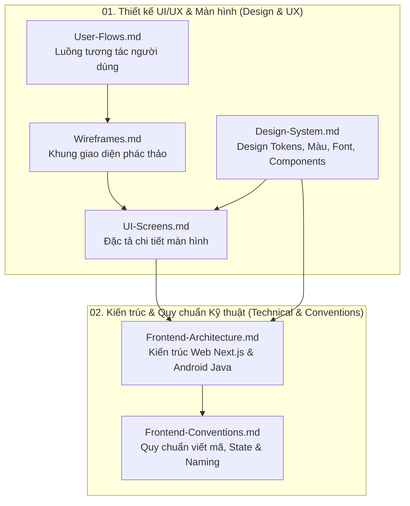

# Tài liệu Thiết kế & Kỹ thuật Frontend

## Hệ thống Quản lý Mượn Trả Thiết bị Học tập cho Sinh viên
> **Đồ án:** Phát triển phần mềm hướng đối tượng (SE100) — Nhóm 13  
> **Nền tảng hỗ trợ:**  
> - **Web (Quản trị viên & Nhân viên):** Next.js 14 (App Router), TypeScript, Tailwind CSS, shadcn/ui  
> - **Mobile (Sinh viên):** Android Native (Java), Material Design 3, Retrofit 2

---

## 1. Sơ đồ Cấu trúc & Mối quan hệ Tài liệu

Tài liệu frontend được phân chia thành 2 khu vực rõ ràng: **Thiết kế UI/UX & Giao diện** và **Kiến trúc Kỹ thuật & Quy chuẩn**:

---

## 2. Danh mục Tài liệu Chi tiết

| Thư mục | Tệp tài liệu | Nền tảng áp dụng | Mô tả tóm tắt | Phiên bản |
|---|---|---|---|---|
| **`01-design/`** | [User-Flows.md](01-design/User-Flows.md) | Web & Mobile | Sơ đồ luồng tương tác và kịch bản người dùng cho 19 use cases: đăng ký mượn, duyệt, bàn giao, kiểm tra trả, lập biên bản vi phạm và báo cáo thống kê. | v1.0 |
| | [Wireframes.md](01-design/Wireframes.md) | Web & Mobile | Bản vẽ khung phác thảo giao diện trực quan (ASCII & Layout specs) cho toàn bộ các màn hình trên cả hai nền tảng. | v1.0 |
| | [UI-Screens.md](01-design/UI-Screens.md) | Web & Mobile | Đặc tả giao diện chi tiết: danh sách trường nhập liệu, validation, trạng thái hiển thị, bảng dữ liệu và thông báo lỗi. | v1.0 |
| | [Design-System.md](01-design/Design-System.md) | Web & Mobile | Hệ thống thiết kế chuẩn hóa: bảng màu (Semantic colors), thang đo Typography, Spacing, Iconography, và hướng dẫn component dùng chung. | v1.0 |
| **`02-architecture/`** | [Frontend-Architecture.md](02-architecture/Frontend-Architecture.md) | Web & Mobile | Kiến trúc chi tiết 2 client: Next.js 14 App Router cho nhân viên/quản trị và ứng dụng Java native cho sinh viên; phân tầng, routing, auth lifecycle, caching và offline. | v1.0 |
| | [Frontend-Conventions.md](02-architecture/Frontend-Conventions.md) | Web & Mobile | Quy ước viết mã, cấu trúc thư mục dự án, quy tắc đặt tên, quản lý trạng thái (state management), gọi API và xử lý thông báo lỗi. | v1.0 |

---

## 3. Lộ trình Đọc Tài liệu theo Vai trò (Reading Roadmap)

### 3.1. Dành cho UI/UX Designer
1. Bắt đầu với [User-Flows.md](01-design/User-Flows.md) để nắm toàn bộ hành trình trải nghiệm của Sinh viên, Nhân viên và Quản trị viên.
2. Tham khảo [Wireframes.md](01-design/Wireframes.md) để đối chiếu layout bố cục tổng thể.
3. Đọc [Design-System.md](01-design/Design-System.md) để áp dụng chính xác các Design Token (màu sắc, typography, component spacing).
4. Xem chi tiết từng màn hình tại [UI-Screens.md](01-design/UI-Screens.md).

### 3.2. Dành cho Web Developer (Next.js - Nhân viên & Quản trị)
1. **Thiết kế & Giao diện:** Đọc [Design-System.md](01-design/Design-System.md) (mục Tailwind / CSS Tokens) và [UI-Screens.md](01-design/UI-Screens.md) (các màn hình Web mã hiệu W-xx).
2. **Kiến trúc Web:** Đọc [Frontend-Architecture.md](02-architecture/Frontend-Architecture.md) (mục Kiến trúc Next.js App Router, Server/Client Components, Route Groups).
3. **Quy chuẩn mã nguồn:** Đọc [Frontend-Conventions.md](02-architecture/Frontend-Conventions.md) để tuân thủ quy tắc tổ chức thư mục, naming conventions và hooks.
4. **Tích hợp API:** Đối chiếu với tài liệu Backend `backend/docs/04-api/API-Notes.md` và `openapi.yaml`.

### 3.3. Dành cho Mobile Developer (Android Java - Sinh viên)
1. **Thiết kế & Giao diện:** Đọc [Design-System.md](01-design/Design-System.md) (mục Android Material 3 tokens) và [UI-Screens.md](01-design/UI-Screens.md) (các màn hình Mobile mã hiệu M-xx).
2. **Kiến trúc Android:** Đọc [Frontend-Architecture.md](02-architecture/Frontend-Architecture.md) (mục Kiến trúc Android Java, MVVM, Room Database, Retrofit).
3. **Quy chuẩn mã nguồn:** Đọc [Frontend-Conventions.md](02-architecture/Frontend-Conventions.md) (mục chuẩn viết mã Java, package structure).
4. **Tích hợp API:** Đối chiếu với tài liệu Backend `backend/docs/04-api/API-Notes.md` và `openapi.yaml`.

### 3.4. Dành cho QA / Tester
1. Đọc [User-Flows.md](01-design/User-Flows.md) để thiết kế các kịch bản kiểm thử hành vi người dùng (End-to-End User Journeys).
2. Đọc [UI-Screens.md](01-design/UI-Screens.md) để kiểm tra tính chính xác của các validation rules, thông báo lỗi và trạng thái giao diện.

---

## 4. Bảng Ký hiệu & Mã hiệu Màn hình

- **`W-xx`**: Màn hình Web dành cho Nhân viên hoặc Quản trị viên (ví dụ: `W-01`, `W-02`...).
- **`M-xx`**: Màn hình Mobile dành cho Sinh viên (ví dụ: `M-01`, `M-02`...).
- **`[ĐX-FC-xx]`**: Các quyết định đề xuất bổ sung về quy chuẩn Frontend được tổng hợp trong [Frontend-Conventions.md](02-architecture/Frontend-Conventions.md) (ĐX-FC-01 đến ĐX-FC-18).

